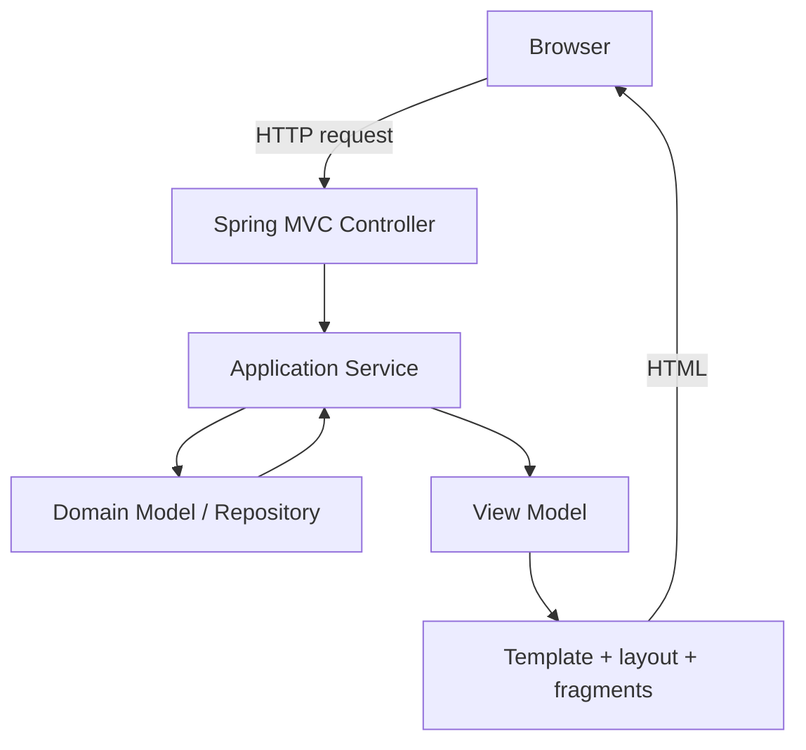
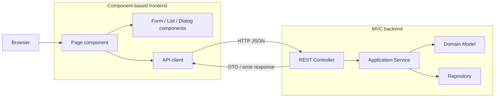
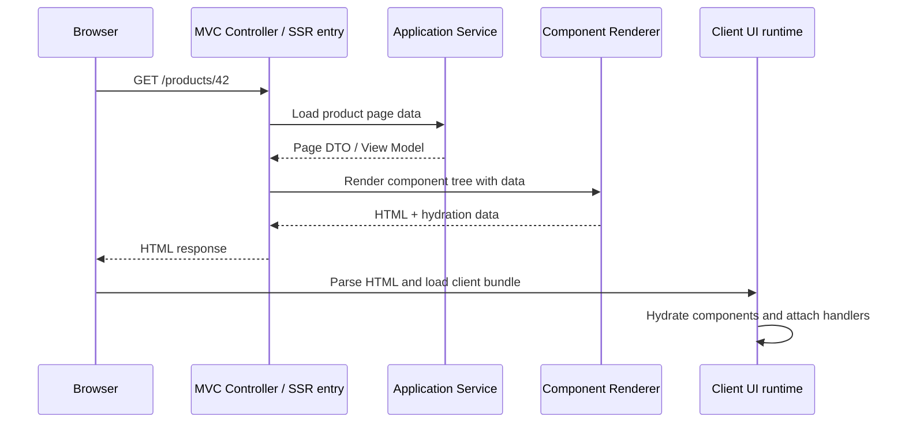
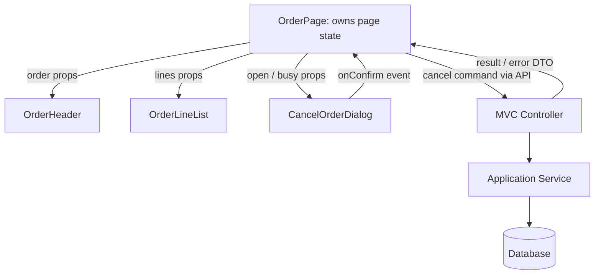

# Quan hệ giữa MVC và kiến trúc giao diện dựa trên thành phần

MVC (Model–View–Controller) và kiến trúc giao diện dựa trên thành phần (component-based UI architecture) giải quyết hai câu hỏi có liên quan nhưng ở hai cấp độ khác nhau. MVC tổ chức cách ứng dụng tiếp nhận request, điều phối nghiệp vụ và tạo phản hồi. Kiến trúc component tổ chức giao diện thành những khối nhỏ có trách nhiệm, dữ liệu đầu vào và cách tương tác rõ ràng. Một ứng dụng web có thể dùng MVC ở phía server và component ở phía trình duyệt cùng lúc.

Ví dụ, Spring MVC có thể nhận `POST /orders`, gọi application service và trả JSON hoặc HTML. Ở phía trình duyệt, React hoặc Vue có thể chia trang đặt hàng thành `OrderForm`, `AddressFields`, `OrderSummary` và `SubmitButton`. Controller phía server vẫn chịu trách nhiệm xác thực request, kiểm tra quyền và điều phối use case; các component phía client chịu trách nhiệm trình bày, quản lý trạng thái giao diện và phát sinh sự kiện tương tác.

Vì vậy, không nên xem một component là một Controller thu nhỏ hoặc cho rằng component tree thay thế toàn bộ MVC. Hai cách tổ chức có thể bổ sung cho nhau nếu hợp đồng dữ liệu, quyền sở hữu trạng thái và luồng sự kiện được xác định rõ.

## 1. Hai cách tổ chức ở hai cấp độ

### 1.1. MVC tổ chức luồng request và trách nhiệm ứng dụng

Trong một ứng dụng web theo MVC:

- **Model** biểu diễn trạng thái và quy tắc nghiệp vụ, thường được phối hợp bởi application service.
- **View** trình bày dữ liệu thành HTML hoặc một dạng phản hồi phù hợp.
- **Controller** nhận request, kiểm tra dữ liệu ở ranh giới, gọi use case và chọn phản hồi.

MVC giúp tách cách ứng dụng xử lý một thao tác khỏi cách thao tác đó được trình bày. Một use case có thể được gọi từ Controller HTML, Controller API hoặc một adapter khác mà không phải đưa logic nghiệp vụ vào View.

### 1.2. Component architecture tổ chức cây giao diện

Kiến trúc component chia UI thành các thành phần có thể kết hợp. Mỗi component thường có:

- Phần trình bày hoặc cấu trúc giao diện.
- Dữ liệu đầu vào, thường được gọi là props hoặc parameters.
- Trạng thái cục bộ nếu component cần quản lý tương tác riêng.
- Sự kiện hoặc callback để thông báo ý định của người dùng.
- Quy tắc vòng đời và cách kết hợp component con.

Ví dụ một trang chi tiết đơn hàng có thể được chia thành `OrderPage`, `OrderHeader`, `OrderStatusBadge`, `OrderLineList`, `ShippingAddressCard` và `CancelOrderDialog`. Mỗi component tập trung vào một vùng giao diện có ý nghĩa.

### 1.3. Không phải quan hệ một-một

| MVC | Component-based UI | Quan hệ thường gặp |
|---|---|---|
| Controller | Page/container component hoặc client-side controller | Có thể cùng điều phối một luồng giao diện, nhưng Controller server xử lý HTTP và quyền ở phía server |
| View | Cây component | Component tree là cách cấu tạo View; một View có thể gồm nhiều component |
| Model | Dữ liệu domain, application state hoặc client state | UI state có thể phản ánh một phần Model, nhưng không phải bản sao đáng tin cậy của domain |
| Application service | API client hoặc frontend service | Frontend service gọi endpoint; application service thực hiện use case phía server |
| View Model / DTO | Props và component data | DTO/View Model là hợp đồng dữ liệu; props là cách truyền dữ liệu trong cây component |

Một component có thể chứa markup, state và event handler nhưng không vì vậy mà trở thành toàn bộ MVC. Một frontend framework có thể cung cấp router, service, store hoặc dependency injection, song cách tổ chức cụ thể vẫn tùy kiến trúc ứng dụng. React chủ yếu cung cấp mô hình component và không áp đặt một kiến trúc MVC hoàn chỉnh.

## 2. Các kiểu kết hợp MVC và component UI

Có ba cách triển khai phổ biến. Việc lựa chọn phụ thuộc vào yêu cầu tương tác, SEO, độ phức tạp giao diện và năng lực vận hành.

### 2.1. MVC server-rendered với template fragment

Controller xử lý request và trả View Model. Template engine render HTML trên server. Layout, fragment, partial hoặc component template được dùng để tái sử dụng các phần giao diện.



Trong cách này, component thường là khối template được render cùng trang, ví dụ fragment thông báo, trường biểu mẫu hoặc phân trang. Tương tác thường dẫn đến một request mới, redirect hoặc một phần JavaScript bổ sung.

Ví dụ fragment Thymeleaf:

```html
<!-- fragments/status.html -->
<span th:fragment="badge(label, kind)"
      th:class="|status-badge status-badge--${kind}|"
      th:text="${label}">
  Đang xử lý
</span>
```

Trang sử dụng fragment:

```html
<td>
  <div th:replace="~{fragments/status :: badge(
      ${order.statusLabel}, ${order.statusStyle})}"></div>
</td>
```

`statusStyle` nên được ánh xạ từ một tập giá trị do ứng dụng kiểm soát, không lấy trực tiếp class CSS từ dữ liệu người dùng. Fragment nhận dữ liệu trình bày đã chuẩn bị trong View Model; nó không tự truy vấn database hoặc quyết định quyền nghiệp vụ.

**Phù hợp khi:** trang chủ yếu là nội dung và biểu mẫu, cần HTML từ server, luồng request/response đơn giản và tương tác phía client ở mức vừa phải.

### 2.2. MVC backend với SPA component-based frontend

Server cung cấp API. Controller nhận HTTP request, gọi application service và trả DTO/JSON. Frontend là một ứng dụng component riêng, quản lý cây giao diện, route phía client và trạng thái tương tác.



Ở đây có hai cây trách nhiệm:

- Cây component phía client điều phối trạng thái giao diện, hiển thị dữ liệu và phát sự kiện.
- Luồng MVC phía server xác thực, phân quyền, kiểm tra invariant, lưu dữ liệu và trả kết quả.

Component không được xem trạng thái client là nguồn dữ liệu đáng tin cậy. Ví dụ, việc nút “Hủy đơn” đang hiển thị không chứng minh người dùng có quyền hủy. Server phải kiểm tra lại quyền và trạng thái đơn trong request.

**Phù hợp khi:** giao diện có tương tác phong phú, nhiều vùng cập nhật độc lập, cần trải nghiệm gần ứng dụng desktop hoặc có nhiều màn hình dùng chung component.

### 2.3. MVC với server-side rendering và hydration

Một số ứng dụng render component thành HTML trên server trước, sau đó client hydrate để gắn event handler và tiếp tục tương tác. Backend có thể dùng MVC để định tuyến và cung cấp dữ liệu; framework UI đảm nhiệm render component ở server và client.



SSR có thể cải thiện thời gian hiển thị nội dung ban đầu và hỗ trợ crawler, nhưng làm tăng yêu cầu về môi trường render, đồng bộ dữ liệu giữa server/client và xử lý hydration. Cần tránh render ra markup khác nhau giữa hai môi trường do thời gian hiện tại, locale, random value hoặc dữ liệu không đồng nhất.

**Phù hợp khi:** cần HTML ban đầu có nội dung, SEO hoặc hiệu năng cảm nhận tốt, đồng thời vẫn cần tương tác component ở client.

## 3. Xác định ranh giới trách nhiệm

Khi MVC và component UI cùng tồn tại, cần xác định nơi mỗi quyết định được đưa ra.

| Trách nhiệm | Chủ sở hữu phù hợp | Ví dụ |
|---|---|---|
| Nhận HTTP request và xác thực đầu vào | Server Controller / web boundary | Bind JSON, path variable, form field |
| Quyền truy cập và invariant | Server security, application service, Model | Người dùng có được hủy đơn không? |
| Lấy và lưu dữ liệu | Application service và repository | Đọc đơn, cập nhật trạng thái |
| Hợp đồng dữ liệu qua mạng | API DTO / View Model | `OrderResponse`, `CancelOrderRequest` |
| Cấu trúc trang và thành phần hiển thị | UI component tree hoặc server template | Header, list, dialog, form field |
| Trạng thái tương tác tạm thời | Component hoặc state store phía client | Dialog đang mở, tab đang chọn |
| Trạng thái nghiệp vụ bền vững | Server Model và database | Trạng thái đơn hàng, số dư |
| Điều hướng | Server router, client router hoặc kết hợp | `/orders/42` |
| Thông báo lỗi | Server phát mã/kết quả; UI trình bày | Field error, global alert |

Quy tắc hữu ích là giữ quyết định có ảnh hưởng đến tính đúng đắn và bảo mật ở server. Component có thể ẩn nút, kiểm tra dữ liệu sơ bộ và cải thiện trải nghiệm, nhưng server vẫn là nơi xác nhận cuối cùng.

## 4. Luồng dữ liệu, props và sự kiện

Component tree thường truyền dữ liệu từ component cha xuống component con qua props, còn sự kiện từ component con được gửi lên cha qua callback hoặc event. Cách này tạo luồng dữ liệu dễ theo dõi.

Ví dụ:



Component con không cần biết repository, database hoặc cấu trúc entity. Nó nhận dữ liệu đã được chuẩn bị và phát sự kiện thể hiện ý định, ví dụ `onCancelRequested(orderId)`.

### 4.1. Ví dụ React component

```jsx
function CancelOrderButton({ disabled, onRequestCancel }) {
  return (
    <button
      type="button"
      disabled={disabled}
      onClick={onRequestCancel}
    >
      Hủy đơn
    </button>
  );
}

function OrderActions({ order, onCancel }) {
  const canOfferCancel = order.status === "PENDING";

  if (!canOfferCancel) return null;

  return (
    <CancelOrderButton
      disabled={order.cancelPending}
      onRequestCancel={() => onCancel(order.id)}
    />
  );
}
```

Ví dụ minh họa component trình bày. `canOfferCancel` chỉ quyết định có nên hiển thị hành động trong UI dựa trên dữ liệu server trả về. Endpoint hủy đơn vẫn phải xác thực danh tính, quyền sở hữu và trạng thái hiện tại; client không thể tự cấp quyền bằng cách thay đổi props.

### 4.2. Quyền sở hữu state

Không nên lưu cùng một trạng thái ở nhiều nơi mà không có quy tắc đồng bộ. Ví dụ, nếu `OrderPage` và `CancelOrderDialog` đều tự giữ một bản `order.status`, chúng có thể hiển thị khác nhau sau khi request hoàn tất.

Hãy xác định:

- State nào chỉ phục vụ một component, như dialog mở/đóng.
- State nào cần được chia sẻ trong một vùng UI, như bộ lọc và trang hiện tại.
- Server state nào cần tải lại hoặc cập nhật sau mutation.
- Dữ liệu nào chỉ là cache tạm và có thể bị stale.

Đưa state lên component cha gần nhất khi nhiều component cần dùng chung; dùng state store hoặc query cache khi phạm vi chia sẻ lớn và có nhu cầu rõ. Không sao chép toàn bộ domain model vào global client store nếu chỉ một màn hình cần một phần dữ liệu.

## 5. Kết nối API DTO với component props

API DTO là hợp đồng qua mạng giữa frontend và backend. Props là hợp đồng nội bộ giữa component cha và con. Hai loại hợp đồng này có thể liên quan nhưng không nên mặc định dùng chung một cấu trúc.

Ví dụ API trả:

```json
{
  "id": "42",
  "orderNumber": "ORD-1042",
  "status": "PENDING",
  "total": {
    "amount": "1250000.00",
    "currency": "VND"
  },
  "actions": {
    "cancelAllowed": true
  }
}
```

Frontend có thể ánh xạ thành props dành riêng cho giao diện:

```ts
type OrderSummaryProps = {
  numberLabel: string;
  statusText: string;
  formattedTotal: string;
  showCancelAction: boolean;
};
```

Mapper ở frontend có thể định dạng tiền và trạng thái theo locale. Nhưng trường `showCancelAction` chỉ là gợi ý trình bày. Server vẫn phải kiểm tra quyền và trạng thái khi nhận lệnh hủy.

### 5.1. Tránh truyền entity trực tiếp đến component

Entity ORM thường chứa quan hệ, trường nội bộ và chi tiết persistence. Trả entity trực tiếp qua API hoặc truyền sâu vào cây component làm giao diện phụ thuộc vào mô hình lưu trữ. Hãy dùng DTO/View Model với những trường cần thiết.

### 5.2. Định nghĩa null, loading và empty state

Component cần biết dữ liệu đang ở trạng thái nào. `null`, danh sách rỗng và dữ liệu chưa tải không nên bị coi là cùng một trường hợp.

Một state model rõ có thể là:

```ts
type LoadState<T> =
  | { status: "loading" }
  | { status: "success"; data: T }
  | { status: "empty" }
  | { status: "error"; code: string; message: string };
```

Với server-rendered MVC, các trạng thái tương tự có thể được biểu diễn qua View Model và template condition. Với SPA, component page thường điều phối state này và truyền trạng thái cần thiết xuống component con.

## 6. Biểu mẫu và validation qua hai kiến trúc

Biểu mẫu là nơi MVC và component UI phối hợp rõ nhất. Component quản lý tương tác như nhập liệu, hiển thị lỗi tức thời và trạng thái submit. Server Controller bind request, validation cấu trúc và application service kiểm tra quy tắc nghiệp vụ.

### 6.1. Client-side validation cải thiện trải nghiệm

Component có thể kiểm tra định dạng email, trường bắt buộc hoặc độ dài trước khi gửi request. Việc này giúp người dùng sửa lỗi nhanh mà không cần chờ round trip.

Tuy nhiên, validation phía client có thể bị bỏ qua hoặc sửa đổi. Server phải kiểm tra lại mọi dữ liệu và thực thi các quy tắc quan trọng. Không dùng kết quả validation trong component làm bằng chứng rằng request hợp lệ.

### 6.2. Server trả lỗi có cấu trúc

Một API có thể trả lỗi theo dạng:

```json
{
  "code": "VALIDATION_FAILED",
  "message": "Vui lòng kiểm tra lại thông tin.",
  "fieldErrors": [
    {
      "field": "shippingAddress",
      "code": "VALIDATION_REQUIRED",
      "message": "Địa chỉ giao hàng không được để trống."
    }
  ]
}
```

Component form có thể ánh xạ `fieldErrors` vào đúng trường và hiển thị `message`. Client nên dùng `code` ổn định để xử lý hành vi, không so sánh câu tiếng Việt. Với API đa ngôn ngữ, server có thể trả message đã dịch theo locale hoặc chỉ trả mã để frontend dùng message catalog; hợp đồng cần quy định rõ.

### 6.3. Trạng thái submit và request trùng

Khi người dùng nhấn submit, component có thể chuyển sang trạng thái `submitting`, khóa nút và hiển thị tiến trình. Khi thành công, page cập nhật dữ liệu hoặc điều hướng; khi lỗi, form giữ dữ liệu phù hợp và hiển thị lỗi.

Khóa nút chỉ giảm thao tác lặp từ giao diện. Server vẫn cần xử lý request lặp an toàn cho thao tác tạo đơn, thanh toán hoặc chuyển tiền, ví dụ bằng idempotency key và ràng buộc dữ liệu.

## 7. Điều hướng và phân chia route

Ứng dụng MVC server-rendered thường dùng route phía server: mỗi request điều hướng đến Controller và nhận HTML mới hoặc redirect. SPA thường dùng client router để thay đổi page component mà không tải lại toàn bộ document; API request vẫn đi đến Controller phía server.

| Khía cạnh | Server MVC | Component SPA |
|---|---|---|
| Điều hướng chính | HTTP request/redirect | Client router và history |
| Tải dữ liệu | Controller/query service trước khi render | Page component hoặc data loader gọi API |
| Back/forward | Browser điều hướng document hoặc URL | Router đồng bộ URL và UI state |
| 404 | Server Controller/error route | Client not-found route, đồng thời API vẫn có 404 riêng |
| Quyền truy cập | Server kiểm tra mỗi request | UI có thể ẩn route/action; server vẫn kiểm tra quyền |

Với ứng dụng kết hợp, cần thống nhất URL và trách nhiệm route. Một route có thể do server trả HTML shell, trong khi client router xử lý các route con; API route cần namespace hoặc quy ước riêng để tránh xung đột.

## 8. Bảo mật khi component gọi MVC backend

Component architecture không làm thay đổi trách nhiệm bảo mật phía server.

- Không tin `userId`, `role`, `ownerId`, giá hoặc trạng thái do client gửi lên nếu server phải xác định các giá trị đó.
- Kiểm tra authorization trong server cho từng thao tác và tài nguyên.
- Với cookie-based authentication, bảo vệ request thay đổi trạng thái bằng CSRF token theo cấu hình bảo mật.
- Cấu hình CORS theo origin cần thiết; CORS không thay thế authorization.
- Escape nội dung không tin cậy khi render HTML; không dùng cơ chế render raw HTML nếu chưa sanitize đáng tin cậy.
- Không đưa secret hoặc access token vào bundle frontend; mọi dữ liệu trong browser đều có thể bị người dùng kiểm tra.
- Không cache response cá nhân bằng key dùng chung giữa người dùng hoặc tenant.

Ẩn một component hoặc nút hành động chỉ là quyết định giao diện. Người dùng vẫn có thể gọi endpoint trực tiếp bằng công cụ khác. Server phải từ chối request không được phép dù UI không hiển thị nút đó.

## 9. Kiểm thử component và MVC theo từng ranh giới

Kiểm thử nên xác minh component và MVC backend ở tầng phù hợp.

| Tầng | Mục tiêu | Ví dụ |
|---|---|---|
| Component unit test | Props, event và trạng thái cục bộ | Nút gọi `onCancel` khi được nhấn; dialog đóng khi xác nhận thành công |
| Component integration test | Nhiều component phối hợp | Form hiển thị lỗi server ở đúng field |
| MVC slice test | Controller, binding, validation, status và DTO | `MockMvc` xác minh request sai trả 400/422 |
| Service/domain test | Invariant và quyền nghiệp vụ | Đơn đã giao không thể hủy |
| API integration test | Hợp đồng JSON và persistence | Response sau khi lưu có trạng thái đúng |
| E2E test | Luồng người dùng qua browser và server | Mở đơn, nhấn hủy, xác nhận và thấy trạng thái cập nhật |

### 9.1. Kiểm thử props và event

Component con nên được test bằng dữ liệu đầu vào cụ thể. Kiểm tra nội dung, trạng thái disabled và callback được gọi khi người dùng tương tác. Tránh test chi tiết implementation như tên hook hoặc cấu trúc state nội bộ nếu không thuộc hợp đồng component.

### 9.2. Kiểm thử tích hợp form

Có thể mock API client để trả lỗi `VALIDATION_FAILED`, sau đó xác minh form hiển thị lỗi ở trường tương ứng. Một test backend riêng dùng `MockMvc` xác minh Controller thực sự trả mã và cấu trúc lỗi đúng. Hai test này kiểm tra hai phía của cùng hợp đồng.

### 9.3. Kiểm thử authorization ở server

Test E2E có thể xác minh nút không xuất hiện với người dùng không có quyền, nhưng cần có test API gửi request trực tiếp và xác minh server trả 403 hoặc 404 theo chính sách. Không kết luận endpoint an toàn chỉ từ component UI.

## 10. Tổ chức mã nguồn khi kết hợp MVC và component

Với server MVC dùng template, có thể tổ chức View theo layout, fragment và feature:

```text
src/main/
├── java/com/example/orders/
│   ├── web/OrderController.java
│   ├── application/OrderQueryService.java
│   └── domain/Order.java
└── resources/templates/
    ├── layout/main.html
    ├── fragments/
    │   ├── alert.html
    │   └── pagination.html
    └── orders/
        ├── list.html
        └── detail.html
```

Với frontend component riêng, có thể nhóm theo feature:

```text
src/
├── app/
│   ├── router/
│   └── providers/
├── features/orders/
│   ├── api/ordersApi.ts
│   ├── pages/OrderDetailPage.tsx
│   ├── components/OrderSummary.tsx
│   ├── components/CancelOrderDialog.tsx
│   └── model/orderTypes.ts
└── shared/ui/
    ├── Button.tsx
    ├── Dialog.tsx
    └── FieldError.tsx
```

Đây là hai cấu trúc minh họa cho hai phần triển khai khác nhau. Không cần ép chúng vào cùng một cây thư mục nếu server và frontend được quản lý như hai dự án độc lập. Điều quan trọng là hợp đồng API được quản lý rõ và component không phụ thuộc vào lớp persistence của backend.

### 10.1. Shared UI và feature component

`shared/ui` phù hợp với component tổng quát như Button, Dialog hoặc TextField, không chứa quy tắc riêng của đơn hàng. Component theo feature như `CancelOrderDialog` có thể hiểu trạng thái và ngôn ngữ của nghiệp vụ đơn hàng nhưng vẫn gọi callback hoặc API client qua ranh giới đã xác định.

Không đưa logic nghiệp vụ quan trọng vào thư viện component dùng chung. Một `Button` không nên quyết định người dùng có được hủy đơn; nó chỉ hiển thị trạng thái disabled và phát sự kiện theo props.

## 11. Hiệu năng và khả năng bảo trì

Component giúp tái sử dụng nhưng quá nhiều component nhỏ hoặc state phân tán có thể làm cây UI khó hiểu. MVC server-rendered có thể giảm JavaScript phía client nhưng render lại toàn trang cho một số tương tác. SPA giảm tải document navigation nhưng phải quản lý bundle, API calls, cache và đồng bộ state.

Một số tiêu chí cần cân nhắc:

- **Kích thước bundle:** chỉ tải code cần thiết, chia route hoặc lazy load component khi có lợi.
- **Số lần render:** tránh state thay đổi không cần thiết và component tree cập nhật quá rộng.
- **Số request API:** gộp dữ liệu phù hợp, tránh mỗi component tự gọi cùng endpoint.
- **Cache server state:** xác định thời hạn và invalidation; không coi cache client là dữ liệu có thẩm quyền.
- **SSR/hydration:** bảo đảm dữ liệu và markup ban đầu nhất quán giữa server và client.
- **Độ phức tạp triển khai:** cân nhắc hai runtime, build pipeline, routing và logging khi tách frontend/backend.

Đừng chuyển sang SPA chỉ vì component có vẻ hiện đại hơn. Nếu trang chủ yếu là biểu mẫu và nội dung, server-rendered MVC với fragment có thể đơn giản hơn. Nếu UI có nhiều tương tác độc lập và trạng thái phức tạp, component frontend riêng có thể mang lại lợi ích đáng kể.

## 12. Những sai lầm thường gặp

**Coi component là Controller.** Component thường quản lý tương tác giao diện; server Controller tiếp nhận HTTP và gọi use case. Trộn hai khái niệm làm ranh giới bảo mật và nghiệp vụ không rõ.

**Đưa toàn bộ nghiệp vụ vào component.** UI có thể kiểm tra sơ bộ, nhưng quy tắc có ảnh hưởng đến dữ liệu phải được thực thi ở server Model/application service.

**Đưa entity ORM trực tiếp vào component hoặc JSON response.** Giao diện bị ràng buộc với persistence và có thể nhận dữ liệu thừa. Dùng DTO/View Model.

**Để component con tự gọi nhiều API không kiểm soát.** Component khó tái sử dụng và dễ tạo request trùng. Xác định data owner ở page/container hoặc query layer.

**Chia component quá nhỏ.** Cây component sâu và nhiều props làm luồng dữ liệu khó theo dõi. Trích xuất theo ý nghĩa và hợp đồng thực tế.

**Sao chép cùng state ở nhiều component.** Các vùng UI có thể hiển thị khác nhau. Xác định một nơi sở hữu state và truyền dữ liệu xuống.

**Tin rằng ẩn nút đồng nghĩa có quyền.** Endpoint vẫn có thể được gọi trực tiếp. Server phải kiểm tra authorization mỗi lần.

**Dùng một DTO cho API, domain và props.** Các lớp có vòng đời và nhu cầu khác nhau. Chỉ chia sẻ cấu trúc khi hợp đồng thực sự giống nhau và có chủ sở hữu rõ.

**Bỏ qua lỗi mạng và trạng thái bất đồng bộ.** Component chỉ có success path sẽ không thể giải thích timeout, retry hoặc validation error. Mô hình hóa loading, empty, success và error.

**Chọn SPA dù không cần tương tác phức tạp.** Frontend riêng làm tăng công việc routing, state, build, bảo mật và vận hành. Chọn mô hình theo yêu cầu thực tế.

## 13. Cách chọn mô hình phù hợp

| Nhu cầu | Hướng triển khai thường phù hợp |
|---|---|
| Trang nội dung, biểu mẫu và điều hướng đơn giản | Server MVC với template và fragment |
| Nhiều vùng UI cập nhật độc lập, tương tác phong phú | MVC backend + SPA component frontend |
| Cần HTML ban đầu, SEO và tương tác sau khi tải | MVC/API kết hợp SSR và hydration |
| Nhiều client như web, mobile và tích hợp đối tác | MVC/API backend với DTO ổn định; mỗi client có UI riêng |
| Nhóm nhỏ, sản phẩm còn đơn giản | Ưu tiên kiến trúc ít thành phần vận hành và dễ triển khai |

Không có mô hình đúng cho mọi ứng dụng. Có thể bắt đầu bằng server MVC và chỉ đưa một vùng giao diện thành component tương tác khi nhu cầu xuất hiện. Cũng có thể dùng SPA ngay nếu yêu cầu sản phẩm đòi hỏi trạng thái client phong phú. Hãy giữ hợp đồng server rõ ràng để có thể thay đổi cách trình bày mà không phải viết lại nghiệp vụ.

## 14. Checklist thiết kế MVC kết hợp component UI

Khi thiết kế một màn hình hoặc feature, hãy tự hỏi:

1. MVC đang chịu trách nhiệm nào ở phía server và component tree chịu trách nhiệm nào ở phía client?
2. Component có đại diện cho một khối giao diện có ý nghĩa và có đầu vào rõ ràng không?
3. Component cha nào sở hữu state dùng chung và server state?
4. Dữ liệu truyền qua API có DTO/View Model ổn định, không lộ entity nội bộ không?
5. Component chỉ phát ý định hay đang tự thực hiện quy tắc nghiệp vụ quan trọng?
6. Validation client có được kiểm tra lại ở server không?
7. Server có xác thực danh tính, quyền và invariant cho từng thao tác không?
8. Loading, empty, success, validation error, business error và network error có được mô hình hóa không?
9. API error code và message có đủ rõ để component ánh xạ vào UI không?
10. Route server và client có quy ước rõ, không xung đột không?
11. CSRF, CORS, output escaping và cache dữ liệu cá nhân đã được xử lý đúng không?
12. Có test cho component, MVC controller, API contract và luồng E2E quan trọng không?
13. SSR/hydration hoặc SPA có mang lại lợi ích đủ lớn so với chi phí vận hành không?

## Kết luận

MVC và kiến trúc giao diện dựa trên thành phần có thể bổ sung cho nhau vì chúng tổ chức hai cấp độ khác nhau. MVC phân chia trách nhiệm xử lý request, nghiệp vụ và phản hồi; component architecture chia View thành các khối có dữ liệu đầu vào, state và sự kiện rõ ràng. Với server-rendered MVC, layout và fragment là cách tái sử dụng phần giao diện; với SPA, component tree gọi API do MVC backend cung cấp; với SSR, component có thể được render trên server rồi hydrate ở client. Dù chọn cách nào, server vẫn phải sở hữu quyết định nghiệp vụ và bảo mật, còn component tập trung vào trình bày và tương tác. Hợp đồng DTO, quyền sở hữu state, luồng sự kiện và kiểm thử theo từng ranh giới giúp hai kiến trúc phối hợp mà không làm mờ trách nhiệm.
