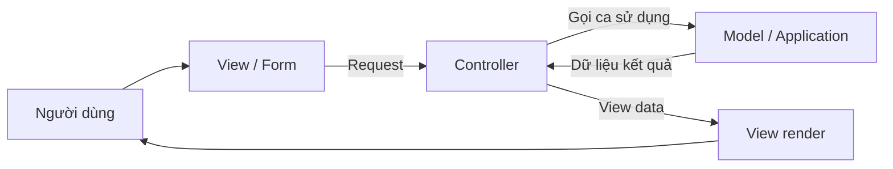
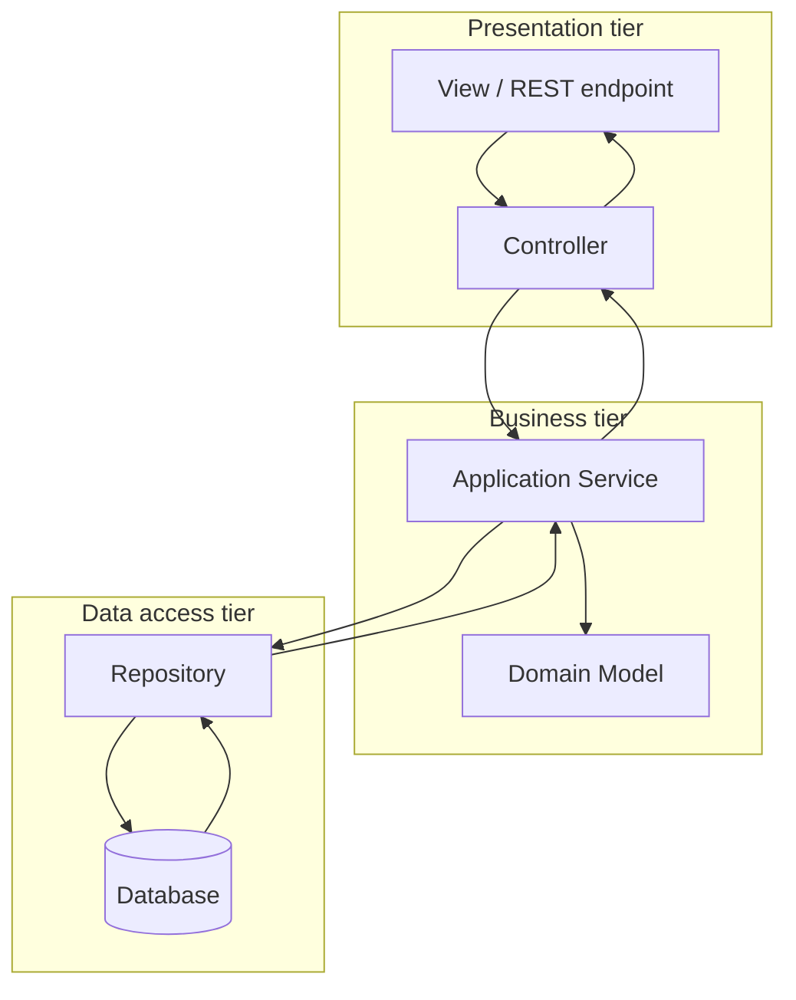
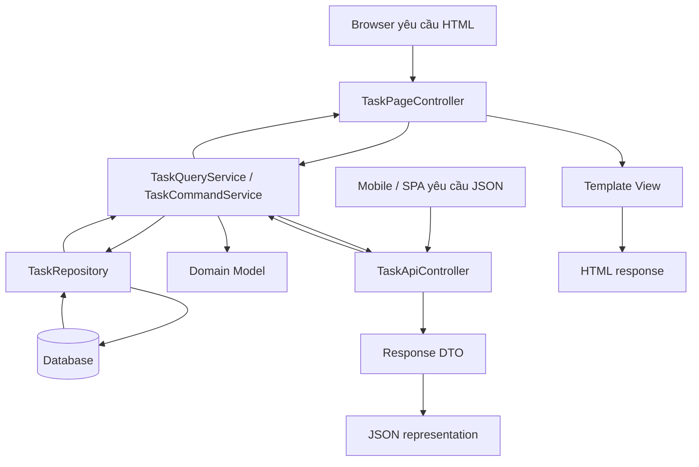

# Phân biệt MVC, mô hình ba tầng và REST

Khi thiết kế một ứng dụng web, các thuật ngữ **MVC**, **mô hình ba tầng** và **REST** thường xuất hiện cùng nhau. Chúng dễ bị xem như ba kiến trúc thay thế nhau, nhưng thực tế mô tả những khía cạnh khác nhau của hệ thống.

- **MVC (Model–View–Controller)** là mẫu tổ chức phần trình bày và tương tác: tách trạng thái/mô hình, cách hiển thị và thành phần tiếp nhận điều khiển.
- **Mô hình ba tầng (three-tier architecture)** là cách phân chia trách nhiệm lớn của ứng dụng thành tầng trình bày, tầng nghiệp vụ và tầng dữ liệu.
- **REST (Representational State Transfer)** là phong cách kiến trúc cho hệ thống phân tán, tổ chức giao tiếp quanh tài nguyên và các ràng buộc của một giao diện thống nhất.

Một ứng dụng có thể dùng cả ba: MVC trong tầng trình bày, mô hình ba tầng để phân chia toàn hệ thống, và REST để cung cấp API cho trình duyệt hoặc ứng dụng di động. Muốn chọn đúng cách tổ chức, trước hết cần biết mỗi khái niệm giải quyết câu hỏi nào.

## 1. Ba khái niệm trả lời ba câu hỏi khác nhau

Hãy xét một ứng dụng quản lý công việc. Người dùng mở danh sách công việc, tạo công việc mới và đánh dấu một công việc đã hoàn thành. Ứng dụng có giao diện HTML, API JSON và cơ sở dữ liệu.

| Khái niệm | Câu hỏi chính | Trọng tâm | Ví dụ trong ứng dụng công việc |
|---|---|---|---|
| MVC | Ai tiếp nhận tương tác và ai quyết định cách trình bày? | Tách Model, View và Controller | `TaskController`, `TaskListView`, dữ liệu `Task` hoặc `TaskListViewModel` |
| Ba tầng | Trách nhiệm ứng dụng được chia thành những phần lớn nào? | Presentation, Business, Data Access | Web layer, application/domain layer, repository/database layer |
| REST | Các client và server giao tiếp qua hợp đồng nào? | Tài nguyên, biểu diễn, method, trạng thái và ràng buộc giao tiếp | `GET /api/tasks/42`, `PATCH /api/tasks/42` |

Ba khái niệm không nằm trên cùng một trục. MVC tổ chức một phần của ứng dụng; ba tầng tổ chức các trách nhiệm xuyên suốt ứng dụng; REST định hình cách các thành phần độc lập giao tiếp qua mạng.

## 2. MVC: tách mô hình, cách hiển thị và điều khiển

MVC phân tách ba vai trò trong luồng tương tác:

- **Model:** biểu diễn trạng thái và quy tắc liên quan đến dữ liệu mà ứng dụng làm việc. Tùy thiết kế, Model có thể gồm domain model, application model, dữ liệu truy vấn hoặc view model. Model không đồng nghĩa với một bảng database.
- **View:** trình bày thông tin cho người dùng hoặc client. Trong ứng dụng server-rendered, View thường là template HTML. Trong một số biến thể, View có thể là thành phần giao diện phía client.
- **Controller:** tiếp nhận hành động hoặc request, chuyển dữ liệu đầu vào cho phần xử lý phù hợp và chọn kết quả trình bày.

Luồng cơ bản của một trang HTML:



Ví dụ với Spring MVC:

```java
@Controller
@RequestMapping("/tasks")
public class TaskPageController {
    private final TaskQueryService taskQueryService;

    public TaskPageController(TaskQueryService taskQueryService) {
        this.taskQueryService = taskQueryService;
    }

    @GetMapping
    public String list(Model model) {
        model.addAttribute("tasks", taskQueryService.getTaskList());
        return "tasks/list";
    }
}
```

Controller nhận request `GET /tasks`, lấy dữ liệu cần hiển thị và trả tên template `tasks/list`. View engine render HTML. `org.springframework.ui.Model` ở đây là vùng chứa thuộc tính dành cho View; nó không phải domain model và cũng không phải persistence entity.

MVC không yêu cầu mọi ứng dụng phải render HTML trên server. Một controller có thể trả JSON thay vì tên View. Spring `@RestController` vẫn dùng hạ tầng điều phối request của Spring MVC, nhưng response body được chuyển đổi bằng `HttpMessageConverter`.

## 3. Mô hình ba tầng: chia trách nhiệm của toàn ứng dụng

Mô hình ba tầng thường chia ứng dụng thành:

1. **Presentation tier:** nhận tương tác, kiểm tra dữ liệu giao tiếp và trình bày kết quả.
2. **Business tier:** thực hiện use case, quy tắc nghiệp vụ và điều phối Model.
3. **Data access tier:** truy cập, truy vấn và lưu trữ dữ liệu qua repository hoặc data access component.



Ví dụ cấu trúc package:

```text
com.example.tasks
  web/
    TaskPageController.java
    TaskApiController.java
    form/
    response/
  application/
    TaskCommandService.java
    TaskQueryService.java
  domain/
    Task.java
    TaskStatus.java
    TaskPolicy.java
  infrastructure/
    persistence/
      TaskEntity.java
      SpringDataTaskRepository.java
```

Đây là một cách bố trí minh họa. Dự án có thể tổ chức theo feature hoặc bounded context, nhưng vẫn giữ ranh giới trách nhiệm tương tự.

Presentation không nên chứa quy tắc nghiệp vụ quan trọng; business tier không nên phụ thuộc trực tiếp vào Servlet API hoặc template engine; data access không nên quyết định thông điệp giao diện. Ranh giới rõ giúp thay đổi giao diện, database hoặc cách giao tiếp mà không buộc toàn bộ ứng dụng thay đổi theo.

### Layer và tier có thể được dùng với nghĩa khác nhau

Trong thực tế, hai từ *layer* và *tier* đôi khi được dùng thay thế trong tài liệu. Một phân biệt hữu ích là:

- **Layer** thường chỉ ranh giới logic và trách nhiệm trong mã nguồn.
- **Tier** theo nghĩa triển khai chặt chẽ chỉ một phần được triển khai hoặc vận hành riêng, có thể ở tiến trình hay máy chủ khác.

Ví dụ, presentation, business và data access có thể là ba layer trong cùng một ứng dụng Spring Boot chạy một tiến trình. Chúng chưa nhất thiết là ba physical tier. Nếu web server, application server và database được triển khai riêng, ta có thể nói đến ba tier triển khai. Khi đọc tài liệu kiến trúc, cần xem tác giả đang nói về phân lớp logic hay topology triển khai.

## 4. REST: phong cách kiến trúc cho giao tiếp qua mạng

REST được Roy Fielding mô tả như một phong cách kiến trúc cho hệ thống phân tán. REST tập trung vào tài nguyên và cách client thao tác với biểu diễn của tài nguyên qua một giao diện thống nhất.

Ví dụ tài nguyên trong ứng dụng công việc:

- Collection công việc: `/api/tasks`
- Một công việc: `/api/tasks/42`
- Bình luận của công việc: `/api/tasks/42/comments`

Client không cần biết server dùng bao nhiêu lớp Java, repository nào hay database gì. Client tương tác qua hợp đồng giao tiếp được công bố.

REST có các ràng buộc kiến trúc chính:

1. **Client–server:** tách trách nhiệm giao diện client khỏi lưu trữ và xử lý phía server.
2. **Stateless:** mỗi request mang đủ thông tin cần để server hiểu và xử lý; server không dựa vào trạng thái phiên giao tiếp ẩn để diễn giải request tiếp theo. Điều này không có nghĩa ứng dụng không lưu dữ liệu nghiệp vụ hoặc không có tài khoản người dùng.
3. **Cacheable:** response chỉ rõ có thể cache hay không và trong phạm vi nào.
4. **Uniform interface:** client và server giao tiếp qua một giao diện thống nhất, gồm định danh tài nguyên, thao tác qua representation, thông điệp tự mô tả và hypermedia làm phương tiện điều khiển trạng thái ứng dụng.
5. **Layered system:** client không cần biết nó đang kết nối trực tiếp server gốc hay qua gateway, proxy hoặc tầng trung gian.
6. **Code-on-demand (tùy chọn):** server có thể cung cấp code để client thực thi, chẳng hạn script; đây là ràng buộc tùy chọn.

Một API dùng JSON qua HTTP thường được gọi là REST API, nhưng dùng JSON và HTTP chưa đủ để tự động thỏa mọi ràng buộc REST. Đặc biệt, hypermedia và giao diện thống nhất thường bị giản lược trong các API thực tế. Khi thiết kế, nên mô tả chính xác mức độ tuân thủ thay vì chỉ dựa vào tên gọi.

REST là phong cách kiến trúc, không phải tên của một giao thức cụ thể. HTTP là cách triển khai phổ biến vì có sẵn method, status, header, cache và cơ chế định danh tài nguyên bằng URI. Một representation có thể cung cấp liên kết để client khám phá hành động tiếp theo thay vì phải tự ghép URL theo quy ước riêng:

```json
{
  "id": 42,
  "title": "Chuẩn bị báo cáo",
  "status": "OPEN",
  "_links": {
    "self": { "href": "/api/tasks/42" },
    "project": { "href": "/api/projects/7" },
    "complete": { "href": "/api/tasks/42/complete", "method": "POST" }
  }
}
```

Đây là ví dụ representation có liên kết theo hướng hypermedia; trường `method` là quy ước bổ sung của ví dụ, không phải một cấu trúc bắt buộc chung cho mọi định dạng. Khi trạng thái tài nguyên thay đổi, server có thể cung cấp tập liên kết phù hợp với hành động hiện được phép.

## 5. REST sử dụng HTTP method và resource representation

Một API theo phong cách REST thường đặt tên URL theo tài nguyên và dùng method để thể hiện loại thao tác.

| Request | Ý nghĩa thường dùng | Ví dụ |
|---|---|---|
| `GET /api/tasks` | Đọc danh sách công việc | Trả collection hoặc trang kết quả |
| `GET /api/tasks/42` | Đọc một công việc | Trả representation của task 42 |
| `POST /api/tasks` | Tạo tài nguyên hoặc xử lý một command trên collection | Trả `201 Created` và `Location` khi tạo thành công |
| `PUT /api/tasks/42` | Thay thế representation có thể chỉnh sửa của tài nguyên | Client gửi trạng thái biểu diễn đầy đủ theo hợp đồng |
| `PATCH /api/tasks/42` | Cập nhật một phần tài nguyên | Chỉ gửi trường cần thay đổi theo patch semantics đã định nghĩa |
| `DELETE /api/tasks/42` | Yêu cầu xóa tài nguyên | Trả status phù hợp với kết quả xóa |

Ví dụ response tạo mới:

```http
POST /api/tasks
Content-Type: application/json

{
  "title": "Chuẩn bị báo cáo",
  "description": "Tổng hợp số liệu tháng"
}
```

```http
HTTP/1.1 201 Created
Location: /api/tasks/42
Content-Type: application/json

{
  "id": 42,
  "title": "Chuẩn bị báo cáo",
  "description": "Tổng hợp số liệu tháng",
  "status": "OPEN"
}
```

Response là một representation của tài nguyên, không nhất thiết là bản sao entity database. Nó có thể bỏ trường nội bộ, đổi tên thuộc tính, tổng hợp dữ liệu hoặc bổ sung liên kết mà client được phép sử dụng.

### Không đồng nhất REST với RPC

Một API kiểu RPC thường đặt tên endpoint theo hành động, ví dụ:

```http
POST /api/completeTask
```

Thiết kế theo resource có thể biểu đạt thao tác cập nhật trạng thái bằng `PATCH /api/tasks/42` với representation phù hợp, hoặc dùng một resource trạng thái/hành động được mô hình hóa rõ. Trong thực tế, endpoint hành động như `/api/tasks/42/complete` vẫn có thể là lựa chọn thực dụng khi hành động có quy tắc riêng; điều quan trọng là hợp đồng và semantics được xác định rõ. Không nên chỉ đổi tên URL thành danh từ rồi kết luận API đã RESTful.

## 6. MVC và REST kết hợp trong cùng một ứng dụng

Spring MVC cho phép cùng một ứng dụng cung cấp trang HTML cho trình duyệt và API JSON cho SPA hoặc ứng dụng di động. Cả hai có thể dùng chung application service và domain model.



Ví dụ Controller cho HTML:

```java
@Controller
@RequestMapping("/tasks")
public class TaskPageController {
    private final TaskQueryService queryService;

    public TaskPageController(TaskQueryService queryService) {
        this.queryService = queryService;
    }

    @GetMapping("/{id}")
    public String detail(@PathVariable long id, Model model) {
        model.addAttribute("task", queryService.getDetail(id));
        return "tasks/detail";
    }
}
```

Ví dụ Controller cho REST API:

```java
@RestController
@RequestMapping("/api/tasks")
public class TaskApiController {
    private final TaskQueryService queryService;

    public TaskApiController(TaskQueryService queryService) {
        this.queryService = queryService;
    }

    @GetMapping("/{id}")
    public TaskResponse detail(@PathVariable long id) {
        return queryService.getResponse(id);
    }
}
```

Hai Controller khác nhau ở cách tiếp nhận và biểu diễn response. Service có thể được dùng chung vì quy tắc nghiệp vụ không nên phụ thuộc vào việc client nhận HTML hay JSON.

## 7. `@Controller` và `@RestController` khác nhau ở kết quả trình bày

Trong Spring MVC:

- `@Controller` thường trả tên View hoặc `ModelAndView`; framework dùng `ViewResolver` để tìm template và render response.
- `@RestController` tương đương `@Controller` kết hợp `@ResponseBody` ở cấp lớp; giá trị trả về được ghi vào response body qua `HttpMessageConverter`.

Ví dụ:

```java
@Controller
class TaskPageController {
    @GetMapping("/tasks")
    String list(Model model) {
        model.addAttribute("tasks", taskQueryService.getTaskList());
        return "tasks/list";
    }
}
```

```java
@RestController
class TaskApiController {
    @GetMapping("/api/tasks")
    List<TaskResponse> list() {
        return taskQueryService.getTaskResponses();
    }
}
```

Cả hai vẫn đi qua `DispatcherServlet`, `HandlerMapping`, `HandlerAdapter` và các cơ chế xử lý tham số của Spring MVC. Khác biệt nằm ở cách framework diễn giải return value và tạo response.

REST không bắt buộc phải dùng Spring MVC. Có thể triển khai API REST bằng framework khác hoặc công nghệ khác. Ngược lại, Spring MVC có thể phục vụ trang HTML, API theo phong cách RPC hoặc endpoint nội bộ không nhằm tuân thủ REST đầy đủ.

## 8. Ba tầng có thể chứa MVC ở đâu?

Trong ứng dụng ba tầng, MVC thường nằm chủ yếu trong presentation tier:

| Thành phần | Tầng thường thuộc về | Vai trò |
|---|---|---|
| HTML template / frontend view | Presentation | Hiển thị dữ liệu và nhận tương tác |
| Spring MVC Controller | Presentation | Tiếp nhận HTTP request và chọn response |
| Request DTO / Form object | Presentation boundary | Mô tả hợp đồng dữ liệu nhập |
| Application Service | Business | Điều phối use case |
| Domain Model | Business | Bảo vệ quy tắc và trạng thái nghiệp vụ |
| Repository interface/implementation | Data access hoặc ranh giới domain tùy cách tổ chức | Đọc và ghi dữ liệu |
| Database | Data tier | Lưu trữ bền vững |

Ranh giới cụ thể có thể khác theo kiến trúc. Ví dụ trong Hexagonal Architecture, repository interface có thể thuộc core/application domain, còn implementation nằm ở infrastructure. Bảng trên mô tả cách chia phổ biến trong ứng dụng ba tầng, không phải quy tắc đặt package bắt buộc.

### Model trong MVC không đồng nghĩa với Business tier

Đây là một nhầm lẫn thường gặp. Từ “Model” trong MVC có phạm vi linh hoạt: có thể là dữ liệu mà View sử dụng, domain model, hoặc một tập hợp đối tượng phối hợp. Business tier lại là một vùng trách nhiệm lớn, thường bao gồm application service, domain model, policy và các thành phần nghiệp vụ khác.

Vì vậy, không nên suy luận rằng toàn bộ Business tier chỉ là một class `Model`, hoặc mọi đối tượng được đặt tên `Model` đều chứa quy tắc nghiệp vụ.

### Controller không phải toàn bộ Business tier

Controller nên điều phối request và response ở ranh giới web. Nếu Controller tự tính phí, kiểm tra quy tắc chuyển trạng thái, truy vấn nhiều repository và gửi email, nó đang gánh trách nhiệm của Business tier. Hãy chuyển các use case vào Service/Model để chúng có thể được gọi từ HTML Controller, REST Controller, job nền hoặc message consumer.

## 9. Phân biệt ba khái niệm qua cùng một hành động

Giả sử người dùng muốn hoàn thành công việc số 42.

**Theo góc nhìn MVC:** Controller nhận thao tác, gọi use case và chọn trang chi tiết hoặc response để trình bày trạng thái mới.

**Theo góc nhìn ba tầng:** request đi vào presentation tier; business tier kiểm tra công việc có được phép hoàn thành hay không; data access tier lưu trạng thái mới.

**Theo góc nhìn REST:** client gửi request theo hợp đồng tài nguyên, ví dụ:

```http
PATCH /api/tasks/42
Content-Type: application/merge-patch+json

{"status":"COMPLETED"}
```

Hoặc API có thể định nghĩa command riêng:

```http
POST /api/tasks/42/complete
```

Server kiểm tra quyền và quy tắc chuyển trạng thái trước khi cập nhật. Client không được phép bỏ qua quy tắc chỉ bằng cách gửi một giá trị trạng thái tùy ý.

Ba cách nhìn có thể mô tả cùng một request mà không mâu thuẫn: MVC nói về thành phần web; ba tầng nói về nơi trách nhiệm được thực hiện; REST nói về hợp đồng giao tiếp giữa client và server.

## 10. Các tổ hợp kiến trúc thường gặp

| Tổ hợp | Ví dụ | Khi phù hợp |
|---|---|---|
| MVC + ba tầng, không cung cấp REST API | Ứng dụng server-rendered dùng form và template | Hệ thống nội bộ hoặc website chủ yếu phục vụ HTML |
| MVC + ba tầng + REST API | Spring Boot có HTML Controller và REST Controller dùng chung Service | Cần web, mobile hoặc tích hợp đối tác |
| REST + ba tầng, không dùng MVC framework | API được xây dựng bằng handler/router đơn giản | Backend API không cần mẫu MVC cụ thể |
| MVC trong presentation của hệ thống nhiều tầng | Web tier gọi application tier và data tier tách biệt | Hệ thống lớn cần mở rộng hoặc cô lập triển khai |
| MVC ở frontend và REST ở backend | SPA có component/view/controller phía client gọi REST API | Giao diện tương tác phong phú và backend độc lập |

MVC không yêu cầu phải có ba tầng. Ba tầng không yêu cầu phải dùng MVC. REST cũng không yêu cầu mô hình ba tầng, dù nhiều hệ thống dùng chúng cùng nhau.

## 11. REST client–server không đồng nghĩa với triển khai ba tầng

Một client gọi REST API thường giao tiếp với server qua mạng. Điều đó không có nghĩa backend tự động là một kiến trúc ba tầng.

Ví dụ một REST server có thể là ứng dụng đơn khối với controller, service và repository trong cùng một tiến trình. Ngược lại, một hệ thống ba tầng có thể dùng giao thức khác REST giữa các tầng, chẳng hạn messaging, RPC hoặc giao thức database.

Sự khác nhau:

- REST mô tả ràng buộc của giao tiếp và cách tài nguyên được thao tác.
- Ba tầng mô tả sự phân chia trách nhiệm và, trong nghĩa triển khai, các vùng chạy độc lập.
- Client–server là một ràng buộc trong REST, không phải bằng chứng rằng server đã tách thành ba tier.

Không nên gọi một ứng dụng là microservices chỉ vì có REST endpoint. Microservices liên quan đến cách chia dịch vụ, quyền sở hữu dữ liệu, triển khai độc lập và vận hành; REST chỉ là một trong các giao thức giao tiếp có thể dùng giữa chúng.

## 12. Lựa chọn hợp đồng API và DTO phù hợp

REST representation không nên là entity ORM được trả thẳng cho client. Entity có thể chứa quan hệ lazy, trường nội bộ, version lưu trữ hoặc dữ liệu không được công bố. DTO giúp định nghĩa representation độc lập với cấu trúc persistence.

Ví dụ:

```java
public record TaskResponse(
        long id,
        String title,
        String status,
        String assigneeName) {
}
```

Request DTO cũng nên mô tả dữ liệu client được phép gửi cho từng hành động:

```java
public record CreateTaskRequest(
        @NotBlank @Size(max = 200) String title,
        @Size(max = 1000) String description) {
}
```

Controller nhận DTO, xác thực dữ liệu ở ranh giới web rồi chuyển thành command/query cho Application Service. Service không nên phụ thuộc `HttpServletRequest`, `Model`, `ResponseEntity` hoặc annotation của Spring MVC.

```java
@PostMapping
public ResponseEntity<TaskResponse> create(
        @Valid @RequestBody CreateTaskRequest request,
        @AuthenticationPrincipal AppUserPrincipal actor) {

    TaskResponse created = taskCommandService.create(
            new CreateTaskCommand(
                    request.title(),
                    request.description(),
                    actor.userId()));

    URI location = URI.create("/api/tasks/" + created.id());
    return ResponseEntity.created(location).body(created);
}
```

Ví dụ này kết hợp REST semantics (`201 Created`, `Location`), MVC Controller và business service trong kiến trúc ba tầng.

## 13. Kiểm thử cũng phản ánh ba góc nhìn khác nhau

Mỗi khái niệm gợi ý một nhóm kiểm thử khác nhau:

| Góc nhìn | Điều nên kiểm thử | Ví dụ |
|---|---|---|
| MVC | Mapping, binding, validation, chọn View hoặc response body | MockMvc xác nhận `GET /tasks` trả template đúng |
| Ba tầng | Ranh giới trách nhiệm, use case, persistence và transaction | Unit test Service/Model; integration test Repository và database |
| REST | Method, status, header, representation, cache và semantics request | Kiểm tra `POST` trả `201` và `Location`; `GET` không thay đổi dữ liệu |

Một integration test có thể bao phủ cả ba góc nhìn. Ví dụ, MockMvc gửi `POST /api/tasks`, request đi qua REST Controller, Service và Repository, sau đó test kiểm tra response `201 Created` cùng bản ghi đã được lưu.

Browser E2E test lại kiểm tra hành trình HTML thực tế. Nó không thay thế kiểm thử hợp đồng REST; nếu ứng dụng có mobile client hoặc đối tác tích hợp, API cần test riêng để bảo vệ contract.

## 14. Những nhầm lẫn và lỗi thiết kế thường gặp

| Nhầm lẫn hoặc lỗi | Vì sao không chính xác hoặc gây hại | Cách hiểu/cải thiện |
|---|---|---|
| MVC, ba tầng và REST là ba lựa chọn loại trừ nhau | Chúng giải quyết các khía cạnh khác nhau | Có thể kết hợp cả ba trong một ứng dụng |
| REST chỉ có nghĩa là JSON qua HTTP | Chưa thể hiện đầy đủ các ràng buộc REST | Xem resource, uniform interface, stateless, cache và hypermedia |
| Mọi Spring MVC Controller đều phải trả View HTML | Spring MVC cũng hỗ trợ response body | Dùng `@RestController` khi trả representation cho API |
| `Model` của Spring là domain model | `org.springframework.ui.Model` chỉ là model attributes cho View | Phân biệt View model với domain model |
| Model trong MVC chính là Business tier | Model là khái niệm của mẫu MVC; business tier có nhiều thành phần | Tổ chức Service và domain logic theo trách nhiệm |
| Controller được phép xử lý toàn bộ nghiệp vụ | Controller trở nên lớn và khó tái sử dụng | Chuyển use case vào Service/Model |
| Ba tầng bắt buộc phải chạy trên ba máy chủ | Logical layer không đồng nghĩa physical tier | Phân biệt cấu trúc mã và topology triển khai |
| REST API đồng nghĩa microservices | REST chỉ là phong cách giao tiếp | Microservices cần ranh giới dịch vụ và vận hành độc lập |
| Trả thẳng entity ORM thành JSON | Có thể lộ trường, gây lazy loading hoặc vòng lặp | Dùng response DTO/representation |
| Mọi thao tác phải dùng endpoint theo đúng một khuôn cứng | Domain và hợp đồng có thể có hành động riêng | Ưu tiên resource semantics, nhưng định nghĩa rõ command khi cần |

## 15. Cách quyết định nên áp dụng khái niệm nào

Hãy bắt đầu từ nhu cầu cụ thể:

**Nếu câu hỏi là cách tổ chức xử lý giao diện:** dùng MVC hoặc một mẫu presentation phù hợp. Xác định ai nhận input, ai chuẩn bị dữ liệu và ai render output.

**Nếu câu hỏi là ranh giới trách nhiệm trong ứng dụng:** cân nhắc mô hình ba tầng hoặc một cách phân lớp khác. Đặt quy tắc nghiệp vụ ở nơi không phụ thuộc giao diện và lưu trữ.

**Nếu câu hỏi là cách client và server giao tiếp:** thiết kế API theo REST khi resource-oriented interface phù hợp. Quy định method, URI, representation, status, cache, xác thực và semantics retry.

**Nếu có nhiều client:** có thể cung cấp REST API dùng chung Service; HTML Controller vẫn phục vụ website. Không cần nhân đôi quy tắc nghiệp vụ cho từng client.

**Nếu hệ thống cần triển khai độc lập:** xem xét physical tier, service boundary, network latency, bảo mật giữa các vùng và chi phí vận hành. Không tách tiến trình chỉ để làm cho sơ đồ trông giống ba tầng.

## 16. Checklist thiết kế ứng dụng kết hợp MVC, ba tầng và REST

Trước khi triển khai một chức năng, hãy tự hỏi:

1. Request đến từ trang HTML, SPA, mobile client hay hệ thống tích hợp?
2. Controller chịu trách nhiệm bind, xác thực dữ liệu và chọn response đã rõ chưa?
3. Use case và quy tắc nghiệp vụ có nằm trong Service/Model thay vì Controller không?
4. Repository có cô lập chi tiết lưu trữ khỏi presentation không?
5. View model, request DTO và response DTO có được phân biệt khi cần không?
6. Nếu là REST API, tài nguyên và HTTP method có semantics rõ ràng không?
7. Response có status, header, representation và error contract phù hợp không?
8. Client có cần cache, pagination, conditional request hoặc idempotency không?
9. Các tầng là ranh giới logic hay được triển khai thành tier riêng? Lý do tách đã rõ chưa?
10. Test có kiểm tra riêng MVC contract, business rules, persistence và API semantics không?

MVC, mô hình ba tầng và REST không phải ba tên gọi cho cùng một kiến trúc. MVC tổ chức cách ứng dụng tiếp nhận và trình bày tương tác; mô hình ba tầng chia trách nhiệm trình bày, nghiệp vụ và truy cập dữ liệu; REST định hình giao tiếp tài nguyên giữa các thành phần qua mạng. Khi phân biệt đúng ba góc nhìn, ta có thể kết hợp chúng có chủ đích: Controller thuộc presentation tier, Service và Model xử lý nghiệp vụ, Repository truy cập dữ liệu, còn REST API cung cấp representation ổn định cho các client. Kết quả là hệ thống dễ hiểu, dễ kiểm thử và thay đổi từng phần mà không làm rối các ranh giới trách nhiệm.
