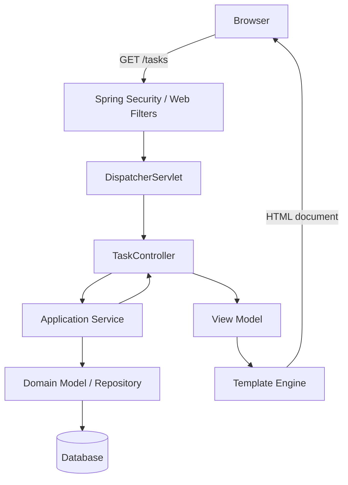
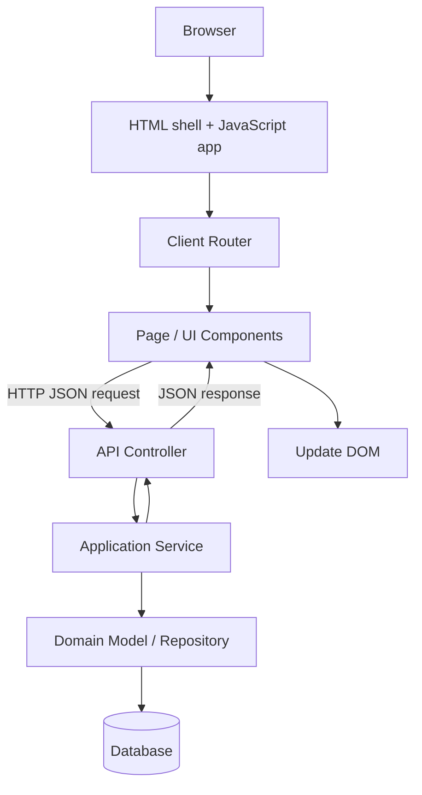
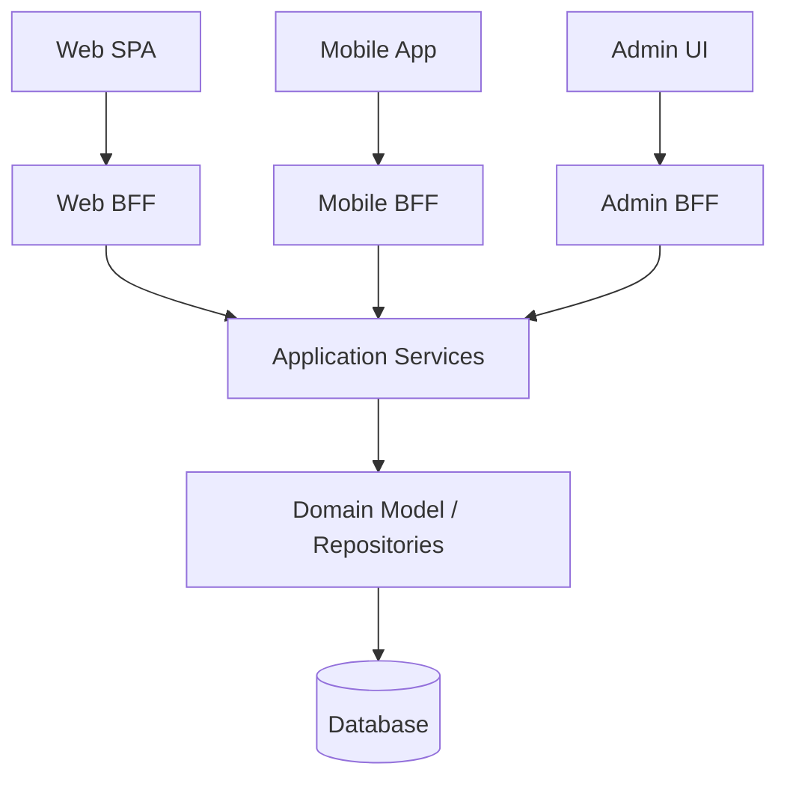

# Kết xuất phía máy chủ, SPA và ranh giới giao diện–API

Ứng dụng MVC có thể trình bày giao diện bằng HTML được tạo ở máy chủ, bằng một ứng dụng JavaScript chạy trong trình duyệt hoặc kết hợp cả hai cách. Dù chọn cách nào, kiến trúc vẫn cần phân biệt rõ nơi xử lý nghiệp vụ, nơi giữ trạng thái giao diện và hợp đồng trao đổi dữ liệu giữa giao diện với máy chủ.

Với kết xuất phía máy chủ (Server-Side Rendering, SSR), trình duyệt gửi request, Controller gọi use case, sau đó View engine tạo HTML để trả về. Với ứng dụng một trang (Single-Page Application, SPA), máy chủ thường cung cấp HTML/JavaScript ban đầu; trình duyệt tải dữ liệu qua API rồi cập nhật giao diện mà không tải lại toàn bộ tài liệu cho mỗi lần điều hướng. Ứng dụng lai có thể render HTML ban đầu ở máy chủ rồi hydrate bằng JavaScript, hoặc dùng SSR cho một số trang và SPA cho những khu vực tương tác cao.

Không có một lựa chọn phù hợp cho mọi sản phẩm. SSR thường đơn giản cho biểu mẫu và trang nội dung, tận dụng HTTP và khả năng truy cập cơ bản của HTML. SPA hữu ích khi giao diện có nhiều tương tác liên tục, trạng thái cục bộ phong phú hoặc cần trải nghiệm gần ứng dụng desktop. Cả hai đều cần API/hợp đồng rõ ràng khi giao diện và nghiệp vụ tách thành các thành phần độc lập.

## Ba cách tổ chức giao diện phổ biến

### Kết xuất phía máy chủ (SSR truyền thống)

Trong SSR truyền thống, Controller xử lý request và đưa dữ liệu trình bày vào View Model. Template engine như Thymeleaf, FreeMarker hoặc JSP tạo HTML trên máy chủ. Trình duyệt nhận tài liệu đã có nội dung, sau đó có thể gửi form hoặc theo liên kết để thực hiện request tiếp theo.



Trong mô hình này, View được render cho từng request. Một thao tác tạo công việc có thể dùng POST, lưu dữ liệu, rồi redirect về trang danh sách theo mẫu Post/Redirect/Get (PRG). Trình duyệt không cần tự gọi API để dựng lại toàn bộ màn hình.

### Ứng dụng một trang (SPA)

SPA thường tải một HTML shell và các bundle JavaScript/CSS. Router phía trình duyệt xử lý điều hướng nội bộ; component gọi API để lấy dữ liệu hoặc gửi command. Máy chủ vẫn xác thực, phân quyền, thực hiện use case và truy cập dữ liệu. Việc render component xảy ra trong trình duyệt.



SPA không có nghĩa là nghiệp vụ chạy ở trình duyệt. Client có thể kiểm tra dữ liệu để phản hồi nhanh, nhưng mọi quy tắc có ý nghĩa bảo mật hoặc tính toàn vẹn phải được xác minh lại ở máy chủ. Không tin role, giá tiền, owner ID hoặc trạng thái do JavaScript gửi lên.

### Mô hình lai (Hybrid)

Ứng dụng lai dùng nhiều kỹ thuật tùy trang hoặc tùy giai đoạn. Ví dụ:

- trang giới thiệu và tài liệu được SSR để nội dung xuất hiện ngay và dễ được lập chỉ mục;
- trang quản trị có nhiều bộ lọc, kéo thả và cập nhật liên tục dùng SPA;
- trang chi tiết render HTML ban đầu ở máy chủ, sau đó hydrate component để bổ sung tương tác;
- một ứng dụng Spring MVC có thể render HTML cho browser nhưng đồng thời cung cấp REST API cho mobile client.

Hybrid có thể cải thiện trải nghiệm nhưng làm tăng số đường đi dữ liệu và cách quản lý trạng thái. Cần xác định trang nào do server render, trang nào do client render, API nào được dùng và ai chịu trách nhiệm cho từng phần trạng thái.

## So sánh SSR và SPA

| Tiêu chí | SSR truyền thống | SPA |
|---|---|---|
| HTML ban đầu | Server trả HTML đã có nội dung | Thường bắt đầu từ HTML shell; JavaScript dựng nội dung, trừ khi có SSR/hydration |
| Điều hướng | Thường tải tài liệu mới hoặc redirect | Router client cập nhật view mà không tải lại toàn bộ tài liệu |
| Xử lý form | HTML form, binding và validation ở server | Component quản lý form, gửi request API |
| Trạng thái giao diện | Chủ yếu tái tạo từ URL, request và session | Có thêm state trong component/store ở trình duyệt |
| Hợp đồng dữ liệu | Có thể truyền View Model trực tiếp cho template | Thường dùng DTO/JSON API rõ ràng |
| SEO và nội dung công khai | Thuận lợi vì HTML đã có nội dung | Cần SSR/prerender hoặc chiến lược crawler phù hợp |
| Tương tác phức tạp | Có thể cần JavaScript bổ sung và request từng bước | Thuận lợi cho tương tác liên tục, cập nhật cục bộ |
| Phân phối | Có thể triển khai cùng ứng dụng web | Static assets có thể triển khai riêng với API |
| Bảo mật | Server kiểm soát session và render; vẫn cần CSRF/XSS protection | Cùng yêu cầu server-side authorization; cần quyết định cách lưu credentials và CORS/CSRF |
| Kiểm thử | Controller, template và browser flow | API, component, router và browser flow |

SSR không tự động nhanh hơn SPA trong mọi trường hợp; SPA cũng không tự động mang lại trải nghiệm tốt hơn. Hiệu năng phụ thuộc kích thước HTML/JavaScript, dữ liệu tải về, mạng, cache, truy vấn, render và thiết bị. Hãy đo các luồng quan trọng trên thiết bị/mạng đại diện cho người dùng thực tế.

## Ranh giới giao diện–API

Khi giao diện và máy chủ trao đổi qua HTTP, cần một hợp đồng dữ liệu ổn định. Hợp đồng này mô tả:

- endpoint, HTTP method và mục đích use case;
- request DTO, kiểu dữ liệu, trường bắt buộc và quy tắc validation;
- response DTO, mã lỗi và cấu trúc lỗi;
- cách phân trang, lọc, sắp xếp và giới hạn kích thước;
- cách xác thực, phân quyền và truyền ngữ cảnh người dùng;
- cách xử lý retry, idempotency và cập nhật đồng thời;
- quy tắc tương thích khi API thay đổi.

Không nên để giao diện phụ thuộc trực tiếp vào entity JPA hoặc cấu trúc bảng database. Entity có thể chứa quan hệ lazy, field nội bộ hoặc trạng thái persistence không phù hợp để công khai. API nên trả DTO được thiết kế cho nhu cầu của client.

### DTO là hợp đồng, không phải bản sao entity

Ví dụ request tạo công việc:

```java
public record CreateTaskRequest(
        @NotBlank @Size(max = 120) String title,
        LocalDate dueDate) {
}
```

Response dành cho giao diện:

```java
public record TaskResponse(
        long id,
        String title,
        String status,
        LocalDate dueDate,
        String assigneeName) {
}
```

`CreateTaskRequest` chỉ chứa dữ liệu mà client được phép gửi. `TaskResponse` chỉ công khai dữ liệu cần hiển thị. Không thêm `ownerId`, `createdBy`, `role`, `price` hoặc trạng thái nhạy cảm vào request nếu những giá trị đó phải do server xác định. Khi trả dữ liệu, không serialize entity ORM trực tiếp chỉ để tiết kiệm một lớp mapping.

### Controller API gọi use case

```java
@RestController
@RequestMapping("/api/tasks")
public class TaskApiController {
    private final CreateTaskUseCase createTask;
    private final GetTaskDetailsQuery getTaskDetails;

    public TaskApiController(
            CreateTaskUseCase createTask,
            GetTaskDetailsQuery getTaskDetails) {
        this.createTask = createTask;
        this.getTaskDetails = getTaskDetails;
    }

    @PostMapping
    public ResponseEntity<TaskResponse> create(
            @Valid @RequestBody CreateTaskRequest request,
            @AuthenticationPrincipal AppPrincipal principal) {

        TaskId id = createTask.handle(new CreateTaskCommand(
                request.title(), request.dueDate(), principal.userId()));

        TaskDetails details = getTaskDetails.handle(id, principal.userId());
        return ResponseEntity.created(URI.create("/api/tasks/" + id.value()))
                .body(toResponse(details));
    }
}
```

Đây là ví dụ cấu trúc; các command, query, principal và mapper cần được định nghĩa trong ứng dụng. Controller lấy actor từ principal đã xác thực, không lấy người tạo từ request body. Application service vẫn kiểm tra quyền và quy tắc trên tài nguyên. Với use case thực tế, có thể trả trực tiếp dữ liệu cần thiết từ command handler để tránh đọc lại; ví dụ tách query ở đây chỉ để minh họa ranh giới.

## SSR với Spring MVC và template

Với SSR truyền thống, Controller có thể trả tên template và đưa dữ liệu vào `Model` của Spring MVC:

```java
@Controller
@RequestMapping("/tasks")
public class TaskPageController {
    private final ListTasksQuery listTasks;

    public TaskPageController(ListTasksQuery listTasks) {
        this.listTasks = listTasks;
    }

    @GetMapping
    public String list(
            @AuthenticationPrincipal AppPrincipal principal,
            Model model) {

        model.addAttribute(
                "tasks", listTasks.handle(principal.userId()));
        return "tasks/list";
    }
}
```

Trong template, dữ liệu được hiển thị theo cơ chế escape mặc định của template engine. Không dùng cú pháp render raw HTML cho nội dung người dùng nhập nếu chưa sanitize theo ngữ cảnh. View Model nên chứa dữ liệu trình bày đã được chuẩn bị; template không nên tự gọi repository hoặc quyết định quy tắc nghiệp vụ.

### Form POST và Post/Redirect/Get

```java
@PostMapping
public String create(
        @Valid @ModelAttribute("form") CreateTaskForm form,
        BindingResult errors,
        @AuthenticationPrincipal AppPrincipal principal,
        RedirectAttributes redirectAttributes) {

    if (errors.hasErrors()) {
        return "tasks/new";
    }

    TaskId id = createTask.handle(new CreateTaskCommand(
            form.getTitle(), form.getDueDate(), principal.userId()));
    redirectAttributes.addFlashAttribute("message", "Đã tạo công việc");
    return "redirect:/tasks/" + id.value();
}
```

PRG tránh việc refresh trang kết quả gửi lại POST trong nhiều luồng biểu mẫu. Khi validation thất bại, Controller trả lại template cùng dữ liệu form và lỗi trường. Khi thành công, redirect về URL GET. Với form dùng session cookie, cần CSRF token theo cấu hình Spring Security.

### Progressive Enhancement

SSR có thể hoạt động ngay cả khi JavaScript chưa tải hoặc bị tắt, nếu các thao tác chính dùng liên kết và HTML form chuẩn. JavaScript sau đó bổ sung tìm kiếm tức thời, preview hoặc cập nhật một phần trang. Cách tiếp cận này gọi là Progressive Enhancement.

Progressive Enhancement hữu ích cho trang nội dung, biểu mẫu quan trọng và trải nghiệm cần hỗ trợ nhiều loại thiết bị. Tuy nhiên, không phải mọi giao diện phức tạp đều cần hoạt động đầy đủ khi thiếu JavaScript; hãy xác định rõ chức năng cốt lõi và fallback cần hỗ trợ.

## SPA gọi API và cập nhật giao diện

Trong SPA, component chịu trách nhiệm hiển thị trạng thái giao diện và gọi API thông qua một lớp client/service. Không nên để mọi component tự ghép URL, tự xử lý token và tự diễn giải mọi dạng lỗi theo cách khác nhau. Một lớp API client chung có thể chuẩn hóa base URL, header, timeout, serialization, correlation ID và ánh xạ lỗi giao thức.

Ví dụ JavaScript dùng `fetch`:

```javascript
async function createTask(request, csrfToken) {
  const response = await fetch("/api/tasks", {
    method: "POST",
    credentials: "same-origin",
    headers: {
      "Content-Type": "application/json",
      "Accept": "application/json",
      "X-CSRF-TOKEN": csrfToken
    },
    body: JSON.stringify(request)
  });

  if (!response.ok) {
    const problem = await response.json().catch(() => null);
    throw new ApiError(response.status, problem);
  }

  return response.status === 204 ? null : response.json();
}
```

Ví dụ giả định SPA dùng cookie/session cùng CSRF token do server cung cấp. Tên header CSRF phải khớp cấu hình bảo mật của ứng dụng. Nếu dùng bearer token, cơ chế lấy, lưu và gửi token sẽ khác; không copy ví dụ này mà bỏ qua mô hình xác thực thực tế. `fetch` không tự ném exception chỉ vì response có status 4xx/5xx, vì vậy client cần kiểm tra `response.ok`.

### Các trạng thái giao diện cần biểu diễn

Một component gọi API thường cần quản lý các trạng thái:

- **Idle:** chưa gửi request;
- **Loading:** request đang chờ;
- **Success:** dữ liệu đã được nhận;
- **Empty:** request thành công nhưng không có dữ liệu;
- **Validation error:** dữ liệu form không hợp lệ;
- **Business rejection:** hành động bị từ chối theo quy tắc;
- **Unauthorized/forbidden:** cần đăng nhập hoặc không có quyền;
- **Technical error:** server hoặc dependency không thể xử lý;
- **Retrying/offline:** có cơ chế thử lại hoặc mạng đang gián đoạn.

Không nên hiển thị cùng một thông báo “Có lỗi xảy ra” cho tất cả trường hợp. Lỗi validation cần chỉ rõ trường; business rejection cần giải thích hành động không được phép; lỗi kỹ thuật cần thông báo có thể thử lại nếu phù hợp, không lộ chi tiết nội bộ.

## Tách trạng thái giao diện, trạng thái server và trạng thái URL

Một nguồn gây lỗi thường gặp là lưu cùng một dữ liệu ở nhiều nơi mà không xác định nơi nào là nguồn sự thật.

| Loại trạng thái | Ví dụ | Nơi phù hợp |
|---|---|---|
| Trạng thái miền bền vững | Trạng thái công việc, đơn hàng, số dư | Database/Domain Model phía server |
| Trạng thái server được cache ở client | Danh sách công việc, chi tiết hồ sơ | Query cache hoặc data store có chính sách stale/refetch |
| Trạng thái UI tạm thời | Modal đang mở, tab đang chọn, input chưa lưu | Component hoặc UI store |
| Trạng thái điều hướng/chia sẻ | Trang hiện tại, bộ lọc, sort, page | URL path/query parameters |
| Ngữ cảnh xác thực | Session hoặc principal | Cơ chế bảo mật phía server; client chỉ giữ credential theo chính sách |

Không lưu bản sao trạng thái miền rồi coi đó là sự thật cuối cùng. Client có thể hiển thị trạng thái lạc hậu do người dùng khác vừa cập nhật; server cần xác minh lại khi nhận command. Với dữ liệu có cập nhật đồng thời, API có thể dùng version, ETag/`If-Match` hoặc optimistic locking để phát hiện xung đột.

### Đưa bộ lọc và phân trang vào URL

Ví dụ URL:

```text
/tasks?status=IN_PROGRESS&sort=dueDate&page=2&size=20
```

Đặt bộ lọc và trang trong URL giúp người dùng bookmark, chia sẻ và dùng nút Back/Forward. API có thể nhận query tương ứng, kiểm tra `size` tối đa và chỉ cho phép các trường sort được allowlist. Không nối tên cột SQL trực tiếp từ tham số `sort`.

### Cache dữ liệu server ở client

SPA có thể dùng query cache để giảm request lặp, nhưng cần xác định:

- thời gian dữ liệu được coi là mới;
- khi nào invalidate sau mutation;
- khi nào refetch khi focus hoặc reconnect;
- cách phân biệt dữ liệu theo user/tenant;
- cách xóa dữ liệu cache khi logout hoặc đổi tài khoản;
- cách xử lý optimistic update nếu server từ chối.

Không lưu dữ liệu nhạy cảm trong persistent browser storage chỉ để tiện cache. Cache trong trình duyệt không phải ranh giới bảo mật; người dùng có thể xem dữ liệu mà ứng dụng đã tải về.

## Bảo vệ ranh giới UI–API

### Client validation không thay thế server validation

Client validation cải thiện trải nghiệm bằng phản hồi sớm. Nhưng request có thể được tạo bằng công cụ khác hoặc sửa trực tiếp, nên server phải kiểm tra lại:

- kiểu dữ liệu, độ dài và định dạng;
- giá trị nằm trong allowlist;
- quyền truy cập trên tài nguyên;
- tenant/owner được xác định từ ngữ cảnh tin cậy;
- bất biến và chuyển trạng thái nghiệp vụ;
- kích thước, số lượng và giới hạn tần suất.

Ví dụ, SPA có thể disable nút “Hoàn thành” khi task đang `CANCELLED`, nhưng API vẫn phải kiểm tra trạng thái trong Model. Ẩn nút hoặc disable control chỉ là hành vi giao diện, không phải authorization.

### Authentication và Authorization

Với SSR truyền thống, session cookie là lựa chọn phổ biến. Trình duyệt tự gửi cookie theo phạm vi domain/path, vì vậy request thay đổi trạng thái cần CSRF protection. Với SPA, có thể dùng session cookie hoặc OAuth2/OIDC bearer token tùy kiến trúc. Bearer token cần được bảo vệ khỏi XSS và không nên lưu trong `localStorage` một cách tùy tiện; cookie `HttpOnly` giảm khả năng JavaScript đọc credential nhưng yêu cầu thiết kế CSRF phù hợp.

Mọi API phải xác minh danh tính và quyền phía server. Không tin `role`, `userId`, `ownerId`, `tenantId` hoặc `isAdmin` do client gửi. Khi client được chọn tenant, server phải kiểm tra membership và quyền của user đối với tenant đó.

### CORS và CSRF là hai vấn đề khác nhau

CORS quyết định browser có cho JavaScript ở một origin đọc response từ origin khác hay không. CORS không xác thực người dùng và không thay thế authorization. CSRF bảo vệ request được trình duyệt tự gửi kèm credentials như cookie. Nếu SPA và API cùng origin, cấu hình CORS có thể không cần thiết; nếu khác origin, chỉ cho phép origin, method và header cụ thể, tránh wildcard với credentials.

Không tắt CSRF chỉ vì API trả JSON. Nếu browser dùng cookie/session, request có thể vẫn bị CSRF. Nếu dùng bearer token trong Authorization header và không dùng cookie tự động cho API, chiến lược CSRF có thể khác; cần dựa trên cách credentials thực sự được gửi.

### XSS và nội dung không đáng tin cậy

SSR template cần escape output theo ngữ cảnh HTML, attribute, URL hoặc JavaScript. SPA cũng cần tránh chèn chuỗi không tin cậy bằng API render raw HTML. Nếu cần hiển thị rich text, dùng sanitizer phù hợp và allowlist phần tử/thuộc tính. Content Security Policy là lớp phòng vệ bổ sung, không thay thế escaping và sanitization.

## Thiết kế hợp đồng API cho lỗi

API nên trả cấu trúc lỗi ổn định để SSR Controller và SPA có thể diễn giải nhất quán. Có thể dùng `ProblemDetail` theo RFC 9457 hoặc một schema tương đương.

Ví dụ:

```json
{
  "type": "about:blank",
  "title": "Không thể thực hiện thao tác",
  "status": 409,
  "detail": "Công việc đã bị hủy nên không thể hoàn thành.",
  "code": "TASK_STATE_INVALID",
  "category": "business",
  "traceId": "4bf92f3577b34da6a3ce929d0e0e4736"
}
```

Không trả stack trace, câu SQL, tên class nội bộ hoặc secret. `code` nên là mã ổn định để client ánh xạ thông báo; `detail` là nội dung công khai đã được kiểm soát. Với validation error, có thể bổ sung danh sách lỗi theo field nhưng không phản chiếu nguyên văn dữ liệu nhạy cảm.

Ví dụ cấu trúc lỗi validation:

```json
{
  "type": "about:blank",
  "title": "Dữ liệu không hợp lệ",
  "status": 400,
  "code": "VALIDATION_FAILED",
  "errors": [
    { "field": "title", "code": "NotBlank", "message": "Tiêu đề là bắt buộc." }
  ]
}
```

Client nên xử lý theo status và code, không phân tích chuỗi `detail` để quyết định logic. Nội dung thông báo có thể được bản địa hóa hoặc thay đổi mà không làm hỏng code.

## Phân trang, lọc và kích thước response

API danh sách nên có giới hạn rõ:

- page/offset và size hoặc cursor;
- kích thước trang tối đa;
- tập sort field được phép;
- bộ lọc được hỗ trợ và cách kết hợp;
- metadata về trang tiếp theo hoặc tổng số nếu cần.

Ví dụ response:

```json
{
  "items": [
    { "id": 42, "title": "Viết tài liệu", "status": "IN_PROGRESS" }
  ],
  "page": 0,
  "size": 20,
  "hasNext": true
}
```

Không nhất thiết phải trả tổng số bản ghi nếu việc đếm tốn kém hoặc không cần cho giao diện. Với dữ liệu thay đổi liên tục, cursor pagination có thể ổn định hơn offset pagination. Client không nên tự tải toàn bộ dữ liệu rồi phân trang trong bộ nhớ khi tập dữ liệu có thể tăng lớn.

## Versioning và khả năng tương thích API

Giao diện và API có thể được triển khai ở thời điểm khác nhau. Nếu server đổi schema trước khi client mới được phát hành, client cũ vẫn có thể gọi API. Hãy ưu tiên thay đổi tương thích ngược:

- thêm field tùy chọn thay vì đổi nghĩa field hiện có;
- không đổi kiểu dữ liệu hoặc xóa field mà client đang dùng nếu chưa có kế hoạch;
- thêm enum value có thể khiến client cũ không xử lý được; client nên có nhánh unknown/fallback;
- không đổi status/error code một cách âm thầm;
- công bố thời gian deprecation và kế hoạch ngừng hỗ trợ;
- dùng version path/header khi cần thay đổi phá vỡ tương thích.

Không phải mọi API đều cần version cho mỗi thay đổi nhỏ. Versioning là công cụ quản lý thay đổi không tương thích; hợp đồng rõ và kiểm thử tương thích thường quan trọng hơn việc tăng số version liên tục.

## Backend for Frontend (BFF)

Khi một sản phẩm có nhiều client khác nhau, như web SPA, mobile app và giao diện quản trị, một API chung có thể trả quá nhiều dữ liệu hoặc buộc mỗi client phải gọi nhiều endpoint. Backend for Frontend (BFF) là một lớp API được thiết kế theo nhu cầu của một loại giao diện.



BFF có thể tổng hợp dữ liệu từ nhiều use case, chuyển đổi response cho client, xử lý session hoặc che giấu topology nội bộ. Nó không nên chứa bản sao quy tắc nghiệp vụ hoặc trở thành nơi bỏ qua application service. Quy tắc cốt lõi vẫn thuộc Model/application layer và phải được dùng chung giữa các adapter.

BFF hữu ích khi nhu cầu dữ liệu hoặc cách xác thực của các client khác biệt rõ. Nếu chỉ có một client và API đơn giản, thêm BFF có thể làm tăng độ phức tạp triển khai, latency và điểm lỗi mà không mang lại lợi ích tương xứng.

## Hiệu năng và phân phối tài nguyên

### SSR

SSR cần xử lý template trên server cho từng request, vì vậy hãy chú ý:

- thời gian truy vấn và số lượng dữ liệu đưa vào View Model;
- tránh N+1 khi template truy cập quan hệ lazy;
- cache template và dữ liệu công khai khi phù hợp;
- không cache trang riêng tư dùng chung giữa người dùng;
- giới hạn kích thước HTML và số lượng component;
- dùng CDN cho static assets và cache có version/hash.

### SPA

SPA có thể giảm tải điều hướng sau lần tải đầu nhưng bundle ban đầu có thể lớn. Hãy cân nhắc:

- code splitting theo route;
- lazy load component không cần thiết ngay;
- cache static asset có content hash;
- nén và tối ưu ảnh/font;
- tránh tải lặp dữ liệu đã có trong query cache;
- hủy request cũ khi người dùng đổi bộ lọc nhanh;
- tránh render lại component không cần thiết;
- đo Core Web Vitals và thời gian tương tác trên thiết bị thực tế.

### Cache và dữ liệu cá nhân

HTML hoặc JSON công khai có thể cache ở CDN nếu header và chính sách cho phép. Response phụ thuộc session, cookie, authorization hoặc dữ liệu cá nhân cần cache riêng tư hoặc không cache. Cấu hình `Vary`, `Cache-Control` và cache key phải phản ánh đúng yếu tố làm thay đổi response.

Không dùng cache shared cho response chứa dữ liệu người dùng nếu cache key không phân biệt danh tính. Khi logout hoặc đổi tenant, xóa hoặc vô hiệu hóa client cache liên quan.

## SEO, accessibility và trải nghiệm tải trang

SSR thường thuận lợi cho nội dung công khai vì HTML ban đầu có sẵn nội dung, title và metadata. SPA có thể cần prerender/SSR hoặc giải pháp khác để crawler nhận được nội dung quan trọng. Với trang yêu cầu SEO, kiểm tra kết quả thực tế của crawler và thẻ canonical, title, description, structured data nếu có.

Dù SSR hay SPA, giao diện nên dùng semantic HTML, label cho input, heading theo thứ bậc, keyboard navigation, focus management và thông báo lỗi có thể được công nghệ hỗ trợ đọc. SPA cần quản lý focus khi route thay đổi, thông báo loading/error qua live region phù hợp và bảo đảm nút Back/Forward hoạt động đúng.

SSR có thể hiển thị nội dung sớm nhưng vẫn có thể chậm nếu server render hoặc database chậm. SPA có thể tải nhanh sau lần đầu nhưng tạo màn hình trắng nếu bundle lớn hoặc JavaScript lỗi. Đo trải nghiệm người dùng thực tế thay vì suy luận từ mô hình kiến trúc.

## Triển khai và định tuyến

### Cùng origin

Một cách triển khai đơn giản là phục vụ frontend và API dưới cùng origin:

```text
https://app.example.com/          -> HTML / SPA assets
https://app.example.com/api/...   -> API Controller
```

Cùng origin giúp đơn giản hóa cookie và tránh cấu hình CORS cho luồng browser cùng origin. Reverse proxy có thể định tuyến `/api` đến ứng dụng backend và các đường dẫn còn lại đến static hosting. Cần cấu hình SPA fallback sao cho route client như `/tasks/42` trả HTML shell, trong khi `/api/tasks/42` vẫn trả response API và lỗi API không bị rewrite thành HTML.

### Khác origin

Frontend và API có thể triển khai riêng:

```text
https://ui.example.com       -> SPA
https://api.example.com      -> API
```

Khi đó, cần cấu hình CORS chính xác nếu browser gọi trực tiếp API. Nếu dùng cookie cross-site, cần xem xét `SameSite=None; Secure`, CSRF và chính sách trình duyệt; nếu dùng bearer token, cần bảo vệ token và kiểm tra CORS/authorization riêng. Không bật `Access-Control-Allow-Origin: *` cùng credentials.

Static asset của SPA có thể được triển khai qua CDN, còn API có thể phát hành độc lập. Điều này giúp scale từng phần nhưng yêu cầu quản lý version, cache invalidation, base URL, CSP, secrets build-time và tương thích client/server.

## Kiểm thử theo mô hình giao diện

Không dùng một loại test để thay thế tất cả:

| Mức kiểm thử | SSR | SPA / Hybrid |
|---|---|---|
| Unit test | Application service, mapper, View Model assembler | Component logic, state reducer, API client |
| Controller/API test | Route, binding, validation, View name, redirect, status | API contract, auth, DTO, error response |
| Template/component test | Render template, escaping, conditional display | Component rendering, loading/error/empty states |
| Contract test | Form/request-response contract nếu có API | Schema và tương thích API giữa frontend/backend |
| Browser E2E | Form submit, PRG, validation, navigation | Router, API interaction, session, state updates |
| Accessibility test | Semantic HTML, keyboard và label | Focus, live region, keyboard, route transitions |

### Kiểm thử SSR

Với Spring MockMvc, xác minh GET trả đúng View và model attribute; POST validation thất bại trả lại form; POST thành công redirect đến URL dự kiến; CSRF được yêu cầu với cấu hình session. Template test cần kiểm tra nội dung quan trọng được render và dữ liệu không tin cậy được escape.

### Kiểm thử API contract

Kiểm tra request DTO, response DTO, status code, mã lỗi, phân trang và quy tắc validation. Contract test có thể dùng OpenAPI schema hoặc công cụ contract testing để bảo đảm frontend và backend không âm thầm lệch nhau. Đặc biệt kiểm tra enum value mới, field nullable và ngày/giờ/múi giờ.

### Kiểm thử SPA

Component test cần bao phủ loading, success, empty, validation error, business rejection, unauthorized và technical error. Test API client cần xác minh header, credentials, CSRF/token handling, parsing lỗi và timeout. Browser E2E xác minh route, refresh, Back/Forward, logout, cập nhật dữ liệu và request trực tiếp không vượt qua authorization.

### Kiểm thử hybrid

Với SSR + hydration, kiểm tra HTML server và DOM sau hydrate có cùng dữ liệu/ý nghĩa. Tránh mismatch do thời gian, random, locale hoặc dữ liệu thay đổi giữa server render và client hydrate. Nếu JavaScript không tải, xác định rõ chức năng nào vẫn hoạt động.

## Những dấu hiệu ranh giới UI–API đang không rõ

- Controller trả trực tiếp entity ORM và frontend phụ thuộc tên field persistence.
- Client gửi `ownerId`, `role`, `price` hoặc trạng thái mà server không xác minh.
- Cùng một quy tắc nghiệp vụ được cài đặt riêng ở SPA và SSR Controller.
- Component tự ghép URL và xử lý authentication theo cách khác nhau.
- API trả exception message hoặc stack trace cho client.
- API đổi field hoặc enum khiến client cũ hỏng mà không có deprecation/versioning.
- SPA lưu bản sao trạng thái miền và coi đó là nguồn sự thật.
- SSR template truy cập repository/lazy relation trong lúc render.
- CORS được bật rộng hoặc CSRF bị tắt mà không dựa trên cơ chế credentials.
- Client cache giữ dữ liệu người dùng sau logout hoặc đổi tenant.
- Route SPA bị reverse proxy rewrite nhầm vào API hoặc ngược lại.

Khi gặp các dấu hiệu này, hãy làm rõ hợp đồng dữ liệu, xác định nguồn sự thật cho trạng thái, chuyển quy tắc về Model/application layer và để adapter UI chỉ xử lý giao tiếp, trình bày.

## Quy trình chọn SSR, SPA hay Hybrid

Khi bắt đầu một chức năng hoặc sản phẩm mới, hãy trả lời lần lượt:

1. **Loại trải nghiệm:** nội dung đọc, form CRUD, dashboard hay giao diện tương tác liên tục?
2. **Yêu cầu tải ban đầu:** nội dung cần xuất hiện ngay, SEO hoặc hỗ trợ thiết bị yếu ở mức nào?
3. **Độ phức tạp tương tác:** có cần state cục bộ phong phú, cập nhật realtime hoặc thao tác kéo thả không?
4. **Kênh client:** chỉ browser hay còn mobile/desktop cần dùng cùng use case?
5. **Hợp đồng dữ liệu:** có thể định nghĩa request/response DTO ổn định và lỗi có mã không?
6. **Xác thực:** session cookie hay bearer token; CSRF/CORS được xử lý ra sao?
7. **Trạng thái:** phần nào thuộc server, URL, query cache và component?
8. **Vận hành:** frontend/API deploy cùng hay riêng; cache, CDN và fallback route được cấu hình thế nào?
9. **Kiểm thử:** có test contract, browser flow, accessibility và bảo mật không?
10. **Đo lường:** theo dõi request/API latency, bundle size, Core Web Vitals và lỗi client như thế nào?

Một ứng dụng có thể bắt đầu bằng SSR cho form và trang nội dung, sau đó bổ sung JavaScript cho một số tương tác. Chỉ chuyển sang SPA khi lợi ích về trải nghiệm hoặc tổ chức client đủ rõ. Ngược lại, SPA có thể dùng SSR/prerender cho các route công khai. Chọn theo đặc điểm từng luồng thay vì biến một công nghệ thành quy tắc bắt buộc cho toàn bộ hệ thống.

## Câu hỏi tự đánh giá

1. SSR truyền thống và SPA khác nhau ở nơi tạo HTML và điều hướng như thế nào?
2. Vì sao SPA không có nghĩa nghiệp vụ hoặc authorization được chuyển sang trình duyệt?
3. Hybrid rendering có thể kết hợp những mô hình nào?
4. Vì sao API nên trả DTO thay vì entity JPA?
5. Những dữ liệu nào cần lấy từ principal thay vì request body?
6. Trạng thái nào nên nằm trong URL, component, query cache hoặc database?
7. Vì sao client validation không thay thế server validation?
8. CORS và CSRF giải quyết hai vấn đề gì khác nhau?
9. Khi nào BFF hữu ích và khi nào nó chỉ làm tăng độ phức tạp?
10. Cần kiểm thử những gì để frontend và backend giữ tương thích khi API thay đổi?

SSR, SPA và Hybrid là các cách tổ chức phần giao diện của ứng dụng MVC. Dù HTML được tạo ở máy chủ hay component được render trong trình duyệt, nghiệp vụ và dữ liệu có thẩm quyền vẫn thuộc phía server. Ranh giới UI–API cần DTO, mã lỗi, quy tắc xác thực, phân trang và chính sách tương thích rõ ràng. Khi trạng thái được đặt đúng nơi, client không tự quyết định quy tắc bảo mật và các adapter dùng chung application service, ứng dụng có thể thay đổi cách trình bày mà không làm nghiệp vụ phụ thuộc vào một công nghệ giao diện cụ thể.
