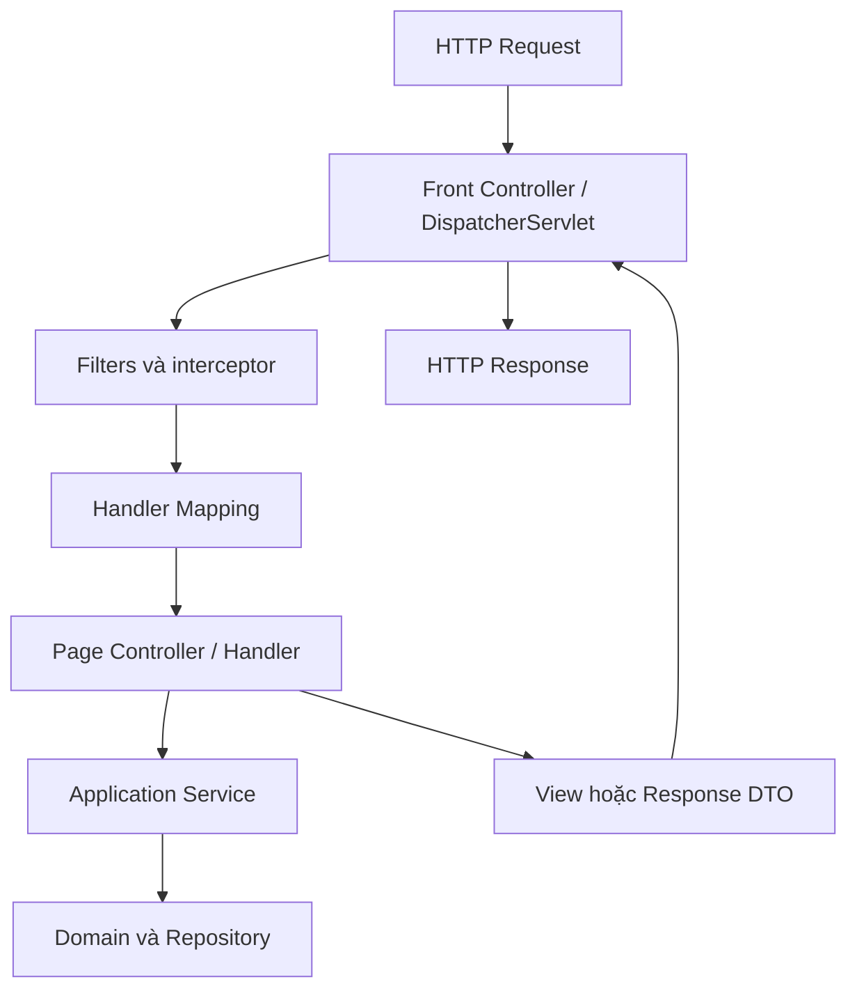
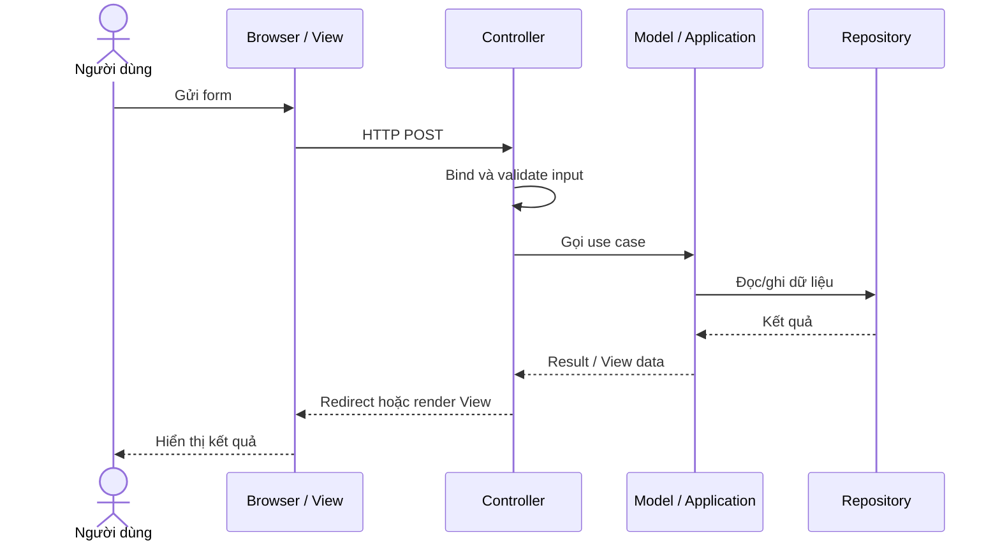
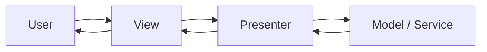
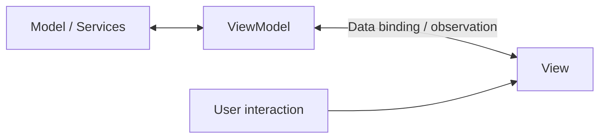
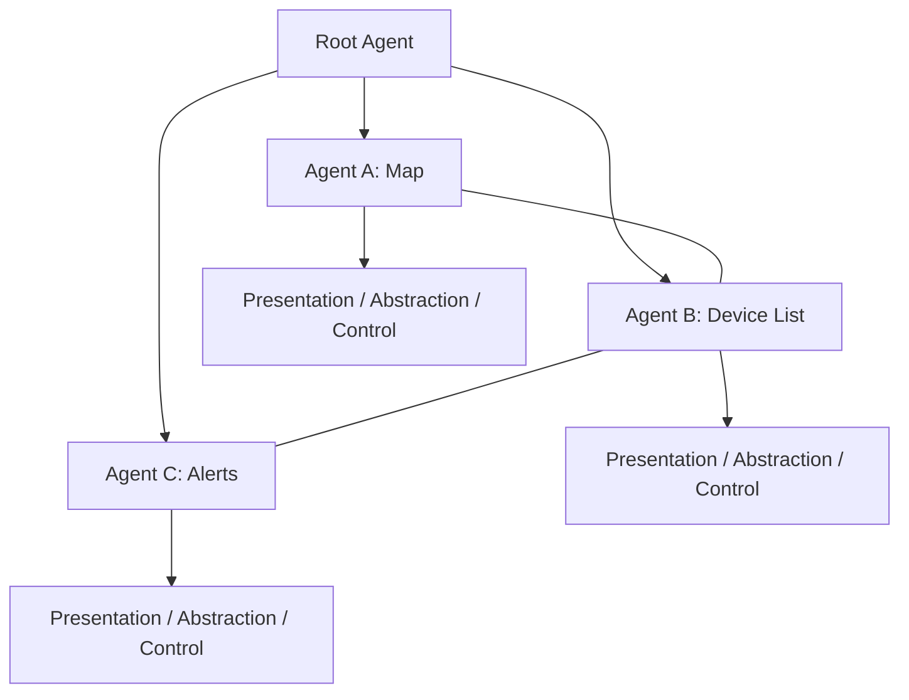
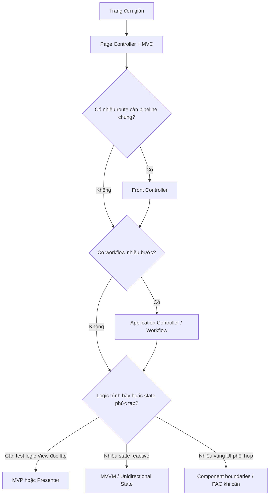

# Tiêu chí chọn mẫu theo độ phức tạp của tương tác

Khi xây dựng giao diện web, **Model–View–Controller (MVC)** là một cách tổ chức phổ biến để tách phần tiếp nhận tương tác, trạng thái/dữ liệu và trình bày. Tuy nhiên, MVC không phải lựa chọn duy nhất. Tùy độ phức tạp của màn hình và luồng tương tác, nhóm phát triển có thể dùng Page Controller, Front Controller, Application Controller, Model–View–Presenter (MVP), Model–View–ViewModel (MVVM) hoặc Presentation–Abstraction–Control (PAC). Các mẫu này giải quyết những vấn đề ở phạm vi khác nhau và có thể được kết hợp.

Điều quan trọng là chọn mẫu dựa trên **độ phức tạp thực tế của tương tác**: một trang chỉ hiển thị và nhận một form đơn giản cần ít cơ chế điều phối; một quy trình nhiều bước, nhiều trạng thái, nhiều vùng giao diện đồng bộ hoặc nhiều client cần ranh giới và cơ chế quản lý state rõ hơn. Dùng quá ít cấu trúc khiến Controller hoặc component phình to; dùng quá nhiều pattern cho màn hình đơn giản lại làm tăng số lớp, luồng gọi và chi phí bảo trì.

Bài học này phân loại các mẫu UI liên quan, giải thích phạm vi của từng mẫu, so sánh cách tổ chức state và điều phối tương tác, rồi đưa ra quy trình chọn mẫu theo nhu cầu. Ví dụ sử dụng ứng dụng web và Java/Spring ở phía server, đồng thời đề cập các framework UI phía client.

## 1. Bắt đầu từ độ phức tạp của tương tác

Độ phức tạp của giao diện không chỉ được quyết định bởi số lượng component hoặc số dòng code. Một màn hình có ít nút nhưng nhiều trạng thái phụ thuộc lẫn nhau có thể khó thiết kế hơn một trang dài chỉ hiển thị dữ liệu.

Hãy xem xét các chiều sau:

- **Số lượng hành động:** người dùng có thể xem, tạo, sửa, xóa hay thực hiện nhiều hành động có điều kiện?
- **Số trạng thái:** giao diện có loading, empty, validation error, success, conflict, offline hoặc trạng thái chưa xác định không?
- **Quan hệ giữa các vùng:** thay đổi ở một vùng có cập nhật vùng khác hay nhiều panel cùng phản ánh một dữ liệu không?
- **Luồng nhiều bước:** người dùng có thể đi tới, quay lại, tạm lưu hoặc tiếp tục một quy trình không?
- **Điều phối:** có nhiều use case, quyền, quy tắc điều hướng hoặc tác vụ bất đồng bộ cần phối hợp không?
- **Tái sử dụng:** nhiều màn hình có dùng chung workflow hoặc logic trình bày không?
- **Khả năng kiểm thử:** logic tương tác có thể kiểm tra độc lập với DOM, HTTP hoặc framework không?
- **Phạm vi client:** giao diện được render trên server, chạy trong browser hay có cả mobile/API client?

Một vài ví dụ:

| Mức tương tác | Ví dụ | Nhu cầu cấu trúc thường gặp |
|---|---|---|
| Đơn giản | Trang chi tiết, form chỉnh sửa ít trường | Controller và View rõ ràng; validation và service riêng |
| Trung bình | Danh sách có filter, sort, pagination, nhiều thao tác | Điều phối route/use case, ViewModel và state URL rõ ràng |
| Phức tạp | Wizard nhiều bước, form phụ thuộc nhiều trường | State machine hoặc workflow service, draft state và validation theo bước |
| Tương tác cao | Dashboard nhiều vùng cập nhật độc lập, drag-and-drop | Component state, event handling và presenter/view-model phù hợp |
| Rất phức tạp | Ứng dụng làm việc nhiều tab, offline, realtime hoặc nhiều client | Ranh giới state/use case rõ, đồng bộ và xử lý xung đột có chủ đích |

Các mức này là hướng dẫn, không phải thang đo cứng. Hãy xem xét số trạng thái và mối liên hệ giữa chúng trước khi quyết định pattern.

## 2. Nhóm pattern UI giải quyết những vấn đề khác nhau

Các tên pattern thường được nhắc cạnh MVC không phải tất cả đều thay thế MVC trực tiếp. Có thể chia chúng thành ba nhóm:

1. **Pattern điều phối request/navigation:** Page Controller, Front Controller và Application Controller.
2. **Pattern phân chia trách nhiệm trình bày:** MVC, MVP, MVVM và PAC.
3. **Pattern tổ chức việc dựng View:** Template View, Transform View và Two-Step View.

Một ứng dụng có thể dùng Front Controller để tiếp nhận request, Page Controller để xử lý từng trang, Application Controller để điều phối workflow và một biến thể MVC/MVP/MVVM để tổ chức phần tương tác của từng màn hình. Pattern cần được chọn theo vấn đề cụ thể, không phải theo tên gọi.

## 3. Page Controller: mỗi trang có một bộ điều khiển

**Page Controller** tổ chức logic xử lý theo từng trang hoặc endpoint. Một Controller chịu trách nhiệm nhận request của trang đó, lấy dữ liệu, xử lý hành động và chọn response.

Ví dụ trong Spring MVC:

```java
@Controller
class ProductPageController {

    private final ProductQueryService products;

    ProductPageController(ProductQueryService products) {
        this.products = products;
    }

    @GetMapping("/products/{id}")
    String detail(@PathVariable String id, Model model) {
        model.addAttribute("product", products.getDetail(id));
        return "products/detail";
    }
}
```

Mỗi trang có Controller riêng hoặc một nhóm handler có trách nhiệm rõ ràng. Page Controller phù hợp khi:

- Mỗi trang có luồng request tương đối độc lập.
- Logic điều phối không quá phức tạp.
- Các hành động gắn rõ với URL và HTTP method.
- Muốn dễ tìm nơi xử lý một trang cụ thể.

Ưu điểm là đơn giản, dễ hiểu và phù hợp với server-rendered MVC. Khi một trang có quá nhiều hành động hoặc nhiều trang chia sẻ workflow phức tạp, Controller có thể phình to. Khi đó nên tách use case/application service hoặc một lớp điều phối chuyên biệt.

Page Controller không có nghĩa mọi logic nghiệp vụ được đặt trong Controller. Nó chỉ mô tả cách tổ chức entry point theo trang; Controller vẫn nên chuyển quy tắc nghiệp vụ sang tầng ứng dụng/miền.

## 4. Front Controller: một điểm tiếp nhận request chung

**Front Controller** đưa các request đi qua một điểm xử lý trung tâm trước khi chuyển đến handler phù hợp. Điểm trung tâm có thể xử lý các chức năng chung như:

- Ánh xạ route và chọn handler.
- Authentication và authorization ở mức giao thức.
- Logging, tracing và correlation ID.
- Locale, encoding và một số metadata chung.
- Exception mapping hoặc các bước xử lý xuyên suốt.

Trong Spring MVC, `DispatcherServlet` là ví dụ điển hình của Front Controller. Nó nhận request, phối hợp handler mapping, handler adapter, converter và view resolver để thực thi handler.



Front Controller phù hợp khi nhiều route cần một pipeline chung và hệ thống cần quản lý các mối quan tâm xuyên suốt nhất quán. Nó giảm việc lặp lại xử lý chung trong từng Page Controller.

Không nên biến Front Controller thành một “siêu Controller” chứa toàn bộ logic của mọi trang. Vai trò của nó là điều phối pipeline và phân phối request; logic riêng của use case vẫn thuộc handler/application service phù hợp.

## 5. Application Controller: điều phối use case hoặc workflow

**Application Controller** là pattern điều phối hành động ở mức ứng dụng. Nó nhận một yêu cầu trình bày và quyết định use case nào cần chạy, bước nào tiếp theo, hoặc response/view nào được chọn. Nó thường hữu ích khi nhiều trang hoặc nhiều entry point cùng thực hiện một workflow.

Ví dụ, quy trình tạo đơn hàng có thể gồm:

1. Chọn khách hàng.
2. Chọn sản phẩm và số lượng.
3. Xác nhận địa chỉ giao hàng.
4. Xem lại và gửi đơn.

Một Application Controller hoặc workflow coordinator có thể điều phối bước hiện tại, kiểm tra điều kiện chuyển bước và quyết định bước tiếp theo. Các quy tắc cốt lõi như tồn kho, giá hoặc trạng thái đơn vẫn cần được kiểm tra ở tầng nghiệp vụ.

### Page Controller và Application Controller khác nhau thế nào?

| Tiêu chí | Page Controller | Application Controller |
|---|---|---|
| Phạm vi | Một trang hoặc endpoint | Một use case/workflow có thể đi qua nhiều trang |
| Trách nhiệm | Xử lý request của trang | Điều phối hành động và bước tiếp theo |
| Tái sử dụng | Thường gắn với trang cụ thể | Có thể dùng chung giữa nhiều entry point |
| Phù hợp | CRUD, trang chi tiết, form đơn giản | Wizard, quy trình phê duyệt, workflow nhiều bước |
| Rủi ro | Controller trang phình to | Lớp điều phối trở thành trung tâm quá lớn nếu chứa nghiệp vụ |

Không phải mọi form nhiều bước đều cần Application Controller. Nếu mỗi bước đơn giản và không chia sẻ workflow, Page Controller cùng application service có thể đủ. Chỉ thêm coordinator khi nó làm rõ state transition hoặc giảm trùng lặp thực sự.

## 6. MVC: Controller điều phối, Model giữ trạng thái, View trình bày

MVC phù hợp với ứng dụng có luồng tương tác request/response rõ ràng. Controller nhận input và gọi use case; Model đại diện dữ liệu/trạng thái; View trình bày kết quả.

Trong web MVC server-rendered, một request thường tạo response HTML mới. Trạng thái có thể nằm trong URL, request, session hoặc backend. View được render từ dữ liệu do Controller chuẩn bị.



MVC thường là lựa chọn tự nhiên khi:

- Mỗi hành động tương ứng với request và response rõ ràng.
- Server có thể render HTML hoặc trả DTO cho client.
- Trạng thái tương tác được quản lý qua URL/request/session hoặc một state store có ranh giới.
- Logic trình bày không quá phụ thuộc vào việc nhiều component cùng đồng bộ tức thời.

Nếu giao diện chỉ cần form và danh sách thông thường, MVC thường đã đủ. Không cần thêm Presenter hoặc ViewModel theo nghĩa MVVM chỉ để đổi tên các lớp hiện có.

## 7. MVP: Presenter điều khiển View qua hợp đồng rõ ràng

**Model–View–Presenter (MVP)** tách logic trình bày khỏi View bằng một Presenter. View thường là một giao diện (interface) mà Presenter gọi để yêu cầu hiển thị dữ liệu hoặc trạng thái. Presenter nhận sự kiện từ View, gọi Model/service và quyết định View cần thể hiện gì.

Luồng khái quát:



Ví dụ pseudocode Java:

```java
interface LoginView {
    void showLoading();
    void showError(String message);
    void showHome();
}

class LoginPresenter {
    private final LoginView view;
    private final LoginService loginService;

    LoginPresenter(LoginView view, LoginService loginService) {
        this.view = view;
        this.loginService = loginService;
    }

    void submit(String username, String password) {
        view.showLoading();
        try {
            loginService.login(username, password);
            view.showHome();
        } catch (InvalidCredentialsException ex) {
            view.showError("Tên đăng nhập hoặc mật khẩu chưa đúng.");
        }
    }
}
```

Ví dụ chỉ minh họa quan hệ giữa Presenter và View; xử lý bất đồng bộ, trạng thái loading và lỗi thực tế cần được thiết kế theo framework.

MVP phù hợp khi:

- Logic trình bày có nhiều nhánh và cần test độc lập với UI framework.
- View có thể được thay thế hoặc mock dễ dàng.
- Nhiều hành động cần phối hợp nhưng muốn giữ View mỏng.
- Ứng dụng desktop/mobile hoặc UI framework không cung cấp data binding thuận tiện.

Nhược điểm là Presenter có thể chứa quá nhiều logic và trở nên khó bảo trì. Nếu Presenter gọi View method cho mọi chi tiết nhỏ, hợp đồng View có thể phình to và hai bên gắn chặt với nhau.

## 8. MVVM: ViewModel cung cấp state cho View

**Model–View–ViewModel (MVVM)** đưa ViewModel vào giữa Model và View. ViewModel cung cấp dữ liệu và trạng thái trình bày theo dạng mà View có thể bind. View quan sát thay đổi ở ViewModel và cập nhật giao diện thông qua data binding hoặc reactive state.



ViewModel có thể chứa:

- Giá trị đang hiển thị trong form.
- Trạng thái loading, success và error.
- Các lựa chọn được chuẩn bị cho dropdown.
- Lệnh hoặc action mà View có thể kích hoạt.
- Dữ liệu đã định dạng hoặc trạng thái hiển thị.

ViewModel không nên thay thế Domain Model hoặc tự quyết định quy tắc nghiệp vụ có thẩm quyền. Nó tổ chức state và hành động cho giao diện; service/domain vẫn chịu trách nhiệm use case và bất biến.

Ví dụ TypeScript pseudocode:

```typescript
type ScreenState =
  | { kind: "loading" }
  | { kind: "ready"; name: string; canSave: boolean }
  | { kind: "error"; message: string };

class ProfileViewModel {
  state: ScreenState = { kind: "loading" };

  constructor(private readonly profileService: ProfileService) {}

  async load() {
    try {
      const profile = await this.profileService.getCurrent();
      this.state = {
        kind: "ready",
        name: profile.name,
        canSave: true
      };
    } catch {
      this.state = {
        kind: "error",
        message: "Chưa thể tải hồ sơ. Hãy thử lại."
      };
    }
  }
}
```

Đây là mô hình khái niệm, không gắn với một framework reactive cụ thể. Trong ứng dụng thật, state cần được thông báo cho View qua cơ chế quan sát của framework hoặc thư viện state.

MVVM phù hợp khi:

- Giao diện có nhiều state cần đồng bộ với nhiều component.
- Framework hỗ trợ data binding/reactive observation tốt.
- Cần tách logic trình bày khỏi DOM hoặc component tree.
- UI có nhiều trạng thái bất đồng bộ, filter phụ thuộc và validation tương tác.

MVVM có thể trở nên nặng nếu mỗi component nhỏ đều có một ViewModel riêng, hoặc ViewModel biến thành bản sao toàn bộ backend. Hãy tạo ViewModel khi nó giúp tổ chức state và hành vi trình bày có ý nghĩa.

## 9. PAC: chia giao diện thành các agent phối hợp

**Presentation–Abstraction–Control (PAC)** tổ chức hệ thống giao diện thành các agent. Mỗi agent có:

- **Presentation:** phần hiển thị và nhận tương tác cục bộ.
- **Abstraction:** dữ liệu và trạng thái mà agent quản lý.
- **Control:** điều phối giữa Presentation và Abstraction, đồng thời phối hợp với agent khác.

PAC thường phù hợp với giao diện lớn, phân cấp hoặc có nhiều vùng tương tác tương đối độc lập. Ví dụ, một ứng dụng điều khiển có nhiều panel: bản đồ, danh sách thiết bị, biểu đồ và bảng cảnh báo. Mỗi vùng có state riêng nhưng cần phối hợp qua một cấu trúc agent.



PAC có thể giúp chia nhỏ một UI lớn thành các phần tự quản lý, nhưng chi phí phối hợp giữa agent, đồng bộ state và luồng sự kiện có thể cao. Với dashboard thông thường, component architecture cùng state management có thể đơn giản hơn.

## 10. Các pattern tổ chức việc dựng View

Ngoài pattern điều phối và phân chia trách nhiệm, có những pattern tập trung vào cách tạo representation.

### Template View

Template View dùng template có cấu trúc sẵn và chèn dữ liệu vào các vị trí tương ứng. Thymeleaf, JSP và nhiều template engine hỗ trợ cách tiếp cận này.

Phù hợp với server-rendered HTML, trang có cấu trúc rõ và nội dung thay đổi theo Model/ViewModel. Template nên tập trung trình bày, tránh nhúng quy tắc nghiệp vụ phức tạp.

### Transform View

Transform View chuyển dữ liệu nguồn thành representation bằng một bước biến đổi. Ví dụ, một serializer chuyển DTO thành JSON hoặc XML. Cách này phù hợp với API response, feed và export.

### Two-Step View

Two-Step View chia việc dựng trang thành hai bước: tạo một representation tổng quát rồi áp dụng layout/theme hoặc bước biến đổi cuối. Nó hữu ích khi nhiều trang chia sẻ bố cục hoặc cần nhiều skin/format từ cùng dữ liệu.

Các pattern này không thay thế MVC. Chúng mô tả cách View hoặc response được tạo sau khi Controller và tầng ứng dụng đã chuẩn bị dữ liệu.

## 11. So sánh các pattern chính

| Pattern | Trọng tâm | Nơi giữ logic trình bày | Khi phù hợp |
|---|---|---|---|
| Page Controller | Xử lý theo trang/endpoint | Controller của từng trang và service liên quan | Trang độc lập, luồng đơn giản đến vừa |
| Front Controller | Pipeline request chung | Điểm tiếp nhận chung và handler chuyên biệt | Nhiều route cần xử lý xuyên suốt thống nhất |
| Application Controller | Điều phối workflow/use case | Lớp điều phối ứng dụng | Nhiều bước hoặc nhiều trang cùng workflow |
| MVC | Tách input, state/model và presentation | Controller, Model và View theo vai trò | Request/response và server-rendered UI |
| MVP | Tách logic trình bày khỏi View | Presenter | UI cần test độc lập, View đơn giản |
| MVVM | Đồng bộ state giữa View và ViewModel | ViewModel và data binding | UI reactive, nhiều state liên kết |
| PAC | Chia UI lớn thành agent phối hợp | Control/Abstraction của từng agent | UI phân cấp, nhiều vùng tương tác độc lập |
| Template View | Dựng representation từ template | Template engine | Server-rendered HTML |
| Transform View | Biến đổi dữ liệu thành representation | Serializer/transformer | JSON, XML, export |

Một số pattern thuộc các cấp độ khác nhau nên có thể cùng xuất hiện trong một ứng dụng. Ví dụ, Spring `DispatcherServlet` là Front Controller; từng endpoint dùng Page Controller; một workflow nhiều bước được điều phối bởi Application Service; template Thymeleaf đóng vai trò Template View.

## 12. Server-rendered MVC hay Single-Page Application?

Lựa chọn giữa server-rendered UI và SPA ảnh hưởng đến nơi quản lý state và cách điều phối tương tác, nhưng đây không phải lựa chọn trực tiếp giữa MVC và MVVM.

### Server-rendered MVC

Server nhận request và render HTML cho mỗi lần điều hướng hoặc submit form. Phù hợp khi:

- Nội dung có thể được tạo từ request/response.
- SEO, tải trang ban đầu và khả năng hoạt động với JavaScript tối thiểu quan trọng.
- Luồng form và điều hướng tương đối tuyến tính.
- Nhóm muốn tập trung logic giao tiếp ở backend.

### SPA

SPA tải một ứng dụng client, sau đó thay đổi nội dung và route trong browser mà không tải lại toàn bộ document ở mỗi điều hướng. Phù hợp khi:

- Tương tác liên tục và nhiều vùng UI cập nhật độc lập.
- Client cần quản lý state phức tạp hoặc offline.
- Có nhiều thao tác bất đồng bộ và chuyển màn hình nhanh.
- Có API backend được thiết kế như hợp đồng độc lập.

SPA thường dùng component architecture cùng một biến thể MVVM, unidirectional data flow hoặc state management library. Tuy vậy, server vẫn cần xác thực, authorization, validation và quy tắc nghiệp vụ; state phía client không phải nguồn sự thật.

### So sánh

| Tiêu chí | Server-rendered MVC | SPA |
|---|---|---|
| Điều hướng | Request mới hoặc redirect | Client router và history API |
| Render | Chủ yếu trên server | Chủ yếu trong browser |
| State UI | URL, request, session và một phần client | Component/store/view-model |
| Validation | Server là thẩm quyền; client có thể hỗ trợ | Client phản hồi nhanh; server vẫn xác minh |
| Tương tác realtime | Có thể dùng nhưng cần bổ sung | Thường thuận tiện hơn khi UI cập nhật liên tục |
| Tải ban đầu | Có thể trả HTML đầy đủ | Cần tải bundle và khởi tạo app, tùy SSR/hydration |
| Độ phức tạp | Backend điều phối nhiều hơn | Client state, routing và API contract phức tạp hơn |

Có thể dùng hybrid: server render nội dung ban đầu, sau đó hydrate component; hoặc chỉ dùng SPA cho một khu vực có tương tác cao trong một ứng dụng server-rendered.

## 13. Tiêu chí chọn pattern theo độ phức tạp

Thay vì bắt đầu bằng tên pattern, hãy xác định đặc điểm tương tác và chọn cơ chế tối thiểu đáp ứng được.

| Dấu hiệu của bài toán | Pattern/cơ chế nên cân nhắc | Lý do |
|---|---|---|
| Mỗi URL có một handler và form đơn giản | Page Controller + MVC | Ít điều phối, dễ theo dõi |
| Nhiều route cần authentication, logging và exception pipeline chung | Front Controller | Tập trung cross-cutting request handling |
| Nhiều trang cùng tham gia một workflow | Application Controller/workflow coordinator | Quản lý bước và transition tại một nơi |
| Logic trình bày nhiều nhưng View cần đơn giản và dễ mock | MVP | Presenter có thể test độc lập với View |
| Nhiều component phản ứng theo cùng state và framework hỗ trợ binding | MVVM hoặc reactive ViewModel | State có thể quan sát và đồng bộ rõ ràng |
| Giao diện có nhiều vùng độc lập, phân cấp và phối hợp | PAC hoặc component architecture có boundaries | Giới hạn state và điều phối theo vùng |
| Nhiều trang chia sẻ layout/theme | Template View hoặc Two-Step View | Tái sử dụng cách dựng representation |
| API cần JSON/XML theo hợp đồng | Transform View/serializer | Tách dữ liệu khỏi representation |
| Nội dung và form chủ yếu theo request/response | Server-rendered MVC | Trạng thái và điều hướng đơn giản hơn |
| UI tương tác liên tục, nhiều state phía client | SPA với MVVM/unidirectional state | Phù hợp vòng đời component và state client |

### Một số câu hỏi quyết định

1. **Mỗi hành động có thể mô tả bằng một request độc lập không?** Nếu có, Page Controller/MVC thường đủ.
2. **Nhiều request có thuộc cùng một workflow nhiều bước không?** Nếu có, cân nhắc Application Controller hoặc workflow state machine.
3. **Có logic trình bày cần kiểm thử độc lập với UI không?** Nếu có, MVP hoặc ViewModel có thể hữu ích.
4. **Nhiều component cần quan sát cùng một state không?** Nếu có, MVVM hoặc unidirectional state flow có thể phù hợp.
5. **Có nhiều vùng UI độc lập nhưng phải phối hợp không?** Nếu có, tách component/agent và định nghĩa contract sự kiện.
6. **Nội dung có cần được chia sẻ/bookmark/điều hướng bằng URL không?** Nếu có, đưa state điều hướng vào URL thay vì giấu toàn bộ trong bộ nhớ component.
7. **Logic nào thực sự là nghiệp vụ?** Đưa nó vào application/domain, không để Presenter hoặc ViewModel trở thành nơi quyết định có thẩm quyền.
8. **Pattern có giảm độ phức tạp tổng thể không?** Nếu chỉ thêm interface và lớp chuyển tiếp mà không tạo ranh giới hữu ích, chưa cần thêm pattern.

## 14. Ví dụ lựa chọn cho ba tình huống

### Tình huống A: Form cập nhật hồ sơ

Người dùng mở trang hồ sơ, sửa tên và email, gửi form rồi nhận thông báo thành công hoặc lỗi validation. Tương tác tuyến tính, ít state liên kết.

Lựa chọn phù hợp:

- Server-rendered MVC với Page Controller.
- Form Object/Request DTO để bind và validate.
- Application service để cập nhật hồ sơ.
- ViewModel để render lại form và lỗi.
- Post/Redirect/Get sau khi lưu thành công.

Không cần thêm MVP, MVVM hoặc Application Controller nếu không có logic tương tác đáng kể.

### Tình huống B: Wizard đăng ký nhiều bước

Người dùng đi qua các bước thông tin cá nhân, xác minh, chọn gói và xác nhận. Có thể quay lại, lưu nháp, session hết hạn hoặc tiếp tục sau khi đăng nhập.

Lựa chọn cần cân nhắc:

- Application Controller/workflow service để điều phối bước.
- State machine mô tả transition hợp lệ.
- Draft state phía server có ID, quyền truy cập và expiry.
- ViewModel hoặc MVP/MVVM nếu mỗi bước có nhiều tương tác cục bộ.
- Server validation ở từng bước và kiểm tra toàn bộ trước khi hoàn tất.

Không nên để ViewModel tự quyết định rằng đăng ký đã hoàn tất hoặc bỏ qua bước xác minh. Backend cần xác nhận trạng thái workflow.

### Tình huống C: Dashboard điều khiển vận hành

Dashboard có bản đồ, biểu đồ, danh sách thiết bị và cảnh báo. Nhiều vùng cập nhật độc lập theo dữ liệu realtime; người dùng có thể lọc, chọn và thực hiện hành động.

Lựa chọn cần cân nhắc:

- SPA/component architecture cho cập nhật vùng UI độc lập.
- MVVM hoặc unidirectional data flow để quản lý state có thể quan sát.
- Tách state theo feature/panel và định nghĩa event contract.
- Dùng Application Service/API cho use case; backend kiểm tra quyền và trạng thái.
- PAC chỉ khi phân cấp agent thực sự giúp quản lý nhiều vùng tương tác.

Không nhất thiết dùng PAC chỉ vì dashboard có nhiều panel. Component boundary cùng store/event model đơn giản có thể đủ.

## 15. Tránh chọn pattern theo xu hướng

Các lỗi lựa chọn thường gặp:

### Dùng MVVM cho mọi màn hình

Một trang tĩnh hoặc form đơn giản có thể trở nên nặng với nhiều ViewModel, binding và state abstraction. Dùng MVVM khi state và tương tác thực sự cần được quản lý theo cách đó.

### Dùng MVC nhưng để Controller xử lý mọi thứ

MVC không yêu cầu Controller chứa nghiệp vụ. Controller nên điều phối request; application/domain xử lý use case và quy tắc.

### Dùng Application Controller cho mỗi nút bấm

Một lớp điều phối workflow có ích khi nhiều bước cần phối hợp. Với hành động độc lập, nó có thể chỉ tạo thêm lớp chuyển tiếp.

### Dùng Front Controller như một nơi chứa toàn bộ logic

Front Controller nên quản lý pipeline chung và phân phối request. Logic riêng cần nằm trong handler và use case phù hợp.

### Dùng MVP nhưng Presenter biết quá nhiều về View cụ thể

Presenter có thể trở nên khó tái sử dụng và khó test nếu nó phụ thuộc DOM, widget hoặc framework. Hãy định nghĩa View contract ở mức hành vi cần thiết.

### Dùng ViewModel như Domain Model

ViewModel phục vụ state và presentation. Không dùng nó làm nguồn sự thật cho quyền, giá, tồn kho hoặc trạng thái nghiệp vụ.

### Tách quá nhiều component/agent

Mỗi ranh giới bổ sung tạo chi phí truyền state, event và xử lý lỗi. Chỉ tách khi component có trách nhiệm và vòng đời tương đối độc lập.

## 16. Cách phát triển pattern theo từng giai đoạn

Không cần dự đoán mọi độ phức tạp ngay từ đầu. Có thể tiến hóa cấu trúc khi nhu cầu thực tế xuất hiện.



Sơ đồ gợi ý cách suy nghĩ theo vấn đề; không phải lộ trình bắt buộc. Một hệ thống có thể dùng Front Controller ngay từ framework, trong khi từng màn hình vẫn đơn giản. Cũng có thể kết hợp MVC phía server với MVVM trong một widget client.

### Refactor khi có dấu hiệu cụ thể

- Controller dài vì điều phối nhiều use case: tách application service/workflow.
- View có nhiều logic trạng thái: tạo ViewModel hoặc Presenter.
- Nhiều component tự đồng bộ cùng dữ liệu: đưa state vào một store hoặc ViewModel có ranh giới.
- Logic UI khó test vì gắn chặt DOM: tách logic trình bày khỏi View.
- Nhiều route lặp middleware: dùng pipeline/Front Controller hoặc cấu hình framework chung.
- Các trang dựng response giống nhau: trích template/transformer dùng chung.

Refactor nên giữ nguyên hành vi quan sát được, có test bảo vệ các luồng quan trọng và chỉ tách phần đang gây khó khăn.

## 17. Kiểm thử theo pattern đã chọn

Pattern ảnh hưởng đến nơi đặt logic, vì vậy cũng ảnh hưởng đến chiến lược kiểm thử.

| Pattern | Kiểm thử trọng tâm |
|---|---|
| Page Controller/MVC | Route, binding, validation, status, ViewModel và redirect |
| Front Controller | Pipeline chung, filter/interceptor, exception mapping, tracing và security |
| Application Controller | Workflow transition, quyền, bước kế tiếp và trường hợp resume/cancel |
| MVP | Presenter với mock View contract và fake service |
| MVVM | ViewModel state transition, command, async loading và binding contract |
| PAC | Agent isolation, event contract, phối hợp và cập nhật state giữa agent |
| Template View | Render đúng dữ liệu, escape output, accessibility và layout |
| Transform View | Schema/serialization, content type và compatibility |

Không cần test implementation của framework. Hãy test hành vi mà pattern giúp tổ chức. Ví dụ, với MVVM, cần xác minh ViewModel chuyển từ loading sang success/error; với Application Controller, cần xác minh người dùng không thể nhảy qua bước bắt buộc.

## 18. Tiêu chí đánh giá sau khi chọn pattern

Sau khi triển khai, hãy kiểm tra:

- Có thể tìm thấy nơi xử lý một hành động mà không phải lần theo quá nhiều lớp không?
- State có một nguồn quản lý rõ ràng hay bị sao chép giữa View, Controller, session và store?
- Quy tắc nghiệp vụ có được bảo vệ ở backend/domain không?
- View có thể thay đổi mà không phải sửa logic nghiệp vụ không?
- Logic trình bày có thể test độc lập ở mức phù hợp không?
- Nhiều component có giao tiếp qua contract rõ ràng không?
- Có xử lý loading, empty, error, retry, conflict và cancellation không?
- Pattern có giúp giảm duplication hoặc coupling không?
- Chi phí số lớp, boilerplate và điều phối có tương xứng với lợi ích không?

Nếu pattern làm cho một thay đổi nhỏ phải sửa nhiều file và truyền qua nhiều lớp không tạo giá trị, hãy xem lại ranh giới. Kiến trúc tốt cần làm cho thay đổi thường gặp trở nên dễ hiểu và có thể kiểm soát.

## Kết luận

Các mẫu UI liên quan MVC giải quyết những vấn đề ở những cấp độ khác nhau. Page Controller tổ chức xử lý theo trang; Front Controller tạo pipeline request chung; Application Controller điều phối workflow; MVC phân chia input, state và presentation; MVP tách logic trình bày vào Presenter; MVVM quản lý state qua ViewModel; PAC chia giao diện lớn thành các agent phối hợp; Template/Transform/Two-Step View tổ chức cách tạo representation.

Hãy chọn mẫu dựa trên số trạng thái, mức độ phụ thuộc giữa các vùng UI, số bước workflow, nhu cầu tái sử dụng và khả năng kiểm thử. Trang đơn giản thường chỉ cần MVC với Page Controller. Workflow nhiều bước có thể cần Application Controller hoặc state machine. Giao diện reactive phức tạp có thể phù hợp với MVP, MVVM hoặc component state architecture. Pattern chỉ tạo giá trị khi nó làm rõ trách nhiệm và giảm chi phí thay đổi; không nên thêm lớp chỉ để theo một xu hướng thiết kế.
