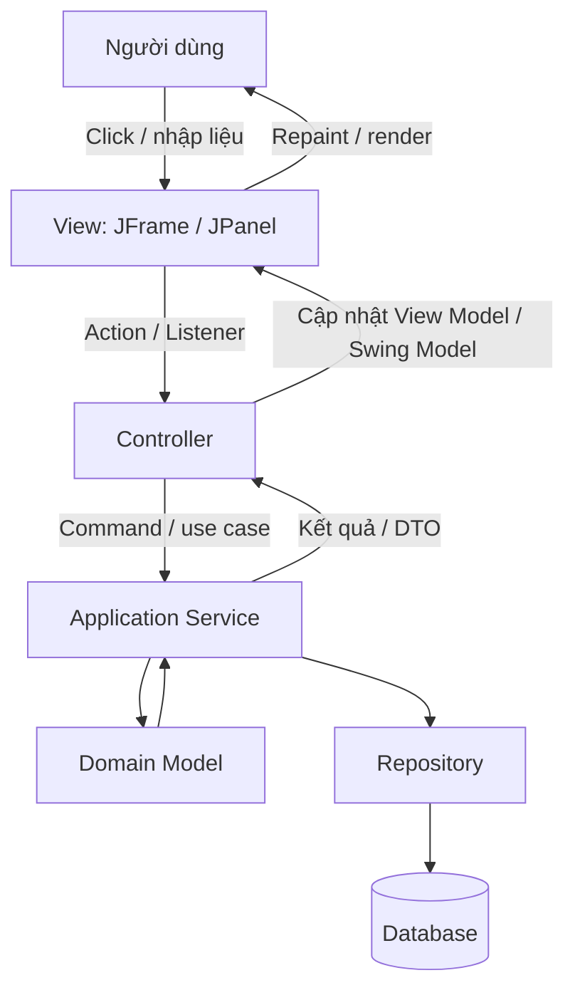
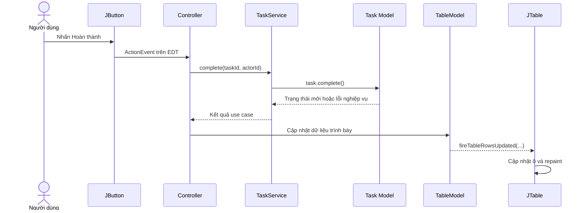

# Tổ chức MVC trong ứng dụng Java Swing

Java Swing là bộ công cụ giao diện desktop của Java. Một ứng dụng Swing thường có cửa sổ, panel, nút bấm, bảng, danh sách và các listener nhận sự kiện từ người dùng. Khi ứng dụng phát triển, nếu mọi thao tác giao diện, quy tắc nghiệp vụ và truy cập dữ liệu đều nằm trong một lớp `JFrame`, mã nguồn sẽ nhanh chóng khó kiểm thử và khó thay đổi.

Mô hình Model–View–Controller (MVC) giúp tổ chức ứng dụng Swing theo ba trách nhiệm: Model giữ trạng thái và quy tắc nghiệp vụ; View trình bày trạng thái bằng các component Swing; Controller tiếp nhận hành động và điều phối use case. Tuy nhiên, cần hiểu một điểm đặc thù: kiến trúc component của Swing không phải bản triển khai MVC cổ điển một-một. Swing dùng cách tiếp cận thường được gọi là *separable model architecture* (kiến trúc tách model), kết hợp model dữ liệu/trạng thái của component với UI delegate chịu trách nhiệm hiển thị và tương tác theo Look and Feel.

Vì vậy, khi áp dụng MVC ở cấp ứng dụng, ta tổ chức Model, View và Controller của chức năng; đồng thời tận dụng các model interface có sẵn bên trong Swing như `ListModel`, `TableModel`, `ButtonModel` và `Document`. Hiểu cả hai lớp kiến trúc này giúp tránh nhầm `JTable` với domain Model hoặc coi `TableModel` là nơi chứa toàn bộ quy tắc nghiệp vụ.

## MVC ở cấp ứng dụng Swing

Một ứng dụng quản lý công việc có thể phân chia trách nhiệm như sau:

| Thành phần | Trách nhiệm | Ví dụ trong ứng dụng Swing |
|---|---|---|
| Model | Trạng thái miền, bất biến và hành vi nghiệp vụ; có thể phối hợp repository/service | `Task`, `Project`, `TaskService`, `TaskRepository` |
| View | Bố cục và trình bày dữ liệu; cung cấp điểm tương tác | `TaskWindow`, `TaskPanel`, `JTable`, `JTextField`, `JButton` |
| Controller | Nhận sự kiện UI, chuyển thành hành động/use case, cập nhật trạng thái trình bày | `TaskController`, `ActionListener`, `Action` |

Controller không nên tự quyết định một công việc có được hoàn thành hay không. Nó gọi use case hoặc hành vi Model; Model kiểm tra trạng thái và bảo vệ quy tắc. View không nên tự truy vấn database hoặc sửa entity trực tiếp chỉ vì người dùng nhấn nút.



Luồng này là một cách tổ chức phổ biến. Ứng dụng nhỏ có thể không cần lớp Application Service riêng cho mọi thao tác; điều quan trọng là View không sở hữu quy tắc miền và Controller không biến thành nơi chứa toàn bộ nghiệp vụ.

## Kiến trúc component bên trong Swing

Swing cung cấp các component như `JButton`, `JList`, `JTable`, `JTree` và `JTextField`. Nhiều component tách trạng thái dữ liệu hoặc trạng thái lựa chọn ra khỏi phần hiển thị. Component giao tiếp với một model interface; UI delegate đảm nhiệm cách vẽ và một phần xử lý tương tác theo Look and Feel hiện hành.

### Separable model architecture

Trong Swing, một component thường có ba khía cạnh liên quan:

- **Component:** API công khai mà mã giao diện sử dụng, ví dụ `JButton` hoặc `JTable`.
- **Model:** đối tượng/interface giữ trạng thái mà component trình bày hoặc trạng thái tương tác, ví dụ `ButtonModel`, `TableModel`.
- **UI delegate:** lớp UI cụ thể như `ButtonUI` hoặc `TableUI`, được Look and Feel cài đặt để vẽ component và xử lý các chi tiết giao diện.

Model của Swing phát sự kiện khi trạng thái thay đổi. Component/UI delegate nhận sự kiện để cập nhật cách hiển thị. UI delegate có thể được thay khi Look and Feel thay đổi mà không phải viết lại domain Model của ứng dụng.

Đây là lý do không nên mô tả Swing như một MVC cổ điển hoàn toàn tách biệt trong đó mọi component luôn có đúng ba object Model, View và Controller độc lập. Swing có thiết kế model-delegate riêng; ở cấp ứng dụng, ta vẫn có thể tổ chức Controller và Model miền rõ ràng quanh các component đó.

### Một số Swing model interface quan trọng

| Component | Model interface | Dữ liệu/trạng thái được biểu diễn |
|---|---|---|
| `JButton`, `JToggleButton` | `ButtonModel` | armed, pressed, selected, enabled và trạng thái nút |
| `JList` | `ListModel<E>` và `ListSelectionModel` | Danh sách phần tử và lựa chọn hiện tại |
| `JTable` | `TableModel` và `ListSelectionModel` | Dữ liệu hàng/cột và lựa chọn hàng/cột |
| `JTree` | `TreeModel` và `TreeSelectionModel` | Cấu trúc cây và node được chọn |
| `JTextField`, `JTextArea` | `Document` | Nội dung văn bản và thay đổi nội dung |
| `JSlider` | `BoundedRangeModel` | Giá trị, min/max và extent |
| `JComboBox` | `ComboBoxModel<E>` | Các lựa chọn và phần tử đang chọn |

Các model này phục vụ trạng thái của component. Chúng không nhất thiết là domain Model. Ví dụ, `TableModel` có thể chuyển đổi danh sách `TaskSummary` thành giá trị từng ô; nó không nên quyết định người dùng có quyền hoàn thành công việc hay không.

## Phân biệt Domain Model và Swing Model

Đây là ranh giới quan trọng nhất khi tổ chức MVC trong Swing:

| Domain Model | Swing Model |
|---|---|
| Biểu diễn khái niệm và quy tắc nghiệp vụ | Cung cấp dữ liệu/trạng thái cho component |
| Có thể tồn tại độc lập với giao diện desktop | Thường gắn với vòng đời và sự kiện của component |
| Ví dụ `Task`, `Money`, `TaskAssignmentPolicy` | Ví dụ `TableModel`, `ListModel`, `ButtonModel` |
| Không nên phụ thuộc `JFrame`, `JTable` hoặc `ActionListener` | Có thể dùng `AbstractTableModel`, `DefaultListModel` và event của Swing |
| Được kiểm thử bằng unit test nghiệp vụ | Được kiểm thử về dữ liệu trình bày và sự kiện model |

Một View Model hoặc Swing adapter có thể chuyển Domain Model thành dữ liệu phù hợp cho giao diện. Chẳng hạn, `Task` lưu `dueDate` và `assigneeId`; `TaskTableModel` trình bày ngày theo định dạng người dùng và tên người được giao ở các cột. Nếu giao diện đổi từ `JTable` sang danh sách card, Domain Model không cần thay đổi.

## Luồng sự kiện trong một ứng dụng Swing

Người dùng tương tác với component. Swing tạo sự kiện và phân phối nó trên Event Dispatch Thread (EDT). Listener hoặc Action do Controller cung cấp tiếp nhận hành động, gọi use case và cập nhật model trình bày. Khi Swing model phát sự kiện dữ liệu, component cập nhật hiển thị hoặc yêu cầu repaint.



Nếu use case cần truy cập database hoặc mạng, Controller không nên chặn EDT trong thời gian dài. Phần xử lý nền và cập nhật Swing model cần được tách đúng thread; nội dung này được trình bày ở phần Event Dispatch Thread và SwingWorker bên dưới.

## Cấu trúc package gợi ý

Với ứng dụng vừa hoặc lớn, có thể tổ chức theo chức năng rồi chia trách nhiệm bên trong:

```text
src/main/java/
  com/example/tasks/
    domain/
      Task.java
      TaskStatus.java
      TaskRuleViolation.java
      TaskRepository.java
    application/
      CompleteTaskUseCase.java
      ListTasksQuery.java
      TaskService.java
      TaskSummary.java
    infrastructure/
      JdbcTaskRepository.java
    ui/
      TaskWindow.java
      TaskPanel.java
      TaskController.java
      TaskTableModel.java
      TaskActions.java
```

Đây là một cấu trúc tham khảo. Ứng dụng nhỏ có thể dùng ít package hơn; ứng dụng lớn có thể chia theo feature như `tasks`, `projects`, `reports`. Không cần tạo interface cho mọi class nếu chưa có ranh giới phụ thuộc hoặc nhu cầu thay thế rõ ràng.

## Ví dụ MVC nhỏ: bộ đếm

Một bộ đếm giúp nhìn thấy rõ luồng giữa Model, View và Controller mà không bị chi tiết database làm phân tán.

### Model giữ trạng thái

```java
import java.beans.PropertyChangeListener;
import java.beans.PropertyChangeSupport;

public final class CounterModel {
    private final PropertyChangeSupport changes =
            new PropertyChangeSupport(this);
    private int value;

    public int value() {
        return value;
    }

    public void increment() {
        int oldValue = value;
        value++;
        changes.firePropertyChange("value", oldValue, value);
    }

    public void addPropertyChangeListener(PropertyChangeListener listener) {
        changes.addPropertyChangeListener(listener);
    }
}
```

`CounterModel` giữ trạng thái và phát property change khi giá trị thay đổi. Trong ví dụ nhỏ này, hành động tăng được gọi từ listener chạy trên EDT nên sự kiện được phát đồng bộ trên EDT. Với ứng dụng thực tế, domain entity không bắt buộc phải phụ thuộc `PropertyChangeSupport`; có thể để application service trả DTO hoặc phát sự kiện ứng dụng, rồi Controller cập nhật Swing model.

### View chỉ trình bày và cung cấp component

```java
import java.awt.FlowLayout;
import javax.swing.JButton;
import javax.swing.JLabel;
import javax.swing.JPanel;

public final class CounterView extends JPanel {
    private final JLabel valueLabel = new JLabel("0");
    private final JButton incrementButton = new JButton("Tăng");

    public CounterView() {
        super(new FlowLayout());
        add(valueLabel);
        add(incrementButton);
    }

    public JButton incrementButton() {
        return incrementButton;
    }

    public void showValue(int value) {
        valueLabel.setText(Integer.toString(value));
    }
}
```

View không tăng biến đếm và không quyết định quy tắc. Nó chỉ cung cấp nút cho Controller đăng ký hành động và một phương thức trình bày giá trị.

### Controller tiếp nhận hành động và cập nhật View

```java
import java.awt.event.ActionEvent;
import java.awt.event.ActionListener;
import java.beans.PropertyChangeEvent;
import java.beans.PropertyChangeListener;

public final class CounterController
        implements ActionListener, PropertyChangeListener {

    private final CounterModel model;
    private final CounterView view;

    public CounterController(CounterModel model, CounterView view) {
        this.model = model;
        this.view = view;
        view.incrementButton().addActionListener(this);
        model.addPropertyChangeListener(this);
        view.showValue(model.value());
    }

    @Override
    public void actionPerformed(ActionEvent event) {
        model.increment();
    }

    @Override
    public void propertyChange(PropertyChangeEvent event) {
        if ("value".equals(event.getPropertyName())) {
            view.showValue((Integer) event.getNewValue());
        }
    }
}
```

Controller kết nối View với Model. Nó không chứa trạng thái đếm; khi Model phát sự kiện, Controller cập nhật nhãn. Trong ứng dụng lớn, cần quản lý vòng đời listener và gỡ đăng ký khi View bị đóng nếu Model sống lâu hơn View, tránh giữ tham chiếu không cần thiết.

### Khởi tạo giao diện trên EDT

```java
import javax.swing.JFrame;
import javax.swing.SwingUtilities;

public final class CounterApplication {
    public static void main(String[] args) {
        SwingUtilities.invokeLater(() -> {
            CounterModel model = new CounterModel();
            CounterView view = new CounterView();
            new CounterController(model, view);

            JFrame frame = new JFrame("MVC Counter");
            frame.setDefaultCloseOperation(JFrame.EXIT_ON_CLOSE);
            frame.setContentPane(view);
            frame.pack();
            frame.setLocationRelativeTo(null);
            frame.setVisible(true);
        });
    }
}
```

`SwingUtilities.invokeLater` đưa việc tạo và hiển thị component lên EDT. Trong Swing, phần lớn thao tác tạo/cập nhật component và model gắn với component phải diễn ra trên EDT. Đây là nguyên tắc cần duy trì trong toàn bộ ứng dụng.

## Controller trong Swing: Listener hay Action?

Swing cung cấp nhiều listener như `ActionListener`, `MouseListener`, `KeyListener`, `ListSelectionListener`, `DocumentListener` và `TableModelListener`. Controller có thể triển khai listener trực tiếp, hoặc tạo object `Action` để biểu diễn một hành động có thể được dùng ở nhiều vị trí.

### Khi nào dùng ActionListener?

`ActionListener` phù hợp cho một hành động đơn giản gắn với nút hoặc menu item. Ví dụ:

```java
saveButton.addActionListener(event -> controller.save());
```

Lambda ngắn giúp View wiring sự kiện rõ ràng, nhưng nếu logic bên trong lambda bắt đầu chứa validation nghiệp vụ, truy vấn dữ liệu hoặc điều kiện phức tạp, hãy chuyển phần điều phối vào Controller/use case.

### Dùng AbstractAction cho hành động dùng chung

`Action` mở rộng ý tưởng listener bằng cách gói hành động cùng thuộc tính như tên, icon, trạng thái enabled, mnemonic và accelerator. Cùng một Action có thể gắn vào button, menu item hoặc toolbar.

```java
import java.awt.event.ActionEvent;
import javax.swing.Action;
import javax.swing.AbstractAction;

public final class SaveTaskAction extends AbstractAction {
    private final TaskController controller;

    public SaveTaskAction(TaskController controller) {
        super("Lưu");
        this.controller = controller;
        putValue(SHORT_DESCRIPTION, "Lưu công việc hiện tại");
    }

    @Override
    public void actionPerformed(ActionEvent event) {
        controller.saveCurrentTask();
    }
}
```

Sau đó có thể dùng cùng Action:

```java
Action saveAction = new SaveTaskAction(controller);
JButton saveButton = new JButton(saveAction);
JMenuItem saveMenuItem = new JMenuItem(saveAction);
```

Khi `saveAction.setEnabled(false)` được gọi, các component dùng Action đó có thể phản ánh trạng thái disabled. Điều này hữu ích để đồng bộ menu, toolbar và button. Không đặt quy tắc miền vào `Action`; Action là adapter của tương tác UI, còn use case/Model vẫn phải kiểm tra điều kiện.

### Dùng InputMap và ActionMap cho phím tắt

Với phím tắt, Swing thường khuyến nghị kết hợp `InputMap` và `ActionMap` thay vì viết `KeyListener` cho từng component. Cách này tôn trọng focus condition và cơ chế binding của Swing:

```java
KeyStroke shortcut = KeyStroke.getKeyStroke("control S");
rootPane.getInputMap(JComponent.WHEN_IN_FOCUSED_WINDOW)
        .put(shortcut, "save-task");
rootPane.getActionMap().put("save-task", saveAction);
```

Phím tắt trỏ đến cùng Action với menu và button, nên một hành động có một nơi điều phối. Chọn đúng input condition như `WHEN_FOCUSED`, `WHEN_ANCESTOR_OF_FOCUSED_COMPONENT` hoặc `WHEN_IN_FOCUSED_WINDOW` theo phạm vi mong muốn.

## Dùng Swing model để hiển thị dữ liệu

Với component có dữ liệu dạng collection, nên dùng model interface thay vì thêm dữ liệu trực tiếp vào component hoặc tạo subclass component để giữ domain state.

### JList và ListModel

`JList<E>` lấy dữ liệu từ `ListModel<E>`. Với danh sách thay đổi đơn giản, có thể dùng `DefaultListModel<E>`:

```java
DefaultListModel<String> listModel = new DefaultListModel<>();
listModel.addElement("Chuẩn bị tài liệu");
listModel.addElement("Review thiết kế");

JList<String> taskList = new JList<>(listModel);
```

Khi thêm hoặc xóa phần tử qua `DefaultListModel`, model phát sự kiện để `JList` cập nhật. Nếu dữ liệu đến từ domain service, Controller lấy danh sách DTO rồi cập nhật Swing model. Không nên lưu entity ORM trực tiếp trong `DefaultListModel` nếu View chỉ cần vài trường hiển thị.

### JTable và AbstractTableModel

`JTable` dùng `TableModel` để lấy số hàng, số cột, tên cột và giá trị từng ô. Với bảng nghiệp vụ, thường tạo class kế thừa `AbstractTableModel` để chuyển DTO thành cấu trúc hàng/cột.

```java
public final class TaskTableModel extends AbstractTableModel {
    private final String[] columns = {"Mã", "Tiêu đề", "Trạng thái"};
    private List<TaskSummary> rows = List.of();

    public void setRows(List<TaskSummary> rows) {
        this.rows = List.copyOf(rows);
        fireTableDataChanged();
    }

    public TaskSummary rowAt(int modelRow) {
        return rows.get(modelRow);
    }

    @Override
    public int getRowCount() {
        return rows.size();
    }

    @Override
    public int getColumnCount() {
        return columns.length;
    }

    @Override
    public String getColumnName(int column) {
        return columns[column];
    }

    @Override
    public Object getValueAt(int rowIndex, int columnIndex) {
        TaskSummary task = rows.get(rowIndex);
        return switch (columnIndex) {
            case 0 -> task.id();
            case 1 -> task.title();
            case 2 -> task.statusLabel();
            default -> throw new IndexOutOfBoundsException(columnIndex);
        };
    }
}
```

`TaskSummary` là DTO bất biến dành cho màn hình, có thể là record chứa `id`, `title` và `statusLabel`. `setRows()` thay thế snapshot dữ liệu và phát `fireTableDataChanged()` để JTable biết nội dung đã thay đổi. Với thay đổi nhỏ, có thể dùng `fireTableRowsInserted`, `fireTableRowsUpdated` hoặc `fireTableRowsDeleted` để thông báo chính xác hơn.

Không gọi `fireTableDataChanged()` cho mọi ô nếu chỉ một hàng thay đổi; sự kiện chính xác giúp JTable và các listener cập nhật hiệu quả hơn. Những phương thức thay đổi Swing model cần được gọi trên EDT.

### Selection model là trạng thái riêng

`JTable` có model dữ liệu và selection model. Dữ liệu hàng/cột không đồng nghĩa với hàng đang được chọn. Khi xử lý hành động trên hàng, Controller cần chuyển view row index sang model row index nếu bảng đang dùng sorter/filter:

```java
int viewRow = table.getSelectedRow();
if (viewRow >= 0) {
    int modelRow = table.convertRowIndexToModel(viewRow);
    TaskSummary selected = taskTableModel.rowAt(modelRow);
    controller.openTask(selected.id());
}
```

Đoạn mã giả định `TaskTableModel` có phương thức `rowAt(int)` trả về DTO tại model index. Nếu không chuyển index khi có `RowSorter`, có thể mở nhầm công việc sau khi người dùng sắp xếp hoặc lọc bảng.

## Giữ View Model tách khỏi Domain Model

Một màn hình thường cần dữ liệu đã định dạng hoặc tổng hợp. Ví dụ, `TaskSummary` có thể chứa tên trạng thái đã bản địa hóa, tên người phụ trách và cờ `canComplete` để quyết định có hiển thị hành động hay không. Dữ liệu này có thể được tạo bởi query service hoặc presenter/view-model assembler.

```java
public record TaskSummary(
        long id,
        String title,
        String statusLabel,
        String assigneeName,
        boolean canComplete) {
}
```

`canComplete` chỉ giúp View trình bày trạng thái nút phù hợp. Khi người dùng kích hoạt hành động, use case vẫn phải kiểm tra quyền và trạng thái hiện tại. Không coi cờ trong View Model là bảo đảm nghiệp vụ vì nó có thể cũ sau khi dữ liệu thay đổi.

Một luồng tải bảng có thể là:

1. Controller gọi `ListTasksQuery`.
2. Application service lấy dữ liệu qua repository và tạo `TaskSummary`.
3. Controller nhận danh sách DTO.
4. Controller cập nhật `TaskTableModel` trên EDT.
5. `JTable` nhận event từ model và hiển thị dữ liệu.

View Model có thể được dùng chung bởi nhiều View nếu hợp đồng trình bày giống nhau, nhưng không nên biến nó thành domain entity hoặc kho lưu trạng thái bền vững.

## Event Dispatch Thread và cập nhật giao diện an toàn

Swing không thread-safe theo nghĩa mọi component có thể được gọi từ bất kỳ thread nào. Hầu hết thao tác tạo, đọc/cập nhật component và thay đổi Swing model cần diễn ra trên Event Dispatch Thread (EDT). EDT nhận event chuột/bàn phím, chạy listener, cập nhật component và xử lý repaint.

Nếu một listener thực hiện truy vấn database hoặc gọi API lâu trên EDT, cửa sổ sẽ không phản hồi vì EDT bị chặn. Người dùng có thể thấy giao diện đứng, animation dừng hoặc hệ điều hành báo ứng dụng không phản hồi.

### Dùng SwingWorker cho tác vụ nền

`SwingWorker<T, V>` giúp chạy công việc dài trong background và nhận kết quả trên EDT:

```java
new SwingWorker<List<TaskSummary>, Void>() {
    @Override
    protected List<TaskSummary> doInBackground() throws Exception {
        return listTasksQuery.handle(currentUserId);
    }

    @Override
    protected void done() {
        try {
            List<TaskSummary> tasks = get();
            taskTableModel.setRows(tasks);
            statusLabel.setText("Đã tải " + tasks.size() + " công việc");
        } catch (InterruptedException ex) {
            Thread.currentThread().interrupt();
            showLoadError("Tác vụ bị gián đoạn");
        } catch (ExecutionException ex) {
            showLoadError("Không thể tải danh sách công việc");
            logger.error("Tải danh sách thất bại", ex.getCause());
        }
    }
}.execute();
```

Ví dụ giả định `listTasksQuery`, `currentUserId`, `taskTableModel`, `statusLabel`, `showLoadError` và `logger` đã được cung cấp. `doInBackground()` chạy trên worker thread; `done()` được gọi trên EDT nên có thể cập nhật Swing component/model tại đó. `get()` trong `done()` không gây chặn lâu vì tác vụ đã hoàn tất.

Không gọi `get()` ngay sau `execute()` trên EDT, vì như vậy sẽ chặn giao diện cho đến khi tác vụ kết thúc. Với tác vụ có tiến độ, dùng `publish()` trong `doInBackground()` và `process()` trên EDT để cập nhật tiến trình. Hãy hỗ trợ cancel nếu người dùng có thể đóng cửa sổ hoặc đổi màn hình trước khi tác vụ hoàn tất.

### Quy tắc thread cho Swing Model

- Tạo và cập nhật `JFrame`, `JPanel`, component và Swing model trên EDT.
- Không chạy truy vấn hoặc xử lý tệp lớn trực tiếp trong `ActionListener`.
- Background worker có thể tải dữ liệu hoặc thực hiện I/O, sau đó chuyển snapshot về EDT.
- Không để nhiều thread cùng sửa `DefaultTableModel` hoặc `DefaultListModel`.
- Nếu domain model được chia sẻ giữa nhiều thread, quản lý concurrency ở tầng domain/application; EDT không tự làm domain model thread-safe.
- Tránh gọi đồng bộ từ EDT sang worker rồi chờ worker gọi ngược lại EDT, vì có thể tạo deadlock.

Có thể dùng `SwingUtilities.isEventDispatchThread()` trong assertion nội bộ hoặc test để phát hiện thao tác cập nhật sai thread. `SwingUtilities.invokeLater()` lên lịch một Runnable trên EDT; `invokeAndWait()` chờ EDT thực hiện và không được gọi từ chính EDT.

## Xử lý validation và lỗi trong View

View có thể phản hồi ngay cho dữ liệu dễ kiểm tra như trường bắt buộc hoặc định dạng số, nhưng quy tắc có ý nghĩa nghiệp vụ vẫn phải được xác minh ở Model/use case. Ví dụ, trường ngày có thể parse thành `LocalDate` nhưng vẫn không hợp lệ vì ngày đã qua hoặc dự án đã đóng.

Một cách tổ chức:

- View đánh dấu trường sai định dạng và hiển thị lỗi cạnh input.
- Controller chuyển dữ liệu thành command và gọi use case.
- Application service/Model kiểm tra quy tắc và trả lỗi có mã.
- Controller ánh xạ lỗi sang thông báo giao diện.
- View hiển thị thông báo, giữ dữ liệu người dùng đã nhập nếu phù hợp.

Không hiển thị stack trace hoặc thông tin SQL trong `JOptionPane`. Lỗi kỹ thuật nên được ghi log có ngữ cảnh; người dùng nhận thông báo dễ hiểu và hướng xử lý an toàn. Business rejection nên được trình bày theo lý do nghiệp vụ thay vì gọi chung là “lỗi hệ thống”.

## Kiểm thử ứng dụng MVC Swing

Tách MVC giúp kiểm thử từng phần mà không cần mở cửa sổ thật cho mọi quy tắc.

| Thành phần | Cách kiểm thử | Ví dụ xác minh |
|---|---|---|
| Domain Model | Unit test thuần | Công việc đã hủy không thể hoàn thành |
| Application Service | Unit test với fake/mock repository/port | Use case gọi đúng repository và trả kết quả |
| Controller | Test với Model/service giả và View abstraction hoặc component thật nhẹ | Nhấn action tạo command đúng và hiển thị kết quả |
| Swing Model | Unit test trên EDT khi cần | `TableModel` trả đúng hàng/cột và phát event |
| View | Component/UI test | Nhãn, trạng thái nút, lựa chọn và layout |
| Tích hợp | Test repository và luồng end-to-end | Tải dữ liệu, cập nhật và lưu qua database |

### Kiểm thử Model không cần khởi tạo Swing

Quy tắc nghiệp vụ nên được kiểm thử bằng JUnit trực tiếp trên entity/value object/service. Nếu test `Task.complete()` cần tạo `JFrame`, `JButton` hoặc `JTable`, thường là dấu hiệu domain logic đang bị trộn vào giao diện.

### Kiểm thử Swing trên EDT

Khi test tương tác với component, tạo và thao tác component trên EDT. Có thể dùng:

```java
SwingUtilities.invokeAndWait(() -> {
    TaskTableModel model = new TaskTableModel();
    model.setRows(List.of(
            new TaskSummary(1, "Viết tài liệu", "Đang làm", "An", true)));

    assertEquals(1, model.getRowCount());
    assertEquals("Viết tài liệu", model.getValueAt(0, 1));
});
```

Ví dụ giả định record `TaskSummary` và class `TaskTableModel` đã được định nghĩa. Với test thực tế, có thể đăng ký `TableModelListener` để xác minh loại sự kiện và phạm vi hàng thay đổi. Không dùng `invokeAndWait()` từ EDT vì sẽ gây lỗi hoặc deadlock.

### Kiểm thử Controller

Controller nên phụ thuộc vào abstraction use case và một giao diện View đủ nhỏ. Có thể cung cấp fake service để xác minh:

- action được gọi đúng khi người dùng kích hoạt;
- dữ liệu được chuyển thành command đúng;
- kết quả thành công cập nhật View/Swing model;
- lỗi nghiệp vụ hiển thị thông báo phù hợp;
- lỗi kỹ thuật không làm ứng dụng treo hoặc lộ chi tiết nội bộ;
- thao tác không hợp lệ không cập nhật giao diện như thể đã thành công.

Không cần mock mọi method của `JFrame` hoặc test từng getter. Hãy kiểm tra hành vi quan sát được và giữ test độc lập với layout pixel nếu không phải kiểm thử giao diện trực quan.

### Kiểm thử end-to-end

Với luồng quan trọng, có thể dùng AssertJ Swing hoặc công cụ desktop UI automation phù hợp để mở cửa sổ, click, nhập liệu và xác minh kết quả. E2E test có chi phí cao hơn unit test, nên tập trung vào luồng chính như đăng nhập, tạo, sửa, hoàn thành và tìm kiếm dữ liệu.

Test GUI có thể phụ thuộc môi trường hiển thị, kích thước màn hình, Look and Feel và timing. Giữ phần lớn quy tắc ở unit test; dùng GUI test để xác minh các component thực sự được nối đúng và luồng người dùng hoạt động.

## Những sai lầm thường gặp khi áp dụng MVC với Swing

- **Đặt mọi thứ trong JFrame:** cửa sổ vừa vẽ, vừa xử lý nghiệp vụ, vừa truy cập database. Tách View, Controller và use case.
- **Để View sửa Domain Model trực tiếp:** component trở thành nơi quyết định quy tắc. Chuyển hành động qua Controller/use case.
- **Nhầm TableModel với Domain Model:** dữ liệu từng ô bị dùng làm nguồn sự thật nghiệp vụ. Dùng TableModel như adapter trình bày.
- **Controller chứa toàn bộ nghiệp vụ:** listener dài và khó kiểm thử. Đưa quy tắc vào Model hoặc service.
- **Dùng static field để chia sẻ trạng thái giao diện:** nhiều cửa sổ hoặc test ảnh hưởng lẫn nhau. Quản lý dependency và vòng đời rõ ràng.
- **Chặn EDT bằng I/O:** cửa sổ không phản hồi. Dùng `SwingWorker` hoặc executor và chuyển cập nhật về EDT.
- **Cập nhật Swing model từ background thread:** component có thể hiển thị lỗi hoặc trạng thái không nhất quán. Thực hiện thay đổi model gắn với Swing trên EDT.
- **Dùng KeyListener cho mọi phím tắt:** hành vi phụ thuộc focus và khó chia sẻ. Dùng `InputMap`, `ActionMap` và `Action`.
- **Không chuyển view index sang model index:** thao tác nhầm hàng sau sort/filter trong JTable. Dùng `convertRowIndexToModel()`.
- **Không gỡ listener:** Model sống lâu giữ tham chiếu đến View đã đóng. Quản lý đăng ký/hủy đăng ký listener.
- **Tin trạng thái nút disabled:** client UI có thể cũ hoặc bị thay đổi. Use case phải kiểm tra quyền và quy tắc lại.
- **Test toàn bộ bằng GUI:** test chậm và khó chẩn đoán. Ưu tiên unit test Model/service, thêm component và E2E test cho luồng cần thiết.

## Khi nào nên dùng MVC, MVP hoặc MVVM trong Swing?

MVC là cách tổ chức phù hợp khi Controller có thể điều phối hành động và View có thể được cập nhật qua các method hoặc Swing model. Tuy nhiên, một số ứng dụng có View phức tạp cần kiểm thử độc lập hơn:

- **MVP (Model–View–Presenter):** View thường là interface thụ động; Presenter nhận event và quyết định nội dung hiển thị. Dễ kiểm thử Presenter bằng fake View, phù hợp khi giao diện có nhiều trạng thái và logic điều phối.
- **MVVM (Model–View–ViewModel):** ViewModel cung cấp state và command cho View. Swing không có data binding tích hợp rộng như một số framework UI khác, nên thường cần property change listener hoặc thư viện binding để nối state.
- **MVC:** Controller nhận sự kiện và phối hợp Model/View; phù hợp cho form, cửa sổ và chức năng có luồng tương tác tương đối rõ.

Không cần áp dụng đồng thời nhiều pattern cho một màn hình. Chọn cấu trúc giúp ranh giới dễ hiểu, giảm phụ thuộc và kiểm thử được. Có thể dùng MVC cho toàn ứng dụng và một presenter/view-model nhỏ cho màn hình phức tạp nếu lợi ích thực tế rõ ràng.

## Quy trình xây dựng một màn hình Swing theo MVC

Khi thêm một chức năng, có thể làm theo trình tự:

1. **Mô tả use case:** người dùng muốn thực hiện hành động gì và điều kiện thành công/thất bại là gì?
2. **Xác định Model:** entity, value object, policy và application service nào chịu trách nhiệm?
3. **Thiết kế dữ liệu trình bày:** View Model/DTO cần trường nào; không đưa toàn bộ entity vào component nếu không cần.
4. **Tạo Swing View:** bố cục component và các method trình bày; tránh truy cập repository.
5. **Tạo Swing Model khi phù hợp:** `TableModel`, `ListModel`, `Document` hoặc model mặc định tương ứng.
6. **Nối Controller:** dùng listener hoặc Action để chuyển thao tác thành command/use case.
7. **Xác định thread:** I/O chạy nền; tạo và cập nhật component/Swing model trên EDT.
8. **Xử lý lỗi và trạng thái:** loading, empty, validation, business rejection và technical error.
9. **Kiểm thử từng ranh giới:** Model, service, Controller, Swing model và luồng UI quan trọng.
10. **Quản lý vòng đời:** gỡ listener, hủy worker và giải phóng tài nguyên khi cửa sổ đóng.

## Checklist review MVC trong Java Swing

- Domain Model không phụ thuộc Swing component hoặc listener.
- View chủ yếu bố trí và trình bày; không truy vấn database hoặc chứa quy tắc nghiệp vụ.
- Controller nhận sự kiện và gọi use case thay vì thực hiện mọi nghiệp vụ trực tiếp.
- Swing model được dùng đúng vai trò dữ liệu/trạng thái component.
- Domain Model và `TableModel`/`ListModel` được phân biệt rõ.
- Dữ liệu trình bày được chuyển qua DTO/View Model phù hợp.
- Các thao tác I/O dài không chạy trên EDT.
- Component và Swing model được cập nhật trên EDT.
- JTable xử lý đúng view/model row index khi có sorter.
- Listener và worker có vòng đời, được hủy hoặc gỡ khi không còn cần.
- Quy tắc nghiệp vụ có unit test độc lập với GUI.
- Luồng giao diện quan trọng có component hoặc end-to-end test.

## Câu hỏi tự đánh giá

1. Model, View và Controller đảm nhiệm trách nhiệm gì trong một ứng dụng Swing?
2. Vì sao kiến trúc component Swing thường được mô tả là separable model architecture thay vì MVC cổ điển thuần túy?
3. `TableModel` khác Domain Model ở điểm nào?
4. UI delegate liên quan thế nào đến Look and Feel?
5. Vì sao Controller nên gọi use case thay vì tự sửa entity và lưu database?
6. Khi nào nên dùng `Action` thay cho một `ActionListener` riêng lẻ?
7. Vì sao phải chuyển view row index sang model row index trong JTable có sorter?
8. Event Dispatch Thread chịu trách nhiệm gì và tại sao không nên chặn nó bằng I/O?
9. `SwingWorker` phân chia công việc giữa `doInBackground()` và `done()` như thế nào?
10. Những phần nào nên được kiểm thử bằng unit test, component test và GUI end-to-end test?

Tổ chức MVC trong Java Swing cần nhìn ở hai cấp: MVC của chức năng ứng dụng và kiến trúc model-delegate bên trong Swing. Domain Model giữ quy tắc; Controller/Action điều phối sự kiện; View trình bày qua component; các Swing model như `TableModel` hoặc `ListModel` cung cấp dữ liệu cho component. Khi giữ rõ các ranh giới này, tuân thủ EDT và kiểm thử từng lớp phù hợp, ứng dụng desktop sẽ dễ mở rộng, ít phụ thuộc giao diện và dễ bảo trì hơn.
