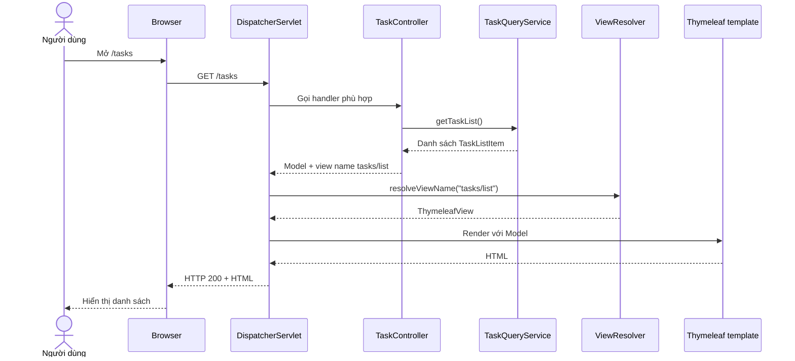

# Kết xuất khuôn mẫu trong ứng dụng Spring MVC

Trong một ứng dụng web server-rendered, người dùng gửi request, Controller xử lý dữ liệu đầu vào rồi trả về một trang HTML. Controller thường không tự ghép từng thẻ HTML thành chuỗi. Thay vào đó, nó chuẩn bị dữ liệu cho View và trả tên khuôn mẫu (template). Spring MVC chọn `View` phù hợp thông qua `ViewResolver`, sau đó template engine kết xuất HTML để gửi về trình duyệt.

Hiểu đúng luồng này giúp phân biệt trách nhiệm giữa Controller, Model, View và template engine. Controller quyết định trang nào cần hiển thị và cung cấp dữ liệu; template tập trung trình bày dữ liệu; `ViewResolver` tìm cách kết xuất tương ứng. Với Spring Boot, Thymeleaf là một lựa chọn phổ biến, nhưng Spring MVC cũng hỗ trợ JSP và nhiều loại View khác.

## 1. Kết xuất khuôn mẫu nằm ở đâu trong MVC?

Hãy xét trang danh sách công việc. Người dùng gửi `GET /tasks`. Spring MVC tìm Controller xử lý URL, Controller gọi Service để lấy dữ liệu và trả về tên View `tasks/list`. ViewResolver tìm template tương ứng; template engine chèn dữ liệu vào HTML rồi gửi response.



Các thành phần có trách nhiệm riêng:

| Thành phần | Trách nhiệm |
|---|---|
| `DispatcherServlet` | Front Controller nhận request và điều phối xử lý MVC |
| Controller | Tiếp nhận request, gọi use case, chuẩn bị model và chọn kết quả |
| `Model` | Chứa các thuộc tính cần chuyển sang View trong request hiện tại |
| `ViewResolver` | Ánh xạ tên View thành đối tượng View có thể kết xuất |
| `View` / template engine | Kết xuất dữ liệu thành nội dung response, thường là HTML |
| Browser | Nhận HTML và hiển thị giao diện |

`Model` trong Spring MVC thường là `org.springframework.ui.Model`. Nó là vùng chứa dữ liệu trình bày, không phải domain model hay entity ORM. Dữ liệu nghiệp vụ được lấy từ Service rồi chuyển thành ViewModel hoặc DTO phù hợp trước khi đưa vào Model.

## 2. Controller trả tên View thay vì tự tạo HTML

Với `@Controller`, một phương thức có thể trả về `String` để chỉ định tên View:

```java
@Controller
@RequestMapping("/tasks")
public class TaskPageController {
    private final TaskQueryService taskQueryService;

    public TaskPageController(TaskQueryService taskQueryService) {
        this.taskQueryService = taskQueryService;
    }

    @GetMapping
    public String list(Model model) {
        model.addAttribute("tasks", taskQueryService.getTaskList());
        return "tasks/list";
    }
}
```

Trong ví dụ:

- `taskQueryService.getTaskList()` lấy dữ liệu cho màn hình.
- `model.addAttribute("tasks", ...)` đặt dữ liệu vào Model với tên `tasks`.
- `return "tasks/list"` chỉ định logical view name.

Controller không cần biết file template nằm ở thư mục nào hoặc được render bằng Thymeleaf hay JSP. Cấu hình ViewResolver đảm nhận ánh xạ tên View.

### Những kiểu return value thường gặp

| Giá trị trả về | Ý nghĩa trong `@Controller` |
|---|---|
| `String` | Logical view name, ví dụ `tasks/list` |
| `ModelAndView` | Kết hợp Model và tên View trong một đối tượng |
| `View` | Trả trực tiếp đối tượng View |
| `RedirectView` | Chỉ định redirect một cách tường minh |
| `void` | Có thể dùng response đã được ghi trực tiếp hoặc suy ra default view tùy chữ ký và cấu hình; cần tránh mơ hồ |

Có thể dùng `ModelAndView` khi muốn gộp model và view:

```java
@GetMapping("/{id}")
public ModelAndView detail(@PathVariable long id) {
    TaskDetailView task = taskQueryService.getDetail(id);

    ModelAndView result = new ModelAndView("tasks/detail");
    result.addObject("task", task);
    return result;
}
```

Với handler đơn giản, `String` kết hợp tham số `Model` thường dễ đọc hơn. Hãy chọn một cách nhất quán trong cùng codebase.

### Phân biệt tên View với response body

Trong `@Controller`, chuỗi trả về thường được hiểu là tên View. Khi dùng `@ResponseBody`, giá trị trả về được ghi vào HTTP response body thông qua `HttpMessageConverter`.

```java
@Controller
class TaskPageController {
    @GetMapping("/tasks")
    String page(Model model) {
        model.addAttribute("tasks", taskQueryService.getTaskList());
        return "tasks/list";
    }
}
```

```java
@RestController
class TaskApiController {
    @GetMapping("/api/tasks")
    List<TaskResponse> list() {
        return taskQueryService.getTaskResponses();
    }
}
```

`@RestController` tương đương `@Controller` kết hợp `@ResponseBody` ở cấp lớp. Phương thức API không đi qua ViewResolver để tìm template; đối tượng trả về được chuyển thành JSON hoặc định dạng phù hợp với content negotiation.

## 3. ViewResolver ánh xạ logical view name như thế nào?

Controller trả về tên logic, chẳng hạn `tasks/list`. ViewResolver tìm cách chuyển tên đó thành một View cụ thể.

Với Thymeleaf trong Spring Boot, starter thường tự cấu hình `ThymeleafViewResolver` và template engine. Theo cấu hình mặc định phổ biến:

- Thư mục template: `classpath:/templates/`
- Phần mở rộng: `.html`
- Tên View `tasks/list` được tìm trong `templates/tasks/list.html`.

Cấu hình có thể điều chỉnh trong `application.yml`:

```yaml
spring:
  thymeleaf:
    prefix: classpath:/templates/
    suffix: .html
    mode: HTML
    encoding: UTF-8
    cache: true
```

Trong môi trường phát triển, có thể tắt cache template để thay đổi HTML được phản ánh nhanh hơn:

```yaml
spring:
  thymeleaf:
    cache: false
```

Ở production, bật cache thường phù hợp hơn để tránh đọc và phân tích template lại cho mỗi request. Spring Boot có thể cung cấp các giá trị mặc định tương ứng, vì vậy chỉ khai báo những thuộc tính cần tùy chỉnh.

### Khi có nhiều ViewResolver

Một ứng dụng có thể dùng nhiều loại View, ví dụ Thymeleaf cho HTML và một ViewResolver khác cho PDF hoặc JSP. Spring xét các ViewResolver theo thứ tự cấu hình. Nếu một resolver bắt mọi tên View quá rộng, nó có thể chiếm mất tên mà resolver sau cần xử lý.

Khi cấu hình nhiều resolver:

- Đặt thứ tự có chủ đích.
- Giới hạn mẫu tên hoặc phạm vi View mà resolver xử lý nếu có thể.
- Kiểm tra tên View thực tế được chọn trong integration test.
- Tránh khai báo thủ công bean làm trùng hoặc ghi đè cấu hình auto-configuration của Spring Boot.

Với ứng dụng chỉ dùng Thymeleaf, cấu hình mặc định từ starter thường đủ; không cần tự tạo ViewResolver nếu không có yêu cầu đặc biệt.

## 4. Tạo template Thymeleaf đầu tiên

Giả sử Controller đưa danh sách `TaskListItem` vào Model. Tạo file:

```text
src/main/resources/
  templates/
    tasks/
      list.html
```

Nội dung template:

```html
<!DOCTYPE html>
<html lang="vi" xmlns:th="http://www.thymeleaf.org">
<head>
    <meta charset="UTF-8">
    <meta name="viewport" content="width=device-width, initial-scale=1">
    <title>Danh sách công việc</title>
    <link rel="stylesheet" th:href="@{/css/app.css}">
</head>
<body>
    <main>
        <h1>Danh sách công việc</h1>

        <p th:if="${#lists.isEmpty(tasks)}">
            Chưa có công việc nào.
        </p>

        <table th:unless="${#lists.isEmpty(tasks)}">
            <thead>
                <tr>
                    <th>Tiêu đề</th>
                    <th>Người phụ trách</th>
                    <th>Trạng thái</th>
                </tr>
            </thead>
            <tbody>
                <tr th:each="task : ${tasks}">
                    <td>
                        <a th:href="@{/tasks/{id}(id=${task.id})}"
                           th:text="${task.title}">Tiêu đề mẫu</a>
                    </td>
                    <td th:text="${task.assigneeName}">Người phụ trách</td>
                    <td th:text="${task.status}">OPEN</td>
                </tr>
            </tbody>
        </table>

        <a th:href="@{/tasks/new}">Tạo công việc</a>
    </main>
</body>
</html>
```

Các thuộc tính `th:*` là chỉ thị Thymeleaf:

- `th:each` lặp qua collection.
- `th:if` và `th:unless` điều khiển phần tử theo điều kiện.
- `th:text` thay nội dung văn bản của phần tử.
- `th:href` tạo URL có xét context path của ứng dụng.
- Biểu thức `${...}` đọc thuộc tính trong context template.

Template vẫn là HTML hợp lệ. Giá trị mặc định như `Tiêu đề mẫu` có thể xuất hiện khi mở file trực tiếp, còn khi được Thymeleaf render thì nội dung được thay bằng dữ liệu Model.

## 5. Truyền dữ liệu từ Controller sang template

Controller đưa thuộc tính vào Model bằng tên và giá trị:

```java
model.addAttribute("tasks", taskQueryService.getTaskList());
model.addAttribute("pageTitle", "Công việc của tôi");
```

Template truy cập bằng `${tasks}` và `${pageTitle}`:

```html
<h1 th:text="${pageTitle}">Trang công việc</h1>
<tr th:each="task : ${tasks}">
    <td th:text="${task.title}">Tiêu đề</td>
</tr>
```

Tên thuộc tính là một phần hợp đồng giữa Controller và View. Nên dùng tên có ý nghĩa và nhất quán; tránh tạo quá nhiều biến rời rạc hoặc đưa cả object graph lớn vào Model.

### Dùng ViewModel thay vì đưa entity ORM vào View

Một trang danh sách thường chỉ cần một số trường. Hãy định nghĩa DTO cho màn hình:

```java
public record TaskListItem(
        long id,
        String title,
        String assigneeName,
        String status) {
}
```

Service trả dữ liệu đã chuẩn bị:

```java
@Transactional(readOnly = true)
public List<TaskListItem> getTaskList() {
    return taskRepository.findTaskListItems();
}
```

Đưa entity trực tiếp vào template có thể khiến template vô tình truy cập quan hệ lazy, gây N+1 query hoặc `LazyInitializationException`. DTO/ViewModel làm rõ dữ liệu mà màn hình được phép hiển thị và giúp tránh phụ thuộc vào cấu trúc lưu trữ.

### Model có phạm vi theo request

Các thuộc tính thêm vào Model thường được dùng để render response hiện tại. Không nên dùng Model làm kho lưu trạng thái qua nhiều request. Nếu cần dữ liệu tồn tại qua redirect, dùng `RedirectAttributes` và flash attribute; nếu cần trạng thái lâu dài, lưu ở nơi phù hợp như database hoặc session theo đúng mục đích.

## 6. Binding dữ liệu biểu mẫu với `th:object` và `th:field`

Với biểu mẫu, Spring MVC có thể bind request parameter vào một form object. Thymeleaf hỗ trợ gắn các trường HTML với object đó.

Form object:

```java
public class CreateTaskForm {
    @NotBlank(message = "Tiêu đề không được để trống.")
    @Size(max = 200, message = "Tiêu đề tối đa 200 ký tự.")
    private String title;

    @Size(max = 1000, message = "Mô tả tối đa 1000 ký tự.")
    private String description;

    public String getTitle() { return title; }
    public void setTitle(String title) { this.title = title; }
    public String getDescription() { return description; }
    public void setDescription(String description) { this.description = description; }
}
```

Controller:

```java
@GetMapping("/new")
public String newForm(Model model) {
    model.addAttribute("form", new CreateTaskForm());
    return "tasks/form";
}

@PostMapping
public String create(
        @Valid @ModelAttribute("form") CreateTaskForm form,
        BindingResult bindingResult,
        RedirectAttributes redirectAttributes) {

    if (bindingResult.hasErrors()) {
        return "tasks/form";
    }

    long id = taskCommandService.create(new CreateTaskCommand(
            form.getTitle(), form.getDescription()));
    redirectAttributes.addFlashAttribute("notice", "Đã tạo công việc.");
    return "redirect:/tasks/" + id;
}
```

`CreateTaskCommand` là kiểu dữ liệu của ca sử dụng, ví dụ:

```java
public record CreateTaskCommand(String title, String description) {
}
```

Controller chuyển form object thành command để tầng nghiệp vụ không phụ thuộc vào cấu trúc binding của Spring MVC. Ứng dụng thực tế có thể bổ sung actor lấy từ ngữ cảnh xác thực và các trường đã được kiểm tra theo hợp đồng.

`BindingResult` phải đặt ngay sau tham số được bind và validate để nhận lỗi tương ứng. Khi có lỗi, Controller trả lại cùng template và Spring giữ thông tin binding để Thymeleaf hiển thị giá trị đã nhập cùng lỗi trường.

Template `tasks/form.html`:

```html
<form th:action="@{/tasks}" th:object="${form}" method="post">
    <div>
        <label for="title">Tiêu đề</label>
        <input id="title" type="text" th:field="*{title}">
        <p th:if="${#fields.hasErrors('title')}"
           th:errors="*{title}">Lỗi tiêu đề</p>
    </div>

    <div>
        <label for="description">Mô tả</label>
        <textarea id="description" th:field="*{description}"></textarea>
        <p th:if="${#fields.hasErrors('description')}"
           th:errors="*{description}">Lỗi mô tả</p>
    </div>

    <button type="submit">Lưu</button>
</form>
```

`th:object` chọn form object làm đối tượng gốc. `th:field` liên kết input với thuộc tính của object và tạo các thuộc tính `name`, `id`, `value` phù hợp. `*{...}` là biểu thức selection dựa trên object hiện tại.

### CSRF token cho form

Nếu ứng dụng bật Spring Security CSRF và không dùng cơ chế tích hợp tự động tương ứng, form POST cần gửi token. Có thể thêm trường ẩn:

```html
<input type="hidden"
       th:name="${_csrf.parameterName}"
       th:value="${_csrf.token}">
```

Kiểm tra cấu hình Spring Security và Thymeleaf đang dùng để tránh thiếu token hoặc thêm trùng. Không tắt CSRF chỉ để làm cho test/form chạy được.

## 7. Hiển thị dữ liệu an toàn: `th:text` và `th:utext`

Template có thể hiển thị dữ liệu do người dùng nhập. Nếu đưa nội dung đó vào HTML mà không escape, kẻ tấn công có thể chèn markup hoặc script (cross-site scripting, XSS).

Thymeleaf `th:text` ghi nội dung dưới dạng văn bản và escape các ký tự HTML đặc biệt:

```html
<p th:text="${task.description}">Mô tả công việc</p>
```

Nếu người dùng gửi chuỗi:

```text
<script>alert('xss')</script>
```

thì `th:text` hiển thị nó như văn bản, không thực thi thành script.

`th:utext` kết xuất nội dung không escape:

```html
<div th:utext="${task.description}"></div>
```

Chỉ dùng `th:utext` khi nội dung HTML đã được làm sạch bằng sanitizer đáng tin cậy và có yêu cầu nghiệp vụ rõ ràng. Không dùng nó cho nội dung tự do do người dùng gửi. Việc đổi `th:text` thành `th:utext` để giữ định dạng có thể tạo lỗ hổng XSS.

Quy tắc tương tự áp dụng cho URL, JavaScript inline, CSS và thuộc tính HTML. Không ghép dữ liệu không tin cậy vào ngữ cảnh thực thi script hoặc URL điều hướng mà không xác thực theo đúng ngữ cảnh.

## 8. Tái sử dụng template bằng fragment

Một ứng dụng có thể có header, navigation, footer hoặc một hàng bảng dùng chung. Thymeleaf fragment giúp tách phần HTML tái sử dụng.

File `templates/fragments/layout.html`:

```html
<header th:fragment="siteHeader">
    <a th:href="@{/}">Trang chủ</a>
    <nav>
        <a th:href="@{/tasks}">Công việc</a>
    </nav>
</header>
```

File `templates/fragments/task-row.html`:

```html
<tr th:fragment="taskRow(task)">
    <td th:text="${task.title}">Tiêu đề</td>
    <td th:text="${task.assigneeName}">Người phụ trách</td>
    <td th:text="${task.status}">OPEN</td>
</tr>
```

Sử dụng fragment trong `tasks/list.html`:

```html
<body>
    <div th:replace="~{fragments/layout :: siteHeader}"></div>
    <table>
        <tbody>
            <th:block th:each="task : ${tasks}">
                <th:block th:replace="~{fragments/task-row :: taskRow(${task})}"></th:block>
            </th:block>
        </tbody>
    </table>
</body>
```

`th:replace` thay phần tử hiện tại bằng fragment; `th:insert` giữ phần tử bao ngoài và chèn fragment vào bên trong. Chọn theo cấu trúc HTML mong muốn, đặc biệt khi fragment là phần tử như `tr`, `li` hoặc `section` cần nằm đúng vị trí trong DOM.

Fragment nên nhận dữ liệu tường minh và chỉ đảm nhiệm trình bày. Không đặt truy vấn database hoặc quy tắc nghiệp vụ vào fragment.

## 9. Điều hướng và Post/Redirect/Get

Sau khi xử lý POST thành công, ứng dụng server-rendered thường dùng mẫu Post/Redirect/Get (PRG):

1. Browser gửi `POST /tasks`.
2. Controller gọi Service tạo công việc.
3. Controller trả redirect đến `GET /tasks/{id}`.
4. Browser gửi GET và nhận trang kết quả.

Trong Spring MVC, có thể trả chuỗi bắt đầu bằng `redirect:`:

```java
return "redirect:/tasks/" + id;
```

Hoặc dùng `RedirectAttributes` để truyền thông báo tạm thời:

```java
redirectAttributes.addFlashAttribute("notice", "Đã lưu công việc.");
return "redirect:/tasks/" + id;
```

Flash attribute tồn tại qua lần chuyển hướng tiếp theo rồi được tiêu thụ. Nó phù hợp cho thông báo thành công hoặc lỗi ngắn hạn, không phải nơi lưu dữ liệu nghiệp vụ.

`redirect:` yêu cầu Spring tạo redirect response. Trong nhiều cấu hình Spring MVC, redirect sau POST dùng status 302 theo mặc định; nếu hợp đồng cần 303 rõ ràng, có thể trả `RedirectView` và cấu hình status hoặc tạo `ResponseEntity` phù hợp. Không nên giả định mọi redirect đều có cùng status nếu test phụ thuộc chính xác vào mã HTTP.

`forward:` chuyển tiếp nội bộ đến tài nguyên phía server trong cùng request; nó khác redirect vì browser không gửi request mới và URL trên thanh địa chỉ không thay đổi. Chỉ dùng khi có lý do rõ ràng; với form POST thành công, PRG thường dễ dự đoán hơn.

## 10. Tạo URL và phục vụ tài nguyên tĩnh

Template nên dùng URL expression của Thymeleaf để tạo đường dẫn có xét context path:

```html
<link rel="stylesheet" th:href="@{/css/app.css}">
<script th:src="@{/js/tasks.js}" defer></script>
<a th:href="@{/tasks/{id}(id=${task.id})}">Chi tiết</a>
```

Tài nguyên tĩnh thường đặt trong:

```text
src/main/resources/static/
  css/app.css
  js/tasks.js
  images/logo.svg
```

Spring Boot mặc định phục vụ nội dung trong các thư mục static resource phổ biến dưới classpath. Khi cần tùy chỉnh, có thể dùng `WebMvcConfigurer#addResourceHandlers`. Không nên tạo Controller riêng cho từng file CSS hoặc ảnh.

Trong production, có thể đặt cache header cho tài nguyên tĩnh và dùng tên file có fingerprint để trình duyệt cache lâu mà vẫn nhận bản mới khi nội dung thay đổi. Không cache tùy tiện HTML chứa dữ liệu riêng tư hoặc phụ thuộc session.

Nếu ứng dụng dùng Spring Boot, tránh thêm `@EnableWebMvc` chỉ để tùy chỉnh một vài resource handler. Annotation này chuyển quyền cấu hình MVC sang ứng dụng và có thể làm mất một phần auto-configuration mà Boot cung cấp. Thông thường chỉ cần implement `WebMvcConfigurer` nếu muốn bổ sung cấu hình.

## 11. Bản địa hóa nội dung template

Không nên viết cố định mọi nhãn giao diện trong template nếu ứng dụng cần nhiều ngôn ngữ. Spring `MessageSource` và Thymeleaf cho phép lấy thông điệp theo locale.

File `messages_vi.properties`:

```properties
tasks.title=Danh sách công việc
tasks.create=Tạo công việc
tasks.empty=Chưa có công việc nào.
```

File `messages_en.properties`:

```properties
tasks.title=Task list
tasks.create=Create task
tasks.empty=There are no tasks yet.
```

Template:

```html
<h1 th:text="#{tasks.title}">Task list</h1>
<p th:text="#{tasks.empty}">There are no tasks yet.</p>
<a th:href="@{/tasks/new}" th:text="#{tasks.create}">Create task</a>
```

`#{...}` là message expression. Locale có thể được xác định từ cấu hình locale resolver, cookie, session hoặc header tùy chính sách ứng dụng. Mã lỗi nghiệp vụ nên ổn định, còn thông điệp hiển thị có thể được dịch tại tầng trình bày.

## 12. Xử lý lỗi và trang lỗi trong template

Validation của form thường được trả về chính template với `BindingResult`. Lỗi ở mức request hoặc nghiệp vụ có thể được ánh xạ sang trang lỗi bằng `@ControllerAdvice`.

Ví dụ:

```java
@ControllerAdvice(basePackages = "com.example.web.page")
public class PageErrorHandler {

    @ExceptionHandler(TaskNotFoundException.class)
    public ModelAndView handleNotFound() {
        ModelAndView view = new ModelAndView("errors/not-found");
        view.setStatus(HttpStatus.NOT_FOUND);
        view.addObject("message", "Không tìm thấy công việc.");
        return view;
    }
}
```

Template `templates/errors/not-found.html`:

```html
<!DOCTYPE html>
<html lang="vi" xmlns:th="http://www.thymeleaf.org">
<head>
    <meta charset="UTF-8">
    <title>Không tìm thấy</title>
</head>
<body>
    <main>
        <h1>Không tìm thấy tài nguyên</h1>
        <p th:text="${message}">Không tìm thấy nội dung.</p>
        <a th:href="@{/tasks}">Quay lại danh sách</a>
    </main>
</body>
</html>
```

Trang lỗi vẫn cần HTTP status đúng. Không trả `200 OK` cho tài nguyên không tồn tại chỉ vì template lỗi đã render thành công. Với API JSON, dùng advice riêng hoặc phạm vi riêng để tránh trả HTML cho client API.

## 13. Giữ template tập trung vào trình bày

Template có thể chứa điều kiện đơn giản, lặp danh sách và định dạng hiển thị. Tuy nhiên, không nên biến template thành nơi điều phối nghiệp vụ.

Không nên:

- Gọi repository hoặc Service từ template.
- Tự quyết định người dùng có quyền thực hiện hành động hay không chỉ dựa trên việc ẩn/hiện nút.
- Tính toán quy tắc giá, trạng thái hoặc chính sách phức tạp bằng biểu thức template.
- Truy cập entity graph sâu khiến ORM phát sinh truy vấn ngoài dự kiến.
- Đưa token, dữ liệu xác thực hoặc trường nội bộ vào HTML không cần thiết.

Nên:

- Chuẩn bị ViewModel rõ ràng ở Service/query layer.
- Đưa trạng thái hiển thị cần thiết vào Model, ví dụ `canEdit` sau khi đã được server tính toán.
- Dùng fragment cho phần HTML lặp lại.
- Escape dữ liệu không tin cậy.
- Kiểm tra quyền ở server cho mọi request, kể cả khi View đã ẩn nút.

Ví dụ ViewModel:

```java
public record TaskDetailView(
        long id,
        String title,
        String description,
        String statusLabel,
        boolean canEdit,
        boolean canComplete) {
}
```

Template chỉ dùng các thuộc tính để quyết định cách trình bày:

```html
<h1 th:text="${task.title}">Công việc</h1>
<p th:text="${task.statusLabel}">Đang mở</p>
<a th:if="${task.canEdit}"
   th:href="@{/tasks/{id}/edit(id=${task.id})}">Sửa</a>
```

`canEdit` hỗ trợ trải nghiệm giao diện; Controller/Service vẫn phải xác minh quyền khi nhận request sửa.

## 14. Kiểm thử quá trình render template

Có thể dùng MockMvc để xác nhận Controller chọn đúng View và đưa đúng dữ liệu vào Model:

```java
@WebMvcTest(TaskPageController.class)
class TaskPageControllerTest {
    @Autowired
    MockMvc mockMvc;

    @MockBean
    TaskQueryService taskQueryService;

    @Test
    void rendersTaskListView() throws Exception {
        given(taskQueryService.getTaskList()).willReturn(List.of(
                new TaskListItem(42L, "Chuẩn bị báo cáo", "An", "OPEN")
        ));

        mockMvc.perform(get("/tasks"))
                .andExpect(status().isOk())
                .andExpect(view().name("tasks/list"))
                .andExpect(model().attributeExists("tasks"))
                .andExpect(content().string(containsString("Chuẩn bị báo cáo")));
    }
}
```

Test slice cần có cấu hình ViewResolver/template engine tương ứng nếu muốn xác nhận HTML đã render. Nếu chỉ kiểm tra `view().name(...)` và Model, test đang xác nhận kết quả điều phối MVC; nó chưa chứng minh template thực tế không có lỗi cú pháp. Có thể bổ sung integration test với Thymeleaf được cấu hình trong Spring context để kiểm tra response HTML.

### Những gì nên kiểm tra

- Controller trả đúng logical view name.
- Model có các thuộc tính template cần dùng.
- Template render dữ liệu và trạng thái rỗng đúng.
- Form có `name`, `id`, value và lỗi validation đúng.
- URL được tạo đúng khi ứng dụng chạy dưới context path.
- Dữ liệu người dùng được escape; nội dung không tin cậy không trở thành HTML thực thi.
- Trang lỗi trả status phù hợp.
- Tài nguyên CSS/JavaScript được phục vụ đúng.

Với luồng JavaScript hoặc tương tác thực tế của browser, bổ sung browser E2E test. MockMvc không chạy JavaScript hoặc layout trình duyệt.

## 15. Các lỗi thường gặp khi kết xuất template

| Lỗi | Nguyên nhân thường gặp | Cách xử lý |
|---|---|---|
| Browser hiện lỗi không tìm thấy template | Tên View không khớp vị trí template hoặc prefix/suffix | Kiểm tra logical view name, thư mục và cấu hình resolver |
| Trang hiển thị `${task.title}` nguyên văn | Template chưa được render hoặc biểu thức viết sai | Kiểm tra ViewResolver và cú pháp Thymeleaf |
| Controller trả tên View nhưng response lại là chuỗi | Phương thức có `@ResponseBody` hoặc lớp dùng `@RestController` | Dùng `@Controller` nếu cần render template |
| Model không có dữ liệu | Sai tên attribute hoặc Controller không thêm dữ liệu | Đối chiếu `addAttribute` với `${...}` |
| Form không bind giá trị | `th:object`, `th:field` hoặc tên form object không khớp | Kiểm tra tên Model attribute và property của form |
| Validation lỗi nhưng không hiện | `BindingResult` đặt sai vị trí hoặc template không đọc field errors | Đặt ngay sau form object và dùng `th:errors` |
| Lỗi lazy loading khi render | View truy cập quan hệ sau transaction | Dùng DTO/ViewModel và chuẩn bị dữ liệu trong Service |
| N+1 query khi lặp template | Template truy cập quan hệ lazy cho từng dòng | Projection hoặc fetch plan phù hợp |
| XSS qua nội dung người dùng | Dùng `th:utext` cho dữ liệu không tin cậy | Dùng `th:text` hoặc sanitizer được kiểm chứng |
| CSS/JS không tải khi có context path | Hard-code đường dẫn tuyệt đối | Dùng `@{/...}` và cấu hình static resources |
| Trang lỗi trả sai status | Chỉ render template mà không đặt status | Dùng `ResponseEntity`, `ModelAndView#setStatus` hoặc handler phù hợp |

## 16. Quy trình xây dựng một trang Spring MVC

Khi thêm một trang mới, có thể thực hiện theo thứ tự:

1. Xác định request và hành động người dùng: GET danh sách, GET form, POST tạo hoặc GET chi tiết.
2. Thiết kế ViewModel/Form object chỉ chứa dữ liệu cần cho màn hình.
3. Tạo Controller để nhận request, gọi Service và chọn logical view name.
4. Tạo template đúng vị trí theo prefix/suffix của ViewResolver.
5. Dùng Thymeleaf expression để hiển thị, lặp, tạo URL và bind form.
6. Bổ sung validation, thông báo lỗi và CSRF theo cấu hình bảo mật.
7. Tách fragment cho phần giao diện lặp lại và dùng message bundle cho nội dung đa ngôn ngữ nếu cần.
8. Kiểm tra escaping, quyền truy cập, truy vấn lazy và tài nguyên tĩnh.
9. Viết MockMvc test cho view name, Model, binding và response; thêm integration/browser test khi cần.
10. Kiểm tra cấu hình cache template và static resource trước khi triển khai production.

Kết xuất template trong Spring MVC là bước chuyển logical view name và dữ liệu Model thành response HTML. Controller chuẩn bị dữ liệu và chọn View; ViewResolver tìm template; Thymeleaf hoặc View engine khác thực hiện render. Khi ViewModel rõ ràng, form binding có validation, dữ liệu được escape và template chỉ tập trung trình bày, ứng dụng MVC dễ kiểm thử, an toàn hơn và ít phụ thuộc vào chi tiết persistence.
