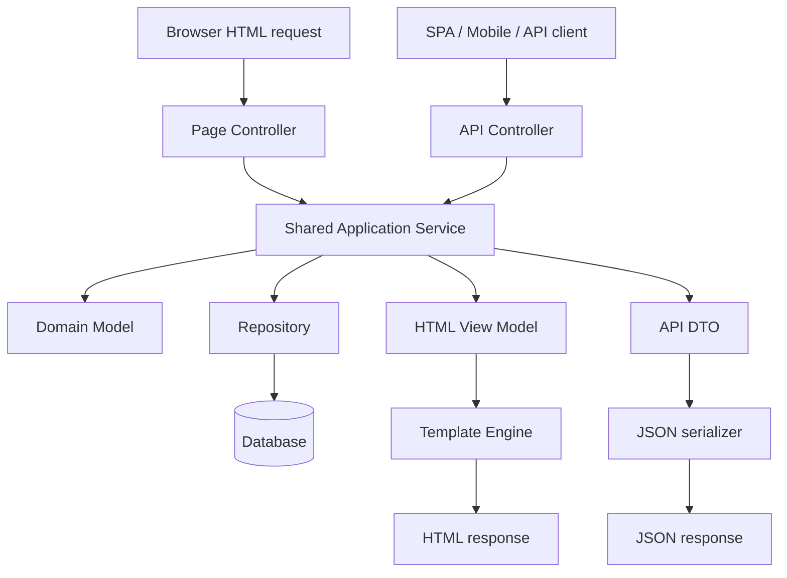

# Phân biệt ứng dụng trả HTML và ứng dụng trả dữ liệu trong cùng nền tảng

Một nền tảng web có thể phục vụ cả người dùng đang tương tác với trang HTML và các client cần dữ liệu có cấu trúc như JSON. Ví dụ, cùng một hệ thống quản lý đơn hàng có thể trả trang chi tiết cho trình duyệt, đồng thời cung cấp API để ứng dụng mobile hoặc một giao diện JavaScript lấy thông tin đơn hàng. Hai kiểu phản hồi có hình thức khác nhau nhưng có thể dùng chung Model nghiệp vụ, application service, repository, transaction và chính sách bảo mật.

Trong MVC, Controller tiếp nhận request và chọn cách phản hồi. Với luồng HTML, Controller chuẩn bị View Model rồi chọn template để server render thành HTML. Với luồng dữ liệu, Controller gọi cùng use case nhưng trả DTO để framework serialize thành JSON hoặc định dạng được API công bố. Việc phân biệt hai luồng ở ranh giới web giúp tránh trộn markup, serialization và quy tắc nghiệp vụ vào cùng một lớp.

## 1. Hai kiểu phản hồi trong cùng một ứng dụng

### 1.1. Ứng dụng trả HTML

Luồng HTML thường phục vụ trình duyệt theo mô hình request/response:

1. Trình duyệt gửi request đến URL của trang.
2. Controller gọi application service hoặc query service.
3. Dữ liệu được ánh xạ thành View Model phù hợp với màn hình.
4. Controller đưa View Model vào Model của Spring MVC và chọn tên template.
5. View resolver cùng template engine render HTML.
6. Server trả response có `Content-Type: text/html`.

Trình duyệt nhận một tài liệu hoàn chỉnh, sau đó tải CSS, JavaScript, ảnh và các tài nguyên liên quan. Khi gửi biểu mẫu, ứng dụng thường dùng Post/Redirect/Get để tránh gửi lại thao tác khi người dùng refresh.

### 1.2. Ứng dụng trả dữ liệu

Luồng API trả dữ liệu có cấu trúc thay vì một trang giao diện:

1. Client gửi request đến endpoint API.
2. Controller gọi application service hoặc query service.
3. Kết quả được ánh xạ thành DTO thuộc hợp đồng API.
4. Framework serialize DTO thành JSON hoặc định dạng được hỗ trợ.
5. Server trả status, header và body theo hợp đồng API.

Client có thể là SPA, ứng dụng mobile, hệ thống đối tác hoặc một dịch vụ khác. Client tự quyết định cách trình bày dữ liệu.

### 1.3. Cùng nền tảng, hai adapter trình bày



Page Controller và API Controller là hai adapter của cùng nền tảng. Chúng có thể dùng chung use case nhưng có hợp đồng đầu ra khác nhau. HTML cần dữ liệu phục vụ bố cục, nhãn, trạng thái hiển thị và điều hướng; API cần trường dữ liệu ổn định, có ý nghĩa với client và không phụ thuộc vào template.

## 2. Phân biệt Controller trả View và Controller trả body

Trong Spring MVC, annotation và kiểu trả về giúp framework biết cần render View hay ghi dữ liệu vào response body.

| Cách viết | Ý nghĩa thường gặp | Kết quả |
|---|---|---|
| `@Controller` trả `String` | Tên logic của View | View resolver tìm template và render |
| `@Controller` trả `ModelAndView` | View cùng dữ liệu Model | Render View đã chọn với Model tương ứng |
| `@Controller` với `@ResponseBody` | Giá trị trả về là response body | HttpMessageConverter serialize dữ liệu |
| `@RestController` | Kết hợp `@Controller` và `@ResponseBody` | Giá trị trả về được ghi vào body |
| `ResponseEntity<T>` | Body cùng status và headers tường minh | Phản hồi HTTP được kiểm soát rõ |

Một lỗi dễ gặp là dùng `@RestController` rồi trả về chuỗi `"orders/detail"` với ý định render template. Vì `@RestController` có `@ResponseBody`, chuỗi đó thường được ghi thẳng vào response body, không được xem là tên View. Ngược lại, một `@Controller` trả về DTO mà không có `@ResponseBody` có thể khiến Spring xem DTO như tên View hoặc gặp lỗi phân giải View.

### 2.1. Controller trả HTML

```java
@Controller
@RequestMapping("/orders")
public class OrderPageController {
    private final OrderQueryService orders;

    public OrderPageController(OrderQueryService orders) {
        this.orders = orders;
    }

    @GetMapping("/{orderId}")
    public String detail(
            @PathVariable long orderId,
            Model model) {

        OrderPageViewModel page = orders.getPage(orderId);
        model.addAttribute("order", page);
        return "orders/detail";
    }
}
```

Phương thức trả về tên View logic `orders/detail`. `Model` trong chữ ký Spring MVC là nơi đưa thuộc tính vào template; nó không phải Domain Model chứa quy tắc nghiệp vụ. `OrderPageViewModel` chỉ nên chứa dữ liệu cần để trình bày trang.

### 2.2. Controller trả JSON

```java
@RestController
@RequestMapping("/api/orders")
public class OrderApiController {
    private final OrderQueryService orders;

    public OrderApiController(OrderQueryService orders) {
        this.orders = orders;
    }

    @GetMapping("/{orderId}")
    public OrderResponse detail(@PathVariable long orderId) {
        return orders.getResponse(orderId);
    }
}
```

Với `@RestController`, Spring ghi đối tượng trả về vào response body và dùng `HttpMessageConverter` phù hợp, thường là Jackson để serialize JSON trong cấu hình Spring Boot phổ biến. `OrderResponse` là DTO API, không nên mặc định dùng trực tiếp entity ORM.

### 2.3. Khi cần kiểm soát status và header

API thường cần trả status và header tường minh. Có thể dùng `ResponseEntity`:

```java
@PostMapping
public ResponseEntity<OrderResponse> create(
        @Valid @RequestBody CreateOrderRequest request) {

    OrderResponse created = orders.create(toCommand(request));
    URI location = URI.create("/api/orders/" + created.id());

    return ResponseEntity.created(location).body(created);
}
```

Ví dụ minh họa endpoint tạo tài nguyên mới: response thường là `201 Created`, có header `Location` trỏ đến tài nguyên vừa tạo và body chứa representation nếu hợp đồng yêu cầu. Với thao tác không có body, có thể trả `204 No Content` khi phù hợp.

## 3. Hai cách tổ chức URL

Có hai lựa chọn thường gặp: dùng đường dẫn riêng cho API hoặc dùng content negotiation để cùng một tài nguyên có thể trả nhiều representation.

### 3.1. Tách route HTML và API

Ví dụ:

| Mục đích | URL | Representation |
|---|---|---|
| Trang chi tiết đơn | `GET /orders/42` | HTML |
| Lấy dữ liệu đơn | `GET /api/orders/42` | JSON |
| Tạo đơn qua biểu mẫu | `POST /orders` | Form data, sau đó redirect |
| Tạo đơn qua API | `POST /api/orders` | JSON request/response |

Ưu điểm của route riêng:

- Dễ đọc và dễ nhận biết endpoint dành cho người dùng hay client dữ liệu.
- Có thể áp dụng error handler, cache policy và tài liệu API riêng.
- Giảm sự phụ thuộc vào cách client gửi `Accept`.
- Dễ quan sát traffic HTML và API theo route template.

Nhược điểm là có thêm endpoint và có thể lặp một phần ánh xạ request/response. Không nên lặp logic nghiệp vụ; cả hai Controller nên gọi cùng application service.

### 3.2. Dùng content negotiation

HTTP cho phép client nêu representation mong muốn qua header `Accept`. Ví dụ:

```http
GET /orders/42 HTTP/1.1
Accept: text/html
```

hoặc:

```http
GET /orders/42 HTTP/1.1
Accept: application/json
```

Spring MVC có thể chọn handler dựa trên điều kiện `produces`. Hai Controller có thể dùng chung path nhưng khai báo representation khác nhau:

```java
@Controller
@RequestMapping("/orders")
class OrderHtmlController {
    @GetMapping(value = "/{id}", produces = MediaType.TEXT_HTML_VALUE)
    String detail(@PathVariable long id, Model model) {
        model.addAttribute("order", orderQueries.getPage(id));
        return "orders/detail";
    }
}

@RestController
@RequestMapping("/orders")
class OrderJsonController {
    @GetMapping(value = "/{id}", produces = MediaType.APPLICATION_JSON_VALUE)
    OrderResponse detail(@PathVariable long id) {
        return orderQueries.getResponse(id);
    }
}
```

Khi request có `Accept: text/html`, handler HTML phù hợp; khi `Accept: application/json`, handler JSON phù hợp. Cách này cần kiểm thử mapping và đảm bảo các điều kiện request không mơ hồ. Nếu client không chấp nhận representation mà server hỗ trợ, server có thể trả `406 Not Acceptable`.

### 3.3. Chọn route riêng hay content negotiation?

| Tiêu chí | Route riêng | Content negotiation |
|---|---|---|
| Khả năng nhận biết | URL cho biết loại endpoint | Client phải gửi `Accept` đúng |
| Tài liệu và tooling | Thường đơn giản cho API | Cần mô tả rõ nhiều representation |
| Cache | Cache key theo URL dễ phân biệt | Cần cân nhắc `Vary: Accept` |
| Dùng chung tài nguyên | Có thể tách route nhưng vẫn chung use case | Một URI có nhiều representation |
| Độ phức tạp mapping | Ít điều kiện lựa chọn | Cần cấu hình `produces` và test negotiation |

Với nền tảng có API công khai hoặc nhiều client, route `/api/...` thường rõ ràng và dễ vận hành. Content negotiation phù hợp khi cùng một URI thực sự đại diện cho một tài nguyên và các representation có semantics tương ứng. Không nên dùng query parameter hoặc phần mở rộng file tùy tiện để thay thế một chính sách negotiation chưa được định nghĩa.

## 4. Dùng chung nghiệp vụ, tách hợp đồng đầu ra

HTML và JSON có thể dùng cùng application service nhưng thường cần hai View Model/DTO khác nhau.

Ví dụ:

```java
public record OrderPageViewModel(
    String orderNumber,
    String customerDisplayName,
    String statusLabel,
    String formattedTotal,
    boolean showCancelButton
) {}

public record OrderResponse(
    long id,
    String orderNumber,
    OrderStatus status,
    MoneyResponse total
) {}

public record MoneyResponse(
    BigDecimal amount,
    String currency
) {}
```

`OrderPageViewModel` phục vụ cách trình bày: nhãn trạng thái đã dịch, tiền đã định dạng và cờ hiển thị hành động. `OrderResponse` phục vụ hợp đồng API: mã trạng thái ổn định, giá trị tiền và currency có cấu trúc. Không nên để API phụ thuộc vào chuỗi nhãn tiếng Việt hoặc định dạng tiền dành riêng cho một template.

### 4.1. Không trả entity ORM trực tiếp

Entity có thể chứa lazy relationship, trường nội bộ, dữ liệu audit hoặc cấu trúc persistence. Serialize entity trực tiếp có thể gây:

- Vòng tham chiếu và lỗi serialize.
- Truy vấn lazy ngoài dự kiến.
- Lộ trường không thuộc hợp đồng API.
- Hợp đồng client thay đổi khi schema hoặc mapping ORM thay đổi.

Hãy ánh xạ sang DTO rõ ràng. View Model cũng không nên là entity; nó có thể chứa trường đã định dạng, nội dung hiển thị hoặc trạng thái riêng của trang.

### 4.2. Không đưa logic nghiệp vụ vào Controller hoặc serializer

Controller chỉ điều phối. Việc tính giá, kiểm tra quyền hủy, quyết định chuyển trạng thái hoặc áp dụng invariant thuộc application service và Model. Serializer chỉ chuyển dữ liệu DTO sang định dạng wire; nó không nên gọi repository hoặc quyết định nghiệp vụ.

### 4.3. Tránh lặp use case giữa HTML và API

Nếu Controller HTML và API cùng triển khai riêng việc kiểm tra quyền, cập nhật đơn và gửi thông báo, hai luồng có thể lệch hành vi sau một lần thay đổi. Hãy để cả hai gọi cùng use case, ví dụ `CancelOrderService`, rồi mỗi adapter ánh xạ kết quả sang HTML redirect hoặc API response.

## 5. GET, POST và cách trả phản hồi

Hai kiểu phản hồi thường có cách xử lý sau mutation khác nhau.

### 5.1. Form HTML và Post/Redirect/Get

Sau khi nhận form hợp lệ, Controller HTML thường gọi use case rồi redirect sang trang kết quả:

```java
@Controller
@RequestMapping("/orders")
class OrderFormController {
    private final CreateOrderService createOrders;

    @PostMapping
    String create(
            @Valid @ModelAttribute("form") CreateOrderForm form,
            BindingResult errors,
            RedirectAttributes redirect) {

        if (errors.hasErrors()) {
            return "orders/new";
        }

        long id = createOrders.execute(toCommand(form));
        redirect.addFlashAttribute("notice", "Đơn hàng đã được tạo.");
        return "redirect:/orders/" + id;
    }
}
```

Nếu validation thất bại, Controller render lại form với lỗi và dữ liệu phù hợp. Nếu thành công, redirect khiến request kế tiếp là GET, giúp refresh không gửi lại POST ban đầu. Không đưa dữ liệu nhạy cảm vào flash attribute hoặc URL.

### 5.2. API trả status và representation

API thường trả kết quả ngay trong response body:

```java
@RestController
@RequestMapping("/api/orders")
class OrderCommandController {
    private final CreateOrderService createOrders;

    @PostMapping
    ResponseEntity<OrderResponse> create(
            @Valid @RequestBody CreateOrderRequest request) {

        OrderResponse created = createOrders.execute(toCommand(request));
        return ResponseEntity
            .created(URI.create("/api/orders/" + created.id()))
            .body(created);
    }
}
```

API client tự quyết định cập nhật giao diện hoặc điều hướng. Với thao tác bất đồng bộ, response có thể là `202 Accepted` cùng URL trạng thái hoặc operation ID theo hợp đồng. Không trả `200 OK` cho mọi kết quả nếu status cụ thể có ý nghĩa với client.

## 6. Validation và xử lý lỗi theo từng representation

Quy tắc validation và lỗi nghiệp vụ nên được chia sẻ, nhưng cách trình bày lỗi phụ thuộc vào HTML hay JSON.

### 6.1. Lỗi form HTML

Với form HTML, `BindingResult` có thể giữ lỗi gắn với trường. Controller trả lại template, View hiển thị thông báo gần input và giữ lại các giá trị không nhạy cảm.

```html
<label for="email">Email</label>
<input id="email" name="email"
       th:value="${form.email}"
       th:classappend="${#fields.hasErrors('email')} ? ' invalid'">
<p class="field-error"
   th:if="${#fields.hasErrors('email')}"
   th:errors="*{email}"></p>
```

Đoạn template minh họa; form object cần được đặt đúng tên trong model và cú pháp selection expression phải phù hợp với `th:object` của form. Không đưa mật khẩu, token hoặc trường bí mật trở lại HTML khi validation thất bại.

### 6.2. Lỗi API có cấu trúc

API nên trả mã lỗi ổn định cùng danh sách lỗi trường nếu client cần ánh xạ vào form:

```json
{
  "code": "VALIDATION_FAILED",
  "message": "Vui lòng kiểm tra lại thông tin.",
  "fieldErrors": [
    {
      "field": "email",
      "code": "VALIDATION_EMAIL_INVALID",
      "message": "Địa chỉ email chưa đúng định dạng."
    }
  ]
}
```

Client nên dựa vào `code` để xử lý và dùng `message` để hiển thị. Nếu API không muốn bản địa hóa ở server, có thể trả mã và tham số an toàn để client dùng message catalog. Chính sách locale cần được mô tả trong hợp đồng.

### 6.3. Hai error handler, một quy tắc nghiệp vụ

Ứng dụng có thể có `@ControllerAdvice` cho HTML và `@RestControllerAdvice` cho API, hoặc một advice chung có handler phân biệt loại request. Dù chọn cách nào, cả hai nên ánh xạ từ cùng error code hoặc exception miền.

| Loại lỗi | HTML | JSON API |
|---|---|---|
| Validation | Render lại form và gắn field errors | `400` hoặc `422` cùng error body |
| Chưa đăng nhập | Redirect đến trang đăng nhập hoặc trang truy cập | `401 Unauthorized` theo hợp đồng |
| Không đủ quyền | Trang 403 hoặc trang không tìm thấy theo chính sách | `403` hoặc `404` theo chính sách tài nguyên |
| Không tìm thấy | Template 404 | JSON error `404` |
| Xung đột nghiệp vụ | Trang thông báo hoặc form có lỗi tổng thể | `409 Conflict` cùng mã lỗi ổn định |
| Lỗi hệ thống | Trang lỗi an toàn với mã tham chiếu | `500`/`503` với error code an toàn |

Không trả stack trace, SQL hoặc thông tin kết nối cho cả hai loại response. Log nội bộ có thể chứa chi tiết đã được kiểm soát; response chỉ chứa thông tin người dùng cần.

## 7. Content negotiation và Content-Type

`Accept` mô tả kiểu response client mong muốn; `Content-Type` mô tả kiểu dữ liệu của request body hoặc response body đang được gửi.

Ví dụ:

| Header | Ý nghĩa |
|---|---|
| `Accept: text/html` | Client muốn nhận HTML |
| `Accept: application/json` | Client muốn nhận JSON |
| `Content-Type: application/json` | Request body được gửi dưới dạng JSON |
| `Content-Type: application/x-www-form-urlencoded` | Form body dạng URL-encoded |
| `Content-Type: multipart/form-data` | Form có file hoặc nhiều phần dữ liệu |

Nếu server không hỗ trợ kiểu response trong `Accept`, có thể trả `406 Not Acceptable`. Nếu request body có `Content-Type` không được endpoint hỗ trợ, có thể trả `415 Unsupported Media Type`. Hai lỗi này khác nhau và nên được kiểm thử riêng.

Không nên dựa vào `Content-Type` của request để quyết định response representation. Một client có thể gửi JSON nhưng muốn nhận HTML, hoặc gửi form data nhưng muốn nhận JSON; `Accept` mới thể hiện kiểu response mong muốn. Hợp đồng cụ thể vẫn có thể quy định cứng cho từng endpoint.

### 7.1. Chất lượng và nhiều giá trị Accept

Header `Accept` có thể chứa nhiều media type và quality value, ví dụ:

```http
Accept: application/json;q=0.9, text/html;q=0.8, */*;q=0.1
```

Framework có thể chọn representation phù hợp theo mapping và negotiation rules. Nếu endpoint cần một representation cố định, route riêng hoặc `produces` tường minh thường dễ hiểu hơn. Không nên giả định mọi client đều gửi `Accept` chính xác; browser có thể gửi nhiều loại media type.

### 7.2. Không dùng User-Agent làm cơ chế chọn representation chính

User-Agent có thể bị thay đổi, bị proxy sửa hoặc không phản ánh ý định của client. Chọn HTML hay JSON dựa trên User-Agent khiến hành vi khó kiểm thử và cache khó chính xác. Dùng route rõ ràng hoặc `Accept` theo hợp đồng.

## 8. Bảo mật trong nền tảng có cả HTML và API

Hai kiểu phản hồi không đồng nghĩa hai mức tin cậy khác nhau. Mọi request thay đổi dữ liệu phải được xác thực và phân quyền ở server.

### 8.1. Authentication và session

Trang HTML thường dùng session cookie; API có thể dùng cookie session hoặc bearer token tùy kiến trúc. Cùng một nền tảng có thể hỗ trợ nhiều cơ chế, nhưng cần quy định rõ cách xác thực cho từng route và không vô tình cho phép endpoint API truy cập ẩn danh.

### 8.2. CSRF và CORS

Với cookie-based authentication, request thay đổi trạng thái cần được bảo vệ CSRF theo cấu hình ứng dụng, kể cả endpoint trả JSON. Chỉ trả JSON không tự loại bỏ nguy cơ CSRF nếu trình duyệt tự gửi cookie.

CORS kiểm soát việc JavaScript từ origin khác đọc response; nó không thay thế authentication, authorization hoặc CSRF protection. Chỉ cho phép origin cần thiết và không dùng wildcard với credential theo cách không hợp lệ.

### 8.3. Output encoding và serialization

Template engine cần escape dữ liệu theo ngữ cảnh HTML. JSON serializer xử lý encoding JSON nhưng client vẫn phải render dữ liệu an toàn khi đưa vào DOM. Không dùng raw HTML từ API nếu chưa sanitize đáng tin cậy.

### 8.4. Phân quyền ở use case

Page Controller có thể ẩn nút “Hủy đơn” nếu user không có quyền, nhưng API Controller cũng phải gọi use case có kiểm tra quyền. Không dựa vào UI hoặc DTO client gửi lên để quyết định quyền sở hữu tài nguyên.

## 9. Transaction và side effect dùng chung

Nếu HTML form và JSON API cùng gọi một application service, transaction boundary nên nằm ở use case thay vì ở từng Controller. Như vậy hai adapter dùng cùng chính sách commit/rollback.

Ví dụ, cả form `/orders/{id}/cancel` và API `/api/orders/{id}/cancel` đều gọi `CancelOrderService`. Service kiểm tra trạng thái, cập nhật đơn và giải phóng tồn kho trong một transaction. Controller HTML chuyển hướng sau thành công; Controller API trả JSON/status. Hai kiểu response không làm thay đổi quy tắc nghiệp vụ.

Nếu use case phát email hoặc sự kiện, không gửi side effect không thể rollback trước khi transaction commit. Có thể dùng after-commit hoặc Transactional Outbox khi cần giao nhận bền vững. Điều này áp dụng giống nhau dù request đến từ HTML hay API.

## 10. Cache và representation

Khi cùng một URI có thể trả HTML hoặc JSON, cache phải phân biệt representation. Với content negotiation, response thường cần `Vary: Accept` để cache trung gian không dùng HTML cho client muốn JSON hoặc ngược lại.

Ví dụ:

```http
Vary: Accept
Cache-Control: public, max-age=60
```

Chỉ dùng cache public nếu dữ liệu thực sự công khai. Response cá nhân hoặc phụ thuộc session, quyền, tenant thường cần `private` hoặc `no-store` theo yêu cầu. Nếu nội dung phụ thuộc locale, có thể cần thêm `Vary: Accept-Language` hoặc chính sách cache theo cookie/URL tương ứng.

Với route HTML và API riêng, URL đã tách representation nhưng vẫn phải xem xét authorization, user-specific data và tenant isolation. Cache key theo URL không tự bảo đảm response cá nhân an toàn.

## 11. Quan sát và vận hành hai luồng

Một nền tảng có HTML và API nên phân biệt traffic theo route template và loại response để điều tra hiệu năng và lỗi.

Các metric hữu ích:

- Request count và latency theo route template, method, status class.
- Tỷ lệ lỗi HTML và API.
- Thời gian query/service dùng chung.
- Kích thước HTML response và JSON response.
- Tỷ lệ `406`, `415`, `401`, `403`, `409` và `5xx`.

Không dùng URL đầy đủ, user ID hoặc order ID làm metric label vì cardinality cao. Log có thể chứa request ID/trace ID và error code đã được kiểm soát để tìm một thao tác cụ thể. Trace giúp xác định liệu HTML và API có đang cùng chậm ở một application service hoặc database dependency hay không.

## 12. Kiểm thử hai kiểu phản hồi

Kiểm thử cần xác minh cả routing, representation và hành vi dùng chung.

### 12.1. Kiểm thử HTML response

```java
mockMvc.perform(get("/orders/42")
        .accept(MediaType.TEXT_HTML))
    .andExpect(status().isOk())
    .andExpect(view().name("orders/detail"))
    .andExpect(model().attributeExists("order"));
```

Nếu cần xác minh template thật, dùng test integration với View resolver và template engine để kiểm tra HTML đã render, không chỉ kiểm tra tên View.

### 12.2. Kiểm thử JSON response

```java
mockMvc.perform(get("/api/orders/42")
        .accept(MediaType.APPLICATION_JSON))
    .andExpect(status().isOk())
    .andExpect(content().contentTypeCompatibleWith(
        MediaType.APPLICATION_JSON
    ))
    .andExpect(jsonPath("$.orderNumber").value("ORD-1042"));
```

Test API nên xác minh schema/field quan trọng, status và Content-Type. Không cần so sánh toàn bộ JSON nếu thứ tự field hoặc trường không thuộc hợp đồng có thể thay đổi.

### 12.3. Kiểm thử content negotiation

Với một path có nhiều `produces`, gửi cùng URL với các header `Accept` khác nhau và xác minh handler/representation phù hợp. Thêm trường hợp media type không hỗ trợ để xác minh `406`. Nếu endpoint có `consumes`, gửi request body với `Content-Type` không phù hợp để kiểm tra `415`.

### 12.4. Kiểm thử lỗi và bảo mật

- HTML validation lỗi trả đúng template và field errors.
- API validation lỗi trả error DTO và status theo hợp đồng.
- Lỗi nghiệp vụ có cùng error code nhưng presentation khác nhau.
- Người không đủ quyền bị từ chối ở cả HTML và API.
- Request thay đổi trạng thái được bảo vệ CSRF khi dùng cookie authentication.
- Response không chứa stack trace hoặc dữ liệu nhạy cảm.
- Cache không trộn HTML/JSON, locale hoặc dữ liệu giữa người dùng.

### 12.5. Kiểm thử use case dùng chung

Unit/integration test cho application service cần xác minh invariant và transaction độc lập với adapter. Không nên viết hai bộ test nghiệp vụ giống hệt cho Controller HTML và API nếu cùng gọi một service; mỗi adapter kiểm tra phần mapping của mình, còn use case được kiểm tra ở tầng ứng dụng.

## 13. Tổ chức mã nguồn và tài liệu hợp đồng

Có thể chia web adapter theo representation:

```text
orders/
├── application/
│   ├── CreateOrderService.java
│   └── OrderQueryService.java
├── domain/
│   └── Order.java
├── persistence/
│   └── OrderRepository.java
└── web/
    ├── html/
    │   ├── OrderPageController.java
    │   └── OrderFormController.java
    ├── api/
    │   ├── OrderApiController.java
    │   ├── OrderResponse.java
    │   └── CreateOrderRequest.java
    └── mapping/
        ├── OrderPageMapper.java
        └── OrderApiMapper.java
```

Đây là một cách tổ chức tham khảo; dự án nhỏ có thể không cần tách nhiều package. Điểm quan trọng là adapter HTML và API có thể thay đổi độc lập trong khi use case và Model vẫn dùng chung.

API công khai cần tài liệu về:

- URL, HTTP method và media type.
- Request DTO, response DTO và validation.
- Status code và error code.
- Authentication, authorization, CSRF/CORS nếu có.
- Pagination, sorting, filtering và versioning.
- Idempotency và retry cho thao tác ghi khi cần.

Template HTML thường được kiểm soát cùng ứng dụng; vẫn cần hợp đồng View Model nội bộ để Controller và template không phụ thuộc vào entity hoặc session một cách ngầm định.

## 14. Những sai lầm thường gặp

**Dùng `@RestController` nhưng mong Spring render template.** `@RestController` ghi giá trị trả về vào response body. Dùng `@Controller` cho View hoặc `@ResponseBody` khi thực sự trả dữ liệu.

**Dùng `@Controller` trả DTO mà không đánh dấu response body.** Spring có thể xem giá trị như tên View. Hãy dùng `@RestController`, `@ResponseBody` hoặc `ResponseEntity`.

**Trộn HTML và JSON trong một phương thức khó hiểu.** Nhiều nhánh `if` theo header làm Controller khó kiểm thử. Tách adapter hoặc dùng mapping `produces` tường minh.

**Lặp nghiệp vụ ở hai Controller.** HTML và API có thể lệch quy tắc. Đưa use case vào application service dùng chung.

**Dùng chung một đối tượng cho entity, View Model và API DTO.** Presentation thay đổi có thể làm API vỡ hoặc lộ persistence. Tách hợp đồng theo mục đích.

**Dựa vào User-Agent để chọn response.** Hành vi không ổn định và khó cache. Dùng URL riêng hoặc `Accept`.

**Bỏ qua `406` và `415`.** Content negotiation và request media type là hai điều kiện khác nhau. Kiểm thử cả hai khi endpoint hỗ trợ negotiation.

**Trả lỗi HTML cho client API hoặc JSON cho form browser mà không có hợp đồng.** Mỗi adapter cần error mapping phù hợp, nhưng dùng chung error code và quy tắc nghiệp vụ.

**Cho rằng API không cần CSRF vì trả JSON.** Cookie vẫn có thể được browser tự gửi. Xác định cơ chế authentication và CSRF theo threat model.

**Cache response theo URL mà bỏ qua representation hoặc quyền.** Có thể trả nhầm HTML/JSON hoặc dữ liệu cá nhân. Dùng `Vary` và cache policy phù hợp.

## 15. Checklist thiết kế nền tảng phục vụ HTML và dữ liệu

Khi thêm một luồng phản hồi mới, hãy tự hỏi:

1. Request phục vụ trang HTML hay dữ liệu có cấu trúc?
2. Dùng route riêng hay content negotiation; lý do lựa chọn là gì?
3. Controller có dùng đúng `@Controller`, `@RestController`, `@ResponseBody` và kiểu trả về không?
4. HTML View Model và API DTO có phản ánh đúng hợp đồng riêng không?
5. Hai adapter có gọi cùng application service thay vì lặp nghiệp vụ không?
6. Validation, authorization và invariant có được thực thi ở server không?
7. HTML form dùng PRG khi phù hợp; API trả status, Location và body đúng semantics không?
8. Error mapping có giữ error code ổn định nhưng trả representation phù hợp không?
9. `Accept`, `Content-Type`, `produces`, `consumes`, 406 và 415 đã được xử lý rõ chưa?
10. CSRF, CORS, output encoding và dữ liệu nhạy cảm đã được bảo vệ chưa?
11. Cache có phân biệt representation, locale, user và tenant khi cần không?
12. Metrics, logs và traces có phân biệt traffic HTML/API mà không tạo cardinality cao không?
13. Có test riêng cho HTML, JSON, negotiation, lỗi và use case dùng chung không?

## Kết luận

Một nền tảng MVC có thể phục vụ cả HTML và dữ liệu có cấu trúc bằng cách tách hai kiểu phản hồi ở tầng web adapter, đồng thời dùng chung application service và Model nghiệp vụ. Controller HTML chuẩn bị View Model và chọn template; API Controller trả DTO qua response body và serializer. Route riêng thường dễ nhận biết, còn content negotiation qua `Accept` phù hợp khi cùng URI có nhiều representation được định nghĩa rõ. Hai luồng cần error mapping, cache policy, bảo mật và kiểm thử phù hợp với representation của mình. Khi không trộn View Model với API DTO và không lặp quy tắc nghiệp vụ trong Controller, nền tảng có thể phục vụ trình duyệt, SPA, mobile và client tích hợp mà vẫn giữ một nguồn quy tắc nghiệp vụ nhất quán.
