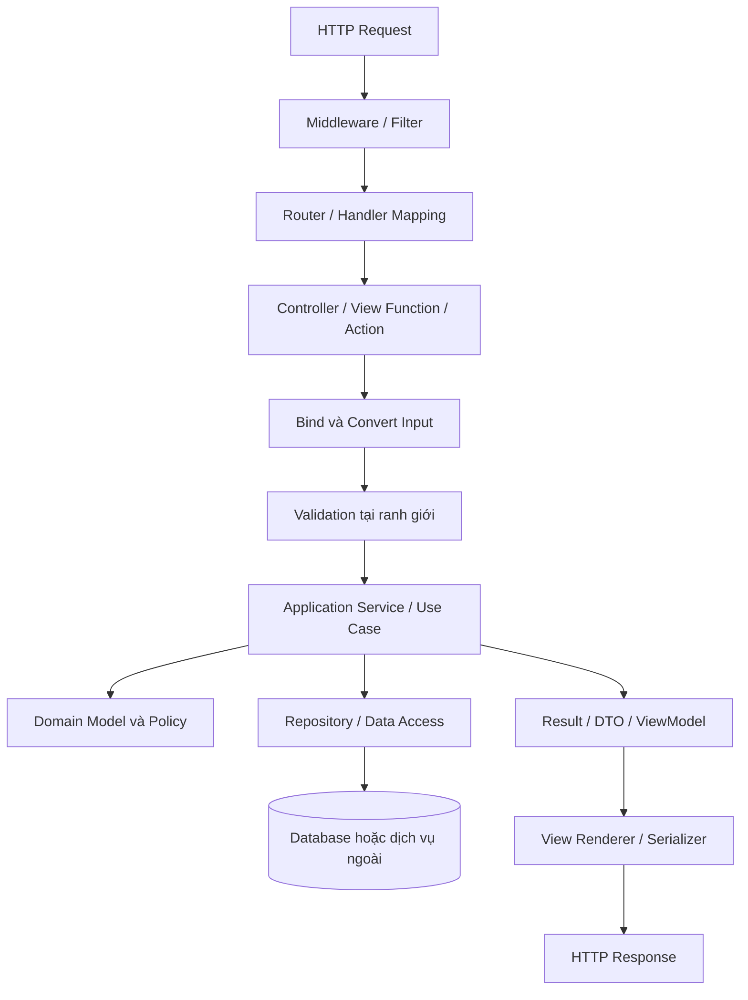

# Những trách nhiệm nền tảng cung cấp và những ranh giới cần tự thiết kế

Các framework web thường cung cấp sẵn nhiều cơ chế để xây dựng ứng dụng theo **Model–View–Controller (MVC)**: định tuyến URL, tiếp nhận HTTP request, bind dữ liệu, gọi handler, render View, serialize response và xử lý lỗi. Nhờ vậy, nhóm phát triển không phải tự viết lại toàn bộ hạ tầng giao tiếp web.

Tuy nhiên, framework chỉ cung cấp cơ chế và quy ước. Nó không tự quyết định ranh giới nghiệp vụ của sản phẩm, dữ liệu nào được phép nhận từ client, use case nào cần tồn tại, ai có quyền thực hiện hành động, transaction kéo dài đến đâu hoặc Model nào phù hợp với một màn hình. Những quyết định này vẫn thuộc trách nhiệm thiết kế của nhóm phát triển.

Bài học này ánh xạ các trách nhiệm MVC lên một số nền tảng web phổ biến, gồm Spring MVC, ASP.NET Core MVC, Django, Ruby on Rails và Express. Mục tiêu là nhận diện phần framework đã hỗ trợ, phần cần cấu hình và phần phải tự thiết kế; từ đó tránh nhầm lẫn giữa việc sử dụng framework với việc đã có một kiến trúc ứng dụng rõ ràng.

## 1. Framework cung cấp cơ chế, ứng dụng định nghĩa ý nghĩa

Một framework MVC thường giúp giải quyết các vấn đề kỹ thuật lặp lại:

- Nhận request và chọn handler dựa trên URL, HTTP method, header hoặc route constraint.
- Chuyển dữ liệu từ path, query string, form hoặc body thành tham số/đối tượng.
- Chuyển đổi kiểu và kích hoạt validation theo cấu hình.
- Cung cấp dependency injection để tạo và kết nối object.
- Gọi Controller/action và xử lý kết quả.
- Render template hoặc serialize dữ liệu thành JSON/XML.
- Chạy middleware, filter, interceptor hoặc hook dùng chung.
- Ánh xạ exception thành HTTP response.
- Tích hợp session, cookie, authentication, authorization và persistence thông qua các thành phần phù hợp.

Những cơ chế này giúp chuẩn hóa vòng đời HTTP. Nhưng framework không thể tự biết một đơn hàng đã thanh toán có được hủy hay không, người dùng có quyền sửa một hồ sơ cụ thể hay không, dữ liệu nào được phép cập nhật hoặc hai bước nghiệp vụ có phải nằm trong cùng transaction hay không.

### Phân biệt ba loại trách nhiệm

| Loại trách nhiệm | Ví dụ | Ai quyết định? |
|---|---|---|
| Cơ chế nền tảng | Route matching, model binding, template rendering, DI | Framework cung cấp; nhóm cấu hình và sử dụng |
| Quy ước kỹ thuật của ứng dụng | Package boundaries, DTO, service interface, exception mapping | Nhóm phát triển thiết kế dựa trên framework |
| Quy tắc sản phẩm/nghiệp vụ | Giá, quyền sở hữu, trạng thái đơn, điều kiện phê duyệt | Nhóm sản phẩm và nhóm phát triển xác định; domain/application thực thi |

Không nên suy luận rằng một tính năng có trong framework thì ranh giới kiến trúc đã được giải quyết. Ví dụ, framework có thể bind request vào object, nhưng nhóm vẫn phải quyết định object đó là Form Object, Request DTO hay Domain Entity.

## 2. Ánh xạ MVC lên vòng đời HTTP chung

Tên class và API khác nhau giữa các nền tảng, nhưng nhiều ứng dụng MVC có luồng khái quát tương tự:



Đây là luồng khái quát, không phải mọi framework đều thực hiện đúng thứ tự hoặc dùng cùng thuật ngữ. Một số framework bind dữ liệu trước khi gọi action; một số có validation tự động; một số cần middleware hoặc thư viện bổ sung. Điểm chung là framework quản lý phần lớn plumbing HTTP, còn ứng dụng quyết định ý nghĩa của hành động và dữ liệu.

## 3. Spring MVC: DispatcherServlet, Controller và View

Spring MVC dùng mô hình Front Controller. `DispatcherServlet` nhận request và phối hợp các thành phần để tìm handler, gọi handler và tạo response.

### Những gì Spring MVC cung cấp

- `DispatcherServlet` làm điểm tiếp nhận request chính.
- `HandlerMapping` tìm handler phù hợp với request.
- `HandlerAdapter` gọi handler theo kiểu được hỗ trợ.
- `@Controller` và `@RestController` khai báo handler.
- `@PathVariable`, `@RequestParam`, `@ModelAttribute` và `@RequestBody` hỗ trợ bind dữ liệu.
- `HttpMessageConverter` đọc/ghi body như JSON.
- `WebDataBinder`, `ConversionService` và Bean Validation integration hỗ trợ bind, convert và validate.
- `Model`, `ModelAndView`, `ViewResolver` và template engine hỗ trợ server-rendered View.
- `@ExceptionHandler` và `@ControllerAdvice` hỗ trợ xử lý lỗi tập trung.
- Interceptor và Servlet Filter hỗ trợ logic xuyên suốt request.
- Spring container cung cấp dependency injection và quản lý bean lifecycle.

Một số cơ chế cần dependency hoặc cấu hình tương ứng. Ví dụ, `@Valid` cần provider Bean Validation phù hợp; render Thymeleaf cần tích hợp template engine; authentication/authorization thường được bổ sung qua Spring Security.

### Ví dụ Controller

```java
@Controller
@RequestMapping("/orders")
class OrderController {

    private final OrderQueryService queryService;
    private final ConfirmOrderUseCase confirmOrder;

    OrderController(
            OrderQueryService queryService,
            ConfirmOrderUseCase confirmOrder) {
        this.queryService = queryService;
        this.confirmOrder = confirmOrder;
    }

    @GetMapping("/{id}")
    String detail(@PathVariable UUID id, Model model) {
        model.addAttribute("order", queryService.getDetail(id));
        return "orders/detail";
    }

    @PostMapping("/{id}/confirm")
    String confirm(
            @PathVariable UUID id,
            Principal principal,
            RedirectAttributes redirectAttributes) {
        confirmOrder.execute(new ConfirmOrderCommand(
                new OrderId(id), principal.getName()));
        redirectAttributes.addFlashAttribute(
                "notice", "Đơn hàng đã được xác nhận.");
        return "redirect:/orders/" + id;
    }
}
```

Framework cung cấp annotation routing, binding `UUID`, `Model`, redirect và dependency injection. Nhóm phát triển vẫn phải định nghĩa `OrderQueryService`, `ConfirmOrderUseCase`, command, policy, repository và quy tắc `confirm()`.

### Những ranh giới cần tự thiết kế trong Spring

- Chọn Form Object/Request DTO riêng thay vì bind trực tiếp vào entity.
- Đưa use case và quy tắc nghiệp vụ vào application/domain.
- Xác định repository interface thuộc application/domain hay một cấu trúc khác.
- Quyết định transaction boundary và xử lý concurrency.
- Chuẩn hóa response lỗi, mã lỗi và thông báo cho người dùng.
- Quy định ViewModel nào dành cho trang nào và dữ liệu nào được phép hiển thị.
- Chọn cách quản lý state qua URL, session, flash attribute hoặc client state.

Spring cung cấp nhiều cách để hiện thực các quyết định này, nhưng không tự chọn ranh giới đúng cho mọi sản phẩm.

## 4. ASP.NET Core MVC: Routing, Model Binding và Action Result

ASP.NET Core MVC tổ chức request thông qua middleware pipeline, endpoint routing và controller action. Controller thường kế thừa `Controller` hoặc dùng `ControllerBase` cho API.

### Những gì nền tảng cung cấp

- Middleware pipeline xử lý request theo thứ tự cấu hình.
- Endpoint Routing chọn endpoint theo route và điều kiện.
- Controller/action và attribute routing như `[Route]`, `[HttpGet]`, `[HttpPost]`.
- Model binding lấy dữ liệu từ route, query, form, header hoặc body theo cấu hình.
- Model validation và `ModelState` lưu lỗi binding/validation.
- Action result như `View()`, `RedirectToAction()`, `Ok()`, `NotFound()` và `BadRequest()`.
- Razor View, layout, partial và Tag Helper cho server-rendered HTML.
- Dependency injection tích hợp trong host.
- Filters và middleware cho xử lý xuyên suốt.
- Authentication/authorization middleware và policy framework.

### Ví dụ Controller

```csharp
[Route("orders")]
public class OrdersController : Controller
{
    private readonly IOrderQueryService _queries;
    private readonly IConfirmOrderUseCase _confirm;

    public OrdersController(
        IOrderQueryService queries,
        IConfirmOrderUseCase confirm)
    {
        _queries = queries;
        _confirm = confirm;
    }

    [HttpGet("{id:guid}")]
    public async Task<IActionResult> Details(Guid id)
    {
        var model = await _queries.GetDetails(id);
        return model is null ? NotFound() : View(model);
    }

    [HttpPost("{id:guid}/confirm")]
    [ValidateAntiForgeryToken]
    public async Task<IActionResult> Confirm(Guid id)
    {
        await _confirm.Execute(id, User);
        return RedirectToAction(nameof(Details), new { id });
    }
}
```

Ví dụ minh họa cách dùng action result và route constraint. Trong dự án thực tế, cách truyền danh tính vào use case nên thông qua một abstraction phù hợp thay vì để domain phụ thuộc `ClaimsPrincipal`.

### ModelState và validation

Với MVC Controller thông thường, action có thể kiểm tra `ModelState.IsValid` và render lại View nếu dữ liệu không hợp lệ. Với API Controller được đánh dấu `[ApiController]`, ASP.NET Core có thể tự động trả 400 khi model state không hợp lệ theo cấu hình mặc định. Test cần biết endpoint đang dùng loại Controller và cấu hình nào.

```csharp
public class CreateOrderRequest
{
    [Required]
    [StringLength(120)]
    public string Reference { get; set; } = "";
}
```

Data Annotation hỗ trợ validation đầu vào. Quy tắc như “đơn chỉ được xác nhận khi còn ở trạng thái Draft” vẫn thuộc application/domain, không nên được coi là một thuộc tính của model binding.

### Ranh giới cần tự thiết kế

- Request model và domain entity có nên tách riêng không?
- Application service và repository được tổ chức theo feature nào?
- Authorization theo resource được kiểm tra ở đâu?
- Transaction và concurrency được xử lý thế nào?
- Lỗi nghiệp vụ được chuyển thành Problem Details hoặc View error ra sao?
- ModelState lỗi, business rule lỗi và lỗi hạ tầng có được phân biệt không?

## 5. Django: URLconf, View, Model và Template

Django thường mô tả kiến trúc của mình là **MTV (Model–Template–View)**. Tên gọi khác MVC truyền thống có thể gây nhầm lẫn: Django View thường đóng vai trò tương tự Controller trong MVC, còn Template đóng vai trò trình bày.

### Ánh xạ khái niệm

| MVC tổng quát | Django | Vai trò |
|---|---|---|
| Controller | View function hoặc class-based view | Nhận request, điều phối xử lý và trả response |
| Model | Django Model/ORM | Đại diện dữ liệu và thao tác persistence; có thể chứa một phần logic miền |
| View | Template | Trình bày context thành HTML |
| Router | URLconf (`urls.py`) | Ánh xạ URL đến view |
| Form Object/Input validation | Django Form hoặc ModelForm | Bind và validate dữ liệu form |
| Middleware | Django middleware | Xử lý request/response xuyên suốt |

### Ví dụ View

```python
from django.shortcuts import get_object_or_404, render
from django.views.decorators.http import require_GET

@require_GET
def order_detail(request, order_id):
    order = get_object_or_404(
        Order.objects.select_related("customer"),
        pk=order_id,
    )
    return render(request, "orders/detail.html", {"order": order})
```

URLconf ánh xạ URL đến view:

```python
from django.urls import path
from . import views

urlpatterns = [
    path("orders/<int:order_id>/", views.order_detail, name="order-detail"),
]
```

Framework cung cấp URL dispatcher, request/response object, ORM, template engine, middleware, form validation và authentication primitives. Nhóm phát triển vẫn quyết định query service, use case, policy, transaction boundary và cách tổ chức domain logic.

### Lưu ý về Model và validation

Django Model là lớp gắn chặt với ORM theo cách dùng phổ biến. Có thể đặt một số hành vi và phương thức miền trong Model, nhưng không nên mặc định rằng mọi logic nghiệp vụ đều nên nằm trong `models.py`. Django Form/ModelForm hỗ trợ bind và validation; gọi `save()` không có nghĩa mọi bước `full_clean()` tự động chạy trong mọi trường hợp. Hãy kiểm tra rõ đường đi validation của ứng dụng.

Django ORM giúp truy vấn và lưu trữ nhưng không tự xác định aggregate boundary, quyền sở hữu tài nguyên hoặc quy trình nghiệp vụ nhiều bước.

## 6. Ruby on Rails: Convention over Configuration

Ruby on Rails cung cấp cấu trúc MVC theo quy ước rõ ràng:

- Router trong `config/routes.rb` ánh xạ request đến controller/action.
- Controller nhận request, lọc tham số và điều phối.
- Active Record Model ánh xạ dữ liệu và cung cấp validation/callback/association.
- View template và partial render HTML.
- Middleware, callback và framework convention hỗ trợ xử lý xuyên suốt.

### Ví dụ route và controller

```ruby
# config/routes.rb
resources :orders, only: [:index, :show, :create] do
  post :confirm, on: :member
end
```

```ruby
class OrdersController < ApplicationController
  def show
    @order = Order.find(params[:id])
  end

  def create
    @order = Order.new(order_params)

    if @order.save
      redirect_to @order, notice: "Đơn hàng đã được tạo."
    else
      render :new, status: :unprocessable_entity
    end
  end

  private

  def order_params
    params.require(:order).permit(:reference, :customer_id)
  end
end
```

Rails cung cấp routing, parameter handling, strong parameters, Active Record, validation và template conventions. `permit` giúp giới hạn thuộc tính được mass-assign; nó không thay thế authorization hoặc quy tắc miền.

### Những ranh giới cần tự thiết kế

- Khi nào logic Active Record Model còn dễ quản lý và khi nào cần domain/service object?
- Callback có đang che giấu side effect hoặc làm khó thứ tự transaction không?
- Quy trình nhiều bước có cần một application service không?
- Quyền trên một record được kiểm tra ở đâu?
- Query và response DTO/ViewModel có cần tách khỏi Active Record object không?

Rails khuyến khích convention giúp phát triển nhanh. Tuy vậy, convention không tự ngăn fat controller, fat model hoặc callback chain quá phức tạp.

## 7. Express: framework tối giản, nhóm tự chọn nhiều ranh giới

Express cung cấp router và middleware tối giản cho Node.js. Nó không áp đặt đầy đủ một cấu trúc MVC hoặc một ORM cụ thể.

### Những gì Express cung cấp

- `app` và `Router` để khai báo route.
- Middleware xử lý request/response.
- `req`, `res` và `next` để đọc input, tạo response và chuyển tiếp xử lý.
- Error-handling middleware.
- Tích hợp với template engine qua cơ chế view engine.
- Cơ chế mở rộng thông qua package hệ sinh thái.

Những phần như ORM, validation, dependency injection, authentication, DTO mapping, application service và domain model thường do nhóm chọn thư viện hoặc tự tổ chức.

### Ví dụ route

```javascript
const express = require("express");
const router = express.Router();

router.get("/orders/:id", async (req, res, next) => {
  try {
    const order = await orderQueryService.getDetail(req.params.id);
    if (!order) {
      return res.status(404).json({ code: "ORDER_NOT_FOUND" });
    }
    return res.json(order);
  } catch (error) {
    return next(error);
  }
});

module.exports = router;
```

Đây là ví dụ tối giản. Ứng dụng thực tế cần validation `req.params.id`, authentication, authorization, rate limit và error mapping phù hợp. Không nên xem chuỗi `req.params.id` là UUID hợp lệ chỉ vì route đã match.

### Express cần ranh giới do ứng dụng tự định nghĩa

Một cấu trúc thường gặp:

```text
src/
├── routes/          # URL mapping và HTTP handlers
├── controllers/     # Chuyển HTTP input thành lời gọi use case
├── application/     # Use case và orchestration
├── domain/          # Entity, value object, policy
├── repositories/    # Port hoặc abstraction đọc/ghi
├── infrastructure/  # DB client, ORM và adapter
├── validators/      # Schema và input validation
└── views/            # Template nếu server-rendered
```

Đây là một lựa chọn, không phải cấu trúc Express bắt buộc. Express linh hoạt nhưng nhóm cần tự thống nhất convention, error flow, dependency wiring và test boundaries.

## 8. So sánh trách nhiệm giữa các nền tảng

| Trách nhiệm | Spring MVC | ASP.NET Core MVC | Django | Rails | Express |
|---|---|---|---|---|---|
| Router/dispatch | DispatcherServlet + HandlerMapping | Middleware + Endpoint Routing | URLconf | Rails Router | Router |
| Handler | `@Controller` method | Controller action | View function/class | Controller action | Route callback/handler |
| Input binding | `@PathVariable`, `@RequestParam`, `@ModelAttribute`, `@RequestBody` | Model Binding | Request object, Form | `params`, form helpers | `req.params`, `req.query`, `req.body` qua middleware |
| Conversion/validation | ConversionService, WebDataBinder, Bean Validation | Model binding, Data Annotations, ModelState | Form/ModelForm, validators | Strong Parameters, Active Model validations | Thường dùng middleware/package riêng |
| View rendering | ViewResolver, Thymeleaf/JSP | Razor | Django Template | ERB/Haml/Slim | Template engine tích hợp qua adapter |
| JSON response | Message converters | Formatters/JSON serialization | JsonResponse/DRF nếu dùng | `render json` | `res.json` |
| Dependency injection | Spring container | Built-in DI container | Có thể dùng cấu trúc/service tự tổ chức hoặc thư viện | Convention/initializer và thư viện | Tự chọn hoặc thư viện |
| Persistence | Spring Data/JPA/JDBC tùy chọn | EF Core hoặc thư viện khác | Django ORM | Active Record | Không áp đặt ORM |
| Exception handling | `@ControllerAdvice`, resolver | Exception middleware/filters | Middleware/exception handlers | `rescue_from` và exception handling | Error middleware |
| Cross-cutting pipeline | Filter, interceptor, AOP | Middleware, filters | Middleware | Middleware/callback | Middleware |

Bảng này mô tả cơ chế phổ biến, không phải danh sách đầy đủ. Các framework cho phép thay thế hoặc mở rộng thành phần; phiên bản, package và cấu hình có thể làm khác biệt hành vi.

## 9. Framework không tự quyết định ranh giới Model

Từ “Model” có thể chỉ nhiều loại object:

| Loại | Mục đích | Ví dụ |
|---|---|---|
| Domain Model | Trạng thái, hành vi và bất biến nghiệp vụ | `Order`, `Money` |
| Persistence Model | Ánh xạ bảng/record và quan hệ lưu trữ | JPA entity, Django model, Rails Active Record |
| Request/Form Model | Nhận dữ liệu từ client | `CreateOrderRequest`, Django Form |
| Response DTO | Hợp đồng dữ liệu trả về API | `OrderResponse` |
| ViewModel/Presentation Model | Dữ liệu dành cho một màn hình | `OrderDetailViewModel` |
| Framework View Model | Container dữ liệu render | Spring `Model`, Razor view model convention |

Ở ứng dụng nhỏ, một class có thể kiêm nhiều vai trò nếu các yêu cầu thay đổi vẫn tương đồng. Khi input, persistence và nghiệp vụ có vòng đời khác nhau, việc dùng một object cho tất cả dễ tạo coupling và mass assignment.

### Câu hỏi cần tự trả lời

- Client được phép gửi những trường nào?
- Trường nào do server tự xác định như owner, role, price hoặc status?
- Dữ liệu nào cần validation cú pháp và dữ liệu nào cần quy tắc nghiệp vụ?
- View cần dữ liệu nào và có cần che bớt trường theo quyền không?
- ORM entity có thể được serialize trực tiếp mà không lộ quan hệ không?
- Khi schema database đổi, API contract và Domain Model có phải đổi cùng lúc không?

Framework có thể bind vào class được chỉ định, nhưng nhóm phải chọn class đúng và giới hạn các trường được phép cập nhật.

## 10. Framework không tự tạo Application Layer

Nhiều framework cho phép gọi repository hoặc ORM trực tiếp từ Controller/View function. Điều đó thuận tiện cho CRUD đơn giản, nhưng không có nghĩa mọi logic nên nằm tại handler.

Một Application Service/use case có thể:

- Điều phối nhiều thao tác domain/repository.
- Kiểm tra quyền theo ngữ cảnh nghiệp vụ.
- Quản lý transaction boundary.
- Gọi dịch vụ ngoài theo một workflow.
- Chuyển kết quả thành một kết quả ứng dụng có ý nghĩa.
- Bảo đảm cùng một use case có thể được gọi từ web, API, batch hoặc message handler.

Ví dụ:

```java
@Service
class ConfirmOrderService implements ConfirmOrderUseCase {

    private final OrderRepository orders;
    private final OrderPermissionPolicy permissions;

    @Transactional
    public void execute(ConfirmOrderCommand command) {
        Order order = orders.findById(command.orderId())
                .orElseThrow(OrderNotFoundException::new);

        permissions.checkCanConfirm(command.actorId(), order);
        order.confirm();
        orders.save(order);
    }
}
```

Framework quản lý dependency và transaction integration thông qua annotation/cấu hình. Nhóm vẫn phải quyết định use case cần làm gì, policy nào được áp dụng và transaction bao trùm những thao tác nào.

Không phải mọi endpoint đều cần một lớp service chỉ chuyển tiếp lời gọi. Hãy tạo application boundary khi nó gom một hành động có ý nghĩa, bảo vệ quy tắc hoặc cho phép nhiều adapter dùng chung.

## 11. Data binding không thay thế validation và authorization

Model binding giúp chuyển dữ liệu request thành object. Nó không chứng minh dữ liệu hợp lệ về nghiệp vụ và cũng không chứng minh người gửi có quyền thay đổi đối tượng.

Ví dụ request:

```json
{
  "displayName": "Lan",
  "email": "lan@example.com",
  "role": "ADMIN",
  "ownerId": "user-900"
}
```

Nếu use case chỉ cho phép sửa tên và email, request DTO nên chỉ có hai trường đó. Server phải lấy actor và owner từ ngữ cảnh xác thực hoặc dữ liệu có thẩm quyền, rồi kiểm tra quyền trước khi ghi.

| Kiểm tra | Câu hỏi | Vị trí thường gặp |
|---|---|---|
| Binding/conversion | Chuỗi có chuyển thành UUID/int/date không? | Web framework/converter |
| Input validation | Trường có rỗng hoặc vượt giới hạn không? | Form Object/Request DTO validator |
| Business rule | Đơn có ở trạng thái cho phép sửa không? | Application/domain |
| Authorization | Người dùng hiện tại có quyền sửa đơn này không? | Security policy/application service |
| Persistence constraint | Dữ liệu có vi phạm unique/FK/check constraint không? | Database và data layer |

Không nên coi annotation validation hoặc strong parameters là cơ chế authorization. Chúng giải quyết các câu hỏi khác nhau.

## 12. Authentication, authorization và middleware/filter

Framework thường cung cấp pipeline để thực thi các mối quan tâm xuyên suốt. Nhưng nhóm cần xác định chính sách và vị trí kiểm tra.

- Authentication xác định danh tính người gửi.
- Authorization xác định danh tính đó có được thực hiện hành động hay truy cập tài nguyên không.
- CSRF protection bảo vệ các request thay đổi trạng thái trong mô hình xác thực dựa trên cookie khi phù hợp.
- Rate limiting giới hạn tần suất request.
- Logging/tracing ghi nhận luồng request và mã tham chiếu.
- Input size limits và upload policy bảo vệ tài nguyên.

Middleware/filter/interceptor phù hợp với chính sách xuyên suốt hoặc kiểm tra giao thức. Quyền theo tài nguyên cụ thể thường cần dữ liệu nghiệp vụ và nên được kiểm tra trong application/domain policy. Ví dụ, filter có thể xác minh người dùng đã đăng nhập; use case vẫn phải xác minh người đó có quyền phê duyệt đúng đơn hàng.

Không nên chỉ ẩn nút trong View rồi cho rằng người dùng không thể gọi endpoint. Mọi thao tác có tác động phải được kiểm tra quyền ở server.

## 13. Exception handling và hợp đồng lỗi

Các nền tảng đều có cách tập trung xử lý exception, nhưng nhóm phải định nghĩa mapping từ lỗi ứng dụng sang HTTP response.

| Loại lỗi | Response thường dùng | Nội dung cần có |
|---|---|---|
| Binding/conversion | 400 | Mã lỗi và trường không hợp lệ |
| Validation | 400 hoặc 422 theo hợp đồng | Lỗi theo field, hướng sửa |
| Chưa xác thực | 401 hoặc redirect login | Hướng đăng nhập lại |
| Không đủ quyền | 403 hoặc 404 theo chính sách | Thông tin an toàn, không tiết lộ quá mức |
| Không tìm thấy | 404 | Mã lỗi ổn định và hành động tiếp theo |
| Xung đột trạng thái | 409 | Hướng tải bản mới hoặc xử lý xung đột |
| Lỗi ngoài dự kiến | 500 | Thông báo chung và correlation/reference ID |

Spring có `@ControllerAdvice`; ASP.NET Core có exception-handling middleware và filters; Django có middleware và custom error handlers; Rails có `rescue_from`; Express dùng error-handling middleware. Dù cơ chế khác nhau, response cần nhất quán và không lộ stack trace, SQL hoặc bí mật.

## 14. Template, ViewModel và response serialization

Framework có thể cung cấp template engine hoặc JSON serializer, nhưng ứng dụng vẫn quyết định dữ liệu nào được đưa vào View.

### Server-rendered View

Controller hoặc view function chuẩn bị ViewModel/context rồi gọi template. Template nên tập trung trình bày:

```html
<h1 th:text="${order.reference}">ORD-42</h1>
<p th:text="${order.statusLabel}">Đang xử lý</p>
```

View không nên tự truy vấn database hoặc tính quy tắc nghiệp vụ. Dữ liệu cần thiết nên được chuẩn bị trước khi render để tránh lazy loading và truy vấn dư thừa.

### JSON response

Serializer chuyển object thành representation. Nếu trả thẳng ORM entity, có thể gặp vòng tham chiếu, lazy loading, lộ field nội bộ hoặc phá vỡ API contract khi schema persistence thay đổi. Response DTO giúp kiểm soát trường công khai và giữ hợp đồng API ổn định hơn.

### Data formatting

Định dạng tiền tệ, ngày giờ và nhãn dịch có thể nằm trong presentation mapper/formatter. Domain nên giữ giá trị có ý nghĩa như `Money` hoặc `Instant`; ViewModel có thể chứa `"1.250.000 ₫"` hoặc chuỗi ngày theo locale nếu đó là nhu cầu của giao diện.

## 15. State và vòng đời request

Framework thường cung cấp session, cookie, flash message hoặc client state integration. Nhóm phải xác định state nào thuộc URL, request, session, browser storage hay database.

| Trạng thái | Nơi thường phù hợp | Lý do |
|---|---|---|
| Filter, sort, pagination có thể chia sẻ | URL query | Bookmark, refresh và Back/Forward |
| Form vừa submit bị validation lỗi | Request/Form Object và ViewModel | Giữ dữ liệu hợp lệ trong lần render lỗi |
| Thông báo sau redirect | Flash attribute/session ngắn hạn | Chỉ cần hiển thị ở request tiếp theo |
| Wizard ngắn | Session hoặc draft có ID | Giữ dữ liệu qua nhiều request |
| UI state cục bộ | Component/ViewModel/browser state | Không nhất thiết gửi lên server |
| Trạng thái đơn hàng | Domain Model/database | Là dữ liệu nghiệp vụ có thẩm quyền |

Đừng dùng session như kho lưu mọi loại dữ liệu hoặc dùng hidden field làm bằng chứng quyền sở hữu. Framework cung cấp cơ chế lưu; ứng dụng xác định vòng đời, phạm vi, expiry và kiểm tra lại khi khôi phục.

## 16. Persistence và ORM: framework không thay thế mô hình miền

Spring Data JPA, Entity Framework Core, Django ORM và Rails Active Record đều giúp ánh xạ object với database. Chúng có thể cung cấp repository-like API, query builder, migration hoặc change tracking theo cách khác nhau.

Tuy nhiên:

- ORM entity là mô hình persistence; nó không nhất thiết là Domain Model phù hợp.
- Association/relationship không tự xác định aggregate boundary.
- Lazy/eager loading không tự giải quyết N+1 hoặc nhu cầu dữ liệu của View.
- Database transaction không tự quyết định một use case cần bao trùm những thao tác nào.
- Unique/FK/check constraint bảo vệ tính toàn vẹn lưu trữ, nhưng không thay thế policy và hành vi miền.
- Repository pattern không bắt buộc nếu framework/ORM đã cung cấp abstraction đủ phù hợp; nhưng ranh giới truy cập dữ liệu vẫn cần rõ.

Hãy chọn mức trừu tượng theo độ phức tạp và yêu cầu thay đổi. Một CRUD nhỏ có thể dùng ORM trực tiếp qua service; một miền nhiều quy tắc có thể cần Domain Model và repository port riêng.

## 17. Kiểm thử: framework hỗ trợ công cụ, nhóm xác định hợp đồng

Các nền tảng cung cấp test utilities, nhưng nhóm phải quyết định điều gì cần được kiểm chứng.

| Nền tảng | Công cụ thường dùng | Phạm vi phù hợp |
|---|---|---|
| Spring MVC | MockMvc, `@WebMvcTest`, `@SpringBootTest` | Route, binding, validation, filter, exception handler và integration |
| ASP.NET Core | `WebApplicationFactory`, TestServer, integration test | Routing, model binding, middleware, DI và HTTP contract |
| Django | Django test client, `TestCase`, `RequestFactory` | URLconf, view, form, middleware và response |
| Rails | Rails integration/controller tests, request specs | Route, params, validation, callbacks và response |
| Express | Supertest và test framework Node | Router, middleware, handler và error response |

Các nhóm test cần có:

- Route đúng path/method và route sai.
- Binding đúng nguồn và conversion sai kiểu.
- Validation thành công, thất bại và giá trị biên.
- Request chứa field ngoài hợp đồng không thể thay đổi dữ liệu nội bộ.
- Authentication, authorization và CSRF theo mô hình ứng dụng.
- Exception mapping trả status và error body phù hợp.
- Use case được gọi đúng khi input hợp lệ và không chạy khi request bị từ chối.
- Persistence và transaction được kiểm thử ở tầng phù hợp.
- View/response chỉ chứa trường được phép và escape nội dung không tin cậy.

Không nên chỉ test rằng framework khởi động được hoặc route trả 200. Hãy kiểm tra hợp đồng mà client phụ thuộc và các ranh giới bảo vệ dữ liệu.

## 18. Chọn framework theo cơ chế có sẵn và ranh giới cần thiết

Khi đánh giá nền tảng, có thể dùng bảng câu hỏi sau:

| Câu hỏi | Vì sao quan trọng? |
|---|---|
| Router và request pipeline có phù hợp với số lượng endpoint không? | Quyết định cách tổ chức entry point và cross-cutting concerns |
| Model binding có kiểm soát nguồn và kiểu dữ liệu không? | Giảm lỗi input và rủi ro mass assignment |
| Validation có tích hợp với response lỗi không? | Giúp tạo hợp đồng đầu vào nhất quán |
| DI và cấu hình có hỗ trợ test boundary không? | Giúp thay thế dependency và kiểm thử use case |
| Template/serializer có đáp ứng kiểu giao diện không? | Ảnh hưởng cách xây dựng View và API response |
| Security primitives có phù hợp không? | Giảm rủi ro khi cấu hình authentication/authorization |
| Persistence integration có phù hợp với dữ liệu và transaction không? | Ảnh hưởng mapping, query và consistency |
| Có công cụ test route/request ở mức phù hợp không? | Giúp bảo vệ hợp đồng HTTP |
| Hệ sinh thái và convention có dễ duy trì không? | Ảnh hưởng onboarding và vận hành dài hạn |

Không nên chọn framework chỉ vì nó có nhiều tính năng. Một framework tối giản có thể phù hợp nếu nhóm muốn tự định nghĩa ranh giới; một framework tích hợp nhiều cơ chế có thể tăng tốc nhưng cần hiểu rõ convention và lifecycle của nó.

## 19. Quy trình ánh xạ một yêu cầu vào nền tảng

Khi triển khai một chức năng MVC, hãy đi theo trình tự:

1. **Xác định hành động người dùng:** xem, tạo, cập nhật, xóa hay thực hiện workflow nào?
2. **Thiết kế hợp đồng HTTP:** path, method, query, header, content type và response.
3. **Chọn handler mechanism:** Controller/action/view function/route callback theo framework.
4. **Chọn input model:** Form Object, Request DTO hoặc command; chỉ nhận trường được phép.
5. **Định nghĩa binding và validation:** conversion, field constraints, nested validation và lỗi.
6. **Xác định use case:** application service nào điều phối hành động?
7. **Đặt quy tắc miền:** entity, value object hoặc policy nào bảo vệ bất biến?
8. **Xác định persistence boundary:** repository/ORM/DAO nào đọc ghi và transaction nằm ở đâu?
9. **Chuẩn bị output model:** ViewModel/Response DTO chứa đúng trường cần trình bày.
10. **Chọn error mapping và security:** status, authentication, authorization, CSRF và log.
11. **Viết test theo ranh giới:** route, binding, validation, use case, persistence và response.

Framework có thể tự động hóa nhiều bước, nhưng việc xác định đúng hợp đồng và trách nhiệm vẫn cần thực hiện trước khi dựa vào annotation hoặc convention.

## 20. Những hiểu lầm thường gặp

### Framework có MVC nên kiến trúc đã tự tốt

Framework cung cấp cấu trúc mặc định, nhưng Controller vẫn có thể chứa toàn bộ SQL và nghiệp vụ; Model vẫn có thể nhận mọi trường client; View vẫn có thể truy vấn database. Cần thiết kế ranh giới cụ thể.

### ORM entity chính là Domain Model trong mọi trường hợp

Một entity có thể vừa là persistence model vừa là domain model ở dự án nhỏ. Nhưng khi lifecycle, quy tắc và schema thay đổi khác nhau, việc tách vai trò có thể cần thiết.

### Model binding đồng nghĩa dữ liệu hợp lệ

Bind thành công chỉ có nghĩa framework đã chuyển dữ liệu vào tham số/object. Nó không chứng minh business rule hoặc authorization đã đạt.

### Middleware/filter có thể thay mọi kiểm tra quyền

Middleware phù hợp với authentication và chính sách chung. Quyền trên một tài nguyên cụ thể thường cần use case và dữ liệu nghiệp vụ.

### Có Dependency Injection nghĩa là đã có layered architecture

DI giúp tạo và kết nối object. Nó không tự ngăn Controller phụ thuộc trực tiếp database hoặc Domain Model phụ thuộc HTTP.

### Có repository nghĩa là persistence đã được tách hoàn toàn

Repository chỉ tạo abstraction nếu hợp đồng và dependency được đặt đúng. Nếu interface chỉ bọc một lời gọi ORM mà không tạo lợi ích, có thể không cần thêm lớp.

### Framework xử lý exception là đủ

Exception handler cung cấp điểm ánh xạ lỗi. Nhóm vẫn phải định nghĩa error code, status, thông điệp, logging và chính sách không tiết lộ dữ liệu.

## Kết luận

Spring MVC, ASP.NET Core MVC, Django, Rails và Express đều cung cấp các cơ chế giúp tiếp nhận request, định tuyến, bind dữ liệu và tạo response, nhưng mức độ tích hợp và tên gọi khác nhau. Spring MVC có `DispatcherServlet` và handler mapping; ASP.NET Core có middleware/endpoint routing và model binding; Django dùng URLconf, View function/class và Template theo cách gọi MTV; Rails dựa nhiều vào convention MVC và Active Record; Express cung cấp router/middleware tối giản để nhóm tự chọn nhiều thành phần.

Framework đảm nhận plumbing và cung cấp extension points. Nhóm phát triển phải xác định Request DTO, ViewModel, use case, Domain Model, repository boundary, transaction, authorization, state lifecycle và hợp đồng lỗi. Khi phân biệt rõ cơ chế nền tảng với quyết định kiến trúc và quy tắc sản phẩm, ứng dụng có thể tận dụng framework mà vẫn giữ được ranh giới dễ kiểm thử, bảo trì và thay đổi.
