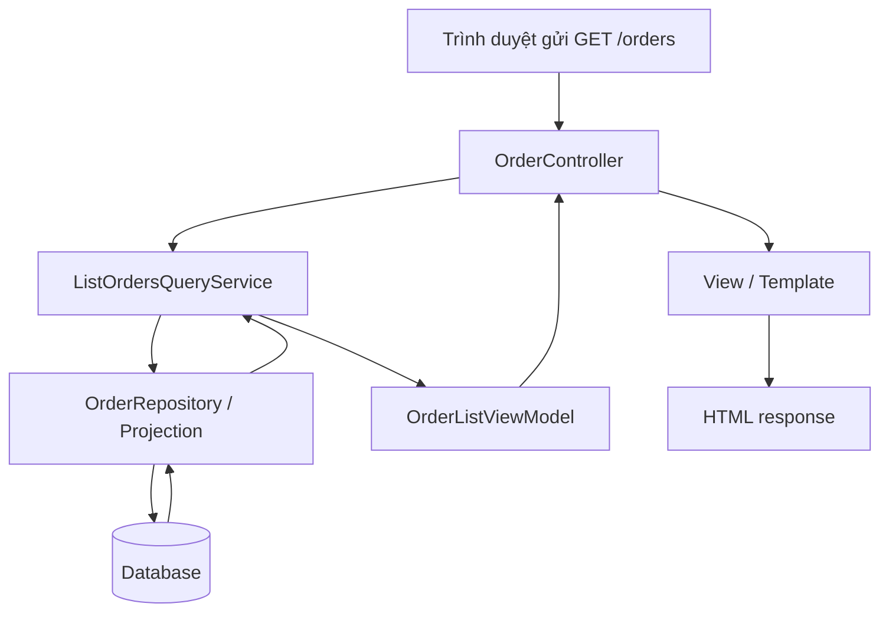
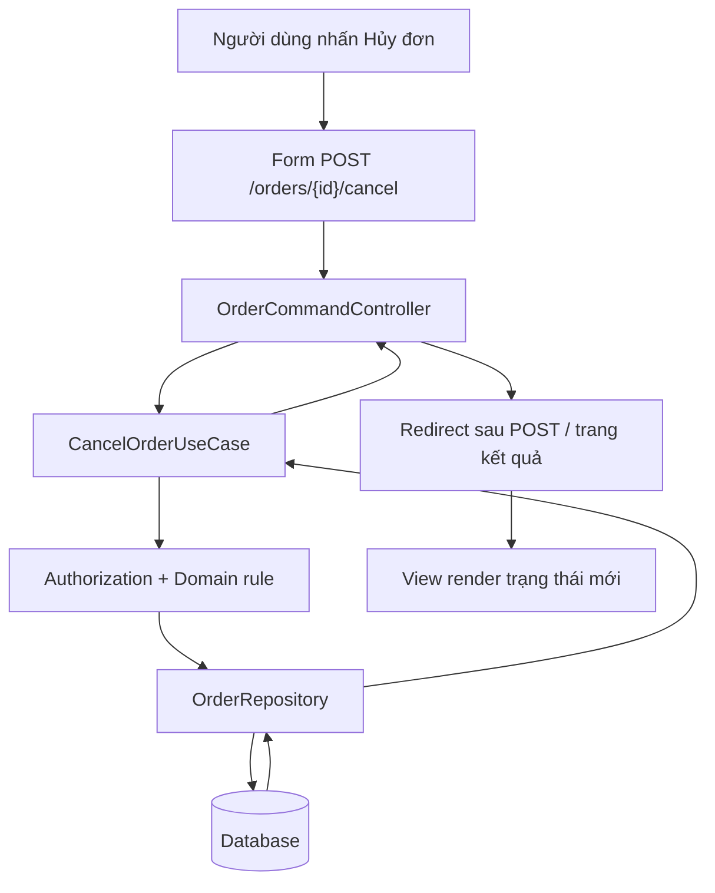

# View thực hiện truy vấn hoặc cập nhật dữ liệu

Trong mô hình Model–View–Controller (MVC), View có nhiệm vụ trình bày dữ liệu và phản hồi giao diện cho người dùng. Một lỗi thiết kế thường gặp là để template, component hoặc mã JavaScript của View gọi repository, ORM hay câu SQL trực tiếp; một lỗi khác là để thao tác hiển thị trang âm thầm thay đổi dữ liệu. Ban đầu cách làm này có vẻ nhanh vì ít lớp trung gian, nhưng theo thời gian nó khiến truy vấn khó kiểm soát, quy tắc nghiệp vụ bị phân tán, quyền truy cập dễ bị bỏ sót và kiểm thử trở nên khó khăn.

Ranh giới rõ ràng hơn là: Controller nhận request và điều phối; application/query service lấy dữ liệu hoặc thực hiện ca sử dụng; Model/domain bảo vệ trạng thái và quy tắc; repository làm việc với persistence; View nhận một mô hình trình bày đã được chuẩn bị và chỉ render. Với giao diện SPA, component có thể khởi tạo request tới API, nhưng việc truy vấn và thay đổi dữ liệu phía máy chủ vẫn đi qua API adapter và application boundary.

## 1. Vai trò của View trong MVC

View chuyển dữ liệu đã được chuẩn bị thành nội dung mà người dùng có thể nhìn thấy hoặc tương tác. Với ứng dụng server-rendered, View thường là template HTML; với SPA, đó là component giao diện; với API, serializer/response mapper cũng thuộc vùng trình bày của adapter.

View có thể:

- Hiển thị danh sách, chi tiết, thông báo và trạng thái.
- Lặp qua các phần tử trong ViewModel.
- Ẩn/hiện thành phần giao diện theo dữ liệu đã được cung cấp.
- Định dạng ngày, số, tiền tệ và nhãn hiển thị đơn giản.
- Thu thập dữ liệu từ biểu mẫu hoặc sự kiện giao diện.
- Khởi tạo một request HTTP tới endpoint khi người dùng thực hiện hành động.

View không nên:

- Gọi repository, `EntityManager`, ORM session hoặc SQL.
- Tự tải entity và quan hệ persistence để dựng trang.
- Tự quyết định hoặc thực thi quy tắc nghiệp vụ.
- Thay đổi trạng thái domain chỉ vì người dùng mở trang.
- Tự mở transaction hoặc điều khiển commit/rollback.
- Gửi email, trừ tiền, đặt chỗ hoặc tạo dữ liệu như một side effect của việc render.
- Dùng thông tin do trình duyệt gửi lên làm bằng chứng về danh tính hay quyền truy cập.

Một View có thể khởi tạo request, nhưng request đó phải được xử lý qua ranh giới của ứng dụng. Ví dụ, khi người dùng nhấn “Hủy đơn”, View gửi form POST tới Controller; Controller gọi use case hủy đơn; use case kiểm tra quyền và trạng thái rồi lưu thay đổi. View không trực tiếp gọi `orderRepository.delete(...)`.

## 2. Vì sao truy vấn trong View là một sai lầm?

Ví dụ một template Thymeleaf truy vấn repository ngay trong biểu thức:

```html
<tr th:each="order : ${@orderRepository.findByCustomerId(customerId)}">
    <td th:text="${order.orderNumber}"></td>
    <td th:text="${order.total}"></td>
</tr>
```

Template đang quyết định lấy dữ liệu từ đâu và gọi persistence trong lúc render. Điều này tạo ra nhiều vấn đề:

1. **Trộn trách nhiệm:** View vừa trình bày vừa biết repository và cách lưu dữ liệu.
2. **Khó kiểm thử:** kiểm thử template có thể cần database, transaction và cấu hình ORM.
3. **Khó tối ưu:** truy vấn nằm trong template nên khó thấy toàn bộ query plan, số lần gọi và điều kiện lọc.
4. **Khó tái sử dụng:** cùng một màn hình có thể được gọi từ nhiều Controller nhưng template lại tự truy vấn theo một cách cố định.
5. **Khó phân quyền:** điều kiện truy vấn có thể quên phạm vi tenant hoặc chủ sở hữu.
6. **Phụ thuộc persistence:** đổi repository, ORM hoặc cách truy vấn có thể buộc sửa template.

Tình huống nguy hiểm hơn là View gọi một phương thức lazy trên entity. Một vòng lặp hiển thị 50 đơn có thể kích hoạt 50 truy vấn riêng để lấy khách hàng hoặc dòng hàng. Đây là lỗi N+1 thường khó nhận ra nếu chỉ nhìn HTML cuối cùng.

### View có thể làm phát sinh truy vấn gián tiếp

Ngay cả khi template không gọi repository trực tiếp, nó vẫn có thể kích hoạt truy vấn nếu nhận entity có quan hệ lazy:

```java
public class Order {
    @ManyToOne(fetch = FetchType.LAZY)
    private Customer customer;
}
```

```html
<span th:text="${order.customer.displayName}"></span>
```

Khi template đọc `order.customer.displayName`, ORM có thể tải `Customer` trong lúc render. Nếu danh sách có nhiều đơn, mỗi lần đọc có thể tạo thêm query. Kết quả là hiệu năng phụ thuộc vào cách template truy cập thuộc tính, và truy vấn khó được dự đoán.

Giải pháp là lấy đúng dữ liệu cần hiển thị trong query service, ánh xạ sang DTO/ViewModel, rồi truyền dữ liệu phẳng hoặc có cấu trúc phù hợp cho View. Template không cần biết quan hệ ORM.

## 3. Vì sao cập nhật dữ liệu trong View còn nguy hiểm hơn?

Một View không nên thay đổi dữ liệu khi được render. Ví dụ, không nên gọi hàm `markAsRead`, `decreaseInventory`, `recordVisit` hoặc `cancelOrder` từ biểu thức template. Việc mở trang hoặc refresh có thể lặp lại side effect.

Các vấn đề thường gặp:

- Người dùng refresh trang và thao tác bị chạy lại.
- Trình duyệt prefetch, crawler hoặc proxy retry URL GET làm phát sinh thay đổi ngoài ý muốn.
- Người dùng không hiểu vì sao chỉ mở trang đã thay đổi trạng thái.
- Khó xác định actor, thời điểm và nguồn gốc của thao tác.
- CSRF và authorization khó được áp dụng nhất quán.

Ví dụ không nên dùng GET để hủy đơn:

```html
<a th:href="@{/orders/{id}/cancel(id=${order.id})}">
    Hủy đơn
</a>
```

Nếu endpoint này thay đổi dữ liệu, một liên kết GET có thể bị kích hoạt khi người dùng mở liên kết, trình duyệt kiểm tra trước URL hoặc một hệ thống tự động thu thập đường dẫn. GET được thiết kế cho thao tác an toàn, không tạo thay đổi nghiệp vụ.

Thay vào đó, View gửi một form POST:

```html
<form th:action="@{/orders/{id}/cancel(id=${order.id})}"
      method="post">
    <input type="hidden" name="reason" value="CUSTOMER_REQUEST">
    <button type="submit">Hủy đơn</button>
</form>
```

Trong ứng dụng dùng Spring Security và Thymeleaf integration, CSRF token thường được thêm tự động cho form có `th:action`. Nếu không có tích hợp tự động, phải gửi token theo cơ chế CSRF đã cấu hình. Controller vẫn phải xác thực người dùng và kiểm tra quyền; việc có token không thay thế authorization.

## 4. Luồng đúng: Controller chuẩn bị dữ liệu, View chỉ render

Một luồng đọc điển hình:



Controller không cần chứa SQL hoặc quy tắc nghiệp vụ. Nó chuyển tham số request thành query, gọi application service và đưa kết quả vào model cho View.

### Định nghĩa hợp đồng dữ liệu cho View

Thay vì truyền entity `Order`, hãy tạo DTO chỉ chứa dữ liệu cần hiển thị:

```java
public record OrderListItemView(
    UUID id,
    String orderNumber,
    String customerName,
    OrderStatus status,
    BigDecimal total,
    String currencyCode,
    Instant createdAt
) {}

public record OrderListPageView(
    List<OrderListItemView> items,
    int page,
    int pageSize,
    boolean hasNext
) {}
```

DTO này không có repository, lazy relation hoặc phương thức thay đổi trạng thái. Nó mô tả dữ liệu mà màn hình danh sách cần.

### Query service lấy dữ liệu

```java
public record ListOrdersQuery(
    OrderStatus status,
    int page,
    int size
) {}

public interface ListOrdersUseCase {
    OrderListPageView execute(ListOrdersQuery query);
}
```

Application layer nhận danh tính đã xác minh qua một abstraction nhỏ:

```java
public record Actor(UUID id, UUID tenantId) {}

public interface CurrentActor {
    Actor get();
}
```

Repository có thể trả một projection dành riêng cho truy vấn danh sách:

```java
public record OrderListRow(
    UUID id,
    String orderNumber,
    String customerName,
    OrderStatus status,
    BigDecimal total,
    String currencyCode,
    Instant createdAt
) {}
```

Hợp đồng repository minh họa:

```java
public interface OrderRepository {
    Page<OrderListRow> findRowsVisibleTo(
        UUID actorId,
        UUID tenantId,
        OrderStatus status,
        Pageable pageable
    );
}
```

Phần triển khai query phải lọc theo `actorId`/`tenantId` và chỉ lấy các cột trong projection; có thể dùng JPQL constructor expression, Criteria API hoặc query builder phù hợp.

Triển khai use case gọi repository và ánh xạ kết quả:

```java
@Service
@RequiredArgsConstructor
public class ListOrdersService implements ListOrdersUseCase {
    private final CurrentActor currentActor;
    private final OrderRepository orders;

    @Override
    @Transactional(readOnly = true)
    public OrderListPageView execute(ListOrdersQuery query) {
        Actor actor = currentActor.get();
        int page = Math.max(query.page(), 0);
        int size = Math.min(Math.max(query.size(), 1), 100);

        Page<OrderListRow> result = orders.findRowsVisibleTo(
            actor.id(),
            actor.tenantId(),
            query.status(),
            PageRequest.of(page, size, Sort.by("createdAt").descending())
        );

        List<OrderListItemView> items = result.getContent().stream()
            .map(row -> new OrderListItemView(
                row.id(),
                row.orderNumber(),
                row.customerName(),
                row.status(),
                row.total(),
                row.currencyCode(),
                row.createdAt()
            ))
            .toList();

        return new OrderListPageView(
            items,
            result.getNumber(),
            result.getSize(),
            result.hasNext()
        );
    }
}
```

`OrderListRow` là DTO projection do repository trả về. Truy vấn phải áp dụng phạm vi người dùng/tenant ở phía server; không nhận `customerId` tùy ý từ template hoặc query string rồi tin đó là phạm vi được phép. Ví dụ này minh họa cấu trúc, tên trường và repository cần điều chỉnh theo domain thực tế.

### Controller điều phối request

```java
@Controller
@RequiredArgsConstructor
@RequestMapping("/orders")
public class OrderPageController {
    private final ListOrdersUseCase listOrders;

    @GetMapping
    public String list(
            @RequestParam(defaultValue = "0") int page,
            @RequestParam(defaultValue = "20") int size,
            @RequestParam(required = false) OrderStatus status,
            Model model) {

        OrderListPageView result = listOrders.execute(
            new ListOrdersQuery(status, page, size)
        );
        model.addAttribute("orders", result);
        return "orders/list";
    }
}
```

Controller chỉ chuyển request thành query và gắn kết quả vào model. Application service chịu trách nhiệm xác định actor, phân quyền và lấy dữ liệu. View không biết repository nằm ở đâu.

### Template chỉ hiển thị ViewModel

```html
<table>
  <tbody>
    <tr th:each="order : ${orders.items}">
      <td th:text="${order.orderNumber}"></td>
      <td th:text="${order.customerName}"></td>
      <td th:text="${order.status}"></td>
      <td th:text="${order.total + ' ' + order.currencyCode}"></td>
    </tr>
  </tbody>
</table>
```

Biểu thức ghép chuỗi dùng cú pháp Thymeleaf và chỉ đọc các trường đã có trong ViewModel. Template không gọi repository, truy cập entity relation hoặc thực hiện phép tính nghiệp vụ.

## 5. Luồng cập nhật đúng: View gửi command qua Controller

Khi người dùng thực hiện hành động, View thu thập input và gửi request tới Controller. Controller gọi use case thay đổi dữ liệu. Domain model kiểm tra bất biến, repository lưu trạng thái và Controller trả redirect hoặc response.



Ví dụ Controller:

Hợp đồng command và form tối thiểu:

```java
public record CancelOrderForm(@NotBlank String reason) {}

public record CancelOrderCommand(UUID orderId, String reason) {}

public interface CancelOrderUseCase {
    void execute(CancelOrderCommand command);
}
```

```java
@Controller
@RequiredArgsConstructor
@RequestMapping("/orders")
public class OrderCommandController {
    private final CancelOrderUseCase cancelOrder;

    @PostMapping("/{id}/cancel")
    public String cancel(
            @PathVariable UUID id,
            @Valid @ModelAttribute CancelOrderForm form,
            BindingResult errors,
            RedirectAttributes redirect) {

        if (errors.hasErrors()) {
            redirect.addFlashAttribute("error", "Lý do hủy không hợp lệ");
            return "redirect:/orders/" + id;
        }

        cancelOrder.execute(new CancelOrderCommand(id, form.reason()));
        redirect.addFlashAttribute("message", "Đơn hàng đã được hủy");
        return "redirect:/orders/" + id;
    }
}
```

Use case phải tự kiểm tra actor có quyền hủy đơn và đơn đang ở trạng thái cho phép. Không dựa vào việc nút Hủy có xuất hiện trong View hay không. Người dùng có thể tự gửi request bằng công cụ khác.

### Dùng Post/Redirect/Get

Sau khi xử lý POST thành công, Controller có thể redirect về trang GET. Cách này tránh việc refresh trang kết quả vô tình gửi lại biểu mẫu trong luồng trình duyệt thông thường. PRG không thay thế idempotency hoặc kiểm soát đồng thời cho những hành động có thể bị gửi lặp do retry hoặc nhiều tab.

## 6. Những việc View được phép tính và những việc phải chuyển ra ngoài

Không phải mọi biểu thức trong View đều sai. Ranh giới quan trọng là biểu thức đó có phải chỉ phục vụ trình bày hay đang truy cập dữ liệu hoặc quyết định nghiệp vụ.

| Công việc | Có thể ở View? | Vị trí phù hợp |
|---|---|---|
| Lặp qua danh sách đã có trong ViewModel | Có | View |
| Hiển thị nhãn trạng thái đã chuẩn bị | Có | View hoặc Presenter |
| Định dạng ngày/số theo locale | Có thể, nếu đơn giản | Presenter/formatter hoặc template helper thuần |
| Tính tổng tiền, thuế hoặc chiết khấu | Không nên | Domain/application service |
| Kiểm tra người dùng có quyền hủy đơn | Không | Authorization policy/use case |
| Đọc danh sách đơn từ database | Không | Query service/repository |
| Ghi nhận đơn đã thanh toán | Không | Command use case/domain |
| Hiển thị nút theo quyền được cung cấp | Có, cho UX | View; server vẫn phải kiểm tra quyền |
| Gửi request tới API khi người dùng nhấn nút | Có thể khởi tạo | View/client API layer gọi endpoint |

Ví dụ, View có thể hiển thị nút “Hủy đơn” nếu `canCancel` trong ViewModel là `true`. Nhưng `canCancel` chỉ giúp giao diện phản ánh quyền hiện tại. `CancelOrderUseCase` vẫn phải kiểm tra lại quyền và trạng thái tại thời điểm thực thi.

## 7. ViewModel giúp tránh rò rỉ persistence

Đưa entity trực tiếp vào View thường tạo coupling giữa template và database model:

```java
// Không nên: template nhận entity có quan hệ ORM.
model.addAttribute("order", orderEntity);
```

Template có thể vô tình truy cập trường nội bộ, quan hệ lazy hoặc thuộc tính không dành cho người dùng. Khi entity thay đổi, giao diện cũng có thể hỏng theo.

Thay vào đó, tạo ViewModel riêng:

```java
public record OrderDetailsView(
    String orderNumber,
    String customerName,
    String shippingAddress,
    String statusLabel,
    String totalText,
    List<OrderLineView> lines,
    boolean canCancel
) {}
```

Dữ liệu query và dòng hàng được presenter sử dụng có thể có hợp đồng riêng:

```java
public record OrderLineData(
    String productName,
    int quantity,
    BigDecimal lineTotal
) {}

public record OrderDetailsData(
    String orderNumber,
    String customerName,
    String shippingAddress,
    OrderStatus status,
    BigDecimal total,
    String currencyCode,
    List<OrderLineData> lines
) {}

public record OrderLineView(
    String productName,
    int quantity,
    String lineTotalText
) {}
```

Presenter tạo ViewModel từ dữ liệu truy vấn và ngữ cảnh đã được kiểm tra:

```java
@Component
@RequiredArgsConstructor
public class OrderDetailsPresenter {
    private final MessageSource messages;

    public OrderDetailsView present(
            OrderDetailsData data,
            boolean canCancel,
            Locale locale) {

        String statusLabel = messages.getMessage(
            "order.status." + data.status().name(),
            null,
            locale
        );

        return new OrderDetailsView(
            data.orderNumber(),
            data.customerName(),
            data.shippingAddress(),
            statusLabel,
            formatMoney(data.total(), data.currencyCode(), locale),
            data.lines().stream().map(this::presentLine).toList(),
            canCancel
        );
    }
}
```

Đây là ví dụ rút gọn; `formatMoney` và `presentLine` là các hàm trình bày thuần cần được triển khai hoặc ủy quyền cho formatter. Presenter không truy vấn repository và không thay đổi entity. ViewModel chỉ chứa dữ liệu phù hợp với màn hình hiện tại.

## 8. Component SPA cũng không nên truy cập persistence

Trong SPA, View thường là React, Vue, Angular hoặc component tương tự. Component có thể gọi `fetch` hoặc API client để tải dữ liệu; điều đó không có nghĩa component được truy cập database.

Một cấu trúc dễ bảo trì:

```text
orders/
  components/
    OrderList.tsx
    OrderRow.tsx
  api/
    orderClient.ts
  state/
    orderQueries.ts
```

Component tập trung render và phát sự kiện:

```tsx
function OrderList() {
  const { data, isLoading, error } = useOrders();

  if (isLoading) return <Loading />;
  if (error) return <ErrorMessage />;

  return (
    <ul>
      {data.items.map(order => (
        <li key={order.id}>
          <span>{order.orderNumber}</span>
          <span>{order.statusLabel}</span>
        </li>
      ))}
    </ul>
  );
}
```

API client chịu trách nhiệm giao tiếp HTTP:

```typescript
export async function fetchOrders(): Promise<OrderListResponse> {
  const response = await fetch("/api/v1/orders");
  if (!response.ok) {
    throw new Error("Không thể tải danh sách đơn hàng");
  }
  return response.json();
}
```

Phía server vẫn có API Controller, use case, policy và repository. Component không được nhúng thông tin kết nối database, credential database hoặc truy vấn trực tiếp vào trình duyệt. Các quy tắc nghiệp vụ và authorization phải được xác minh ở server.

Với ứng dụng nhỏ, việc gọi `fetch` từ hook hoặc component có thể chấp nhận được. Khi ứng dụng lớn hơn, tách API client và state/query layer giúp quản lý cache, retry, lỗi và đồng bộ dữ liệu rõ hơn. Dù tổ chức thế nào, component vẫn không sở hữu persistence logic.

## 9. Các hậu quả về bảo mật và quyền truy cập

Truy vấn trong View có thể bỏ qua chính sách mà query service thường áp dụng. Ví dụ template gọi `findById(orderId)` mà không lọc theo chủ sở hữu hoặc tenant. Nếu người dùng thay ID trên URL, trang có thể hiển thị dữ liệu của người khác.

Các nguyên tắc cần giữ:

- Không để View tự chọn tenant hoặc actor từ dữ liệu không đáng tin cậy.
- Query service áp dụng phạm vi dữ liệu theo danh tính đã xác thực.
- Command use case kiểm tra quyền trên tài nguyên tại thời điểm thay đổi.
- Ẩn nút trong View chỉ là UX, không phải cơ chế bảo vệ.
- GET chỉ dùng cho thao tác an toàn; thay đổi dữ liệu dùng phương thức phù hợp và có CSRF protection khi xác thực bằng cookie.
- Không hiển thị exception, SQL, token hoặc dữ liệu nhạy cảm trong template.

Một View có thể được dùng bởi nhiều vai trò. Hãy tạo ViewModel phù hợp với quyền hiện tại và không gửi các trường nhạy cảm xuống client nếu không cần thiết.

## 10. Tác động đến hiệu năng

Truy vấn trong template thường làm số query khó dự đoán. Một trang có thể trông đơn giản nhưng khi render lại phát sinh nhiều lần truy cập ORM.

Các vấn đề thường gặp:

- N+1 query khi lặp qua entity và truy cập quan hệ lazy.
- Overfetch khi template nhận entity graph lớn nhưng chỉ hiển thị vài trường.
- Count hoặc aggregate được tính bằng cách tải tất cả bản ghi vào bộ nhớ.
- Truy vấn lặp khi một fragment được render nhiều lần.
- Cache khó kiểm soát vì dữ liệu được lấy ngầm trong quá trình render.

Giải pháp:

1. Liệt kê trường cần hiển thị cho từng màn hình.
2. Dùng projection hoặc query DTO để chỉ lấy dữ liệu cần.
3. Phân trang và lọc tại database.
4. Tổng hợp bằng query khi phù hợp với quy tắc nghiệp vụ.
5. Đo query count và thời gian render.
6. Chỉ thêm cache khi đã hiểu chính sách quyền, độ mới dữ liệu và invalidation.

Không nên chuyển mọi quan hệ ORM sang `EAGER` để template chạy được. Điều đó có thể làm mọi màn hình tải thêm dữ liệu, kể cả khi không cần. Chọn fetch plan theo use case và kiểm tra SQL thực tế.

## 11. Fragment và component dùng chung cũng phải giữ ranh giới

Template fragment, layout hoặc component dùng chung có thể nhận ViewModel và render một phần giao diện. Chúng không nên tự gọi service hoặc repository để bổ sung dữ liệu.

Ví dụ fragment hiển thị thông tin khách hàng:

```html
<section th:fragment="customerSummary(customer)">
    <h2 th:text="${customer.displayName}"></h2>
    <span th:text="${customer.email}"></span>
</section>
```

Controller hoặc presenter cung cấp `customer` đã được truy vấn và kiểm tra quyền. Fragment chỉ hiển thị các trường có trong dữ liệu đầu vào.

Nếu nhiều trang cần cùng một dữ liệu phụ, hãy cân nhắc:

- Query service chuẩn bị dữ liệu cho từng màn hình.
- Controller advice hoặc model attribute provider chỉ cho dữ liệu tham chiếu chung, ít thay đổi và không có side effect.
- Component/application service riêng nếu đó là một use case có ý nghĩa.

Không biến model attribute provider thành nơi chạy truy vấn phức tạp cho mọi request. Dữ liệu dùng chung cũng cần được đo lường, phân quyền và có vòng đời rõ ràng.

## 12. Kiểm thử để bảo đảm View chỉ trình bày

Việc tách query và command khỏi View tạo ra các ranh giới kiểm thử dễ hiểu:

| Loại kiểm thử | Điều cần xác minh |
|---|---|
| Unit test query service | Filter, pagination, authorization và mapping dữ liệu |
| Unit test presenter | Nhãn, định dạng và ViewModel đúng |
| Controller test | Request được chuyển thành query/command; model hoặc response đúng |
| Template test | Render đúng với ViewModel mẫu, không cần repository |
| Repository integration test | Projection, join và phạm vi truy vấn chính xác |
| Security test | Không đọc hoặc cập nhật dữ liệu ngoài quyền |
| Performance test | Query count, response time và số hàng phù hợp |

Ví dụ kiểm thử Controller với MockMvc:

```java
mockMvc.perform(get("/orders")
        .param("page", "0")
        .param("size", "20")
        .with(user("customer")))
    .andExpect(status().isOk())
    .andExpect(view().name("orders/list"))
    .andExpect(model().attributeExists("orders"));
```

Ví dụ này kiểm tra Controller trả View và model phù hợp. Unit test riêng cho query service xác minh dữ liệu; repository integration test xác minh SQL/projection. Không nên mock mọi lớp trong một test rồi kết luận truy vấn thật là đúng.

### Phát hiện truy vấn bị kích hoạt trong lúc render

Với server-rendered MVC, có thể dùng SQL statistics hoặc query counter trong integration test:

- Gọi endpoint để tải danh sách.
- Đếm số truy vấn trước và sau khi render.
- Tăng số lượng dữ liệu từ vài bản ghi lên nhiều bản ghi.
- Xác minh query count không tăng tuyến tính ngoài dự kiến.

Một template tốt không làm phát sinh truy vấn mới khi chỉ đọc các thuộc tính của ViewModel. Nếu số query tăng theo số dòng hiển thị, hãy kiểm tra entity relation lazy hoặc lời gọi service bị ẩn trong template.

## 13. Quy trình refactor khi View đang truy cập dữ liệu

Giả sử một template đang gọi repository để lấy danh sách đơn hàng:

1. **Xác định dữ liệu được dùng.** Liệt kê chính xác cột, quan hệ, bộ lọc và hành động mà màn hình cần.
2. **Tạo ViewModel.** Chỉ chứa trường cần render; không giữ entity hoặc repository.
3. **Tạo query/use case.** Đưa điều kiện lọc, phạm vi người dùng, phân trang và projection vào query service.
4. **Chuyển việc gọi query sang Controller.** Controller gọi use case và gắn ViewModel vào model.
5. **Sửa template.** Thay biểu thức truy vấn hoặc truy cập lazy bằng việc đọc thuộc tính ViewModel.
6. **Tách thao tác ghi.** Mọi nút hành động gửi request tới Controller/API và gọi command use case.
7. **Bổ sung bảo mật.** Kiểm tra authorization ở server, CSRF cho form dùng cookie và xác thực đầu vào.
8. **Kiểm thử và đo lại.** Xác minh kết quả hiển thị, query count, quyền truy cập và side effect.

Không cần tạo một lớp mới cho từng biểu thức template. Mục tiêu là đặt truy vấn và hành vi ở một ranh giới có ý nghĩa, với hợp đồng dữ liệu đủ rõ để kiểm thử và bảo trì.

## 14. Những cách làm sai thường gặp

| Cách làm | Hậu quả | Hướng sửa |
|---|---|---|
| Gọi repository từ Thymeleaf/JSP | View phụ thuộc persistence | Query service chuẩn bị ViewModel |
| Truy cập quan hệ lazy trong template | N+1 query và lỗi session | Projection/DTO phẳng |
| Trả entity đầy đủ vào model | Lộ trường và coupling ORM | ViewModel theo màn hình |
| Gọi phương thức cập nhật trong biểu thức render | Side effect khi mở/refresh trang | POST/PATCH/DELETE tới command endpoint |
| Dùng GET để xóa hoặc hủy | Crawler/prefetch có thể kích hoạt thay đổi | Dùng phương thức thay đổi phù hợp, CSRF và authorization |
| Ẩn nút rồi coi đó là phân quyền | Request trực tiếp vẫn thực hiện được | Server kiểm tra quyền trong use case |
| Tính thuế/giá trong template | Quy tắc nghiệp vụ bị phân tán | Domain/application service |
| Component SPA gọi database trực tiếp | Lộ credential và bỏ qua server policy | API client gọi backend |
| Fragment tự gọi service | Truy vấn ẩn, khó kiểm soát | Truyền dữ liệu qua model/ViewModel |
| Dùng global model provider cho query nặng | Mọi trang đều chịu chi phí truy vấn | Query theo nhu cầu từng màn hình |

## 15. Checklist rà soát View

- Template/component chỉ đọc dữ liệu được truyền vào hay còn gọi service/repository?
- View có nhận entity ORM hoặc truy cập quan hệ lazy không?
- Việc render có thể tạo side effect hoặc thay đổi trạng thái không?
- GET có giữ tính an toàn và không làm thay đổi dữ liệu nghiệp vụ không?
- Form hành động có gửi request tới endpoint rõ ràng và có CSRF khi cần không?
- Controller có điều phối query/command thay vì chứa SQL và quy tắc phức tạp không?
- Application/domain có kiểm tra quyền và bất biến ở server không?
- ViewModel có chỉ chứa dữ liệu cần thiết, tránh trường nhạy cảm không?
- Các phép tính trong View có thuần trình bày hay đang quyết định nghiệp vụ?
- Query có phân trang, lọc và tránh N+1 không?
- Fragment/component dùng chung có truy vấn ẩn không?
- Test có xác minh model, template, authorization và query count không?

## Kết luận

View là nơi trình bày dữ liệu và thu thập tương tác, không phải nơi truy cập persistence hoặc thực thi nghiệp vụ. Với luồng đọc, Controller gọi query/use case để lấy DTO hoặc ViewModel rồi chuyển cho template render. Với luồng ghi, View gửi command qua request tới Controller/API; application service và domain kiểm tra quyền, trạng thái và lưu thay đổi. Cách tổ chức này giúp truy vấn có thể quan sát và tối ưu, tránh N+1, bảo vệ dữ liệu và làm cho mỗi phần của MVC dễ kiểm thử hơn.
