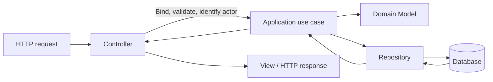
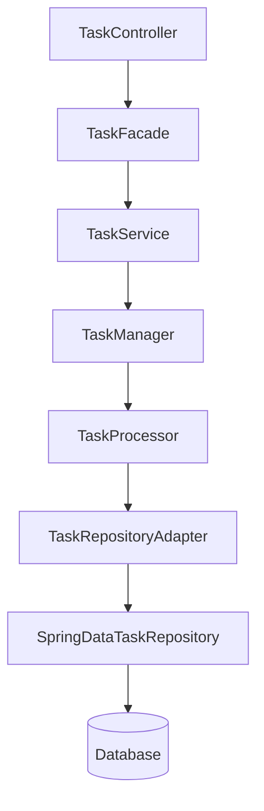

# Coi Controller mỏng là lý do tạo thêm các lớp trung gian không cần thiết

Trong ứng dụng MVC, Controller nên tập trung tiếp nhận request, chuyển dữ liệu đầu vào cho ca sử dụng và chọn response phù hợp. Nguyên tắc này thường được gọi là **thin controller**. Tuy nhiên, có một cách hiểu sai khá phổ biến: muốn Controller mỏng thì phải đẩy từng dòng code sang một lớp mới. Kết quả là một thao tác đơn giản đi qua nhiều lớp `Facade`, `Manager`, `Processor`, `Handler`, `Service`, `Adapter` và `Repository`, trong khi phần lớn các lớp chỉ gọi tiếp phương thức kế tiếp.

Số lớp tăng không tự động làm hệ thống dễ bảo trì. Nếu mỗi lớp không có trách nhiệm, quy tắc, ranh giới thay đổi hoặc chính sách riêng, chúng chỉ tạo thêm nơi phải đọc và điều hướng khi sửa lỗi. Một Controller mỏng là Controller có trách nhiệm rõ ràng; nó không phải Controller có ít dòng nhất bằng mọi giá.

Bài học này phân biệt sự phân tách trách nhiệm có ích với việc tạo tầng trung gian theo thói quen, dùng ví dụ Spring MVC để nhận diện pass-through layers, chọn đúng ranh giới Service/Repository/Model và refactor vừa đủ theo nhu cầu thực tế.

## 1. Thin Controller thực sự có nghĩa gì?

Controller là adapter ở ranh giới HTTP. Nó hiểu URL, HTTP method, request parameter, form binding, danh tính người dùng và cách tạo response. Controller thường nên:

- Nhận request và bind dữ liệu vào kiểu đầu vào phù hợp.
- Áp dụng kiểm tra ở ranh giới giao tiếp, chẳng hạn `@Valid` và định dạng tham số.
- Lấy thông tin actor từ ngữ cảnh xác thực, không tin ID người dùng do client tự khai báo.
- Gọi ca sử dụng hoặc truy vấn phù hợp.
- Chuyển kết quả thành View, redirect, status, header hoặc response DTO.
- Chuyển lỗi đã biết sang phản hồi theo hợp đồng web.

Controller không nên tự sở hữu quy tắc nghiệp vụ quan trọng, transaction xuyên nhiều thao tác, chính sách phân quyền theo tài nguyên hoặc quy trình tích hợp phức tạp. Những trách nhiệm đó thuộc Service, Model hoặc thành phần chuyên trách phù hợp.



Một Controller có thể có nhiều dòng code mà vẫn mỏng nếu các dòng đó xử lý giao thức HTTP và trình bày kết quả. Ngược lại, một Controller chỉ có 10 dòng nhưng tự quyết định quy tắc trạng thái và cập nhật nhiều bảng vẫn có thể đang chứa nghiệp vụ.

## 2. Hiểu sai: mỗi trách nhiệm nhỏ phải có một lớp riêng

Hãy xem hành động hoàn thành công việc. Một thiết kế quá nhiều tầng có thể trông như sau:



Nếu mỗi lớp chỉ nhận `taskId`, gọi lớp kế tiếp rồi trả lại cùng kết quả, hệ thống không có thêm ranh giới nghiệp vụ hay kỹ thuật có ý nghĩa. Khi cần tìm nơi kiểm tra trạng thái công việc, người đọc phải mở nhiều file để lần theo chuỗi ủy quyền.

Một lớp trung gian chỉ đáng tồn tại khi nó thực sự làm một việc có ý nghĩa, ví dụ:

- Điều phối một use case có transaction và nhiều bước.
- Bảo vệ một bất biến hoặc quy tắc nghiệp vụ.
- Chuyển đổi giữa hai mô hình có lý do độc lập.
- Cô lập một hệ thống bên ngoài hoặc công nghệ lưu trữ.
- Cung cấp một chính sách được nhiều luồng dùng chung.
- Tạo một ranh giới module cần được kiểm thử hoặc thay thế độc lập.

Nếu lớp không làm những việc đó, hãy cân nhắc bỏ nó hoặc gộp vào thành phần đang sở hữu trách nhiệm thực tế.

## 3. Dấu hiệu một lớp chỉ là pass-through layer

Một lớp trung gian thường không đem lại giá trị nếu phần lớn nội dung chỉ là chuyển tiếp.

```java
@Service
public class TaskFacade {
    private final TaskService taskService;

    public TaskFacade(TaskService taskService) {
        this.taskService = taskService;
    }

    public TaskResult complete(long taskId) {
        return taskService.complete(taskId);
    }
}
```

Nếu `TaskFacade` không kiểm tra quyền, không điều phối nhiều use case, không chuyển đổi hợp đồng, không thêm chính sách và chỉ tồn tại để gọi `TaskService`, nó là một lớp chuyển tiếp.

Các dấu hiệu thường gặp:

- Phương thức chỉ gọi đúng một phương thức ở dependency rồi `return` kết quả.
- Lớp có tên `Manager`, `Helper`, `Processor` hoặc `Facade` nhưng không có trách nhiệm được mô tả rõ.
- Interface và implementation luôn đi thành cặp một-một, implementation chỉ chuyển tiếp mà không tạo ranh giới cần thay thế.
- Cùng một dữ liệu được bọc qua nhiều DTO giống hệt nhau mà không thay đổi ý nghĩa hoặc mức tin cậy.
- Một thao tác đơn giản phải đi qua nhiều file mới đến được nơi có hành vi thực tế.
- Test phải mock nhiều lớp trung gian nhưng không xác nhận thêm quy tắc nào.
- Khi đổi tên một phương thức, phải sửa hàng loạt lớp chỉ để đổi tên lời gọi tiếp theo.

Một lớp có thể ngắn mà vẫn có giá trị, ví dụ một adapter chuyển đổi giao thức bên ngoài. Ngược lại, lớp dài cũng có thể là dấu hiệu đang gộp quá nhiều trách nhiệm. Hãy đánh giá theo vai trò và lý do thay đổi, không chỉ theo số dòng.

## 4. Ví dụ thiết kế quá nhiều tầng

Giả sử endpoint nhận request hoàn thành công việc:

```java
@RestController
@RequestMapping("/api/tasks")
class TaskController {
    private final TaskFacade facade;

    TaskController(TaskFacade facade) {
        this.facade = facade;
    }

    @PostMapping("/{id}/complete")
    TaskResponse complete(@PathVariable long id) {
        return facade.complete(id);
    }
}

@Service
class TaskFacade {
    private final TaskService service;

    TaskFacade(TaskService service) {
        this.service = service;
    }

    TaskResponse complete(long id) {
        return service.complete(id);
    }
}

@Service
class TaskService {
    private final TaskManager manager;

    TaskService(TaskManager manager) {
        this.manager = manager;
    }

    TaskResponse complete(long id) {
        return manager.complete(id);
    }
}

@Component
class TaskManager {
    private final TaskRepositoryAdapter adapter;

    TaskManager(TaskRepositoryAdapter adapter) {
        this.adapter = adapter;
    }

    TaskResponse complete(long id) {
        return adapter.complete(id);
    }
}

@Repository
class TaskRepositoryAdapter {
    private final SpringDataTaskRepository repository;

    TaskRepositoryAdapter(SpringDataTaskRepository repository) {
        this.repository = repository;
    }

    TaskResponse complete(long id) {
        TaskEntity task = repository.findById(id).orElseThrow();
        task.setStatus("COMPLETED");
        repository.save(task);
        return new TaskResponse(task.getId(), task.getTitle(), task.getStatus());
    }
}
```

Ở đây có nhiều vấn đề:

1. `TaskFacade`, `TaskService` và `TaskManager` không có trách nhiệm khác nhau.
2. Quy tắc chuyển trạng thái lại nằm trong lớp mang tên repository adapter.
3. Không thấy ranh giới transaction của ca sử dụng.
4. Controller không lấy actor nên ví dụ chưa thể hiện kiểm tra quyền theo người dùng.
5. Việc trả DTO bị gắn vào lớp truy cập dữ liệu, khiến persistence và representation của API dính nhau.

Thêm lớp không làm quy tắc được phân tách tốt hơn; nó chỉ đẩy hành vi đến vị trí không phù hợp.

## 5. Thiết kế vừa đủ: một Controller, một use case service và Repository

Nếu thao tác có quy tắc chuyển trạng thái và cần transaction, một ranh giới application service là hợp lý. Domain Model giữ bất biến; Repository chịu trách nhiệm tải và lưu aggregate.

Controller:

```java
@Controller
@RequestMapping("/tasks")
public class TaskPageController {
    private final TaskApplicationService taskService;

    public TaskPageController(TaskApplicationService taskService) {
        this.taskService = taskService;
    }

    @PostMapping("/{id}/complete")
    public String complete(
            @PathVariable long id,
            @AuthenticationPrincipal AppUserPrincipal actor,
            RedirectAttributes redirectAttributes) {

        taskService.complete(id, actor.userId());
        redirectAttributes.addFlashAttribute("notice", "Đã hoàn thành công việc.");
        return "redirect:/tasks/" + id;
    }
}
```

Application service:

```java
@Service
public class TaskApplicationService {
    private final TaskRepository taskRepository;
    private final TaskAccessPolicy accessPolicy;
    private final Clock clock;

    public TaskApplicationService(
            TaskRepository taskRepository,
            TaskAccessPolicy accessPolicy,
            Clock clock) {
        this.taskRepository = taskRepository;
        this.accessPolicy = accessPolicy;
        this.clock = clock;
    }

    @Transactional
    public void complete(long taskId, long actorId) {
        Task task = taskRepository.findById(taskId)
                .orElseThrow(() -> new TaskNotFoundException(taskId));

        accessPolicy.checkCanComplete(actorId, task);
        task.complete(clock.instant());
    }
}
```

Domain Model:

```java
@Entity
public class Task {
    @Id
    private Long id;

    private String title;

    private Instant createdAt;

    @Enumerated(EnumType.STRING)
    private TaskStatus status;

    private Instant completedAt;

    public void complete(Instant now) {
        if (status == TaskStatus.CANCELLED) {
            throw new InvalidTaskTransitionException();
        }

        if (status == TaskStatus.COMPLETED) {
            return;
        }

        if (status != TaskStatus.IN_PROGRESS) {
            throw new InvalidTaskTransitionException();
        }

        status = TaskStatus.COMPLETED;
        completedAt = now;
    }
}
```

Repository:

```java
public interface TaskRepository extends JpaRepository<Task, Long> {
}
```

Thiết kế này có ít tầng hơn nhưng mỗi thành phần có lý do tồn tại:

- Controller chuyển request HTTP thành lời gọi use case và chọn redirect.
- Application service điều phối tải aggregate, kiểm tra quyền và transaction.
- Domain Model bảo vệ quy tắc chuyển trạng thái.
- Repository cung cấp khả năng truy cập dữ liệu.

Nếu ứng dụng dùng Spring Data JPA trực tiếp, repository interface đã là abstraction truy cập dữ liệu. Không cần tự tạo thêm `TaskRepositoryAdapter` chỉ để gọi `repository.findById()` và `repository.save()` nếu không có ranh giới chuyển đổi hoặc công nghệ cần cô lập.

Ví dụ giả định `Task` là entity được quản lý trong transaction JPA; thay đổi trạng thái sẽ được dirty checking ghi khi commit, nên không nhất thiết phải gọi `save()` lại. Nếu repository của ứng dụng dùng kiểu aggregate hoặc persistence khác, cách lưu có thể khác.

## 6. Không phải mọi endpoint đều cần thêm một Service

Application service rất hữu ích khi nó biểu diễn một use case hoặc ranh giới transaction. Nhưng nếu một endpoint chỉ thực hiện truy vấn đơn giản, không có quy tắc, không phối hợp nhiều nguồn dữ liệu và không cần một ranh giới ứng dụng độc lập, việc tạo một service chỉ để chuyển tiếp có thể chưa cần thiết.

Ví dụ, một trang nội bộ chỉ đọc projection:

```java
public interface TaskListRow {
    Long getId();
    String getTitle();
    TaskStatus getStatus();
}

// Bổ sung phương thức projection vào TaskRepository đã khai báo ở trên.
List<TaskListRow> findAllProjectedByOrderByCreatedAtDesc();
```

Trong một ứng dụng nhỏ, Controller có thể gọi projection trực tiếp:

```java
@Controller
@RequestMapping("/tasks")
class TaskListController {
    private final TaskRepository taskRepository;

    TaskListController(TaskRepository taskRepository) {
        this.taskRepository = taskRepository;
    }

    @GetMapping
    String list(Model model) {
        model.addAttribute(
                "tasks", taskRepository.findAllProjectedByOrderByCreatedAtDesc());
        return "tasks/list";
    }
}
```

Đây là một lựa chọn có chủ đích cho truy vấn đơn giản, chỉ đọc và gắn với màn hình. Nó đánh đổi việc Controller biết đến Spring Data repository để giảm một lớp chuyển tiếp. Khi truy vấn có phân quyền, lọc theo nhiều điều kiện, tái sử dụng giữa nhiều client, cache, transaction hoặc chính sách nghiệp vụ, hãy trích xuất một query service/use case phù hợp.

Không có quy tắc rằng Controller tuyệt đối không được phụ thuộc Repository. Điều quan trọng là không để Controller trở thành nơi thực thi nghiệp vụ hoặc phụ thuộc persistence theo cách làm hỏng ranh giới mà hệ thống thực sự cần.

## 7. Phân biệt các loại lớp thường bị tạo thừa

Tên lớp không quyết định giá trị của nó. Hãy xem trách nhiệm cụ thể.

| Thành phần | Nên tồn tại khi | Có thể không cần khi |
|---|---|---|
| Application Service | Biểu diễn use case, điều phối nhiều thành phần, transaction, actor hoặc chính sách ứng dụng | Chỉ chuyển tiếp một lời gọi không thêm ranh giới |
| Domain Service | Quy tắc nghiệp vụ không tự nhiên thuộc về một entity/value object cụ thể | Chỉ bọc một phép gán hoặc gọi repository |
| Repository | Cung cấp truy vấn và lưu aggregate, cô lập persistence | Framework repository đã đáp ứng nhu cầu và wrapper chỉ chuyển tiếp |
| Facade | Cung cấp API đơn giản cho một subsystem phức tạp hoặc phối hợp nhiều use case | Là alias của một service duy nhất |
| Mapper/Assembler | Có chuyển đổi đáng kể giữa các mô hình, quy tắc mapping dùng chung hoặc cần kiểm soát rõ | Chỉ copy 2–3 trường ở một nơi và không có logic riêng |
| Adapter | Chuyển đổi giao thức, schema hoặc dependency bên ngoài sang mô hình nội bộ | Không có chuyển đổi và không tạo ranh giới phụ thuộc |
| Interface/Port | Cần đảo chiều phụ thuộc, có nhiều implementation, mock tại ranh giới hoặc bảo vệ module | Chỉ tồn tại vì quy ước “mỗi class phải có interface” |
| Manager/Helper/Processor | Có một trách nhiệm chuyên biệt, tên phản ánh đúng hành vi | Là tên chung cho một lớp chuyển tiếp hoặc nơi gom logic tùy tiện |

Một lớp có thể bắt đầu đơn giản rồi phát triển khi yêu cầu xuất hiện. Không cần dự đoán mọi khả năng thay đổi trong tương lai bằng một interface hoặc wrapper ngay từ đầu.

## 8. Khi nào Application Service thực sự có ích?

Application service không chỉ là một lớp nằm giữa Controller và Repository. Nó là nơi biểu diễn một ca sử dụng ở mức ứng dụng.

Một service có giá trị khi cần một hoặc nhiều việc sau:

- Tải một hoặc nhiều aggregate rồi điều phối hành động.
- Xác định ranh giới transaction cho toàn bộ thao tác.
- Kiểm tra quyền dựa trên actor và tài nguyên.
- Gọi domain policy hoặc domain service.
- Phối hợp repository với dịch vụ ngoài.
- Ghi outbox event hoặc tạo audit event theo chính sách.
- Chuẩn hóa kết quả use case cho nhiều adapter như HTML Controller, REST Controller, message consumer hoặc scheduled job.

Ví dụ một thao tác tạo đơn hàng có thể cần kiểm tra tồn kho, áp dụng chính sách giá, tạo order, ghi payment intent và phát sự kiện. Application service là nơi phù hợp để điều phối các bước đó, trong khi Controller chỉ chuyển dữ liệu request và trả response.

Nếu service chỉ có một phương thức `return repository.findById(id);`, hãy hỏi liệu nó có tạo ranh giới use case thực sự hay chỉ thêm một lớp để đáp ứng sơ đồ kiến trúc. Với truy vấn đơn giản, projection hoặc repository có thể đã đủ; nếu service là nơi đặt quyền, transaction hoặc chính sách truy vấn, nó có lý do rõ ràng hơn.

## 9. Domain Service không phải nơi chứa mọi logic

Một sai lầm khác là khi Controller bị làm mỏng, toàn bộ logic được dồn vào một lớp `TaskService` khổng lồ. Khi đó service trở thành “God Service”.

Hãy đặt hành vi ở nơi phù hợp:

- Quy tắc phụ thuộc trạng thái của một công việc thường thuộc `Task`.
- Giá trị có quy tắc riêng như `Money`, `DateRange` có thể là value object.
- Quy tắc phối hợp nhiều đối tượng nhưng không thuộc tự nhiên về một entity có thể là domain service hoặc policy.
- Điều phối request, transaction và các dependency thuộc application service.
- HTTP binding, redirect và View thuộc Controller.

Ví dụ, `Task.complete()` tự bảo vệ quy tắc trạng thái. `TaskApplicationService.complete()` tìm task, kiểm tra actor, gọi hành vi và đặt transaction. Hai phương thức có trách nhiệm khác nhau, nên đây là sự phân tách có ý nghĩa.

Không nên tạo `TaskCompletionManager`, `TaskCompletionProcessor` và `TaskCompletionHelper` nếu cả ba chỉ chuyển cùng một lệnh `complete()`.

## 10. Interface và implementation không phải lúc nào cũng cần thành cặp

Một mẫu thường gặp:

```java
public interface TaskService {
    Optional<Task> findById(long id);
}

@Service
public class TaskServiceImpl implements TaskService {
    private final TaskRepository repository;

    public TaskServiceImpl(TaskRepository repository) {
        this.repository = repository;
    }

    @Override
    public Optional<Task> findById(long id) {
        return repository.findById(id);
    }
}
```

Interface có ích nếu nó định nghĩa một port ổn định mà module khác phụ thuộc, có nhiều adapter/implementation, hoặc cần đảo chiều dependency. Nhưng nếu interface chỉ lặp lại chính xác public method của một class duy nhất, không có nhu cầu thay thế hay ranh giới module, nó có thể tạo thêm file mà không giảm coupling đáng kể.

Spring có thể inject trực tiếp một class cụ thể qua constructor. Nếu sau này xuất hiện implementation thứ hai hoặc cần tách port, có thể trích xuất interface tại thời điểm có nhu cầu thực tế.

Không nên nhầm khả năng mock với lý do duy nhất để tạo interface. Mockito có thể mock class không final trong nhiều cấu hình; quan trọng hơn là test nên tập trung vào hành vi và ranh giới cần cô lập, không phải tạo abstraction chỉ để framework test có thể chạy.

## 11. Repository wrapper có thể che giấu thay vì cô lập persistence

Spring Data JPA repository đã cung cấp một abstraction cho thao tác lưu trữ. Một lớp wrapper như sau thường không tạo giá trị:

```java
@Repository
class TaskRepositoryAdapter {
    private final SpringDataTaskRepository delegate;

    Optional<TaskEntity> findById(long id) {
        return delegate.findById(id);
    }
}
```

Nếu adapter không chuyển entity sang domain model, không thay đổi query semantics, không gom nhiều nguồn dữ liệu và không bảo vệ một ranh giới module, nó chỉ đổi tên lời gọi.

Adapter có ý nghĩa trong kiến trúc Hexagonal hoặc khi cần:

- Chuyển từ schema persistence sang domain object.
- Kết hợp nhiều bảng hoặc nguồn dữ liệu theo một hợp đồng domain.
- Cô lập API của thư viện hoặc hệ thống ngoài.
- Thực hiện chiến lược lưu trữ khác nhau mà core không cần biết.
- Bảo vệ module nghiệp vụ khỏi dependency framework.

Khi đó, hãy để interface thể hiện nhu cầu của domain/application và implementation nằm ở infrastructure. Nếu dự án chấp nhận phụ thuộc Spring Data JPA trong application layer, repository interface trực tiếp có thể là lựa chọn đơn giản và hợp lý.

## 12. Mapper riêng hay mapping ngay tại chỗ?

Mapper là một thành phần hữu ích khi chuyển đổi giữa các mô hình có cấu trúc hoặc quy tắc khác nhau. Nhưng không phải mỗi DTO đều cần một class mapper riêng.

Mapping nhỏ và chỉ dùng một nơi có thể viết ngay tại query/service:

```java
TaskListItem item = new TaskListItem(
        task.getId(),
        task.getTitle(),
        task.getStatus().name());
```

Khi mapping phức tạp, dùng ở nhiều use case, có quy tắc null/default/enum, cần kiểm thử riêng hoặc dùng MapStruct, một mapper chuyên biệt có thể làm mã rõ hơn:

```java
@Mapper(componentModel = "spring")
public interface TaskResponseMapper {
    TaskResponse toResponse(Task task);
}
```

Đừng tạo chuỗi `FormMapper -> CommandMapper -> DomainMapper -> EntityMapper -> ResponseMapper` nếu mỗi bước chỉ sao chép cùng các trường mà không thay đổi ý nghĩa. Hãy chuyển đổi ở ranh giới nơi mô hình thực sự thay đổi.

## 13. DTO cho mọi tầng có thể tạo ra chi phí không cần thiết

DTO giúp tách hợp đồng và giới hạn dữ liệu. Nhưng việc tạo một kiểu mới cho mỗi lần chuyển giữa hai lớp có thể làm hệ thống đầy các record giống nhau:

```text
CreateTaskForm
CreateTaskRequestDto
CreateTaskServiceInput
CreateTaskCommandDto
CreateTaskDomainInput
CreateTaskEntityData
CreateTaskResponseDto
```

Không phải tên nào trong danh sách cũng sai. Form object và API request DTO có thể khác nhau vì chúng phục vụ client khác nhau. Command có thể khác request DTO vì nó biểu diễn ý định nghiệp vụ. Entity có cấu trúc và vòng đời riêng. Response DTO có thể chỉ công bố một phần dữ liệu.

Nhưng nếu hai kiểu có cùng ý nghĩa, cùng trường và cùng vòng đời, việc nhân bản có thể tạo mapping lặp và khiến thay đổi một trường phải cập nhật nhiều file. Hãy phân biệt DTO theo ranh giới thực, không theo số lớp mà dữ liệu đi qua.

## 14. Đừng tách lớp chỉ để làm test dễ mock

Một chuỗi abstraction dài thường dẫn đến test kiểu tương tác:

```java
given(taskFacade.complete(42L)).willReturn(result);
given(taskService.complete(42L)).willReturn(result);
given(taskManager.complete(42L)).willReturn(result);
given(repositoryAdapter.complete(42L)).willReturn(result);
```

Test phải mock từng lớp chuyển tiếp để đi qua một hành động. Nó xác nhận cấu trúc gọi hiện tại hơn là hành vi người dùng cần.

Một thiết kế gọn hơn cho phép test theo ranh giới có ý nghĩa:

- Unit test `Task.complete()` kiểm tra quy tắc trạng thái.
- Unit test `TaskApplicationService` kiểm tra điều phối, quyền và transaction collaborators khi cần.
- MVC test kiểm tra route, binding, status, redirect hoặc response.
- Integration test kiểm tra Repository và transaction với database.

Không cần unit test riêng cho một class chỉ có một dòng `return dependency.call()`, trừ khi lớp đó có hợp đồng hoặc hành vi riêng cần bảo vệ. Test nên xác nhận điều có thể sai, không phải số lượng lớp hiện diện.

## 15. Ranh giới transaction là lý do tốt để có application service

Một use case có thể cập nhật nhiều aggregate hoặc bảng. Nếu mỗi repository call tự chạy transaction riêng, thao tác tổng thể có thể bị lưu một phần khi bước sau thất bại.

Ví dụ, hoàn thành công việc đồng thời ghi lịch sử và tạo outbox event. Một application service có thể xác định transaction cho các thay đổi database:

```java
@Transactional
public void complete(long taskId, long actorId) {
    Task task = taskRepository.findById(taskId)
            .orElseThrow(() -> new TaskNotFoundException(taskId));
    accessPolicy.checkCanComplete(actorId, task);
    task.complete(clock.instant());
    historyRepository.save(TaskHistory.completed(taskId, actorId));
    outboxRepository.save(TaskCompletedEvent.from(task, actorId));
}
```

Ở đây Service không phải pass-through. Nó định nghĩa một use case và ranh giới transaction có ý nghĩa. Không cần thêm một `TaskTransactionManager` chỉ để gọi phương thức này, trừ khi lớp đó thực sự quản lý một chính sách transaction dùng chung khác biệt.

Với tác động bên ngoài như gửi email hoặc gọi cổng thanh toán, transaction database không thể rollback hệ thống ngoài. Có thể ghi outbox trong transaction rồi xử lý bằng worker. Worker/outbox processor là một thành phần riêng có lý do tồn tại: nó xử lý giao nhận, retry và chống trùng sự kiện.

## 16. Tách theo lý do thay đổi, không tách theo động từ trong tên hàm

Một cách đặt lớp dễ dẫn đến dư thừa là tạo một class cho mỗi hành động:

```text
TaskCreateHandler
TaskUpdateHandler
TaskDeleteHandler
TaskCompleteHandler
TaskReopenHandler
```

Đây không tự động là sai. Command handler riêng có thể hữu ích trong hệ thống dùng CQRS, message processing hoặc use case có vòng đời độc lập. Nhưng nếu các class chỉ ủy quyền đến cùng một service mà không có policy riêng, chúng tạo nhiều điểm điều hướng.

Hãy nhóm theo trách nhiệm và lý do thay đổi:

- Một application service có thể chứa các use case liên quan của cùng aggregate.
- Một query service có thể gom các truy vấn đọc theo nhu cầu màn hình.
- Một policy có thể được tách khi quy tắc được dùng ở nhiều luồng hoặc cần cấu hình độc lập.
- Một adapter riêng có thể được tách khi tích hợp ngoài thay đổi độc lập với nghiệp vụ.

Không có số phương thức tối đa bắt buộc cho một service. Khi service trở nên khó hiểu vì có nhiều nhóm lý do thay đổi không liên quan, hãy tách theo các nhóm đó.

## 17. Package theo layer hay theo feature?

Tạo thêm lớp trung gian thường đi cùng cấu trúc package quá thiên về layer:

```text
controller/
service/
manager/
facade/
processor/
repository/
mapper/
dto/
```

Với ứng dụng lớn, người đọc phải nhảy giữa nhiều thư mục để hiểu một tính năng. Tổ chức theo feature có thể đặt các thành phần liên quan gần nhau:

```text
tasks/
  web/
    TaskPageController.java
    CreateTaskForm.java
  application/
    TaskApplicationService.java
    TaskQueryService.java
  domain/
    Task.java
    TaskStatus.java
  infrastructure/
    JpaTaskRepository.java
```

Đây chỉ là một lựa chọn. Dự án nhỏ có thể dùng package đơn giản hơn. Điều quan trọng là không tạo package chỉ vì một class mới cần chỗ đặt; hãy giữ cấu trúc giúp người đọc tìm được hành vi và ranh giới của tính năng.

## 18. Khi nào nên trích xuất một lớp mới?

Trước khi tạo lớp, hãy kiểm tra một số câu hỏi:

| Câu hỏi | Nếu câu trả lời là “có” | Nếu câu trả lời là “không” |
|---|---|---|
| Lớp có một trách nhiệm riêng và có thể mô tả bằng một câu cụ thể không? | Có lý do để tách | Có thể đang chia nhỏ theo hình thức |
| Nó sở hữu quy tắc hoặc chính sách cần bảo vệ không? | Có thể là Model, policy hoặc service phù hợp | Có thể chỉ chuyển tiếp |
| Nó xác định ranh giới transaction hoặc use case không? | Application service có giá trị | Một lớp bọc repository có thể chưa cần |
| Nó cô lập dependency bên ngoài hoặc công nghệ dễ thay đổi không? | Adapter/port có thể hợp lý | Interface/adapter có thể là ceremony |
| Nhiều caller dùng chung hành vi có cùng ý nghĩa không? | Thành phần dùng chung có thể hữu ích | Tránh tạo abstraction dự đoán trước |
| Có thể kiểm thử hành vi của nó độc lập và có ý nghĩa không? | Tách lớp có thể tạo seam tốt | Nếu chỉ test một dòng delegate, giá trị thấp |
| Việc tách giúp module ít biết về chi tiết khác hơn không? | Có lợi ích giảm coupling | Có thể chỉ chuyển coupling sang nhiều file |

Không cần tất cả câu trả lời đều là “có”. Một lý do đủ mạnh, được mô tả rõ, có thể biện minh cho một lớp riêng.

## 19. Refactor từ thiết kế nhiều tầng về cấu trúc vừa đủ

Nếu một use case đang đi qua quá nhiều lớp, không cần viết lại toàn bộ hệ thống. Có thể refactor từng bước:

1. Vẽ đường đi thực tế từ Controller đến database hoặc hệ thống ngoài.
2. Ghi rõ mỗi lớp hiện đang làm gì, không dựa vào tên class.
3. Đánh dấu lớp chỉ chuyển tiếp và lớp sở hữu logic thật.
4. Chuyển quy tắc nghiệp vụ về Model, policy hoặc application service phù hợp.
5. Đặt transaction tại ranh giới use case nếu thao tác cần tính nguyên tử.
6. Gộp các lớp chuyển tiếp không có hợp đồng riêng.
7. Giữ adapter hoặc interface khi nó bảo vệ một ranh giới phụ thuộc thực sự.
8. Điều chỉnh test để xác nhận hành vi thay vì chuỗi lời gọi nội bộ.
9. Chạy unit, MVC và integration test liên quan.
10. Đo độ phức tạp sau refactor: số bước điều hướng, số kiểu trung gian và khả năng tìm quy tắc.

Refactor tốt không nhất thiết giảm số class xuống mức tối thiểu. Mục tiêu là mỗi class còn lại có một lý do tồn tại dễ giải thích.

## 20. Những sai lầm thường gặp

| Sai lầm | Hệ quả | Hướng cải thiện |
|---|---|---|
| Coi Controller mỏng là Controller không được chứa bất kỳ logic nào | Tạo thêm nhiều lớp chỉ để di chuyển vài dòng | Giữ xử lý HTTP ở Controller; chuyển quy tắc nghiệp vụ có ý nghĩa sang Model/Service |
| Mỗi method có một Service riêng | Nhiều lớp trùng trách nhiệm và khó tìm use case | Nhóm theo use case và lý do thay đổi |
| Tạo Facade chỉ để gọi một Service | Thêm một bước điều hướng | Bỏ lớp nếu không có orchestration hoặc API riêng |
| Tạo interface cho mọi implementation | Nhiều file nhưng không có ranh giới thay thế | Chỉ tạo port/interface khi cần đảo dependency hoặc nhiều implementation |
| Bọc Spring Data Repository bằng wrapper không đổi semantics | Coupling vẫn còn nhưng thêm indirection | Dùng repository trực tiếp hoặc tạo adapter có chuyển đổi thực sự |
| Dồn mọi logic vào một God Service | Service khó hiểu và khó kiểm thử | Đặt hành vi vào aggregate, value object, policy hoặc service chuyên trách |
| Tạo DTO cho từng lần gọi nội bộ | Mapping lặp và mô hình dữ liệu phình to | Tách DTO theo ranh giới giao tiếp thực sự |
| Tách Mapper cho vài phép gán đơn giản | Tăng ceremony | Map tại chỗ; trích xuất khi mapping có quy tắc hoặc tái sử dụng |
| Mock mọi lớp trung gian | Test phụ thuộc cấu trúc hơn hành vi | Test tại các ranh giới có ý nghĩa |
| Tách package theo tên class | Tính năng bị phân tán qua nhiều thư mục | Cân nhắc package theo feature và trách nhiệm |

## 21. Checklist giữ Controller mỏng mà không over-engineer

Khi thiết kế một endpoint MVC, hãy tự hỏi:

1. Controller có đang xử lý HTTP, binding, validation và chọn response không?
2. Quy tắc nghiệp vụ có nằm ở Model hoặc policy phù hợp không?
3. Có một application service thực sự điều phối use case hoặc transaction không?
4. Có lớp nào chỉ gọi tiếp dependency mà không thêm trách nhiệm không?
5. Interface có bảo vệ ranh giới module hoặc dependency thực sự không?
6. Repository wrapper có thay đổi query semantics hoặc mô hình dữ liệu không?
7. DTO được tách vì hợp đồng khác nhau hay chỉ vì mỗi tầng cần một tên mới?
8. Test có xác nhận hành vi, dữ liệu và response thay vì chuỗi delegate không?
9. Một người mới có thể lần theo luồng request và tìm quy tắc nghiệp vụ nhanh không?
10. Nếu xóa một lớp trung gian, có mất chính sách, tính nguyên tử hoặc khả năng thay thế nào không?

Controller mỏng là nguyên tắc đặt trách nhiệm đúng chỗ, không phải cuộc thi giảm số dòng trong Controller. Một ứng dụng MVC thường chỉ cần những ranh giới thực sự giúp tách giao thức web, use case, quy tắc nghiệp vụ và lưu trữ. Application service, domain service, repository, mapper, facade hay adapter đều có thể hữu ích khi sở hữu một trách nhiệm riêng. Nếu chúng chỉ chuyển tiếp lời gọi, hãy gộp chúng lại. Thiết kế tốt giữ đủ cấu trúc để bảo vệ quy tắc và thay đổi độc lập, đồng thời tránh buộc người đọc đi qua nhiều lớp không đem lại thông tin mới.
