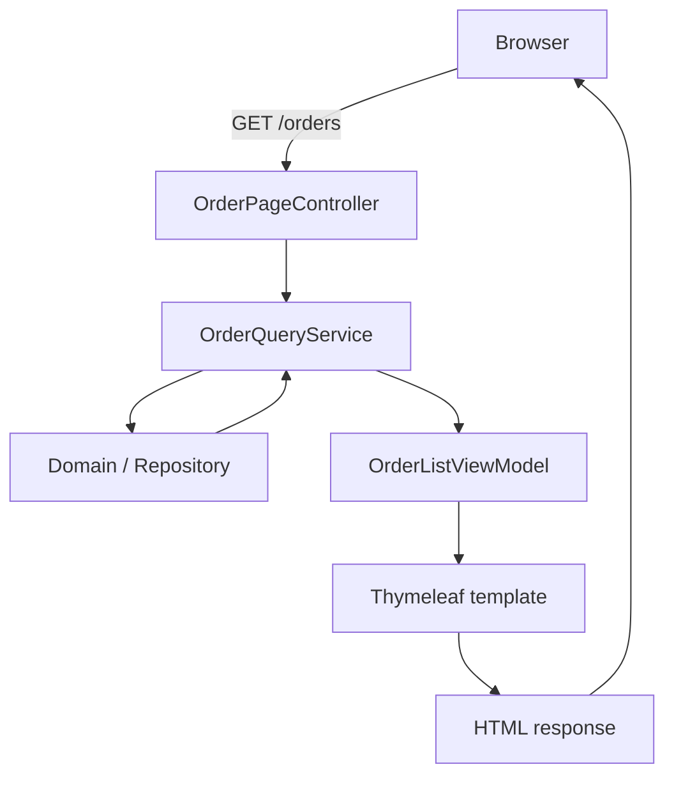
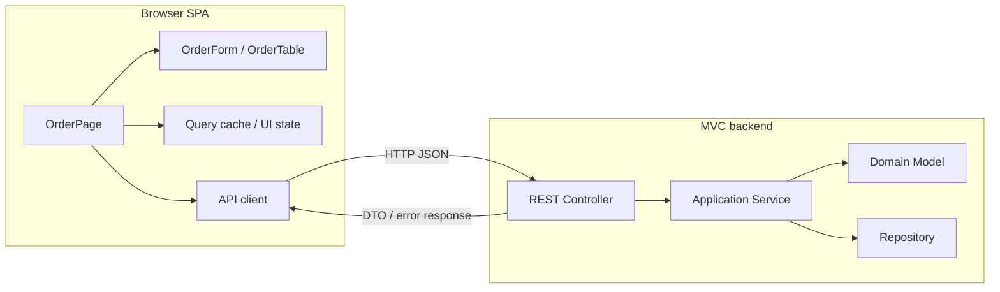
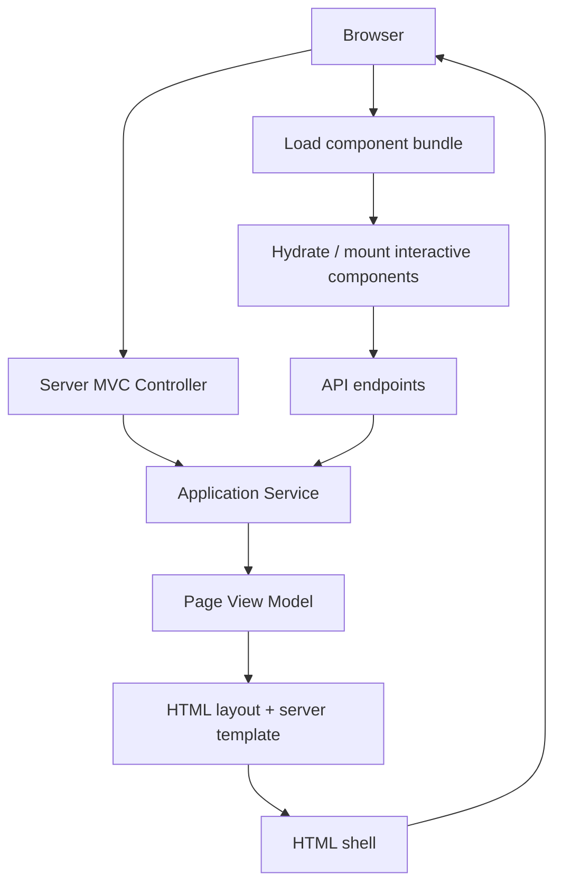
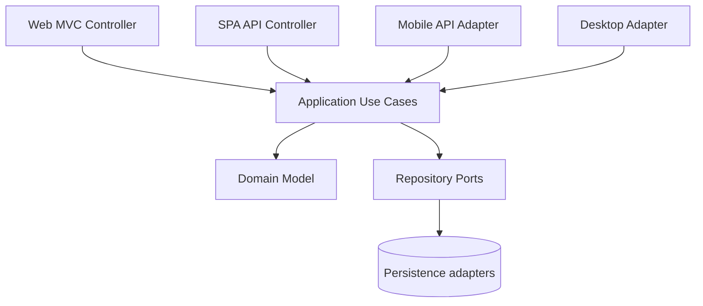

# Cố áp dụng cùng một biến thể MVC cho mọi loại giao diện

MVC là một cách tổ chức trách nhiệm, không phải một khuôn triển khai duy nhất phù hợp với mọi màn hình và mọi nền tảng. Một website chủ yếu hiển thị nội dung và biểu mẫu có thể hoạt động tốt với Controller phía server cùng template HTML. Một dashboard có nhiều vùng cập nhật độc lập có thể cần component UI và state ở client. Ứng dụng mobile có vòng đời màn hình, điều hướng và khả năng offline riêng; ứng dụng desktop có thể cần tách View khỏi logic trình bày để kiểm thử dễ hơn.

Sai lầm thường gặp là chọn một biến thể MVC quen thuộc rồi áp dụng nguyên trạng cho tất cả giao diện. Khi đó, server-rendered page có thể bị biến thành một SPA phức tạp không cần thiết; ngược lại, giao diện tương tác cao bị buộc phải gửi request và render lại toàn trang cho từng thao tác. Ứng dụng mobile có thể bị thiết kế như một website thu nhỏ, còn frontend component có thể bị nhồi logic nghiệp vụ vốn phải được bảo vệ ở server.

Với module Model–View–Controller, mục tiêu là phân tách trạng thái và nghiệp vụ, trình bày và tiếp nhận tương tác một cách rõ ràng. Muốn giữ được mục tiêu đó, cần chọn cách tổ chức presentation theo loại giao diện, đồng thời giữ các quy tắc nghiệp vụ quan trọng ở tầng ứng dụng và miền. Có thể dùng nhiều biến thể trong cùng một nền tảng nếu chúng cùng tuân theo hợp đồng use case và dữ liệu rõ ràng.

## 1. MVC là nguyên tắc phân tách, không phải một bộ khung cố định

Ba vai trò cốt lõi của MVC thường được diễn giải như sau:

- **Model:** trạng thái và quy tắc của ứng dụng hoặc miền nghiệp vụ. Trong ứng dụng phân tầng, Model nghiệp vụ thường được phối hợp bởi application service và repository.
- **View:** cách trình bày dữ liệu và trạng thái cho người dùng.
- **Controller:** tiếp nhận tương tác hoặc request, điều phối thao tác và chọn kết quả trình bày.

Các nền tảng triển khai ba vai trò này khác nhau. Một framework web có thể có Controller nhận HTTP request và trả template. Một UI framework phía client có thể tổ chức giao diện bằng component, state store và event handler. Một ứng dụng desktop có thể dùng controller/presenter để phản hồi sự kiện từ widget. Tên gọi giống nhau không có nghĩa vòng đời, luồng dữ liệu hoặc ranh giới triển khai giống nhau.

### 1.1. Phân biệt biến thể MVC với pattern lân cận

Một số thuật ngữ thường bị gom chung dù chúng mô tả những khía cạnh khác nhau:

| Cách tổ chức | Điều nó mô tả | Ví dụ |
|---|---|---|
| Page Controller | Mỗi trang hoặc nhóm trang có controller điều phối riêng | Controller trang danh sách đơn hàng |
| Front Controller | Một điểm vào trung tâm tiếp nhận request và phân phối đến handler phù hợp | DispatcherServlet trong Spring MVC |
| Server-rendered MVC | Server xử lý request và render HTML View | Spring MVC với Thymeleaf |
| Client-side MVC | UI chạy trong client, có các vai trò model/view/controller ở phía client | Một số framework JavaScript đời đầu hoặc kiến trúc client tự tổ chức theo MVC |
| MVP | Presenter điều phối View qua interface, thường phù hợp UI cần kiểm thử presentation độc lập | Ứng dụng desktop hoặc mobile |
| MVVM | View bind với ViewModel và state/command | Nhiều framework desktop và mobile |
| Component-based UI | Giao diện được ghép từ component có props, state và event | React, Vue, Angular |

Page Controller và Front Controller chủ yếu mô tả cách định tuyến request ở phía server. MVP và MVVM là các mẫu tổ chức presentation có quan hệ với MVC nhưng không phải chỉ là tên khác của MVC. Component-based UI mô tả cách cấu tạo giao diện; một ứng dụng component có thể kết hợp với MVC backend mà không cần tự nhận là client-side MVC.

### 1.2. Những gì nên được giữ nhất quán

Dù chọn biến thể nào, các nguyên tắc sau vẫn hữu ích:

- Quy tắc nghiệp vụ và invariant phải được bảo vệ ở server hoặc miền có thẩm quyền.
- View không nên tự truy cập database hoặc chứa logic nghiệp vụ quan trọng.
- Controller/Presenter điều phối thay vì trở thành nơi chứa toàn bộ nghiệp vụ.
- Dữ liệu đi qua ranh giới nên có hợp đồng rõ như command, DTO hoặc View Model.
- Trạng thái giao diện cần có nơi sở hữu xác định.
- Lỗi, quyền truy cập và transaction phải được xử lý ở tầng có đủ ngữ cảnh và thẩm quyền.

## 2. Vì sao một biến thể không phù hợp với mọi giao diện?

Giao diện khác nhau ở cách người dùng tương tác, nơi state được giữ, cách điều hướng và môi trường thực thi.

| Loại giao diện | Đặc điểm nổi bật | Nhu cầu kiến trúc thường gặp |
|---|---|---|
| Website nội dung/biểu mẫu | Request/response, điều hướng trang, ít state phía client | Server-rendered MVC và template |
| Cổng quản trị CRUD | Form, bảng, lọc, phân trang, một số tương tác động | Server MVC hoặc hybrid với component nhỏ |
| SPA tương tác cao | Nhiều vùng cập nhật độc lập, state phía client, route client | API backend kết hợp component architecture và state/query layer |
| Mobile app | Vòng đời app/screen, điều hướng stack, offline, push, thiết bị | Presentation pattern theo nền tảng như MVVM/MVP cùng API backend |
| Desktop app | Widget event, nhiều cửa sổ, state cục bộ, tích hợp hệ điều hành | MVC/MVP/MVVM tùy framework và mức data binding |
| Kiosk hoặc thiết bị chuyên dụng | Input đặc thù, trạng thái phiên dài, kết nối không ổn định | State machine/presentation controller kết hợp domain service |
| Giao diện realtime | Event liên tục, cập nhật từng vùng, kết nối dài | Component UI, event stream và mô hình đồng bộ state |

Áp dụng cùng một cách tổ chức cho các trường hợp trên thường dẫn đến một trong hai cực: kiến trúc quá nặng so với nhu cầu hoặc kiến trúc không đủ khả năng quản lý tương tác.

## 3. Biến thể server-rendered MVC phù hợp với request/response

Với website nội dung, form đăng ký, trang quản trị đơn giản hoặc hệ thống nội bộ, server-rendered MVC thường là lựa chọn gọn. Controller nhận HTTP request, gọi use case, tạo View Model rồi trả template. Trình duyệt nhận HTML và điều hướng bằng request mới hoặc redirect.



Ví dụ Spring MVC:

```java
@Controller
@RequestMapping("/orders")
public class OrderPageController {
    private final OrderQueryService orders;

    public OrderPageController(OrderQueryService orders) {
        this.orders = orders;
    }

    @GetMapping
    public String list(Model model) {
        model.addAttribute("page", orders.getFirstPage());
        return "orders/list";
    }
}
```

Biến thể này phù hợp khi phần lớn thao tác có thể biểu diễn bằng request và response HTML. Template có thể tái sử dụng layout và fragment; validation lỗi có thể render lại form; thành công có thể dùng Post/Redirect/Get.

### 3.1. Dấu hiệu nên chọn server-rendered MVC

- Trang chủ yếu hiển thị nội dung, bảng dữ liệu hoặc biểu mẫu.
- Mỗi thao tác có thể hoàn tất bằng một request rõ ràng.
- Không cần giữ nhiều state tương tác phức tạp ở client.
- SEO, HTML ban đầu và khả năng hoạt động với trình duyệt thông thường là ưu tiên.
- Đội ngũ muốn giảm số runtime, build pipeline và state management phía client.

### 3.2. Khi server-rendered MVC bị áp dụng quá mức

Nếu một màn hình có bảng realtime, nhiều panel độc lập, kéo thả, chỉnh sửa đồng thời hoặc thao tác liên tục, việc render lại toàn trang sau mỗi sự kiện có thể tạo cảm giác chậm và làm mất state tạm thời. Khi đó, có thể thêm component tương tác cho đúng vùng cần thiết hoặc chuyển riêng feature đó sang API + client UI.

Không cần chuyển toàn bộ website sang SPA chỉ vì một màn hình có tương tác cao. Có thể giữ các trang nội dung ở server-rendered MVC và chỉ dùng client component ở những feature cần thiết.

## 4. Biến thể API backend và component frontend phù hợp với SPA

SPA thường cần nhiều vùng giao diện cập nhật độc lập, state tương tác tồn tại giữa các lần gọi API và điều hướng phía client. Trong mô hình này, MVC backend vẫn có vai trò rõ: Controller nhận request API, application service thực hiện use case và server trả DTO. Component frontend tổ chức View, state và event ở phía client.



### 4.1. Những điều cần quản lý ở client

- UI state: dialog mở/đóng, tab đang chọn, nội dung đang nhập.
- Server state: dữ liệu lấy từ API, thời điểm tải, cache và invalidation.
- Navigation state: route, query parameter và lịch sử trình duyệt.
- Async state: loading, success, empty, error, retry và request bị hủy.
- Component composition: props, event và quyền sở hữu state.

Đây là những vấn đề mà một Controller server-rendered truyền thống không tự giải quyết cho SPA. Ép mọi trạng thái qua request mới hoặc cố mô phỏng page controller trên client có thể làm luồng dữ liệu rối.

### 4.2. Những điều không được chuyển sang client

Client có thể kiểm tra đầu vào để cải thiện trải nghiệm và ẩn hành động không phù hợp. Tuy nhiên, quyền truy cập, giá trị cần tin cậy, invariant và transaction phải được kiểm tra ở server. Một component hiển thị nút “Hủy đơn” không có nghĩa server sẽ chấp nhận lệnh hủy.

### 4.3. Không gọi API tùy tiện từ mọi component

Nếu mỗi component con tự gọi API, một trang có thể tạo nhiều request trùng, trạng thái lỗi phân tán và cache khó đồng bộ. Hãy xác định page/container hoặc query layer chịu trách nhiệm tải dữ liệu, sau đó truyền dữ liệu xuống component con. Chỉ để component tự tải dữ liệu khi nó có ranh giới độc lập và hợp đồng tải rõ ràng.

## 5. Mobile và desktop có vòng đời presentation riêng

Ứng dụng mobile và desktop không chỉ là website hiển thị trên màn hình nhỏ. Chúng có lifecycle, navigation, event và khả năng hoạt động khác nhau.

Ví dụ mobile có thể cần:

- Giữ trạng thái biểu mẫu khi ứng dụng chuyển nền rồi quay lại.
- Phục hồi màn hình sau khi hệ điều hành tạo lại Activity/View Controller.
- Điều hướng theo stack hoặc tab.
- Xử lý camera, vị trí, thông báo push và quyền thiết bị.
- Đồng bộ dữ liệu khi offline rồi gửi lại khi có mạng.

Desktop có thể cần:

- Quản lý nhiều cửa sổ, tab hoặc panel.
- Tích hợp bàn phím tắt, menu, clipboard và file system.
- Giữ state khi người dùng thay đổi kích thước hoặc sắp xếp cửa sổ.
- Cập nhật UI theo event từ thiết bị hoặc tác vụ nền.

### 5.1. Khi nào cân nhắc MVP hoặc MVVM?

MVP có thể hữu ích khi muốn Presenter điều phối View thông qua interface, giúp test logic trình bày mà không cần dựng UI framework. MVVM phù hợp khi nền tảng hỗ trợ data binding và muốn View quan sát state/command trong ViewModel.

Không cần chọn MVP hoặc MVVM chỉ vì ứng dụng là mobile/desktop. Hãy xem framework đã cung cấp mô hình component, state và binding nào, cũng như nhóm phát triển có thể sử dụng nó nhất quán ra sao. Chọn mẫu phù hợp với lifecycle và công cụ của nền tảng.

### 5.2. Tránh nhồi logic nền tảng vào Domain Model

Domain Model không nên phụ thuộc Activity, View, widget hoặc lifecycle callback. Logic như kiểm tra đơn có thể hủy hay không nên ở miền/application service. ViewModel hoặc Presenter chuyển kết quả thành state phù hợp với màn hình.

## 6. Giao diện lai: kết hợp server rendering và component

Không phải lựa chọn nào cũng là “toàn bộ server” hoặc “toàn bộ SPA”. Nhiều ứng dụng dùng MVC server-rendered cho phần lớn trang, nhưng tăng tính tương tác bằng component ở một số vùng. Một hướng khác là server-side rendering component rồi hydrate ở client.



Ví dụ trang quản lý đơn hàng có thể render tiêu đề, thông tin cơ bản và navigation ở server; vùng bộ lọc nâng cao hoặc bảng realtime được mount thành component. Như vậy, chỉ phần có nhu cầu tương tác cao mới cần client state phức tạp.

### 6.1. Lợi ích và chi phí của giao diện lai

Lợi ích:

- Giữ HTML ban đầu và điều hướng đơn giản cho phần lớn trang.
- Tăng tương tác ở vùng cần thiết mà không chuyển toàn hệ thống.
- Có thể tái sử dụng API cho một số client khác.

Chi phí:

- Cần thống nhất authentication/session giữa HTML và API.
- Cần quản lý bundle, dependency và build frontend.
- Cần xác định dữ liệu nào đến từ View Model ban đầu và dữ liệu nào tải qua API.
- Có thể xuất hiện hai cơ chế state và hai cách xử lý lỗi trong cùng trang.
- Cần test cả ranh giới server-rendered và component hydration.

Giao diện lai chỉ có lợi khi ranh giới được thiết kế rõ. Nếu mỗi vùng tự có một state store và gọi API theo cách riêng, trang sẽ khó bảo trì hơn cả một SPA thống nhất.

## 7. Chọn biến thể theo loại tương tác, không theo trào lưu

Trước khi chọn, hãy mô tả cách người dùng thao tác và cách trạng thái thay đổi.

| Tiêu chí | Server-rendered MVC | SPA/component UI | MVP/MVVM hoặc presentation pattern nền tảng |
|---|---|---|---|
| Tương tác | Request/response theo trang | Cập nhật nhiều vùng, async liên tục | Event và lifecycle của app/widget |
| State chính | Server + form/request; client state nhỏ | UI state và server state phía client | ViewModel/Presenter và state màn hình |
| Điều hướng | Server route, redirect | Client router kết hợp API | Navigation framework của nền tảng |
| HTML ban đầu/SEO | Tự nhiên | Cần SSR/prerender nếu quan trọng | Thường không phải mục tiêu chính |
| Offline | Cần bổ sung cơ chế riêng | Có thể thiết kế cache/sync phía client | Có thể tích hợp local storage và sync |
| Kiểm thử | Controller, template, integration | Component, state, API contract, E2E | Presenter/ViewModel và lifecycle test |
| Vận hành | Một runtime web có thể đủ | Thêm bundle, API và state cache | Thêm cấu trúc theo nền tảng UI |

Một số câu hỏi giúp quyết định:

1. Người dùng có thường xuyên cập nhật nhiều vùng mà không điều hướng trang không?
2. Có cần giữ state tương tác lâu hơn một request không?
3. Có yêu cầu offline hoặc đồng bộ nền không?
4. Nội dung cần được crawler hoặc hiển thị ngay từ HTML ban đầu không?
5. Có nhiều client khác nhau cần dùng cùng API không?
6. Nền tảng UI hiện tại đã có state/binding/navigation mechanism nào?
7. Đội ngũ có thể vận hành thêm runtime hoặc build pipeline không?
8. Có thể giữ use case và Model độc lập với lựa chọn presentation không?

Không có câu trả lời duy nhất cho mọi ứng dụng. Hãy chọn mẫu ít phức tạp nhất đáp ứng các yêu cầu đã xác định, sau đó mở rộng ở những feature có bằng chứng về nhu cầu.

## 8. Ví dụ chọn biến thể cho ba màn hình

### 8.1. Form cập nhật hồ sơ

Màn hình có vài trường, validation và nút lưu. Người dùng gửi form rồi xem kết quả. Server-rendered MVC thường đủ:

- GET hiển thị form với View Model.
- POST bind và validate dữ liệu.
- Application service kiểm tra quyền và lưu thay đổi.
- Lỗi trả lại form với field errors.
- Thành công redirect theo Post/Redirect/Get.

Chuyển màn hình đơn giản này sang SPA có thể thêm router, API client, client state và error handling mà không đem lại lợi ích tương xứng.

### 8.2. Bảng quản trị có lọc và cập nhật nhanh

Màn hình có bộ lọc kết hợp, sort, phân trang, chọn nhiều dòng, cập nhật trạng thái và hiển thị kết quả nền. Có thể chọn SPA hoặc hybrid:

- Backend MVC cung cấp API query/command.
- Page component sở hữu filter và selection state.
- Query layer tải trang dữ liệu và quản lý cache.
- Component con hiển thị bảng, bộ lọc và dialog.
- Server vẫn kiểm tra quyền và trạng thái cho mỗi command.

Nếu chỉ có một vùng cập nhật động nhỏ, hybrid có thể đủ thay vì chuyển cả trang sang SPA.

### 8.3. Ứng dụng mobile cần offline

Ứng dụng mobile cần lưu bản nháp khi mất mạng, đồng bộ sau và phục hồi state khi app bị hệ điều hành tạm dừng. MVVM hoặc presentation architecture phù hợp với framework mobile có thể giúp tách View lifecycle khỏi state và command.

Backend vẫn cung cấp API và use case dùng chung. Client giữ bản nháp hoặc cache offline, nhưng khi đồng bộ, server phải kiểm tra version, quyền và invariant; xung đột cần có chính sách rõ thay vì âm thầm ghi đè.

## 9. Những sai lầm khi ép cùng một biến thể cho mọi UI

### 9.1. Dùng server page controller cho mọi tương tác

Mỗi thao tác nhỏ đều gửi request và render lại toàn trang. State tạm thời như tab, selection hoặc nội dung đang nhập có thể mất; mạng chậm làm trải nghiệm kém. Hãy dùng component hoặc endpoint tương tác cho những vùng thực sự cần cập nhật độc lập.

### 9.2. Chuyển mọi trang sang SPA dù không cần

Một trang nội dung đơn giản phải tải bundle, khởi tạo router và gọi API trước khi hiển thị. Nhóm phải vận hành thêm client state, build pipeline, authentication flow và lỗi mạng. Hãy giữ server-rendered MVC khi nó đáp ứng tốt nhu cầu.

### 9.3. Coi REST Controller là một biến thể View khác

REST Controller trả representation dữ liệu, thường là JSON; nó không render UI cho người dùng. API là adapter giao tiếp. Client có thể dùng React, mobile hoặc một hệ thống khác để trình bày dữ liệu đó.

### 9.4. Ép mobile UI dùng cấu trúc điều hướng của website

Mobile có navigation stack, lifecycle và tương tác thiết bị. Sao chép nguyên cấu trúc trang web có thể tạo luồng khó dùng và state khó phục hồi. Chia sẻ use case/API, không bắt buộc chia sẻ cùng cây màn hình.

### 9.5. Đưa toàn bộ state vào một global store

State toàn cục làm component phụ thuộc nhau, khó xác định nơi cập nhật và dễ stale. Chỉ đưa state lên phạm vi cần chia sẻ; state cục bộ nên ở gần component sở hữu nó. Server state nên có cache/invalidation riêng với UI state.

### 9.6. Cho View hoặc component quyết định nghiệp vụ

Ẩn nút, kiểm tra form hoặc disable hành động chỉ cải thiện trải nghiệm. Client có thể bị sửa hoặc gọi API trực tiếp. Server cần xác thực, phân quyền và kiểm tra invariant cho mọi request.

### 9.7. Dùng chung một Model cho mọi tầng

Entity persistence, Domain Model, API DTO và View Model có mục đích khác nhau. Dùng một class cho tất cả làm giao diện phụ thuộc schema database, dễ lộ trường và khó thay đổi hợp đồng. Hãy ánh xạ qua DTO/View Model theo use case.

### 9.8. Nhân đôi use case theo từng giao diện

HTML Controller và API Controller tự viết hai lần logic tạo đơn hoặc hủy đơn sẽ dần lệch quy tắc. Hãy để các adapter gọi cùng application service; mỗi adapter chỉ xử lý input/output của giao diện.

### 9.9. Dùng một cách xử lý lỗi cho mọi client

Form HTML cần giữ dữ liệu hợp lệ và gắn lỗi vào trường; API cần status cùng error code/DTO; mobile có thể cần trạng thái retry hoặc offline. Có thể dùng chung error code và quy tắc, nhưng presentation phải phù hợp với client.

### 9.10. Chia sẻ component quá mức giữa các nền tảng

Một nút hoặc màu sắc có thể chia sẻ ở design system, nhưng toàn bộ màn hình web không nhất thiết dùng lại được trên mobile. Chia sẻ component khi semantics, hành vi và môi trường tương thích; chia sẻ use case và hợp đồng dữ liệu thường có giá trị hơn việc ép dùng chung UI tree.

## 10. Giữ Model nghiệp vụ độc lập với biến thể giao diện

Khả năng hỗ trợ nhiều UI phụ thuộc vào việc Model và use case không bị khóa vào một framework trình bày.



Các adapter có thể khác nhau nhưng cùng gọi use case. Application service nhận command/query có cấu trúc, kiểm tra quyền và điều phối transaction. Domain Model thực thi quy tắc nghiệp vụ. Kết quả được adapter ánh xạ thành View Model, JSON DTO hoặc state phù hợp với nền tảng.

### 10.1. Dùng command/query theo ý định nghiệp vụ

Một command như `CancelOrderCommand` nên biểu diễn ý định hủy đơn, không chứa tên template hoặc component. Query như `GetOrderDetailsQuery` trả dữ liệu cần thiết cho use case; adapter có thể ánh xạ sang cấu trúc trình bày riêng.

### 10.2. Không để domain phụ thuộc framework UI

Domain Model không nên import Spring MVC `Model`, React component, Android Activity hoặc widget desktop. Các framework này thuộc ranh giới giao diện. Giữ dependency hướng vào application/domain giúp có thể thay đổi UI mà không phải viết lại quy tắc nghiệp vụ.

### 10.3. Phân quyền theo tài nguyên và use case

Không nên chỉ kiểm tra quyền ở Controller HTML rồi giả định API an toàn vì dùng cùng database. Mọi adapter phải đi qua chính sách authorization phù hợp. Application service có thể nhận actor/context đã được xác thực và kiểm tra quyền nghiệp vụ; web security vẫn chịu trách nhiệm xác thực request.

## 11. Tiến hóa kiến trúc theo nhu cầu thực tế

Không cần chọn trước một biến thể duy nhất cho toàn bộ vòng đời sản phẩm. Có thể tiến hóa từng feature:

1. Bắt đầu bằng server-rendered MVC cho các trang có tương tác đơn giản.
2. Chuẩn hóa application service, command/query và View Model để nghiệp vụ không phụ thuộc template.
3. Xác định một vùng có nhu cầu tương tác cao hoặc nhiều client cần dữ liệu.
4. Tạo API DTO và endpoint cho use case đó, giữ nguyên application service.
5. Thêm component frontend cho vùng tương tác; định nghĩa nơi sở hữu state và cách xử lý lỗi.
6. Đo hiệu năng và độ phức tạp vận hành sau thay đổi.
7. Chỉ mở rộng mô hình mới sang feature khác khi lợi ích đã rõ.

Nếu một SPA trở nên quá phức tạp, có thể chuyển một số trang nội dung sang SSR hoặc server-rendered MVC. Nếu một trang MVC chỉ có một widget tương tác cao, có thể mount component riêng thay vì viết lại toàn bộ hệ thống.

### 11.1. Tiêu chí đánh giá sau khi thay đổi

- Số bước người dùng cần thực hiện và thời gian hoàn tất thao tác.
- Thời gian hiển thị nội dung ban đầu và độ trễ khi tương tác.
- Số request, kích thước bundle và chi phí render.
- Tỷ lệ lỗi validation, network và server.
- Khả năng phục hồi state khi refresh, điều hướng hoặc mất kết nối.
- Độ khó kiểm thử và bảo trì component/use case.
- Chi phí triển khai, giám sát và hỗ trợ nhiều client.

Không đánh giá thành công chỉ bằng số component, số endpoint hoặc việc dùng một framework mới. Mục tiêu là đáp ứng tương tác với ranh giới trách nhiệm rõ và chi phí hợp lý.

## 12. Kiểm thử theo biến thể giao diện

Các biến thể khác nhau cần bộ test khác nhau, nhưng đều phải xác minh use case và invariant ở server.

| Phạm vi | Server-rendered MVC | SPA/component | Mobile/desktop |
|---|---|---|---|
| Presentation | Controller/View name, template và HTML | Props, event, state, component rendering | Presenter/ViewModel và UI state |
| Input | Binding, validation, form error | Client validation và API error mapping | Form state, command và platform validation |
| Navigation | Route, redirect, PRG | Client router, history và deep link | Navigation stack, lifecycle restoration |
| Server contract | Controller/service integration | API DTO, status, authorization | API DTO, offline/sync conflict |
| End-to-end | Browser form và page flow | Browser interaction và API | UI automation trên thiết bị/mô phỏng |

Không dùng unit test component để chứng minh server authorization. Không dùng Controller test để chứng minh giao diện mobile phục hồi state sau process death. Chọn test đúng ranh giới.

### 12.1. Kiểm thử use case dùng chung

Viết unit/integration test cho application service và Domain Model để bảo đảm invariant không phụ thuộc giao diện. Sau đó, mỗi adapter có test riêng cho mapping request/response và lỗi.

### 12.2. Kiểm thử trạng thái giao diện

Với SPA hoặc mobile, kiểm tra loading, empty, success, error, retry và state restoration. Với server-rendered MVC, kiểm tra template có dữ liệu, rỗng, validation lỗi và lỗi nghiệp vụ. Các trạng thái này phản ánh vòng đời khác nhau nên không nên ép vào một bộ assertion duy nhất.

## 13. Checklist chọn biến thể MVC

Trước khi quyết định cách tổ chức một giao diện, hãy tự hỏi:

1. Giao diện chủ yếu là nội dung/form theo request hay có nhiều tương tác liên tục?
2. State nào cần tồn tại qua request, qua route hoặc qua vòng đời app?
3. Ai sở hữu state: server, page/container, component hay ViewModel?
4. Cần HTML ban đầu, SEO, offline, realtime hoặc tích hợp thiết bị không?
5. Nền tảng đã có router, binding, component và lifecycle mechanism nào?
6. Server có cung cấp use case/API ổn định để nhiều UI dùng chung không?
7. View Model, API DTO và Domain Model đã được tách đúng mục đích chưa?
8. Quyền truy cập và invariant có được kiểm tra ở server không?
9. Error handling có phù hợp với HTML, API và UI native không?
10. Cache, navigation và đồng bộ state có được định nghĩa rõ không?
11. Bộ test có bao phủ đúng lifecycle và tương tác của nền tảng không?
12. Chi phí runtime, build, deployment và vận hành có tương xứng với lợi ích không?
13. Có thể áp dụng từng feature và thay đổi dần thay vì chuyển toàn bộ ứng dụng không?

## Kết luận

Cố áp dụng cùng một biến thể MVC cho mọi loại giao diện thường làm kiến trúc hoặc quá phức tạp hoặc không đáp ứng được cách người dùng tương tác. Server-rendered MVC phù hợp với trang nội dung và biểu mẫu theo request/response; SPA cần component, client state và API contract; mobile/desktop cần tôn trọng lifecycle và cơ chế presentation của nền tảng; giao diện lai có thể kết hợp server rendering với component ở vùng tương tác cao. Dù lựa chọn nào, hãy giữ quy tắc nghiệp vụ và quyền truy cập ở server/domain, tách View Model khỏi DTO và entity, xác định nơi sở hữu state, rồi kiểm thử theo đúng ranh giới. Chọn biến thể dựa trên nhu cầu tương tác và chi phí vận hành của từng feature, không dựa trên mong muốn dùng một khuôn duy nhất cho toàn bộ sản phẩm.
