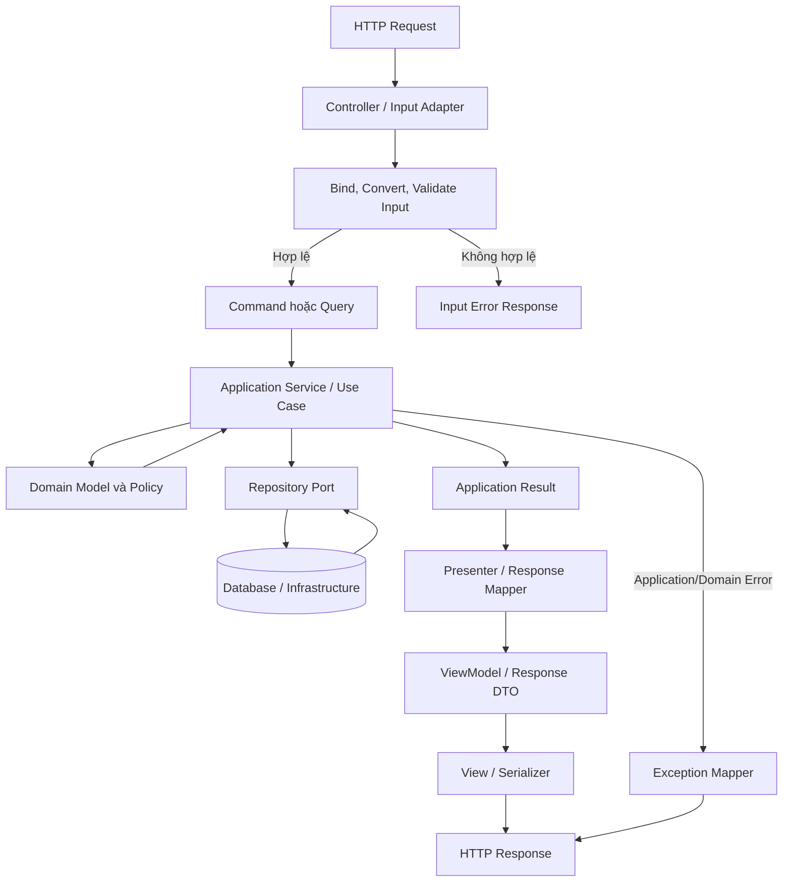
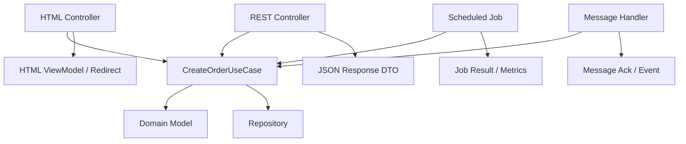
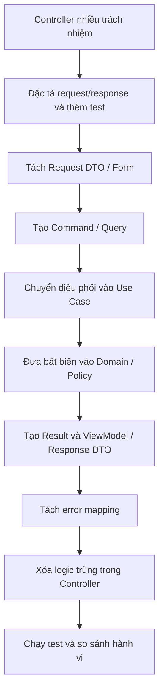

# Tách xử lý đầu vào và tạo phản hồi khỏi mã nghiệp vụ

Trong ứng dụng web theo kiến trúc **MODEL_VIEW_CONTROLLER (MVC)**, Controller thường là nơi nhận HTTP request, chuyển dữ liệu đầu vào, gọi xử lý và trả View hoặc response. Nếu Controller đồng thời chứa quy tắc nghiệp vụ, truy vấn dữ liệu, định dạng thông báo và quyết định nội dung phản hồi, nó sẽ trở thành điểm tập trung của nhiều trách nhiệm. Khi đó, thay đổi giao diện hoặc thêm một API mới có thể buộc nhóm sửa cả logic nghiệp vụ vốn không liên quan đến HTTP.

Một cải tiến quan trọng là **tách xử lý đầu vào và tạo phản hồi khỏi mã nghiệp vụ**. Controller và các adapter trình bày chịu trách nhiệm chuyển đổi giữa giao thức web với lời gọi ứng dụng. Application Service điều phối use case; Domain Model và policy bảo vệ quy tắc nghiệp vụ. Kết quả use case được chuyển thành ViewModel hoặc Response DTO ở ranh giới trình bày.

Sự phân tách này giúp cùng một use case có thể được gọi từ trang HTML, REST API, tác vụ nền hoặc message handler mà không phải sao chép quy tắc. Nó cũng làm cho kiểm thử dễ định vị hơn: kiểm tra binding ở web layer, kiểm tra quy tắc ở domain/application và kiểm tra dữ liệu trình bày ở mapper/ViewModel.

## 1. Nhận diện vấn đề: Controller đang làm quá nhiều việc

Một Controller bắt đầu đơn giản có thể dần tích lũy nhiều trách nhiệm:

- Đọc path, query, form field và JSON body.
- Chuyển đổi kiểu, kiểm tra định dạng và giá trị bắt buộc.
- Lấy danh tính người dùng và kiểm tra quyền.
- Tìm entity trong database.
- Tính giá, phí, trạng thái hoặc điều kiện nghiệp vụ.
- Gọi nhiều repository và dịch vụ bên ngoài.
- Quản lý transaction.
- Chuyển exception thành mã HTTP.
- Định dạng tiền tệ, ngày tháng, nhãn trạng thái.
- Tạo ViewModel, JSON response, redirect và thông báo.

Một số trách nhiệm thuộc ranh giới HTTP; một số thuộc use case; một số thuộc domain; một số chỉ phục vụ hiển thị. Khi chúng bị trộn trong cùng một phương thức, Controller khó đọc, khó kiểm thử và khó tái sử dụng.

### Ví dụ Controller quá tải

```java
@PostMapping("/orders")
String createOrder(
        @RequestParam String customerId,
        @RequestParam String productId,
        @RequestParam int quantity,
        Principal principal,
        Model model) {

    Customer customer = customerRepository.findById(customerId)
            .orElseThrow(() -> new IllegalArgumentException("Customer not found"));
    Product product = productRepository.findById(productId)
            .orElseThrow(() -> new IllegalArgumentException("Product not found"));

    if (!customer.getOwnerId().equals(principal.getName())) {
        throw new AccessDeniedException("Not allowed");
    }
    if (quantity <= 0 || quantity > 100) {
        model.addAttribute("error", "Số lượng không hợp lệ");
        return "orders/new";
    }
    if (product.getAvailableQuantity() < quantity) {
        model.addAttribute("error", "Sản phẩm không đủ tồn kho");
        return "orders/new";
    }

    BigDecimal total = product.getPrice().multiply(BigDecimal.valueOf(quantity));
    Order order = new Order(customer, product, quantity, total);
    orderRepository.save(order);

    model.addAttribute("message", "Đã tạo đơn " + order.getId());
    return "orders/success";
}
```

Đoạn code minh họa nhiều vấn đề cùng lúc: Controller tự truy vấn, tự kiểm tra quyền sở hữu, tự quyết định tồn kho, tự tính tổng tiền, tạo entity và lưu dữ liệu. Quy tắc tạo đơn chỉ có thể chạy qua HTTP handler này; một tác vụ nền hoặc API khác rất dễ phải sao chép logic.

## 2. Xác định ranh giới trách nhiệm

Một cách phân chia thường dùng trong MVC là:

| Trách nhiệm | Nơi phù hợp | Ví dụ |
|---|---|---|
| Nhận HTTP path/query/body/header | Controller hoặc web adapter | `@PathVariable`, `@RequestBody` |
| Chuyển đổi và kiểm tra cú pháp | Binding/converter/Request DTO | UUID hợp lệ, ngày đúng định dạng |
| Kiểm tra ràng buộc đầu vào | Request DTO/Form Object validator | Tên không rỗng, số lượng trong giới hạn đầu vào |
| Điều phối một hành động ứng dụng | Application Service/Use Case | `CreateOrderUseCase` |
| Bảo vệ bất biến và quy tắc miền | Domain Model/Policy | Không xác nhận đơn rỗng |
| Đọc/ghi dữ liệu | Repository/Infrastructure | Tải sản phẩm, lưu đơn |
| Chuyển kết quả thành dữ liệu cho View | Presenter/Mapper/ViewModel factory | Nhãn trạng thái, tổng tiền hiển thị |
| Render HTML hoặc JSON | View/Serializer/Response adapter | Thymeleaf, JSON converter |
| Ánh xạ lỗi sang HTTP | Exception handler/Controller advice | 404, 409, 422 |

Ranh giới có thể khác nhau theo kích thước ứng dụng, nhưng nguyên tắc là mã nghiệp vụ không nên phụ thuộc vào chi tiết HTTP hoặc template engine. Ngược lại, Controller có thể biết HTTP nhưng không nên trở thành nơi định nghĩa chính sách nghiệp vụ.

### Luồng dữ liệu sau khi tách



Controller chuyển đổi giao thức thành input cho use case. Use case không cần biết request đến từ form HTML hay JSON. Kết quả use case không nhất thiết là HTML hoặc HTTP response; adapter trình bày quyết định cách biểu diễn.

## 3. Tách dữ liệu đầu vào khỏi Domain Model

Không nên mặc định bind trực tiếp request vào entity nghiệp vụ. Request có cấu trúc và quyền cập nhật riêng; Domain Model có trạng thái và bất biến riêng.

### Request DTO hoặc Form Object

DTO đầu vào mô tả những trường client được phép gửi:

```java
public record CreateOrderRequest(
        @NotNull UUID productId,
        @Min(1) @Max(100) int quantity,
        @NotBlank @Size(max = 80) String deliveryNote
) {}
```

Request DTO không cần chứa `ownerId`, `status`, `total`, `approvedAt` hoặc những trường do server quyết định. Controller nhận DTO, lấy actor từ security context và chuyển thành command.

### Command cho use case

Command mô tả ý định thực hiện một hành động ứng dụng:

```java
public record CreateOrderCommand(
        CustomerId customerId,
        ProductId productId,
        int quantity,
        String deliveryNote,
        UserId actorId
) {}
```

Command có thể dùng ID và kiểu dữ liệu của application/domain thay vì kiểu HTTP. Không nhất thiết tạo một command class cho mọi endpoint; hãy tạo khi nó làm rõ use case và ranh giới dữ liệu.

### Controller chuyển Request DTO thành Command

```java
@RestController
@RequestMapping("/api/orders")
class OrderController {

    private final CreateOrderUseCase createOrder;
    private final CurrentUser currentUser;

    OrderController(
            CreateOrderUseCase createOrder,
            CurrentUser currentUser) {
        this.createOrder = createOrder;
        this.currentUser = currentUser;
    }

    @PostMapping
    ResponseEntity<OrderCreatedResponse> create(
            @Valid @RequestBody CreateOrderRequest request) {

        CreateOrderCommand command = new CreateOrderCommand(
                new CustomerId(currentUser.customerId()),
                new ProductId(request.productId()),
                request.quantity(),
                request.deliveryNote(),
                new UserId(currentUser.id()));

        OrderCreatedResult result = createOrder.execute(command);
        URI location = URI.create("/api/orders/" + result.orderId().value());

        return ResponseEntity.created(location)
                .body(new OrderCreatedResponse(result.orderId().value()));
    }
}
```

`CurrentUser` là abstraction ở tầng web/application adapter để lấy danh tính đã xác thực; ví dụ không yêu cầu Domain Model phụ thuộc `Principal`, `HttpServletRequest` hoặc Spring Security. `CustomerId` có thể được xác định từ actor hoặc từ một quy tắc chọn khách hàng đã được kiểm tra; không tin một `customerId` tùy ý nếu người dùng không được phép tạo đơn cho khách hàng đó.

## 4. Phân biệt binding, input validation và business rule

Tách xử lý đầu vào không có nghĩa mọi validation đều phải nằm ở Controller. Có nhiều lớp kiểm tra với mục đích khác nhau:

| Lớp kiểm tra | Câu hỏi | Ví dụ | Nơi thực hiện |
|---|---|---|---|
| Binding/conversion | Giá trị có chuyển thành kiểu mong đợi không? | UUID sai định dạng | Framework converter |
| Input validation | Dữ liệu có đáp ứng hợp đồng request không? | Số lượng phải từ 1 đến 100 | Request DTO/Form validator |
| Business validation | Hành động có hợp lệ trong trạng thái hiện tại không? | Sản phẩm còn được bán không? | Application/domain |
| Authorization | Actor có được thực hiện hành động trên tài nguyên này không? | Người dùng có quyền tạo đơn cho khách hàng này? | Security policy/use case |
| Persistence constraint | Dữ liệu có vi phạm ràng buộc lưu trữ không? | Mã đơn duy nhất | Database và data layer |

Validation ở client chỉ cải thiện trải nghiệm. Server vẫn phải kiểm tra lại. Một số điều kiện như tồn kho hoặc trạng thái đơn có thể thay đổi giữa lúc người dùng mở form và lúc submit; chúng cần được xác minh trong use case/transaction.

### Ví dụ kiểm tra ở Domain Model

```java
public void addLine(Product product, int quantity) {
    if (status != OrderStatus.DRAFT) {
        throw new OrderNotEditableException(id);
    }
    if (quantity <= 0) {
        throw new InvalidOrderQuantityException(quantity);
    }
    lines.add(OrderLine.create(product, quantity));
}
```

Domain Model bảo vệ bất biến dù lời gọi đến từ web, batch job hay test. Controller không thể là nơi duy nhất bảo vệ điều kiện này.

## 5. Đưa điều phối nghiệp vụ vào Application Service

Application Service nhận command/query, tải dữ liệu cần thiết, gọi domain behavior, phối hợp repository và quản lý transaction boundary của use case.

```java
public interface CreateOrderUseCase {
    OrderCreatedResult execute(CreateOrderCommand command);
}
```

```java
@Service
class CreateOrderService implements CreateOrderUseCase {

    private final ProductRepository products;
    private final CustomerRepository customers;
    private final OrderRepository orders;
    private final OrderPermissionPolicy permissions;

    CreateOrderService(
            ProductRepository products,
            CustomerRepository customers,
            OrderRepository orders,
            OrderPermissionPolicy permissions) {
        this.products = products;
        this.customers = customers;
        this.orders = orders;
        this.permissions = permissions;
    }

    @Transactional
    public OrderCreatedResult execute(CreateOrderCommand command) {
        Customer customer = customers.findById(command.customerId())
                .orElseThrow(CustomerNotFoundException::new);
        permissions.checkCanCreateOrder(command.actorId(), customer);

        Product product = products.findAvailableForOrder(command.productId())
                .orElseThrow(ProductUnavailableException::new);

        Order order = Order.create(customer.id());
        order.addLine(product, command.quantity());
        order.setDeliveryNote(command.deliveryNote());

        Order saved = orders.save(order);
        return new OrderCreatedResult(saved.id());
    }
}
```

Đây là ví dụ minh họa. Trong hệ thống thực tế, kiểm tra và giữ tồn kho cần thao tác nguyên tử hoặc cơ chế concurrency phù hợp; chỉ đọc số lượng còn hàng rồi lưu đơn có thể tạo race condition. Application service điều phối use case, còn Domain Model bảo vệ các bất biến nội tại.

Không nên chuyển toàn bộ code từ Controller sang một service lớn rồi giữ nguyên mọi trách nhiệm. Hãy phân chia rõ: use case điều phối, domain chứa quy tắc, repository truy cập dữ liệu và mapper chuẩn bị representation.

## 6. Tách dữ liệu đầu ra khỏi kết quả nghiệp vụ

Kết quả use case nên diễn đạt điều đã xảy ra ở mức ứng dụng, không cần mang chi tiết template hoặc HTTP.

Ví dụ:

```java
public record OrderCreatedResult(OrderId orderId) {}
```

Đối với một use case khác, kết quả có thể chứa thông tin cần cho caller:

```java
public record OrderSummaryResult(
        OrderId id,
        OrderStatus status,
        Money total
) {}
```

Adapter trình bày chuyển kết quả này thành response DTO hoặc ViewModel:

```java
public record OrderCreatedResponse(String id, String message) {}

public final class OrderResponseMapper {
    public OrderCreatedResponse toResponse(OrderCreatedResult result) {
        return new OrderCreatedResponse(
                result.orderId().value().toString(),
                "Đơn hàng đã được tạo.");
    }
}
```

Mapper đặt ở presentation/API adapter vì message và hình dạng response thuộc hợp đồng giao tiếp. Nếu một thông điệp cần dịch, dùng message code hoặc message source ở lớp trình bày thay vì lưu câu văn HTTP trong Domain Model.

### ViewModel cho server-rendered View

Một ViewModel có thể chứa dữ liệu đã định dạng và các cờ hiển thị:

```java
public record OrderDetailViewModel(
        String reference,
        String statusLabel,
        String totalText,
        boolean showCancelAction
) {}
```

`showCancelAction` chỉ hỗ trợ giao diện hiển thị nút. Khi người dùng gửi request hủy, backend vẫn phải kiểm tra quyền và điều kiện hủy trong use case. Không dùng cờ giao diện làm cơ chế authorization.

## 7. Tách Query và Command khi nhu cầu đọc khác nhu cầu ghi

Một số màn hình cần dữ liệu đã tổng hợp, định dạng hoặc join từ nhiều nguồn; trong khi use case ghi cần Domain Entity để bảo vệ hành vi. Có thể tách:

- **Command path:** nhận ý định thay đổi, kiểm tra quyền và quy tắc, thay đổi Model và lưu.
- **Query path:** lấy projection/DTO phù hợp với màn hình, không cần tải toàn bộ entity nếu không cần.

Ví dụ:

```java
public interface OrderQueryService {
    OrderDetailViewModel getDetail(OrderId id, UserId viewer);
}

public interface CancelOrderUseCase {
    void execute(CancelOrderCommand command);
}
```

Đây là cách phân chia trách nhiệm đọc/ghi, có thể dùng mà không cần triển khai đầy đủ CQRS với hai database hoặc event sourcing. Chỉ tách query/command khi hình dạng dữ liệu và yêu cầu xử lý thực sự khác nhau.

## 8. Tạo phản hồi ở đúng adapter

Một use case có thể được gọi bởi nhiều adapter:



Mỗi adapter có cách biểu diễn kết quả riêng:

- HTML Controller có thể redirect và đưa flash message.
- REST Controller có thể trả `201 Created`, `Location` và JSON body.
- Job có thể ghi log, metric hoặc kết quả batch.
- Message handler có thể acknowledge, retry hoặc phát event tiếp theo.

Application Service không nên trả về `ModelAndView`, `ResponseEntity`, `IActionResult`, template name hoặc đối tượng request framework. Những kiểu đó gắn use case với một adapter cụ thể.

## 9. Xử lý lỗi: giữ ngữ nghĩa ở ứng dụng, ánh xạ ở giao thức

Use case và Domain Model nên biểu diễn lỗi có ý nghĩa với hành động: `OrderNotFoundException`, `OrderNotEditableException`, `ProductUnavailableException`. Web adapter chuyển chúng thành status, View hoặc response body.

Ví dụ Spring MVC:

```java
@RestControllerAdvice
class ApiExceptionHandler {

    @ExceptionHandler(OrderNotFoundException.class)
    ResponseEntity<ProblemDetail> handleNotFound() {
        ProblemDetail problem = ProblemDetail.forStatusAndDetail(
                HttpStatus.NOT_FOUND,
                "Không tìm thấy đơn hàng được yêu cầu.");
        problem.setTitle("Không tìm thấy tài nguyên");
        problem.setProperty("code", "ORDER_NOT_FOUND");
        return ResponseEntity.status(HttpStatus.NOT_FOUND).body(problem);
    }

    @ExceptionHandler(OrderNotEditableException.class)
    ResponseEntity<ProblemDetail> handleConflict() {
        ProblemDetail problem = ProblemDetail.forStatusAndDetail(
                HttpStatus.CONFLICT,
                "Đơn hàng không còn ở trạng thái cho phép chỉnh sửa.");
        problem.setTitle("Không thể thực hiện thao tác");
        problem.setProperty("code", "ORDER_NOT_EDITABLE");
        return ResponseEntity.status(HttpStatus.CONFLICT).body(problem);
    }
}
```

Trong server-rendered MVC, exception handler hoặc Controller có thể chuyển lỗi sang ViewModel lỗi. Lỗi binding/validation của request thường được xử lý tại web boundary để giữ lại dữ liệu form an toàn. Lỗi nghiệp vụ được ánh xạ theo ngữ nghĩa use case.

Không trả stack trace, SQL hoặc message nội bộ của database cho client. Logging chi tiết thuộc hạ tầng quan sát; thông báo người dùng thuộc response adapter.

## 10. Bảo mật: tách input không đồng nghĩa tin input

Request DTO giới hạn trường được bind, nhưng không tự chứng minh người gửi có quyền thực hiện hành động.

Các nguyên tắc:

- Lấy actor từ danh tính đã xác thực, không tin `actorId` hoặc `ownerId` do client tự khai.
- Chỉ nhận các trường mà use case cho phép client điều khiển.
- Kiểm tra quyền trên tài nguyên trong application/policy với dữ liệu có thẩm quyền.
- Không dùng hidden field hoặc ViewModel flag làm bằng chứng quyền.
- Validate cú pháp ở boundary và kiểm tra business rule ở tầng có thẩm quyền.
- Áp dụng CSRF protection cho luồng xác thực dựa trên cookie khi phù hợp.
- Escape dữ liệu người dùng khi render HTML.
- Không đưa token, mật khẩu hoặc dữ liệu nhạy cảm vào response lỗi/log.

Ví dụ, request tạo đơn có thể gửi `productId` và `quantity`, nhưng giá, trạng thái thanh toán và người sở hữu cần được xác định từ backend. Nếu sản phẩm có giá theo hợp đồng khách hàng, use case phải tải và áp dụng chính sách giá hiện hành.

## 11. Transaction và side effect thuộc luồng use case

Controller không nên tự mở transaction chỉ để gom các lệnh repository. Transaction thường bao quanh một use case hoặc một thao tác ghi có ý nghĩa nghiệp vụ.

Ví dụ tạo đơn có thể cần:

1. Kiểm tra actor có quyền tạo đơn.
2. Xác minh sản phẩm và giá.
3. Giữ hoặc trừ tồn kho bằng cơ chế concurrency phù hợp.
4. Tạo đơn và dòng hàng.
5. Ghi sự kiện cần phát sau commit.

Application service điều phối transaction và các bước cần tính nguyên tử trong database. Gọi email, thanh toán hoặc dịch vụ ngoài có thể cần outbox, saga hoặc workflow riêng; không giữ transaction database mở trong lúc chờ mạng nếu không cần thiết.

Việc tách Controller không tự giải quyết transaction. Ranh giới transaction phải được chọn theo tính nhất quán của use case.

## 12. Xử lý file upload và input đặc biệt

Một số input không nên chuyển thẳng thành byte array lớn trong Command hoặc Domain Entity. Với file upload, web adapter có thể nhận `MultipartFile`, kiểm tra giới hạn giao thức và chuyển thành abstraction phù hợp như stream, metadata và storage reference.

```java
public record UploadDocumentCommand(
        UserId actorId,
        DocumentCategory category,
        String originalFileName,
        String declaredContentType,
        InputStreamSource content
) {}
```

`InputStreamSource` ở đây là abstraction minh họa; ứng dụng có thể định nghĩa port riêng để tránh phụ thuộc Spring. Use case cần kiểm tra quyền, kích thước, loại nội dung thực tế, tên lưu an toàn và chính sách lưu trữ. Không tin phần mở rộng hoặc MIME type do client gửi.

Adapter trình bày quyết định trả `201`, trang xem trước hoặc lỗi upload; domain/application không cần biết file đến từ `MultipartFile`.

## 13. Refactor Controller lớn theo từng bước

Không cần viết lại toàn bộ ứng dụng để tách trách nhiệm. Có thể refactor tăng dần, giữ nguyên hành vi quan sát được.

### Bước 1: Ghi nhận hợp đồng hiện tại

Liệt kê URL, HTTP method, input, status, response, redirect, flash message và lỗi. Viết hoặc bổ sung test bảo vệ các trường hợp quan trọng trước khi di chuyển code.

### Bước 2: Tạo Request DTO/Form Object

Tách các tham số rời rạc thành object mô tả input của endpoint. Chỉ giữ trường client được phép gửi. Thêm conversion và validation phù hợp.

### Bước 3: Tạo Command/Query

Chuyển input web thành kiểu dữ liệu use case. Lấy actor từ security context và đưa vào command qua ID/abstraction phù hợp.

### Bước 4: Di chuyển điều phối sang Application Service

Đưa việc tải dữ liệu, phối hợp repository và gọi domain behavior vào use case. Chọn transaction boundary phù hợp.

### Bước 5: Chuyển quy tắc về Domain Model/Policy

Nếu điều kiện nghiệp vụ đang nằm trong Controller hoặc service thủ tục, đưa bất biến vào entity/value object/domain service phù hợp. Không chuyển validation cú pháp HTTP vào Domain Model.

### Bước 6: Tạo kết quả ứng dụng và ViewModel/Response DTO

Use case trả kết quả trung lập với HTTP. Adapter map kết quả thành dữ liệu hiển thị hoặc JSON.

### Bước 7: Tách exception mapping và thông báo

Ánh xạ lỗi có ngữ nghĩa sang status/View. Giữ mã lỗi ổn định và thông báo an toàn; không để Domain Model trả template name hoặc câu văn HTTP.

### Bước 8: Xóa code cũ và xác minh hành vi

Sau khi test xác nhận luồng mới, xóa phần nghiệp vụ cũ khỏi Controller. Kiểm tra lại response, authorization, transaction, logging và trường hợp lỗi.



## 14. Ví dụ trước và sau khi refactor

### Trước: Controller biết chi tiết nghiệp vụ và response

```java
@PostMapping("/orders/{id}/cancel")
String cancel(@PathVariable UUID id, Principal principal, Model model) {
    Order order = orderRepository.findById(id).orElseThrow();

    if (!order.getCustomerId().equals(principal.getName())) {
        throw new AccessDeniedException("Forbidden");
    }
    if (order.getStatus() == OrderStatus.SHIPPED) {
        model.addAttribute("error", "Đơn đã giao, không thể hủy");
        model.addAttribute("order", order);
        return "orders/detail";
    }

    order.setStatus(OrderStatus.CANCELLED);
    orderRepository.save(order);
    model.addAttribute("message", "Đã hủy đơn hàng");
    return "orders/detail";
}
```

### Sau: Controller chuyển input, use case thực hiện hành động

```java
@PostMapping("/orders/{id}/cancel")
String cancel(
        @PathVariable UUID id,
        Principal principal,
        RedirectAttributes flash) {

    cancelOrder.execute(new CancelOrderCommand(
            new OrderId(id), new UserId(principal.getName())));

    flash.addFlashAttribute("notice", "Đã gửi yêu cầu hủy đơn hàng.");
    return "redirect:/orders/" + id;
}
```

```java
@Service
class CancelOrderService implements CancelOrderUseCase {

    private final OrderRepository orders;
    private final OrderPermissionPolicy permissions;

    @Transactional
    public void execute(CancelOrderCommand command) {
        Order order = orders.findById(command.orderId())
                .orElseThrow(OrderNotFoundException::new);

        permissions.checkCanCancel(command.actorId(), order);
        order.cancel();
        orders.save(order);
    }
}
```

```java
public void cancel() {
    if (status == OrderStatus.SHIPPED || status == OrderStatus.DELIVERED) {
        throw new OrderCannotBeCancelledException(id);
    }
    if (status != OrderStatus.PENDING && status != OrderStatus.CONFIRMED) {
        throw new OrderCannotBeCancelledException(id);
    }
    status = OrderStatus.CANCELLED;
}
```

Ví dụ sau là phác thảo; chính sách hủy thực tế phải theo nghiệp vụ sản phẩm. Controller không còn tự quyết định trạng thái nào được hủy. Domain Model bảo vệ điều kiện chuyển trạng thái; policy kiểm tra quyền; application service điều phối; Controller quyết định redirect và thông báo.

## 15. Kiểm thử sau khi tách

Khi trách nhiệm được phân chia, test có thể tập trung vào đúng lớp:

| Loại test | Điều cần xác minh | Ví dụ |
|---|---|---|
| Controller/Web test | Binding, validation, route, status và mapping | UUID sai trả 400; input hợp lệ gọi use case |
| Application service test | Điều phối, quyền, repository và transaction intent | Actor không có quyền không lưu đơn |
| Domain unit test | Bất biến và state transition | Đơn đã giao không thể hủy |
| Repository integration test | Query, mapping và persistence | Lưu rồi tải lại trạng thái đúng |
| Presenter/Mapper test | Kết quả ứng dụng thành ViewModel đúng | Status `CANCELLED` hiển thị nhãn đã hủy |
| End-to-end test | Luồng người dùng hoàn chỉnh | Submit form, redirect và xem kết quả |

### Một số test quan trọng

- Request thiếu trường hoặc sai định dạng không gọi use case.
- Request có field ngoài hợp đồng không thay đổi owner, role, price hoặc status.
- Use case từ chối actor không đủ quyền.
- Domain Model từ chối chuyển trạng thái không hợp lệ ngay cả khi được gọi ngoài web.
- Lỗi nghiệp vụ được ánh xạ thành status và error code phù hợp.
- Mapper không đưa dữ liệu nhạy cảm vào ViewModel/Response DTO.
- Sau refactor, URL, status, redirect và nội dung phản hồi vẫn theo hợp đồng hiện tại.

Không nên kiểm thử mọi lớp chỉ bằng mock. Domain test nên chạy trực tiếp logic miền; repository test cần database phù hợp; web test cần MVC infrastructure thực để kiểm tra binding và exception handling.

## 16. Những lỗi refactor thường gặp

### Chỉ chuyển toàn bộ code sang một Service lớn

Controller ngắn hơn nhưng service mới chứa HTTP request, ViewModel, SQL và quy tắc. Hãy tách theo trách nhiệm và giữ application service tập trung vào use case.

### Để Application Service nhận `HttpServletRequest` hoặc `ModelAndView`

Use case bị khóa vào Spring MVC. Chuyển dữ liệu cần thiết thành command/query và trả kết quả trung lập với giao thức.

### Trả entity trực tiếp cho View hoặc JSON

Response có thể lộ field nội bộ, kích hoạt lazy loading hoặc phụ thuộc schema persistence. Dùng ViewModel/Response DTO khi hợp đồng trình bày khác với entity.

### Đưa mọi validation vào Controller

Điều kiện nghiệp vụ có thể bị bỏ qua khi use case được gọi từ batch hoặc API khác. Controller xử lý binding/input; domain/application bảo vệ quy tắc và quyền.

### Đưa mọi validation vào Domain Model

Domain không cần biết chuỗi ngày trong query string hoặc thông báo lỗi của form. Conversion và cú pháp thuộc adapter; bất biến thuộc domain.

### Tạo interface và mapper cho mọi class

Abstraction chỉ có ích khi nó tạo ranh giới, thay thế implementation hoặc hợp đồng có ý nghĩa. Tránh lớp chuyển tiếp không có trách nhiệm rõ.

### Dùng ViewModel flag thay authorization

Ẩn nút trên giao diện không ngăn request trực tiếp. Use case phải kiểm tra quyền khi thực hiện hành động.

### Làm mất thông tin lỗi khi chuyển tầng

Nếu mọi lỗi bị đổi thành `RuntimeException` chung, Controller không thể ánh xạ chính xác. Giữ lỗi có ngữ nghĩa hoặc application error code ổn định.

### Thay đổi hợp đồng HTTP trong lúc refactor mà không chủ đích

Refactor cấu trúc nên giữ URL, status, response schema và hành vi quan sát được, trừ khi có thay đổi API được lên kế hoạch riêng.

## 17. Khi nào chưa cần tách thêm lớp?

Không phải Controller nào cũng cần một chuỗi Controller → Mapper → Facade → Interactor → Service → Manager cho một thao tác đơn giản. Nếu endpoint chỉ đọc một danh sách, không có quy tắc phức tạp và query service đã tạo ViewModel phù hợp, thêm nhiều lớp có thể làm khó theo dõi hơn.

Nên tách khi có dấu hiệu cụ thể:

- Quy tắc nghiệp vụ bị lặp ở nhiều endpoint hoặc adapter.
- Controller có nhiều nhánh nghiệp vụ và khó test.
- View/HTTP type đang xâm nhập vào application/domain.
- Request model và entity có tập trường/quyền cập nhật khác nhau.
- Cùng use case cần được gọi từ web, job hoặc message handler.
- Logic trình bày phức tạp cần test độc lập.
- Transaction hoặc authorization đang bị thực hiện rải rác.

Giữ thiết kế vừa đủ: một Form Object, một use case và một ViewModel có thể đã đủ cho một màn hình; chỉ thêm port, policy hoặc presenter khi chúng làm rõ một ranh giới cần thiết.

## 18. Checklist thiết kế trước khi hoàn tất

- [ ] Controller chỉ xử lý giao thức, binding, điều phối và chọn response.
- [ ] Request DTO/Form Object chỉ nhận các trường client được phép gửi.
- [ ] Danh tính actor được lấy từ ngữ cảnh đã xác thực.
- [ ] Input validation và business rule được phân biệt.
- [ ] Application Service thể hiện một use case có ý nghĩa.
- [ ] Domain Model/Policy bảo vệ bất biến và quyền nghiệp vụ.
- [ ] Repository chỉ chịu trách nhiệm truy cập dữ liệu theo hợp đồng.
- [ ] Transaction boundary phù hợp với use case.
- [ ] Kết quả use case không phụ thuộc HTTP hoặc template engine.
- [ ] ViewModel/Response DTO chỉ chứa dữ liệu được phép trình bày.
- [ ] Exception được ánh xạ thành response an toàn và nhất quán.
- [ ] Test bao phủ binding, use case, domain behavior và response mapping.
- [ ] Refactor giữ nguyên hành vi quan sát được nếu không có thay đổi hợp đồng được yêu cầu.

## Kết luận

Tách xử lý đầu vào và tạo phản hồi khỏi mã nghiệp vụ giúp Controller giữ vai trò adapter của HTTP, còn application/domain chịu trách nhiệm thực hiện hành động và bảo vệ quy tắc. Request DTO/Form Object mô tả dữ liệu client được phép gửi; Command/Query diễn đạt ý định use case; Application Service điều phối; Domain Model và Policy bảo vệ bất biến; ViewModel/Response DTO được tạo ở ranh giới trình bày.

Khi refactor, hãy bắt đầu từ hợp đồng request/response, thêm test bảo vệ hành vi, tách input, di chuyển điều phối vào use case, đưa quy tắc về domain và tạo output model phù hợp. Không cần thêm lớp chỉ để làm Controller ngắn; mục tiêu là đặt mỗi quyết định ở đúng nơi để cùng một nghiệp vụ có thể được sử dụng qua nhiều adapter, kiểm thử độc lập và thay đổi giao diện mà không làm xáo trộn quy tắc cốt lõi.
