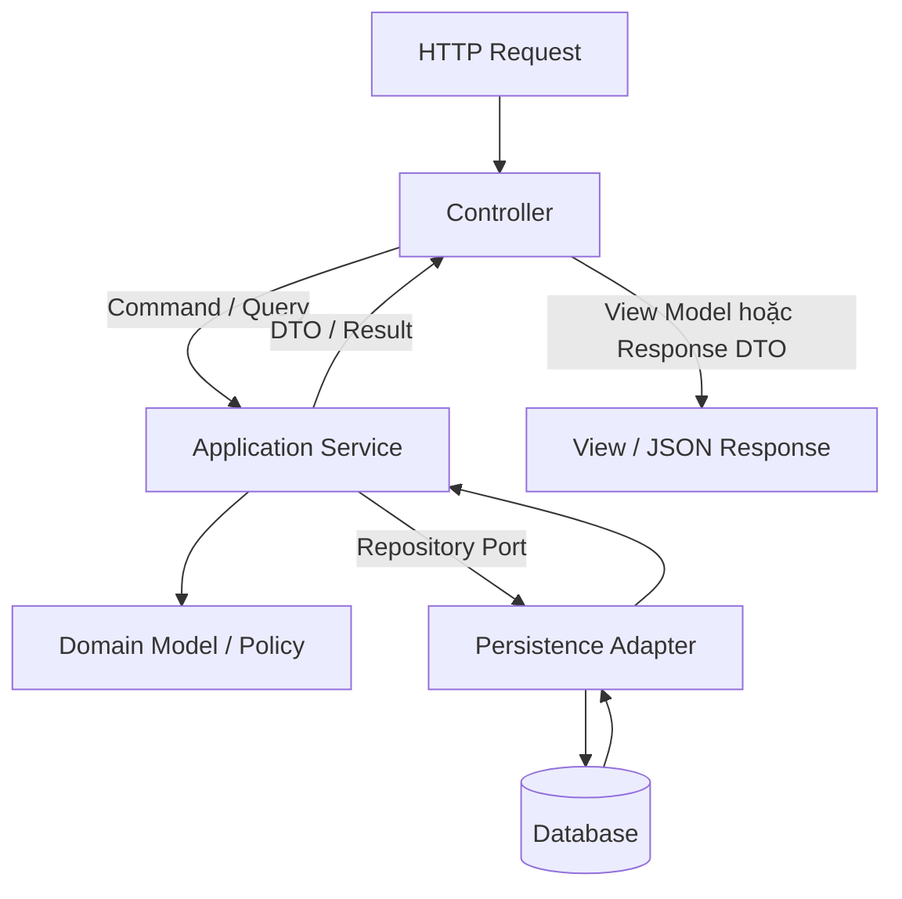

# Đưa truy cập dữ liệu về lớp có trách nhiệm

Trong ứng dụng MVC, Controller nhận request, kiểm tra dữ liệu ở ranh giới giao thức, gọi hành động ứng dụng rồi chọn response hoặc View. View trình bày dữ liệu đã được chuẩn bị. Model giữ trạng thái và quy tắc nghiệp vụ. Nếu Controller tự viết SQL, gọi `EntityManager`, truy cập `JpaRepository` hoặc nếu template tự tải quan hệ lazy, các trách nhiệm này bị trộn lẫn.

Khi truy cập dữ liệu nằm rải rác trong Controller, View và Domain Model, một thay đổi về database có thể buộc sửa nhiều nơi. Khó kiểm thử nghiệp vụ mà không dựng database; transaction không có ranh giới rõ; truy vấn lặp có thể tạo N+1; và dữ liệu persistence dễ bị lộ trực tiếp ra giao diện.

Cải tiến thiết kế bằng cách đưa thao tác đọc/ghi về thành phần sở hữu trách nhiệm đó: Repository/DAO hoặc persistence adapter thực hiện truy cập lưu trữ; Application Service/use case điều phối nghiệp vụ và xác định transaction; Controller chuyển request thành command/query và chuyển kết quả thành response; View chỉ nhận dữ liệu trình bày. Domain Model vẫn bảo vệ bất biến và hành vi miền, nhưng không cần biết HTTP, template hay chi tiết SQL.

## Xác định đúng trách nhiệm của từng lớp

Một luồng MVC có thể chia thành các trách nhiệm sau:

| Thành phần | Trách nhiệm với dữ liệu | Việc không nên làm |
|---|---|---|
| Controller | Nhận request, binding/validation, lấy actor từ ngữ cảnh tin cậy, gọi use case và chọn response | Viết SQL, mở transaction thủ công, chứa truy vấn phức tạp hoặc quyết định mapping database |
| Application Service / Use Case | Điều phối thao tác đọc/ghi, kiểm tra quyền ở mức use case, xác định transaction và gọi Model/port | Tự chứa chi tiết JDBC/JPA hoặc trả entity persistence cho View |
| Domain Model | Bảo vệ invariant, chuyển trạng thái và thực hiện quy tắc nghiệp vụ | Phụ thuộc `HttpServletRequest`, template, `EntityManager` hoặc tự mở kết nối database |
| Repository / DAO / Persistence Adapter | Đọc, lưu, cập nhật và chuyển đổi dữ liệu qua cơ chế lưu trữ | Quyết định luồng giao diện hoặc sở hữu toàn bộ use case |
| Query Service / Read Adapter | Tạo dữ liệu đọc phù hợp cho màn hình/API, projection, lọc và phân trang | Bỏ qua quyền truy cập hoặc tự quyết định hành vi miền khi ghi |
| View / Template | Hiển thị DTO/View Model đã được chuẩn bị | Gọi repository, chạy SQL, tự tải dữ liệu hoặc thay đổi trạng thái miền |

Không phải dự án nào cũng cần đủ mọi lớp hoặc interface. Với ứng dụng nhỏ, application service và repository cụ thể có thể đã đủ. Điều quan trọng là mỗi truy vấn và thao tác ghi có một nơi sở hữu rõ ràng, có thể kiểm thử và thay đổi độc lập.

## Nhìn luồng dữ liệu qua MVC



Trong kiến trúc có dependency inversion, Application Service phụ thuộc vào abstraction như `TaskRepository`; adapter JPA/JDBC triển khai abstraction đó. Mũi tên gọi lúc chạy đi từ service đến adapter, nhưng source dependency của application layer không cần phụ thuộc Spring Data hoặc SQL cụ thể.

Với ứng dụng đơn giản, có thể để application service phụ thuộc trực tiếp vào một repository Spring Data nếu dự án chấp nhận coupling framework. Khi cần tách domain/application khỏi hạ tầng, hãy đặt port ở phía trong và adapter persistence ở phía ngoài. Không nên thêm interface chỉ để tăng số file; interface có giá trị khi nó tạo ranh giới phụ thuộc hoặc hợp đồng cần thay thế.

## Vì sao Controller không nên truy cập database trực tiếp?

Controller là adapter của HTTP. Nhiệm vụ của nó là chuyển giao thức thành lời gọi ứng dụng. Nếu Controller truy vấn dữ liệu trực tiếp, nó thường phải biết:

- entity nào được lưu trong bảng nào;
- quan hệ nào cần fetch;
- cách phân trang và lọc của ORM;
- transaction nào cần mở;
- cách xử lý optimistic lock và constraint;
- cách chuyển entity sang JSON hoặc View Model.

Những hiểu biết đó làm Controller phụ thuộc vào persistence. Một use case được gọi từ web, desktop, scheduler hoặc message consumer có thể bị triển khai lại vì logic truy vấn và điều phối đang gắn với HTTP.

### Ví dụ Controller truy cập Repository trực tiếp

```java
@Controller
@RequestMapping("/tasks")
public class TaskController {
    private final TaskJpaRepository tasks;

    public TaskController(TaskJpaRepository tasks) {
        this.tasks = tasks;
    }

    @GetMapping
    public String list(Model model) {
        List<TaskEntity> rows = tasks.findAll();
        model.addAttribute("tasks", rows);
        return "tasks/list";
    }

    @PostMapping("/{id}/complete")
    public String complete(@PathVariable long id) {
        TaskEntity task = tasks.findById(id).orElseThrow();
        task.setStatus("COMPLETED");
        tasks.save(task);
        return "redirect:/tasks";
    }
}
```

Đoạn mã có vẻ ngắn nhưng Controller đang quyết định trạng thái lưu trữ trực tiếp. Nó có thể bỏ qua điều kiện chỉ công việc `IN_PROGRESS` mới được hoàn thành, quyền của actor, audit, domain event và transaction của use case. `findAll()` cũng có thể tải quá nhiều bản ghi hoặc trả entity chứa quan hệ lazy cho template.

### Chuyển truy cập dữ liệu vào use case

```java
@Controller
@RequestMapping("/tasks")
public class TaskController {
    private final ListTasksQuery listTasks;
    private final CompleteTaskUseCase completeTask;

    public TaskController(
            ListTasksQuery listTasks,
            CompleteTaskUseCase completeTask) {
        this.listTasks = listTasks;
        this.completeTask = completeTask;
    }

    @GetMapping
    public String list(
            @AuthenticationPrincipal AppPrincipal principal,
            Model model) {
        model.addAttribute("tasks", listTasks.handle(principal.userId()));
        return "tasks/list";
    }

    @PostMapping("/{id}/complete")
    public String complete(
            @PathVariable long id,
            @AuthenticationPrincipal AppPrincipal principal,
            RedirectAttributes redirectAttributes) {
        completeTask.handle(new CompleteTaskCommand(
                new TaskId(id), principal.userId()));
        redirectAttributes.addFlashAttribute("message", "Đã hoàn thành công việc");
        return "redirect:/tasks";
    }
}
```

Controller không biết truy vấn được thực hiện bằng JPA, JDBC hay API khác. Nó chỉ biết hợp đồng use case. `AppPrincipal` đại diện danh tính đã xác thực; actor được lấy từ security context, không nhận `userId` tùy ý từ form. Use case vẫn phải kiểm tra người đó có quyền trên công việc.

## Đưa truy vấn đọc vào Query Service hoặc Repository

Không phải mọi thao tác đọc đều cần tải aggregate đầy đủ. Màn hình danh sách thường cần vài trường để hiển thị; màn hình chi tiết có thể cần dữ liệu tổng hợp từ nhiều nguồn. Hãy thiết kế truy vấn theo nhu cầu đọc thay vì luôn gọi `findAll()` rồi để Controller hoặc View lọc.

Một query service có thể trả DTO:

```java
public record TaskRow(
        long id,
        String title,
        String status,
        String assigneeName) {
}
```

```java
public interface ListTasksQuery {
    Page<TaskRow> handle(UserId actorId, Pageable pageable);
}
```

Adapter đọc có thể dùng projection hoặc query trực tiếp để lấy đúng các cột:

```java
public interface TaskRowProjection {
    Long getId();
    String getTitle();
    String getStatus();
    String getAssigneeName();
}
```

```java
public interface SpringDataTaskQueries
        extends Repository<TaskEntity, Long> {

    @Query("""
        select t.id as id,
               t.title as title,
               t.status as status,
               u.displayName as assigneeName
        from TaskEntity t
        left join t.assignee u
        where t.ownerId = :actorId
        """)
    Page<TaskRowProjection> findRowsForOwner(
            @Param("actorId") long actorId,
            Pageable pageable);
}
```

Application query handler gọi adapter, chuyển projection thành `TaskRow` và trả về Controller. Ví dụ minh họa cần điều chỉnh tên field/entity và cú pháp JPQL theo mô hình thực tế. Nếu phân quyền theo project/tenant thay vì owner, điều kiện truy vấn cần phản ánh chính sách tương ứng; không được bỏ điều kiện quyền chỉ để ví dụ ngắn hơn.

### Vì sao DTO/projection phù hợp cho màn hình đọc?

- chỉ tải các trường cần hiển thị;
- tránh serialize entity ORM và quan hệ lazy;
- giảm nguy cơ lộ field nội bộ;
- hợp đồng View/API ít phụ thuộc schema persistence;
- có thể tổng hợp dữ liệu mà không ép domain entity mang cấu trúc của một màn hình cụ thể.

Không cần tạo DTO cho mọi phương thức nếu kết quả chỉ là một giá trị đơn giản. Hãy tạo kiểu riêng khi nó làm rõ hợp đồng hoặc tránh rò rỉ chi tiết persistence.

## Đưa thao tác ghi vào Application Service và Domain Model

Thao tác ghi thường có nhiều bước: tải aggregate, xác minh actor/quyền, kiểm tra điều kiện nghiệp vụ, thay đổi trạng thái và lưu kết quả. Application Service điều phối các bước; Domain Model bảo vệ invariant; Repository lưu aggregate.

```java
public interface TaskRepository {
    Optional<Task> findById(TaskId id);
    void save(Task task);
}
```

```java
public record CompleteTaskCommand(TaskId taskId, UserId actorId) {
}
```

```java
public interface CompleteTaskUseCase {
    void handle(CompleteTaskCommand command);
}
```

```java
@Service
public class CompleteTaskService implements CompleteTaskUseCase {
    private final TaskRepository tasks;
    private final TaskAccessPolicy accessPolicy;

    public CompleteTaskService(
            TaskRepository tasks,
            TaskAccessPolicy accessPolicy) {
        this.tasks = tasks;
        this.accessPolicy = accessPolicy;
    }

    @Override
    @Transactional
    public void handle(CompleteTaskCommand command) {
        Task task = tasks.findById(command.taskId())
                .orElseThrow(TaskNotFoundException::new);
        accessPolicy.ensureCanComplete(command.actorId(), task);
        task.complete();
        tasks.save(task);
    }
}
```

Trong ví dụ, `Task.complete()` tự kiểm tra trạng thái miền. `TaskAccessPolicy` kiểm tra quyền của actor theo chính sách ứng dụng. `@Transactional` đặt ở ranh giới use case để việc tải, thay đổi và lưu diễn ra trong cùng transaction. Repository không quyết định một công việc có được hoàn thành hay không; nó chỉ cung cấp thao tác lưu trữ.

Nếu dùng JPA, entity được quản lý trong persistence context có thể tự dirty-check và không cần gọi `save()` sau khi thay đổi; gọi `save()` vẫn có thể là một phần hợp đồng repository hoặc cần cho adapter cụ thể. Hãy thống nhất semantics của repository để không tạo cảm giác `save()` luôn là lệnh SQL ngay lập tức.

## Phân biệt Repository, DAO và Query Service

Các thuật ngữ có thể được dùng khác nhau giữa dự án, nhưng có thể phân biệt theo mục tiêu:

| Thành phần | Mục tiêu chính | Ví dụ |
|---|---|---|
| DAO (Data Access Object) | Đóng gói thao tác truy cập một nguồn dữ liệu hoặc bảng/record | `JdbcTaskDao.findById()` |
| Repository | Cung cấp abstraction truy xuất/lưu aggregate hoặc tập đối tượng miền | `TaskRepository.findById()` và `save()` |
| Query Service | Phục vụ truy vấn đọc theo nhu cầu màn hình/báo cáo, thường trả projection/DTO | `ListTasksQuery.handle()` |
| Persistence Adapter | Triển khai port bằng JPA, JDBC, document store hoặc API | `JpaTaskRepositoryAdapter` |

Một dự án có thể dùng Spring Data repository trực tiếp làm DAO/repository cho ứng dụng đơn giản. Trong kiến trúc phân lớp hoặc hexagonal, interface repository thường đặt ở application/domain side và adapter nằm ở infrastructure. Không cần tranh luận tên gọi nếu trách nhiệm, transaction và dependency direction đã rõ.

## Tách interface lưu trữ khỏi implementation JPA

Khi muốn application layer không phụ thuộc Spring Data, định nghĩa port:

```java
public interface TaskRepository {
    Optional<Task> findById(TaskId id);
    void save(Task task);
}
```

Implementation JPA sử dụng Spring Data repository và mapper:

```java
public interface SpringDataTaskRepository
        extends JpaRepository<TaskEntity, Long> {
}
```

```java
@Repository
public class JpaTaskRepositoryAdapter implements TaskRepository {
    private final SpringDataTaskRepository jpa;
    private final TaskMapper mapper;

    public JpaTaskRepositoryAdapter(
            SpringDataTaskRepository jpa,
            TaskMapper mapper) {
        this.jpa = jpa;
        this.mapper = mapper;
    }

    @Override
    public Optional<Task> findById(TaskId id) {
        return jpa.findById(id.value()).map(mapper::toDomain);
    }

    @Override
    public void save(Task task) {
        TaskEntity entity = mapper.toEntity(task);
        jpa.save(entity);
    }
}
```

Đây là phác thảo. Cần quyết định mapper xử lý entity đang tồn tại thế nào để không ghi đè field không liên quan hoặc làm mất quan hệ. Với JPA, nhiều ứng dụng chọn để domain model chính là persistence entity hoặc dùng aggregate mapping có chủ đích; không bắt buộc phải tạo hai object cho mọi bảng. Nếu tách domain object và JPA entity, mapper cần bảo toàn ID, version và quan hệ theo đúng semantics.

Điểm quan trọng là Controller không phụ thuộc `SpringDataTaskRepository`. Application service chỉ gọi port `TaskRepository`; chi tiết JPA được cô lập trong adapter.

## Không đưa truy cập database vào View

Template cần dữ liệu để render, nhưng dữ liệu đó phải được Controller/use case chuẩn bị trước. Khi View tự truy vấn hoặc chạm vào lazy relationship, thời gian và số lượng query trở nên khó dự đoán.

Ví dụ không nên làm:

```html
<!-- Ý tưởng sai: template gọi helper truy cập repository trong lúc render -->
<span th:text="${taskService.findAssigneeName(task.id)}"></span>
```

Mỗi hàng có thể gọi một query riêng; template không thể hiện rõ số lần truy cập dữ liệu và khó test độc lập. Hãy trả `assigneeName` ngay trong `TaskRow`/View Model bằng join hoặc query phù hợp.

### Chuẩn bị View Model trước khi render

```java
@GetMapping("/{id}")
public String detail(
        @PathVariable long id,
        @AuthenticationPrincipal AppPrincipal principal,
        Model model) {
    TaskDetailsView details = getTaskDetails.handle(
            new TaskId(id), principal.userId());
    model.addAttribute("task", details);
    return "tasks/detail";
}
```

Template chỉ đọc các thuộc tính của `TaskDetailsView`, không cần biết chúng đến từ một query, nhiều bảng hay cache. Việc lấy dữ liệu xảy ra trước render và có thể được đo/kiểm thử ở query service.

## Transaction thuộc về ranh giới use case

Transaction xác định một nhóm thao tác dữ liệu phải được commit hoặc rollback như một đơn vị. Với ứng dụng MVC, ranh giới thường phù hợp ở Application Service/use case vì nó biết toàn bộ hành động nghiệp vụ.

Ví dụ đặt `@Transactional` ở Controller làm transaction gắn với giao thức HTTP. Đặt transaction ở từng phương thức repository có thể khiến nhiều thao tác của một use case không nằm trong cùng transaction. Đặt transaction quá rộng quanh toàn bộ request có thể giữ connection trong lúc render View hoặc chờ client.

Một nguyên tắc thường hữu ích:

- use case ghi dữ liệu dùng `@Transactional` ở phương thức application service;
- query service dùng `@Transactional(readOnly = true)` nếu phù hợp với persistence provider;
- repository thực hiện thao tác lưu trữ trong transaction do caller quản lý hoặc theo semantics đã định;
- không giữ transaction mở trong lúc render template, stream response hoặc chờ người dùng.

`readOnly = true` là gợi ý/hint cho transaction manager và provider; không phải cơ chế bảo mật tuyệt đối ngăn mọi câu lệnh ghi. Cần hiểu hành vi cụ thể của database và ORM đang dùng.

### Chú ý proxy và self-invocation của Spring

Trong chế độ proxy mặc định, lời gọi nội bộ từ một method trong cùng bean sang method khác có `@Transactional` thường không đi qua proxy, nên annotation trên method được gọi nội bộ có thể không được áp dụng như mong đợi. Đặt transaction ở public use case boundary được gọi từ bean khác hoặc tổ chức service phù hợp. Không dùng `new` để tự tạo Spring service rồi kỳ vọng annotation hoạt động.

### Không dùng transaction để che giấu mọi vấn đề nhất quán

Transaction database không tự bao gồm email, HTTP call hoặc message broker. Nếu use case lưu đơn hàng rồi gọi payment provider, giữ transaction database mở trong lúc chờ mạng có thể làm cạn connection và tăng lock time. Hãy cân nhắc outbox, saga hoặc workflow có trạng thái khi cần phối hợp nhiều hệ thống.

## Xử lý N+1 và lazy loading ở đúng lớp

Khi Controller lấy một danh sách entity rồi View truy cập quan hệ lazy cho từng hàng, ORM có thể tạo N+1 query. Ví dụ một query lấy 100 task, sau đó template truy cập `task.assignee.name` và phát sinh thêm 100 query.

Hướng xử lý:

- query service dùng projection DTO và join cần thiết;
- repository dùng `EntityGraph` hoặc fetch join có chủ đích;
- phân trang và giới hạn dữ liệu thay vì tải toàn bộ;
- mapping DTO trong transaction nếu cần truy cập quan hệ lazy;
- tránh serialize entity có quan hệ hai chiều gây vòng lặp hoặc tải dữ liệu ngoài ý muốn.

Không giải quyết N+1 bằng cách fetch join mọi quan hệ cùng lúc. Fetch nhiều collection có thể nhân số hàng, gây dữ liệu trùng, tốn bộ nhớ hoặc không tương thích với pagination. Chọn fetch plan theo use case và kiểm tra query thực tế.

## Phân trang và lọc thuộc về truy vấn, không thuộc View

View có thể hiển thị trang hiện tại và liên kết điều hướng, nhưng truy vấn phải giới hạn dữ liệu ở phía server. Không tải toàn bộ bảng rồi dùng Java stream hoặc template để lọc khi dữ liệu có thể tăng lớn.

Ví dụ application query nhận `Pageable`:

```java
@Service
public class ListTasksQueryService implements ListTasksQuery {
    private final TaskReadRepository tasks;

    public ListTasksQueryService(TaskReadRepository tasks) {
        this.tasks = tasks;
    }

    @Transactional(readOnly = true)
    @Override
    public Page<TaskRow> handle(UserId actorId, Pageable pageable) {
        Pageable safePageable = PageRequest.of(
                pageable.getPageNumber(),
                Math.min(pageable.getPageSize(), 100),
                Sort.by(Sort.Direction.DESC, "createdAt"));
        return tasks.findRowsVisibleTo(actorId, safePageable);
    }
}
```

Trong thực tế cần giới hạn cả page number/offset, allowlist sort field và xử lý trường hợp page size không hợp lệ. Không truyền nguyên chuỗi sort từ request vào SQL. Repository phải áp dụng điều kiện quyền/tenant trong truy vấn hoặc qua một cơ chế kiểm tra tương đương; Controller không nên tự lọc danh sách sau khi tải dữ liệu.

## Quyền truy cập dữ liệu phải được áp dụng tại server

Đưa truy vấn vào repository không tự động bảo đảm an toàn. Một query như `findById(id)` có thể trả về tài nguyên thuộc người dùng khác nếu use case quên kiểm tra quyền. Có thể áp dụng quyền theo hai cách bổ sung:

- tải aggregate theo ID rồi gọi policy xác minh actor có quyền;
- thiết kế query có điều kiện owner/tenant để chỉ trả các bản ghi actor được phép thấy.

Lựa chọn phụ thuộc nghiệp vụ và mức độ phức tạp. Với command cần thay đổi trạng thái, kiểm tra quyền và invariant trong use case/Model vẫn quan trọng ngay cả khi query đã giới hạn kết quả. Không dựa vào việc nút bị ẩn trong View hoặc ID khó đoán.

### Tenant scoping

Trong hệ thống multi-tenant, tenant context phải đến từ danh tính/phiên đã xác thực và được kiểm tra membership. Không nhận `tenantId` từ request rồi nối vào query mà không xác minh. Có thể truyền `TenantId` tường minh vào query/repository port để điều kiện phạm vi được nhìn thấy trong hợp đồng.

Ví dụ:

```java
Optional<Task> findByIdForTenant(TaskId id, TenantId tenantId);
```

Hợp đồng này làm rõ rằng việc đọc cần có tenant scope. Cần có test đảm bảo tenant A không thể đọc hoặc sửa dữ liệu tenant B, kể cả khi biết ID.

## Khi nào Model được phép gọi Repository?

Trong một số cách hiểu MVC hoặc kiến trúc Active Record, Model có thể trực tiếp cung cấp phương thức đọc/lưu dữ liệu. Ví dụ một Active Record có `save()` hoặc `findById()`. Đây là một phong cách hợp lệ trong một số framework và ứng dụng nhỏ, nhưng nó kết hợp domain behavior với persistence.

Trong Domain Model theo hướng tách biệt, entity thường không tự mở kết nối hoặc gọi repository. Application Service lấy aggregate qua repository, gọi hành vi miền, rồi lưu lại. Cách này giúp Model thuần hơn, dễ kiểm thử và không phụ thuộc database.

Không có một quy tắc đặt tên “Model tuyệt đối không được truy cập dữ liệu” cho mọi framework. Hãy phân biệt rõ:

- **Model là dữ liệu trình bày:** không nên tự truy vấn database;
- **Domain Entity/Aggregate:** thường giữ quy tắc và trạng thái, còn repository bên ngoài quản lý persistence;
- **Active Record Model:** có thể gộp persistence với entity theo chủ đích framework;
- **Application Service:** điều phối use case và chọn transaction;
- **Repository/DAO:** đóng gói thao tác lưu trữ.

Với module MVC hướng đến phân tách trách nhiệm, nên ưu tiên Controller → Application Service → Repository/Adapter → Database, và để Domain Model thực thi quy tắc nghiệp vụ.

## Kiểm thử sau khi chuyển truy cập dữ liệu

Tách truy cập dữ liệu giúp kiểm thử từng ranh giới:

| Lớp | Loại test | Điều cần xác minh |
|---|---|---|
| Domain Model | Unit test | Bất biến và chuyển trạng thái không phụ thuộc database |
| Application Service | Unit test với fake/mock port | Đúng thứ tự điều phối, actor, policy và kết quả use case |
| Repository Adapter | Integration test với database | Mapping, query, transaction, constraint, pagination và locking |
| Controller | MockMvc/controller test | Binding, validation, gọi đúng use case và response/redirect |
| View | Template/component test | Render đúng DTO, escape dữ liệu và không truy vấn lưu trữ |
| Luồng tổng thể | Integration/E2E test | Request đi qua security, use case, repository và response đúng |

### Unit test Application Service

Có thể dùng fake repository để kiểm tra điều phối mà không cần database:

```java
class CompleteTaskServiceTest {
    private final InMemoryTaskRepository tasks =
            new InMemoryTaskRepository();
    private final TaskAccessPolicy accessPolicy = new TaskAccessPolicy();
    private final CompleteTaskService service =
            new CompleteTaskService(tasks, accessPolicy);

    @Test
    void completesTaskWhenActorCanAccessIt() {
        Task task = Task.startNew(new TaskId(10), new UserId(7));
        task.start();
        tasks.save(task);

        service.handle(new CompleteTaskCommand(
                new TaskId(10), new UserId(7)));

        assertThat(tasks.findById(new TaskId(10)).orElseThrow().status())
                .isEqualTo(TaskStatus.COMPLETED);
    }
}
```

Đây là ví dụ minh họa; factory và repository trong test cần khớp API thật của dự án. Unit test này xác minh quy tắc và điều phối với repository giả. Nó không chứng minh câu SQL, mapping JPA hoặc transaction thực hoạt động đúng; các phần đó cần integration test.

### Integration test Repository

Với repository adapter, dùng database thử nghiệm tương thích để kiểm tra:

- truy vấn trả đúng bản ghi và projection;
- điều kiện tenant/owner không bị thiếu;
- phân trang và sort có kết quả ổn định;
- quan hệ được fetch theo kế hoạch;
- constraint và optimistic locking hoạt động;
- transaction rollback khi use case thất bại.

H2 có thể hữu ích cho test nhanh, nhưng khác biệt với PostgreSQL/MySQL về kiểu dữ liệu, locking, SQL dialect và execution plan. Với hành vi phụ thuộc database cụ thể, dùng Testcontainers hoặc môi trường database tương thích.

### Kiểm thử Controller không cần Repository thật

MockMvc test có thể thay use case bằng mock/fake để xác minh Controller chuyển request đúng:

```java
mockMvc.perform(post("/tasks/10/complete")
        .with(user(appPrincipal))
        .with(csrf()))
    .andExpect(status().is3xxRedirection())
    .andExpect(redirectedUrl("/tasks"));

verify(completeTask).handle(
        new CompleteTaskCommand(new TaskId(10), new UserId(7)));
```

Ví dụ cần cấu hình MockMvc, Spring Security test support và principal phù hợp. Test Controller không cần kiểm tra repository được gọi bao nhiêu lần; điều đó thuộc test application service/adapter. Controller test xác minh giao thức và hợp đồng gọi use case.

## Các lỗi thiết kế khi chuyển truy cập dữ liệu

- **Chỉ chuyển repository field từ Controller sang một lớp `CommonService`:** trách nhiệm vẫn không rõ nếu service trở thành nơi chứa mọi query và rule. Chia theo use case hoặc capability.
- **Repository chứa toàn bộ nghiệp vụ:** repository không nên quyết định có được hoàn thành đơn hàng hay không. Để use case/Model giữ quyết định.
- **Domain Model tự gọi database:** entity trở nên khó tạo và kiểm thử, transaction ẩn. Đưa persistence ra repository trừ khi chủ đích dùng Active Record.
- **View truy cập lazy relation:** render phát sinh query không dự kiến. Chuẩn bị DTO/projection trước khi render.
- **Controller trả entity JPA:** lộ cấu trúc persistence, lazy loading và field nhạy cảm. Dùng response DTO/View Model.
- **Dùng `findAll()` cho trang danh sách lớn:** tốn bộ nhớ và thời gian. Phân trang và truy vấn đúng trường cần thiết.
- **Đặt transaction ở toàn bộ request:** transaction có thể kéo dài qua render hoặc chờ client. Đặt ở use case boundary.
- **Đặt transaction ở từng repository method mà không xét use case:** nhiều thao tác ghi có thể không cùng transaction. Xác định transaction theo hành động ứng dụng.
- **Quên điều kiện owner/tenant:** chuyển truy vấn vào repository nhưng vẫn có thể lộ dữ liệu chéo. Kiểm tra quyền trong query và use case.
- **Tạo interface cho mọi repository nhỏ:** tăng lớp mà không tạo ranh giới. Chỉ tạo port khi có giá trị kiến trúc hoặc kiểm thử.
- **Giả định `save()` luôn phát SQL ngay:** JPA có dirty checking và flush theo lifecycle. Hiểu semantics persistence context.
- **Không kiểm thử query thực:** unit test service xanh không chứng minh SQL đúng. Bổ sung repository integration test.

## Quy trình refactor Controller đang truy cập database

Khi phát hiện Controller gọi repository hoặc viết query, có thể chuyển dần:

1. **Xác định use case:** Controller đang phục vụ hành động đọc hay ghi nào?
2. **Ghi rõ dữ liệu cần thiết:** xác định request, actor, kết quả và lỗi nghiệp vụ.
3. **Tạo application port/use case:** ví dụ `ListTasksQuery` hoặc `CompleteTaskUseCase`.
4. **Chuyển điều phối ra khỏi Controller:** tải dữ liệu, kiểm tra quyền, gọi Model và lưu trong service.
5. **Đưa query vào repository/query adapter:** chọn aggregate, projection hoặc DTO phù hợp.
6. **Xác định transaction boundary:** đặt transaction ở use case; tránh giữ transaction qua render.
7. **Chuẩn bị dữ liệu trình bày:** trả DTO/View Model, không để template tự truy cập persistence.
8. **Giữ Controller mỏng:** binding, tạo command/query, gọi use case và chọn response.
9. **Viết test theo ranh giới:** unit test Model/service, integration test repository, controller test và regression.
10. **Đo lại:** kiểm tra query count, latency, số bản ghi tải và phạm vi ảnh hưởng.

Không cần refactor mọi Controller cùng lúc. Chọn một luồng có query lặp hoặc rule quan trọng, chuyển hoàn chỉnh và dùng cấu trúc đó làm mẫu cho các luồng tiếp theo.

## Checklist review

- Controller không viết SQL/JPA query hoặc thao tác repository trực tiếp nếu kiến trúc quy định qua use case.
- View/template không gọi repository, service truy cập dữ liệu hoặc lazy-load ngoài dự kiến.
- Application Service có tên theo use case và điều phối đúng các bước nghiệp vụ.
- Domain Model giữ invariant và không phụ thuộc HTTP/UI.
- Repository/DAO/persistence adapter đóng gói truy cập lưu trữ.
- Query đọc trả projection/DTO phù hợp với nhu cầu màn hình.
- Entity persistence không bị trả trực tiếp ra API/View khi không phù hợp.
- Transaction nằm ở ranh giới hành động ứng dụng.
- Query có phân trang, giới hạn và điều kiện owner/tenant phù hợp.
- Không có N+1 do template hoặc mapper truy cập quan hệ lazy.
- Test phân biệt rõ unit test và integration test database.
- Thay đổi không làm suy yếu authentication, authorization hoặc audit.

## Câu hỏi tự đánh giá

1. Vì sao Controller không nên trực tiếp gọi `JpaRepository` cho mọi thao tác?
2. Repository khác Application Service ở trách nhiệm nào?
3. Khi nào một màn hình nên dùng projection hoặc DTO thay vì tải aggregate đầy đủ?
4. Vì sao template truy cập quan hệ lazy có thể gây N+1 query?
5. Transaction nên bao quanh use case hay từng request HTTP? Vì sao?
6. `readOnly = true` có phải cơ chế ngăn mọi thao tác ghi không?
7. Khi nào cần đặt repository port ở application/domain layer?
8. Làm thế nào áp dụng owner/tenant scope cho truy vấn dữ liệu?
9. Unit test service chứng minh được gì và không chứng minh được gì về SQL/JPA?
10. Khi nào Active Record là lựa chọn có chủ đích và khi nào nên tách repository?

Đưa truy cập dữ liệu về lớp có trách nhiệm giúp MVC giữ được ranh giới rõ: Controller chuyển request thành use case; Application Service điều phối và quản lý transaction; Domain Model bảo vệ quy tắc; Repository/DAO/adapter làm việc với database; View nhận dữ liệu trình bày đã chuẩn bị. Khi query được thiết kế theo nhu cầu đọc, thao tác ghi đi qua use case và các ranh giới được kiểm thử riêng, ứng dụng dễ thay đổi persistence, giảm truy vấn ngoài dự kiến và giữ quy tắc nghiệp vụ nhất quán giữa nhiều loại giao diện.
