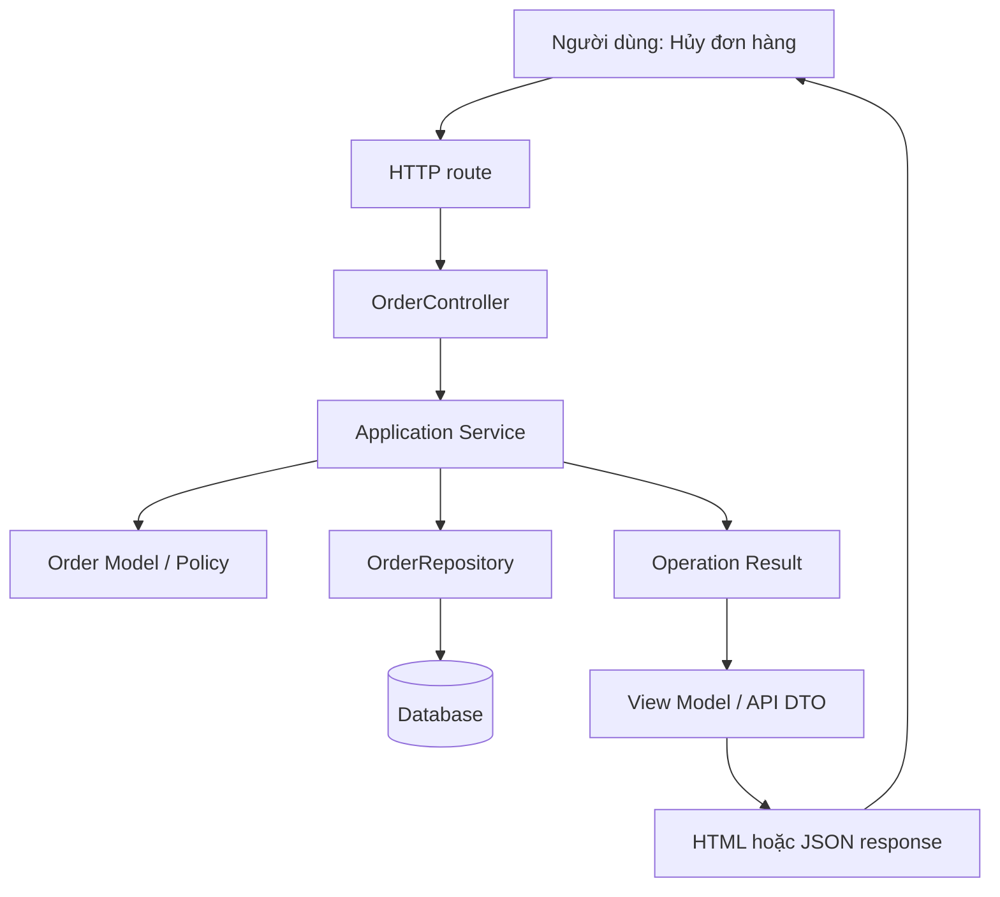
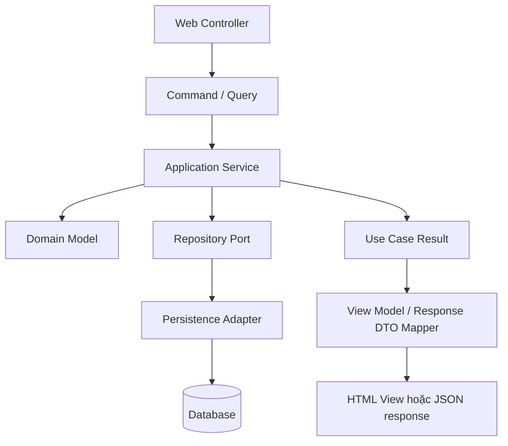
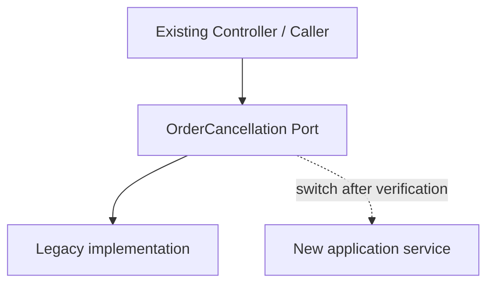
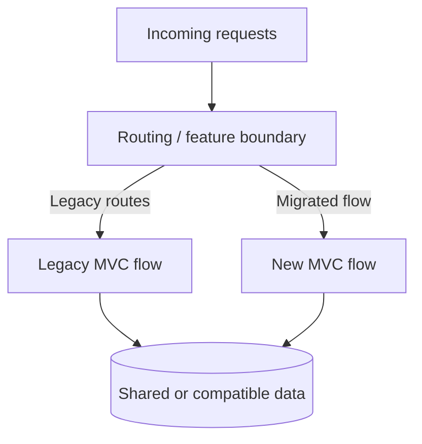
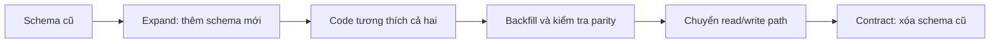

# Cải tiến từng luồng thay vì tổ chức lại toàn bộ mã một lần

Khi một ứng dụng MVC trở nên khó bảo trì, phản ứng thường gặp là muốn tổ chức lại toàn bộ mã: đổi cấu trúc package, thay Controller, tách Model, thay repository và viết lại View trong cùng một đợt. Cách làm này tạo ra một thay đổi lớn với nhiều giả định chưa được kiểm chứng. Trong thời gian dài, nhóm phải duy trì cả thiết kế cũ lẫn thiết kế mới; đến khi tích hợp, những khác biệt về hành vi, dữ liệu và hợp đồng HTTP mới xuất hiện.

Một hướng an toàn hơn là cải tiến theo từng luồng người dùng (user flow hoặc vertical slice). Chọn một thao tác có ranh giới rõ, lần theo nó từ request qua Controller, application service, Model và persistence đến View/response; sau đó cải thiện các trách nhiệm bên trong luồng đó, kiểm tra hành vi và đưa thay đổi vào sử dụng. Khi một luồng đã ổn định, nhóm có thể dùng kinh nghiệm và cấu trúc đã chứng minh để cải tiến luồng tiếp theo.

Với Model–View–Controller, cách tiếp cận này giúp làm rõ dần nơi tiếp nhận tương tác, nơi thực thi nghiệp vụ và nơi trình bày kết quả. Nó cũng giảm rủi ro phải thay đổi đồng thời mọi màn hình, route, biểu mẫu và client đang sử dụng. Mục tiêu của mỗi bước là tạo ra một cải thiện có thể quan sát, kiểm thử và phát hành độc lập.

## 1. Vì sao không nên tổ chức lại toàn bộ mã trong một lần?

Một đợt tái cấu trúc lớn thường thay đổi nhiều thứ cùng lúc:

- Cấu trúc package và dependency giữa các module.
- Cách Controller nhận request và ánh xạ dữ liệu.
- Vị trí đặt quy tắc nghiệp vụ và transaction.
- Hợp đồng giữa service, repository và Model.
- Cấu trúc View Model, DTO và template.
- Cách xử lý lỗi, bảo mật và logging.
- Cách triển khai database hoặc API.

Mỗi thay đổi riêng lẻ có thể hợp lý, nhưng khi tất cả được thực hiện cùng lúc, rất khó xác định thay đổi nào gây ra lỗi. Test thất bại có thể đến từ mapping, transaction, route, template hoặc schema. Nếu chưa có test bao phủ hành vi cũ, nhóm còn khó biết liệu phiên bản mới có giữ nguyên những hành vi mà người dùng đang phụ thuộc hay không.

### 1.1. Rủi ro của big-bang refactor

| Rủi ro | Hệ quả | Vì sao khó xử lý khi thay đổi toàn bộ |
|---|---|---|
| Phạm vi không kiểm soát | Công việc kéo dài và khó dự báo | Nhiều tầng cùng thay đổi, phát sinh phụ thuộc chưa biết |
| Hồi quy hành vi | Form, route hoặc quy tắc cũ hoạt động khác | Không có điểm so sánh theo từng luồng |
| Tích hợp muộn | Xung đột giữa các nhánh và module | Nhiều thay đổi độc lập tích tụ trước khi ghép |
| Hai hệ thống song song | Phải sửa lỗi và vận hành cả cũ lẫn mới | Chuyển đổi chưa hoàn tất nhưng kiến trúc cũ đã bị sửa dở |
| Migration dữ liệu phức tạp | Không thể rollback đơn giản | Code mới có thể phụ thuộc schema mới trong khi code cũ vẫn chạy |
| Khó xác định lợi ích | Không biết phần nào cải thiện hiệu năng hoặc bảo trì | Nhiều yếu tố thay đổi trong cùng một lần đo |

Không phải mọi thay đổi lớn đều sai. Một hệ thống nhỏ, chưa có người dùng hoặc chưa có dữ liệu thật có thể được tổ chức lại nhanh. Nhưng với ứng dụng đang vận hành, có route, client, dữ liệu và quy trình nghiệp vụ đang được sử dụng, cải tiến theo lát cắt thường giảm phạm vi rủi ro và tạo phản hồi sớm hơn.

### 1.2. Refactor theo luồng là gì?

Một luồng là một mục tiêu người dùng có thể mô tả bằng hành động và kết quả, ví dụ:

- Xem danh sách đơn hàng.
- Tạo đơn hàng từ biểu mẫu.
- Hủy đơn hàng đang chờ xử lý.
- Cập nhật địa chỉ giao hàng.
- Tra cứu lịch sử thanh toán.

Một luồng có thể đi qua nhiều lớp nhưng chỉ thay đổi một phần có liên quan của hệ thống. Ví dụ, cải tiến luồng hủy đơn có thể cần Controller, application service, Model, repository và một View thông báo. Không cần tổ chức lại toàn bộ module khách hàng, sản phẩm và thanh toán nếu chúng không nằm trong luồng đó.



Luồng được cải tiến xuyên qua các lớp cần thiết, nhưng phạm vi vẫn là một hành vi người dùng. Đây là điểm khác với việc chỉ đổi tên package hoặc di chuyển mọi Controller cùng lúc.

## 2. Bắt đầu từ hành vi đang tồn tại

Trước khi thay đổi cấu trúc, cần hiểu luồng hiện tại và xác định hành vi phải được giữ. Trong hệ thống cũ, hành vi thực tế có thể khác tài liệu hoặc khác ý định ban đầu. Những quy tắc chưa được viết thành test vẫn có thể đang được người dùng, client hoặc quy trình vận hành phụ thuộc.

### 2.1. Lập bản đồ một luồng

Ghi lại các thành phần mà request đi qua:

| Điểm trong luồng | Câu hỏi cần trả lời | Ví dụ |
|---|---|---|
| Route / request | URL, method, input và client nào sử dụng? | `POST /orders/{id}/cancel` |
| Controller | Binding, validation và authorization diễn ra ở đâu? | `OrderController.cancel()` |
| Service | Có bước điều phối nào và transaction bắt đầu ở đâu? | `CancelOrderService` |
| Model | Invariant và chuyển trạng thái được bảo vệ ở đâu? | Đơn đã giao không thể hủy |
| Repository | Những dữ liệu nào được đọc/ghi? | Cập nhật đơn và giải phóng tồn kho |
| Side effect | Có email, event hoặc lời gọi ngoài không? | Phát `OrderCancelled` sau commit |
| View / response | Thành công và lỗi được hiển thị ra sao? | Redirect, flash message hoặc JSON |
| Observability | Có thể tìm log, metric và trace của thao tác không? | Request ID và error code |

Sơ đồ này giúp xác định phạm vi thật. Một thao tác tưởng như chỉ liên quan đến Controller có thể đang cập nhật nhiều bảng, gửi email hoặc được gọi từ API khác.

### 2.2. Ghi lại hành vi quan sát được

Hành vi cần ghi nhận có thể gồm:

- Status code, redirect URL và response header.
- Tên View, thông báo và field error.
- Cấu trúc JSON, mã lỗi và trường dữ liệu công khai.
- Quy tắc nghiệp vụ khi dữ liệu ở các trạng thái khác nhau.
- Thay đổi database sau thành công và sau thất bại.
- Quyền của các vai trò người dùng.
- Side effect như email, message hoặc audit event.

Không cần mô tả mọi chi tiết triển khai. Chỉ ghi những điều có thể ảnh hưởng đến client, dữ liệu hoặc quy trình vận hành.

### 2.3. Characterization test cho mã cũ

Khi chưa hiểu đầy đủ hành vi, có thể viết characterization test (test ghi nhận hành vi hiện tại). Test này không khẳng định hành vi cũ là thiết kế tốt; nó tạo một mốc so sánh trước khi refactor.

Ví dụ với Controller HTML:

```java
@WebMvcTest(OrderController.class)
class CancelOrderCharacterizationTest {
    @Autowired
    MockMvc mockMvc;

    @MockBean
    OrderService orderService;

    @Test
    void successfulCancellationRedirectsToOrderDetail() throws Exception {
        mockMvc.perform(post("/orders/42/cancel"))
            .andExpect(status().is3xxRedirection())
            .andExpect(redirectedUrl("/orders/42"));

        then(orderService).should().cancel(42L);
    }
}
```

Ví dụ chỉ minh họa một hợp đồng cũ: POST thành công sẽ redirect đến trang chi tiết và gọi service. Test thực tế cần xử lý CSRF/authentication nếu Spring Security được bật, đồng thời dùng đúng chữ ký service hiện tại.

Với hành vi persistence hoặc transaction, cần integration test với database kiểm thử. Mock repository không chứng minh rollback hoặc constraint hoạt động thật.

## 3. Chọn luồng đầu tiên có phạm vi phù hợp

Không nhất thiết chọn luồng lớn nhất hoặc nổi bật nhất. Luồng đầu tiên nên đủ quan trọng để chứng minh giá trị, nhưng đủ hẹp để nhóm hiểu và kiểm soát được.

### 3.1. Tiêu chí lựa chọn

| Tiêu chí | Nên ưu tiên | Cần thận trọng |
|---|---|---|
| Phạm vi | Một mục tiêu người dùng, ít phụ thuộc chéo | Một quy trình xuyên nhiều bounded context |
| Tần suất | Có đủ request để đo và nhận phản hồi | Hầu như không được sử dụng, khó đánh giá |
| Rủi ro nghiệp vụ | Có thể kiểm thử rõ và giới hạn ảnh hưởng | Tác động tài chính/pháp lý lớn, chưa có test và audit |
| Dependency | Có ranh giới repository/service tương đối rõ | Gắn chặt với nhiều module và side effect |
| Khả năng phát hành | Có thể bật theo route, vai trò hoặc feature flag | Chỉ có thể chuyển tất cả client cùng lúc |
| Khả năng rollback | Có thể quay lại code cũ mà không mất dữ liệu | Schema hoặc event mới không tương thích với code cũ |

Ví dụ, cải tiến trang danh sách đơn hàng thường ít rủi ro hơn luồng thanh toán. Nó có thể giúp nhóm thử nghiệm View Model, query projection, phân trang và template mà không thay đổi nhiều quy tắc ghi dữ liệu.

### 3.2. Xác định tiêu chí thành công trước khi làm

Một cải tiến nên có kết quả mong đợi cụ thể, chẳng hạn:

- Controller không còn chứa quy tắc chuyển trạng thái.
- Một application service sở hữu transaction của use case.
- View nhận một View Model có cấu trúc rõ.
- API response không còn serialize entity ORM trực tiếp.
- Số truy vấn của trang danh sách giảm từ N+1 xuống số lượng xác định.
- Có test chứng minh quyền và invariant ở server.
- Thời gian p95 hoặc tỷ lệ lỗi không xấu đi sau phát hành.

Tránh mục tiêu mơ hồ như “làm code sạch hơn” nếu không chỉ ra dấu hiệu có thể review hoặc đo lường.

## 4. Thiết kế lát cắt đích trước khi di chuyển mã

Trước khi sửa, hãy phác thảo luồng sau cải tiến. Với MVC, một cấu trúc thường gặp là:



Không phải mọi dự án cần đủ các lớp hoặc interface trên. Mục đích của sơ đồ là chỉ ra ai sở hữu trách nhiệm và nơi dependency đi qua, không phải tạo thêm lớp chỉ để khớp một sơ đồ.

### 4.1. Giữ hợp đồng ở ranh giới

Trước khi thay đổi implementation, xác định hợp đồng phải giữ:

- Route và HTTP method.
- Request fields và validation behavior.
- Authentication/authorization.
- Status code, redirect, response body và header.
- View name, thông báo và nội dung quan trọng.
- Transaction outcome và side effect.

Nếu cần thay đổi hợp đồng, hãy tách nó thành một thay đổi sản phẩm có chủ đích, có versioning hoặc kế hoạch tương thích. Không để refactor âm thầm làm client hiện tại hỏng.

### 4.2. Đặt ranh giới transaction theo use case

Nếu luồng cần cập nhật nhiều bản ghi có liên quan, application service nên điều phối chúng trong một transaction. Repository tham gia transaction hiện tại. Không tách transaction thành nhiều lần commit độc lập chỉ vì đang di chuyển code giữa các lớp.

Side effect bên ngoài database như email hoặc message broker cần được xử lý riêng. Nếu sự kiện phải được phát bền vững sau commit, có thể dùng Transactional Outbox. Không giả định rollback database có thể hoàn tác email hoặc HTTP request đã gửi.

### 4.3. Không tạo abstraction khi chưa có nhu cầu

Một luồng có thể chỉ cần một service và một mapper. Không bắt buộc tạo interface cho mọi class, adapter cho mọi phương thức hoặc module mới cho từng bảng. Chỉ thêm abstraction khi nó bảo vệ một ranh giới có ý nghĩa, cho phép thay thế dependency hoặc làm hợp đồng dễ kiểm thử hơn.

## 5. Cải tiến từng bước bằng ví dụ luồng hủy đơn

Giả sử Controller cũ đang thực hiện mọi việc:

```java
@Controller
@RequestMapping("/orders")
public class OrderController {
    private final OrderRepository orders;
    private final InventoryRepository inventory;
    private final EmailSender emailSender;

    @PostMapping("/{id}/cancel")
    public String cancel(@PathVariable long id,
                         Principal principal,
                         RedirectAttributes redirect) {
        Order order = orders.findById(id).orElseThrow();

        if (!order.getCustomerEmail().equals(principal.getName())) {
            throw new AccessDeniedException("Forbidden");
        }
        if (!"PENDING".equals(order.getStatus())) {
            redirect.addFlashAttribute("error", "Không thể hủy đơn.");
            return "redirect:/orders/" + id;
        }

        order.setStatus("CANCELLED");
        inventory.release(order.getItems());
        orders.save(order);
        emailSender.sendCancellation(order);

        redirect.addFlashAttribute("notice", "Đã hủy đơn hàng.");
        return "redirect:/orders/" + id;
    }
}
```

Đoạn code minh họa một Controller có nhiều trách nhiệm: truy vấn, authorization, kiểm tra trạng thái, cập nhật Model, giải phóng tồn kho, gửi email và điều hướng. Nó còn có nguy cơ transaction không rõ ràng. Nếu email gửi thành công nhưng ghi database thất bại, hệ thống có thể gửi thông báo không đúng với trạng thái đã commit.

### 5.1. Bước 1: ghi nhận hành vi hiện tại

Tạo test cho các trường hợp:

- Chủ sở hữu hủy đơn đang chờ: trạng thái chuyển sang hủy và redirect.
- Người dùng khác yêu cầu hủy: bị từ chối.
- Đơn đã giao: không được hủy.
- Repository hoặc persistence lỗi: không được để lại thay đổi một phần.
- Email hoặc event chỉ được phát theo chính sách sau khi nghiệp vụ hoàn tất.

Nếu code cũ có hành vi chưa rõ, hãy xác minh với hợp đồng hiện tại và người sở hữu nghiệp vụ trước khi thay đổi semantics.

### 5.2. Bước 2: chuyển điều phối sang application service

```java
@Service
public class CancelOrderService {
    private final OrderRepository orders;
    private final InventoryService inventory;

    public CancelOrderService(OrderRepository orders,
                              InventoryService inventory) {
        this.orders = orders;
        this.inventory = inventory;
    }

    @Transactional
    public CancelOrderResult execute(long orderId, Actor actor) {
        Order order = orders.findById(orderId)
            .orElseThrow(OrderNotFoundException::new);

        order.ensureCanBeCancelledBy(actor);
        order.cancel();
        inventory.release(order.getItems());
        orders.save(order);

        return new CancelOrderResult(order.getId(), order.getStatus());
    }
}
```

Đây là ví dụ định hướng. `Actor` cần được tạo từ danh tính đã xác thực ở ranh giới ứng dụng; `ensureCanBeCancelledBy()` và `cancel()` là hành vi Model; các repository phải tham gia cùng transaction manager. Nếu giải phóng tồn kho cập nhật dữ liệu trong cùng database, thao tác đó cần cùng transaction. Nếu gọi dịch vụ tồn kho bên ngoài, cần thiết kế quy trình phân tán thay vì giả định `@Transactional` bao trùm dịch vụ đó.

### 5.3. Bước 3: làm Controller mỏng

```java
@Controller
@RequestMapping("/orders")
public class OrderController {
    private final CancelOrderService cancelOrder;

    public OrderController(CancelOrderService cancelOrder) {
        this.cancelOrder = cancelOrder;
    }

    @PostMapping("/{id}/cancel")
    public String cancel(@PathVariable long id,
                         Principal principal,
                         RedirectAttributes redirect) {
        Actor actor = Actor.from(principal);
        cancelOrder.execute(id, actor);
        redirect.addFlashAttribute("notice", "Đã hủy đơn hàng.");
        return "redirect:/orders/" + id;
    }
}
```

Controller còn giữ trách nhiệm HTTP: đọc path variable, lấy principal, tạo context phù hợp và quyết định redirect. Nó không trực tiếp cập nhật entity hoặc giải phóng tồn kho.

### 5.4. Bước 4: xử lý side effect theo chính sách

Không nên gửi email trước khi transaction commit. Với thông báo cần giao nhận bền vững, service có thể ghi outbox event trong cùng transaction; publisher gửi email hoặc message sau đó. Nếu dùng callback after-commit, cần hiểu callback trong bộ nhớ có thể mất khi tiến trình dừng sau commit.

### 5.5. Bước 5: giữ nguyên hợp đồng HTTP

Sau khi tách service, route vẫn là `POST /orders/{id}/cancel`, thành công vẫn redirect đến trang chi tiết và lỗi vẫn được ánh xạ theo chính sách hiện tại. Refactor nội bộ không nên làm thay đổi URL hoặc thông báo ngoài ý muốn.

### 5.6. Bước 6: xác minh bằng test

- Unit test Model xác minh đơn đã giao không thể hủy.
- Unit/application test xác minh service điều phối đúng và kiểm tra quyền.
- Integration test xác minh transaction rollback nếu giải phóng tồn kho hoặc lưu đơn thất bại.
- MVC slice test xác minh route, redirect và error mapping.
- E2E test cho luồng quan trọng nếu cần xác minh trải nghiệm trình duyệt.

## 6. Chiến lược chuyển đổi không làm gián đoạn client

Khi một luồng có nhiều caller, không phải lúc nào cũng có thể đổi tất cả cùng lúc. Có thể dùng các kỹ thuật chuyển đổi từng bước.

### 6.1. Branch by Abstraction

Branch by Abstraction tạo một interface hoặc seam ổn định trước, sau đó chuyển dần implementation phía sau seam. Caller tiếp tục dùng cùng hợp đồng trong lúc implementation được thay thế.



Trình tự thường gặp:

1. Tạo abstraction đúng tại điểm thay đổi cần cô lập.
2. Chuyển implementation cũ vào adapter tương thích.
3. Viết test hợp đồng cho abstraction.
4. Xây implementation mới và chạy cùng test.
5. Chuyển caller sang implementation mới bằng cấu hình hoặc một thay đổi nhỏ.
6. Theo dõi hành vi, sau đó xóa implementation cũ khi không còn caller.

Không tạo abstraction chỉ để có thêm interface. Seam cần bảo vệ một điểm biến động thực tế, ví dụ cách tính phí, cách truy cập hệ thống cũ hoặc một use case đang được nhiều adapter sử dụng.

### 6.2. Strangler Fig theo route hoặc feature

Khi một phần chức năng được thay thế dần, có thể định tuyến một nhóm route hoặc feature sang implementation mới, trong khi phần còn lại vẫn chạy trên đường cũ.



Phải bảo đảm hai luồng hiểu cùng hợp đồng dữ liệu và không ghi đè nhau. Nếu cùng truy cập database, schema và transaction cần tương thích trong thời gian chuyển đổi. Khi feature mới ổn định, có thể chuyển thêm route và cuối cùng loại bỏ đường cũ.

### 6.3. Feature flag và canary

Feature flag có thể bật implementation mới cho một nhóm người dùng, tenant hoặc tỷ lệ traffic nhỏ. Canary release giúp quan sát lỗi và latency trước khi mở rộng.

Flag cần có:

- Chủ sở hữu và mục đích rõ.
- Điều kiện bật/tắt xác định.
- Metric để đánh giá kết quả.
- Cách quay lại implementation cũ.
- Thời hạn hoặc điều kiện xóa flag.

Không để flag chuyển đổi tồn tại vô thời hạn. Hai nhánh code làm tăng số đường cần test và có thể tạo hành vi không đồng nhất giữa người dùng.

### 6.4. Shadow read và so sánh kết quả

Với một query có thể chạy an toàn hai implementation, có thể gửi cùng input đến đường mới ở chế độ shadow và so sánh kết quả, nhưng chỉ trả kết quả của đường đang phục vụ chính. Cách này hữu ích để phát hiện sai khác khi chuyển query hoặc mapping.

Không thực hiện shadow write tùy tiện. Chạy cùng command hai lần có thể tạo giao dịch, gửi email hoặc phát event trùng. Nếu cần kiểm tra write path, dùng môi trường dữ liệu thử nghiệm, mô phỏng có kiểm soát hoặc cơ chế idempotent được thiết kế rõ.

## 7. Thay đổi database theo hướng tương thích ngược

Refactor code thường kéo theo thay đổi schema. Nếu code cũ và mới có thể cùng chạy trong một khoảng thời gian, migration database phải hỗ trợ cả hai.

Một chiến lược thường dùng là expand-and-contract:

1. **Expand:** thêm cột/bảng hoặc cấu trúc mới theo cách code cũ vẫn hoạt động.
2. Triển khai code có thể đọc dữ liệu cũ và mới, hoặc ghi theo hợp đồng tương thích.
3. Backfill dữ liệu cũ sang cấu trúc mới bằng job có thể theo dõi và chạy lại an toàn.
4. Chuyển read path sang cấu trúc mới và xác minh dữ liệu.
5. Chuyển write path khi mọi caller đã tương thích.
6. **Contract:** chỉ xóa cột/bảng cũ sau khi chắc chắn không còn code hoặc báo cáo nào sử dụng.



Không nên thêm cột mới, đổi tên cột cũ và triển khai code chỉ hiểu schema mới trong cùng một lần nếu deployment có thể chạy song song nhiều phiên bản. Nếu migration không thể rollback, cần kế hoạch roll-forward và phục hồi dữ liệu rõ ràng.

### 7.1. Tránh dual-write không kiểm soát

Ghi cùng một dữ liệu vào hai bảng hoặc hai hệ thống trong cùng request có thể tạo trạng thái lệch nếu một lần ghi thành công và lần còn lại thất bại. Database transaction chỉ giúp khi cả hai thao tác thuộc cùng transaction manager và cùng tài nguyên hỗ trợ.

Nếu cần đồng bộ sang hệ thống khác, hãy dùng outbox/event, quy trình idempotent và đối soát. Ghi log hai lần không thay thế một cơ chế nhất quán.

### 7.2. Backfill phải có thể chạy lại

Job backfill cần:

- Xử lý theo batch và giới hạn tải lên hệ thống.
- Có checkpoint hoặc cách tiếp tục sau lỗi.
- Không tạo bản ghi trùng khi chạy lại.
- Ghi nhận số bản ghi thành công, bỏ qua và lỗi.
- Có cách so sánh dữ liệu nguồn/đích.
- Có kế hoạch xử lý bản ghi thay đổi trong lúc backfill.

Không xóa dữ liệu cũ chỉ vì job đã chạy hết. Cần xác minh parity và caller đã chuyển sang đường mới.

## 8. Bảo toàn hợp đồng HTML, API và bảo mật

Một luồng MVC có thể được sử dụng bởi browser, SPA hoặc client khác. Refactor cần giữ các hợp đồng liên quan:

- Route, HTTP method và media type.
- Form field, request DTO và validation.
- View name, redirect, flash message và thông báo quan trọng.
- API field, status code, error code và pagination.
- Authentication, authorization và CSRF.
- Output escaping và chính sách cache.

Nếu muốn thay đổi hợp đồng, hãy version hoặc triển khai tương thích theo kế hoạch riêng. Không dựa vào việc “chỉ sửa backend” để giả định client không bị ảnh hưởng.

### 8.1. Giữ authorization ở server

Khi di chuyển logic từ Controller sang service, không được vô tình bỏ kiểm tra quyền. Cần xác định kiểm tra nào thuộc web security, kiểm tra nào là quyền nghiệp vụ trên tài nguyên. Mọi adapter gọi cùng use case phải áp dụng chính sách tương đương.

### 8.2. Giữ validation ở đúng tầng

Validation cấu trúc request có thể ở Controller boundary. Invariant và quy tắc nghiệp vụ cần được bảo vệ trong Model/application service. Không loại bỏ kiểm tra cũ trước khi xác định nó đang bảo vệ điều kiện gì và kiểm tra mới đã thay thế đúng chưa.

### 8.3. Giữ xử lý lỗi tương thích

Khi chuyển exception handling, kiểm tra lại status, View, response body và thông báo. Một lỗi nghiệp vụ có thể được trình bày thành field error trong HTML nhưng thành `409 Conflict` trong API. Cùng một error code nội bộ có thể được ánh xạ sang nhiều representation khác nhau.

## 9. Giảm rủi ro bằng kiểm thử theo từng bước

Không cần chờ đến cuối đợt refactor mới chạy test. Mỗi thay đổi nhỏ cần có bằng chứng phù hợp.

| Thời điểm | Kiểm tra | Mục đích |
|---|---|---|
| Trước refactor | Characterization test | Ghi lại hành vi hiện tại |
| Khi tách Model/service | Unit test | Xác minh invariant và điều phối |
| Khi thay Controller | MVC slice test | Giữ route, binding, status và View contract |
| Khi đổi template/View Model | Template integration test | Xác minh nội dung HTML và trạng thái lỗi |
| Khi đổi repository/schema | Database integration test | Kiểm tra query, constraint, transaction và migration |
| Trước mở rộng traffic | Contract/E2E test | Xác minh client và luồng quan trọng |
| Sau phát hành | Smoke test và monitoring | Xác nhận hành vi thực tế |

### 9.1. Test phải độc lập với cấu trúc nội bộ

Test nên mô tả hành vi của luồng thay vì buộc code phải có một số lượng class hoặc tên method cụ thể. Nếu refactor đổi tên service nhưng hợp đồng không đổi, test không nên thất bại chỉ vì tên lớp đã đổi.

### 9.2. Dùng test thật cho transaction và database

Mock repository phù hợp để kiểm tra điều phối, nhưng không chứng minh rollback, locking hoặc constraint. Với thay đổi persistence, dùng database kiểm thử cùng loại hoặc môi trường tương đương production.

### 9.3. Kiểm thử hai đường trong thời gian chuyển đổi

Nếu feature flag hoặc routing cho phép cả đường cũ và mới cùng tồn tại, test cần xác minh:

- Mỗi nhánh trả cùng hợp đồng với cùng input.
- Không tạo side effect kép.
- Cả hai nhánh tôn trọng quyền và invariant.
- Tắt flag thực sự quay về đường cũ.
- Sau khi xóa đường cũ, test không còn phụ thuộc vào implementation đã loại bỏ.

## 10. Đo lường trước và sau khi cải tiến

Refactor thường hướng đến bảo trì, nhưng có thể ảnh hưởng hiệu năng, lỗi và vận hành. Cần có baseline trước khi chuyển traffic.

Các chỉ số có thể theo dõi:

- Request rate và error rate theo route template.
- p50, p95, p99 latency.
- Số query và thời gian database.
- Tỷ lệ rollback, deadlock, optimistic lock conflict.
- Tỷ lệ lỗi validation và lỗi nghiệp vụ.
- Kích thước HTML/JSON response.
- Số lần retry và lỗi dependency.
- Tỷ lệ thành công của use case theo outcome.

Không dùng user ID, order ID hoặc trace ID làm metric label vì cardinality cao. Dùng trace/log có cấu trúc để điều tra một request cụ thể; metric để so sánh xu hướng trước và sau.

### 10.1. Đặt ngưỡng dừng hoặc rollback

Trước khi bật implementation mới, xác định tín hiệu nào buộc dừng rollout, ví dụ:

- Error rate vượt ngưỡng đã thống nhất.
- p95 latency tăng đáng kể trong thời gian đủ dài.
- Tỷ lệ kết quả nghiệp vụ bất thường tăng.
- Có sai khác dữ liệu hoặc side effect trùng.
- Tỷ lệ rollback/timeout tăng.

Ngưỡng phải dựa trên SLO và baseline của hệ thống, không chọn một con số tùy ý sau khi đã xảy ra sự cố.

### 10.2. Rollback code và rollback dữ liệu là hai việc khác nhau

Feature flag có thể chuyển traffic về code cũ, nhưng không tự đảo ngược schema migration hoặc dữ liệu đã được ghi theo định dạng mới. Trước khi phát hành, hãy xác định:

- Code cũ có đọc được schema mới không?
- Code mới có đọc được dữ liệu do code cũ ghi không?
- Có migration không thể đảo ngược không?
- Cần backup, backfill ngược hoặc roll-forward không?
- Side effect đã phát ra có thể được bù trừ không?

Với dữ liệu đã được commit, thường cần một thao tác nghiệp vụ bù trừ hoặc kế hoạch roll-forward thay vì cố khôi phục bằng cách đổi code về phiên bản cũ.

## 11. Tổ chức công việc thành các thay đổi nhỏ

Một kế hoạch cải tiến luồng có thể chia thành các pull request nhỏ:

| Thay đổi | Kết quả review được |
|---|---|
| PR 1: thêm characterization tests | Hành vi hiện tại được ghi nhận |
| PR 2: tạo command/result hoặc View Model | Hợp đồng nội bộ rõ hơn, chưa đổi hành vi |
| PR 3: tách application service | Use case có ranh giới riêng và test được |
| PR 4: chuyển Controller sang gọi service | Controller mỏng hơn, HTTP contract giữ nguyên |
| PR 5: tách persistence hoặc query projection nếu cần | Truy vấn và ghi dữ liệu có trách nhiệm rõ |
| PR 6: xử lý side effect và observability | Có thể theo dõi kết quả và lỗi |
| PR 7: bật theo nhóm traffic và dọn đường cũ | Luồng mới được xác minh, implementation cũ được loại bỏ |

Không phải luồng nào cũng cần bảy PR. Có thể gộp các bước nhỏ khi chúng đơn giản và có test rõ, nhưng tránh một PR vừa đổi kiến trúc, đổi schema, đổi UI và thay đổi nghiệp vụ mà không có điểm kiểm soát.

### 11.1. Giữ thay đổi dễ review

Mỗi PR nên có:

- Vấn đề cụ thể và luồng người dùng liên quan.
- Hành vi trước/sau.
- Những hợp đồng được giữ hoặc thay đổi.
- Test được bổ sung và kết quả chạy.
- Rủi ro migration hoặc rollout nếu có.
- Cách quan sát và quay lại nếu có sự cố.

Tránh trộn format toàn bộ repository hoặc đổi tên hàng trăm file trong cùng PR nếu không cần cho luồng đang cải tiến. Những thay đổi nhiễu làm reviewer khó nhận ra logic thực sự đã đổi.

## 12. Những sai lầm thường gặp khi cải tiến theo từng luồng

**Chọn luồng quá lớn.** Một quy trình xuyên nhiều module làm mất lợi ích của lát cắt nhỏ. Hãy bắt đầu từ một mục tiêu người dùng có ranh giới và dependency có thể kiểm soát.

**Chỉ di chuyển file mà không thay đổi trách nhiệm.** Đưa method từ Controller sang một class `Helper` không làm kiến trúc tốt hơn nếu logic vẫn trộn lẫn. Hãy xác định ai sở hữu quy tắc và transaction.

**Refactor đồng thời với thay đổi nghiệp vụ.** Khi test thất bại, khó biết lỗi đến từ thay đổi hành vi hay cấu trúc. Nếu có thể, tách hai thay đổi; nếu bắt buộc kết hợp, mô tả rõ và kiểm thử riêng từng yêu cầu.

**Không ghi nhận hành vi cũ.** Nhóm có thể vô tình bỏ mất validation, redirect hoặc quyền đang được sử dụng. Hãy thêm characterization test và xác minh hợp đồng trước khi di chuyển.

**Tạo abstraction quá sớm.** Interface và adapter không có mục đích rõ làm tăng số lớp và khó lần theo luồng. Tạo seam tại điểm biến động thật.

**Giữ hai implementation quá lâu.** Hai đường xử lý làm tăng test matrix và nguy cơ lệch hành vi. Đặt điều kiện và thời hạn loại bỏ đường cũ.

**Dual-write không có cơ chế đối soát.** Hai hệ thống có thể lệch dữ liệu khi một lần ghi thất bại. Dùng outbox, idempotency và reconciliation khi cần đồng bộ.

**Dùng shadow write trên dữ liệu thật.** Lệnh có thể tạo đơn, gửi email hoặc trừ tiền hai lần. Chỉ shadow các thao tác đọc an toàn hoặc dùng môi trường/dữ liệu kiểm thử.

**Tin rằng feature flag giải quyết rollback dữ liệu.** Flag chỉ đổi đường code được chọn; schema và side effect đã commit vẫn tồn tại. Thiết kế migration tương thích và kế hoạch phục hồi riêng.

**Chỉ đo hiệu năng sau khi rollout toàn bộ.** Khi không có baseline, khó biết cải tiến có làm latency hoặc error rate xấu đi không. Đo trước và rollout theo bước.

**Xóa code cũ quá sớm.** Có thể còn route, job, client hoặc message consumer gọi implementation cũ. Kiểm tra caller và traffic trước khi xóa.

## 13. Checklist cải tiến một luồng MVC

Trước khi bắt đầu:

1. Luồng người dùng nào đang có vấn đề và vì sao cần cải tiến?
2. Route, client và caller nào đang sử dụng luồng?
3. Controller, service, Model, repository, View và side effect nào tham gia?
4. Hành vi hiện tại nào phải giữ?
5. Có characterization test và baseline metrics chưa?
6. Tiêu chí thành công có thể kiểm tra hoặc đo được không?

Trong khi thực hiện:

7. Ranh giới mới có làm rõ trách nhiệm thay vì chỉ di chuyển file không?
8. Application service có sở hữu transaction và điều phối use case phù hợp không?
9. Model có giữ invariant và quy tắc nghiệp vụ không?
10. Controller/Presenter có giữ đúng vai trò adapter không?
11. DTO, View Model và entity có được tách theo mục đích không?
12. Hợp đồng HTML/API, validation, error và authorization có được giữ không?
13. Side effect và migration dữ liệu có tương thích với đường cũ không?

Trước khi phát hành và dọn đường cũ:

14. Unit, MVC slice, integration và E2E test phù hợp đã chạy chưa?
15. Có cách bật theo nhóm traffic hoặc feature flag khi cần không?
16. Có metric, log và trace để so sánh kết quả không?
17. Ngưỡng dừng rollout và kế hoạch phục hồi đã rõ chưa?
18. Có xác minh không còn caller trước khi xóa implementation cũ không?
19. Feature flag và adapter chuyển tiếp có điều kiện loại bỏ không?
20. Tài liệu vận hành và ownership đã được cập nhật chưa?

## Kết luận

Cải tiến từng luồng giúp giảm phạm vi rủi ro vì mỗi lần thay đổi có một hành vi người dùng cụ thể, hợp đồng rõ và kết quả có thể kiểm chứng. Hãy bắt đầu bằng việc lập bản đồ request, ghi nhận hành vi hiện tại và chọn một luồng có phạm vi phù hợp. Sau đó xác định ranh giới đích, tách trách nhiệm Controller, application service, Model, repository và View theo nhu cầu thực tế; giữ tương thích route, dữ liệu, quyền và side effect; rồi kiểm thử và đo trước khi mở rộng. Branch by Abstraction, Strangler Fig, feature flag và expand-and-contract có thể hỗ trợ chuyển đổi khi cần, nhưng phải đi cùng kế hoạch loại bỏ đường cũ và xử lý dữ liệu. Khi một lát cắt đã ổn định, áp dụng bài học cho luồng tiếp theo. Cách làm này tạo ra tiến bộ liên tục mà không buộc toàn bộ ứng dụng phải chờ một lần tái tổ chức lớn mới nhận được giá trị.
