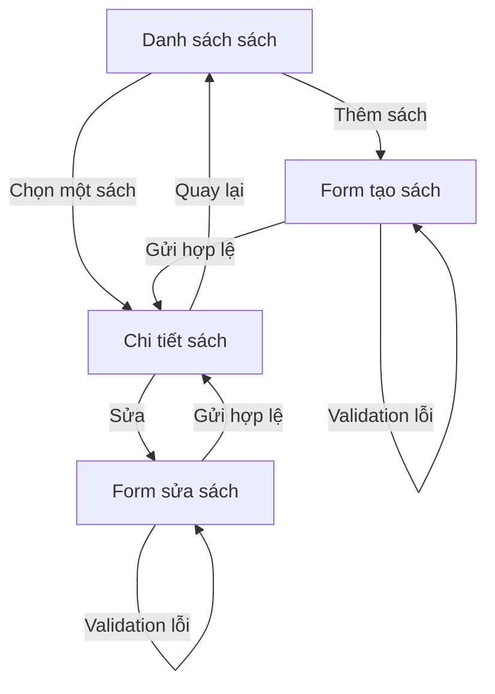
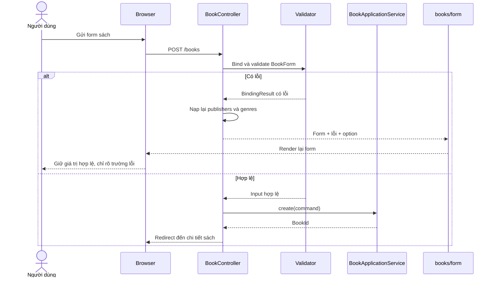
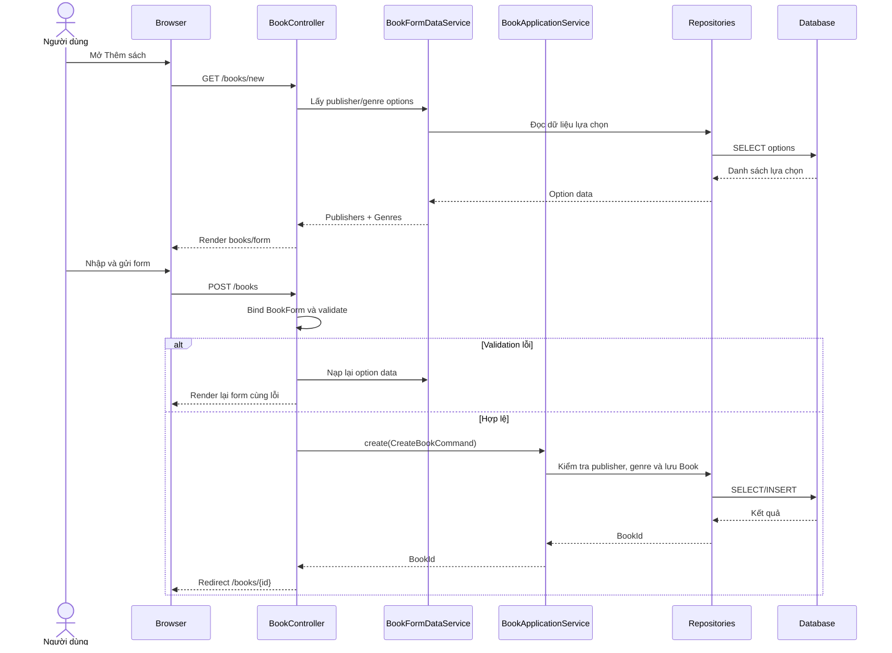

# Xác định View, dữ liệu biểu mẫu và dữ liệu trình bày

Trong ứng dụng quản lý sách theo kiến trúc **MODEL_VIEW_CONTROLLER (MVC)**, mỗi màn hình cần dữ liệu khác nhau và mỗi biểu mẫu chỉ nên nhận những trường mà người dùng được phép nhập. Trang danh sách cần tiêu đề, tác giả, thể loại và thông tin phân trang; trang chi tiết cần thêm mô tả, nhà xuất bản và ngày xuất bản; biểu mẫu tạo hoặc sửa sách cần các trường nhập cùng danh sách lựa chọn như thể loại và nhà xuất bản.

Nếu dùng một đối tượng `Book` cho mọi mục đích, ứng dụng dễ trộn dữ liệu nghiệp vụ, dữ liệu nhận từ form và dữ liệu chỉ phục vụ giao diện. Điều đó có thể khiến form nhận cả trường nội bộ như `status`, `createdAt` hoặc `approvedBy`; View phải tự định dạng dữ liệu; hoặc Controller phải nạp nhiều thông tin không cần thiết.

Bài học này dùng ví dụ quản lý sách để xác định ba nhóm dữ liệu: **dữ liệu nghiệp vụ của sách**, **dữ liệu biểu mẫu đầu vào**, và **dữ liệu trình bày cho View**. Từ đó, ta chọn các View phù hợp, thiết kế Form Object và ViewModel, rồi tổ chức luồng Controller – Application Service – Repository – View trong ứng dụng Spring MVC.

## 1. Xác định các màn hình theo công việc của người dùng

Trước khi thiết kế class hoặc template, hãy xác định người dùng cần làm gì. Với chức năng quản lý sách cơ bản, có thể bắt đầu bằng các màn hình sau:

| View | Mục đích | Dữ liệu chính cần hiển thị |
|---|---|---|
| Danh sách sách | Duyệt, tìm kiếm và lọc sách | Mã sách, tiêu đề, tác giả, thể loại, trạng thái hiển thị, phân trang |
| Chi tiết sách | Xem đầy đủ thông tin một cuốn sách | ISBN, tiêu đề, tác giả, nhà xuất bản, ngày xuất bản, mô tả, thể loại |
| Tạo sách | Nhập thông tin để thêm sách mới | Các trường được phép nhập và lựa chọn thể loại/nhà xuất bản |
| Sửa sách | Chỉnh sửa thông tin sách hiện có | Form đã điền dữ liệu hiện tại và các lựa chọn liên quan |
| Kết quả thao tác | Thông báo sau khi tạo/sửa/xóa | Thông báo, mã sách hoặc đường dẫn đến chi tiết |

Một số ứng dụng có thể thêm View nhập kho, quản lý bản sao, lịch sử mượn hoặc phê duyệt. Không nên tạo một View riêng cho mỗi endpoint một cách máy móc. Hãy tạo View theo công việc và thông tin mà người dùng cần; một View có thể được phục vụ bởi nhiều request, ví dụ GET để hiển thị form và POST để xử lý submit rồi render lại khi lỗi.

### Sơ đồ điều hướng cơ bản



## 2. Phân biệt ba nhóm dữ liệu

Trong ví dụ này, cần tách rõ dữ liệu nghiệp vụ, dữ liệu biểu mẫu và dữ liệu trình bày.

### Dữ liệu nghiệp vụ (Book Domain Data)

Đây là dữ liệu mô tả sách trong hệ thống và chịu sự quản lý của quy tắc nghiệp vụ. Ví dụ:

- `BookId`: định danh sách.
- `ISBN`: mã định danh xuất bản, nếu nghiệp vụ yêu cầu.
- `title`: tiêu đề sách.
- `author`: tác giả hoặc danh sách tác giả.
- `publisherId`: nhà xuất bản liên quan.
- `genreId`: thể loại.
- `publicationDate`: ngày xuất bản.
- `description`: mô tả nội dung.
- `status`: trạng thái nghiệp vụ như bản nháp, đang lưu hành hoặc ngừng phát hành.
- `createdAt`, `updatedAt`: thời điểm hệ thống ghi nhận.

Không phải mọi trường đều được người dùng nhập. `BookId`, `createdAt`, `updatedAt` thường do hệ thống quản lý. `status` có thể được thay đổi bởi một use case riêng hoặc một người có quyền, chứ không nhất thiết được nhận từ form tạo/sửa thông thường.

### Dữ liệu biểu mẫu (Form/Input Data)

Đây là dữ liệu mà người dùng gửi từ trình duyệt. Ví dụ form tạo sách có thể nhận:

- ISBN.
- Tiêu đề.
- Tên tác giả hoặc danh sách tác giả theo hợp đồng form.
- Nhà xuất bản được chọn.
- Thể loại được chọn.
- Ngày xuất bản.
- Mô tả.

Form Object biểu diễn đúng tập trường được phép nhập cho một thao tác. Form tạo sách và form sửa sách có thể dùng chung cấu trúc nếu các trường và quy tắc giống nhau; nếu khác nhau đáng kể, hãy dùng hai Form Object riêng.

### Dữ liệu trình bày (Presentation Data)

Đây là dữ liệu đã được chuẩn bị để View hiển thị. Ví dụ:

- Tên thể loại thay cho `genreId`.
- Tên nhà xuất bản thay cho `publisherId`.
- Ngày xuất bản theo định dạng `dd/MM/yyyy` hoặc locale người dùng.
- Trạng thái đã chuyển thành nhãn “Đang lưu hành”.
- URL ảnh bìa.
- Danh sách sách đã lọc, sắp xếp và phân trang.
- Danh sách lựa chọn cho dropdown thể loại/nhà xuất bản.
- Cờ hiển thị hành động như `canEdit` hoặc `showDeleteAction`.

Presentation Data không nhất thiết là một bản sao của entity. Nó có thể kết hợp dữ liệu từ nhiều nguồn, bỏ trường nội bộ và định dạng theo ngữ cảnh của View.

### Bảng so sánh

| Tiêu chí | Dữ liệu nghiệp vụ | Dữ liệu biểu mẫu | Dữ liệu trình bày |
|---|---|---|---|
| Mục đích | Mô tả trạng thái sách trong hệ thống | Nhận ý định và thông tin người dùng nhập | Hiển thị thông tin đúng nhu cầu View |
| Ví dụ | `Book`, `ISBN`, `BookStatus` | `BookForm`, `CreateBookRequest` | `BookListItemViewModel`, `BookDetailViewModel` |
| Nguồn | Domain/application và persistence | HTTP form/request | Query service và presentation mapper |
| Quyền sở hữu | Quy tắc nghiệp vụ và hệ thống | Client gửi nhưng server xác minh | Server chuẩn bị theo View và quyền |
| Có thể thay đổi theo View? | Thường không | Có thể khác theo thao tác | Có, theo nhu cầu từng View |
| Có được dùng làm nguồn sự thật? | Có, theo mô hình và persistence có thẩm quyền | Không | Không |

## 3. Không bind trực tiếp form vào Book Entity

Một cách làm dễ bắt đầu nhưng có rủi ro là bind request trực tiếp vào entity:

```java
@PostMapping("/books")
String create(@ModelAttribute Book book) {
    bookRepository.save(book);
    return "redirect:/books";
}
```

Vấn đề là entity có thể chứa những thuộc tính mà form không được quyền thay đổi, chẳng hạn `id`, `status`, `createdAt`, `createdBy` hoặc `archived`. Client có thể tự thêm các trường đó vào request, kể cả khi giao diện không hiển thị chúng. Nếu binder cập nhật các thuộc tính này, ứng dụng có thể gặp mass assignment.

Ngoài ra, entity thường có quan hệ persistence, proxy lazy hoặc trường phục vụ nghiệp vụ mà View không cần. Dùng cùng một object cho HTTP binding, domain behavior và persistence làm các thay đổi ở một nơi dễ ảnh hưởng nơi khác.

Hãy tạo Form Object chỉ chứa trường đầu vào được phép. Controller chuyển Form Object thành Command; application service tải dữ liệu có thẩm quyền và tạo/cập nhật `Book` thông qua hành vi miền.

## 4. Thiết kế Form Object cho tạo và sửa sách

Ví dụ dùng Java record để minh họa Form Object:

```java
public record BookForm(
        @NotBlank(message = "Vui lòng nhập ISBN")
        @Size(max = 20, message = "ISBN không được vượt quá 20 ký tự")
        String isbn,

        @NotBlank(message = "Vui lòng nhập tiêu đề sách")
        @Size(max = 200, message = "Tiêu đề không được vượt quá 200 ký tự")
        String title,

        @NotBlank(message = "Vui lòng nhập tên tác giả")
        @Size(max = 160)
        String authorName,

        @NotNull(message = "Vui lòng chọn nhà xuất bản")
        UUID publisherId,

        @NotNull(message = "Vui lòng chọn thể loại")
        UUID genreId,

        @DateTimeFormat(iso = DateTimeFormat.ISO.DATE)
        LocalDate publicationDate,

        @Size(max = 4000)
        String description
) {
    public static BookForm empty() {
        return new BookForm("", "", "", null, null, null, "");
    }
}
```

Các giới hạn trên là ví dụ, cần điều chỉnh theo quy tắc của sản phẩm và dữ liệu thực tế. Ví dụ ISBN có thể có quy tắc chuẩn hóa/kiểm tra checksum riêng; ngày xuất bản có thể được phép bỏ trống hoặc có giới hạn thời gian theo nghiệp vụ.

Form không chứa `id`, `status`, `createdAt` hoặc `createdBy`. Khi sửa, `id` được lấy từ path variable; người thực hiện được lấy từ ngữ cảnh xác thực; trạng thái được quản lý qua use case riêng nếu cần.

### Tạo và sửa có cần hai Form Object?

Có thể dùng chung `BookForm` nếu cả hai thao tác có cùng trường và quy tắc. Nhưng nếu tạo mới yêu cầu ISBN bắt buộc trong khi sửa cho phép giữ ISBN cũ, hoặc sửa có thêm trường ghi chú nội bộ, nên tách `CreateBookForm` và `UpdateBookForm` để hợp đồng rõ ràng.

Đừng dùng một form chung chỉ vì hai màn hình trông giống nhau. Hãy xem xét quyền, vòng đời và quy tắc của từng use case.

## 5. Dữ liệu phụ trợ cho biểu mẫu

Form sách không chỉ có dữ liệu người dùng nhập. Các trường lựa chọn thường cần dữ liệu phụ trợ từ server:

- Danh sách thể loại còn được sử dụng.
- Danh sách nhà xuất bản đang hoạt động.
- Các giá trị mặc định hoặc lựa chọn gần đây.
- Thông tin hướng dẫn, đơn vị hoặc định dạng.

Ví dụ `BookFormPageViewModel`:

```java
public record SelectOption(UUID value, String label) {}

public record BookFormPageViewModel(
        BookForm form,
        List<SelectOption> publishers,
        List<SelectOption> genres,
        String pageTitle,
        String submitLabel
) {}
```

Ở đây:

- `form` chứa dữ liệu người dùng nhập hoặc giá trị ban đầu.
- `publishers` và `genres` cung cấp các lựa chọn cho dropdown.
- `pageTitle` và `submitLabel` phục vụ hiển thị.

Trong Spring MVC, có thể đưa từng thuộc tính vào `Model` thay vì tạo record bao ngoài. Dùng một ViewModel giúp gom dữ liệu của View thành hợp đồng rõ ràng, đặc biệt khi form có nhiều dữ liệu phụ trợ.

### Dữ liệu lựa chọn không phải dữ liệu đầu vào đáng tin cậy

Trình duyệt gửi `publisherId` hoặc `genreId` từ lựa chọn hiện tại, nhưng người dùng có thể sửa request thủ công. Application service phải kiểm tra ID có tồn tại, đang hoạt động và người dùng có quyền sử dụng trong ngữ cảnh hiện tại không. Không tin rằng một option từng xuất hiện trong dropdown thì chắc chắn hợp lệ tại thời điểm submit.

## 6. Xác định ViewModel cho từng màn hình

Mỗi View nên nhận dữ liệu vừa đủ cho công việc của nó. Ví dụ:

### Book List ViewModel

```java
public record BookListItemViewModel(
        UUID id,
        String isbn,
        String title,
        String authorName,
        String genreName,
        String statusLabel,
        boolean canEdit
) {}

public record BookListViewModel(
        List<BookListItemViewModel> items,
        String keyword,
        UUID selectedGenreId,
        List<SelectOption> genres,
        int page,
        int totalPages,
        long totalItems
) {}
```

Danh sách không cần toàn bộ mô tả, lịch sử thay đổi hoặc quan hệ persistence của từng sách. Query service có thể trả projection chứa đúng các cột cần hiển thị.

### Book Detail ViewModel

```java
public record BookDetailViewModel(
        UUID id,
        String isbn,
        String title,
        String authorName,
        String publisherName,
        String genreName,
        String publicationDateText,
        String description,
        String statusLabel,
        String coverImageUrl,
        boolean canEdit,
        boolean canArchive
) {}
```

Trang chi tiết cần nhiều thông tin hơn danh sách. Những trường `canEdit` và `canArchive` chỉ quyết định giao diện có hiển thị hành động hay không. Backend vẫn phải kiểm tra quyền và trạng thái khi nhận request.

### Book Form Page ViewModel

```java
public record BookFormPageViewModel(
        BookForm form,
        List<SelectOption> publishers,
        List<SelectOption> genres,
        String heading,
        String submitLabel,
        boolean editing
) {}
```

Form View cần giá trị ban đầu, lựa chọn và nhãn hành động. Nó không cần nhận toàn bộ `Book` entity.

## 7. Ma trận dữ liệu theo từng View

Ma trận giúp phát hiện dữ liệu nào cần được truy vấn, dữ liệu nào người dùng nhập và dữ liệu nào chỉ dùng để hiển thị.

| Dữ liệu | Danh sách | Chi tiết | Form tạo | Form sửa |
|---|---:|---:|---:|---:|
| ID sách | Có | Có | Không | Lấy từ URL |
| ISBN | Có | Có | Input | Input ban đầu |
| Tiêu đề | Có | Có | Input | Input ban đầu |
| Tác giả | Có | Có | Input | Input ban đầu |
| Tên nhà xuất bản | Có | Có | Option label | Option label |
| `publisherId` | Có thể cần cho filter | Có thể cần cho link | Input selection | Input selection |
| Tên thể loại | Có | Có | Option label | Option label |
| `genreId` | Có thể cần cho filter | Có thể cần cho link | Input selection | Input selection |
| Ngày xuất bản | Có thể rút gọn | Có | Input | Input ban đầu |
| Mô tả | Thường không | Có | Input | Input ban đầu |
| Trạng thái nghiệp vụ | Nhãn | Nhãn | Không nhận mặc định | Không nhận mặc định |
| `createdAt`/`updatedAt` | Không | Có thể hiển thị | Không | Không |
| Phân trang | Có | Không | Không | Không |
| Lỗi theo trường | Không | Không | Khi submit lỗi | Khi submit lỗi |
| Danh sách thể loại/nhà xuất bản | Filter option | Không nhất thiết | Có | Có |

Ký hiệu “có thể” tùy nhu cầu sản phẩm. Ví dụ danh sách có thể dùng `genreId` trong filter URL nhưng chỉ hiển thị `genreName`.

## 8. Tổ chức Controller cho các View

Một `BookController` có thể xử lý các route liên quan đến sách. Controller chuẩn bị dữ liệu trình bày và chuyển form thành lời gọi use case; nó không tự thực hiện quy tắc nghiệp vụ.

| HTTP | Route | Mục đích | View/Response |
|---|---|---|---|
| GET | `/books` | Xem và tìm kiếm danh sách | `books/list` |
| GET | `/books/{id}` | Xem chi tiết | `books/detail` |
| GET | `/books/new` | Hiển thị form tạo | `books/form` |
| POST | `/books` | Xử lý tạo mới | Redirect hoặc render form lỗi |
| GET | `/books/{id}/edit` | Hiển thị form sửa | `books/form` |
| POST | `/books/{id}` | Xử lý cập nhật | Redirect hoặc render form lỗi |

Đây là route server-rendered minh họa. API JSON có thể dùng route và response DTO khác, nhưng vẫn nên giữ input/output contract tách khỏi Domain Entity.

### Controller minh họa

```java
@Controller
@RequestMapping("/books")
class BookController {

    private final BookQueryService queries;
    private final BookApplicationService books;
    private final BookFormDataService formData;
    private final CurrentUser currentUser;

    BookController(
            BookQueryService queries,
            BookApplicationService books,
            BookFormDataService formData,
            CurrentUser currentUser) {
        this.queries = queries;
        this.books = books;
        this.formData = formData;
        this.currentUser = currentUser;
    }

    @GetMapping("/new")
    String newBook(Model model) {
        model.addAttribute("form", BookForm.empty());
        addFormOptions(model);
        model.addAttribute("formAction", "/books");
        model.addAttribute("pageTitle", "Thêm sách mới");
        model.addAttribute("submitLabel", "Tạo sách");
        return "books/form";
    }

    @PostMapping
    String create(
            @Valid @ModelAttribute("form") BookForm form,
            BindingResult errors,
            Model model,
            RedirectAttributes flash) {

        if (errors.hasErrors()) {
            addFormOptions(model);
            model.addAttribute("formAction", "/books");
            model.addAttribute("pageTitle", "Thêm sách mới");
            model.addAttribute("submitLabel", "Tạo sách");
            return "books/form";
        }

        BookId id = books.create(BookFormMapper.toCreateCommand(
                form, currentUser.userId()));
        flash.addFlashAttribute("notice", "Đã tạo sách thành công.");
        return "redirect:/books/" + id.value();
    }

    @GetMapping("/{id}/edit")
    String edit(@PathVariable UUID id, Model model) {
        BookEditData data = queries.getForEdit(new BookId(id), currentUser.userId());
        model.addAttribute("form", BookFormMapper.toForm(data));
        addFormOptions(model);
        model.addAttribute("formAction", "/books/" + id);
        model.addAttribute("pageTitle", "Chỉnh sửa sách");
        model.addAttribute("submitLabel", "Lưu thay đổi");
        return "books/form";
    }

    @PostMapping("/{id}")
    String update(
            @PathVariable UUID id,
            @Valid @ModelAttribute("form") BookForm form,
            BindingResult errors,
            Model model,
            RedirectAttributes flash) {

        if (errors.hasErrors()) {
            addFormOptions(model);
            model.addAttribute("formAction", "/books/" + id);
            model.addAttribute("pageTitle", "Chỉnh sửa sách");
            model.addAttribute("submitLabel", "Lưu thay đổi");
            return "books/form";
        }

        books.update(new BookId(id), BookFormMapper.toUpdateCommand(
                form, currentUser.userId()));
        flash.addFlashAttribute("notice", "Đã cập nhật sách.");
        return "redirect:/books/" + id;
    }

    private void addFormOptions(Model model) {
        model.addAttribute("publishers", formData.publisherOptions());
        model.addAttribute("genres", formData.genreOptions());
    }
}
```

Đây là ví dụ minh họa cấu trúc; mapper, query service, `CurrentUser` và application service là các thành phần cần được định nghĩa theo dự án. Điểm chính là Controller chỉ điều phối request, giữ dữ liệu form khi validation lỗi, nạp lại option và gọi use case khi input hợp lệ.

Trong Spring MVC, `BindingResult` phải đặt ngay sau tham số `@Valid` tương ứng. Nếu đặt sai vị trí, framework có thể ném exception thay vì cho Controller xử lý lỗi form như dự kiến.

## 9. View dùng Form Object và dữ liệu lựa chọn

Ví dụ template Thymeleaf cho form tạo/sửa:

```html
<form th:action="${formAction}" th:object="${form}" method="post">
  <h1 th:text="${pageTitle}">Thêm sách mới</h1>

  <label for="isbn">ISBN</label>
  <input id="isbn" type="text" th:field="*{isbn}">
  <p th:if="${#fields.hasErrors('isbn')}"
     th:errors="*{isbn}">Lỗi ISBN</p>

  <label for="title">Tiêu đề</label>
  <input id="title" type="text" th:field="*{title}">
  <p th:if="${#fields.hasErrors('title')}"
     th:errors="*{title}">Lỗi tiêu đề</p>

  <label for="authorName">Tác giả</label>
  <input id="authorName" type="text" th:field="*{authorName}">

  <label for="publisherId">Nhà xuất bản</label>
  <select id="publisherId" th:field="*{publisherId}">
    <option value="">-- Chọn nhà xuất bản --</option>
    <option th:each="publisher : ${publishers}"
            th:value="${publisher.value}"
            th:text="${publisher.label}"></option>
  </select>

  <label for="genreId">Thể loại</label>
  <select id="genreId" th:field="*{genreId}">
    <option value="">-- Chọn thể loại --</option>
    <option th:each="genre : ${genres}"
            th:value="${genre.value}"
            th:text="${genre.label}"></option>
  </select>

  <label for="publicationDate">Ngày xuất bản</label>
  <input id="publicationDate" type="date" th:field="*{publicationDate}">

  <label for="description">Mô tả</label>
  <textarea id="description" th:field="*{description}"></textarea>

  <button type="submit" th:text="${submitLabel}">Lưu</button>
</form>
```

Template không cần biết `Book` được lưu bằng JPA hay database nào. Nó chỉ biết hợp đồng `form`, `publishers`, `genres`, `pageTitle` và `submitLabel`.

### Tạo và sửa dùng chung template

Có thể truyền `formAction` hoặc dùng route khác nhau cho create/update. Ví dụ trên minh họa form tạo; form sửa cần action `/books/{id}`. Có thể thêm `formAction` vào ViewModel và dùng `th:action` theo giá trị đã chuẩn bị, hoặc tạo hai template nhỏ dùng chung fragment form. Hãy chọn cách dễ đọc, tránh ghép URL tùy tiện từ dữ liệu không tin cậy.

## 10. Giữ dữ liệu form khi validation thất bại

Khi người dùng nhập sai một trường, ứng dụng nên giữ lại các trường hợp lệ để họ sửa tiếp. Trong Spring MVC, `BindingResult` lưu lỗi binding/validation cùng giá trị đã bind. Khi render lại form, Controller phải nạp lại dữ liệu phụ trợ như danh sách thể loại và nhà xuất bản.

Luồng xử lý:



Không nên lưu lại mọi trường một cách máy móc. Nếu form có mật khẩu, token, dữ liệu nhạy cảm hoặc thông tin thanh toán, cần xóa hoặc xử lý riêng khi render lại. Trong form quản lý sách, ISBN và tiêu đề có thể giữ; các trường nội bộ như trạng thái phê duyệt không nên xuất hiện trong form nếu người dùng không được phép chỉnh sửa.

## 11. Chuyển Form Object thành Command

Form Object phản ánh giao diện nhập liệu. Command phản ánh ý định ứng dụng. Hai cấu trúc có thể giống nhau lúc đầu nhưng không bắt buộc giống nhau.

```java
public record CreateBookCommand(
        String isbn,
        String title,
        String authorName,
        PublisherId publisherId,
        GenreId genreId,
        LocalDate publicationDate,
        String description,
        UserId actorId
) {}

public record UpdateBookCommand(
        String isbn,
        String title,
        String authorName,
        PublisherId publisherId,
        GenreId genreId,
        LocalDate publicationDate,
        String description,
        UserId actorId
) {}
```

Mapper chuyển đổi:

```java
public final class BookFormMapper {
    private BookFormMapper() {}

    public static CreateBookCommand toCreateCommand(
            BookForm form, UserId actorId) {
        return new CreateBookCommand(
                form.isbn().trim(),
                form.title().trim(),
                form.authorName().trim(),
                new PublisherId(form.publisherId()),
                new GenreId(form.genreId()),
                form.publicationDate(),
                form.description(),
                actorId);
    }

    public static UpdateBookCommand toUpdateCommand(
            BookForm form, UserId actorId) {
        return new UpdateBookCommand(
                form.isbn().trim(),
                form.title().trim(),
                form.authorName().trim(),
                new PublisherId(form.publisherId()),
                new GenreId(form.genreId()),
                form.publicationDate(),
                form.description(),
                actorId);
    }
}
```

Trong Controller thực tế, truyền `actorId` vào mapper hoặc tạo command tại handler sau khi lấy người dùng hiện tại. Không lấy `actorId` từ form. Nếu có chuẩn hóa ISBN hoặc title quan trọng với miền, Domain Value Object/Factory nên bảo vệ quy tắc đó; mapper chỉ nên làm chuyển đổi ở ranh giới.

## 12. Application Service tạo và cập nhật sách

Application Service điều phối use case. Nó tải publisher và genre có thẩm quyền, kiểm tra quyền và tạo/cập nhật Domain Model.

```java
@Service
class BookApplicationService {

    private final BookRepository books;
    private final PublisherRepository publishers;
    private final GenreRepository genres;
    private final BookPermissionPolicy permissions;

    BookApplicationService(
            BookRepository books,
            PublisherRepository publishers,
            GenreRepository genres,
            BookPermissionPolicy permissions) {
        this.books = books;
        this.publishers = publishers;
        this.genres = genres;
        this.permissions = permissions;
    }

    @Transactional
    public BookId create(CreateBookCommand command) {
        permissions.checkCanCreate(command.actorId());

        Publisher publisher = publishers.findActiveById(command.publisherId())
                .orElseThrow(PublisherNotAvailableException::new);
        Genre genre = genres.findActiveById(command.genreId())
                .orElseThrow(GenreNotAvailableException::new);

        Book book = Book.create(
                new ISBN(command.isbn()),
                command.title(),
                command.authorName(),
                publisher.id(),
                genre.id(),
                command.publicationDate(),
                command.description());

        return books.save(book).id();
    }
}
```

Đây là ví dụ khung; các kiểu ID, factory, repository và policy cần được định nghĩa. Kiểm tra ISBN trùng lặp cần được bảo vệ bằng truy vấn và ràng buộc unique phù hợp trong database để xử lý request đồng thời. Kiểm tra ở form một mình không đủ bảo đảm tính duy nhất.

Với update, application service cần tải `Book` hiện tại, kiểm tra quyền sửa, kiểm tra publisher/genre còn hợp lệ, rồi gọi hành vi cập nhật trên Model. Không tạo entity mới từ form rồi ghi đè toàn bộ trạng thái, vì có thể làm mất `status`, metadata hoặc các trường do hệ thống quản lý.

## 13. Query Service chuẩn bị dữ liệu trình bày

Query Service có thể trả dữ liệu khác nhau cho list, detail và edit form.

```java
public interface BookQueryService {
    BookListViewModel search(BookSearchCriteria criteria);
    BookDetailViewModel getDetail(BookId id, UserId viewer);
    BookEditData getForEdit(BookId id, UserId editor);
}
```

Ví dụ:

- `search()` trả các dòng sách ngắn gọn, tên thể loại, trạng thái hiển thị và phân trang.
- `getDetail()` trả dữ liệu chi tiết cùng các cờ hiển thị hành động theo quyền.
- `getForEdit()` trả các trường có thể chỉnh sửa, không trả các trường nội bộ không thuộc form.

Query có thể dùng projection để chỉ tải cột cần thiết. Với trang danh sách, không cần tải toàn bộ entity graph nếu chỉ hiển thị tiêu đề, tác giả và thể loại. Với trang chi tiết, có thể tải thêm mô tả và nhà xuất bản.

### Dữ liệu hiển thị cần định dạng ở đâu?

Có thể định dạng ngày, tiền tệ hoặc nhãn trạng thái trong presentation mapper/formatter. Domain giữ kiểu dữ liệu có ý nghĩa như `LocalDate`, `Money` và `BookStatus`; ViewModel có thể cung cấp `publicationDateText` hoặc `statusLabel`. Không lưu chuỗi ngày đã định dạng làm dữ liệu nghiệp vụ vì locale và cách hiển thị có thể thay đổi.

## 14. Tổ chức template cho danh sách, chi tiết và form

Một cấu trúc template có thể như sau:

```text
templates/
└── books/
    ├── list.html
    ├── detail.html
    ├── form.html
    └── fragments/
        ├── form-fields.html
        └── messages.html
```

`list.html` dùng `BookListViewModel`; `detail.html` dùng `BookDetailViewModel`; `form.html` dùng Form Object cùng option data. Fragment có thể tái sử dụng phần nhập ISBN, tiêu đề, tác giả hoặc phần hiển thị thông báo.

Không nên đưa toàn bộ logic chọn dữ liệu vào template. Template có thể lặp qua danh sách, hiển thị điều kiện đơn giản và định dạng presentation, nhưng query, authorization và business rule phải được xử lý trước ở server.

## 15. Luồng tạo sách hoàn chỉnh



Sơ đồ tập trung vào dữ liệu và trách nhiệm. Trong ứng dụng thực tế, transaction, kiểm tra quyền, lỗi ISBN trùng và concurrency cần được xử lý đầy đủ ở application/data layer.

## 16. Lỗi thường gặp khi thiết kế View và dữ liệu

### Dùng một Book Entity cho form, View và database

Form có thể nhận trường nội bộ; View có thể lộ quan hệ persistence; thay đổi schema có thể làm hỏng hợp đồng giao diện. Tách Form Object và ViewModel khi các trách nhiệm khác nhau.

### View tự truy vấn hoặc gọi repository

Template trở nên phụ thuộc database và có thể tạo N+1 query. Hãy chuẩn bị dữ liệu trước khi render.

### Form nhận `status`, `createdBy` hoặc `ownerId`

Client có thể sửa các trường đó. Chỉ nhận dữ liệu được phép và lấy giá trị do hệ thống quản lý từ nguồn có thẩm quyền.

### Không nạp lại option khi form lỗi

Dropdown bị rỗng sau validation thất bại. Hãy nạp lại publishers/genres trước khi render form.

### Dùng tên hiển thị thay cho ID trong form

Hai thể loại có thể trùng tên; tên có thể đổi. Dùng ID ổn định làm value và tên làm label, sau đó xác minh ID ở server.

### Dùng cùng ViewModel cho list và detail

Danh sách tải quá nhiều dữ liệu; chi tiết thiếu thông tin hoặc phải truy vấn bổ sung trong View. Tạo projection theo nhu cầu từng View.

### Dùng cờ `canEdit` làm cơ chế bảo mật

Ẩn nút sửa không ngăn request trực tiếp. Use case vẫn phải kiểm tra quyền.

### Chuyển tất cả logic vào Controller hoặc Mapper

Controller chỉ điều phối; mapper chuyển đổi representation. Quy tắc tạo, sửa, lưu hành hoặc lưu trữ sách thuộc application/domain.

## 17. Kiểm thử dữ liệu của từng View

Kiểm thử nên xác minh cả dữ liệu được cung cấp và dữ liệu không được phép xuất hiện.

| Phạm vi | Nội dung cần kiểm tra | Ví dụ |
|---|---|---|
| Book List Query | Chỉ lấy trường cần cho danh sách | Có title, author, genre; không tải description dài nếu không cần |
| Book Detail Query | Có đủ dữ liệu chi tiết | Publisher name và publication date đúng |
| Form GET | Có Form Object rỗng/giá trị ban đầu và options | Dropdown có genre/publisher hợp lệ |
| Form POST hợp lệ | Bind đúng trường và gọi use case | ISBN, title, publisherId được chuyển đúng |
| Form POST lỗi | Giữ input hợp lệ và lỗi theo field | Title còn nguyên, lỗi ISBN hiển thị |
| Mass assignment | Bỏ qua/từ chối field ngoài hợp đồng | `status=ARCHIVED` không thể gửi qua form tạo |
| Authorization | View và use case tuân theo quyền | Người không có quyền không thể sửa dù gọi URL trực tiếp |
| Response mapper | Chỉ trả dữ liệu được phép | Không có `createdBy` hoặc thông tin nội bộ |

### Ví dụ kiểm thử Controller với MockMvc

```java
@WebMvcTest(BookController.class)
class BookControllerTest {

    @Autowired
    MockMvc mockMvc;

    @MockitoBean
    BookQueryService queries;

    @MockitoBean
    BookApplicationService books;

    @MockitoBean
    BookFormDataService formData;

    @MockitoBean
    CurrentUser currentUser;

    @Test
    @WithMockUser
    void newBookPageProvidesEmptyFormAndOptions() throws Exception {
        given(formData.publisherOptions()).willReturn(List.of());
        given(formData.genreOptions()).willReturn(List.of());

        mockMvc.perform(get("/books/new"))
                .andExpect(status().isOk())
                .andExpect(view().name("books/form"))
                .andExpect(model().attributeExists("form", "publishers", "genres"));
    }

    @Test
    @WithMockUser
    void invalidFormIsRenderedAgainWithOptions() throws Exception {
        given(formData.publisherOptions()).willReturn(List.of());
        given(formData.genreOptions()).willReturn(List.of());

        mockMvc.perform(post("/books")
                        .with(csrf())
                        .param("isbn", "")
                        .param("title", "")
                        .param("authorName", ""))
                .andExpect(status().isOk())
                .andExpect(view().name("books/form"))
                .andExpect(model().attributeHasFieldErrors("form", "isbn", "title"))
                .andExpect(model().attributeExists("publishers", "genres"));

        then(books).shouldHaveNoInteractions();
    }
}
```

Ví dụ giả định Spring Security được bật và CSRF áp dụng cho POST form. Các bean được mock để tập trung vào hành vi Controller; test use case và repository cần được thực hiện riêng. `@MockitoBean` có sẵn ở các phiên bản Spring mới; với dự án cũ hơn, dùng annotation mock bean tương ứng của phiên bản đang sử dụng.

### Kiểm thử Mapper

Test mapper cần xác minh:

- `BookStatus.ACTIVE` được chuyển thành nhãn đúng theo locale.
- `LocalDate` được định dạng theo quy ước hiển thị.
- ID được giữ chính xác trong link hoặc option value.
- Trường nhạy cảm/nội bộ không xuất hiện trong ViewModel công khai.
- Cờ `canEdit` được tính theo quyền đã xác minh, nhưng use case vẫn kiểm tra lại khi thực thi.

## 18. Quy trình thiết kế View và dữ liệu cho chức năng mới

Khi thêm một màn hình quản lý sách hoặc một chức năng tương tự, hãy thực hiện theo trình tự:

1. **Xác định công việc người dùng:** xem danh sách, xem chi tiết, tạo, sửa hay thay đổi trạng thái?
2. **Liệt kê View:** mỗi công việc cần màn hình hoặc response nào?
3. **Liệt kê trường cần hiển thị:** dữ liệu nào thực sự cần cho View?
4. **Liệt kê trường được nhập:** client được phép gửi những giá trị nào?
5. **Phân biệt dữ liệu do hệ thống quản lý:** ID, owner, status, timestamp và audit field.
6. **Thiết kế Form Object:** kiểu dữ liệu, giới hạn, validation và nested input.
7. **Xác định dữ liệu phụ trợ:** option list, filter, lookup và mặc định.
8. **Thiết kế ViewModel:** dữ liệu hiển thị, nhãn, phân trang và action visibility.
9. **Tạo use case:** command/query và quy tắc nghiệp vụ tương ứng.
10. **Chọn query/persistence:** projection phù hợp, tránh tải thừa và bảo vệ concurrency.
11. **Xử lý lỗi và bảo mật:** giữ form an toàn, kiểm tra quyền, không tin ID từ client.
12. **Viết test:** xác minh input, output, trường bị cấm và từng trạng thái View.

## 19. Checklist trước khi hoàn tất

- [ ] Đã xác định các View theo công việc của người dùng.
- [ ] Mỗi View có danh sách dữ liệu cần hiển thị rõ ràng.
- [ ] Form Object chỉ chứa trường người dùng được phép nhập.
- [ ] Trường hệ thống như ID, status, owner và timestamp không bị bind tùy tiện.
- [ ] Dữ liệu phụ trợ cho dropdown/filter được nạp đầy đủ.
- [ ] Giá trị form được giữ an toàn khi validation thất bại.
- [ ] ViewModel không phơi bày entity graph hoặc dữ liệu nội bộ.
- [ ] Query chỉ tải dữ liệu cần cho View.
- [ ] Controller không chứa quy tắc nghiệp vụ hoặc truy vấn persistence trực tiếp.
- [ ] Use case xác minh quyền và dữ liệu có thẩm quyền.
- [ ] Template chỉ trình bày dữ liệu đã chuẩn bị.
- [ ] Test bao phủ View thành công, form lỗi, mass assignment và quyền truy cập.

## Kết luận

Trong ví dụ quản lý sách, cần xác định View theo công việc: danh sách, chi tiết, tạo và sửa. Mỗi View có nhu cầu dữ liệu riêng. `Book` biểu diễn dữ liệu nghiệp vụ; `BookForm` nhận dữ liệu người dùng được phép nhập; dữ liệu phụ trợ cung cấp lựa chọn cho form; `BookListViewModel`, `BookDetailViewModel` và `BookFormPageViewModel` chuẩn bị dữ liệu để trình bày.

Controller nhận request, bind và validate Form Object, nạp lại option khi lỗi, chuyển input thành Command và gọi Application Service. Use case kiểm tra quyền, tải publisher/genre có thẩm quyền và thay đổi Domain Model; Query Service chuẩn bị projection phù hợp; View chỉ render dữ liệu đã được cung cấp. Tách các nhóm dữ liệu này giúp tránh mass assignment, giảm truy vấn dư thừa, giữ hợp đồng giao diện rõ ràng và làm cho ứng dụng MVC dễ kiểm thử, bảo trì hơn.
