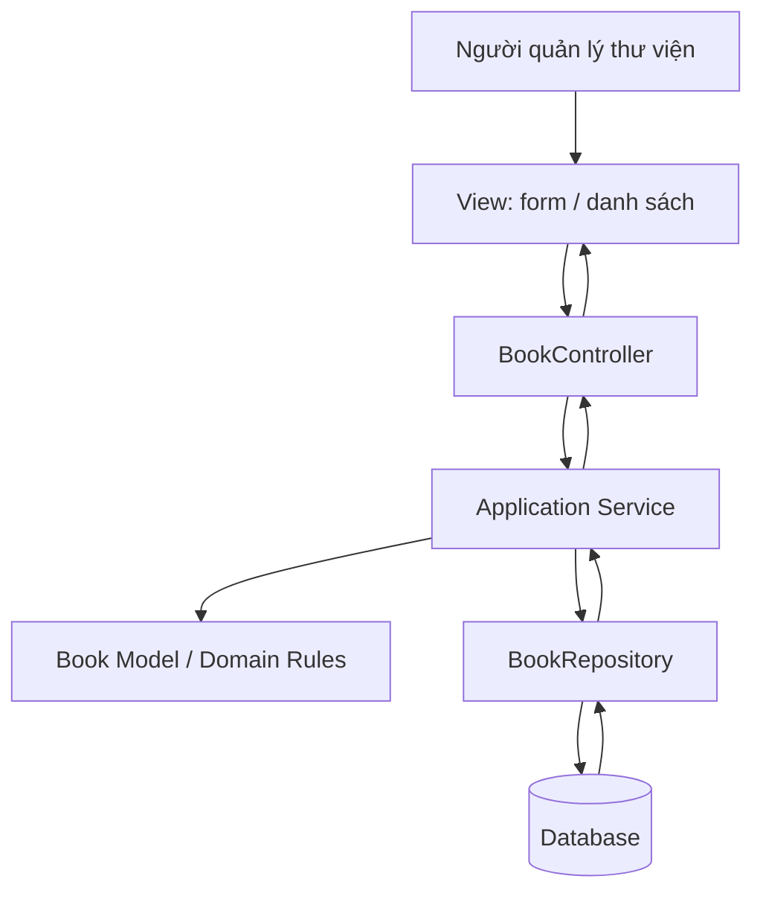
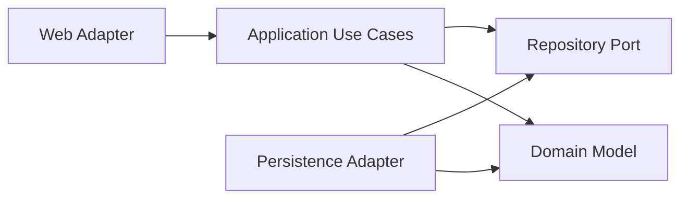

# Tổ chức dịch vụ ứng dụng và kho lưu trữ

Trong ví dụ quản lý sách, Controller nhận request từ người dùng, View hiển thị biểu mẫu hoặc danh sách, còn Model giữ trạng thái và quy tắc của sách. Để ba phần này không phụ thuộc trực tiếp vào database hoặc vào nhau, ứng dụng cần hai thành phần phối hợp: **dịch vụ ứng dụng (application service)** và **kho lưu trữ (repository)**.

Các đoạn Java bên dưới minh họa cấu trúc Spring MVC/JPA và lược bỏ import, khai báo exception cùng cấu hình không liên quan trực tiếp. Hãy xem chúng như các mảnh ghép của cùng một ví dụ, không phải một dự án có thể biên dịch nguyên trạng chỉ bằng cách chép tất cả vào một file.

Dịch vụ ứng dụng thực hiện một ca sử dụng như thêm sách, chỉnh sửa thông tin, tìm kiếm hoặc lưu trữ một đầu sách. Nó điều phối các bước, xác định transaction, gọi quy tắc của Model và yêu cầu repository đọc/ghi dữ liệu. Repository cung cấp cách truy cập dữ liệu theo ngôn ngữ của miền quản lý sách, đồng thời che giấu chi tiết SQL, JPA hoặc hệ quản trị cơ sở dữ liệu.

Khi tổ chức đúng, Controller không cần tự gọi nhiều repository rồi ghép quy tắc nghiệp vụ; Model không cần biết HTTP; View không cần biết entity hoặc SQL. Các lớp có thể được kiểm thử riêng và thay đổi độc lập hơn.

## 1. Bối cảnh ví dụ quản lý sách

Giả sử ứng dụng quản lý một danh mục sách với các chức năng:

- Thêm một đầu sách bằng ISBN, tiêu đề, tác giả, thể loại và số bản ban đầu.
- Xem chi tiết một đầu sách.
- Chỉnh sửa thông tin mô tả.
- Tăng hoặc giảm số bản trong kho.
- Tìm kiếm và lọc danh sách sách.
- Lưu trữ một đầu sách ngừng kinh doanh hoặc không còn được sử dụng.

Một bản ghi sách có thể gồm:

| Thuộc tính | Ý nghĩa |
|---|---|
| `id` | Định danh nội bộ |
| `isbn` | Mã ISBN đã chuẩn hóa |
| `title` | Tiêu đề sách |
| `author` | Tác giả |
| `category` | Thể loại |
| `publishedYear` | Năm xuất bản |
| `totalCopies` | Tổng số bản được quản lý |
| `availableCopies` | Số bản hiện có thể sử dụng |
| `archived` | Sách đã được lưu trữ hay chưa |
| `version` | Phiên bản dùng cho optimistic locking |

Trong hệ thống thư viện thực tế, một đầu sách và từng bản sao vật lý thường là hai khái niệm khác nhau. Ví dụ này quản lý tồn kho đơn giản trên đầu sách để tập trung vào cách tổ chức application service và repository. Nếu cần quản lý mã vạch, tình trạng từng cuốn, người mượn và lịch sử mượn trả, nên mô hình hóa `BookCopy` và `Loan` riêng.

## 2. Phân chia trách nhiệm

Luồng xử lý nên có ranh giới rõ:



| Thành phần | Trách nhiệm | Ví dụ |
|---|---|---|
| Controller | Nhận request, bind input, gọi ca sử dụng và chọn response | `BookController` |
| Application service | Điều phối use case, transaction, authorization và kết quả ứng dụng | `CreateBookService` |
| Domain Model | Bảo vệ bất biến và thay đổi trạng thái hợp lệ | `Book.increaseStock()` |
| Repository | Đọc và lưu aggregate hoặc projection | `BookRepository` |
| View/Presenter | Hiển thị dữ liệu phù hợp với màn hình | `BookListView` |

Application service không nên trở thành nơi chứa toàn bộ quy tắc của sách. Nó điều phối ca sử dụng; quy tắc như số bản không âm, ISBN hợp lệ hoặc không thể tăng tồn kho bằng số âm nên được bảo vệ ở Model/domain. Repository không tự quyết định một cuốn sách có được lưu trữ hay không; nó chỉ thực hiện thao tác persistence theo yêu cầu.

## 3. Application service đại diện cho ca sử dụng

Một application service thường tập trung vào một hành động nghiệp vụ có ý nghĩa. Ví dụ:

- `CreateBookService`: thêm sách mới.
- `UpdateBookDetailsService`: chỉnh sửa thông tin sách.
- `AdjustBookStockService`: thay đổi số bản trong kho.
- `ArchiveBookService`: lưu trữ sách.
- `GetBookDetailsService`: lấy dữ liệu chi tiết.
- `SearchBooksService`: tìm kiếm danh mục.

Tên service nên phản ánh mục tiêu của người dùng hoặc hệ thống. Không nên tạo một `BookService` quá rộng với hàng chục phương thức không liên quan, khiến mọi Controller phụ thuộc vào cùng một lớp lớn.

### Command và result

Đầu vào của một lệnh tạo sách có thể được biểu diễn bằng command:

```java
public record CreateBookCommand(
    String isbn,
    String title,
    String author,
    String category,
    int publishedYear,
    int initialCopies
) {}

public record CreateBookResult(
    UUID bookId,
    String isbn
) {}

public interface CreateBookUseCase {
    CreateBookResult execute(CreateBookCommand command);
}
```

Command mô tả dữ liệu mà ca sử dụng cần. Nó không nên chứa `HttpServletRequest`, `Model`, `BindingResult`, `ResponseEntity` hoặc đối tượng của template engine. Form HTML có thể có cấu trúc khác command; Controller hoặc mapper chuyển form thành command trước khi gọi use case.

Result là dữ liệu ứng dụng trả về cho adapter. Nó không nhất thiết phải là ViewModel hoặc JSON response; mỗi giao diện có thể định dạng kết quả theo nhu cầu riêng.

## 4. Model bảo vệ quy tắc của sách

Model phải tự bảo vệ những điều kiện luôn đúng, kể cả khi một use case khác hoặc một tác vụ nền gọi nó.

Ví dụ một entity JPA có hành vi miền:

```java
@Entity
@Table(
    name = "books",
    uniqueConstraints = @UniqueConstraint(
        name = "uk_books_isbn",
        columnNames = "isbn"
    )
)
public class Book {
    @Id
    private UUID id;

    @Column(nullable = false, length = 20)
    private String isbn;

    @Column(nullable = false, length = 250)
    private String title;

    @Column(nullable = false, length = 160)
    private String author;

    @Column(nullable = false, length = 80)
    private String category;

    private int publishedYear;
    private int totalCopies;
    private int availableCopies;
    private boolean archived;

    @Version
    private long version;

    protected Book() {}

    public static Book create(
            String isbn,
            String title,
            String author,
            String category,
            int publishedYear,
            int initialCopies) {

        Book book = new Book();
        book.id = UUID.randomUUID();
        book.isbn = normalizeIsbn(isbn);
        book.reviseDetails(title, author, category, publishedYear);

        if (initialCopies < 0) {
            throw new InvalidBookDataException(
                "Số bản ban đầu không được âm"
            );
        }
        book.totalCopies = initialCopies;
        book.availableCopies = initialCopies;
        book.archived = false;
        return book;
    }

    public void reviseDetails(
            String title,
            String author,
            String category,
            int publishedYear) {
        ensureNotArchived();
        this.title = requireText(title, "Tiêu đề");
        this.author = requireText(author, "Tác giả");
        this.category = requireText(category, "Thể loại");

        int currentYear = Year.now().getValue();
        if (publishedYear < 1450 || publishedYear > currentYear) {
            throw new InvalidBookDataException("Năm xuất bản không hợp lệ");
        }
        this.publishedYear = publishedYear;
    }

    public void increaseStock(int quantity) {
        ensureNotArchived();
        if (quantity <= 0) {
            throw new InvalidStockChangeException(
                "Số bản tăng phải lớn hơn 0"
            );
        }
        totalCopies += quantity;
        availableCopies += quantity;
    }

    public void decreaseStock(int quantity) {
        ensureNotArchived();
        if (quantity <= 0 || quantity > availableCopies) {
            throw new InvalidStockChangeException(
                "Số bản giảm không hợp lệ"
            );
        }
        totalCopies -= quantity;
        availableCopies -= quantity;
    }

    public void archive() {
        if (archived) {
            return;
        }
        if (availableCopies != totalCopies) {
            throw new BookHasActiveLoansException(
                "Không thể lưu trữ sách đang có bản được mượn"
            );
        }
        archived = true;
    }

    private void ensureNotArchived() {
        if (archived) {
            throw new ArchivedBookException("Sách đã được lưu trữ");
        }
    }

    private static String normalizeIsbn(String value) {
        String normalized = requireText(value, "ISBN")
            .replace("-", "")
            .replace(" ", "")
            .toUpperCase(Locale.ROOT);
        if (!normalized.matches("(97[89])?[0-9]{9}[0-9X]")) {
            throw new InvalidBookDataException("ISBN không hợp lệ");
        }
        return normalized;
    }

    private static String requireText(String value, String field) {
        if (value == null || value.isBlank()) {
            throw new InvalidBookDataException(field + " không được để trống");
        }
        return value.trim();
    }

    public UUID getId() { return id; }
    public String getIsbn() { return isbn; }
    public String getTitle() { return title; }
    public String getAuthor() { return author; }
    public String getCategory() { return category; }
    public int getPublishedYear() { return publishedYear; }
    public int getTotalCopies() { return totalCopies; }
    public int getAvailableCopies() { return availableCopies; }
    public boolean isArchived() { return archived; }
}
```

Đây là ví dụ minh họa cho cấu trúc domain, không phải lớp hoàn chỉnh cho mọi quy tắc ISBN hoặc nghiệp vụ thư viện. Trong ứng dụng thực tế, cần kiểm tra checksum ISBN-10/ISBN-13, quy tắc năm xuất bản, lịch sử mượn và các trường hợp sách đang được giữ chỗ. Việc dùng `Year.now()` cũng nên được đưa qua clock abstraction nếu cần test chính xác theo thời gian.

Điểm quan trọng:

- Constructor được bảo vệ để entity không bị tạo tùy tiện.
- Factory `create` tạo trạng thái ban đầu hợp lệ.
- Các phương thức thay đổi trạng thái kiểm tra điều kiện miền.
- `@Version` hỗ trợ phát hiện cập nhật cạnh tranh.
- Unique constraint bảo vệ ISBN ở database.

Database cũng có thể bổ sung `CHECK` constraint cho `total_copies >= 0` và `available_copies >= 0`. Domain validation giúp trả lỗi dễ hiểu; constraint bảo vệ dữ liệu khi có script hoặc luồng ghi khác ứng dụng.

Không nên đưa mọi validation vào Controller. Controller có thể kiểm tra trường bắt buộc để phản hồi sớm, nhưng domain vẫn cần bảo vệ bất biến.

## 5. Thiết kế Repository

Repository cung cấp các thao tác persistence theo ngôn ngữ của miền. Với ứng dụng Spring Data JPA, có thể định nghĩa:

Trong ứng dụng nhỏ chấp nhận phụ thuộc Spring Data ở application layer, repository có thể được dùng trực tiếp:

```java
public interface BookRepository extends JpaRepository<Book, UUID> {
    boolean existsByIsbn(String isbn);

    Optional<Book> findByIsbn(String isbn);

    Optional<Book> findByIdAndArchivedFalse(UUID id);
}
```

Đây là lựa chọn đơn giản cho dự án Spring tập trung vào MVC; các use case dùng port `BookStore` ở phần sau minh họa cách tách application khỏi framework.

Các phương thức thể hiện nhu cầu của use case:

- `existsByIsbn`: kiểm tra ISBN đã được dùng trước khi tạo.
- `findByIsbn`: tìm một đầu sách theo ISBN đã chuẩn hóa.
- `findByIdAndArchivedFalse`: lấy sách còn hoạt động.
- `save`: lưu aggregate sau khi tạo hoặc thay đổi.

Repository không nên có phương thức như `cancelLoanAndSendEmail` hoặc `archiveIfUserIsAdmin`. Đó là orchestration và nghiệp vụ thuộc application/domain. Repository cũng không nên trả `ModelAndView` hoặc response JSON.

### Repository abstraction và implementation

Khi muốn application layer độc lập với Spring Data, có thể khai báo port riêng:

```java
public interface BookStore {
    Optional<Book> findActiveById(UUID id);
    boolean existsByIsbn(String normalizedIsbn);
    Book save(Book book);
}
```

Adapter persistence triển khai port bằng Spring Data JPA:

```java
@Repository
@RequiredArgsConstructor
public class JpaBookStore implements BookStore {
    private final SpringDataBookRepository jpaRepository;

    @Override
    public Optional<Book> findActiveById(UUID id) {
        return jpaRepository.findByIdAndArchivedFalse(id);
    }

    @Override
    public boolean existsByIsbn(String normalizedIsbn) {
        return jpaRepository.existsByIsbn(normalizedIsbn);
    }

    @Override
    public Book save(Book book) {
        return jpaRepository.save(book);
    }
}
```

Trong dự án Spring MVC đơn giản, application service có thể phụ thuộc trực tiếp vào Spring Data repository để giảm số lớp. Khi cần thay persistence, kiểm thử độc lập hoặc giữ application/domain không phụ thuộc framework, port và adapter riêng sẽ hữu ích hơn. Không nên tạo abstraction chỉ để đổi tên một interface mà không có lợi ích về ranh giới.

Trong ví dụ này, các use case ghi (`CreateBookService`, `UpdateBookDetailsService`, `ArchiveBookService`) phụ thuộc `BookStore`; query service tìm kiếm dùng trực tiếp `SpringDataBookRepository` để minh họa lựa chọn Spring-specific. Một dự án có yêu cầu độc lập framework có thể tạo thêm `BookSearchStore` port và adapter cho truy vấn đọc.

## 6. Use case tạo sách

Ca sử dụng tạo sách điều phối việc chuẩn hóa ISBN, kiểm tra trùng, tạo aggregate và lưu:

```java
@Service
@RequiredArgsConstructor
public class CreateBookService implements CreateBookUseCase {
    private final BookStore books;

    @Override
    @Transactional
    public CreateBookResult execute(CreateBookCommand command) {
        Book book = Book.create(
            command.isbn(),
            command.title(),
            command.author(),
            command.category(),
            command.publishedYear(),
            command.initialCopies()
        );

        if (books.existsByIsbn(book.getIsbn())) {
            throw new DuplicateIsbnException(book.getIsbn());
        }

        Book saved = books.save(book);
        return new CreateBookResult(saved.getId(), saved.getIsbn());
    }
}
```

Service tạo aggregate trước để dùng ISBN đã được domain chuẩn hóa khi kiểm tra trùng. Với hệ thống lớn hơn, có thể tách ISBN thành value object để chuẩn hóa và kiểm tra một lần, sau đó truyền kiểu giá trị đó qua các lớp.

Nếu chỉ nhân viên thư viện được thêm hoặc chỉnh sửa sách, use case cần kiểm tra quyền dựa trên danh tính đã xác thực. Có thể inject `CurrentActor` và `BookPermissionPolicy` vào service rồi gọi policy trước khi ghi. Bảo vệ route bằng Spring Security là lớp kiểm tra ở adapter; application service vẫn cần bảo vệ hành động nếu use case còn được gọi từ API khác, batch job hoặc message consumer. Ví dụ rút gọn phía trên tập trung vào luồng persistence nên lược bỏ phần policy.

Kiểm tra `existsByIsbn` cải thiện thông báo sớm nhưng không đủ để bảo đảm duy nhất khi hai request chạy đồng thời. Cả hai có thể cùng thấy ISBN chưa tồn tại rồi cùng insert. Unique constraint ở database là lớp bảo vệ cuối. Ứng dụng cần bắt lỗi vi phạm unique constraint và ánh xạ thành `DuplicateIsbnException` hoặc lỗi xung đột phù hợp; việc nhận diện constraint nên dựa trên tên constraint hoặc mã lỗi database cụ thể, không bắt mọi `DataIntegrityViolationException` rồi coi là ISBN trùng.

Lỗi vi phạm constraint có thể chỉ xuất hiện khi ORM flush hoặc transaction commit, tức là sau khi thân phương thức service đã chạy xong. Có thể ánh xạ lỗi ở persistence adapter hoặc exception handler nằm ngoài transaction proxy; cần xác định đúng constraint bị vi phạm và không chuyển mọi lỗi dữ liệu thành thông báo ISBN trùng.

## 7. Use case cập nhật thông tin sách

Khi cập nhật, application service tải aggregate, gọi hành vi của Model và lưu:

```java
public record UpdateBookDetailsCommand(
    UUID bookId,
    String title,
    String author,
    String category,
    int publishedYear
) {}

public interface UpdateBookDetailsUseCase {
    void execute(UpdateBookDetailsCommand command);
}

@Service
@RequiredArgsConstructor
public class UpdateBookDetailsService
        implements UpdateBookDetailsUseCase {

    private final BookStore books;

    @Override
    @Transactional
    public void execute(UpdateBookDetailsCommand command) {
        Book book = books.findActiveById(command.bookId())
            .orElseThrow(() -> new BookNotFoundException(command.bookId()));

        book.reviseDetails(
            command.title(),
            command.author(),
            command.category(),
            command.publishedYear()
        );

        books.save(book);
    }
}
```

Nếu `Book` là entity đang được quản lý bởi persistence context, JPA dirty checking có thể tự ghi thay đổi khi transaction commit; gọi `save` trong ví dụ giúp thể hiện rõ repository boundary và có thể cần thiết tùy abstraction. Không cần tự viết SQL trong service.

Với cập nhật cạnh tranh, `@Version` giúp phát hiện một request đã thay đổi sách sau khi request hiện tại đọc dữ liệu. Ứng dụng có thể trả `409 Conflict` hoặc yêu cầu người dùng tải lại trang. Không nên âm thầm ghi đè thay đổi mới.

## 8. Use case thay đổi số bản trong kho

Điều chỉnh số lượng là một hành động nghiệp vụ có ý nghĩa, không nên là setter tổng quát:

```java
public record AdjustBookStockCommand(
    UUID bookId,
    int quantity,
    StockAdjustmentType type
) {}

public enum StockAdjustmentType {
    INCREASE,
    DECREASE
}

@Service
@RequiredArgsConstructor
public class AdjustBookStockService {
    private final BookStore books;

    @Transactional
    public void execute(AdjustBookStockCommand command) {
        Book book = books.findActiveById(command.bookId())
            .orElseThrow(() -> new BookNotFoundException(command.bookId()));

        switch (command.type()) {
            case INCREASE -> book.increaseStock(command.quantity());
            case DECREASE -> book.decreaseStock(command.quantity());
        }

        books.save(book);
    }
}
```

Nếu số bản có thể đồng thời thay đổi bởi nhiều nhân viên hoặc bởi luồng mượn/trả, cần xử lý concurrency bằng optimistic locking, pessimistic locking hoặc cập nhật nguyên tử tùy nghiệp vụ. Không nên chỉ đọc số bản, tính ở Java rồi ghi lại mà không có cơ chế bảo vệ.

Trong hệ thống thực tế, giảm số bản trong kho cần phân biệt “đang được mượn” với “bản bị mất/hỏng”. Nếu `totalCopies` giảm thấp hơn số bản đang lưu hành, cần quy tắc nghiệp vụ cụ thể. Ví dụ đơn giản ở trên chỉ cho giảm trong phạm vi `availableCopies`.

## 9. Lưu trữ thay vì xóa tùy tiện

Xóa cứng sách có thể làm mất tham chiếu từ lịch sử mượn, hóa đơn, báo cáo hoặc audit. Với danh mục quản lý lâu dài, thao tác “ngừng sử dụng” thường nên được mô hình hóa bằng archive/soft delete:

```java
public record ArchiveBookCommand(UUID bookId) {}

@Service
@RequiredArgsConstructor
public class ArchiveBookService {
    private final BookStore books;

    @Transactional
    public void execute(ArchiveBookCommand command) {
        Book book = books.findActiveById(command.bookId())
            .orElseThrow(() -> new BookNotFoundException(command.bookId()));

        book.archive();
        books.save(book);
    }
}
```

Domain kiểm tra sách có đang có bản được mượn hoặc giữ chỗ hay không. Query danh sách mặc định loại sách đã archive; màn hình quản trị có thể có bộ lọc riêng để xem lại. Nếu nghiệp vụ cho phép xóa vĩnh viễn, hãy xác định rõ điều kiện và tác động đến dữ liệu lịch sử trước khi cung cấp use case đó.

## 10. Dịch vụ truy vấn và projection cho danh sách

Trang danh sách thường chỉ cần một phần dữ liệu của sách. Không nhất thiết phải tải toàn bộ entity cho mọi hàng.

Projection:

```java
public interface BookSummaryProjection {
    UUID getId();
    String getIsbn();
    String getTitle();
    String getAuthor();
    String getCategory();
    int getAvailableCopies();
}
```

Repository có thể cung cấp query phân trang:

```java
public interface SpringDataBookRepository
        extends JpaRepository<Book, UUID> {

    Optional<Book> findByIdAndArchivedFalse(UUID id);
    boolean existsByIsbn(String isbn);

    @Query(
        value = """
            select b.id as id,
                   b.isbn as isbn,
                   b.title as title,
                   b.author as author,
                   b.category as category,
                   b.availableCopies as availableCopies
            from Book b
            where b.archived = false
              and (:keyword is null
                   or lower(b.title) like lower(concat('%', :keyword, '%'))
                   or lower(b.author) like lower(concat('%', :keyword, '%'))
                   or b.isbn like concat('%', :keyword, '%'))
              and (:category is null or b.category = :category)
            """,
        countQuery = """
            select count(b)
            from Book b
            where b.archived = false
              and (:keyword is null
                   or lower(b.title) like lower(concat('%', :keyword, '%'))
                   or lower(b.author) like lower(concat('%', :keyword, '%'))
                   or b.isbn like concat('%', :keyword, '%'))
              and (:category is null or b.category = :category)
            """
    )
    Page<BookSummaryProjection> searchActiveBooks(
        @Param("keyword") String keyword,
        @Param("category") String category,
        Pageable pageable
    );
}
```

Đây là JPQL minh họa; cú pháp `LIKE`, collation và khả năng tận dụng index phụ thuộc database. Với tìm kiếm lớn, cần xem execution plan và cân nhắc full-text search. Không nên cho phép client truyền tên cột sort tùy ý; hãy ánh xạ sort option từ allowlist.

### Search query và kết quả

```java
public record SearchBooksQuery(
    String keyword,
    String category,
    int page,
    int size
) {}

public record BookListItem(
    UUID id,
    String isbn,
    String title,
    String author,
    String category,
    int availableCopies
) {}

public interface SearchBooksUseCase {
    Page<BookListItem> execute(SearchBooksQuery query);
}
```

Triển khai query service:

```java
@Service
@RequiredArgsConstructor
public class SearchBooksService implements SearchBooksUseCase {
    private final SpringDataBookRepository books;

    @Override
    @Transactional(readOnly = true)
    public Page<BookListItem> execute(SearchBooksQuery query) {
        String keyword = normalizeOptional(query.keyword());
        String category = normalizeOptional(query.category());
        int page = Math.max(query.page(), 0);
        int size = Math.min(Math.max(query.size(), 1), 100);

        Pageable pageable = PageRequest.of(
            page,
            size,
            Sort.by(Sort.Direction.ASC, "title")
        );

        return books.searchActiveBooks(keyword, category, pageable)
            .map(row -> new BookListItem(
                row.getId(),
                row.getIsbn(),
                row.getTitle(),
                row.getAuthor(),
                row.getCategory(),
                row.getAvailableCopies()
            ));
    }

    private String normalizeOptional(String value) {
        return value == null || value.isBlank() ? null : value.trim();
    }
}
```

Trong ví dụ này, `Page` và `Pageable` của Spring Data được dùng trong application contract để dễ tích hợp với Spring MVC. Nếu cần application layer độc lập framework, có thể định nghĩa `PageQuery` và `PageResult<T>` riêng rồi chuyển đổi ở adapter persistence.

## 11. Controller chỉ gọi use case

Controller nhận tham số, chuyển thành query/command và tạo response:

Form là DTO của giao diện, tách khỏi command ứng dụng:

```java
public record CreateBookForm(
    @NotBlank @Size(max = 20) String isbn,
    @NotBlank @Size(max = 250) String title,
    @NotBlank @Size(max = 160) String author,
    @NotBlank @Size(max = 80) String category,
    @Min(1450) @Max(2100) int publishedYear,
    @Min(0) int initialCopies
) {}
```

Giới hạn `@Max(2100)` ở form chỉ là ví dụ cấu hình cho một giai đoạn triển khai; domain vẫn cần kiểm tra năm hiện tại và quy tắc thực tế. Các lớp form, command và domain có thể ở package riêng.

```java
@Controller
@RequiredArgsConstructor
@RequestMapping("/books")
public class BookController {
    private final SearchBooksUseCase searchBooks;
    private final CreateBookUseCase createBook;

    @GetMapping
    public String list(
            @RequestParam(required = false) String keyword,
            @RequestParam(required = false) String category,
            @RequestParam(defaultValue = "0") int page,
            @RequestParam(defaultValue = "20") int size,
            Model model) {

        Page<BookListItem> result = searchBooks.execute(
            new SearchBooksQuery(keyword, category, page, size)
        );
        model.addAttribute("books", result);
        return "books/list";
    }

    @PostMapping
    public String create(
            @Valid @ModelAttribute("form") CreateBookForm form,
            BindingResult errors,
            RedirectAttributes redirect) {

        if (errors.hasErrors()) {
            return "books/new";
        }

        CreateBookResult result = createBook.execute(
            new CreateBookCommand(
                form.isbn(),
                form.title(),
                form.author(),
                form.category(),
                form.publishedYear(),
                form.initialCopies()
            )
        );

        redirect.addFlashAttribute("message", "Đã thêm sách");
        return "redirect:/books/" + result.bookId();
    }
}
```

`CreateBookForm` là DTO dành cho form và có thể dùng Bean Validation như `@NotBlank`, `@Size`, `@Min` hoặc `@Max`. Các kiểm tra này cải thiện phản hồi giao diện; `Book.create` vẫn phải bảo vệ quy tắc miền. Trong ứng dụng thực tế, nên tách Controller đọc và Controller ghi khi lớp bắt đầu có quá nhiều trách nhiệm.

## 12. Transaction đặt ở application service

Transaction nên bao quanh một ca sử dụng có thay đổi dữ liệu:

```java
@Transactional
public CreateBookResult execute(CreateBookCommand command) {
    // Kiểm tra trùng ISBN, tạo Book và lưu.
}

@Transactional(readOnly = true)
public Page<BookListItem> execute(SearchBooksQuery query) {
    // Truy vấn danh sách sách.
}
```

Một số nguyên tắc:

- Mở transaction ở ranh giới application service để các bước của use case cùng thành công hoặc cùng rollback.
- Dùng `readOnly = true` cho query nếu phù hợp với transaction manager và ORM.
- Không mở transaction trong View.
- Không giữ transaction khi chờ người dùng hoặc gọi dịch vụ mạng lâu.
- Nếu một use case ghi nhiều repository, hãy xác định rõ chúng có cần cùng transaction không.
- Tác động ngoài database như gửi email nên được xử lý sau commit qua event/outbox khi cần độ tin cậy.

Không nên đặt `@Transactional` chỉ ở repository rồi gọi nhiều repository từ Controller. Khi đó mỗi thao tác có thể commit riêng và để lại dữ liệu một phần nếu bước sau thất bại.

## 13. Dependency Injection và hướng phụ thuộc

Application service nhận repository qua constructor injection:

```java
@Service
@RequiredArgsConstructor
public class CreateBookService implements CreateBookUseCase {
    private final BookStore books;
}
```

Spring tạo implementation và inject dependency khi khởi tạo bean. Constructor injection giúp dependency hiển thị rõ, dễ tạo unit test và tránh object ở trạng thái chưa được khởi tạo đầy đủ.

Hướng phụ thuộc mong muốn:



Khi dùng Spring Data repository trực tiếp, application service phụ thuộc abstraction do Spring Data cung cấp. Khi dùng port riêng, application khai báo `BookStore`, persistence adapter triển khai port. Cả hai cách đều có thể hợp lý tùy quy mô và yêu cầu độc lập framework; quan trọng là View và Controller không phụ thuộc trực tiếp persistence implementation.

## 14. Xử lý lỗi tại đúng ranh giới

Các lớp có thể phát sinh lỗi khác nhau:

| Lỗi | Nơi phát hiện | Xử lý |
|---|---|---|
| Form thiếu tiêu đề | Form validation | Hiển thị lỗi cạnh trường |
| ISBN sai định dạng | Value object/domain | Ánh xạ thành lỗi dữ liệu đầu vào |
| ISBN đã tồn tại | Application/database constraint | Thông báo trùng ISBN |
| Không tìm thấy sách | Application service | Trả trang 404 hoặc API 404 |
| Sách đã lưu trữ | Domain | Từ chối thay đổi |
| Số bản giảm không hợp lệ | Domain | Hiển thị thông báo nghiệp vụ |
| Cập nhật đồng thời | Persistence/optimistic lock | Trả conflict và yêu cầu tải lại |
| Database unavailable | Persistence adapter | Log nội bộ và trả lỗi máy chủ phù hợp |

Không để repository trả `null` rồi bắt Controller đoán nguyên nhân. Dùng `Optional`, exception có ý nghĩa hoặc result type rõ ràng. Không trả stack trace, câu SQL hoặc thông tin kết nối database cho người dùng.

`@ControllerAdvice` có thể ánh xạ exception sang HTML hoặc API error response. Application service nên ném lỗi ứng dụng/domain, không tự tạo `ModelAndView` hoặc `ResponseEntity`.

## 15. Kiểm thử Application Service và Repository

Tách service và repository giúp kiểm thử theo từng trách nhiệm:

| Loại test | Điều cần kiểm tra |
|---|---|
| Unit test domain | ISBN, tiêu đề, số bản và quy tắc archive |
| Unit test application service | Điều phối repository, gọi hành vi Model, kết quả và lỗi |
| Repository integration test | Query, projection, unique constraint và mapping ORM |
| Controller test | Binding form, gọi use case và redirect/view |
| Security test | Người dùng không thể xem hoặc thay đổi sách ngoài quyền |
| Concurrency test | Hai request cập nhật cùng sách được xử lý theo version/lock |

### Unit test cho application service

```java
@Test
void createsBookAndReturnsIdentifier() {
    BookStore books = mock(BookStore.class);
    given(books.existsByIsbn("9780132350884")).willReturn(false);

    given(books.save(any(Book.class))).willAnswer(invocation -> {
        Book book = invocation.getArgument(0);
        return book;
    });

    CreateBookService service = new CreateBookService(books);
    CreateBookResult result = service.execute(
        new CreateBookCommand(
            "978-0132350884",
            "Clean Code",
            "Robert C. Martin",
            "Software",
            2008,
            5
        )
    );

    assertNotNull(result.bookId());
    assertEquals("9780132350884", result.isbn());
    then(books).should().save(any(Book.class));
}
```

Đây là test minh họa và giả định `Book.create` chuẩn hóa ISBN trước khi service kiểm tra repository. Trong triển khai hoàn chỉnh, nên gom chuẩn hóa vào value object dùng chung nếu nhiều use case cần xử lý ISBN, tránh các lớp tự định nghĩa quy tắc khác nhau.

### Integration test cho unique ISBN

Unit test mock repository không chứng minh database thực sự ngăn hai ISBN trùng nhau. Repository integration test nên dùng database tương đương môi trường triển khai để xác minh unique constraint. Khi kiểm thử hai request đồng thời, cả hai có thể cùng vượt qua bước `existsByIsbn`; chỉ unique constraint mới bảo đảm một insert thành công.

Với Spring Boot, Testcontainers có thể chạy PostgreSQL/MySQL đúng loại database mà ứng dụng dùng. H2 hữu ích cho một số test nhanh nhưng không thay thế được kiểm tra các khác biệt về constraint, isolation, collation và SQL dialect.

## 16. Cấu trúc package theo tính năng

Một cấu trúc theo feature có thể như sau:

```text
books/
  web/
    BookController.java
    CreateBookForm.java
    BookViewMapper.java
  application/
    create/
      CreateBookCommand.java
      CreateBookUseCase.java
      CreateBookService.java
    update/
      UpdateBookDetailsCommand.java
      UpdateBookDetailsService.java
    stock/
      AdjustBookStockCommand.java
      AdjustBookStockService.java
    archive/
      ArchiveBookService.java
    query/
      SearchBooksQuery.java
      SearchBooksService.java
      BookListItem.java
  domain/
    Book.java
    BookStore.java
    BookExceptions.java
  infrastructure/
    JpaBookStore.java
    SpringDataBookRepository.java
    BookSummaryProjection.java
  view/
    BookListViewModel.java
    BookDetailsViewModel.java
```

Tên và cách chia package có thể thay đổi theo quy mô. Với ứng dụng nhỏ, không cần tạo nhiều interface và folder chỉ để tuân theo sơ đồ. Hãy bắt đầu từ ranh giới rõ ràng rồi tách khi trách nhiệm hoặc số lượng use case tăng lên.

## 17. Những lỗi tổ chức thường gặp

| Lỗi | Hậu quả | Cách cải thiện |
|---|---|---|
| Controller gọi nhiều repository trực tiếp | Orchestration và transaction phân tán | Gọi application service theo use case |
| Service chỉ là lớp chuyển tiếp không có ý nghĩa | Tăng số lớp nhưng không tăng ranh giới | Chỉ tạo service khi có orchestration hoặc hợp đồng hữu ích |
| Một `BookService` chứa mọi chức năng | Khó hiểu trách nhiệm và khó test | Tách theo use case hoặc nhóm hành vi liên quan |
| Repository chứa quy tắc nghiệp vụ | Persistence quyết định hành vi domain | Đưa quy tắc vào Model/application |
| Model chỉ có getter/setter | Bất biến bị rải trong Controller/service | Dùng phương thức domain có ý nghĩa |
| View nhận entity JPA | Coupling và lazy query | DTO/ViewModel hoặc projection |
| Dùng `deleteById` cho mọi trường hợp | Mất lịch sử và tham chiếu | Use case archive khi nghiệp vụ cần lưu vết |
| Chỉ kiểm tra ISBN trước khi insert | Race condition có thể tạo trùng | Unique constraint và xử lý conflict |
| Transaction nằm ở Controller | Khó tái sử dụng use case và dễ commit từng phần | Transaction tại application boundary |
| Bắt mọi exception rồi trả thông báo chung | Che giấu lỗi và khó vận hành | Exception có nghĩa, mapping tại adapter |

## 18. Quy trình triển khai một chức năng mới

Khi thêm chức năng “tăng số bản sách”, có thể thực hiện theo trình tự:

1. **Mô tả hành vi.** Ai được tăng số bản, điều kiện nào hợp lệ, có cần lưu lý do điều chỉnh không?
2. **Xác định bất biến.** Số lượng phải lớn hơn 0; sách đã archive không được điều chỉnh.
3. **Thêm hành vi Model.** Ví dụ `book.increaseStock(quantity)`.
4. **Tạo command/use case.** `AdjustBookStockCommand` mang ID, số lượng và loại điều chỉnh.
5. **Dùng repository.** Tải sách đang hoạt động trong transaction.
6. **Điều phối trong application service.** Gọi hành vi Model và lưu thay đổi.
7. **Tạo adapter.** Controller nhận form/API request và chuyển sang command.
8. **Tạo ViewModel.** Trình bày số bản mới và thông báo kết quả.
9. **Kiểm thử.** Kiểm tra số lượng không hợp lệ, sách archive, không tìm thấy và cập nhật đồng thời.

Thứ tự này giúp quy tắc được thiết kế trước giao diện. Khi một chức năng mới được gọi từ API, batch job hoặc một giao diện khác, nó vẫn dùng cùng ca sử dụng và quy tắc.

## 19. Checklist rà soát

- Mỗi application service có đại diện cho một ca sử dụng hoặc nhóm hành vi liên quan rõ ràng không?
- Command/query có độc lập với `HttpServletRequest`, View và template không?
- Model có bảo vệ bất biến của sách thay vì chỉ cung cấp setter không?
- Repository có tập trung vào truy cập dữ liệu và không quyết định quy tắc nghiệp vụ không?
- Transaction có bao quanh toàn bộ ca sử dụng cần tính nguyên tử không?
- Query danh sách có projection, lọc và phân trang phù hợp không?
- ISBN có được chuẩn hóa nhất quán và có unique constraint không?
- Cập nhật đồng thời có version hoặc cơ chế khóa phù hợp không?
- Lưu trữ sách có bảo toàn lịch sử và tham chiếu nghiệp vụ không?
- Controller có gọi use case thay vì tự điều phối nhiều repository không?
- View nhận DTO/ViewModel thay vì entity persistence không?
- Unit test và integration test có kiểm tra đúng ranh giới từng lớp không?

## Kết luận

Trong ví dụ quản lý sách, application service điều phối từng ca sử dụng như tạo, sửa, điều chỉnh tồn kho, lưu trữ và tìm kiếm. Repository cung cấp hợp đồng đọc/ghi dữ liệu, còn Model bảo vệ quy tắc như ISBN, số bản và trạng thái archive. Controller chuyển request thành command/query và View chỉ trình bày kết quả. Đặt transaction tại application boundary, dùng projection cho luồng đọc và constraint/version ở database giúp ứng dụng dễ kiểm thử, tránh trùng dữ liệu và giữ cho các trách nhiệm MVC rõ ràng khi chức năng tăng lên.
