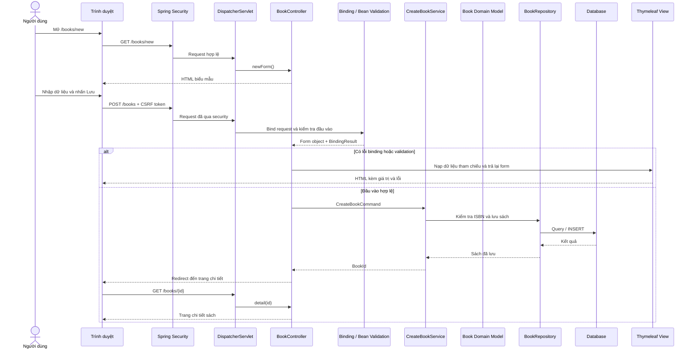

# Luồng gửi biểu mẫu, kiểm tra và báo lỗi

Trong ứng dụng quản lý sách theo MVC, biểu mẫu là nơi người dùng nhập thông tin như tiêu đề, tác giả, ISBN, ngày xuất bản và thể loại. Khi nhấn **Lưu**, trình duyệt gửi dữ liệu đến Controller. Controller tiếp nhận request, kiểm tra dữ liệu theo hợp đồng đầu vào, gọi use case để áp dụng quy tắc nghiệp vụ và chọn kết quả trả về. Nếu dữ liệu chưa hợp lệ, View hiển thị lại biểu mẫu cùng lỗi cụ thể; nếu lưu thành công, ứng dụng chuyển người dùng đến trang chi tiết hoặc danh sách sách.

Luồng này thể hiện rõ vai trò của ba thành phần MVC:

- **Model:** bảo vệ quy tắc nghiệp vụ của sách, ví dụ ISBN hợp lệ, thể loại còn hoạt động hoặc không cho phép trùng ISBN.
- **View:** trình bày trường nhập, giá trị người dùng đã gửi và thông báo lỗi.
- **Controller:** nhận biểu mẫu, phối hợp validation ở ranh giới web, gọi use case và ánh xạ kết quả thành View hoặc redirect.

Một điểm quan trọng là “kiểm tra dữ liệu” không chỉ có một loại. Sai định dạng ngày, thiếu tiêu đề, ISBN đã tồn tại và database mất kết nối là những tình huống khác nhau. Phân biệt chúng giúp thông báo đúng cho người dùng và giữ quy tắc ở đúng lớp.

## Luồng tổng thể khi gửi biểu mẫu

Ví dụ người dùng mở trang thêm sách, nhập thông tin rồi gửi `POST /books`:



Luồng trên mô tả một lần gửi biểu mẫu đồng bộ. Nếu ứng dụng dùng JavaScript và API JSON, các bước nghiệp vụ tương tự nhưng lỗi được trả dưới dạng response JSON thay vì render lại template.

## Phân biệt các lớp kiểm tra

Một request thêm sách có thể gặp nhiều loại lỗi. Không nên gom tất cả vào một thông báo chung hoặc để View tự quyết định dữ liệu có hợp lệ hay không.

| Loại kiểm tra | Ví dụ trong quản lý sách | Nơi phù hợp | Cách phản hồi |
|---|---|---|---|
| Binding / chuyển kiểu | `publishedOn=abc` không chuyển được thành ngày | Spring MVC data binding | Lỗi gắn với trường biểu mẫu |
| Validation đầu vào | Tiêu đề rỗng, ISBN quá dài, thiếu thể loại | Form DTO và Bean Validation | Trả lại form, chỉ rõ trường sai |
| Quy tắc nghiệp vụ | ISBN đã được sách khác sử dụng, thể loại đã ngừng hoạt động | Application Service và Domain Model | Lỗi nghiệp vụ có mã, có thể gắn vào trường hoặc form |
| Lỗi kỹ thuật | Database timeout, connection pool hết kết nối | Persistence adapter / exception handler | Trang lỗi hoặc response lỗi chung, ghi log phía server |
| Lỗi bảo mật | Chưa đăng nhập, thiếu quyền hoặc CSRF token không hợp lệ | Spring Security | Chuyển đến đăng nhập hoặc trả 401/403 theo ngữ cảnh |

Binding và Bean Validation kiểm tra hình dạng/dữ liệu đầu vào. Quy tắc nghiệp vụ kiểm tra liệu hành động có được phép trong trạng thái hiện tại hay không. Lỗi kỹ thuật cho biết ứng dụng không thể hoàn tất do hạ tầng hoặc lỗi không dự kiến. Các nhóm này cần có cách ghi nhận và xử lý khác nhau.

## Thiết kế hợp đồng của biểu mẫu sách

Không nên bind trực tiếp request vào JPA entity hoặc domain aggregate. Hãy tạo một form object chứa đúng các trường người dùng được phép nhập. Điều này ngăn người dùng gửi thêm các trường như `createdBy`, `ownerId`, `status`, `version` hoặc `approved` để sửa trạng thái nội bộ.

Ví dụ form thêm sách:

```java
public class BookForm {
    @NotBlank(message = "Tiêu đề là bắt buộc")
    @Size(max = 200, message = "Tiêu đề không được vượt quá 200 ký tự")
    private String title;

    @NotBlank(message = "Tên tác giả là bắt buộc")
    @Size(max = 120, message = "Tên tác giả không được vượt quá 120 ký tự")
    private String author;

    @NotBlank(message = "ISBN là bắt buộc")
    @Size(max = 17, message = "ISBN không được vượt quá 17 ký tự")
    @Pattern(regexp = "[0-9Xx -]+", message = "ISBN chỉ được chứa chữ số, dấu cách, dấu gạch nối hoặc X")
    private String isbn;

    @NotNull(message = "Ngày xuất bản là bắt buộc")
    @PastOrPresent(message = "Ngày xuất bản không được ở tương lai")
    private LocalDate publishedOn;

    @NotNull(message = "Vui lòng chọn thể loại")
    private Long categoryId;

    // Getter và setter theo quy ước JavaBean.
}
```

Ví dụ dùng Jakarta Bean Validation trong Spring Boot 3. Với Spring Boot 2, package validation thường là `javax.validation` thay vì `jakarta.validation`. Các annotation cần import từ package validation tương ứng.

`@Pattern` ở đây chỉ kiểm tra tập ký tự và không chứng minh ISBN có checksum hợp lệ. Nếu ứng dụng cần xác minh ISBN-10/ISBN-13, hãy tạo value object hoặc validator chuyên biệt thực hiện chuẩn hóa và kiểm tra checksum. Không nên tuyên bố một regex đơn giản là đã xác minh đầy đủ ISBN.

### Vì sao dùng Form DTO?

- Chỉ nhận các trường được phép nhập.
- Có thể đặt validation theo ngữ cảnh biểu mẫu.
- Không để client cập nhật trực tiếp ID, quyền, trạng thái hoặc metadata nội bộ.
- Cho phép cấu trúc form khác với cấu trúc domain entity và database.
- Dễ kiểm thử binding và validation mà không cần persistence.

Khi chỉnh sửa sách, có thể dùng `EditBookForm` riêng hoặc mở rộng một form dùng chung nếu hai luồng thật sự có cùng hợp đồng. Trường ID nên lấy từ path (`/books/{id}/edit`) hoặc một cơ chế xác định tài nguyên đã được xác minh; không tin ID ẩn trong form để quyết định quyền sở hữu.

## Mở biểu mẫu bằng GET

Controller xử lý `GET /books/new` có nhiệm vụ tạo form object rỗng và nạp dữ liệu tham chiếu cần cho View, ví dụ danh sách thể loại đang hoạt động.

```java
@Controller
@RequestMapping("/books")
public class BookController {
    private final CreateBookUseCase createBook;
    private final ListActiveCategoriesQuery listCategories;

    public BookController(
            CreateBookUseCase createBook,
            ListActiveCategoriesQuery listCategories) {
        this.createBook = createBook;
        this.listCategories = listCategories;
    }

    @GetMapping("/new")
    public String newForm(Model model) {
        model.addAttribute("bookForm", new BookForm());
        addCategoryOptions(model);
        return "books/form";
    }

    private void addCategoryOptions(Model model) {
        model.addAttribute("categories", listCategories.handle());
    }
}
```

View nhận `bookForm` và `categories`. Controller không tự viết truy vấn SQL; query service chịu trách nhiệm lấy danh sách thể loại. Nếu danh sách thể loại phụ thuộc quyền hoặc tenant, query phải nhận actor/tenant context đã được xác minh.

## Gửi biểu mẫu bằng POST

Khi người dùng gửi form, Spring MVC bind request parameter vào `BookForm`, sau đó chạy Bean Validation do `@Valid` yêu cầu. `BindingResult` chứa lỗi binding và validation. Tham số `BindingResult` phải đặt ngay sau đối tượng được kiểm tra để Spring gắn đúng kết quả với form đó.

```java
@PostMapping
public String create(
        @Valid @ModelAttribute("bookForm") BookForm form,
        BindingResult bindingResult,
        Model model,
        RedirectAttributes redirectAttributes) {

    if (bindingResult.hasErrors()) {
        addCategoryOptions(model);
        return "books/form";
    }

    try {
        BookId id = createBook.handle(new CreateBookCommand(
                form.getTitle(),
                form.getAuthor(),
                form.getIsbn(),
                form.getPublishedOn(),
                form.getCategoryId()));

        redirectAttributes.addFlashAttribute(
                "successMessage", "Đã thêm sách thành công.");
        return "redirect:/books/" + id.value();
    } catch (DuplicateIsbnException ex) {
        bindingResult.rejectValue(
                "isbn", "book.isbn.duplicate", "ISBN này đã được sử dụng.");
        addCategoryOptions(model);
        return "books/form";
    }
}
```

Đây là ví dụ rút gọn; các kiểu `BookId`, command, use case và exception cần được định nghĩa trong ứng dụng. Trong một dự án thực tế, có thể dùng mapper để chuyển `BookForm` thành command thay vì tạo command trực tiếp trong Controller.

Luồng xử lý có ba kết quả:

1. **Binding/validation thất bại:** không gọi use case; nạp lại dữ liệu tham chiếu và render `books/form`.
2. **Quy tắc nghiệp vụ từ chối:** ánh xạ lỗi có mã như `DUPLICATE_ISBN` thành field error hoặc global error, sau đó render lại form.
3. **Thành công:** lưu sách, đưa thông báo vào flash scope và redirect đến trang chi tiết.

Không catch `RuntimeException` chung rồi biến mọi lỗi thành lỗi ISBN. Chỉ bắt exception nghiệp vụ đã biết và có ánh xạ rõ. Lỗi database hoặc lỗi không dự kiến cần đi qua exception handler chung để ghi log và trả phản hồi an toàn.

## Vì sao phải nạp lại dữ liệu tham chiếu khi có lỗi?

Khi form có dropdown thể loại, GET ban đầu đã thêm `categories` vào model. Nhưng POST không hợp lệ là một request mới. Model attribute của request GET không tự tồn tại trong request POST. Nếu Controller trả lại template mà quên nạp `categories`, dropdown sẽ trống hoặc template có thể lỗi.

Mọi nhánh trả lại `books/form` cần cung cấp đầy đủ dữ liệu mà template yêu cầu:

- danh sách thể loại được phép chọn;
- dữ liệu mặc định hoặc lựa chọn phụ thuộc;
- form object chứa các giá trị đã bind;
- `BindingResult` chứa lỗi;
- dữ liệu trình bày bổ sung như gợi ý ISBN nếu có.

Không tạo một form object mới khi validation thất bại vì sẽ làm mất dữ liệu người dùng vừa nhập. Hãy giữ lại đối tượng đã bind và chỉ bổ sung dữ liệu tham chiếu cần thiết.

## Hiển thị biểu mẫu và lỗi trong Thymeleaf

Template cần liên kết trường HTML với thuộc tính của `BookForm` và hiển thị lỗi ngay cạnh trường liên quan.

```html
<form th:action="@{/books}" th:object="${bookForm}" method="post">
  <div>
    <label for="title">Tiêu đề</label>
    <input id="title" type="text" th:field="*{title}" />
    <p class="field-error" th:if="${#fields.hasErrors('title')}"
       th:errors="*{title}"></p>
  </div>

  <div>
    <label for="author">Tác giả</label>
    <input id="author" type="text" th:field="*{author}" />
    <p class="field-error" th:if="${#fields.hasErrors('author')}"
       th:errors="*{author}"></p>
  </div>

  <div>
    <label for="isbn">ISBN</label>
    <input id="isbn" type="text" th:field="*{isbn}" />
    <p class="field-error" th:if="${#fields.hasErrors('isbn')}"
       th:errors="*{isbn}"></p>
  </div>

  <div>
    <label for="publishedOn">Ngày xuất bản</label>
    <input id="publishedOn" type="date" th:field="*{publishedOn}" />
    <p class="field-error" th:if="${#fields.hasErrors('publishedOn')}"
       th:errors="*{publishedOn}"></p>
  </div>

  <div>
    <label for="categoryId">Thể loại</label>
    <select id="categoryId" th:field="*{categoryId}">
      <option value="">-- Chọn thể loại --</option>
      <option th:each="category : ${categories}"
              th:value="${category.id}"
              th:text="${category.name}"></option>
    </select>
    <p class="field-error" th:if="${#fields.hasErrors('categoryId')}"
       th:errors="*{categoryId}"></p>
  </div>

  <p class="form-error" th:if="${#fields.hasGlobalErrors()}"
     th:each="error : ${#fields.globalErrors()}"
     th:text="${error}"></p>

  <button type="submit">Lưu sách</button>
  <a th:href="@{/books}">Hủy</a>
</form>
```

Ví dụ giả định Spring Security và Thymeleaf được tích hợp qua `RequestDataValueProcessor`, nhờ đó `th:action` cho form POST tự thêm CSRF token ẩn. Nếu cấu hình của ứng dụng không có cơ chế này, hãy thêm hidden field bằng request attribute `_csrf` theo cấu hình thực tế. Chỉ dùng một cách để tránh sinh hai token field trong cùng biểu mẫu.

`th:field` giữ liên kết giữa input và form object. `th:errors` hiển thị lỗi của thuộc tính. `#fields.hasGlobalErrors()` hiển thị lỗi không gắn với một trường cụ thể, ví dụ ngày nhập sách không phù hợp với trạng thái bộ sưu tập. Dùng `th:text` để hiển thị thông báo dưới dạng text đã escape; không render lỗi người dùng bằng HTML thô.

### Giữ lại giá trị người dùng đã nhập

Khi binding và validation thất bại, Spring MVC giữ giá trị đã bind trong model và `BindingResult`. Thymeleaf với `th:field` có thể hiển thị lại giá trị đó. Người dùng không phải nhập lại toàn bộ biểu mẫu chỉ vì một trường sai.

Một số trường có thể cần xử lý đặc biệt. Nếu dữ liệu nhạy cảm như mật khẩu xuất hiện trong form, không nên tự động điền lại sau lỗi. Với form quản lý sách, tiêu đề, tác giả và ISBN thường có thể được giữ lại; nếu có ghi chú nội bộ hoặc dữ liệu hạn chế, cần áp dụng chính sách hiển thị phù hợp.

## Binding lỗi khác validation lỗi

Binding diễn ra khi Spring chuyển request parameter thành kiểu Java. Ví dụ `publishedOn=not-a-date` không thể chuyển thành `LocalDate`; `categoryId=abc` không thể chuyển thành `Long`. Đây là lỗi chuyển kiểu, không phải lỗi `@NotNull` hoặc `@PastOrPresent`.

Bean Validation chạy sau khi binding tạo được đối tượng. Ví dụ `title` là chuỗi rỗng có thể bind thành công nhưng vi phạm `@NotBlank`. `publishedOn` là ngày hợp lệ về cú pháp nhưng ở tương lai sẽ vi phạm `@PastOrPresent`.

| Request value | Binding | Bean Validation |
|---|---|---|
| `title=` | Thành công thành chuỗi rỗng | `@NotBlank` thất bại |
| `title=` với giá trị dài hơn 200 ký tự | Thành công thành chuỗi | `@Size` thất bại |
| `publishedOn=abc` | Thất bại chuyển kiểu | Không thể kiểm tra như ngày đã bind |
| `publishedOn=2035-01-01` | Thành công thành `LocalDate` | `@PastOrPresent` thất bại nếu ngày hiện tại trước đó |
| `categoryId=abc` | Thất bại chuyển kiểu | Không thể kiểm tra như `Long` đã bind |
| `categoryId=` | Thường bind thành null | `@NotNull` thất bại |

Với lỗi binding, Spring thường tạo field error trong `BindingResult`; template có thể hiển thị bằng `th:errors` tương tự lỗi validation. Có thể tùy chỉnh message qua `MessageSource` để thông báo thân thiện hơn thay vì để lộ thông báo chuyển kiểu mặc định.

## Validation nghiệp vụ: ISBN đã tồn tại

Một ISBN có thể đúng định dạng nhưng đã được dùng bởi một sách khác. Đây không phải lỗi cú pháp của form; nó là quy tắc nghiệp vụ về tính duy nhất.

Application Service nên kiểm tra quy tắc này trước khi lưu:

```java
public record CreateBookCommand(
        String title,
        String author,
        String isbn,
        LocalDate publishedOn,
        Long categoryId) {
}
```

```java
public interface BookRepository {
    boolean existsByIsbn(Isbn isbn);
    Book save(Book book);
}
```

```java
@Service
public class CreateBookService implements CreateBookUseCase {
    private final BookRepository books;
    private final CategoryRepository categories;

    public CreateBookService(
            BookRepository books,
            CategoryRepository categories) {
        this.books = books;
        this.categories = categories;
    }

    @Transactional
    @Override
    public BookId handle(CreateBookCommand command) {
        Isbn isbn = Isbn.parse(command.isbn());

        if (books.existsByIsbn(isbn)) {
            throw new DuplicateIsbnException(isbn);
        }

        Category category = categories.findActiveById(command.categoryId())
                .orElseThrow(InactiveCategoryException::new);

        Book book = Book.create(
                command.title(),
                command.author(),
                isbn,
                command.publishedOn(),
                category.id());

        return books.save(book).id();
    }
}
```

Ví dụ giả định `Isbn.parse()` chuẩn hóa và xác minh ISBN, `CategoryRepository` chỉ trả thể loại đang hoạt động, và `Book.create()` bảo vệ invariant của sách. Tên kiểu và phương thức cần khớp với domain model của ứng dụng.

### Vì sao cần kiểm tra cả ở database?

Kiểm tra `existsByIsbn()` trước khi insert giúp trả lỗi thân thiện. Nhưng hai request đồng thời có thể cùng kiểm tra “chưa tồn tại” rồi cùng insert. Để bảo đảm tính duy nhất, database cần unique constraint/index trên giá trị ISBN đã chuẩn hóa. Persistence adapter hoặc lớp xử lý lỗi ở ranh giới transaction cần nhận diện constraint cụ thể và chuyển nó thành `DuplicateIsbnException` hoặc kết quả nghiệp vụ tương ứng; không chuyển mọi `DataIntegrityViolationException` thành lỗi ISBN vì lỗi constraint khác có thể mang ý nghĩa khác.

Với JPA, lỗi unique constraint có thể chỉ xuất hiện khi flush hoặc commit. Nếu muốn bắt và ánh xạ ngay trong use case, adapter có thể flush có chủ đích và chuyển đúng constraint tại thời điểm đó. Nếu lỗi chỉ xuất hiện lúc transaction commit sau khi method service trả về, việc bắt bên trong method đó là quá muộn; cần ánh xạ ở ranh giới bên ngoài transaction hoặc để exception handler xử lý theo hợp đồng web. `existsByIsbn()` vẫn hữu ích cho phản hồi sớm nhưng không thay thế constraint.

Kiểm tra ở application và constraint ở database có vai trò bổ sung:

- application check giúp phản hồi sớm và rõ ràng;
- database constraint bảo vệ invariant trước race condition và mọi đường ghi dữ liệu.

Không dựa vào việc nút submit bị disable hoặc kiểm tra JavaScript để bảo đảm ISBN duy nhất.

## Ánh xạ lỗi nghiệp vụ thành lỗi biểu mẫu

Controller biết lỗi nào có thể hiển thị cạnh trường nào. Ví dụ `DuplicateIsbnException` ánh xạ vào trường `isbn`; `InactiveCategoryException` có thể gắn vào `categoryId` hoặc lỗi toàn form; một xung đột không gắn với trường cụ thể có thể dùng `reject()`.

```java
catch (DuplicateIsbnException ex) {
    bindingResult.rejectValue(
            "isbn", "book.isbn.duplicate", "ISBN này đã được sử dụng.");
    addCategoryOptions(model);
    return "books/form";
}
```

`rejectValue()` thêm lỗi vào `BindingResult` của thuộc tính. Khi View dùng `th:errors="*{isbn}"`, lỗi xuất hiện cạnh trường ISBN. Không nên đưa toàn bộ exception message kỹ thuật vào giao diện; dùng mã lỗi và thông điệp công khai đã được kiểm soát.

Nếu dùng `MessageSource`, mã lỗi như `book.isbn.duplicate` có thể được ánh xạ sang thông báo theo ngôn ngữ:

```properties
book.isbn.duplicate=ISBN này đã được sử dụng.
book.title.required=Tiêu đề là bắt buộc.
book.category.inactive=Thể loại đã ngừng hoạt động.
```

Khi cần đa ngôn ngữ, dùng message code ổn định để Controller/validator không phải hard-code chuỗi cho từng locale. Thứ tự mã cụ thể của Bean Validation/Spring có thể gồm tên object, field và constraint; hãy kiểm tra message resolution trong cấu hình dự án.

## Lỗi toàn biểu mẫu và lỗi trường

Không phải lỗi nào cũng thuộc một input:

- **Field error:** ISBN trùng, tiêu đề thiếu, ngày xuất bản không hợp lệ.
- **Object/global error:** hai trường mâu thuẫn, ví dụ ngày phát hành trước ngày hoàn thành bản thảo theo quy tắc nội bộ.
- **Business conflict:** sách đã được một người khác cập nhật hoặc thể loại vừa bị khóa.
- **Technical error:** database không khả dụng hoặc lỗi mapping.

Với lỗi liên quan nhiều trường, có thể dùng class-level validator hoặc `bindingResult.reject()` để thêm global error. Không gắn một lỗi chung vào một trường không liên quan chỉ để nó xuất hiện ở vị trí dễ nhìn.

Nếu form có nhiều bước, lỗi có thể thuộc bước cụ thể. Hãy giữ trạng thái bước và chỉ hiển thị các trường của bước đó, nhưng vẫn xác minh toàn bộ dữ liệu ở server trước khi lưu cuối cùng.

## Post/Redirect/Get sau khi lưu thành công

Khi POST thành công, Controller thường redirect đến trang GET. Đây là mẫu Post/Redirect/Get (PRG):

```text
POST /books
    -> tạo sách và commit transaction
    -> redirect:/books/42
GET /books/42
    -> tải chi tiết sách
    -> render books/detail
```

PRG giúp khi người dùng refresh trang kết quả, trình duyệt tải lại GET thay vì hỏi gửi lại POST. Thông báo thành công có thể được lưu bằng flash attribute để chỉ xuất hiện trong request kế tiếp:

```java
redirectAttributes.addFlashAttribute(
        "successMessage", "Đã thêm sách thành công.");
return "redirect:/books/" + id.value();
```

PRG không tự ngăn hai lần submit xảy ra gần như đồng thời khi người dùng click hai lần hoặc mạng gửi lại request. Với thao tác cần idempotency, có thể dùng request token/idempotency key, kiểm tra unique constraint hoặc thiết kế use case chống tạo trùng theo nghiệp vụ.

## Khi nào render lại form, khi nào redirect?

| Kết quả POST | Hành vi thường dùng | Lý do |
|---|---|---|
| Binding/validation lỗi | Render lại form trong cùng request | Cần giữ `BindingResult` và dữ liệu đã nhập |
| Business rejection gắn với form | Render lại form với field/global error | Người dùng cần sửa dữ liệu hoặc chọn lại |
| Thành công | Redirect theo PRG | Tránh refresh gửi lại POST |
| Technical error không thể phục hồi | Chuyển đến error handler/page | Không giả vờ rằng lỗi là do dữ liệu người dùng |
| Chưa xác thực | Chuyển đến login hoặc 401 | Xử lý theo security configuration |
| Không có quyền | 403 hoặc trang từ chối truy cập | Không tiết lộ dữ liệu không được phép |

Đối với REST API, validation lỗi thường trả 400 hoặc 422 theo hợp đồng API; business conflict có thể trả 409. Không áp dụng quy tắc “mọi lỗi đều redirect” cho API JSON.

## Xử lý lỗi kỹ thuật tập trung

Controller không nên catch mọi exception và trả lại form như thể người dùng nhập sai. Ví dụ database timeout không phải lỗi ở trường ISBN. Hãy để lỗi kỹ thuật đi đến handler tập trung, ghi log có trace/correlation ID và trả trang lỗi an toàn.

```java
@ControllerAdvice
public class BookWebExceptionHandler {

    @ExceptionHandler(BookStorageUnavailableException.class)
    public String handleStorageUnavailable(
            Model model, HttpServletResponse response) {
        response.setStatus(HttpStatus.SERVICE_UNAVAILABLE.value());
        model.addAttribute(
                "message", "Dịch vụ lưu trữ tạm thời không khả dụng. Vui lòng thử lại sau.");
        return "errors/service-unavailable";
    }
}
```

Ví dụ minh họa cho SSR; API có thể dùng `@RestControllerAdvice` và `ProblemDetail`. Handler nên ghi log exception ở phía server bằng logger/observability đã cấu hình. Không trả stack trace, SQL, hostname nội bộ hoặc credential cho người dùng.

Không nên bắt `Exception` rộng ở Controller để giữ người dùng trên form. Nếu lỗi kỹ thuật xảy ra sau khi transaction rollback, form có thể được cung cấp lại qua trang lỗi hoặc một luồng retry rõ ràng; nhưng cần phân biệt với validation error để người dùng không sửa dữ liệu vô ích.

## Biểu mẫu chỉnh sửa sách

Luồng chỉnh sửa tương tự thêm mới nhưng cần tải dữ liệu hiện tại và xác minh quyền trên tài nguyên.

### GET form chỉnh sửa

```java
@GetMapping("/{id}/edit")
public String editForm(
        @PathVariable long id,
        @AuthenticationPrincipal AppPrincipal principal,
        Model model) {
    BookEditView book = getBookForEdit.handle(new BookId(id), principal.userId());
    model.addAttribute("bookForm", BookForm.from(book));
    addCategoryOptions(model);
    return "books/edit-form";
}
```

Query/use case phải xác minh người dùng có quyền chỉnh sửa sách. Không chỉ tải sách theo ID rồi tin rằng người dùng được phép sửa vì đã biết URL.

### POST form chỉnh sửa

```java
@PostMapping("/{id}")
public String update(
        @PathVariable long id,
        @Valid @ModelAttribute("bookForm") BookForm form,
        BindingResult bindingResult,
        @AuthenticationPrincipal AppPrincipal principal,
        Model model,
        RedirectAttributes redirectAttributes) {

    if (bindingResult.hasErrors()) {
        addCategoryOptions(model);
        return "books/edit-form";
    }

    try {
        updateBook.handle(new UpdateBookCommand(
                new BookId(id), principal.userId(), form.getTitle(),
                form.getAuthor(), form.getIsbn(), form.getPublishedOn(),
                form.getCategoryId()));
        redirectAttributes.addFlashAttribute("successMessage", "Đã cập nhật sách.");
        return "redirect:/books/" + id;
    } catch (DuplicateIsbnException ex) {
        bindingResult.rejectValue(
                "isbn", "book.isbn.duplicate", "ISBN này đã được sử dụng.");
        addCategoryOptions(model);
        return "books/edit-form";
    }
}
```

Trong update, kiểm tra trùng ISBN phải loại trừ chính bản ghi đang sửa. Ví dụ repository có thể cung cấp `existsByIsbnAndIdNot(isbn, bookId)`. Use case vẫn cần xác minh quyền, trạng thái sách và phiên bản hiện tại.

### Phát hiện cập nhật đồng thời

Nếu hai người cùng mở form chỉnh sửa một cuốn sách, người thứ hai có thể ghi đè thay đổi của người thứ nhất. Với JPA, có thể dùng `@Version` để phát hiện optimistic locking conflict. Form có thể mang version đã tải; use case kiểm tra version khi cập nhật. Khi có xung đột, ứng dụng nên yêu cầu người dùng tải lại hoặc so sánh thay đổi thay vì âm thầm ghi đè.

Không tin version hidden field như một cơ chế bảo mật. Nó chỉ là dữ liệu giúp phát hiện stale update; server vẫn phải kiểm tra quyền và tính hợp lệ của thao tác.

## Bảo mật khi gửi biểu mẫu

Biểu mẫu HTML là một ranh giới đầu vào không đáng tin cậy. Các nguyên tắc cơ bản:

- dùng POST/PUT/PATCH cho thao tác thay đổi dữ liệu, không dùng GET để lưu sách;
- bật CSRF protection khi xác thực dựa trên cookie/session;
- xác thực danh tính và quyền trên từng tài nguyên ở server;
- dùng Form DTO allowlist thay vì bind trực tiếp entity;
- không nhận `createdBy`, `ownerId`, `tenantId` hoặc trạng thái kiểm duyệt từ client nếu server phải quyết định;
- escape nội dung khi hiển thị lại trong template;
- giới hạn độ dài và kích thước request;
- không ghi dữ liệu nhạy cảm vào log;
- bảo vệ endpoint chống gửi lặp nếu nghiệp vụ cần idempotency.

Validation không thay thế authorization. Một `categoryId` có thể là số hợp lệ nhưng người dùng không có quyền gắn sách vào thể loại thuộc tenant khác. Use case phải kiểm tra phạm vi truy cập, và query lấy danh sách thể loại nên chỉ cung cấp lựa chọn người dùng được phép sử dụng.

## Trải nghiệm người dùng khi báo lỗi

Một form tốt không chỉ nói “Dữ liệu không hợp lệ”. Thông báo nên giúp người dùng biết:

- trường nào cần sửa;
- điều kiện nào chưa được đáp ứng;
- cách sửa hoặc lựa chọn thay thế;
- dữ liệu đã nhập có được giữ lại không;
- thao tác có được lưu một phần hay chưa.

Ví dụ:

| Thông báo kém hữu ích | Thông báo rõ hơn |
|---|---|
| Có lỗi xảy ra | ISBN này đã được sử dụng cho một cuốn sách khác. |
| Invalid input | Ngày xuất bản không được ở tương lai. |
| Save failed | Chưa thể lưu sách vì dịch vụ đang tạm thời gián đoạn. Vui lòng thử lại sau. |
| Category error | Thể loại đã ngừng hoạt động. Hãy chọn thể loại khác. |

Không đưa thông tin nhạy cảm hoặc dữ liệu của người dùng khác vào thông báo. Ví dụ khi ISBN trùng, không nhất thiết tiết lộ tên sách hoặc chủ sở hữu của bản ghi đã tồn tại.

### Accessibility cho lỗi biểu mẫu

- Mỗi input có `label` liên kết bằng `for`/`id`.
- Lỗi hiển thị bằng văn bản, không chỉ bằng màu viền.
- Có thể thêm `aria-invalid="true"` cho trường lỗi và `aria-describedby` trỏ đến phần tử chứa thông báo.
- Sau khi render lại form lỗi, cân nhắc đưa focus đến phần tóm tắt lỗi hoặc trường lỗi đầu tiên.
- Thông báo tổng quát nên có vị trí dễ nhận biết và không bị đọc lặp không cần thiết.
- Giữ thứ tự tab hợp lý và không dùng placeholder thay cho label.

Ví dụ trường ISBN:

```html
<label for="isbn">ISBN</label>
<input id="isbn" type="text" th:field="*{isbn}"
       th:attr="aria-invalid=${#fields.hasErrors('isbn')}"
       aria-describedby="isbn-error" />
<p id="isbn-error" role="alert"
   th:if="${#fields.hasErrors('isbn')}"
   th:errors="*{isbn}"></p>
```

Với trang render lại toàn bộ tài liệu, có thể đặt summary lỗi ở đầu form và dùng liên kết đến input tương ứng. Kiểm thử bằng bàn phím và screen reader để xác minh thông báo được nhận biết đúng.

## Form gửi qua JavaScript và API JSON

Nếu giao diện là SPA, client có thể gửi JSON đến endpoint API. Ranh giới nghiệp vụ vẫn giữ nguyên: API Controller nhận DTO, Bean Validation kiểm tra đầu vào, use case kiểm tra quy tắc và repository lưu dữ liệu.

Request ví dụ:

```json
{
  "title": "Thiết kế phần mềm",
  "author": "Nguyễn An",
  "isbn": "978-604-1-23456-7",
  "publishedOn": "2025-06-01",
  "categoryId": 3
}
```

Response validation error có thể dùng cấu trúc lỗi ổn định:

```json
{
  "type": "about:blank",
  "title": "Dữ liệu không hợp lệ",
  "status": 400,
  "code": "VALIDATION_FAILED",
  "errors": [
    {
      "field": "title",
      "code": "NotBlank",
      "message": "Tiêu đề là bắt buộc."
    }
  ]
}
```

Với business conflict như ISBN trùng, API có thể trả 409 với mã `BOOK_ISBN_DUPLICATE`. Client ánh xạ mã lỗi sang trường ISBN. Với lỗi kỹ thuật, trả 5xx theo hợp đồng và một thông báo chung; không trả stack trace.

Client validation có thể cải thiện trải nghiệm nhưng server vẫn phải kiểm tra lại toàn bộ dữ liệu. Không tin trạng thái nút, form state hoặc giá trị đã được JavaScript kiểm tra.

## Kiểm thử luồng biểu mẫu

Kiểm thử nên bao phủ cả request hợp lệ và các nhánh lỗi. Có thể chia theo ranh giới:

| Mức kiểm thử | Nội dung | Ví dụ |
|---|---|---|
| Form DTO unit test | Annotation hoặc custom validator | Tiêu đề rỗng bị từ chối; ngày tương lai không hợp lệ |
| Domain unit test | Quy tắc miền | ISBN checksum sai hoặc trạng thái sách không cho phép |
| Application service unit test | Điều phối và business rule | ISBN trùng bị từ chối; category inactive không được dùng |
| Controller/MockMvc test | Binding, validation, View và redirect | POST sai trả `books/form`; POST đúng redirect |
| Repository integration test | Constraint và truy vấn | Unique ISBN hoạt động khi có hai insert đồng thời |
| Browser E2E test | Trải nghiệm form thực tế | Giá trị được giữ lại, lỗi hiển thị đúng và PRG hoạt động |

### Kiểm thử validation bằng MockMvc

Ví dụ gửi tiêu đề rỗng:

```java
mockMvc.perform(post("/books")
        .with(user(appPrincipal))
        .with(csrf())
        .param("title", "")
        .param("author", "Nguyễn An")
        .param("isbn", "978-604-1-23456-7")
        .param("publishedOn", "2025-06-01")
        .param("categoryId", "3"))
    .andExpect(status().isOk())
    .andExpect(view().name("books/form"))
    .andExpect(model().attributeHasFieldErrors("bookForm", "title"));

verifyNoInteractions(createBook);
```

Ví dụ cần Spring Security test support, principal phù hợp và cấu hình MockMvc. `verifyNoInteractions` xác minh use case không được gọi khi lỗi validation đã được phát hiện ở web boundary.

### Kiểm thử business rejection

Giả lập use case ném `DuplicateIsbnException`, gửi form có dữ liệu cú pháp hợp lệ rồi xác minh:

- View trả về là `books/form`;
- `BindingResult` có field error ở `isbn`;
- dữ liệu tham chiếu như `categories` vẫn có;
- giá trị các trường người dùng đã nhập vẫn được giữ;
- không có redirect thành công.

### Kiểm thử thành công và PRG

Với request hợp lệ:

- xác minh use case nhận command đúng;
- response là redirect đến `/books/{id}`;
- flash message có nội dung phù hợp;
- GET trang chi tiết sau redirect tải được dữ liệu đã lưu.

Controller test có thể mock use case để tập trung vào giao thức; integration test cần kiểm tra persistence thực và constraint.

### Kiểm thử lỗi binding

Gửi `publishedOn=abc` hoặc `categoryId=xyz` và xác minh Controller trả lại form với lỗi tương ứng. Test này bảo đảm lỗi chuyển kiểu được xử lý rõ ràng thay vì làm request phát sinh 500.

### Kiểm thử bảo mật

- POST thiếu CSRF token bị từ chối khi CSRF được bật.
- Người dùng chưa đăng nhập không thể gửi form tạo sách nếu endpoint yêu cầu xác thực.
- Người dùng không có quyền không thể sửa sách của người khác.
- Gửi thêm field `createdBy`, `ownerId` hoặc `status` không làm thay đổi giá trị do server quản lý.
- Người dùng không thể chọn category ngoài tenant/phạm vi được phép.

## Những lỗi triển khai thường gặp

- **Bind thẳng vào JPA entity:** client có thể gửi field ngoài ý muốn. Dùng Form DTO allowlist.
- **Đặt `BindingResult` sai vị trí:** Spring không gắn đúng lỗi với form object. Đặt ngay sau tham số `@Valid` tương ứng.
- **Quên `@Valid`:** Bean Validation không chạy như mong đợi. Đặt annotation ở tham số form và cấu hình validation provider.
- **Quên nạp lại danh sách thể loại khi trả form:** dropdown trống sau lỗi. Bổ sung dữ liệu tham chiếu ở mọi nhánh render lại.
- **Tạo form object mới khi có lỗi:** mất dữ liệu người dùng. Giữ object đã bind và `BindingResult`.
- **Chỉ kiểm tra ở JavaScript:** request trực tiếp có thể bỏ qua. Luôn validate ở server.
- **Đưa mọi quy tắc vào Controller:** Controller trở nên khó test và tái sử dụng. Chuyển business rule vào use case/Model.
- **Dùng regex đơn giản để tuyên bố ISBN hợp lệ:** không kiểm tra checksum. Dùng value object/validator theo chuẩn ISBN.
- **Chỉ kiểm tra ISBN tồn tại ở application:** hai request đồng thời vẫn có thể insert trùng. Thêm unique constraint ở database và ánh xạ lỗi.
- **Catch mọi exception rồi trả lỗi form:** lỗi kỹ thuật bị hiểu sai thành lỗi người dùng. Chỉ ánh xạ lỗi đã biết; dùng exception handler chung.
- **Redirect khi validation thất bại:** dễ mất `BindingResult` và dữ liệu form. Render lại cùng request hoặc dùng cơ chế lưu lỗi có chủ đích.
- **Không dùng PRG sau thành công:** refresh có thể gửi lại POST. Redirect đến GET sau khi lưu.
- **Cho rằng PRG chống mọi duplicate submit:** hai POST đồng thời vẫn có thể xảy ra. Dùng idempotency/unique constraint khi cần.
- **Không bảo vệ CSRF:** form dùng cookie session có thể bị lợi dụng. Bật và truyền CSRF token.
- **Thông báo lỗi chỉ dựa vào màu sắc:** người dùng screen reader không nhận biết được. Dùng text, label và ARIA phù hợp.
- **Trả exception detail cho browser:** có thể lộ SQL hoặc cấu trúc nội bộ. Dùng mã lỗi và thông báo công khai.

## Quy trình triển khai một biểu mẫu quản lý sách

Khi thêm chức năng tạo hoặc chỉnh sửa sách, có thể làm theo thứ tự:

1. **Xác định use case:** tạo sách, chỉnh sửa metadata hay thay đổi trạng thái lưu thông?
2. **Thiết kế Form DTO:** chỉ chứa trường người dùng được phép gửi.
3. **Định nghĩa validation đầu vào:** bắt buộc, độ dài, kiểu dữ liệu, định dạng và giới hạn.
4. **Xác định quy tắc nghiệp vụ:** ISBN duy nhất, category active, quyền actor và trạng thái sách.
5. **Tạo use case/command:** chuyển dữ liệu form thành hợp đồng ứng dụng.
6. **Đặt truy cập dữ liệu ở repository:** query thể loại, kiểm tra ISBN và lưu aggregate.
7. **Xác định transaction:** bao quanh use case ghi dữ liệu.
8. **Thiết kế nhánh lỗi:** binding, validation, business rejection, security và technical failure.
9. **Thiết kế View:** liên kết trường, giữ dữ liệu, hiển thị lỗi và hỗ trợ accessibility.
10. **Hoàn thiện PRG:** redirect sau thành công, render lại form khi lỗi đầu vào/nghiệp vụ có thể sửa.
11. **Kiểm thử:** unit, MockMvc, repository integration và browser flow.
12. **Kiểm tra bảo mật:** CSRF, authorization, mass assignment, tenant scope và log an toàn.

## Checklist review

- Form object tách khỏi entity/domain model và chỉ nhận trường được phép.
- Binding và Bean Validation chạy ở ranh giới Controller.
- `BindingResult` đặt ngay sau form object được kiểm tra.
- Dữ liệu tham chiếu được nạp lại trên mọi nhánh render form.
- Giá trị người dùng đã nhập được giữ lại khi có lỗi.
- Business rule được thực hiện trong application/domain layer.
- Lỗi nghiệp vụ được ánh xạ thành field/global error có mã ổn định.
- Lỗi kỹ thuật không bị trình bày như lỗi nhập liệu.
- Thành công dùng Post/Redirect/Get.
- ISBN uniqueness được bảo vệ cả ở application và database.
- CSRF và authorization được kiểm tra phía server.
- Template escape dữ liệu và trình bày lỗi có accessibility.
- Test bao phủ binding, validation, business rejection, success, redirect và security.

## Câu hỏi tự đánh giá

1. Vì sao form DTO nên tách khỏi JPA entity?
2. Binding error khác Bean Validation error ở điểm nào?
3. Vì sao `BindingResult` cần đứng ngay sau tham số `@Valid`?
4. Tại sao phải nạp lại danh sách thể loại khi render lại form sau lỗi?
5. Quy tắc ISBN duy nhất nên được kiểm tra ở những lớp nào?
6. Vì sao kiểm tra `existsByIsbn()` không thay thế unique constraint ở database?
7. Khi nào dùng field error và khi nào dùng global error?
8. Vì sao validation thất bại thường render lại form, còn thành công dùng redirect?
9. PRG giải quyết vấn đề gì và không giải quyết vấn đề gì?
10. Những bảo vệ nào cần có khi gửi form bằng session cookie?

Luồng gửi biểu mẫu trong MVC là sự phối hợp giữa binding, validation, quy tắc nghiệp vụ, persistence và phản hồi giao diện. Controller tiếp nhận và điều phối; Form DTO định nghĩa dữ liệu đầu vào; Model/use case bảo vệ quy tắc; Repository lưu trữ; View hiển thị giá trị và lỗi. Khi phân loại lỗi đúng, giữ dữ liệu người dùng, dùng PRG sau thành công và kiểm tra bảo mật ở server, biểu mẫu quản lý sách sẽ dễ sử dụng, dễ kiểm thử và duy trì được tính toàn vẹn dữ liệu.
