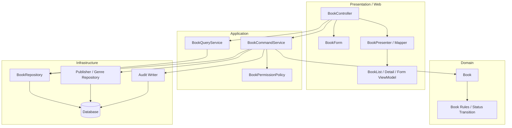

# Tách Controller quá lớn trong một ví dụ có sẵn

Trong bài thực hành này, bạn sẽ refactor một `BookController` đang đảm nhận quá nhiều trách nhiệm trong ứng dụng quản lý sách theo kiến trúc **MODEL_VIEW_CONTROLLER (MVC)**. Controller hiện vừa nhận HTTP request, vừa kiểm tra quyền, truy vấn repository, thực hiện quy tắc nghiệp vụ, ghi audit log, chuẩn bị dữ liệu cho View và quyết định thông báo trả về.

Mục tiêu là đưa mỗi trách nhiệm về đúng ranh giới: Controller giữ vai trò adapter HTTP; Application Service điều phối use case; Domain Model bảo vệ trạng thái và bất biến của sách; Repository thực hiện truy cập dữ liệu; Query Service và Presenter chuẩn bị dữ liệu cho View. Trong quá trình refactor, các URL, HTTP method, tên View và hành vi quan sát được của ứng dụng cần được giữ ổn định.

Bài tập cung cấp đoạn code hiện trạng, yêu cầu cụ thể, trình tự refactor, gợi ý cấu trúc và tiêu chí nghiệm thu. Bạn có thể áp dụng trực tiếp vào một ứng dụng Spring MVC tương tự hoặc tạo một project nhỏ để thực hành.

## 1. Mục tiêu thực hành

Sau khi hoàn thành, bạn có thể:

- Nhận diện dấu hiệu một Controller đang chứa quá nhiều trách nhiệm.
- Phân biệt xử lý HTTP với điều phối use case và quy tắc nghiệp vụ.
- Tách dữ liệu form khỏi Domain Entity bằng Form Object/Request DTO.
- Chuyển logic tạo, sửa và lưu trữ sách sang Application Service.
- Đưa quy tắc chuyển trạng thái vào Domain Model hoặc Policy phù hợp.
- Tách truy vấn và dữ liệu trình bày khỏi Controller.
- Giữ nguyên route, View, redirect, status và thông báo hiện có.
- Viết test bảo vệ hành vi trước và sau refactor.

## 2. Bối cảnh và yêu cầu chức năng

Bạn đang làm việc với trang quản trị thư viện. Người quản trị có thể:

1. Xem danh sách sách, tìm theo từ khóa và lọc theo thể loại.
2. Mở trang tạo sách mới.
3. Tạo sách với ISBN, tiêu đề, tác giả, nhà xuất bản, thể loại và ngày xuất bản.
4. Mở trang chỉnh sửa và cập nhật thông tin sách.
5. Lưu trữ một sách đang hoạt động.

Quy tắc nghiệp vụ của ví dụ:

- ISBN phải hợp lệ theo định dạng mà ứng dụng hỗ trợ và không được trùng.
- Tiêu đề và tác giả không được để trống.
- Nhà xuất bản và thể loại phải tồn tại và đang hoạt động.
- Chỉ người có quyền quản lý sách mới được tạo, sửa hoặc lưu trữ.
- Sách đã lưu trữ không thể tiếp tục chỉnh sửa như sách đang hoạt động.
- Không cho phép lưu trữ một sách đã được lưu trữ.
- `id`, `createdAt`, `createdBy`, `status` và thông tin audit do hệ thống quản lý; form tạo/sửa thông thường không được tự gửi để ghi đè các trường này.

Đây là quy tắc của bài tập. Nếu ứng dụng của bạn có chính sách khác, hãy ghi lại sự khác biệt và giữ nhất quán trong toàn bộ refactor.

### Hợp đồng HTTP cần giữ

| Method | Route | Mục đích | Kết quả hiện tại cần giữ |
|---|---|---|---|
| GET | `/admin/books` | Danh sách và bộ lọc | View `admin/books/list` |
| GET | `/admin/books/new` | Form tạo sách | View `admin/books/form` |
| POST | `/admin/books` | Tạo sách | Redirect đến `/admin/books/{id}` khi thành công; render lại form khi lỗi input |
| GET | `/admin/books/{id}/edit` | Form sửa sách | View `admin/books/form` |
| POST | `/admin/books/{id}` | Cập nhật sách | Redirect đến chi tiết khi thành công; render lại form khi lỗi input |
| POST | `/admin/books/{id}/archive` | Lưu trữ sách | Redirect đến danh sách với thông báo kết quả |
| GET | `/admin/books/{id}` | Chi tiết sách | View `admin/books/detail` |

Nếu project hiện tại dùng route khác, hãy ghi nhận hợp đồng thực tế trước khi refactor và dùng hợp đồng đó làm chuẩn nghiệm thu.

## 3. Khảo sát Controller hiện trạng

Đây là đoạn code cố ý viết theo kiểu Controller quá tải. Một số class phụ thuộc được rút gọn để tập trung vào vấn đề thiết kế.

```java
@Controller
@RequestMapping("/admin/books")
class BookController {

    private final BookRepository books;
    private final PublisherRepository publishers;
    private final GenreRepository genres;
    private final AuditLogRepository auditLogs;
    private final CurrentUser currentUser;
    private final Clock clock;
    private final BookFormatter formatter;

    BookController(
            BookRepository books,
            PublisherRepository publishers,
            GenreRepository genres,
            AuditLogRepository auditLogs,
            CurrentUser currentUser,
            Clock clock,
            BookFormatter formatter) {
        this.books = books;
        this.publishers = publishers;
        this.genres = genres;
        this.auditLogs = auditLogs;
        this.currentUser = currentUser;
        this.clock = clock;
        this.formatter = formatter;
    }

    @GetMapping
    String list(
            @RequestParam(required = false) String q,
            @RequestParam(required = false) UUID genreId,
            Model model) {

        List<Book> result = books.search(q, genreId);
        List<BookRow> rows = result.stream()
                .map(book -> new BookRow(
                        book.getId(),
                        book.getIsbn(),
                        book.getTitle(),
                        book.getAuthorName(),
                        book.getGenre().getName(),
                        formatter.statusLabel(book.getStatus()),
                        currentUser.canEdit(book)))
                .toList();

        model.addAttribute("books", rows);
        model.addAttribute("keyword", q);
        model.addAttribute("selectedGenreId", genreId);
        model.addAttribute("genres", genres.findAllActive());
        return "admin/books/list";
    }

    @GetMapping("/new")
    String newBook(Model model) {
        model.addAttribute("form", new BookForm());
        model.addAttribute("publishers", publishers.findAllActive());
        model.addAttribute("genres", genres.findAllActive());
        model.addAttribute("pageTitle", "Thêm sách mới");
        return "admin/books/form";
    }

    @PostMapping
    String create(
            @Valid @ModelAttribute("form") BookForm form,
            BindingResult errors,
            Model model,
            RedirectAttributes flash) {

        if (!currentUser.hasAuthority("BOOK_CREATE")) {
            throw new AccessDeniedException("Không có quyền tạo sách");
        }

        if (errors.hasErrors()) {
            model.addAttribute("publishers", publishers.findAllActive());
            model.addAttribute("genres", genres.findAllActive());
            model.addAttribute("pageTitle", "Thêm sách mới");
            return "admin/books/form";
        }

        String normalizedIsbn = form.getIsbn().replace("-", "").trim();
        if (books.existsByIsbn(normalizedIsbn)) {
            errors.rejectValue("isbn", "book.isbn.duplicate",
                    "ISBN đã được sử dụng");
            model.addAttribute("publishers", publishers.findAllActive());
            model.addAttribute("genres", genres.findAllActive());
            model.addAttribute("pageTitle", "Thêm sách mới");
            return "admin/books/form";
        }

        Publisher publisher = publishers.findById(form.getPublisherId())
                .orElseThrow(() -> new IllegalArgumentException("Publisher not found"));
        Genre genre = genres.findById(form.getGenreId())
                .orElseThrow(() -> new IllegalArgumentException("Genre not found"));

        Book book = new Book();
        book.setIsbn(normalizedIsbn);
        book.setTitle(form.getTitle().trim());
        book.setAuthorName(form.getAuthorName().trim());
        book.setPublisher(publisher);
        book.setGenre(genre);
        book.setPublicationDate(form.getPublicationDate());
        book.setDescription(form.getDescription());
        book.setStatus(BookStatus.ACTIVE);
        book.setCreatedAt(clock.instant());
        book.setCreatedBy(currentUser.id());

        books.save(book);
        auditLogs.record(currentUser.id(), "BOOK_CREATED", book.getId());

        flash.addFlashAttribute("notice", "Đã tạo sách thành công.");
        return "redirect:/admin/books/" + book.getId();
    }

    @GetMapping("/{id}/edit")
    String edit(@PathVariable UUID id, Model model) {
        Book book = books.findById(id).orElseThrow();
        if (!currentUser.canEdit(book)) {
            throw new AccessDeniedException("Không có quyền sửa sách");
        }

        BookForm form = new BookForm();
        form.setIsbn(book.getIsbn());
        form.setTitle(book.getTitle());
        form.setAuthorName(book.getAuthorName());
        form.setPublisherId(book.getPublisher().getId());
        form.setGenreId(book.getGenre().getId());
        form.setPublicationDate(book.getPublicationDate());
        form.setDescription(book.getDescription());

        model.addAttribute("form", form);
        model.addAttribute("publishers", publishers.findAllActive());
        model.addAttribute("genres", genres.findAllActive());
        model.addAttribute("pageTitle", "Chỉnh sửa sách");
        return "admin/books/form";
    }

    @PostMapping("/{id}")
    String update(
            @PathVariable UUID id,
            @Valid @ModelAttribute("form") BookForm form,
            BindingResult errors,
            Model model,
            RedirectAttributes flash) {

        Book book = books.findById(id).orElseThrow();
        if (!currentUser.canEdit(book)) {
            throw new AccessDeniedException("Không có quyền sửa sách");
        }

        if (errors.hasErrors()) {
            model.addAttribute("publishers", publishers.findAllActive());
            model.addAttribute("genres", genres.findAllActive());
            model.addAttribute("pageTitle", "Chỉnh sửa sách");
            return "admin/books/form";
        }

        String normalizedIsbn = form.getIsbn().replace("-", "").trim();
        if (books.existsByIsbnAndIdNot(normalizedIsbn, id)) {
            errors.rejectValue("isbn", "book.isbn.duplicate",
                    "ISBN đã được sử dụng bởi sách khác");
            model.addAttribute("publishers", publishers.findAllActive());
            model.addAttribute("genres", genres.findAllActive());
            model.addAttribute("pageTitle", "Chỉnh sửa sách");
            return "admin/books/form";
        }

        Publisher publisher = publishers.findById(form.getPublisherId())
                .orElseThrow(() -> new IllegalArgumentException("Publisher not found"));
        Genre genre = genres.findById(form.getGenreId())
                .orElseThrow(() -> new IllegalArgumentException("Genre not found"));

        book.setIsbn(normalizedIsbn);
        book.setTitle(form.getTitle().trim());
        book.setAuthorName(form.getAuthorName().trim());
        book.setPublisher(publisher);
        book.setGenre(genre);
        book.setPublicationDate(form.getPublicationDate());
        book.setDescription(form.getDescription());
        book.setUpdatedAt(clock.instant());
        book.setUpdatedBy(currentUser.id());

        books.save(book);
        auditLogs.record(currentUser.id(), "BOOK_UPDATED", book.getId());

        flash.addFlashAttribute("notice", "Đã cập nhật sách.");
        return "redirect:/admin/books/" + id;
    }

    @PostMapping("/{id}/archive")
    String archive(@PathVariable UUID id, RedirectAttributes flash) {
        Book book = books.findById(id).orElseThrow();
        if (!currentUser.hasAuthority("BOOK_ARCHIVE")) {
            throw new AccessDeniedException("Không có quyền lưu trữ sách");
        }
        if (book.getStatus() == BookStatus.ARCHIVED) {
            flash.addFlashAttribute("error", "Sách đã được lưu trữ.");
            return "redirect:/admin/books";
        }

        book.setStatus(BookStatus.ARCHIVED);
        book.setUpdatedAt(clock.instant());
        book.setUpdatedBy(currentUser.id());
        books.save(book);
        auditLogs.record(currentUser.id(), "BOOK_ARCHIVED", book.getId());

        flash.addFlashAttribute("notice", "Đã lưu trữ sách.");
        return "redirect:/admin/books";
    }

    @GetMapping("/{id}")
    String detail(@PathVariable UUID id, Model model) {
        Book book = books.findById(id).orElseThrow();
        model.addAttribute("book", book);
        model.addAttribute("statusLabel", formatter.statusLabel(book.getStatus()));
        model.addAttribute("canEdit", currentUser.canEdit(book));
        return "admin/books/detail";
    }
}
```

Đoạn code trên cố ý gom nhiều trách nhiệm vào một class. Bạn không cần giữ nguyên tên method hoặc kiểu dữ liệu nếu project thực tế khác; hãy dùng nó làm tình huống để nhận diện vấn đề.

## 4. Phân tích code smell trước khi sửa

Đọc Controller và đánh dấu các dòng thuộc từng nhóm:

| Dấu hiệu | Ví dụ trong code hiện trạng | Vấn đề phát sinh |
|---|---|---|
| Controller truy cập nhiều repository | `books`, `publishers`, `genres`, `auditLogs` | Handler biết quá nhiều chi tiết persistence |
| Quy tắc nghiệp vụ nằm trong handler | Kiểm tra ISBN trùng, trạng thái lưu trữ | Khó tái sử dụng và dễ lặp lại ở API khác |
| Entity được dựng thủ công trong Controller | `new Book()` và nhiều setter | Input, domain và persistence bị trộn |
| Quyền kiểm tra không nhất quán | `hasAuthority` và `canEdit` ở các method | Dễ bỏ sót hoặc áp dụng chính sách khác nhau |
| Lặp logic giữa create/update | Chuẩn hóa ISBN, tìm publisher/genre, ghi audit | Thay đổi quy tắc phải sửa nhiều nơi |
| Controller định dạng View | `formatter.statusLabel(...)` | Trộn truy vấn và presentation mapping |
| View nhận entity trực tiếp | `model.addAttribute("book", book)` | Template phụ thuộc cấu trúc domain/persistence |
| Quản lý thời gian ở Controller | `clock.instant()` | Use case khó kiểm thử và tái sử dụng |
| Xử lý lỗi thiếu ngữ nghĩa | `orElseThrow()` hoặc `IllegalArgumentException` | Khó ánh xạ 404, 409 và lỗi nghiệp vụ nhất quán |

### Bài tập phân loại

Trước khi tiếp tục, hãy ghi mỗi thao tác dưới đây vào một trong các nhóm: HTTP adapter, Application Service, Domain Model/Policy, Repository/Infrastructure hoặc Presentation Mapper.

- Đọc `id` từ path.
- Kiểm tra request có tiêu đề rỗng không.
- Xác định actor hiện tại.
- Kiểm tra actor có quyền lưu trữ sách không.
- Kiểm tra ISBN đã được dùng chưa.
- Xác minh publisher đang hoạt động.
- Chuyển sách từ `ACTIVE` sang `ARCHIVED`.
- Ghi thay đổi vào database.
- Chuyển `BookStatus.ACTIVE` thành nhãn “Đang lưu hành”.
- Chọn View `admin/books/detail`.

Hãy ghi lý do cho từng lựa chọn. Một số thao tác có thể cần phối hợp: ví dụ Controller lấy actor từ security context, nhưng Application Service/Policy quyết định actor có quyền thực hiện hành động trên sách cụ thể hay không.

## 5. Chuẩn bị trước khi refactor

Trước khi di chuyển code, hãy ghi lại hành vi mà người dùng hoặc client đang quan sát được.

### Lập bảng hành vi hiện tại

| Tình huống | Kết quả cần ghi nhận |
|---|---|
| GET danh sách không có filter | Danh sách sách và các filter option |
| GET danh sách có keyword/genre | Kết quả phù hợp, giữ giá trị filter |
| GET form tạo | Form rỗng và publisher/genre options |
| POST tạo hợp lệ | Một sách mới, audit record, redirect và flash message |
| POST tạo thiếu title | Render lại form và lỗi field; không lưu |
| POST tạo ISBN trùng | Lỗi ISBN; không tạo bản ghi mới |
| GET form sửa | Form được điền từ sách hiện tại |
| POST sửa hợp lệ | Cập nhật trường được phép và audit record |
| POST sửa ISBN trùng với sách khác | Lỗi ISBN; dữ liệu cũ không bị ghi đè |
| POST lưu trữ sách hoạt động | Trạng thái chuyển sang `ARCHIVED`, có audit record |
| POST lưu trữ lần nữa | Báo trạng thái đã lưu trữ, không tạo audit trùng |
| Actor không đủ quyền | Request bị từ chối, không thay đổi dữ liệu |
| ID không tồn tại | Response 404 theo hợp đồng ứng dụng |

### Viết test đặc trưng (characterization tests)

Nếu project đã có test, hãy chạy và hiểu chúng. Nếu chưa có, tạo các test bảo vệ các hành vi quan trọng trước khi refactor. Test không nhất thiết phải bao phủ mọi dòng; ưu tiên route, validation, quyền, trạng thái và side effect.

Ví dụ test Controller:

```java
@WebMvcTest(BookController.class)
class BookControllerCharacterizationTest {

    @Autowired
    MockMvc mockMvc;

    @MockitoBean
    BookRepository books;

    @MockitoBean
    PublisherRepository publishers;

    @MockitoBean
    GenreRepository genres;

    @MockitoBean
    AuditLogRepository auditLogs;

    @MockitoBean
    CurrentUser currentUser;

    @MockitoBean
    Clock clock;

    @MockitoBean
    BookFormatter formatter;

    @Test
    @WithMockUser
    void createWithMissingTitleRendersFormAgain() throws Exception {
        given(currentUser.hasAuthority("BOOK_CREATE")).willReturn(true);
        given(publishers.findAllActive()).willReturn(List.of());
        given(genres.findAllActive()).willReturn(List.of());

        mockMvc.perform(post("/admin/books")
                        .with(csrf())
                        .param("isbn", "9780306406157")
                        .param("title", "")
                        .param("authorName", "A. Author"))
                .andExpect(status().isOk())
                .andExpect(view().name("admin/books/form"))
                .andExpect(model().attributeHasFieldErrors("form", "title"));

        then(books).shouldHaveNoInteractions();
    }
}
```

Ví dụ này minh họa kiểm thử validation ở MVC slice. Các dependency thực tế của project có thể khác. Nếu Spring Security bật CSRF, POST cần token hợp lệ để request đến được Controller.

## 6. Thiết kế đích sau refactor

Bạn không cần tạo nhiều lớp chỉ để làm Controller ngắn. Hãy tạo ranh giới vừa đủ để mỗi lớp có một trách nhiệm rõ.



### Trách nhiệm dự kiến

| Thành phần | Trách nhiệm | Không nên làm |
|---|---|---|
| `BookController` | Route, bind input, gọi use case, chọn View/redirect | Tính quy tắc nghiệp vụ, tự viết query, dựng entity |
| `BookForm` | Biểu diễn trường người dùng được phép nhập và input validation | Chứa `createdBy`, `status` hoặc quyền có thẩm quyền |
| `BookCommandService` | Điều phối create/update/archive, transaction và side effect ứng dụng | Biết `Model`, `ModelAndView` hoặc template name |
| `BookQueryService` | Trả projection cho list/detail/edit | Thay đổi trạng thái nghiệp vụ |
| `Book` | Bảo vệ trạng thái và hành vi miền | Biết HTTP hoặc template |
| `BookPermissionPolicy` | Kiểm tra quyền theo actor và sách | Chỉ dựa vào nút đã ẩn trong View |
| Repository | Truy vấn và lưu dữ liệu | Tự quyết định workflow của người dùng |
| `BookPresenter` | Chuyển kết quả/query projection thành dữ liệu View | Thực hiện transaction hoặc cập nhật database |

## 7. Bước 1 — Tách Form Object khỏi Book Entity

Tạo `BookForm` chỉ chứa các trường mà người quản trị được nhập:

```java
public record BookForm(
        @NotBlank
        @Size(max = 20)
        String isbn,

        @NotBlank
        @Size(max = 200)
        String title,

        @NotBlank
        @Size(max = 160)
        String authorName,

        @NotNull
        UUID publisherId,

        @NotNull
        UUID genreId,

        LocalDate publicationDate,

        @Size(max = 4000)
        String description
) {}
```

Nếu ứng dụng dùng class mutable cho Spring form binding, có thể giữ getter/setter. Nếu dùng Java record, hãy xác minh phiên bản Spring và binder hỗ trợ record phù hợp.

Không đưa các trường sau vào Form Object thông thường:

- `id` — lấy từ URL khi sửa.
- `status` — thay đổi qua use case riêng.
- `createdAt`, `createdBy`, `updatedAt`, `updatedBy` — do hệ thống quản lý.
- `canEdit`, `canArchive` — dữ liệu trình bày, không phải input.

Tạo mapper chuyển form thành command. Không để Controller gọi `new Book()` và gán từng field như trước.

**Việc cần làm:**

1. Tạo `BookForm`.
2. Cập nhật GET `/new` và GET `/{id}/edit` để cung cấp form.
3. Cập nhật POST create/update để nhận `BookForm`.
4. Viết test gửi thêm `status=ARCHIVED` hoặc `createdBy=other-user` và xác minh các trường này không được áp dụng.

## 8. Bước 2 — Tạo Command và Application Service

Tạo các command diễn đạt ý định ứng dụng:

```java
public record CreateBookCommand(
        String isbn,
        String title,
        String authorName,
        UUID publisherId,
        UUID genreId,
        LocalDate publicationDate,
        String description,
        String actorId
) {}

public record UpdateBookCommand(
        UUID bookId,
        String isbn,
        String title,
        String authorName,
        UUID publisherId,
        UUID genreId,
        LocalDate publicationDate,
        String description,
        String actorId
) {}

public record ArchiveBookCommand(UUID bookId, String actorId) {}
```

Tạo interface use case hoặc một `BookCommandService` nếu project nhỏ:

```java
public interface BookCommandService {
    UUID create(CreateBookCommand command);
    void update(UpdateBookCommand command);
    void archive(ArchiveBookCommand command);
}
```

Implementation điều phối các thao tác:

```java
@Service
class DefaultBookCommandService implements BookCommandService {

    private final BookRepository books;
    private final PublisherRepository publishers;
    private final GenreRepository genres;
    private final BookPermissionPolicy permissions;
    private final AuditWriter auditWriter;
    private final Clock clock;

    DefaultBookCommandService(
            BookRepository books,
            PublisherRepository publishers,
            GenreRepository genres,
            BookPermissionPolicy permissions,
            AuditWriter auditWriter,
            Clock clock) {
        this.books = books;
        this.publishers = publishers;
        this.genres = genres;
        this.permissions = permissions;
        this.auditWriter = auditWriter;
        this.clock = clock;
    }

    @Transactional
    public UUID create(CreateBookCommand command) {
        permissions.checkCanCreate(command.actorId());
        String isbn = ISBN.normalize(command.isbn());

        if (books.existsByIsbn(isbn)) {
            throw new DuplicateBookIsbnException(isbn);
        }

        Publisher publisher = publishers.findActiveById(command.publisherId())
                .orElseThrow(PublisherNotAvailableException::new);
        Genre genre = genres.findActiveById(command.genreId())
                .orElseThrow(GenreNotAvailableException::new);

        Book book = Book.create(
                isbn,
                command.title(),
                command.authorName(),
                publisher,
                genre,
                command.publicationDate(),
                command.description(),
                command.actorId(),
                clock.instant());

        Book saved = books.save(book);
        auditWriter.record(command.actorId(), "BOOK_CREATED", saved.getId());
        return saved.getId();
    }

    @Transactional
    public void update(UpdateBookCommand command) {
        Book book = books.findById(command.bookId())
                .orElseThrow(BookNotFoundException::new);
        permissions.checkCanEdit(command.actorId(), book);

        String isbn = ISBN.normalize(command.isbn());
        if (books.existsByIsbnAndIdNot(isbn, book.getId())) {
            throw new DuplicateBookIsbnException(isbn);
        }

        Publisher publisher = publishers.findActiveById(command.publisherId())
                .orElseThrow(PublisherNotAvailableException::new);
        Genre genre = genres.findActiveById(command.genreId())
                .orElseThrow(GenreNotAvailableException::new);

        book.updateDetails(
                isbn,
                command.title(),
                command.authorName(),
                publisher,
                genre,
                command.publicationDate(),
                command.description(),
                command.actorId(),
                clock.instant());

        books.save(book);
        auditWriter.record(command.actorId(), "BOOK_UPDATED", book.getId());
    }

    @Transactional
    public void archive(ArchiveBookCommand command) {
        Book book = books.findById(command.bookId())
                .orElseThrow(BookNotFoundException::new);
        permissions.checkCanArchive(command.actorId(), book);
        book.archive(command.actorId(), clock.instant());
        books.save(book);
        auditWriter.record(command.actorId(), "BOOK_ARCHIVED", book.getId());
    }
}
```

Đây là khung hướng dẫn, các kiểu `ISBN`, exception, repository và method Domain Model cần được định nghĩa trong project. Bạn cần bổ sung kiểm soát concurrency và ràng buộc unique ở database cho ISBN; kiểm tra trước bằng query không tự loại bỏ race condition giữa hai request đồng thời.

**Việc cần làm:**

1. Di chuyển create/update/archive sang service.
2. Lấy actor từ `CurrentUser` trong Controller rồi truyền vào command.
3. Đưa transaction boundary vào use case.
4. Đưa audit writer thành dependency riêng hoặc một port có ý nghĩa.
5. Xác minh service không phụ thuộc `Model`, `RedirectAttributes`, `HttpServletRequest` hoặc template name.

## 9. Bước 3 — Đưa chuyển trạng thái vào Domain Model

Controller hiện tự gán `BookStatus.ARCHIVED`. Thay đổi này nên được bảo vệ bởi hành vi miền:

```java
public void archive(String actorId, Instant now) {
    if (status == BookStatus.ARCHIVED) {
        throw new BookAlreadyArchivedException(id);
    }
    if (status != BookStatus.ACTIVE) {
        throw new BookCannotBeArchivedException(id, status);
    }

    status = BookStatus.ARCHIVED;
    updatedBy = actorId;
    updatedAt = now;
}
```

Hãy quyết định quy tắc hợp lệ dựa trên domain của bài tập. Nếu có trạng thái `DRAFT`, `ACTIVE`, `ARCHIVED`, hãy xác định transition được phép thay vì gán enum tùy ý.

Tương tự, `updateDetails()` có thể từ chối cập nhật sách đã lưu trữ. Điều này bảo vệ quy tắc ngay cả khi một use case khác gọi Domain Model mà không đi qua Controller.

### Test Domain Model

```java
@Test
void archivedBookCannotBeArchivedAgain() {
    Book book = anActiveBook();

    book.archive("admin-1", Instant.parse("2026-01-10T10:00:00Z"));

    assertThat(book.getStatus()).isEqualTo(BookStatus.ARCHIVED);
    assertThatThrownBy(() -> book.archive(
            "admin-1", Instant.parse("2026-01-10T10:01:00Z")))
            .isInstanceOf(BookAlreadyArchivedException.class);
}
```

Hàm `anActiveBook()` là fixture do bạn tạo. Test này không cần Spring context hoặc database.

## 10. Bước 4 — Tách truy vấn và dữ liệu cho View

Controller hiện truy vấn `Book` entity rồi tự lấy tên thể loại, định dạng status và kiểm tra quyền để tạo row. Hãy chuyển phần đọc sang Query Service và phần chuyển đổi sang ViewModel.

Ví dụ contract:

```java
public interface BookQueryService {
    BookListViewModel search(BookSearchCriteria criteria, String viewerId);
    BookDetailViewModel getDetail(UUID id, String viewerId);
    BookEditData getForEdit(UUID id, String editorId);
}
```

Các ViewModel có thể là:

```java
public record BookListItemViewModel(
        UUID id,
        String isbn,
        String title,
        String authorName,
        String genreName,
        String statusLabel,
        boolean canEdit
) {}

public record BookListViewModel(
        List<BookListItemViewModel> items,
        String keyword,
        UUID selectedGenreId,
        List<SelectOption> genres
) {}

public record BookDetailViewModel(
        UUID id,
        String isbn,
        String title,
        String authorName,
        String publisherName,
        String genreName,
        String statusLabel,
        boolean canEdit,
        boolean canArchive
) {}
```

Query Service có thể dùng projection từ database để tránh tải toàn bộ entity graph. Presenter/mapper chuyển enum thành nhãn, ngày thành chuỗi theo locale và ID thành dữ liệu link nếu cần.

Lưu ý: `canEdit` hoặc `canArchive` chỉ giúp View ẩn/hiện nút. Use case vẫn phải kiểm tra quyền tại thời điểm thực hiện hành động.

**Việc cần làm:**

1. Tạo `BookSearchCriteria` cho keyword và genre filter.
2. Tạo `BookListViewModel` và `BookDetailViewModel`.
3. Di chuyển truy vấn đọc ra khỏi Controller.
4. Chuyển dữ liệu View sang projection/DTO thay vì truyền entity trực tiếp.
5. Test mapper và query service ở phạm vi riêng.

## 11. Bước 5 — Làm mỏng Controller

Sau khi tách service và query, Controller nên tập trung vào HTTP boundary. Ví dụ POST create sau refactor:

```java
@PostMapping
String create(
        @Valid @ModelAttribute("form") BookForm form,
        BindingResult errors,
        Model model,
        RedirectAttributes flash) {

    if (errors.hasErrors()) {
        populateCreateForm(model);
        return "admin/books/form";
    }

    CreateBookCommand command = formMapper.toCreateCommand(
            form, currentUser.id());
    UUID id = commandService.create(command);

    flash.addFlashAttribute("notice", "Đã tạo sách thành công.");
    return "redirect:/admin/books/" + id;
}
```

Đoạn code vẫn có thể cần xử lý lỗi nghiệp vụ như ISBN trùng. Bạn có thể bắt exception cụ thể để gắn lỗi vào field, hoặc dùng `@ControllerAdvice`/exception mapper để chuyển lỗi theo hợp đồng ứng dụng. Không bắt mọi `RuntimeException` rồi trả về cùng một thông báo.

Ví dụ xử lý ISBN trùng ngay trong Controller để giữ form:

```java
try {
    UUID id = commandService.create(command);
    flash.addFlashAttribute("notice", "Đã tạo sách thành công.");
    return "redirect:/admin/books/" + id;
} catch (DuplicateBookIsbnException ex) {
    errors.rejectValue("isbn", "book.isbn.duplicate", "ISBN đã được sử dụng");
    populateCreateForm(model);
    return "admin/books/form";
}
```

Đây là lựa chọn khi cần giữ lại form và hiển thị lỗi cụ thể. Một phương án khác là exception handler chuyên biệt hoặc kết quả use case dạng `Result`. Hãy chọn một quy ước nhất quán cho ứng dụng.

### Tiêu chí Controller sau refactor

- Không gọi trực tiếp repository.
- Không tự dựng hoặc cập nhật Domain Entity.
- Không chứa điều kiện trạng thái nghiệp vụ.
- Không quản lý transaction.
- Không ghi audit log trực tiếp.
- Không định dạng dữ liệu phức tạp cho View.
- Có thể bind input, gọi use case/query, chọn View hoặc redirect và xử lý lỗi ở ranh giới HTTP.

Controller vẫn có thể thực hiện các quyết định giao thức như trả `201`, `404`, redirect, thêm flash attribute hoặc render lại form. Đây là trách nhiệm của adapter trình bày.

## 12. Bước 6 — Giữ lại dữ liệu form khi có lỗi

Khi form không hợp lệ, Controller cần nạp lại danh sách publisher và genre để View có thể render. Tạo một helper nhỏ hoặc `BookFormDataService`:

```java
private void populateCreateForm(Model model) {
    model.addAttribute("publishers", formData.publisherOptions());
    model.addAttribute("genres", formData.genreOptions());
    model.addAttribute("pageTitle", "Thêm sách mới");
}
```

Nếu create và edit dùng cùng template, cần cung cấp đúng `formAction`, `pageTitle` và `submitLabel` cho từng chế độ. Không để template tự suy đoán từ entity hoặc gọi repository.

Hãy kiểm thử:

- Validation lỗi vẫn hiển thị giá trị người dùng đã nhập hợp lệ.
- Danh sách lựa chọn vẫn có dữ liệu.
- Lỗi được gắn đúng field.
- Không gọi command service khi lỗi binding/validation.
- Không giữ lại dữ liệu nhạy cảm nếu form có trường nhạy cảm.

## 13. Bước 7 — Chuẩn hóa lỗi và bảo mật

Khi di chuyển code, không làm mất các kiểm tra quyền hiện có. Hãy thống nhất nơi thực hiện:

| Kiểm tra | Vị trí đề xuất |
|---|---|
| Người dùng đã đăng nhập | Security filter/framework |
| Người dùng có quyền quản trị sách nói chung | Authorization config hoặc policy |
| Người dùng có quyền sửa/lưu trữ cuốn sách cụ thể | Application policy/use case |
| Form có thiếu title/ISBN sai định dạng | Form validation |
| ISBN có bị trùng không | Application service + repository/database constraint |
| Sách có được phép lưu trữ ở trạng thái hiện tại không | Domain Model |

Ẩn nút sửa/lưu trữ trên View chỉ là hỗ trợ trải nghiệm. Request trực tiếp vẫn phải bị từ chối nếu actor không đủ quyền.

### Ánh xạ lỗi sang HTTP/View

| Lỗi | Response/View phù hợp |
|---|---|
| Form thiếu hoặc sai định dạng | Render lại form, gắn lỗi field |
| Không tìm thấy sách | 404 hoặc trang không tìm thấy |
| Không đủ quyền | 403 hoặc 404 theo chính sách bảo vệ tài nguyên |
| ISBN trùng | Render form với lỗi ISBN hoặc API 409 |
| Sách đã lưu trữ, không thể sửa | 409 hoặc trang lỗi nghiệp vụ phù hợp |
| Lỗi ngoài dự kiến | 500 với thông báo an toàn và correlation ID |

Không dùng `IllegalArgumentException` cho mọi tình huống; exception có ngữ nghĩa giúp mapper xác định response đúng và giúp log rõ hơn.

## 14. Bước 8 — Bảo đảm transaction và audit

Tạo, sửa và lưu trữ là các use case thay đổi dữ liệu. Xác định những thao tác nào phải cùng commit:

- Lưu Book và audit record có cần cùng transaction không?
- Audit writer ghi cùng database hay gọi hệ thống ngoài?
- Nếu gửi thông báo sau khi tạo sách, gửi trước hay sau commit?
- Nếu request được gửi lại do timeout, thao tác có an toàn khi retry không?

Nếu audit record nằm trong cùng database và là yêu cầu bắt buộc, có thể ghi trong transaction của use case. Nếu phát sự kiện hoặc gọi dịch vụ ngoài, cân nhắc transactional outbox hoặc cơ chế retry phù hợp; không kéo dài transaction database trong khi chờ mạng mà không có lý do.

Đừng di chuyển `auditLogs.record()` vào service một cách máy móc nếu chưa xác định tính nguyên tử và failure semantics của nó.

## 15. Bước 9 — Hoàn thiện test sau refactor

Tổ chức test theo trách nhiệm:

| Test | Nội dung | Ví dụ kiểm chứng |
|---|---|---|
| Controller slice | Route, binding, View, redirect | POST hợp lệ gọi đúng command service |
| Form validation | Input sai và giữ form | Title rỗng hiển thị lỗi và option list |
| Command service | Quyền, repository, transaction flow | Actor thiếu quyền không lưu sách |
| Domain unit test | Quy tắc và state transition | Sách archived không thể archive lần nữa |
| Query service | Dữ liệu cho từng View | List chỉ có field cần thiết |
| Presenter/Mapper | Format và field exposure | Không trả `createdBy` ra ViewModel |
| Repository integration | Unique ISBN và persistence mapping | Không thể lưu ISBN trùng khi request đồng thời |
| End-to-end | Luồng người dùng | Tạo sách, redirect, xem chi tiết và lưu trữ |

### Ví dụ test Application Service

```java
@ExtendWith(MockitoExtension.class)
class DefaultBookCommandServiceTest {

    @Mock BookRepository books;
    @Mock PublisherRepository publishers;
    @Mock GenreRepository genres;
    @Mock BookPermissionPolicy permissions;
    @Mock AuditWriter auditWriter;

    @Test
    void refusesCreateWhenActorHasNoPermission() {
        var service = new DefaultBookCommandService(
                books, publishers, genres, permissions, auditWriter,
                Clock.fixed(Instant.parse("2026-01-10T10:00:00Z"), ZoneOffset.UTC));

        doThrow(new AccessDeniedException("forbidden"))
                .when(permissions).checkCanCreate("user-1");

        var command = new CreateBookCommand(
                "9780306406157", "Clean Code", "Robert C. Martin",
                UUID.randomUUID(), UUID.randomUUID(), null, "Description", "user-1");

        assertThatThrownBy(() -> service.create(command))
                .isInstanceOf(AccessDeniedException.class);

        verifyNoInteractions(books, publishers, genres, auditWriter);
    }
}
```

Test giả định policy ném exception khi không đủ quyền. Trong code thật, hãy điều chỉnh kiểu exception và command theo thiết kế của bạn. Test xác minh service không đọc/ghi repository sau khi policy từ chối.

### Ví dụ test Controller sau khi dependency được tách

```java
@WebMvcTest(BookController.class)
class BookControllerTest {

    @Autowired MockMvc mockMvc;
    @MockitoBean BookCommandService commands;
    @MockitoBean BookQueryService queries;
    @MockitoBean BookFormDataService formData;
    @MockitoBean CurrentUser currentUser;

    @Test
    @WithMockUser
    void createValidFormCallsCommandAndRedirects() throws Exception {
        UUID id = UUID.randomUUID();
        given(currentUser.id()).willReturn("admin-1");
        given(commands.create(any(CreateBookCommand.class))).willReturn(id);
        given(formData.publisherOptions()).willReturn(List.of());
        given(formData.genreOptions()).willReturn(List.of());

        mockMvc.perform(post("/admin/books")
                        .with(csrf())
                        .param("isbn", "9780306406157")
                        .param("title", "Clean Code")
                        .param("authorName", "Robert C. Martin")
                        .param("publisherId", UUID.randomUUID().toString())
                        .param("genreId", UUID.randomUUID().toString()))
                .andExpect(status().is3xxRedirection())
                .andExpect(redirectedUrl("/admin/books/" + id));

        then(commands).should().create(any(CreateBookCommand.class));
    }
}
```

Đây là test khung. Nếu Form Object có ràng buộc bổ sung, hãy cung cấp đủ input hợp lệ. Cần kiểm tra `CurrentUser` lấy từ security context đúng với cách project triển khai; không để test giả lập danh tính từ một request parameter.

## 16. Trình tự thực hiện bài tập

Hãy làm theo các mốc sau và commit sau mỗi mốc nếu đang dùng Git:

1. **Khảo sát:** đọc Controller hiện trạng, liệt kê code smell và ghi hợp đồng HTTP.
2. **Bảo vệ hành vi:** chạy test hiện có hoặc bổ sung characterization test cho create/update/archive.
3. **Tách input:** tạo Form Object, giới hạn trường và kiểm tra validation.
4. **Tách use case:** tạo Command và Application Service cho create/update/archive.
5. **Bảo vệ Domain Model:** đưa quy tắc trạng thái và hành vi vào `Book`/Policy.
6. **Tách query:** tạo Query Service và ViewModel cho list/detail/edit.
7. **Làm mỏng Controller:** chỉ giữ binding, gọi service, chọn View/redirect và xử lý lỗi web.
8. **Chuẩn hóa lỗi/quyền:** xác minh 404, 403, 409, validation và audit.
9. **Kiểm thử lại:** chạy Controller, service, domain, repository và end-to-end test phù hợp.
10. **Rà soát:** tìm repository call, transaction annotation và domain condition còn nằm trong Controller.

Không refactor tất cả method cùng lúc nếu chưa có test bảo vệ. Có thể hoàn thành create trước, sau đó áp dụng cùng cấu trúc cho update và archive.

## 17. Tiêu chí nghiệm thu

<badge>Definition of Done</badge>

| Tiêu chí | Đạt khi |
|---|---|
| Controller | Không truy cập repository trực tiếp và không chứa quy tắc trạng thái nghiệp vụ |
| Form Object | Chỉ nhận trường được phép; không bind ID hệ thống, status hoặc audit field tùy tiện |
| Application Service | Có use case create/update/archive và quản lý transaction phù hợp |
| Domain Model | Có hành vi cập nhật/lưu trữ với kiểm tra transition hợp lệ |
| Query Service | Cung cấp dữ liệu phù hợp cho list/detail/edit |
| Presentation | View nhận DTO/ViewModel thay vì phụ thuộc entity graph không cần thiết |
| Authorization | Quyền được kiểm tra ở server cho từng thao tác và tài nguyên |
| Error handling | Validation, not found, forbidden, conflict và lỗi ngoài dự kiến được phân biệt |
| Behavior | URL, method, View, redirect và thông báo được giữ theo hợp đồng đã ghi |
| Tests | Test Controller, use case, domain và query/mapper đều phù hợp với ranh giới |

### Bảng tự chấm điểm

| Hạng mục | Điểm tối đa |
|---|---:|
| Phân tích code smell và hợp đồng hiện tại | 10 |
| Tách Form Object và chống mass assignment | 15 |
| Tách use case/Application Service | 20 |
| Domain Model và state transition | 15 |
| Query Service và ViewModel | 15 |
| Bảo toàn route, View và lỗi | 10 |
| Test và xác minh quyền | 15 |
| **Tổng** | **100** |

Gợi ý tự đánh giá: từ 80 điểm trở lên là hoàn thành tốt; nếu chưa đạt, ưu tiên sửa ranh giới nghiệp vụ và test quyền trước khi tối ưu số lượng class.

## 18. Câu hỏi tự đánh giá

1. Vì sao không nên bind trực tiếp form vào `Book` entity?
2. Kiểm tra ISBN trùng thuộc input validation hay quy tắc ứng dụng? Vì sao cần ràng buộc database?
3. Controller nên lấy actor từ đâu và truyền vào use case dưới dạng nào?
4. Quy tắc không thể lưu trữ sách đã lưu trữ nên nằm ở đâu?
5. Vì sao `canEdit` trong ViewModel không thay thế authorization ở backend?
6. Khi validation thất bại, vì sao phải nạp lại publisher và genre options?
7. Khác biệt giữa `BookListViewModel` và `BookDetailViewModel` là gì?
8. Transaction của thao tác lưu trữ nên bao gồm những bước nào?
9. Khi nào nên dùng exception handler chung và khi nào Controller cần giữ form để hiển thị lỗi field?
10. Làm thế nào chứng minh refactor không làm thay đổi hành vi HTTP?

## 19. Thử thách mở rộng

Sau khi hoàn thành yêu cầu chính, chọn một hoặc nhiều phần sau:

- **Phân trang và lọc:** chuyển query danh sách sang projection có phân trang; giữ filter trong URL.
- **ISBN concurrency:** xử lý hai request tạo cùng ISBN gần như đồng thời bằng unique constraint và ánh xạ lỗi phù hợp.
- **Audit outbox:** nếu audit/event cần phát ra hệ thống ngoài, thiết kế outbox để không mất sự kiện sau commit.
- **Ảnh bìa:** tách upload khỏi Controller bằng storage port; kiểm tra kích thước, MIME thực tế và tên file.
- **API JSON:** thêm REST Controller dùng lại cùng Application Service nhưng trả Response DTO khác với HTML ViewModel.
- **Architecture test:** dùng ArchUnit để ngăn Domain phụ thuộc Spring Web hoặc template framework.
- **Authorization theo resource:** viết test cho người có quyền quản trị chung nhưng không được sửa một số sách thuộc phạm vi khác.

## Kết luận

Bài tập refactor `BookController` cho thấy Controller lớn thường là kết quả của việc nhiều trách nhiệm bị đặt chung: xử lý HTTP, validation, truy vấn, nghiệp vụ, transaction, audit và trình bày. Hãy bắt đầu bằng việc ghi hợp đồng hiện tại và tạo test bảo vệ hành vi. Sau đó tách Form Object, Command, Application Service, Domain behavior, Query Service và ViewModel theo nhu cầu thực tế.

Kết quả mong đợi không chỉ là một Controller ít dòng hơn. Một thiết kế tốt giúp use case có thể được gọi từ nhiều adapter, Domain Model tự bảo vệ trạng thái, View nhận dữ liệu phù hợp và test có thể xác minh từng ranh giới. Giữ nguyên hành vi quan sát được trong suốt refactor để cải thiện cấu trúc mà không tạo ra thay đổi ngoài ý muốn cho người dùng.
