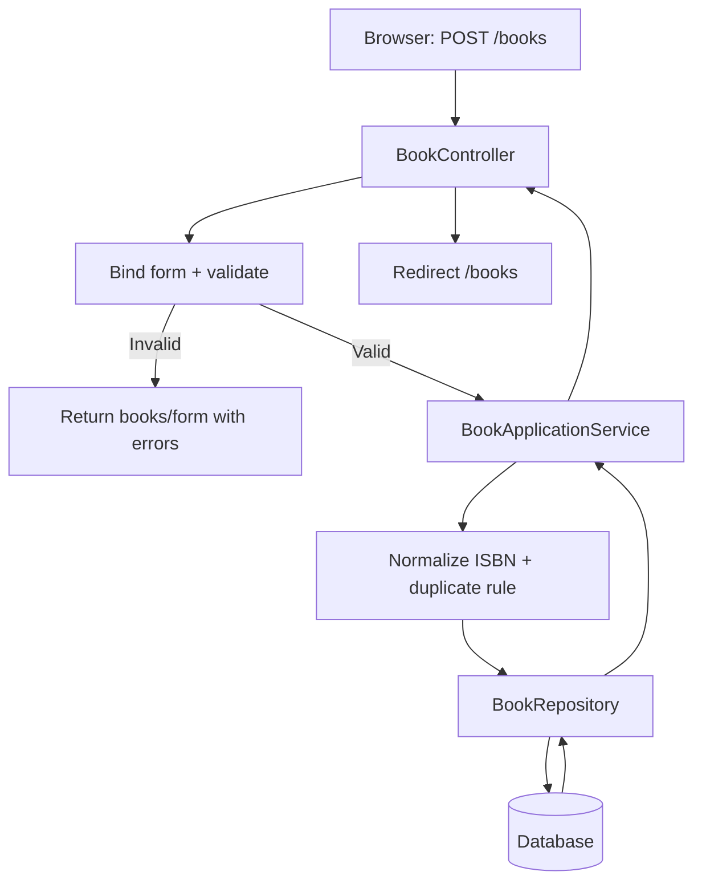

# Thêm kiểm thử để bảo vệ ranh giới MVC

Trong bài thực hành này, bạn sẽ bổ sung một luồng tạo sách cho ứng dụng quản lý thư viện và viết các kiểm thử bảo vệ từng ranh giới của MVC. Mục tiêu không phải là mock mọi lớp hoặc kiểm tra từng lời gọi nội bộ. Mỗi nhóm test sẽ xác nhận một hợp đồng mà thành phần đó chịu trách nhiệm: Controller nhận HTTP và trả response đúng, Application Service thực hiện quy tắc nghiệp vụ, Repository ánh xạ dữ liệu đúng, và một integration test xác nhận các phần phối hợp với nhau.

Khi hoàn thành, bạn sẽ có một bộ test đủ nhanh để chạy thường xuyên và đủ sát hệ thống để phát hiện lỗi ở ranh giới giữa các tầng.

## 1. Mục tiêu thực hành

Sau bài tập, bạn có thể:

- Phân biệt unit test, MVC slice test, repository integration test và full application integration test.
- Kiểm tra route, HTTP method, form binding, validation, View name và redirect bằng MockMvc.
- Kiểm tra quy tắc nghiệp vụ trong Application Service mà không khởi động Spring context.
- Kiểm tra mapping và truy vấn Repository bằng database kiểm thử.
- Xác nhận một request đi qua Controller, Service và Repository tạo ra dữ liệu bền vững.
- Chọn assertion tập trung vào hợp đồng, tránh khóa test vào chi tiết triển khai.

## 2. Bối cảnh và yêu cầu chức năng

Ứng dụng quản lý thư viện cần cho thủ thư tạo một đầu sách mới. Một cuốn sách có các trường:

| Trường | Quy tắc |
|---|---|
| `title` | Bắt buộc, tối đa 200 ký tự |
| `author` | Bắt buộc, tối đa 160 ký tự |
| `isbn` | Bắt buộc, tối đa 20 ký tự; lưu dạng chuẩn hóa không có dấu gạch nối hoặc khoảng trắng |

Luồng người dùng:

1. Mở `GET /books/new` để xem biểu mẫu.
2. Nhập tiêu đề, tác giả và ISBN.
3. Gửi `POST /books`.
4. Nếu dữ liệu hợp lệ và ISBN chưa tồn tại, ứng dụng lưu sách rồi redirect đến `/books`.
5. Nếu validation thất bại, ứng dụng trả lại `books/form` và hiển thị lỗi trường.
6. Nếu ISBN đã tồn tại, ứng dụng trả lại biểu mẫu với lỗi ở trường ISBN.

Giả sử ứng dụng dùng Spring Boot, Spring MVC, Thymeleaf, Spring Data JPA và Spring Security. Các ví dụ test dùng Spring Boot 3.4+ với `@MockitoBean`; nếu dự án dùng Spring Boot cũ hơn, có thể thay bằng `@MockBean` tương ứng.

## 3. Xác định ranh giới cần bảo vệ

Trước khi viết test, hãy vẽ đường đi của request và xác định hợp đồng ở mỗi điểm:



| Ranh giới | Hợp đồng cần bảo vệ | Loại test phù hợp |
|---|---|---|
| HTTP → Controller | URL, method, parameter binding, validation, status và View | `@WebMvcTest` + MockMvc |
| Controller → Application Service | Chỉ gọi use case khi request hợp lệ; chuyển đúng dữ liệu | MVC slice test với Service mock |
| Application Service → Domain/Repository | Chuẩn hóa ISBN, từ chối trùng, lưu dữ liệu đúng | JUnit + Mockito |
| Repository → Database | Mapping entity, unique constraint và derived query | `@DataJpaTest` |
| Toàn bộ request lifecycle | Filter, MVC, Service, transaction và persistence phối hợp | `@SpringBootTest` + MockMvc |

Mỗi test nên tập trung vào một ranh giới. Một full integration test không thay thế được các unit test nhanh; một MVC test mock Service cũng không chứng minh dữ liệu đã được lưu.

## 4. Chuẩn bị cấu trúc mã nguồn

Bạn có thể tổ chức các thành phần theo feature:

```text
src/main/java/com/example/library/
  book/
    web/
      BookController.java
      CreateBookForm.java
    application/
      BookApplicationService.java
      CreateBookCommand.java
      DuplicateIsbnException.java
    domain/
      Book.java
    persistence/
      BookRepository.java

src/main/resources/
  templates/
    books/
      form.html

src/test/java/com/example/library/book/
  web/
    BookControllerWebTest.java
  application/
    BookApplicationServiceTest.java
  persistence/
    BookRepositoryTest.java
  BookCreationFlowIT.java
```

Tên package có thể thay đổi theo dự án. Điều quan trọng là test thể hiện được ranh giới nó đang kiểm tra.

### Dependency cần có

Các starter thường dùng:

```xml
<dependencies>
    <dependency>
        <groupId>org.springframework.boot</groupId>
        <artifactId>spring-boot-starter-web</artifactId>
    </dependency>
    <dependency>
        <groupId>org.springframework.boot</groupId>
        <artifactId>spring-boot-starter-thymeleaf</artifactId>
    </dependency>
    <dependency>
        <groupId>org.springframework.boot</groupId>
        <artifactId>spring-boot-starter-validation</artifactId>
    </dependency>
    <dependency>
        <groupId>org.springframework.boot</groupId>
        <artifactId>spring-boot-starter-data-jpa</artifactId>
    </dependency>
    <dependency>
        <groupId>org.springframework.boot</groupId>
        <artifactId>spring-boot-starter-security</artifactId>
    </dependency>
    <dependency>
        <groupId>org.springframework.boot</groupId>
        <artifactId>spring-boot-starter-test</artifactId>
        <scope>test</scope>
    </dependency>
    <dependency>
        <groupId>org.springframework.security</groupId>
        <artifactId>spring-security-test</artifactId>
        <scope>test</scope>
    </dependency>
    <dependency>
        <groupId>com.h2database</groupId>
        <artifactId>h2</artifactId>
        <scope>test</scope>
    </dependency>
</dependencies>
```

Nếu dự án đã quản lý dependency bằng Gradle hoặc version catalog, thêm các dependency tương đương thay vì sao chép cấu hình Maven. Nếu production dùng PostgreSQL hoặc một hệ quản trị khác, nên có thêm test với cùng engine bằng Testcontainers cho các hành vi phụ thuộc database.

## 5. Tạo form object cho ranh giới web

Không bind request trực tiếp vào JPA entity. Form object chỉ chứa các trường người dùng được phép nhập:

```java
public class CreateBookForm {
    @NotBlank(message = "Tên sách không được để trống.")
    @Size(max = 200, message = "Tên sách tối đa 200 ký tự.")
    private String title;

    @NotBlank(message = "Tác giả không được để trống.")
    @Size(max = 160, message = "Tên tác giả tối đa 160 ký tự.")
    private String author;

    @NotBlank(message = "ISBN không được để trống.")
    @Size(max = 20, message = "ISBN tối đa 20 ký tự.")
    private String isbn;

    public String getTitle() { return title; }
    public void setTitle(String title) { this.title = title; }
    public String getAuthor() { return author; }
    public void setAuthor(String author) { this.author = author; }
    public String getIsbn() { return isbn; }
    public void setIsbn(String isbn) { this.isbn = isbn; }
}
```

Form object thuộc presentation boundary. Nó dùng annotation validation để kiểm tra dữ liệu hình thức trước khi gọi use case. Quy tắc chuẩn hóa ISBN và kiểm tra trùng sẽ nằm ở Application Service.

## 6. Tạo Model và Repository

Entity:

```java
@Entity
@Table(
    name = "books",
    uniqueConstraints = @UniqueConstraint(
        name = "uk_books_isbn",
        columnNames = "isbn"))
public class Book {
    @Id
    @GeneratedValue(strategy = GenerationType.IDENTITY)
    private Long id;

    @Column(nullable = false, length = 200)
    private String title;

    @Column(nullable = false, length = 160)
    private String author;

    @Column(nullable = false, length = 20)
    private String isbn;

    protected Book() {
    }

    public Book(String title, String author, String isbn) {
        this.title = title;
        this.author = author;
        this.isbn = isbn;
    }

    public Long getId() { return id; }
    public String getTitle() { return title; }
    public String getAuthor() { return author; }
    public String getIsbn() { return isbn; }
}
```

Repository:

```java
public interface BookRepository extends JpaRepository<Book, Long> {
    boolean existsByIsbn(String isbn);
}
```

Unique constraint ở database là lớp bảo vệ cuối cùng để ngăn hai request đồng thời tạo cùng ISBN. Kiểm tra `existsByIsbn` trong Service cải thiện phản hồi thông thường, nhưng riêng bước kiểm tra trước khi insert không loại bỏ được race condition giữa hai transaction.

## 7. Tạo Application Service và command

Command biểu diễn dữ liệu use case cần nhận:

```java
public record CreateBookCommand(
        String title,
        String author,
        String isbn) {
}
```

Exception nghiệp vụ:

```java
public class DuplicateIsbnException extends RuntimeException {
    public DuplicateIsbnException() {
        super("A book with this ISBN already exists.");
    }
}
```

Application Service:

```java
@Service
public class BookApplicationService {
    private final BookRepository bookRepository;

    public BookApplicationService(BookRepository bookRepository) {
        this.bookRepository = bookRepository;
    }

    @Transactional
    public void create(CreateBookCommand command) {
        String isbn = normalizeIsbn(command.isbn());

        if (bookRepository.existsByIsbn(isbn)) {
            throw new DuplicateIsbnException();
        }

        Book book = new Book(
                command.title().trim(),
                command.author().trim(),
                isbn);
        bookRepository.save(book);
    }

    private String normalizeIsbn(String value) {
        return value.replace("-", "").replace(" ", "").trim();
    }
}
```

Service thực hiện quy tắc ứng dụng: chuẩn hóa dữ liệu và từ chối ISBN đã tồn tại. Trong hệ thống thật, cần ánh xạ lỗi unique constraint xảy ra do hai request cạnh tranh thành phản hồi nghiệp vụ phù hợp; không dựa riêng vào `existsByIsbn` để bảo đảm tính duy nhất.

## 8. Tạo Controller mỏng

Controller xử lý HTTP, form binding và chọn View hoặc redirect:

```java
@Controller
@RequestMapping("/books")
public class BookController {
    private final BookApplicationService bookService;

    public BookController(BookApplicationService bookService) {
        this.bookService = bookService;
    }

    @GetMapping("/new")
    public String newForm(Model model) {
        model.addAttribute("form", new CreateBookForm());
        return "books/form";
    }

    @PostMapping
    public String create(
            @Valid @ModelAttribute("form") CreateBookForm form,
            BindingResult bindingResult) {

        if (bindingResult.hasErrors()) {
            return "books/form";
        }

        CreateBookCommand command = new CreateBookCommand(
                form.getTitle(),
                form.getAuthor(),
                form.getIsbn());

        try {
            bookService.create(command);
            return "redirect:/books";
        } catch (DuplicateIsbnException exception) {
            bindingResult.rejectValue(
                    "isbn", "duplicate", "ISBN này đã tồn tại.");
            return "books/form";
        }
    }
}
```

`BindingResult` nằm ngay sau form object để Spring gắn lỗi binding và validation vào đúng đối tượng. Khi form không hợp lệ, Service không được gọi. Khi ISBN trùng, lỗi được gắn vào trường `isbn` để View hiển thị.

Ví dụ này xử lý exception miền `DuplicateIsbnException` phát sinh trong Service. Việc xử lý unique constraint ở database do race condition có thể xảy ra tại flush/commit ngoài thân phương thức Service; production cần một exception handler ở ranh giới transaction phù hợp để ánh xạ lỗi đó về cùng hợp đồng phản hồi.

Template tối thiểu `templates/books/form.html`:

```html
<!DOCTYPE html>
<html lang="vi" xmlns:th="http://www.thymeleaf.org">
<head>
    <meta charset="UTF-8">
    <title>Tạo sách</title>
</head>
<body>
<main>
    <h1>Tạo sách mới</h1>
    <form th:action="@{/books}" th:object="${form}" method="post">
        <label for="title">Tên sách</label>
        <input id="title" type="text" th:field="*{title}">
        <p th:if="${#fields.hasErrors('title')}" th:errors="*{title}"></p>

        <label for="author">Tác giả</label>
        <input id="author" type="text" th:field="*{author}">
        <p th:if="${#fields.hasErrors('author')}" th:errors="*{author}"></p>

        <label for="isbn">ISBN</label>
        <input id="isbn" type="text" th:field="*{isbn}">
        <p th:if="${#fields.hasErrors('isbn')}" th:errors="*{isbn}"></p>

        <button type="submit">Lưu sách</button>
    </form>
</main>
</body>
</html>
```

Nếu Spring Security bật CSRF, form cần gửi CSRF token. Thymeleaf/Spring Security có thể tự thêm token trong cấu hình tích hợp; nếu không, bổ sung hidden field theo cấu hình ứng dụng. Các test POST bên dưới dùng `.with(csrf())` để gửi token kiểm thử.

## 9. Test Controller bằng `@WebMvcTest`

MVC slice test tập trung vào presentation boundary. Spring nạp Controller và hạ tầng MVC cần thiết; Application Service được mock để test không phụ thuộc database.

```java
@WebMvcTest(BookController.class)
class BookControllerWebTest {
    @Autowired
    MockMvc mockMvc;

    @MockitoBean
    BookApplicationService bookService;

    @Test
    @WithMockUser(roles = "LIBRARIAN")
    void getNewFormReturnsFormView() throws Exception {
        mockMvc.perform(get("/books/new"))
                .andExpect(status().isOk())
                .andExpect(view().name("books/form"))
                .andExpect(model().attributeExists("form"));
    }

    @Test
    @WithMockUser(roles = "LIBRARIAN")
    void invalidFormDoesNotCallApplicationService() throws Exception {
        mockMvc.perform(post("/books")
                        .with(csrf())
                        .param("title", " ")
                        .param("author", "Nguyễn An")
                        .param("isbn", "9780000000000"))
                .andExpect(status().isOk())
                .andExpect(view().name("books/form"))
                .andExpect(model().attributeHasFieldErrors("form", "title"));

        then(bookService).shouldHaveNoInteractions();
    }

    @Test
    @WithMockUser(roles = "LIBRARIAN")
    void validFormCallsUseCaseAndRedirects() throws Exception {
        mockMvc.perform(post("/books")
                        .with(csrf())
                        .param("title", "Thiết kế phần mềm")
                        .param("author", "Nguyễn An")
                        .param("isbn", "9780000000000"))
                .andExpect(status().is3xxRedirection())
                .andExpect(redirectedUrl("/books"));

        then(bookService).should().create(new CreateBookCommand(
                "Thiết kế phần mềm", "Nguyễn An", "9780000000000"));
    }

    @Test
    @WithMockUser(roles = "LIBRARIAN")
    void duplicateIsbnReturnsFieldError() throws Exception {
        willThrow(new DuplicateIsbnException())
                .given(bookService)
                .create(any(CreateBookCommand.class));

        mockMvc.perform(post("/books")
                        .with(csrf())
                        .param("title", "Thiết kế phần mềm")
                        .param("author", "Nguyễn An")
                        .param("isbn", "9780000000000"))
                .andExpect(status().isOk())
                .andExpect(view().name("books/form"))
                .andExpect(model().attributeHasFieldErrors("form", "isbn"));
    }
}
```

Các import static thường dùng:

```java
import static org.mockito.ArgumentMatchers.any;
import static org.mockito.BDDMockito.then;
import static org.mockito.BDDMockito.willThrow;
import static org.springframework.security.test.web.servlet.request.SecurityMockMvcRequestPostProcessors.csrf;
import static org.springframework.test.web.servlet.request.MockMvcRequestBuilders.get;
import static org.springframework.test.web.servlet.request.MockMvcRequestBuilders.post;
import static org.springframework.test.web.servlet.result.MockMvcResultMatchers.*;
```

Các import annotation/kiểu thường dùng trong test class gồm `org.springframework.boot.test.autoconfigure.web.servlet.WebMvcTest`, `org.springframework.boot.test.autoconfigure.web.servlet.AutoConfigureMockMvc`, `org.springframework.boot.test.context.SpringBootTest`, `org.springframework.test.context.bean.override.mockito.MockitoBean`, `org.springframework.security.test.context.support.WithMockUser` và `org.springframework.test.web.servlet.MockMvc`.

`@MockitoBean` có trong Spring Framework 6.2 và được dùng trong Spring Boot 3.4+. Với dự án Spring Boot cũ hơn, dùng `@MockBean` từ Spring Boot Test. `@WithMockUser` và `.with(csrf())` cần dependency `spring-security-test`; role phải khớp quy tắc bảo vệ route trong ứng dụng.

Để các ví dụ `roles = "LIBRARIAN"` có ý nghĩa, giả sử ứng dụng có quy tắc bảo vệ route tương tự:

```java
@Bean
SecurityFilterChain securityFilterChain(HttpSecurity http) throws Exception {
    return http
            .authorizeHttpRequests(auth -> auth
                    .requestMatchers("/books/**").hasRole("LIBRARIAN")
                    .anyRequest().authenticated())
            .formLogin(Customizer.withDefaults())
            .build();
}
```

Đoạn cấu hình cần các import `org.springframework.context.annotation.Bean`, `org.springframework.security.config.Customizer`, `org.springframework.security.config.annotation.web.builders.HttpSecurity` và `org.springframework.security.web.SecurityFilterChain`.

Nếu dự án dùng URL authorization hoặc method security theo cách khác, hãy giữ nguyên chính sách thực tế và điều chỉnh user/role trong test cho khớp.

Các test trên bảo vệ những điều người dùng và client phụ thuộc: GET form hoạt động, form sai không gọi use case, form hợp lệ gọi đúng command và redirect, ISBN trùng hiển thị lỗi tại trường. Chúng không kiểm tra template có CSS đẹp hay Service thực sự ghi database; đó là phạm vi của các test khác.

## 10. Test Application Service bằng JUnit và Mockito

Service test không cần khởi động Spring. Ta mock Repository và kiểm tra quy tắc chuẩn hóa, từ chối ISBN trùng và dữ liệu được lưu.

```java
@ExtendWith(MockitoExtension.class)
class BookApplicationServiceTest {
    @Mock
    BookRepository bookRepository;

    @InjectMocks
    BookApplicationService bookService;

    @Test
    void normalizesIsbnAndTrimsBookFieldsBeforeSaving() {
        given(bookRepository.existsByIsbn("9780000000000"))
                .willReturn(false);

        bookService.create(new CreateBookCommand(
                " Thiết kế phần mềm ",
                " Nguyễn An ",
                "978-0-000000-00-0"));

        ArgumentCaptor<Book> captor = ArgumentCaptor.forClass(Book.class);
        then(bookRepository).should().save(captor.capture());

        Book saved = captor.getValue();
        assertThat(saved.getTitle()).isEqualTo("Thiết kế phần mềm");
        assertThat(saved.getAuthor()).isEqualTo("Nguyễn An");
        assertThat(saved.getIsbn()).isEqualTo("9780000000000");
    }

    @Test
    void duplicateIsbnIsRejectedWithoutSaving() {
        given(bookRepository.existsByIsbn("9780000000000"))
                .willReturn(true);

        assertThatThrownBy(() -> bookService.create(new CreateBookCommand(
                "Thiết kế phần mềm",
                "Nguyễn An",
                "978-0-000000-00-0")))
                .isInstanceOf(DuplicateIsbnException.class);

        then(bookRepository).should(never()).save(any(Book.class));
    }
}
```

Các import static thường dùng:

```java
import static org.assertj.core.api.Assertions.assertThat;
import static org.assertj.core.api.Assertions.assertThatThrownBy;
import static org.mockito.ArgumentMatchers.any;
import static org.mockito.BDDMockito.given;
import static org.mockito.BDDMockito.then;
import static org.mockito.Mockito.never;
```

Thêm import `org.mockito.ArgumentCaptor` cho biến `captor` trong test đầu tiên.

Test đầu tiên xác nhận quy tắc chuẩn hóa và dữ liệu gửi đến persistence boundary. Test thứ hai xác nhận ISBN trùng bị từ chối trước khi lưu. Không cần test riêng phương thức private `normalizeIsbn`; hãy kiểm tra kết quả công khai của use case.

## 11. Test Repository bằng `@DataJpaTest`

Repository test kiểm tra mapping entity và derived query với JPA thực. `@DataJpaTest` tạo slice cho persistence và thường dùng embedded database nếu có trên classpath.

```java
@DataJpaTest
class BookRepositoryTest {
    @Autowired
    BookRepository bookRepository;

    @Test
    void existsByIsbnFindsPersistedBook() {
        bookRepository.saveAndFlush(new Book(
                "Thiết kế phần mềm",
                "Nguyễn An",
                "9780000000000"));

        assertThat(bookRepository.existsByIsbn("9780000000000"))
                .isTrue();
        assertThat(bookRepository.existsByIsbn("9781111111111"))
                .isFalse();
    }

    @Test
    void databaseRejectsDuplicateIsbn() {
        bookRepository.saveAndFlush(new Book(
                "Sách thứ nhất", "Tác giả A", "9780000000000"));

        assertThatThrownBy(() -> {
            bookRepository.saveAndFlush(new Book(
                    "Sách thứ hai", "Tác giả B", "9780000000000"));
        }).isInstanceOf(DataIntegrityViolationException.class);
    }
}
```

Test này bảo vệ cả derived query `existsByIsbn` và unique constraint ở database. `saveAndFlush` buộc SQL được gửi xuống database ngay trong test để constraint được kiểm tra tại vị trí assertion. `@DataJpaTest` thường rollback transaction test sau khi chạy.

Test class cần import `org.springframework.dao.DataIntegrityViolationException` để kiểm tra lỗi constraint được Spring dịch.

Nếu production dùng PostgreSQL, H2 có thể không tái hiện mọi hành vi về kiểu dữ liệu, collation, constraint hoặc transaction. Khi hành vi phụ thuộc engine, hãy chạy test bổ sung bằng Testcontainers với cùng loại database.

## 12. Full integration test cho luồng tạo sách

Các test ở trên kiểm tra từng ranh giới riêng. Bổ sung một test khởi động ứng dụng đầy đủ để xác nhận wiring, filter, MVC, Service, Repository và database hoạt động cùng nhau.

```java
@SpringBootTest
@AutoConfigureMockMvc
class BookCreationFlowIT {
    @Autowired
    MockMvc mockMvc;

    @Autowired
    BookRepository bookRepository;

    @Test
    @WithMockUser(roles = "LIBRARIAN")
    void createsBookThroughHttpAndPersistsIt() throws Exception {
        String isbn = "978" + ThreadLocalRandom.current()
                .nextLong(1_000_000_000L, 10_000_000_000L);

        mockMvc.perform(post("/books")
                        .with(csrf())
                        .param("title", "Thiết kế phần mềm")
                        .param("author", "Nguyễn An")
                        .param("isbn", isbn))
                .andExpect(status().is3xxRedirection())
                .andExpect(redirectedUrl("/books"));

        assertThat(bookRepository.existsByIsbn(isbn)).isTrue();
    }
}
```

Test này dùng `java.util.concurrent.ThreadLocalRandom` để tạo hậu tố số có 10 chữ số; thêm import tương ứng trong file test. Dữ liệu được tạo duy nhất cho mỗi lần chạy và vẫn giữ định dạng số của ISBN ví dụ.

Test dùng ISBN duy nhất để có thể chạy lặp lại mà không va chạm dữ liệu. Không đánh dấu test này `@Transactional` nếu mục tiêu là quan sát commit của request; hãy để transaction của Service hoàn tất rồi đọc lại qua Repository. Cấu hình test profile cần dùng database riêng và không kết nối production.

Full integration test chậm hơn slice/unit test, vì vậy chỉ cần một số ít test đại diện cho hành trình quan trọng. Không chuyển mọi test Controller sang `@SpringBootTest`.

## 13. Bảo vệ hợp đồng lỗi và bảo mật

Ngoài happy path, thêm các test ranh giới có ảnh hưởng trực tiếp đến người dùng:

| Scenario | Test ở đâu? | Assertion chính |
|---|---|---|
| Thiếu tiêu đề | MVC slice | Field error xuất hiện; Service không được gọi |
| Tiêu đề vượt giới hạn | MVC slice | Form được trả lại với lỗi `title` |
| ISBN trùng theo dạng đã chuẩn hóa | Service + MVC | Service ném lỗi miền; Controller hiển thị lỗi `isbn` |
| POST thiếu CSRF token | MVC/security integration | Request bị từ chối theo cấu hình Spring Security |
| Người chưa đăng nhập truy cập route bảo vệ | MVC/security integration | Redirect login hoặc `401` theo hợp đồng |
| Người dùng không có role thủ thư | MVC/security integration | `403 Forbidden` |
| Database từ chối unique constraint | Repository/integration | Lỗi được ánh xạ thành phản hồi phù hợp, không trả stack trace |

Đối với security test, dùng principal và role đúng với cấu hình thật. `@WithMockUser` tạo một user giả cho test; nó không chứng minh cấu hình đăng nhập hoặc identity provider bên ngoài hoạt động. Nếu cần kiểm tra luồng đăng nhập thật, đó là một integration/E2E test riêng.

## 14. Những assertion nên và không nên viết

Test tốt bảo vệ hành vi ổn định. Ví dụ tốt:

- `status().is3xxRedirection()` và `redirectedUrl("/books")`.
- `view().name("books/form")`.
- `model().attributeHasFieldErrors("form", "title")`.
- `BookApplicationService` không được gọi khi form sai.
- Repository nhận một `Book` đã chuẩn hóa ISBN.
- Database từ chối ISBN trùng.

Các assertion dễ làm test mong manh:

- Kiểm tra thứ tự mọi lời gọi private/helper method.
- Kiểm tra chính xác số lần gọi `save()` nếu hợp đồng không yêu cầu.
- Kiểm tra chuỗi HTML đầy đủ khi chỉ cần kiểm tra View và Model.
- Mock Controller trong test Service hoặc mock Repository trong test Repository.
- Dùng một `@SpringBootTest` cho mọi test chỉ vì cấu hình đơn giản lúc đầu.

Có thể kiểm tra lời gọi collaborator tại ranh giới Controller–Service hoặc Service–Repository khi nó thể hiện hợp đồng quan trọng. Tránh kiểm tra từng bước nội bộ không ảnh hưởng kết quả.

## 15. Bài tập mở rộng

Sau khi hoàn thành bộ test cơ bản, hãy tự mở rộng:

1. Thêm trang danh sách sách và kiểm tra GET trả đúng View cùng Model attribute.
2. Thêm phân trang; test page number, page size và sort theo hợp đồng công khai.
3. Thêm quyền chỉ `LIBRARIAN` được tạo sách; test user không có role nhận `403`.
4. Mô phỏng race condition tạo cùng ISBN; xác nhận unique constraint bảo vệ database và lỗi được ánh xạ đúng.
5. Thêm REST endpoint tạo sách; tái sử dụng Application Service nhưng kiểm tra response JSON, status `201` và `Location` riêng.
6. Thêm browser E2E cho hành trình mở form, nhập dữ liệu và nhìn thấy thông báo thành công.

Không cần thêm abstraction hoặc test mới chỉ để tăng số lượng. Mỗi test mở rộng phải bảo vệ một hợp đồng hoặc rủi ro cụ thể.

## 16. Tiêu chí hoàn thành

Đánh dấu bài thực hành hoàn thành khi:

- [ ] `GET /books/new` trả form và Model attribute đúng.
- [ ] Form không hợp lệ được trả lại cùng lỗi trường.
- [ ] Controller không gọi Service khi validation thất bại.
- [ ] Form hợp lệ gọi đúng `CreateBookCommand` và redirect theo hợp đồng.
- [ ] ISBN trùng tạo lỗi ở trường ISBN.
- [ ] Service chuẩn hóa ISBN và từ chối dữ liệu trùng.
- [ ] Repository test xác nhận derived query hoạt động.
- [ ] Database test xác nhận unique constraint.
- [ ] Full integration test xác nhận request lưu được dữ liệu thật trong database test.
- [ ] Security test bao phủ CSRF và quyền truy cập nếu ứng dụng bật Spring Security.
- [ ] Các test có thể chạy độc lập, không phụ thuộc thứ tự hoặc dữ liệu của test khác.

## 17. Chạy và đọc kết quả kiểm thử

Chạy toàn bộ test bằng wrapper của dự án. Với Maven:

```bash
./mvnw test
```

Với Gradle:

```bash
./gradlew test
```

Tên `BookCreationFlowIT` thường được dùng cho integration test chạy bằng Maven Failsafe hoặc một task `integrationTest` riêng. Nếu dự án dùng Maven Failsafe, chạy `./mvnw verify`; nếu dùng Gradle, chạy task integration test đã cấu hình. Nếu chưa có nhóm test riêng, có thể đổi tên lớp theo quy ước test hiện tại hoặc cấu hình runner để lớp `*IT` thực sự được thực thi. Khi test thất bại, đọc assertion và log đầu tiên có ý nghĩa; không vội tăng timeout hoặc thêm sleep để làm test xanh.

Hãy kiểm tra ba điều sau trong báo cáo:

1. MVC slice test chạy nhanh và không cần database.
2. Service unit test không khởi động Spring context.
3. Repository và full integration test dùng database test, có dữ liệu độc lập và cleanup rõ ràng.

## 18. Tổng kết bài thực hành

Một bộ kiểm thử MVC vững chắc không cần một test duy nhất đi qua mọi lớp cho tất cả tình huống. Hãy bảo vệ từng hợp đồng ở đúng ranh giới: MockMvc xác nhận HTTP, binding, validation và View; unit test xác nhận use case và quy tắc nghiệp vụ; `@DataJpaTest` xác nhận persistence; một số full integration test xác nhận wiring và transaction thực tế. Cách phân chia này giúp lỗi được định vị nhanh, test ít phụ thuộc cấu trúc nội bộ và ứng dụng có thể thay đổi từng tầng mà vẫn giữ hành vi đã cam kết với người dùng.
