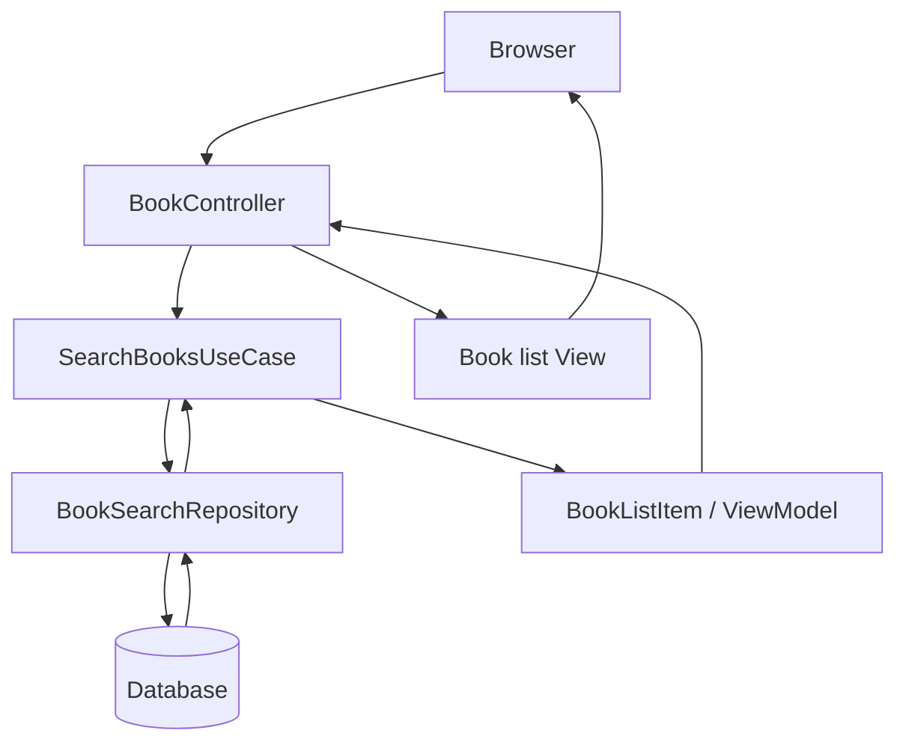
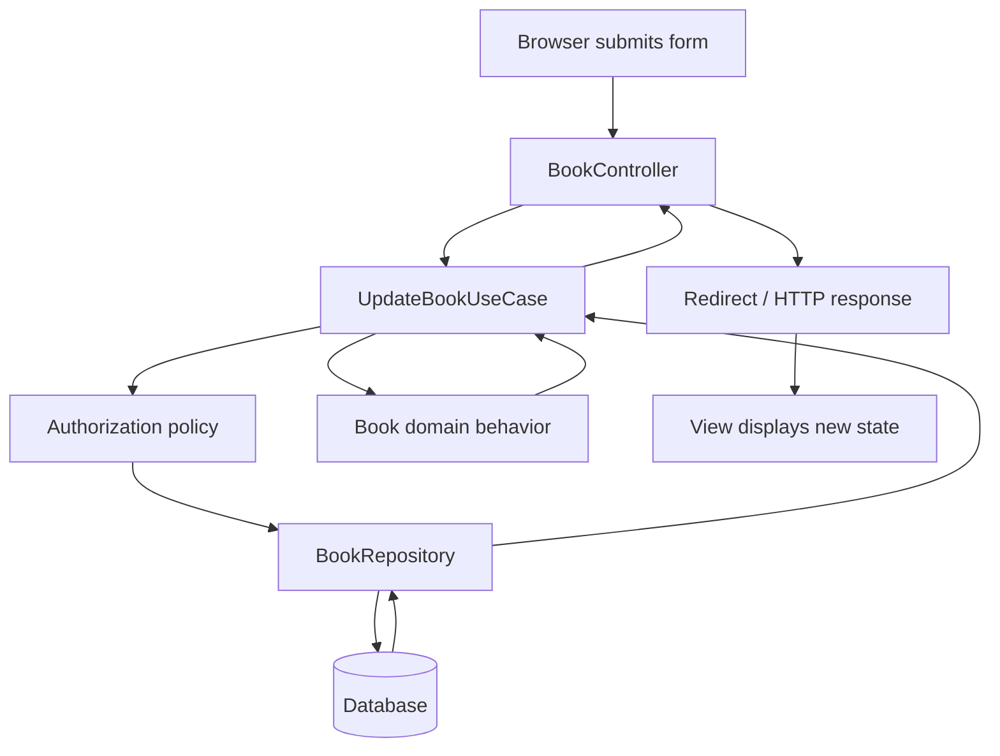

# Kiểm tra trách nhiệm của Model, View và Controller

Design review trong một ứng dụng Model–View–Controller (MVC) không chỉ là kiểm tra xem dự án có ba thư mục mang tên Model, View và Controller hay không. Mục tiêu là xác minh mỗi phần đang làm đúng công việc của nó, dữ liệu đi qua các ranh giới có chủ đích, và một thay đổi ở giao diện không làm hỏng quy tắc nghiệp vụ hoặc persistence. Một dự án có thể dùng đúng framework MVC nhưng vẫn có thiết kế khó bảo trì nếu Controller chứa SQL, template tự gọi repository, hoặc Model chỉ là tập hợp getter/setter trong khi mọi quy tắc nằm rải rác ở nơi khác.

Bài học này đưa ra cách review có thể áp dụng cho một ứng dụng web quản lý sách. Người review sẽ lần theo một request từ trình duyệt tới database và quay lại, kiểm tra trách nhiệm của từng thành phần, nhận diện dấu hiệu phân lớp sai, đánh giá bảo mật và transaction, rồi ghi nhận phát hiện đủ rõ để nhóm có thể sửa theo mức độ ưu tiên.

## 1. Mục tiêu của một lần MVC design review

Một lần review tốt cần trả lời được các câu hỏi:

- Controller có tiếp nhận request, kiểm tra đầu vào ở biên và điều phối đúng ca sử dụng không?
- View có tập trung trình bày dữ liệu và thu thập tương tác không?
- Model có bảo vệ trạng thái và quy tắc nghiệp vụ không?
- Repository có giới hạn trách nhiệm ở việc đọc/ghi dữ liệu không?
- Các lớp có phụ thuộc theo hướng hợp lý không?
- Quyền truy cập, transaction, lỗi và concurrency có được xử lý ở đúng ranh giới không?
- Có thể kiểm thử từng hành vi mà không phải khởi chạy toàn bộ ứng dụng không?
- Một thay đổi về giao diện có buộc sửa domain hoặc database khi ý nghĩa nghiệp vụ không đổi không?

Review không nhằm áp đặt số lượng lớp hoặc mẫu kiến trúc giống nhau cho mọi dự án. Một ứng dụng CRUD nhỏ có thể cần ít abstraction; hệ thống có nhiều kênh truy cập, nhiều quy tắc và nhiều nhóm phát triển có thể cần application service, repository port, presenter và các module rõ ràng hơn. Tiêu chí quan trọng là trách nhiệm có rõ, có thể kiểm chứng và phù hợp độ phức tạp của hệ thống hay không.

## 2. Phân biệt ba thành phần trước khi review

### Model

Model đại diện cho dữ liệu và hành vi mà ứng dụng cần quản lý. Trong MVC, thuật ngữ Model có thể chỉ phần trạng thái/logic của ứng dụng theo nghĩa rộng; ở một hệ thống phân lớp, phần này có thể bao gồm domain model, application model, query result và các abstraction truy cập dữ liệu.

Với ví dụ quản lý sách:

- Domain `Book` giữ ISBN, tiêu đề, số bản và trạng thái lưu trữ.
- Domain methods kiểm tra số lượng hợp lệ và chuyển trạng thái.
- Application service điều phối hành động như tạo sách hoặc điều chỉnh tồn kho.
- Repository đọc và lưu aggregate.
- Query projection cung cấp dữ liệu cần thiết cho danh sách.

Không nên đồng nhất Model với một entity JPA duy nhất. Entity persistence có thể là một cách triển khai domain model, nhưng Model còn bao gồm quy tắc và các đối tượng dữ liệu ứng dụng cần thiết.

Trong Spring MVC, tham số `org.springframework.ui.Model` của Controller là vùng chứa thuộc tính để chuyển dữ liệu sang View. Nó không phải domain Model và cũng không phải entity `Book`. Khi review, cần phân biệt ba khái niệm: domain model giữ quy tắc, Spring UI model mang dữ liệu của request hiện tại, còn ViewModel/DTO mô tả dữ liệu trình bày.

### View

View trình bày dữ liệu cho người dùng. Với server-rendered MVC, đó thường là template HTML; với SPA, đó là component; với API, response mapper/serializer là phần chuyển dữ liệu ứng dụng thành hợp đồng giao tiếp.

View có thể:

- Hiển thị dữ liệu đã được chuẩn bị.
- Lặp danh sách, định dạng đơn giản và hiển thị thông báo.
- Thu thập dữ liệu biểu mẫu.
- Gửi request khi người dùng thực hiện hành động.
- Ẩn hoặc hiện điều khiển theo dữ liệu quyền được cung cấp để cải thiện trải nghiệm.

View không được làm nguồn quyết định cuối cùng về quyền, không truy vấn persistence và không thực hiện side effect nghiệp vụ chỉ vì trang được render.

### Controller

Controller tiếp nhận request và điều phối tương tác:

- Đọc path, query parameter, header và body.
- Bind dữ liệu vào request DTO/form.
- Kích hoạt validation ở biên.
- Gọi application service/use case hoặc query service.
- Chuyển kết quả thành ViewModel, redirect hoặc HTTP response.
- Ánh xạ lỗi ứng dụng thành phản hồi phù hợp với giao thức.

Controller không nên trở thành nơi chứa SQL, tính toán nghiệp vụ, quy tắc trạng thái hoặc transaction orchestration phức tạp. Một Controller có thể có một ít logic điều phối giao thức; “Controller mỏng” không có nghĩa là phải tách mọi dòng code thành một class mới.

## 3. Sơ đồ trách nhiệm cần kiểm tra

Một luồng đọc danh sách sách có thể đi qua các thành phần như sau:



Một luồng cập nhật sách:



Trong thực tế, repository có thể tải entity trước khi domain behavior được gọi; sơ đồ thể hiện trách nhiệm chính chứ không ép một thứ tự kỹ thuật duy nhất. Điểm cần xác minh là View không đi thẳng tới database, Controller không tự thực hiện mọi quy tắc và domain không phụ thuộc HTTP.

## 4. Review trách nhiệm của Controller

### Những dấu hiệu tích cực

Một Controller có ranh giới tốt thường:

- Có phương thức gắn với route hoặc hành động giao thức cụ thể.
- Nhận DTO/form thay vì bind trực tiếp toàn bộ entity persistence.
- Chuyển request thành command/query có tên rõ.
- Gọi một use case cho một mục tiêu nghiệp vụ.
- Đưa kết quả vào model hoặc response DTO.
- Trả đúng view, redirect và HTTP status.
- Để exception handler hoặc adapter xử lý lỗi nhất quán.

Ví dụ:

```java
@Controller
@RequiredArgsConstructor
@RequestMapping("/books")
public class BookController {
    private final SearchBooksUseCase searchBooks;
    private final CreateBookUseCase createBook;

    @GetMapping
    public String list(
            @RequestParam(required = false) String keyword,
            @RequestParam(defaultValue = "0") int page,
            Model model) {

        BookPage result = searchBooks.execute(
            new SearchBooksQuery(keyword, page, 20)
        );
        model.addAttribute("books", result);
        return "books/list";
    }

    @PostMapping
    public String create(
            @Valid @ModelAttribute("form") CreateBookForm form,
            BindingResult errors,
            RedirectAttributes redirect) {

        if (errors.hasErrors()) {
            return "books/new";
        }

        CreateBookResult result = createBook.execute(
            new CreateBookCommand(
                form.isbn(),
                form.title(),
                form.author(),
                form.category(),
                form.publishedYear(),
                form.initialCopies()
            )
        );

        redirect.addFlashAttribute("message", "Đã thêm sách");
        return "redirect:/books/" + result.bookId();
    }
}
```

Đây là ví dụ rút gọn; import, DTO và cấu hình Spring được lược bỏ. Controller nhận form, kiểm tra lỗi binding/validation, chuyển thành command và gọi use case. Nó không tự tính tồn kho, kiểm tra ISBN bằng SQL hay lưu entity.

### Dấu hiệu Controller đang làm quá nhiều

| Dấu hiệu | Vì sao đáng xem xét | Hướng xử lý |
|---|---|---|
| Gọi nhiều repository theo chuỗi | Quy trình nghiệp vụ nằm trong adapter HTTP | Đưa orchestration vào application service |
| Chứa điều kiện trạng thái dài | Quy tắc bị gắn với một route | Đưa invariant vào domain/use case |
| Tự mở transaction và commit | Khó tái sử dụng từ adapter khác | Đặt transaction ở application boundary |
| Tự tính giá, thuế hoặc tồn kho | Business rule bị lặp ở nhiều Controller | Tạo domain behavior/service |
| Trả entity trực tiếp thành JSON | Lộ trường và phụ thuộc ORM | Dùng response DTO |
| Có nhánh `if (isMobile)`, `if (isAdmin)` cho nhiều response | Một Controller ôm nhiều giao thức và trải nghiệm | Tách adapter theo kênh nếu trách nhiệm khác nhau |
| Bắt mọi exception rồi trả cùng một thông báo | Mất ngữ nghĩa lỗi và che lỗi hệ thống | Ánh xạ lỗi có chủ đích |

Không phải mọi lời gọi repository từ Controller đều tự động là lỗi nghiêm trọng trong ứng dụng rất nhỏ. Hãy đánh giá số lượng bước, quy tắc, transaction, khả năng tái sử dụng và test. Nếu Controller chỉ đọc một tham chiếu đơn giản cho một trang nội bộ, một lớp query service riêng có thể chưa tạo thêm giá trị. Nhưng khi có phân quyền, phân trang, nhiều query hoặc quy tắc, nên chuyển trách nhiệm ra khỏi Controller.

### Controller có thể làm gì với validation?

Controller/DTO có thể kiểm tra định dạng và cấu trúc request: trường bắt buộc, độ dài, kiểu, số lượng phần tử hoặc định dạng email. Các kiểm tra này giúp phản hồi sớm và chỉ ra lỗi ở trường nhập.

Các điều kiện như “không được giảm tồn kho thấp hơn số bản đang cho mượn”, “sách đã archive không thể chỉnh sửa” hoặc “chỉ nhân viên của chi nhánh sở hữu mới được thay đổi sách” thuộc application/domain policy. Không để validation annotation hoặc một nhánh trong Controller trở thành nơi duy nhất bảo vệ các quy tắc đó.

## 5. Review trách nhiệm của View

### Những dấu hiệu tích cực

View nhận dữ liệu đã chuẩn bị và tập trung vào cách trình bày:

```html
<table>
  <tbody>
    <tr th:each="book : ${books.items}">
      <td th:text="${book.title}"></td>
      <td th:text="${book.author}"></td>
      <td th:text="${book.availableCopies}"></td>
    </tr>
  </tbody>
</table>
```

Template đọc `books.items` và các trường hiển thị. Nó không biết dữ liệu được lấy bằng JPQL, JDBC hay API khác.

### Dấu hiệu View đang làm việc của lớp khác

- Gọi repository, `EntityManager`, ORM session hoặc service có side effect.
- Truy cập quan hệ lazy khiến render kích hoạt query.
- Tính giá, thuế, tồn kho hoặc quyết định trạng thái nghiệp vụ.
- Thay đổi dữ liệu trong lúc render.
- Gửi email, tạo giao dịch hoặc ghi audit như hệ quả của GET.
- Tự xác định actor/tenant hoặc coi việc ẩn nút là phân quyền.

Ví dụ cần sửa:

```html
<tr th:each="book : ${@bookRepository.findAll()}">
    <td th:text="${book.title}"></td>
    <td th:text="${book.author.name}"></td>
</tr>
```

Template đang gọi repository và có thể kích hoạt truy vấn lazy cho từng tác giả. Nếu có nhiều sách, query count có thể tăng theo số dòng hiển thị. Nên đưa truy vấn sang query service, chọn đúng trường qua projection/DTO rồi truyền vào ViewModel.

### Biểu thức trình bày có giới hạn

Không cần chuyển mọi biểu thức khỏi template. Lặp danh sách, hiển thị nhãn, chọn CSS class, định dạng đơn giản và ẩn/hiện phần tử dựa trên dữ liệu đã có thường phù hợp với View.

Hãy chuyển ra ngoài khi biểu thức:

- Truy cập persistence hoặc mạng.
- Có thể thay đổi dữ liệu.
- Chứa quy tắc quyết định hành vi nghiệp vụ.
- Lặp lại ở nhiều View và có khả năng lệch nhau.
- Khó kiểm thử độc lập hoặc làm phát sinh chi phí truy vấn không rõ ràng.

Một ViewModel có thể có `canArchive` để quyết định có hiển thị nút hay không. Tuy nhiên, use case archive vẫn phải kiểm tra quyền và trạng thái ở server khi nhận request.

### Kiểm tra GET và side effect

GET phải giữ tính an toàn: mở trang chi tiết, tìm kiếm hoặc tải danh sách không được hủy sách hay thay đổi tồn kho. Hành động thay đổi dùng phương thức phù hợp như POST/PATCH/DELETE, có xác thực, authorization và CSRF protection khi dùng cookie/session.

Post/Redirect/Get giúp refresh trang kết quả không gửi lại form POST trong luồng thông thường. PRG không thay thế idempotency hoặc xử lý request lặp từ retry và nhiều tab.

## 6. Review trách nhiệm của Model

### Model có hành vi, không chỉ là dữ liệu

Một Model tốt bảo vệ trạng thái hợp lệ. Ví dụ:

```java
public class Book {
    private int totalCopies;
    private int availableCopies;
    private boolean archived;

    public void increaseStock(int quantity) {
        ensureActive();
        if (quantity <= 0) {
            throw new InvalidStockChangeException();
        }
        totalCopies += quantity;
        availableCopies += quantity;
    }

    public void decreaseStock(int quantity) {
        ensureActive();
        if (quantity <= 0 || quantity > availableCopies) {
            throw new InvalidStockChangeException();
        }
        totalCopies -= quantity;
        availableCopies -= quantity;
    }

    private void ensureActive() {
        if (archived) {
            throw new ArchivedBookException();
        }
    }
}
```

Ví dụ chỉ thể hiện một phần hành vi. Review cần xác minh invariant phù hợp với miền: số lượng không âm, sách archive không được thay đổi, không thể lưu trữ khi còn bản đang được mượn, ISBN duy nhất và các chuyển trạng thái hợp lệ.

### Dấu hiệu Model quá nghèo hoặc quá tải

| Dấu hiệu | Rủi ro | Điều cần xem |
|---|---|---|
| Chỉ có getter/setter, mọi quy tắc ở Controller | Bất biến không được bảo vệ khi có adapter khác | Đưa hành vi vào domain model hoặc domain service |
| Setter công khai cho mọi trạng thái | Bất kỳ code nào cũng có thể tạo trạng thái không hợp lệ | Dùng phương thức có ý nghĩa nghiệp vụ |
| Entity chứa `HttpServletRequest`, `Model` hoặc HTTP status | Domain phụ thuộc giao thức | Chuyển dữ liệu giao thức sang adapter |
| Model gọi trực tiếp template hoặc gửi response | Trộn domain với presentation | Dùng presenter/Controller |
| Entity vừa quản lý persistence vừa chứa quá nhiều orchestration | Khó hiểu ranh giới aggregate | Chuyển điều phối nhiều đối tượng sang application service |
| Model tự gọi repository khác để hoàn tất quy trình | Transaction và phụ thuộc bị ẩn | Xem xét domain service/application service |

Không phải mọi quy tắc đều phải nằm trong một entity. Quy tắc liên quan nhiều aggregate hoặc chính sách ứng dụng có thể thuộc domain service hoặc application service. Review cần xác định quy tắc được đặt ở nơi có đủ ngữ cảnh và được bảo vệ trong mọi đường gọi.

## 7. Kiểm tra ranh giới Repository và Application Service

Repository là abstraction truy cập dữ liệu. Nó có thể tải aggregate, lưu aggregate hoặc trả projection phục vụ truy vấn. Repository không nên biết về HTML, redirect, JSON schema hoặc quyết định quyền của người dùng.

Application service đại diện cho một use case và thường:

1. Nhận command/query.
2. Lấy actor hoặc ngữ cảnh đã xác thực.
3. Kiểm tra authorization theo tài nguyên/hành động.
4. Tải aggregate qua repository.
5. Gọi hành vi domain.
6. Lưu thay đổi hoặc trả dữ liệu truy vấn.
7. Quản lý transaction ở ranh giới cần thiết.

Một use case cập nhật thông tin sách:

Command của use case có thể được định nghĩa như sau:

```java
public record UpdateBookCommand(
    UUID bookId,
    String title,
    String author,
    String category,
    int publishedYear
) {}
```

```java
@Service
@RequiredArgsConstructor
public class UpdateBookService implements UpdateBookUseCase {
    private final BookRepository books;
    private final CurrentActor currentActor;
    private final BookPermissionPolicy permissions;

    @Override
    @Transactional
    public void execute(UpdateBookCommand command) {
        Actor actor = currentActor.get();
        Book book = books.findByIdAndArchivedFalse(command.bookId())
            .orElseThrow(BookNotFoundException::new);

        permissions.ensureCanEdit(actor, book);
        book.reviseDetails(
            command.title(),
            command.author(),
            command.category(),
            command.publishedYear()
        );
    }
}
```

Đây là ví dụ minh họa. Nếu `Book` đang được quản lý bởi JPA persistence context, dirty checking có thể tự lưu khi transaction commit; repository `save` có thể được gọi rõ ràng nếu abstraction hoặc cách triển khai yêu cầu. Review nên kiểm tra transaction và persistence lifecycle thực tế thay vì yêu cầu máy móc một lời gọi `save`.

Ví dụ cập nhật và tăng tồn kho bên dưới dựa trên JPA dirty checking trong transaction. Nếu repository không trả entity đang được quản lý hoặc persistence adapter không dùng JPA, application service cần gọi thao tác lưu rõ ràng theo hợp đồng repository.

### Review hướng phụ thuộc và cohesion

Kiểm tra cả hướng phụ thuộc lẫn mức độ tập trung trách nhiệm:

- View có phụ thuộc trực tiếp repository hoặc domain entity không cần thiết không?
- Domain có import Spring MVC, servlet, template engine hoặc HTTP type không?
- Application service có phụ thuộc abstraction của giao diện hay chỉ vào command/query, policy và port?
- Persistence adapter có triển khai repository port mà application định nghĩa khi cần đảo chiều phụ thuộc không?
- Một class có nhiều lý do độc lập để thay đổi, ví dụ vừa đổi khi route đổi, vừa đổi khi quy tắc tồn kho đổi, vừa đổi khi schema database đổi không?
- Một thay đổi về HTML có buộc sửa domain model không? Một thay đổi quy tắc tồn kho có buộc sửa template không?

Không phải mọi dependency từ application sang Spring Data đều là blocker trong một ứng dụng Spring MVC nhỏ. Hãy ghi nhận đó là lựa chọn kiến trúc và đánh giá theo yêu cầu thay thế persistence, kiểm thử, số adapter và mức độ độc lập framework cần có.

### Những câu hỏi khi review Repository

- Tên phương thức diễn tả nhu cầu dữ liệu rõ không?
- Truy vấn có lọc theo tenant/owner khi cần không?
- Query danh sách có phân trang và projection thay vì tải toàn bộ entity không?
- Repository có trả `Optional`/result rõ thay vì `null` mơ hồ không?
- Có unique/check constraint bảo vệ invariant ở database không?
- Repository có tránh gửi email, kiểm tra quyền hoặc điều phối use case không?
- Có integration test cho query và hành vi phụ thuộc database không?

### Những câu hỏi khi review Application Service

- Một service có mục tiêu/use case rõ không?
- Có phụ thuộc trực tiếp vào `Model`, `HttpServletRequest` hoặc template engine không?
- Transaction bao trùm các thao tác cần nguyên tử không?
- Authorization được kiểm tra ở server và gắn với tài nguyên cụ thể không?
- Có retry hoặc side effect cần idempotency/outbox không?
- Có thể unit test service với dependency giả mà không khởi tạo web server không?

## 8. Kiểm tra luồng request từ đầu đến cuối

Đừng review từng file riêng lẻ rồi kết luận. Chọn một hành trình người dùng và lần theo tất cả bước.

Ví dụ hành trình “thêm sách”:

1. Người quản lý mở trang tạo sách bằng GET.
2. Controller trả form trống và View render.
3. Người dùng nhập ISBN, tiêu đề, tác giả và số bản rồi gửi POST.
4. Spring bind dữ liệu vào `CreateBookForm`.
5. Controller kiểm tra lỗi binding/validation.
6. Controller chuyển form thành `CreateBookCommand`.
7. `CreateBookUseCase` xác minh quyền, chuẩn hóa ISBN và kiểm tra xung đột.
8. Domain tạo `Book` hợp lệ.
9. Repository lưu sách trong transaction.
10. Controller redirect tới trang chi tiết.
11. Query service lấy `BookDetailsView` và View render kết quả.

Với mỗi bước, hãy ghi nhận:

- Dữ liệu nào đi qua ranh giới?
- Ai là chủ sở hữu của quyết định?
- Có kiểm tra quyền hoặc invariant ở đâu?
- Có truy vấn hoặc side effect nào xảy ra?
- Nếu bước thất bại, ai chuyển lỗi thành response?
- Có test nào chứng minh hành vi?

Nếu không thể chỉ ra rõ một quyết định thuộc lớp nào, đó là tín hiệu cần xem xét thêm.

## 9. Review bảo mật và quyền truy cập

Phân lớp đúng hỗ trợ bảo mật nhưng không tự động làm ứng dụng an toàn. Cần kiểm tra:

### Authentication và actor

- Danh tính lấy từ security context/credential đã xác minh.
- Không tin `userId`, `role`, `tenantId` trong body/query như bằng chứng xác thực.
- Tác vụ nền có service identity rõ ràng.
- Không phụ thuộc thread-local security context trong luồng async nếu context không được truyền an toàn.

### Authorization

- Controller/security filter bảo vệ endpoint ở biên.
- Application/domain policy kiểm tra quyền trên tài nguyên và hành động.
- Query giới hạn dữ liệu theo tenant/owner.
- View ẩn nút chỉ phục vụ UX, không thay thế kiểm tra server.
- Lỗi 403/404 được chọn theo chính sách tiết lộ sự tồn tại của tài nguyên.

### Input và output

- Request DTO có validation phù hợp.
- Domain vẫn bảo vệ invariant dù request đi qua adapter nào.
- Template escape output theo mặc định; không đưa dữ liệu không tin cậy vào HTML/JavaScript thô.
- Response không lộ entity nội bộ, credential, stack trace hoặc trường nhạy cảm.
- Form dùng cookie/session có CSRF protection.

## 10. Review transaction, concurrency và side effect

Một hành động có thể thay đổi nhiều bản ghi. Hãy xác định transaction boundary ở application service và kiểm tra tất cả thao tác cần thành công cùng nhau.

Ví dụ tạo phiếu nhập sách có thể cần:

- Tạo phiếu nhập.
- Tạo các dòng nhập.
- Cập nhật số lượng sách.
- Ghi audit/event.

Nếu các thao tác database phải nhất quán, chúng cần cùng transaction hoặc một thiết kế nhất quán tương ứng. Không để Controller gọi từng repository với transaction riêng mà không có xử lý khi một bước thất bại.

Các điểm cần review:

- Optimistic locking/version khi nhiều người cùng sửa một sách.
- Atomic update hoặc lock khi thay đổi số lượng cạnh tranh.
- Unique constraint cho ISBN và mã phiếu.
- Rollback khi một phần use case thất bại.
- Idempotency khi client retry thao tác tạo hoặc nhập kho.
- Outbox/deduplication nếu phát message hoặc gọi dịch vụ bên ngoài.
- Không giữ transaction trong lúc gọi mạng lâu hoặc chờ người dùng.

## 11. Review hiệu năng và khả năng quan sát

Một thiết kế phân lớp tốt giúp nhìn rõ truy vấn và chi phí. Khi review, hãy kiểm tra:

- Template có vô tình kích hoạt lazy loading không?
- Danh sách có N+1 query không?
- Query có trả nhiều trường hơn View cần không?
- Pagination được áp dụng ở database hay sau khi tải hết dữ liệu?
- Filter/sort có allowlist và có index phù hợp không?
- Có query count, thời gian response và log đủ để điều tra lỗi không?
- Correlation/request ID có giúp nối request với log application và persistence không?

Không tối ưu dựa trên phỏng đoán. Hãy xem SQL thực tế, execution plan, query count và dữ liệu có kích thước gần thực tế. Cũng tránh thêm cache trước khi xác định được quyền truy cập, độ mới dữ liệu và chiến lược invalidation.

## 12. Đánh giá testability

Review nên tìm bằng chứng rằng mỗi trách nhiệm có thể được kiểm tra ở mức phù hợp:

| Tầng | Kiểm thử phù hợp | Bằng chứng mong đợi |
|---|---|---|
| Domain Model | Unit test | Invariant, chuyển trạng thái và lỗi miền |
| Application service | Unit test | Điều phối, policy, transaction intent và kết quả |
| Repository | Integration test | Mapping, query, constraint, lock và paging |
| Controller | MVC slice test/MockMvc | Binding, validation, status, redirect và model |
| View | Template/component test | Render đúng với ViewModel, không cần database |
| End-to-end | Browser/API test | Hành trình người dùng và tích hợp thật |

Không cần một end-to-end test cho mọi nhánh domain. Đặt test ở lớp rẻ nhất có thể chứng minh hành vi; dùng integration test cho hành vi ORM/database và test adapter cho hợp đồng HTTP.

Một dấu hiệu thiết kế kém là muốn test một quy tắc tồn kho nhưng phải khởi chạy Spring MVC, dựng database và render template. Có thể domain rule đang bị đặt sai ranh giới hoặc các dependency bị ghép quá chặt.

## 13. Thang mức độ phát hiện

Để review có thể hành động, hãy phân loại phát hiện theo ảnh hưởng và khả năng khai thác:

| Mức | Ý nghĩa | Ví dụ |
|---|---|---|
| Critical | Có thể gây lộ dữ liệu nghiêm trọng, thay đổi trái phép hoặc hỏng dữ liệu diện rộng | View/Controller bỏ qua tenant khiến người dùng sửa dữ liệu người khác |
| High | Có lỗi nghiệp vụ hoặc dữ liệu có khả năng xảy ra trong luồng chính | Hai request có thể tạo ISBN trùng do thiếu unique constraint |
| Medium | Tăng coupling, khó kiểm thử hoặc có nguy cơ hiệu năng đáng kể | Template truy cập lazy relation gây N+1 |
| Low | Vấn đề cục bộ, ảnh hưởng bảo trì hoặc độ rõ ràng | Controller đặt tên không rõ hoặc mapper bị trùng nhẹ |
| Suggestion | Cải tiến tùy chọn, không phải lỗi cần chặn | Có thể tách query DTO khi số trường tăng |

Mức độ phải dựa trên tác động và bối cảnh. Một Controller có 100 dòng chưa chắc là lỗi; một Controller 20 dòng vẫn có thể tạo lỗ hổng nếu tin `ownerId` do client gửi. Không đánh giá chỉ dựa vào số dòng hoặc số class.

## 14. Cách viết một phát hiện review có chất lượng

Một phát hiện hữu ích nên có bốn phần:

1. **Vị trí:** file, phương thức hoặc luồng cụ thể.
2. **Vấn đề:** trách nhiệm nào đang đặt sai hoặc thiếu bảo vệ.
3. **Tác động:** hậu quả có thể xảy ra với dữ liệu, bảo mật, hiệu năng hoặc khả năng thay đổi.
4. **Hướng xử lý:** thay đổi đủ cụ thể để nhóm biết bước tiếp theo.

Ví dụ phát hiện:

```text
[High] Tạo sách có thể lưu ISBN trùng khi hai request chạy đồng thời

Vị trí: CreateBookService.execute()

Vấn đề:
Service chỉ gọi existsByIsbn() rồi mới insert. Hai transaction có thể
cùng nhận kết quả false trước khi transaction nào ghi dữ liệu.

Tác động:
Hai đầu sách có thể cùng ISBN nếu database không có unique constraint.

Đề xuất:
Chuẩn hóa ISBN trước khi ghi, thêm unique constraint trên cột ISBN,
bắt đúng lỗi constraint và ánh xạ thành lỗi trùng ISBN. Bổ sung
integration test với hai transaction cạnh tranh.
```

Ví dụ phát hiện View:

```text
[Medium] Template truy vấn tác giả trong lúc render danh sách

Vị trí: books/list.html

Vấn đề:
Template nhận entity Book và đọc book.author.name; quan hệ author
là lazy nên có thể phát sinh một query cho mỗi dòng.

Tác động:
Trang danh sách chậm khi số sách tăng và query count khó dự đoán.

Đề xuất:
Tạo projection chứa title, authorName và availableCopies; query service
trả BookListItem rồi truyền cho template.
```

Tránh viết nhận xét chung như “Controller quá lớn” hoặc “MVC chưa chuẩn”. Nêu hành vi và hậu quả giúp người viết code xác định đúng chỗ cần thay đổi.

## 15. Ví dụ review một thiết kế chưa tốt

Giả sử Controller được viết như sau:

```java
@Controller
@RequiredArgsConstructor
public class BookController {
    private final BookRepository books;

    @PostMapping("/books/{id}/stock")
    public String increaseStock(
            @PathVariable UUID id,
            @RequestParam int quantity) {

        Book book = books.findById(id).orElseThrow();
        if (book.isArchived()) {
            throw new IllegalStateException("Archived");
        }
        if (quantity <= 0) {
            throw new IllegalArgumentException("Invalid quantity");
        }

        book.setTotalCopies(book.getTotalCopies() + quantity);
        book.setAvailableCopies(book.getAvailableCopies() + quantity);
        books.save(book);
        return "redirect:/books/" + id;
    }
}
```

Nhận xét review:

- Controller truy cập repository trực tiếp và tự điều phối thay đổi dữ liệu.
- Quy tắc archived và quantity được đặt trong Controller, có thể bị bỏ qua ở adapter khác.
- Setter công khai cho phép những lớp khác tạo trạng thái không hợp lệ.
- Không thấy authorization cho người thực hiện hành động.
- Không thấy transaction boundary rõ ở application use case.
- Chưa có bằng chứng xử lý concurrent update.
- Lỗi kỹ thuật và lỗi nghiệp vụ chưa được phân loại.

Một cách tổ chức rõ hơn:

```java
public record IncreaseBookStockCommand(UUID bookId, int quantity) {}

public interface IncreaseBookStockUseCase {
    void execute(IncreaseBookStockCommand command);
}

@Service
@RequiredArgsConstructor
public class IncreaseBookStockService
        implements IncreaseBookStockUseCase {

    private final BookRepository books;
    private final CurrentActor currentActor;
    private final BookPermissionPolicy permissions;

    @Override
    @Transactional
    public void execute(IncreaseBookStockCommand command) {
        Actor actor = currentActor.get();
        Book book = books.findByIdAndArchivedFalse(command.bookId())
            .orElseThrow(BookNotFoundException::new);

        permissions.ensureCanAdjustStock(actor, book);
        book.increaseStock(command.quantity());
    }
}

@Controller
@RequiredArgsConstructor
public class BookStockController {
    private final IncreaseBookStockUseCase increaseStock;

    @PostMapping("/books/{id}/stock/increase")
    public String increase(
            @PathVariable UUID id,
            @RequestParam int quantity) {
        increaseStock.execute(new IncreaseBookStockCommand(id, quantity));
        return "redirect:/books/" + id;
    }
}
```

Ở ví dụ này, `Book.increaseStock` bảo vệ invariant; use case kiểm tra quyền, tải aggregate và chạy trong transaction; Controller chuyển request thành command. Nếu entity đang được quản lý, JPA dirty checking có thể ghi thay đổi khi commit. Repository vẫn phải có version/lock phù hợp nếu có cập nhật đồng thời.

## 16. Quy trình tiến hành design review

Có thể dùng quy trình sau cho một tính năng hoặc một pull request:

1. **Xác định phạm vi.** Chọn hành trình hoặc use case cần review, ví dụ thêm sách, chỉnh sửa sách hoặc tìm kiếm.
2. **Đọc luồng trước khi đọc từng class.** Lần từ route tới View, application service, domain và repository.
3. **Ghi chủ sở hữu từng quyết định.** Định dạng ở View, giao thức ở Controller, quy tắc ở Model, điều phối ở application service, persistence ở repository.
4. **Kiểm tra dependency.** Tìm các lời gọi trực tiếp xuyên tầng và framework dependency đi vào domain.
5. **Kiểm tra rủi ro.** Authorization, validation, transaction, concurrency, side effect và N+1.
6. **Xem test và bằng chứng runtime.** Xác định hành vi đã được kiểm tra ở đâu; xem query/log/metrics nếu có vấn đề hiệu năng.
7. **Phân loại phát hiện.** Critical/High/Medium/Low/Suggestion dựa trên tác động.
8. **Đề xuất thay đổi theo bước nhỏ.** Ưu tiên sửa lỗi dữ liệu/bảo mật trước, sau đó giảm coupling và cải thiện cấu trúc.
9. **Xác nhận sau sửa.** Kiểm tra test liên quan và xem phát hiện đã được giải quyết bằng bằng chứng nào.

Review có thể kết luận “không cần thay đổi” nếu ranh giới đang hợp lý. Không tạo refactor chỉ để tăng số lượng pattern.

## 17. Mẫu checklist dùng trong buổi review

### Controller

- [ ] Route và HTTP method phù hợp với hành vi?
- [ ] Request DTO/form tách khỏi entity persistence?
- [ ] Validation cấu trúc ở biên và lỗi được phản hồi rõ?
- [ ] Controller gọi use case/query thay vì tự điều phối repository?
- [ ] Không chứa quy tắc domain hoặc tính toán nghiệp vụ?
- [ ] Authorization không chỉ dựa vào việc ẩn nút trên View?
- [ ] Response, redirect và status đúng hợp đồng?

### View

- [ ] Chỉ render dữ liệu đã chuẩn bị?
- [ ] Không gọi repository/ORM hoặc truy cập lazy relation?
- [ ] Không cập nhật dữ liệu khi render hoặc qua GET?
- [ ] Không chứa quy tắc giá, tồn kho, trạng thái hoặc quyền?
- [ ] Output được escape và không lộ trường nhạy cảm?
- [ ] Form thay đổi dữ liệu có CSRF protection khi cần?

### Model và application

- [ ] Domain bảo vệ invariant bằng hành vi có tên rõ?
- [ ] Không phụ thuộc HTTP, template hoặc framework web?
- [ ] Use case có mục tiêu và hợp đồng command/query rõ?
- [ ] Authorization kiểm tra actor, tài nguyên và hành động?
- [ ] Transaction bao trùm các thao tác cần nguyên tử?
- [ ] Concurrency và idempotency được xử lý theo nghiệp vụ?

### Repository và dữ liệu

- [ ] Repository chỉ chịu trách nhiệm persistence?
- [ ] Query lọc đúng tenant/owner và dùng projection khi phù hợp?
- [ ] Có pagination, index và tránh N+1?
- [ ] Constraint/version bảo vệ invariant ở database?
- [ ] Integration test xác minh hành vi ORM/database?

### Kiểm thử và vận hành

- [ ] Domain/application có unit test phù hợp?
- [ ] Controller có test cho binding, validation và response?
- [ ] View/component có thể render bằng ViewModel mẫu?
- [ ] Security test xác minh truy cập trái phép bị từ chối?
- [ ] Có log/correlation ID và metrics đủ để điều tra?

## 18. Mẫu ghi kết quả review

Một bản ghi ngắn sau buổi review có thể dùng cấu trúc:

```text
Phạm vi:
- Use case:
- Các route/View liên quan:
- Các service/model/repository liên quan:

Kết quả:
- Critical:
- High:
- Medium:
- Low:
- Suggestions:

Điểm đang làm tốt:
- ...

Việc cần xử lý trước khi merge:
- ...

Bằng chứng xác minh sau sửa:
- Test:
- Quan sát/log/query:
- Người xác nhận:
```

Hãy ghi cả điểm đang làm tốt để nhóm biết ranh giới nào nên được giữ. Với phát hiện không chặn merge, nêu rõ điều kiện hoặc thời điểm xử lý tiếp theo để tránh biến review thành danh sách ý kiến không có thứ tự.

## 19. Những sai lầm khi review MVC

| Sai lầm | Vì sao không hữu ích | Cách review tốt hơn |
|---|---|---|
| Đòi mọi Controller chỉ có vài dòng | Số dòng không phản ánh trách nhiệm | Kiểm tra số quyết định nghiệp vụ và dependency |
| Yêu cầu mọi dự án phải có đủ interface cho từng class | Tạo abstraction không cần thiết | Tách khi có ranh giới hoặc lợi ích kiểm thử/thay thế rõ |
| Coi mọi entity JPA là domain model tốt | Persistence annotation không bảo vệ invariant | Kiểm tra hành vi và điều kiện trạng thái |
| Coi ẩn nút là authorization | Request có thể gửi trực tiếp | Kiểm tra policy phía server |
| Chỉ review tên package | Không thấy luồng dữ liệu thực tế | Lần theo một use case từ request đến database |
| Chỉ yêu cầu thêm unit test | Mock không chứng minh constraint hoặc query thật | Bổ sung integration test đúng nơi cần |
| Refactor toàn bộ trong một lần | Khó kiểm soát rủi ro và regression | Chia nhỏ theo use case, giữ test và behavior |
| Đưa ý kiến chủ quan thành blocker | Làm giảm chất lượng thảo luận | Gắn mức độ với tác động và bằng chứng |

## 20. Checklist quyết định thiết kế

Trước khi chấp thuận thiết kế hoặc pull request, hãy tự trả lời:

1. Nếu đổi template HTML sang API JSON, quy tắc nghiệp vụ có phải viết lại không?
2. Nếu một batch job cần điều chỉnh tồn kho, có thể gọi cùng use case mà không giả lập HTTP request không?
3. Nếu một người dùng gửi request trực tiếp bỏ qua View, server có còn bảo vệ quyền và invariant không?
4. Nếu database trả lỗi hoặc có hai request cạnh tranh, transaction và lỗi có được xử lý rõ không?
5. Nếu cần kiểm tra domain rule, có thể test mà không dựng Spring MVC và template engine không?
6. Nếu trang danh sách tăng từ 20 lên 2.000 sách, query có còn kiểm soát được không?
7. Nếu thay đổi một trường trình bày, có buộc sửa entity hoặc schema khi ý nghĩa dữ liệu không đổi không?

Các câu trả lời không nhất thiết phải dẫn đến một kiến trúc nhiều tầng phức tạp. Chúng giúp phát hiện coupling ẩn và xác định nơi cần bảo vệ hành vi.

## Kết luận

Kiểm tra trách nhiệm Model, View và Controller là kiểm tra đường đi của dữ liệu và quyền quyết định trong ứng dụng. View trình bày và thu thập tương tác; Controller xử lý giao thức và gọi use case; application service điều phối hành động; Model bảo vệ quy tắc và trạng thái; repository quản lý truy cập dữ liệu. Một design review có chất lượng lần theo use case thật, kiểm tra bảo mật, transaction, concurrency, hiệu năng và testability, rồi ghi phát hiện bằng vị trí, tác động và hướng sửa cụ thể. Mục tiêu là giữ ranh giới đủ rõ để ứng dụng MVC có thể thay đổi mà không làm lan truyền trách nhiệm qua toàn bộ hệ thống.
