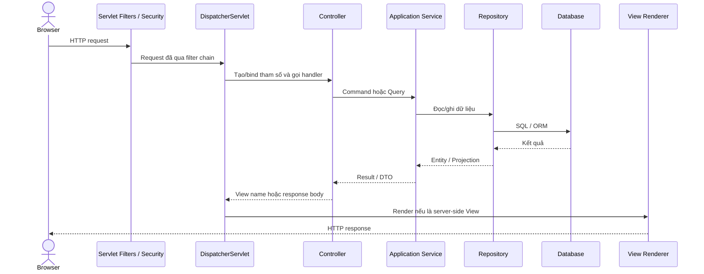
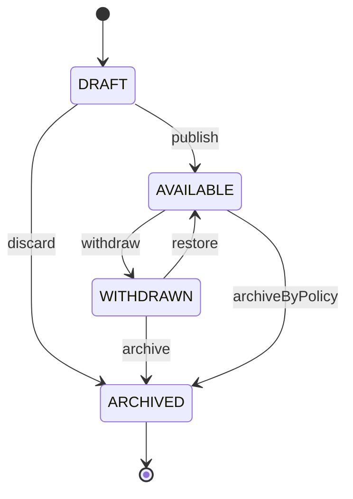
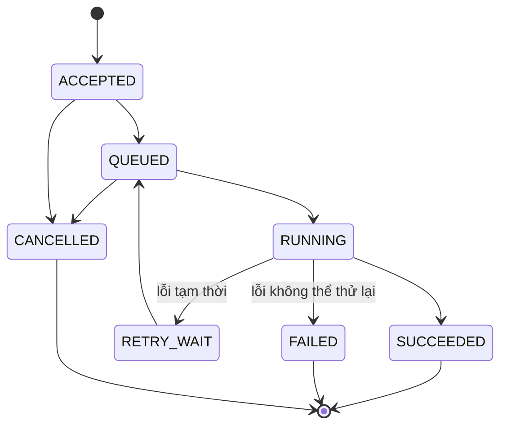

# Kiểm tra trạng thái, vòng đời và an toàn đồng thời

Một thiết kế MVC có thể phân chia Model, View và Controller khá rõ nhưng vẫn phát sinh lỗi khi nhiều request cùng chạy, người dùng mở một biểu mẫu quá lâu hoặc một tác vụ nền tiếp tục xử lý sau khi trình duyệt đã rời trang. Những lỗi này thường không nằm ở sơ đồ lớp mà nằm ở cách ứng dụng sở hữu trạng thái, quản lý vòng đời đối tượng và đồng bộ các thay đổi.

Khi review một chức năng MVC, cần trả lời bốn câu hỏi: **trạng thái thuộc về ai, tồn tại trong bao lâu, ai được phép thay đổi và điều gì xảy ra khi nhiều tác nhân cùng thay đổi nó?** Một trạng thái nghiệp vụ có thể sống nhiều năm trong database; một form object chỉ cần tồn tại trong một request; session có thể kéo dài qua nhiều request; Controller Spring mặc định là singleton được nhiều thread dùng chung. Đối xử với tất cả các loại trạng thái như nhau sẽ dẫn đến dữ liệu rò rỉ giữa người dùng, lost update, race condition và lỗi khó tái hiện.

Bài học này cung cấp cách review trạng thái và vòng đời trong ứng dụng MVC web, tập trung vào Spring MVC, Java và persistence phổ biến. Các nguyên tắc cũng áp dụng cho framework MVC khác: xác định chủ sở hữu trạng thái, giới hạn vòng đời, bảo vệ invariant và chọn cơ chế đồng thời phù hợp với nghiệp vụ.

## Bốn trục cần kiểm tra

| Trục review | Câu hỏi chính | Rủi ro nếu không rõ |
|---|---|---|
| Quyền sở hữu trạng thái | Ai là nguồn sự thật và ai được sửa? | Nhiều bản sao mâu thuẫn, client tự quyết định dữ liệu tin cậy |
| Vòng đời | Trạng thái tồn tại theo request, session, process hay lâu dài? | Rò rỉ dữ liệu, giữ object quá lâu, dùng object sau khi hết hiệu lực |
| Chuyển trạng thái | Hành động nào hợp lệ và điều kiện nào phải đúng? | Trạng thái bất khả thi, setter bỏ qua quy tắc miền |
| Đồng thời | Nếu hai request cùng đọc/sửa thì kết quả phải ra sao? | Lost update, xử lý trùng, ghi đè hoặc side effect lặp |

Không thể review concurrency chỉ bằng cách tìm `synchronized`. Nhiều race condition xảy ra ở database, qua nhiều instance ứng dụng hoặc giữa các request HTTP độc lập. Tương tự, dùng transaction không tự bảo vệ mọi trạng thái trong bộ nhớ hoặc các dịch vụ bên ngoài.

## Lập bản đồ các loại trạng thái

Trước khi đọc code, hãy phân loại dữ liệu của chức năng. Một màn hình quản lý sách có thể sử dụng các loại trạng thái sau:

| Loại trạng thái | Ví dụ | Chủ sở hữu phù hợp | Vòng đời thường gặp |
|---|---|---|---|
| Trạng thái nghiệp vụ bền vững | Tiêu đề, ISBN, trạng thái xuất bản, phiên bản sách | Domain Model và database | Qua nhiều request và lần khởi động |
| Trạng thái request | `BookForm`, `BindingResult`, `Model` | Web adapter/Spring MVC | Một lần xử lý request |
| Trạng thái session | Ngữ cảnh đăng nhập, bước workflow nhiều trang có chủ đích | Security/session workflow | Nhiều request trong một phiên |
| Flash state | Thông báo “Đã lưu sách” sau redirect | Flash scope | Thường chỉ request kế tiếp |
| Trạng thái giao diện phía client | Modal mở, tab đang chọn, input chưa lưu | Browser/component | Theo vòng đời trang hoặc component |
| Trạng thái dẫn xuất/cache | Danh sách sách gần đây, kết quả tìm kiếm đã cache | Cache/query layer | Theo TTL hoặc chính sách invalidation |
| Trạng thái thực thi | Trace context, deadline, cancellation, transaction | Runtime/framework | Theo request, transaction hoặc tác vụ |

Một giá trị có thể được sao chép qua nhiều lớp, nhưng cần chỉ ra đâu là nguồn sự thật. Ví dụ, browser có thể hiển thị trạng thái `AVAILABLE` của sách, nhưng database/domain là nguồn sự thật. Khi người dùng nhấn “Ngừng lưu hành”, server phải đọc trạng thái hiện tại và kiểm tra chuyển trạng thái; không tin giá trị hidden field hoặc JavaScript state.

### Không nhầm dữ liệu đầu vào với trạng thái đã được xác nhận

`BookForm` là dữ liệu người dùng đề xuất. Nó chưa phải một `Book` hợp lệ. Form có thể chứa ISBN chưa chuẩn hóa, category ID không tồn tại hoặc dữ liệu đã cũ. Chỉ sau khi server xác thực, áp dụng quy tắc và lưu thành công, ứng dụng mới có thể coi thay đổi là trạng thái nghiệp vụ đã được chấp nhận.

Không dùng một object duy nhất vừa làm request DTO, JPA entity, domain aggregate và View Model. Các vòng đời và quyền sửa khác nhau khiến việc tái sử dụng object đó dễ tạo mass assignment hoặc làm lộ trạng thái nội bộ.

## Kiểm tra vòng đời request trong Spring MVC

Một request đồng bộ đi qua các thành phần chính như sau:



Các đối tượng như `Model`, `BindingResult`, request attribute và form object thường gắn với một request. Spring tạo chúng trong quá trình xử lý request; chúng không phải nơi lưu trạng thái nghiệp vụ lâu dài. Sau khi response kết thúc, không nên giữ tham chiếu đến request, response hoặc form object trong singleton service để dùng ở request sau.

### Controller mặc định là singleton

Spring bean mặc định có scope singleton trong ApplicationContext. Một `@Controller` thường được tạo một lần và xử lý nhiều request đồng thời trên các thread khác nhau. Vì vậy, Controller nên giữ dependency bất biến như service, mapper hoặc query handler; không nên giữ dữ liệu riêng của người dùng trong field có thể thay đổi.

Thiết kế nguy hiểm:

```java
@Controller
public class BookController {
    private BookForm currentForm;
    private Long currentUserId;

    @PostMapping("/books")
    public String create(@ModelAttribute BookForm form) {
        currentForm = form;
        // Request của người khác có thể ghi đè field trong lúc xử lý.
        return "books/form";
    }
}
```

Hai request đồng thời có thể ghi đè `currentForm` hoặc `currentUserId` của nhau. Dữ liệu của người này có thể xuất hiện trong xử lý của người khác. Đây là lỗi vừa về concurrency vừa có thể trở thành rò rỉ thông tin.

Thiết kế an toàn hơn:

```java
@Controller
@RequestMapping("/books")
public class BookController {
    private final CreateBookUseCase createBook;

    public BookController(CreateBookUseCase createBook) {
        this.createBook = createBook;
    }

    @PostMapping
    public String create(
            @Valid @ModelAttribute("bookForm") BookForm form,
            BindingResult errors,
            @AuthenticationPrincipal AppPrincipal principal) {
        if (errors.hasErrors()) {
            return "books/form";
        }

        createBook.handle(toCommand(form, principal.userId()));
        return "redirect:/books";
    }
}
```

`form`, `errors` và `principal` là dữ liệu của lời gọi hiện tại; dependency được giữ trong field là các collaborator dùng chung có hợp đồng an toàn đồng thời. Bản thân `CreateBookUseCase` và các dependency của nó cũng phải được review về thread safety.

Đoạn Controller này chỉ minh họa việc không lưu dữ liệu request trong field. Trong một form thực tế, nhánh validation lỗi vẫn phải nạp lại danh sách thể loại hoặc dữ liệu tham chiếu mà View cần trước khi trả template.

### Singleton service cũng cần stateless

Service Spring thường cũng là singleton. Không lưu actor hiện tại, entity đang xử lý, request DTO hoặc kết quả tạm vào field của service. Dùng biến cục bộ và truyền dữ liệu qua tham số.

```java
@Service
public class CreateBookService {
    private final BookRepository books;

    public CreateBookService(BookRepository books) {
        this.books = books;
    }

    public BookId handle(CreateBookCommand command) {
        // Biến cục bộ thuộc lời gọi hiện tại.
        Book book = Book.create(command.title(), command.isbn());
        return books.save(book).id();
    }
}
```

Một service stateless vẫn có thể dùng cache hoặc collaborator có trạng thái nếu chúng được thiết kế thread-safe và có chính sách nhất quán rõ. “Không có field mutable” là quy tắc dễ review, nhưng không phải điều kiện duy nhất của thread safety.

## Review bean scope và session state

Spring cung cấp các scope như singleton, prototype, request và session trong ứng dụng web. Scope thay đổi vòng đời object, nhưng không tự bảo đảm object an toàn đồng thời hoặc dữ liệu hợp lệ.

| Scope | Vòng đời | Dùng phù hợp | Cần cảnh giác |
|---|---|---|---|
| Singleton | Một instance trong ApplicationContext | Controller stateless, service, repository, mapper bất biến | Không giữ trạng thái riêng request/người dùng trong field |
| Prototype | Instance mới mỗi lần container resolve bean | Object cần khởi tạo riêng có lifecycle được quản lý rõ | Inject trực tiếp vào singleton thường chỉ nhận một instance lúc tạo singleton; lifecycle sau đó do caller quản lý |
| Request | Một instance cho mỗi HTTP request | Context/holder chỉ có ý nghĩa trong request | Không chuyển object này sang background task sau khi request kết thúc |
| Session | Một instance cho mỗi HTTP session | Wizard nhiều bước hoặc state UI ngắn hạn có chủ đích | Session có thể sống lâu, chiếm bộ nhớ và nhận nhiều request đồng thời |
| Application | Gắn với ServletContext | Dữ liệu ứng dụng dùng chung có vòng đời rõ | Tương tự singleton, mutable state cần đồng bộ và thường không phù hợp lưu domain state |

### Dùng `@SessionAttributes` có chủ đích

`@SessionAttributes` có thể giữ một số model attribute qua nhiều request trong một workflow của Controller, chẳng hạn wizard tạo bản ghi nhiều bước. Khi hoàn tất hoặc hủy, cần gọi `SessionStatus.setComplete()` để kết thúc workflow và xóa các attribute được quản lý.

Không dùng `@SessionAttributes` như một cách lưu mọi form để “đỡ phải query lại”. Người dùng có thể mở nhiều tab, gửi song song hoặc quay lại một bước cũ. Session attribute có thể bị ghi đè hoặc trở nên stale. Chỉ giữ lượng dữ liệu nhỏ, không nhạy cảm và có vòng đời được xác định.

### Session không phải vùng dữ liệu an toàn đồng thời

Một session có thể nhận nhiều request gần như cùng lúc: hai tab gửi form, request AJAX chạy song song hoặc người dùng bấm nút hai lần. Nếu session chứa một mutable `ArrayList` hoặc object workflow không thread-safe, hai request có thể cập nhật đồng thời.

Đừng giả định servlet container luôn tuần tự hóa mọi request cùng session theo cách bảo vệ logic ứng dụng. Nếu cần cập nhật state trong session, hãy dùng dữ liệu bất biến/copy-on-write hoặc đồng bộ đúng phạm vi; tốt hơn nữa, giữ state nghiệp vụ trong database và dùng session cho danh tính/ngữ cảnh tối thiểu.

### Flash attribute và request attribute

Flash attribute phù hợp với thông báo ngắn sau redirect, ví dụ “Đã lưu sách”. Nó không phù hợp để lưu một aggregate lớn hoặc dữ liệu nhạy cảm qua nhiều bước. Request attribute chỉ có ý nghĩa trong request hiện tại. Đừng nhầm hai loại này với session workflow hoặc trạng thái database.

## Mô hình hóa trạng thái và chuyển trạng thái hợp lệ

Review trạng thái cần kiểm tra không chỉ field hiện tại mà cả những chuyển đổi được phép. Ví dụ, sách trong thư viện có thể có các trạng thái `DRAFT`, `AVAILABLE`, `WITHDRAWN` và `ARCHIVED`.



Không phải mọi cặp trạng thái đều có thể chuyển đổi. Ví dụ, sách đã `ARCHIVED` không được quay lại `DRAFT` nếu nghiệp vụ không hỗ trợ. Những chuyển đổi này nên được biểu diễn bằng method có ý nghĩa trong Domain Model thay vì Controller gán chuỗi trạng thái.

```java
public class Book {
    private BookStatus status;

    public void publish() {
        if (status != BookStatus.DRAFT) {
            throw new InvalidBookTransitionException(status, BookStatus.AVAILABLE);
        }
        status = BookStatus.AVAILABLE;
    }

    public void withdraw() {
        if (status != BookStatus.AVAILABLE) {
            throw new InvalidBookTransitionException(status, BookStatus.WITHDRAWN);
        }
        status = BookStatus.WITHDRAWN;
    }
}
```

Ví dụ rút gọn; trong ứng dụng thực tế có thể cần kiểm tra actor, lý do, thời điểm, policy và phát domain event. Domain method bảo vệ invariant bất kể lời gọi đến từ web, desktop, batch job hay message consumer.

### Dấu hiệu state model yếu

- trạng thái được lưu bằng chuỗi tùy ý thay vì enum/value object;
- có public setter cho mọi trạng thái;
- Controller tự gán `status = "PUBLISHED"`;
- nhiều boolean chồng lấn như `published`, `withdrawn`, `archived` tạo tổ hợp bất khả thi;
- không xác định được hành động nào được phép ở từng trạng thái;
- việc thay đổi một field cần cập nhật nhiều field khác nhưng không có một method bảo vệ invariant.

Nếu các trạng thái loại trừ lẫn nhau, một enum thường rõ hơn nhiều boolean. Nếu có workflow phức tạp, cân nhắc state machine hoặc transition service có bảng chuyển đổi được kiểm thử.

## Tách trạng thái bền vững khỏi trạng thái trình bày

Một màn hình chi tiết sách có thể hiển thị:

- dữ liệu bền vững: tiêu đề, ISBN, trạng thái, tác giả;
- trạng thái trình bày: tab đang mở, panel đang thu gọn;
- trạng thái request: thông báo lỗi hoặc form chỉnh sửa;
- trạng thái dẫn xuất: người dùng hiện tại có thể thấy nút “Ngừng lưu hành” hay không.

Không lưu tab đang mở vào database nếu nó chỉ là lựa chọn giao diện. Không lưu `canWithdraw=true` như một sự thật nghiệp vụ vì quyền có thể thay đổi. Có thể tính cờ này khi tạo View Model để hiển thị nút, nhưng use case vẫn phải xác minh quyền tại thời điểm command được thực hiện.

| Câu hỏi | Nơi lưu/kiểm tra phù hợp |
|---|---|
| Sách hiện có trạng thái nào? | Database/Domain Model |
| Người dùng đang mở tab nào? | Browser state hoặc URL nếu cần chia sẻ |
| Request hiện tại có lỗi ISBN không? | `BindingResult`/request model |
| Người dùng có được phép rút sách không? | Authorization policy ở server; View Model chỉ phản ánh để trình bày |
| Có thông báo sau khi redirect không? | Flash attribute |
| Dữ liệu danh sách có thể cache bao lâu? | Query/cache policy có TTL và invalidation |

## Phân tích các race condition phổ biến

Race condition xảy ra khi kết quả phụ thuộc vào thứ tự hoặc thời điểm các thao tác xen kẽ. Trong MVC web, mỗi request có thể chạy trên thread riêng; nhiều instance ứng dụng còn có thể xử lý cùng một bản ghi.

### Lost update: hai người sửa cùng một cuốn sách

Giả sử hai thủ thư cùng mở sách có tiêu đề “Lập trình Java”, phiên bản `version=4`.

1. Người A tải phiên bản 4 và sửa tiêu đề thành “Java thực hành”.
2. Người B cũng tải phiên bản 4 và sửa tác giả.
3. A lưu trước, database cập nhật thành version 5.
4. B lưu sau dựa trên dữ liệu cũ và vô tình ghi đè thay đổi của A nếu không có kiểm soát phiên bản.

Đây là lost update. Người dùng B có thể không biết rằng một người khác vừa cập nhật sách.

### Optimistic locking với `@Version`

Với JPA, có thể dùng version field:

```java
@Entity
public class BookEntity {
    @Id
    private Long id;

    @Version
    private long version;

    private String title;
    private String author;
}
```

Khi cập nhật, ORM kiểm tra version hiện tại. Nếu version trong database đã thay đổi kể từ lúc entity được đọc, thao tác cập nhật thất bại với optimistic locking exception. Version thường được tăng khi flush/commit; vì vậy exception có thể xuất hiện cuối transaction, không nhất thiết ngay ở dòng gọi `save()`.

Controller có thể nhận version của form để phát hiện biểu mẫu cũ, nhưng không được tin version đó như quyền truy cập. Application service tải bản ghi và so sánh `expectedVersion` với version hiện tại trước khi áp dụng thay đổi; sau đó `@Version`/database vẫn phải kiểm tra nguyên tử để bảo vệ khoảng thời gian giữa lần đọc và lần ghi.

Ví dụ command:

```java
public record UpdateBookCommand(
        BookId bookId,
        long expectedVersion,
        UserId actorId,
        String title,
        String author) {
}
```

Nếu dùng JPA managed entity, chỉ kiểm tra `expectedVersion` trong Java rồi cập nhật mà không bảo đảm version predicate ở database có thể vẫn có race giữa bước kiểm tra và ghi. Hãy dùng `@Version`, update có điều kiện `where version = ?` hoặc cơ chế nguyên tử tương đương.

Khi xung đột, ứng dụng thường trả trang conflict hoặc HTTP 409, giải thích dữ liệu đã được người khác thay đổi và yêu cầu tải lại/so sánh. Không tự động ghi đè lần nữa nếu chưa có quy tắc merge an toàn.

### Pessimistic locking

Pessimistic lock có thể phù hợp khi xung đột rất thường xuyên, vùng dữ liệu cần tuần tự hóa hoặc thao tác ngắn cần bảo đảm độc quyền. Ví dụ JPA có thể dùng `LockModeType.PESSIMISTIC_WRITE` trong repository query.

Nhược điểm gồm lock contention, deadlock và giảm throughput. Luôn giữ transaction ngắn, lấy lock theo thứ tự nhất quán và xử lý timeout/deadlock. Không giữ row lock trong lúc chờ người dùng nhập form hoặc gọi dịch vụ mạng.

### Chọn optimistic hay pessimistic?

| Tình huống | Cơ chế thường phù hợp | Lý do |
|---|---|---|
| Nhiều người đọc, ít khi cùng sửa | Optimistic locking | Chi phí thấp khi xung đột hiếm |
| Nhiều người cùng cập nhật một bản ghi trong thời gian ngắn | Đánh giá pessimistic lock hoặc thiết kế lại luồng | Có thể cần tuần tự hóa để giảm retry |
| Đảm bảo ISBN duy nhất | Unique constraint/index | Database bảo vệ invariant nguyên tử |
| Trừ tồn kho/giữ chỗ có cạnh tranh cao | Atomic update, lock hoặc reservation workflow | Cần tránh số lượng âm và oversell |
| Cập nhật nhiều hệ thống bên ngoài | Saga/outbox/idempotency | Database transaction không bao trùm dịch vụ ngoài |

Không chọn lock chỉ vì “an toàn hơn”. Hãy dựa trên tần suất xung đột, mức hậu quả, thời gian giữ tài nguyên và khả năng retry.

## Bảo vệ invariant bằng database constraint

Kiểm tra trước khi ghi trong Java không đủ để bảo đảm tính duy nhất hoặc giới hạn số lượng khi nhiều transaction chạy đồng thời.

Ví dụ ISBN:

```sql
CREATE UNIQUE INDEX uq_book_isbn_normalized
    ON books (isbn_normalized);
```

Ứng dụng có thể gọi `existsByIsbn()` để phản hồi sớm, nhưng unique index là lớp bảo vệ cuối cùng trước hai request đồng thời. Khi constraint bị vi phạm, adapter cần nhận diện đúng constraint và ánh xạ thành lỗi nghiệp vụ như `DuplicateIsbnException`; không chuyển mọi lỗi integrity thành lỗi ISBN.

Với tồn kho, cách đọc số lượng rồi trừ trong Java có thể gây oversell nếu hai request cùng đọc số lượng 1. Có thể dùng câu lệnh atomic như `UPDATE inventory SET quantity = quantity - 1 WHERE id = ? AND quantity > 0` và kiểm tra số hàng bị cập nhật, hoặc dùng lock/transaction phù hợp.

### Invariant cần có lớp bảo vệ nào?

| Invariant | Bảo vệ trong ứng dụng | Bảo vệ ở database |
|---|---|---|
| ISBN duy nhất | Chuẩn hóa và kiểm tra trước khi lưu | Unique index trên giá trị chuẩn hóa |
| Tiêu đề không rỗng | Domain/Bean Validation theo hợp đồng | `NOT NULL`/CHECK nếu schema yêu cầu |
| Số lượng không âm | Domain method và use case | CHECK constraint hoặc atomic update |
| Quan hệ category hợp lệ | Use case kiểm tra category đang hoạt động | Foreign key; trạng thái active cần policy/query phù hợp |
| Cập nhật không ghi đè | Kiểm tra version trong use case | Optimistic version predicate hoặc locking |
| Tenant isolation | Authorization policy và query scope | Có thể bổ sung RLS/composite key theo nền tảng |

Database constraint không thay thế quy tắc nghiệp vụ, và quy tắc nghiệp vụ cũng không thay thế bảo vệ nguyên tử ở database. Hai lớp có vai trò bổ sung.

## Chống gửi lặp và xử lý idempotent

Người dùng có thể nhấn nút hai lần, browser retry sau timeout hoặc proxy gửi lại request. Post/Redirect/Get giảm việc refresh trang kết quả gửi lại POST, nhưng không bảo đảm một thao tác chỉ chạy một lần. Hai POST có thể đến server trước khi redirect xảy ra.

Với thao tác tạo có thể lặp, hãy quyết định semantics:

- cùng một request gửi lại có nên trả kết quả cũ không;
- hay request thứ hai phải bị từ chối vì tài nguyên đã tồn tại;
- hoặc hành động có thể lặp an toàn vì nó là phép đặt trạng thái cuối cùng.

Một idempotency key có thể nhận diện một ý định gửi duy nhất. Server lưu key cùng trạng thái/kết quả trong phạm vi user và use case; request lặp với cùng key trả kết quả đã ghi nhận. Key cần có unique constraint để nhiều instance không xử lý cùng lúc như hai ý định khác nhau.

Không dùng một UUID client gửi lên mà không ràng buộc user, endpoint, payload và thời gian lưu. Cần xác định cách xử lý khi cùng key nhưng payload khác nhau, thời gian hết hạn, request đang chạy và kết quả lỗi.

### Idempotency không giống CSRF

CSRF bảo vệ request dùng credential tự động như cookie khỏi bị website khác kích hoạt ngoài ý muốn. Idempotency xử lý việc cùng một ý định nghiệp vụ được gửi lặp. Một form có CSRF token vẫn có thể bị người dùng nhấn hai lần; một request có idempotency key vẫn cần authorization và CSRF phù hợp.

## Tác vụ bất đồng bộ và vòng đời sau request

Một request có thể xếp công việc vào queue rồi trả `202 Accepted`; worker tiếp tục xử lý sau khi request kết thúc. Không được giữ `HttpServletRequest`, `HttpServletResponse`, `BindingResult`, JPA entity đang managed hoặc request-scoped bean để dùng tùy tiện trong background thread.

Hãy tạo command bất biến chứa dữ liệu tối thiểu cần thiết, ví dụ `GenerateBookReportCommand(reportId, actorId, tenantId)`. Worker mở transaction riêng, tải dữ liệu mới nhất, kiểm tra trạng thái và thực thi công việc. Context như trace ID có thể được truyền qua metadata theo cơ chế propagation; không giữ security context mutable trong field toàn cục.

### Vòng đời tác vụ



Trạng thái job phải được lưu ở nơi worker và API status cùng đọc được nếu cần hiển thị tiến độ qua nhiều instance. Cập nhật trạng thái nên có điều kiện để hai worker không cùng nhận một job. Queue acknowledgement, retry và job handler cần idempotent vì message có thể được giao lại.

### Không giữ transaction database trong lúc gọi dịch vụ ngoài

Nếu use case lưu sách rồi gửi email hoặc gọi dịch vụ xuất bản, không nên mặc định giữ transaction database mở trong toàn bộ thời gian mạng. Một thiết kế phổ biến là transactional outbox:

1. Trong một transaction, lưu thay đổi nghiệp vụ và một outbox event.
2. Worker đọc outbox và gửi event đến broker/provider.
3. Ghi nhận trạng thái gửi, retry có giới hạn và idempotency.

Outbox giúp không mất event giữa lúc database commit và lúc publish, nhưng không tạo exactly-once cho hệ thống ngoài. Consumer vẫn cần xử lý message lặp an toàn.

## Review cache và dữ liệu dẫn xuất

Cache là một bản sao có thể stale. Khi review cache, cần biết:

- key có bao gồm tenant/user/locale hoặc quyền ảnh hưởng kết quả không;
- dữ liệu được cache bao lâu;
- thao tác ghi nào invalidates key;
- nhiều instance có chia sẻ cache không;
- dữ liệu nhạy cảm có bị cache chung không;
- stale data có thể gây sai quyết định nghiệp vụ hay chỉ làm giao diện chậm cập nhật.

Không cache kết quả đã phân quyền theo user trong key chỉ có `bookId`. Hai người có quyền khác nhau có thể nhận cùng response. Với dữ liệu nhạy cảm, cần chính sách cache private/no-store phù hợp. Cache UI không phải nguồn sự thật để quyết định command.

### Cache invalidation sau ghi

Sau khi đổi trạng thái sách, cần cập nhật hoặc xóa cache chi tiết và danh sách liên quan. Nếu không thể invalidation đồng bộ trên mọi instance, chấp nhận một khoảng stale có kiểm soát và không dùng dữ liệu cache đó để quyết định invariant quan trọng. Những quyết định như “còn tồn kho không?” phải dựa trên thao tác nguyên tử hoặc dữ liệu có consistency phù hợp.

## Transaction và vòng đời persistence context

JPA persistence context thường gắn với transaction hoặc EntityManager scope. Entity managed có thể được dirty-check và flush ở thời điểm phù hợp. Khi transaction kết thúc, entity detached; truy cập lazy relationship sau đó có thể gây `LazyInitializationException` nếu không còn persistence context.

Review cần hỏi:

- transaction bắt đầu ở ranh giới use case nào;
- transaction có kéo dài qua render View hoặc HTTP call không;
- lazy relationship có bị truy cập từ template sau transaction không;
- entity có bị chia sẻ qua thread không;
- exception xảy ra ở flush/commit có được ánh xạ đúng không;
- optimistic lock/constraint có thể thất bại tại commit không.

Không dùng Open Session in View để che giấu mọi truy vấn phát sinh trong template. Nếu dự án bật OSIV, hãy kiểm soát query trong View và cân nhắc tắt để buộc dữ liệu trình bày được chuẩn bị trong application/query layer. Quyết định cần dựa trên hành vi thực tế của ứng dụng và cách quản lý transaction.

## Context theo request và thread

Spring Security thường lưu `SecurityContext` theo cơ chế gắn với thread trong quá trình xử lý đồng bộ và filter chain sẽ dọn context theo lifecycle. Với tác vụ bất đồng bộ hoặc executor tự tạo, không giả định context tự truyền sang thread khác. Dùng cơ chế context propagation được framework hỗ trợ hoặc truyền actor/context tường minh trong command.

Tương tự, MDC logging context và trace context có thể cần propagation. Nếu thread pool tái sử dụng thread mà context không được dọn, log của request sau có thể mang trace/user context của request trước. Không tự lưu user hiện tại trong `ThreadLocal` mà thiếu cơ chế cleanup.

Đối với async Spring MVC (`Callable`, `DeferredResult`, `WebAsyncTask`), vòng đời HTTP request có thể gồm nhiều dispatch. Không đo hoặc cập nhật trạng thái như thể handler đồng bộ đã hoàn tất ngay khi method trả về. Tác vụ nền cần cơ chế cancellation, timeout và error handling riêng.

## Thiết kế test cho trạng thái và concurrency

Unit test thông thường kiểm tra một luồng tuần tự. Nó không đủ để chứng minh không có lost update hoặc race condition. Cần chọn test theo invariant và cơ chế đồng thời.

| Loại test | Mục tiêu | Ví dụ |
|---|---|---|
| Domain unit test | Chuyển trạng thái hợp lệ/không hợp lệ | Không thể publish sách đã archived |
| Service unit test | Điều phối và authorization | Actor không có quyền không thể withdraw sách |
| Controller test | Binding, form state và HTTP response | Form lỗi giữ giá trị và trả đúng field error |
| Repository integration test | Version, unique constraint, transaction | Hai insert cùng ISBN chỉ một lần thành công |
| Concurrent integration test | Race condition thực tế qua nhiều transaction | Hai update cùng version: một thành công, một conflict |
| Async/job test | Retry, duplicate delivery và cancellation | Cùng message được giao hai lần không tạo side effect trùng |
| Cache test | Key scope và invalidation | Tenant A không đọc cache của tenant B |

### Kiểm thử optimistic locking

Một integration test có thể mở hai transaction độc lập:

1. Transaction A tải sách ở version 4.
2. Transaction B tải cùng sách ở version 4.
3. A sửa và commit, database tăng version lên 5.
4. B sửa và cố commit với version 4.
5. Xác minh B nhận optimistic locking conflict.

Test phải dùng transaction/persistence context độc lập cho hai luồng và database hỗ trợ semantics đang triển khai. Nếu test chạy trong một transaction test duy nhất, nó có thể không tái hiện đúng race condition.

### Kiểm thử unique constraint đồng thời

Dùng hai thread hoặc hai transaction cùng chèn một ISBN chuẩn hóa. Xác minh chỉ một bản ghi tồn tại và lỗi của transaction còn lại được ánh xạ đúng. Dùng barrier/latch để điều khiển thời điểm cả hai transaction đã qua bước kiểm tra trước khi insert; tránh test dựa vào `sleep()` ngẫu nhiên.

### Kiểm thử singleton không rò state

Với Controller/service singleton, có thể chạy nhiều request đồng thời với dữ liệu khác nhau và xác minh response không trộn user/form. Tuy nhiên, test không thể chứng minh mọi interleaving; cách phòng ngừa chính là không lưu mutable request state trong field dùng chung.

### Kiểm thử state transition

Viết bảng test cho mọi cặp trạng thái và hành động. Ví dụ:

| Trạng thái hiện tại | Hành động | Kết quả mong đợi |
|---|---|---|
| `DRAFT` | publish | `AVAILABLE` |
| `DRAFT` | withdraw | Bị từ chối |
| `AVAILABLE` | withdraw | `WITHDRAWN` |
| `WITHDRAWN` | restore | `AVAILABLE` nếu policy cho phép |
| `ARCHIVED` | publish | Bị từ chối |

Test nên kiểm tra cả trạng thái sau thao tác thất bại để bảo đảm object không bị thay đổi một phần.

## Quy trình design review theo từng bước

Khi review một chức năng MVC, hãy đi theo trình tự này:

1. **Liệt kê trạng thái:** ghi lại field, DTO, session attribute, cache, entity và job state có liên quan.
2. **Xác định nguồn sự thật:** chỉ ra nơi dữ liệu được xác nhận và lưu bền vững.
3. **Gán chủ sở hữu:** Controller/request, session, Domain Model, database, browser hay worker.
4. **Xác định vòng đời:** request, transaction, session, application process hay lâu dài.
5. **Kiểm tra chuyển trạng thái:** liệt kê hành động hợp lệ, điều kiện và trạng thái đích.
6. **Tìm shared mutable state:** singleton field, static field, session object, cache value và `ThreadLocal`.
7. **Liệt kê interleaving:** hai request cùng sửa, retry, duplicate submit, job chạy lại hoặc cache stale.
8. **Chọn cơ chế bảo vệ:** immutable data, transaction, optimistic/pessimistic lock, unique constraint, atomic update hoặc idempotency.
9. **Kiểm tra async lifecycle:** context propagation, cancellation, timeout, retry và transaction riêng.
10. **Thiết kế test:** domain transition, concurrent transaction, security scope, duplicate delivery và regression HTTP.
11. **Đánh giá khả năng quan sát:** log/metric/trace có thể chỉ ra conflict, retry, timeout và stale state không?
12. **Ghi nhận quyết định:** nêu trade-off, failure mode và hành vi người dùng khi xung đột xảy ra.

## Tình huống review mẫu: hai thủ thư cùng sửa sách

Một màn hình cho phép thủ thư thay tiêu đề và tác giả. Bản review có thể ghi nhận:

| Hạng mục | Phát hiện | Đề xuất |
|---|---|---|
| Form state | Form có `bookId`, title, author và version | Giữ form theo request; không lưu trong field Controller |
| Nguồn sự thật | Bản ghi sách trong database | Tải lại sách trong use case trước khi cập nhật |
| Lifecycle | Người dùng có thể giữ form mở nhiều phút | Không giữ transaction/row lock trong lúc nhập |
| Chuyển trạng thái | Chỉ sửa metadata khi sách chưa archived | Domain method/policy xác minh trạng thái hiện tại |
| Đồng thời | Hai người có thể sửa cùng version | Dùng `@Version` và xử lý conflict |
| HTTP response | Form cũ không còn cập nhật được | Render thông báo conflict, cho phép tải lại/so sánh |
| Test | Chưa có test hai transaction | Bổ sung concurrent integration test |

Luồng cập nhật mong muốn:

```mermaid
sequenceDiagram
    actor A as Thủ thư A
    actor B as Thủ thư B
    participant API as MVC Controller
    participant Service as UpdateBookUseCase
    participant DB as Database

    A->>API: GET /books/42/edit
    B->>API: GET /books/42/edit
    API-->>A: Form version 4
    API-->>B: Form version 4
    A->>API: POST update expectedVersion=4
    API->>Service: Update command
    Service->>DB: UPDATE ... WHERE id=42 AND version=4
    DB-->>Service: 1 row; version becomes 5
    Service-->>API: Success
    API-->>A: Redirect
    B->>API: POST update expectedVersion=4
    API->>Service: Update command
    Service->>DB: UPDATE ... WHERE id=42 AND version=4
    DB-->>Service: 0 rows / optimistic conflict
    Service-->>API: Conflict
    API-->>B: HTTP 409 or conflict form
```

Điểm quan trọng là ứng dụng không âm thầm ghi đè dữ liệu của A bằng form cũ của B. Người dùng B được thông báo và có thể tải lại, xem khác biệt hoặc áp dụng lại thay đổi trên version mới.

## Những dấu hiệu cảnh báo trong code review

- Controller hoặc service singleton có field mutable chứa form, user, entity hoặc kết quả request.
- Static collection giữ trạng thái nghiệp vụ trong bộ nhớ của một instance ứng dụng.
- Session chứa mutable object lớn hoặc entity JPA.
- Public setter cho trạng thái miền cho phép tạo tổ hợp bất khả thi.
- Controller tự gán status hoặc tự kiểm tra invariant.
- Update không có version, lock hoặc quy tắc xử lý lost update dù nhiều người có thể sửa cùng bản ghi.
- Chỉ kiểm tra uniqueness trong Java mà không có constraint ở database.
- Dùng `synchronized` trong một instance để bảo vệ dữ liệu được nhiều instance cùng ghi vào database.
- Giữ transaction/lock trong lúc người dùng nhập form hoặc trong lúc gọi API bên ngoài.
- POST không có chính sách duplicate submit/idempotency dù side effect không thể lặp an toàn.
- Worker dùng request/session object sau khi request kết thúc.
- ThreadLocal/security/MDC context không được propagate hoặc cleanup.
- Cache key không bao gồm tenant/user khi response phụ thuộc quyền.
- Template truy cập lazy relationship và làm phát sinh query ngoài dự kiến.
- Test concurrency chỉ dùng một transaction hoặc dựa vào `sleep()`.

Một dấu hiệu đơn lẻ chưa luôn chứng minh có lỗi, nhưng cần yêu cầu tác giả giải thích ownership, lifecycle và consistency guarantee. Review nên ghi rõ tình huống gây lỗi và hậu quả, không chỉ yêu cầu thêm `synchronized` hoặc thêm một annotation.

## Checklist nghiệm thu thiết kế

### Trạng thái và vòng đời

- [ ] Mỗi trạng thái có chủ sở hữu và nguồn sự thật được xác định.
- [ ] Request DTO, View Model, Domain Entity và persistence entity không bị dùng lẫn vai trò tùy tiện.
- [ ] Controller/service singleton không giữ mutable state theo request hoặc user.
- [ ] Session state có lý do tồn tại, kích thước và thời điểm kết thúc rõ.
- [ ] Flash attribute chỉ dùng cho dữ liệu ngắn hạn sau redirect.
- [ ] Worker không giữ request-scoped object sau khi request kết thúc.

### Quy tắc và chuyển trạng thái

- [ ] Các trạng thái hợp lệ được liệt kê rõ.
- [ ] Mỗi hành động có điều kiện và trạng thái đích.
- [ ] Domain Model bảo vệ invariant thay vì để Controller gán field tùy ý.
- [ ] Hành động thất bại không để object ở trạng thái thay đổi một phần.
- [ ] Authorization được kiểm tra ở server tại thời điểm command.

### Đồng thời và persistence

- [ ] Có phân tích lost update và duplicate submit.
- [ ] Optimistic/pessimistic locking hoặc atomic update được chọn theo đặc tính xung đột.
- [ ] Invariant như uniqueness được bảo vệ bằng database constraint khi cần.
- [ ] Transaction có ranh giới ngắn và gắn với use case.
- [ ] Không giữ lock/transaction trong lúc chờ người dùng hoặc dịch vụ mạng.
- [ ] Lỗi commit/constraint/optimistic lock được ánh xạ đúng.

### Async, cache và kiểm thử

- [ ] Command gửi background là dữ liệu bất biến và tối thiểu.
- [ ] Context propagation và cleanup được xác định.
- [ ] Job retry/duplicate delivery có xử lý idempotent.
- [ ] Cache key và invalidation không làm rò dữ liệu giữa user/tenant.
- [ ] Có test state transition và test transaction/concurrency thực tế.
- [ ] Có test bảo mật, duplicate request và async lifecycle nếu luồng sử dụng chúng.

## Câu hỏi tự đánh giá

1. Vì sao Controller Spring singleton không nên lưu `BookForm` trong field?
2. Request scope, session scope và flash attribute khác nhau ở vòng đời nào?
3. Vì sao một session có thể nhận các request đồng thời?
4. Làm thế nào phân biệt trạng thái nghiệp vụ với trạng thái giao diện?
5. Vì sao nên mô hình hóa chuyển trạng thái bằng method miền thay vì public setter?
6. Lost update xảy ra thế nào khi hai người cùng sửa một bản ghi?
7. `@Version` bảo vệ cập nhật ra sao và lỗi có thể xuất hiện ở thời điểm nào?
8. Khi nào pessimistic locking phù hợp hơn optimistic locking?
9. Vì sao kiểm tra ISBN trước khi insert không thay thế unique constraint?
10. PRG, CSRF và idempotency giải quyết những vấn đề khác nhau nào?
11. Vì sao không nên giữ request/session object trong background worker?
12. Cần test gì để chứng minh hai transaction cùng cập nhật một version được xử lý đúng?

Một thiết kế MVC tốt phải giữ trạng thái đúng nơi và đúng thời gian. Controller cùng service singleton cần stateless hoặc dùng collaborator thread-safe; request và form state không được sống lâu hơn mục đích của chúng; Domain Model phải bảo vệ chuyển trạng thái; database cần cơ chế nguyên tử cho invariant và cập nhật đồng thời; tác vụ nền cần lifecycle, context và idempotency riêng. Khi review được các ranh giới này, ứng dụng sẽ tránh được lỗi rò dữ liệu giữa request, lost update và side effect lặp, đồng thời có hành vi rõ ràng khi nhiều người cùng thao tác.
