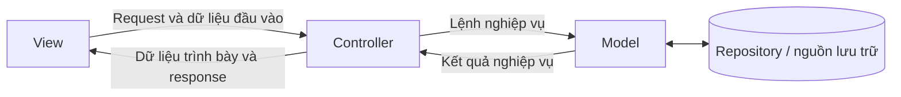
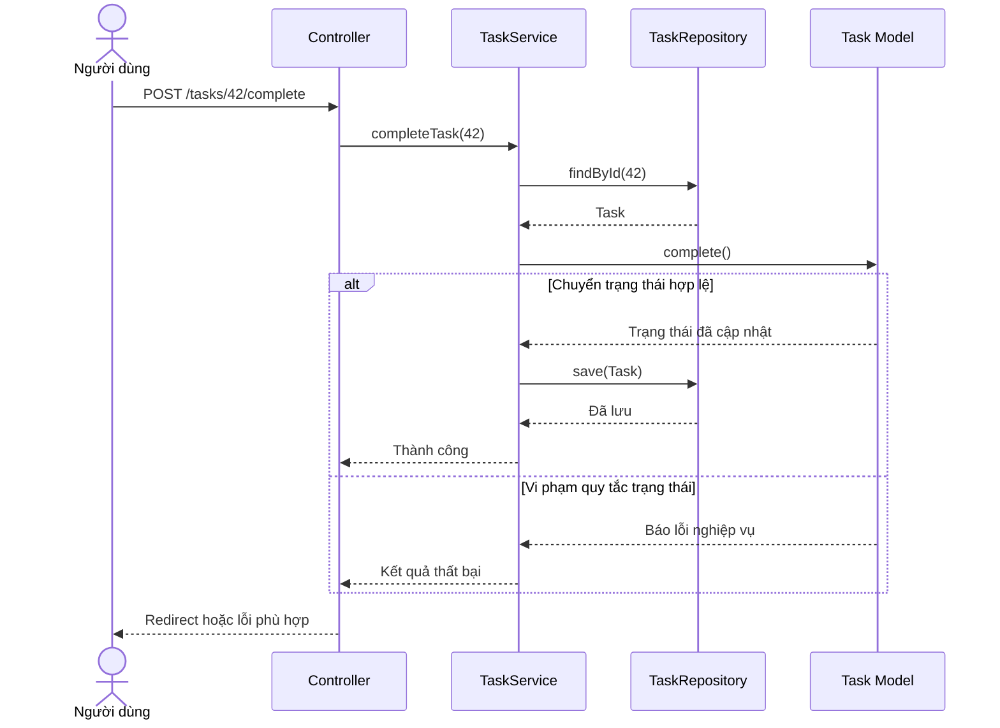

# Model biểu diễn dữ liệu, trạng thái và hành vi nghiệp vụ

Trong MVC, Model đại diện cho dữ liệu và những quy tắc nghiệp vụ chi phối dữ liệu đó. Model cho ứng dụng biết những khái niệm nào tồn tại, chúng đang ở trạng thái nào và hành động nào được phép thực hiện. Ví dụ trong ứng dụng quản lý công việc, Model có thể biểu diễn một công việc, trạng thái hoàn thành, thời hạn, người phụ trách và các quy tắc như không thể hoàn thành một công việc đã bị hủy.

Model là phần giúp ứng dụng duy trì tính nhất quán của nghiệp vụ. View có thể hiển thị dữ liệu, Controller có thể tiếp nhận request, nhưng các quy tắc quyết định trạng thái hợp lệ cần được đặt ở nơi có thể bảo vệ chúng dù thao tác đến từ giao diện web, API, tác vụ nền hay một luồng xử lý khác.

## Model có ý nghĩa gì trong MVC?

Model không chỉ là cấu trúc chứa vài trường dữ liệu. Nó biểu diễn một phần miền vấn đề mà ứng dụng giải quyết. Một Model có thể bao gồm:

- **Dữ liệu:** những thông tin ứng dụng cần ghi nhớ, chẳng hạn mã công việc, tiêu đề, thời hạn và người sở hữu.
- **Trạng thái:** tình trạng hiện tại của đối tượng hoặc quy trình, chẳng hạn mới tạo, đang thực hiện, hoàn thành hoặc bị hủy.
- **Hành vi nghiệp vụ:** các thao tác hợp lệ trên dữ liệu, chẳng hạn đổi thời hạn, giao việc hoặc đánh dấu hoàn thành.
- **Quy tắc và bất biến:** những điều kiện phải luôn đúng, chẳng hạn tiêu đề không được rỗng hoặc công việc đã hủy không thể chuyển sang hoàn thành.
- **Khả năng phối hợp nghiệp vụ:** các dịch vụ và hợp đồng cần thiết để thực hiện một quy trình liên quan đến nhiều đối tượng hoặc nguồn dữ liệu.

Model vì vậy trả lời ba câu hỏi cơ bản: ứng dụng đang quản lý điều gì, trạng thái hợp lệ của nó là gì, và những hành động nào có thể làm thay đổi trạng thái đó.

### Phân biệt Model với dữ liệu lưu trữ

Model không đồng nghĩa với bảng cơ sở dữ liệu, hàng dữ liệu hay lớp ánh xạ ORM. Cơ sở dữ liệu mô tả cách lưu trữ; Model mô tả ý nghĩa và quy tắc của dữ liệu trong miền nghiệp vụ. Một bảng `tasks` có thể có cột `status`, nhưng chỉ nhìn vào cột đó chưa thể biết chuyển trạng thái nào là hợp lệ hoặc điều kiện nào phải được thỏa mãn trước khi hoàn thành công việc.

Một lớp entity có thể vừa được ánh xạ ORM vừa chứa hành vi miền, nhưng hai khái niệm vẫn khác nhau. Ứng dụng nhỏ đôi khi dùng cùng một lớp cho cả hai vai trò. Khi yêu cầu nghiệp vụ hoặc lưu trữ phức tạp hơn, có thể tách đối tượng miền khỏi cấu trúc persistence để giảm phụ thuộc vào công nghệ cơ sở dữ liệu.

### Phân biệt Model MVC với `Model` trong Spring MVC

Trong Spring MVC, phương thức Controller thường nhận tham số có kiểu `org.springframework.ui.Model` để đưa thuộc tính vào View, ví dụ `model.addAttribute("tasks", tasks)`. Đối tượng này chủ yếu là vùng chứa dữ liệu dùng trong quá trình render response. Nó không đại diện cho toàn bộ Model nghiệp vụ của kiến trúc MVC.

Khi đọc tài liệu hoặc mã nguồn, cần dựa vào ngữ cảnh để hiểu từ “Model” đang nói đến phần miền nghiệp vụ hay đối tượng truyền dữ liệu cho View của framework.

## Những trách nhiệm chính của Model

### Biểu diễn khái niệm và trạng thái nghiệp vụ

Model mô tả những khái niệm quan trọng của hệ thống bằng các đối tượng, giá trị và mối quan hệ có ý nghĩa. Với ứng dụng quản lý công việc, các khái niệm có thể là `Task`, `User`, `Project`, `Deadline` và `TaskStatus`.

Trạng thái nên được biểu diễn bằng kiểu dữ liệu rõ nghĩa. Ví dụ, dùng enum `TaskStatus` giúp giới hạn tập giá trị thay vì dùng chuỗi tùy ý như `"done"`, `"finished"` hoặc `"complete"` ở nhiều nơi.

```java
public enum TaskStatus {
    OPEN,
    IN_PROGRESS,
    COMPLETED,
    CANCELLED
}
```

Kiểu trạng thái rõ ràng giúp mã dễ đọc, giảm lỗi chính tả và làm cho các chuyển đổi trạng thái có thể được kiểm soát tại một nơi.

### Bảo vệ bất biến

Bất biến là điều kiện phải đúng trong suốt vòng đời của một đối tượng hoặc một nhóm đối tượng. Model cần bảo vệ bất biến ngay cả khi dữ liệu đến từ một Controller khác, một API khác hoặc một tác vụ chạy nền.

Ví dụ, một công việc không được có tiêu đề rỗng; công việc đã hủy không thể hoàn thành; ngày kết thúc không được sớm hơn ngày bắt đầu. Nếu chỉ kiểm tra những điều kiện này trong biểu mẫu HTML, một client khác vẫn có thể gửi request không hợp lệ.

### Thực hiện hành vi nghiệp vụ

Model không nên chỉ có getter và setter cho mọi trường. Khi một hành động có quy tắc, nên thể hiện hành động đó bằng phương thức có tên theo ý nghĩa nghiệp vụ, chẳng hạn `complete()`, `cancel()` hoặc `assignTo(userId)`. Phương thức có thể kiểm tra trạng thái hiện tại trước khi cập nhật.

```java
public final class Task {
    private final long id;
    private final String title;
    private TaskStatus status;

    public Task(long id, String title) {
        if (title == null || title.isBlank()) {
            throw new IllegalArgumentException("Tiêu đề không được để trống");
        }
        this.id = id;
        this.title = title.trim();
        this.status = TaskStatus.OPEN;
    }

    public void start() {
        if (status != TaskStatus.OPEN) {
            throw new IllegalStateException(
                    "Chỉ công việc đang mở mới có thể bắt đầu");
        }
        status = TaskStatus.IN_PROGRESS;
    }

    public void complete() {
        if (status != TaskStatus.IN_PROGRESS) {
            throw new IllegalStateException(
                    "Chỉ công việc đang thực hiện mới có thể hoàn thành");
        }
        status = TaskStatus.COMPLETED;
    }

    public void cancel() {
        if (status == TaskStatus.COMPLETED) {
            throw new IllegalStateException(
                    "Không thể hủy công việc đã hoàn thành");
        }
        status = TaskStatus.CANCELLED;
    }

    public long getId() {
        return id;
    }

    public String getTitle() {
        return title;
    }

    public TaskStatus getStatus() {
        return status;
    }
}
```

Trong ví dụ, mã gọi không thể tự đặt một trạng thái bất kỳ bằng setter. Nó yêu cầu đối tượng thực hiện hành vi có tên rõ ràng. `Task` kiểm tra trạng thái trước khi thay đổi để bảo vệ quy tắc của chính nó.

### Phối hợp nghiệp vụ qua dịch vụ

Không phải quy tắc nào cũng thuộc về một entity. Một quy trình có thể liên quan đến nhiều đối tượng, kiểm tra quyền của người dùng, lấy dữ liệu từ repository hoặc gọi một dịch vụ bên ngoài. Khi đó, một dịch vụ nghiệp vụ có thể phối hợp các bước, trong khi entity vẫn bảo vệ các quy tắc gắn trực tiếp với trạng thái của nó.

Ví dụ, việc giao một công việc có thể cần kiểm tra người được giao còn hoạt động, người yêu cầu có quyền quản lý dự án và công việc thuộc dự án tương ứng. Những kiểm tra liên quan đến nhiều đối tượng phù hợp với dịch vụ nghiệp vụ; quy tắc “công việc đã hủy không thể được giao” vẫn có thể được bảo vệ trong `Task`.

## Các thành phần thường phối hợp với Model

Trong ứng dụng lớn, Model có thể được triển khai bằng nhiều loại thành phần phối hợp với nhau. Cách chia cụ thể phụ thuộc quy mô và độ phức tạp của miền nghiệp vụ.

| Thành phần | Vai trò | Ví dụ |
|---|---|---|
| Entity | Đối tượng có định danh và vòng đời | `Task`, `Project` |
| Value Object | Giá trị được xác định bởi nội dung, thường bất biến | `EmailAddress`, `Money`, `DateRange` |
| Domain Service | Quy tắc nghiệp vụ không tự nhiên thuộc về một entity cụ thể | Tính điều kiện phân công công việc |
| Repository | Cung cấp cách truy xuất và lưu đối tượng miền | `TaskRepository` |
| Domain Event | Ghi nhận một sự kiện có ý nghĩa nghiệp vụ đã xảy ra | `TaskCompleted` |

Không phải ứng dụng MVC nào cũng cần tất cả các thành phần này. Một ứng dụng nhỏ có thể chỉ cần một vài lớp Model và một repository. Việc thêm lớp nên xuất phát từ nhu cầu giữ quy tắc rõ ràng, kiểm thử được và dễ thay đổi.

### Entity và Value Object

Entity có định danh ổn định. Hai đối tượng `Task` có cùng tiêu đề vẫn có thể là hai công việc khác nhau vì chúng có mã định danh khác nhau. Entity thường có trạng thái thay đổi theo thời gian.

Value Object được xác định bởi giá trị của nó. Hai giá trị `EmailAddress` có cùng địa chỉ có thể được xem là tương đương. Value Object thường bất biến để tránh việc một thay đổi ngoài ý muốn làm thay đổi ý nghĩa của dữ liệu đã được kiểm tra.

```java
public record EmailAddress(String value) {
    public EmailAddress {
        if (value == null || !value.matches("^[^@\\s]+@[^@\\s]+\\.[^@\\s]+$")) {
            throw new IllegalArgumentException("Địa chỉ email không hợp lệ");
        }
    }
}
```

Đây là ví dụ minh họa một Value Object đơn giản; biểu thức kiểm tra email thực tế cần được điều chỉnh theo quy tắc sản phẩm và không thay thế xác minh địa chỉ qua quy trình gửi thư.

### Repository và chi tiết lưu trữ

Repository cung cấp hợp đồng để Model hoặc dịch vụ nghiệp vụ tìm và lưu đối tượng mà không cần biết chi tiết truy vấn SQL, tên bảng hay thư viện ORM. Interface repository thường nằm ở phía nghiệp vụ; phần triển khai cụ thể thuộc tầng lưu trữ hoặc hạ tầng. Ví dụ:

```java
import java.util.Optional;

public interface TaskRepository {
    Optional<Task> findById(long id);
    void save(Task task);
}
```

Phần triển khai repository có thể dùng JDBC, JPA hoặc một nguồn lưu trữ khác. Controller không nên tự viết truy vấn để thực hiện quy tắc nghiệp vụ; View cũng không nên truy cập repository trực tiếp.

## Quan hệ giữa Model với Controller và View

Model, Controller và View phối hợp trong một luồng nhưng không làm thay trách nhiệm của nhau:

- Controller nhận request, chuyển dữ liệu đầu vào thành lệnh phù hợp và gọi dịch vụ hoặc Model.
- Model kiểm tra quy tắc, đọc hoặc thay đổi trạng thái và cung cấp kết quả nghiệp vụ.
- Controller diễn giải kết quả thành response, chọn View hoặc định dạng dữ liệu trả về.
- View trình bày dữ liệu và trạng thái cho người dùng.



Model không cần biết request đến từ biểu mẫu nào, URL nào hay template nào. Điều này cho phép cùng một nghiệp vụ được sử dụng bởi nhiều Controller hoặc nhiều kênh giao tiếp. Tương tự, View không cần biết đối tượng được lưu bằng JDBC hay JPA; nó chỉ cần dữ liệu trình bày theo hợp đồng mà Controller cung cấp.

### Model không nên phụ thuộc vào giao diện

Nếu một entity chứa tên template, mã HTML hoặc thông tin riêng của HTTP request, Model đã bị gắn với một cách trình bày cụ thể. Điều đó khiến cùng một nghiệp vụ khó được sử dụng trong API, ứng dụng di động hoặc tác vụ nền.

Thay vì trả HTML từ Model, hãy trả kết quả có ý nghĩa nghiệp vụ. Controller có thể chuyển kết quả thành thuộc tính View, JSON hoặc response khác tùy kênh giao tiếp.

### Model không nên nhận dữ liệu đầu vào thiếu kiểm soát

Không nên bind trực tiếp toàn bộ request vào entity rồi cho phép thay đổi mọi trường. Request có thể chứa các thuộc tính mà người dùng không được phép sửa như `ownerId`, `role`, `approved` hoặc `status`. Hãy dùng form object hoặc command chỉ chứa các trường được phép, sau đó để dịch vụ nghiệp vụ xác định những giá trị tin cậy từ ngữ cảnh đã xác thực.

## Luồng xử lý một hành động nghiệp vụ

Giả sử người dùng muốn hoàn thành một công việc. Controller nhận request và gọi dịch vụ. Dịch vụ tìm công việc qua repository, yêu cầu entity thực hiện hành vi `complete()`, rồi lưu thay đổi. Nếu trạng thái hiện tại không cho phép hoàn thành, Model từ chối hành động và Controller chuyển kết quả lỗi thành phản hồi phù hợp.



Trong ứng dụng thực tế, thao tác đọc, kiểm tra và lưu thường cần nằm trong một ranh giới transaction phù hợp để tránh cập nhật dở dang. Nếu có nhiều request đồng thời thay đổi cùng một đối tượng, cần cân nhắc khóa lạc quan, khóa bi quan hoặc cơ chế đồng bộ phù hợp để bảo vệ trạng thái.

## Xử lý lỗi và bảo vệ trạng thái

Model nên phân biệt lỗi do dữ liệu không hợp lệ với lỗi do hành động không được phép trong trạng thái hiện tại. Ví dụ:

- Tiêu đề rỗng là dữ liệu không hợp lệ khi tạo công việc.
- Hoàn thành một công việc đã hủy là hành động vi phạm quy tắc trạng thái.
- Không tìm thấy công việc là kết quả truy xuất không có đối tượng tương ứng.
- Người dùng không có quyền hoàn thành công việc là lỗi phân quyền, thường được xác định bởi tầng bảo mật hoặc dịch vụ nghiệp vụ dựa trên danh tính đáng tin cậy.

Controller có trách nhiệm ánh xạ các kết quả này thành trạng thái HTTP hoặc thông báo cho View. Không nên gửi stack trace, câu lệnh SQL hay thông tin nội bộ của hệ thống cho người dùng. Đồng thời, lỗi cần đủ rõ để có thể ghi log và điều tra ở phía máy chủ.

Đối với những thao tác quan trọng, cần xem xét tính nguyên tử: hoặc toàn bộ thay đổi nghiệp vụ được lưu, hoặc không có thay đổi dở dang. Transaction thường được quản lý ở tầng dịch vụ ứng dụng. Model bảo vệ quy tắc đối tượng, còn transaction bảo vệ tính nhất quán của nhóm thao tác lưu trữ.

## Kiểm thử Model

Vì Model chứa quy tắc nghiệp vụ, nhiều trường hợp có thể được kiểm thử mà không cần khởi chạy web server, render HTML hay gửi HTTP request.

Với `Task`, các trường hợp kiểm thử có thể gồm:

| Trường hợp | Kết quả mong đợi |
|---|---|
| Tạo công việc với tiêu đề hợp lệ | Công việc có trạng thái `OPEN` |
| Tạo công việc với tiêu đề rỗng | Từ chối bằng lỗi dữ liệu |
| Bắt đầu công việc đang mở | Chuyển sang `IN_PROGRESS` |
| Hoàn thành công việc đang thực hiện | Chuyển sang `COMPLETED` |
| Hoàn thành công việc đang mở | Từ chối theo quy tắc trạng thái |
| Hủy công việc đã hoàn thành | Từ chối theo quy tắc trạng thái |

Một kiểm thử đơn vị cho hành vi hoàn thành có thể viết như sau:

```java
import static org.junit.jupiter.api.Assertions.assertEquals;
import static org.junit.jupiter.api.Assertions.assertThrows;

import org.junit.jupiter.api.Test;

class TaskTest {
    @Test
    void completesTaskThatIsInProgress() {
        Task task = new Task(42L, "Viết tài liệu");
        task.start();

        task.complete();

        assertEquals(TaskStatus.COMPLETED, task.getStatus());
    }

    @Test
    void cannotCompleteTaskThatIsStillOpen() {
        Task task = new Task(42L, "Viết tài liệu");

        assertThrows(IllegalStateException.class, task::complete);
    }
}
```

Các kiểm thử dịch vụ nghiệp vụ có thể dùng repository giả hoặc mock để xác minh việc tìm đối tượng, phối hợp hành vi và lưu kết quả. Kiểm thử tích hợp riêng sẽ xác minh mapping ORM, transaction và truy vấn thực tế. Không nên dựa hoàn toàn vào kiểm thử Controller để phát hiện mọi lỗi quy tắc miền.

## Dấu hiệu Model được thiết kế chưa tốt

Một số dấu hiệu thường gặp:

- **Model chỉ có getter và setter:** mọi quy tắc nằm rải rác trong Controller hoặc dịch vụ khác. Hãy đưa hành vi gắn trực tiếp với trạng thái về đối tượng miền.
- **Model phụ thuộc HTTP hoặc giao diện:** entity biết URL, session, template hoặc mã HTML. Hãy giữ những chi tiết đó ở ranh giới giao tiếp và trình bày.
- **Model phụ thuộc ORM quá sâu:** quy tắc nghiệp vụ chỉ hoạt động khi có persistence context hoặc truy vấn cụ thể. Hãy cân nhắc tách hợp đồng lưu trữ và đối tượng miền nếu điều này cản trở kiểm thử.
- **Controller thay đổi trạng thái tùy ý:** Controller gọi nhiều setter để tạo ra một trạng thái phức tạp mà không kiểm tra chuyển đổi. Hãy cung cấp hành vi có tên rõ ràng để Model bảo vệ quy tắc.
- **Một lớp Model chứa mọi thứ:** một lớp vừa quản lý tài khoản, thanh toán, thông báo và truy cập mạng. Hãy chia theo khái niệm và trách nhiệm nghiệp vụ có ý nghĩa.
- **Dùng entity làm form cho mọi thao tác:** request có thể ghi đè trường nhạy cảm. Hãy giới hạn dữ liệu đầu vào bằng form object hoặc command.

Không cần áp dụng mô hình miền phức tạp cho mọi ứng dụng. Nếu dữ liệu và quy tắc đơn giản, một lớp Model gọn có thể đủ. Khi trạng thái có nhiều chuyển đổi, quy tắc liên quan đến nhiều đối tượng hoặc yêu cầu lưu trữ thay đổi, hãy tách thành phần dựa trên vấn đề thực tế.

## Câu hỏi tự đánh giá

Khi xem xét Model của một chức năng, hãy tự hỏi:

1. Những khái niệm nghiệp vụ nào đang được biểu diễn?
2. Trạng thái nào hợp lệ và những chuyển đổi nào được cho phép?
3. Bất biến nào phải luôn được bảo vệ?
4. Hành vi nào thuộc về entity và hành vi nào cần dịch vụ phối hợp?
5. Chi tiết lưu trữ có đang làm rò rỉ vào quy tắc nghiệp vụ không?
6. Model có phụ thuộc vào HTTP, Controller hoặc template không?
7. Có thể kiểm thử quy tắc chính mà không cần dựng giao diện không?

Một Model tốt làm cho trạng thái và hành vi nghiệp vụ trở nên dễ hiểu, giữ các quy tắc quan trọng ở nơi có thể bảo vệ chúng, và cung cấp hợp đồng ổn định để Controller điều phối còn View trình bày kết quả.
