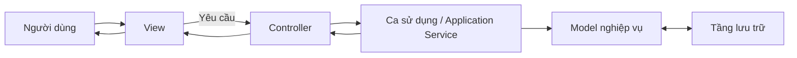
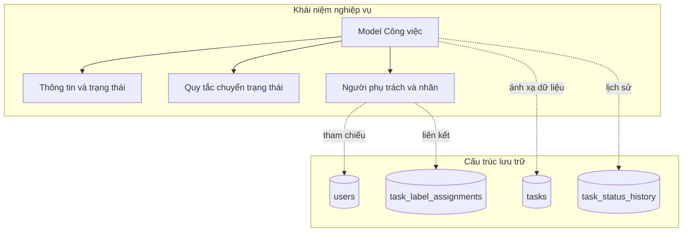
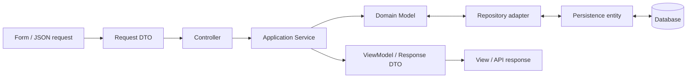

# Vì sao Model không đồng nghĩa với bảng hoặc thực thể cơ sở dữ liệu

Trong một ứng dụng quản lý công việc, người dùng nhìn thấy một **Công việc** có tiêu đề, người phụ trách, hạn hoàn thành và trạng thái. Khi người dùng bấm nút hoàn thành, ứng dụng phải quyết định thao tác đó có hợp lệ hay không, cập nhật trạng thái và phản ánh kết quả lên giao diện.

Ta có thể lưu công việc trong một bảng `tasks`, và dùng một đối tượng Java được ánh xạ bởi ORM để đọc ghi từng dòng. Tuy nhiên, khái niệm **Model** trong mô hình Model–View–Controller (MVC) rộng hơn cả bảng dữ liệu lẫn đối tượng ánh xạ đó. Model biểu diễn thông tin và trạng thái mà ứng dụng quan tâm, cùng các quy tắc và hành vi gắn với miền nghiệp vụ. Bảng và thực thể ORM là những cách có thể dùng để lưu trữ hoặc hiện thực một phần của Model.

Phân biệt được ba khái niệm này giúp ứng dụng không bị chi phối quá mức bởi cấu trúc cơ sở dữ liệu, đồng thời giữ quy tắc nghiệp vụ nhất quán dù dữ liệu được truy cập từ trang web, API hay tác vụ nền.

## 1. Model có ý nghĩa gì trong MVC?

Trong MVC, ba thành phần đảm nhiệm ba nhóm trách nhiệm:

| Thành phần | Trọng tâm | Ví dụ trong chức năng quản lý công việc |
|---|---|---|
| **Model** | Trạng thái, dữ liệu có ý nghĩa trong miền ứng dụng và quy tắc xử lý chúng | Công việc có trạng thái, người phụ trách; công việc đã hủy không thể được hoàn thành |
| **View** | Trình bày thông tin và cung cấp điều khiển tương tác | Trang chi tiết hiển thị tiêu đề, trạng thái và nút Hoàn thành |
| **Controller** | Tiếp nhận yêu cầu, điều phối xử lý và chọn phản hồi | Nhận `POST /tasks/42/complete`, gọi ca sử dụng và trả redirect hoặc JSON |

Model trả lời những câu hỏi như:

- Ứng dụng đang quản lý những khái niệm nào và trạng thái của chúng ra sao?
- Một đối tượng có thể thực hiện những hành động nào?
- Điều kiện nào phải luôn đúng để dữ liệu có ý nghĩa và hợp lệ?
- Khi một hành động xảy ra, trạng thái nghiệp vụ thay đổi như thế nào?

Vì vậy, Model không chỉ là một túi thuộc tính. Tùy cách thiết kế, nó có thể bao gồm đối tượng miền (domain object), giá trị miền (value object), tập hợp đối tượng có ranh giới nhất quán (aggregate), quy tắc nghiệp vụ và các dịch vụ miền cần phối hợp nhiều đối tượng. Trong ứng dụng nhỏ, những phần này có thể đơn giản và ít lớp; trong ứng dụng lớn, chúng thường được tổ chức rõ ràng hơn.

Thuật ngữ này có sắc thái khác nhau giữa các framework. Trong bài học này, **Model** chỉ phần trạng thái và ý nghĩa nghiệp vụ của ứng dụng. Một đối tượng có tên `Model` mà framework cung cấp để chuyển thuộc tính sang template là vùng dữ liệu trình bày (view model), không nhất thiết là Domain Model.



Sơ đồ cho thấy một cách tổ chức phổ biến trong ứng dụng web nhiều lớp. Application Service và tầng lưu trữ là các lớp triển khai thường gặp; chúng không phải là hai thành phần bổ sung bắt buộc của định nghĩa MVC. Trong ứng dụng đơn giản, Controller có thể gọi trực tiếp Model hoặc Repository. Dù tổ chức thế nào, Model vẫn là phần thể hiện trạng thái và quy tắc của ứng dụng.

## 2. Bảng cơ sở dữ liệu là cấu trúc lưu trữ

Bảng cơ sở dữ liệu được thiết kế để lưu trữ và truy vấn dữ liệu theo một hệ quản trị cụ thể. Nó có tên bảng, cột, kiểu dữ liệu, khóa chính, khóa ngoại, chỉ mục và các ràng buộc ở mức lưu trữ.

Ví dụ, bảng `tasks` có thể có cấu trúc:

| Cột | Kiểu dữ liệu minh họa | Ý nghĩa lưu trữ |
|---|---|---|
| `id` | `BIGINT` | Khóa định danh bản ghi |
| `title` | `VARCHAR(200)` | Tiêu đề được lưu |
| `status` | `VARCHAR(30)` | Mã trạng thái |
| `assignee_id` | `BIGINT` | Khóa tham chiếu đến người phụ trách |
| `due_at` | `TIMESTAMP` | Thời hạn |
| `completed_at` | `TIMESTAMP NULL` | Thời điểm hoàn thành, nếu có |

Bảng cho biết dữ liệu được tổ chức và lưu ra sao. Bản thân bảng không mô tả đầy đủ ý nghĩa của hành động `complete`, chẳng hạn trạng thái nào được phép chuyển sang hoàn thành, ai có quyền thực hiện hay cần ghi nhận thời điểm nào. Những quy tắc đó thuộc về nghiệp vụ của ứng dụng.

Một khái niệm nghiệp vụ có thể được lưu qua nhiều bảng. Ví dụ, lịch sử thay đổi trạng thái có thể được lưu trong `task_status_history`; thông tin người phụ trách nằm trong bảng `users`; nhãn của công việc có thể nằm trong `task_labels` và bảng liên kết `task_label_assignments`. Khi tải một Công việc, ứng dụng có thể kết hợp dữ liệu từ các bảng này thành một Model có ý nghĩa với nghiệp vụ.

Chiều ngược lại cũng đúng: một bảng có thể chứa các cột phục vụ lưu trữ, kiểm toán hoặc tối ưu truy vấn mà người dùng nghiệp vụ không xem là một thuộc tính độc lập của khái niệm Công việc. Ví dụ `created_at`, `updated_at`, `version` hoặc cờ xóa mềm có thể cần cho hạ tầng lưu trữ nhưng không nhất thiết là hành vi miền.



Đường ánh xạ giữa Model và cơ sở dữ liệu có thể thay đổi theo thời gian. Ứng dụng có thể tách một bảng lớn thành nhiều bảng, đổi tên cột, thêm chỉ mục hoặc chuyển sang một hệ lưu trữ khác mà khái niệm nghiệp vụ Công việc vẫn giữ nguyên.

## 3. Thực thể ORM là đối tượng ánh xạ dữ liệu

ORM (Object–Relational Mapping) giúp chương trình làm việc với dữ liệu quan hệ thông qua đối tượng. Một ORM entity thường ánh xạ một bản ghi hoặc một phần cấu trúc quan hệ, có định danh, thuộc tính và các quan hệ được ORM quản lý.

Ví dụ với JPA, một lớp có thể được ánh xạ vào bảng `tasks`:

```java
@Entity
@Table(name = "tasks")
public class TaskEntity {
    @Id
    private Long id;

    private String title;

    // Mã trạng thái được lưu; adapter chịu trách nhiệm chuyển đổi sang kiểu miền.
    private String status;

    @Column(name = "assignee_id")
    private Long assigneeId;

    private Instant dueAt;
    private Instant completedAt;

    @Version
    private long version;

    // Getter, setter và constructor được lược bỏ.
}
```

Lớp `TaskEntity` phản ánh cách lưu dữ liệu và có thể chứa chi tiết phục vụ ORM như `@Table`, `@Column`, `@Version`, quan hệ tải dữ liệu hoặc constructor theo yêu cầu của framework. Nó giúp chuyển đổi giữa hàng dữ liệu và đối tượng trong bộ nhớ.

Tuy nhiên, một ORM entity không tự động bảo đảm mọi quy tắc nghiệp vụ của Công việc. Nếu lớp chỉ có getter và setter, bất kỳ nơi nào có quyền truy cập cũng có thể thay đổi `status` tùy ý. Khi đó, quy tắc chuyển trạng thái có thể bị lặp lại ở nhiều Controller hoặc Service.

Điểm cần phân biệt là:

- **Bảng** mô tả cấu trúc lưu trữ ở cơ sở dữ liệu.
- **ORM entity** mô tả đối tượng được ánh xạ để ORM đọc và ghi dữ liệu.
- **Model nghiệp vụ** mô tả khái niệm, trạng thái và quy tắc mà ứng dụng cần bảo vệ.

Ba khái niệm có thể được hiện thực trong cùng một lớp ở ứng dụng đơn giản, nhưng chúng vẫn trả lời những câu hỏi thiết kế khác nhau.

## 4. Ví dụ: Model Công việc bảo vệ quy tắc nghiệp vụ

Giả sử quy trình của ứng dụng cho phép công việc chuyển từ `IN_PROGRESS` sang `COMPLETED`, nhưng không cho phép hoàn thành một công việc đã bị hủy. Quy tắc này cần được áp dụng dù yêu cầu đến từ trang HTML, API hay một tác vụ tự động.

Một Model miền có thể biểu diễn quy tắc ngay tại hành vi thay đổi trạng thái:

```java
public enum TaskStatus {
    OPEN,
    IN_PROGRESS,
    COMPLETED,
    CANCELLED
}

public final class Task {
    private final TaskId id;
    private String title;
    private TaskStatus status;
    private Instant completedAt;

    public Task(TaskId id, String title, TaskStatus status) {
        this.id = Objects.requireNonNull(id);
        this.title = Objects.requireNonNull(title);
        this.status = Objects.requireNonNull(status);
    }

    public void complete(Instant now) {
        if (status == TaskStatus.CANCELLED) {
            throw new InvalidTaskTransitionException(
                    "Không thể hoàn thành công việc đã bị hủy.");
        }

        if (status != TaskStatus.IN_PROGRESS) {
            throw new InvalidTaskTransitionException(
                    "Công việc phải ở trạng thái đang thực hiện.");
        }

        status = TaskStatus.COMPLETED;
        completedAt = Objects.requireNonNull(now);
    }

    public TaskId id() { return id; }
    public String title() { return title; }
    public TaskStatus status() { return status; }
    public Instant completedAt() { return completedAt; }
}
```

Đoạn mã tập trung vào ý nghĩa nghiệp vụ: một Công việc chỉ hoàn thành khi đang được thực hiện. `Task` không cần biết request đến từ HTTP, trang nào đang hiển thị hay dữ liệu được lưu bằng bảng nào. Lớp `TaskId` có thể là một value object để tránh nhầm lẫn định danh công việc với các loại ID khác.

Đây là ví dụ rút gọn; trong ứng dụng thực tế cần bổ sung cách khởi tạo hoặc tái tạo đối tượng từ dữ liệu đã lưu, quy tắc sửa tiêu đề, phân công, hủy công việc và các bất biến liên quan. Thời gian `now` được truyền vào giúp kiểm thử hành vi mà không phụ thuộc trực tiếp vào đồng hồ hệ thống.

Application Service có thể điều phối việc tải, kiểm tra quyền và lưu Model:

```java
@Transactional
public void completeTask(TaskId taskId, UserId actorId) {
    Task task = taskRepository.findById(taskId)
            .orElseThrow(() -> new TaskNotFoundException(taskId));

    permissionPolicy.requireCanUpdate(actorId, task);
    task.complete(clock.instant());
    taskRepository.save(task);
}
```

Trong ví dụ này:

- Repository cung cấp Model từ tầng lưu trữ và nhận Model để lưu lại.
- Permission policy xác định người dùng có quyền thực hiện ca sử dụng hay không.
- Model `Task` bảo vệ quy tắc chuyển trạng thái.
- Application Service điều phối các bước trong một transaction.

Kiểm tra quyền và quy tắc miền có liên quan nhưng không đồng nhất. Người dùng có quyền cập nhật một công việc vẫn không thể thực hiện một chuyển trạng thái bị nghiệp vụ cấm. Ngược lại, chuyển trạng thái hợp lệ về mặt miền cũng không có nghĩa mọi người dùng đều được phép thực hiện.

## 5. Khi nào tách Model nghiệp vụ khỏi ORM entity?

Không có quy tắc rằng mọi dự án đều phải tạo hai lớp riêng cho mỗi khái niệm. Quyết định phụ thuộc độ phức tạp của nghiệp vụ, số loại giao diện, cách lưu trữ và mức độ thay đổi dự kiến.

### Dùng chung một lớp có thể phù hợp

Với chức năng CRUD đơn giản, dữ liệu gần như chỉ được tạo, đọc, sửa và xóa, một JPA entity có thể đồng thời đóng vai trò Model. Cách này giảm số lớp và mã ánh xạ. Nó phù hợp khi:

- Quy tắc nghiệp vụ ít và dễ biểu diễn ngay trong entity.
- Cấu trúc lưu trữ gần với cấu trúc khái niệm của ứng dụng.
- Không có nhiều cách biểu diễn dữ liệu khác nhau cho các giao diện.
- Ranh giới giữa trường được phép sửa và trường nội bộ được kiểm soát rõ ràng.

Ngay cả khi dùng chung lớp, không nên để Controller tùy ý thay đổi mọi thuộc tính. Hãy cung cấp hành vi có ý nghĩa và kiểm tra dữ liệu đầu vào tại ranh giới ứng dụng.

### Tách riêng có lợi khi nghiệp vụ phức tạp

Khi một khái niệm nghiệp vụ trải qua nhiều bảng, có nhiều bất biến, hoặc cần phục vụ nhiều giao diện, tách Model miền khỏi lớp persistence thường giúp giảm phụ thuộc. Ví dụ:

```java
// Đối tượng nghiệp vụ, không mang annotation của JPA.
public final class Task {
    // Trạng thái, hành vi và quy tắc của Công việc.
}

// Đối tượng dành cho ORM và cấu trúc lưu trữ.
@Entity
@Table(name = "tasks")
public class TaskJpaEntity {
    // ID, các cột, version và mapping của JPA.
}
```

Một mapper chuyển đổi giữa hai dạng:

```java
public final class TaskMapper {
    public Task toDomain(TaskJpaEntity row) {
        return Task.reconstitute(
                new TaskId(row.getId()),
                row.getTitle(),
                TaskStatus.valueOf(row.getStatus()),
                row.getCompletedAt());
    }

    public TaskJpaEntity toEntity(Task task) {
        TaskJpaEntity row = new TaskJpaEntity();
        row.setId(task.id().value());
        row.setTitle(task.title());
        row.setStatus(task.status().name());
        row.setCompletedAt(task.completedAt());
        return row;
    }
}
```

Các phương thức `reconstitute`, getter và setter trong ví dụ là API minh họa cần được định nghĩa theo thiết kế thực tế. Mapper làm rõ rằng đối tượng nghiệp vụ và đối tượng lưu trữ có thể có cấu trúc khác nhau.

Việc tách riêng hữu ích khi:

- Một Model được tạo từ nhiều bảng hoặc nhiều nguồn dữ liệu.
- Quy tắc nghiệp vụ cần được kiểm thử độc lập với ORM và cơ sở dữ liệu.
- Cấu trúc bảng thường xuyên thay đổi vì yêu cầu lưu trữ hoặc hiệu năng.
- Cùng một nghiệp vụ được gọi từ web, API, message consumer hoặc tác vụ nền.
- ORM entity có nhiều chi tiết kỹ thuật không nên lan sang phần nghiệp vụ.

Tách lớp cũng có chi phí: cần mapper, thêm mã và phải duy trì chuyển đổi hai chiều. Chỉ nên tách khi lợi ích về ranh giới và khả năng thay đổi lớn hơn chi phí đó.

## 6. Phân biệt các loại dữ liệu trong một request

Một lỗi phổ biến là dùng một đối tượng cho tất cả các bước: nhận request, xử lý nghiệp vụ, lưu cơ sở dữ liệu và trả kết quả cho View. Mỗi bước có mục đích và quyền sở hữu dữ liệu khác nhau.

| Loại dữ liệu | Vai trò | Ví dụ |
|---|---|---|
| Request DTO / Form object | Mô tả dữ liệu client được phép gửi | `CompleteTaskRequest` hoặc form có trường ghi chú |
| Domain Model | Biểu diễn khái niệm và quy tắc nghiệp vụ | `Task`, `TaskId`, `TaskStatus` |
| Persistence entity | Biểu diễn dữ liệu theo cách ORM lưu trữ | `TaskJpaEntity` ánh xạ bảng `tasks` |
| ViewModel / Response DTO | Cung cấp dữ liệu phù hợp cho giao diện hoặc API | `TaskDetailView` gồm tiêu đề, nhãn trạng thái và tên người phụ trách |

Luồng dữ liệu minh họa:



Không phải ứng dụng nào cũng cần đủ các lớp trên. Sơ đồ nhấn mạnh các hợp đồng khác nhau, không phải yêu cầu phải tạo một class riêng cho mọi mũi tên. Trong ứng dụng nhỏ, một số kiểu có thể được dùng chung nếu trách nhiệm và quyền thay đổi vẫn rõ ràng.

### Ví dụ về nguy cơ khi bind request trực tiếp vào entity

Giả sử entity có các trường `title`, `status`, `ownerId` và `isAdmin`. Nếu Controller nhận trực tiếp entity từ request, client có thể gửi thêm các trường mà biểu mẫu không hiển thị. Đây là nguy cơ mass assignment: dữ liệu không được phép thay đổi vẫn có thể bị bind vào đối tượng.

Thay vào đó, hãy nhận DTO chỉ chứa trường được phép:

```java
public record UpdateTaskRequest(
        @NotBlank @Size(max = 200) String title) {
}
```

Controller kiểm tra DTO rồi gọi ca sử dụng. Service xác định người dùng hiện tại và quyền thao tác; Model bảo vệ quy tắc miền. Máy chủ không dựa vào việc giao diện có ẩn một trường hay không để quyết định quyền cập nhật.

## 7. Model trong các kiểu ứng dụng khác nhau

Model không bị giới hạn ở một loại giao diện hoặc một công nghệ lưu trữ.

**Ứng dụng kết xuất HTML phía máy chủ:** Controller lấy dữ liệu Model, chuẩn bị ViewModel và yêu cầu template kết xuất HTML. Model không cần biết template đang dùng là Thymeleaf, JSP hay một công cụ khác.

**Backend cung cấp REST API:** Controller nhận JSON, gọi ca sử dụng và trả Response DTO. Cùng một Model nghiệp vụ có thể được sử dụng dù response JSON có cấu trúc khác trang HTML.

**Tác vụ nền:** Một message consumer hoặc scheduled job có thể gọi Application Service để xử lý công việc. Quy tắc trong Model vẫn được áp dụng mà không cần tạo HTTP request hay View.

Điều này cho thấy Model thể hiện phần ý nghĩa và quy tắc của ứng dụng. Nó không phải là tên gọi khác của trang giao diện, request HTTP hoặc cấu trúc bảng.

## 8. Những nhầm lẫn thường gặp

| Nhầm lẫn | Hệ quả | Cách suy nghĩ phù hợp |
|---|---|---|
| Mỗi bảng phải có đúng một Model | Cấu trúc nghiệp vụ bị ép theo cấu trúc lưu trữ | Một Model có thể trải trên nhiều bảng; một bảng có thể chỉ là chi tiết lưu trữ |
| ORM entity luôn là toàn bộ Model | Quy tắc nghiệp vụ bị phụ thuộc vào cách ORM ánh xạ | Entity có thể tham gia Model, nhưng cần xem nó có thực sự bảo vệ hành vi và bất biến không |
| Model chỉ là getter và setter | Quy tắc bị phân tán sang Controller hoặc Service | Đặt hành vi và bất biến gần đối tượng miền sở hữu trạng thái |
| Model phải chứa mọi thứ của ứng dụng | Model phình to, trộn HTTP, giao diện, lưu trữ và nghiệp vụ | Phân định Model, Controller, View và các lớp điều phối/hạ tầng |
| Luôn phải tách domain model và persistence entity | Tăng mã ánh xạ và độ phức tạp không cần thiết | Chọn mức tách phù hợp với độ phức tạp và tốc độ thay đổi |
| Spring `Model` chính là Domain Model | Nhầm đối tượng truyền dữ liệu cho template với mô hình miền | `org.springframework.ui.Model` là vùng chứa thuộc tính Controller đưa sang View |

Đặc biệt, trong Spring MVC, tham số `org.springframework.ui.Model` của handler chỉ là một vùng chứa các thuộc tính để View sử dụng. Ví dụ:

```java
@GetMapping("/{id}")
public String detail(@PathVariable long id,
                     org.springframework.ui.Model viewModel) {
    TaskDetail task = taskService.getDetail(new TaskId(id));
    viewModel.addAttribute("task", task);
    return "tasks/detail";
}
```

Ở đây, biến `viewModel` là dữ liệu chuyển sang template. Đối tượng `Task` được lấy từ nghiệp vụ mới là Domain Model. Tên gọi giống nhau không có nghĩa chúng có cùng trách nhiệm.

## 9. Kiểm thử Model mà không phụ thuộc cơ sở dữ liệu

Khi quy tắc nghiệp vụ nằm trong Model, có thể kiểm thử trực tiếp bằng unit test. Không cần khởi động web server, tạo HTTP request hoặc kết nối cơ sở dữ liệu chỉ để xác nhận một chuyển trạng thái.

Ví dụ với JUnit:

```java
class TaskTest {
    @Test
    void completesTaskThatIsInProgress() {
        Task task = new Task(
                new TaskId(42L), "Viết tài liệu", TaskStatus.IN_PROGRESS);
        Instant now = Instant.parse("2026-01-10T09:00:00Z");

        task.complete(now);

        assertEquals(TaskStatus.COMPLETED, task.status());
        assertEquals(now, task.completedAt());
    }

    @Test
    void rejectsCompletionOfCancelledTask() {
        Task task = new Task(
                new TaskId(42L), "Viết tài liệu", TaskStatus.CANCELLED);

        assertThrows(InvalidTaskTransitionException.class,
                () -> task.complete(Instant.now()));
    }
}
```

Ngoài unit test cho Model, nên có kiểm thử tích hợp cho mapper và Repository để xác nhận dữ liệu được đọc, ánh xạ và lưu đúng. Kiểm thử Controller xác nhận request được chuyển thành lời gọi ca sử dụng và phản hồi phù hợp. Mỗi loại kiểm thử tập trung vào một ranh giới cụ thể.

## 10. Câu hỏi để xác định một lớp có đang làm đúng vai trò Model không

Khi đọc hoặc thiết kế một lớp, hãy tự hỏi:

1. Lớp này đang mô tả khái niệm hoặc trạng thái nghiệp vụ nào?
2. Nó có bảo vệ quy tắc nào phải luôn đúng không?
3. Nó có phụ thuộc trực tiếp vào HTTP, template, session hoặc chi tiết framework giao diện không?
4. Nó có phụ thuộc vào tên bảng, câu SQL hoặc annotation ORM chỉ vì lý do lưu trữ không?
5. Nếu thay đổi cấu trúc bảng hoặc thêm một giao diện API, quy tắc nghiệp vụ trong lớp có phải thay đổi theo không?
6. Có thể kiểm thử hành vi chính của lớp mà không cần dựng toàn bộ ứng dụng không?

Nếu một lớp vừa nhận request, kiểm tra quyền, chạy SQL, thay đổi trạng thái, định dạng HTML và trả response, nó đang gánh quá nhiều trách nhiệm. Hãy tìm các ranh giới phù hợp để chuyển phần giao tiếp về Controller, phần trình bày về View và phần lưu trữ về Repository hoặc adapter.

Model trong MVC là cách ứng dụng biểu diễn trạng thái và ý nghĩa nghiệp vụ. Bảng cơ sở dữ liệu là cấu trúc lưu trữ; ORM entity là đối tượng ánh xạ dữ liệu. Chúng có thể được kết hợp trong một lớp khi nghiệp vụ đơn giản, hoặc tách riêng khi cần ranh giới rõ hơn. Điều quan trọng là các quy tắc của ứng dụng phải có một nơi đáng tin cậy để được bảo vệ, độc lập với cách người dùng gửi yêu cầu và cách hệ thống lưu dữ liệu.
