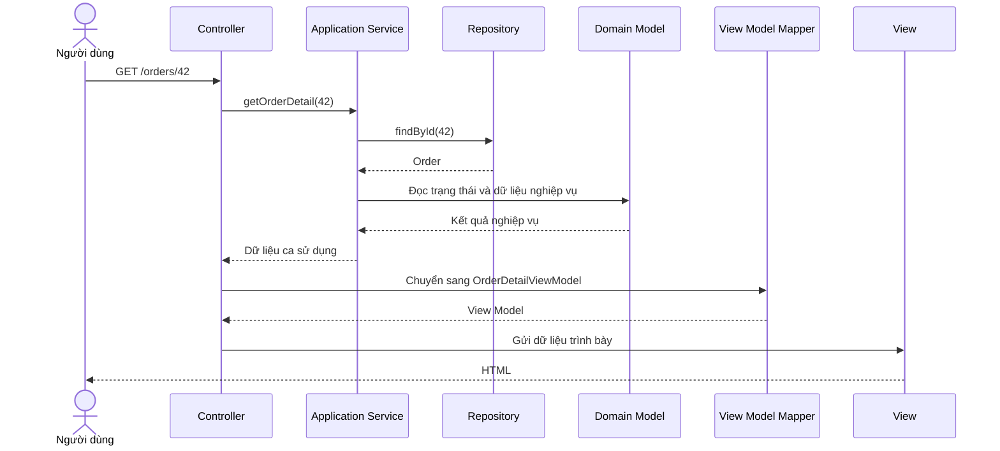

# Phân biệt Model nghiệp vụ và mô hình dữ liệu trình bày

Trong MVC (Model–View–Controller), từ **Model** thường được dùng để chỉ phần dữ liệu và trạng thái mà ứng dụng làm việc. Tuy nhiên, trong một ứng dụng web thực tế, có nhiều loại đối tượng cùng mang dữ liệu nhưng phục vụ những mục đích khác nhau. Đối tượng biểu diễn một đơn hàng và bảo vệ quy tắc nghiệp vụ không nhất thiết phải giống đối tượng chứa các trường mà trang chi tiết đơn hàng cần hiển thị.

Phân biệt **Model nghiệp vụ** (Domain Model) với **mô hình dữ liệu trình bày** (Presentation Model hoặc View Model) giúp đặt đúng trách nhiệm cho từng đối tượng. Model nghiệp vụ thể hiện khái niệm và quy tắc của miền ứng dụng. Mô hình dữ liệu trình bày tổ chức dữ liệu theo nhu cầu của một màn hình hoặc một dạng phản hồi. Nhờ tách hai mục đích này, nghiệp vụ ít phụ thuộc vào giao diện, còn giao diện có thể thay đổi cách trình bày mà không làm biến dạng mô hình miền.

## 1. Vì sao cần phân biệt các loại Model?

Một chức năng xem chi tiết đơn hàng có thể cần biết:

- Đơn hàng thuộc về khách hàng nào, có những dòng hàng nào và đang ở trạng thái gì.
- Tổng tiền được tính theo quy tắc nào, đơn hàng có thể chuyển sang trạng thái nào và khi nào được phép hủy.
- Trang web cần hiển thị mã đơn, ngày đặt hàng đã định dạng, tên trạng thái dễ đọc, tổng tiền theo tiền tệ và nút thao tác có xuất hiện hay không.

Các thông tin trên liên quan đến cùng một đơn hàng nhưng không cùng bản chất. Quy tắc tính tiền và chuyển trạng thái là quy tắc nghiệp vụ. Chuỗi ngày tháng, nhãn trạng thái và cấu trúc một hàng trong bảng là cách trình bày. Nếu đặt tất cả vào một đối tượng, thay đổi giao diện có thể tác động đến nghiệp vụ; ngược lại, một quy tắc nghiệp vụ có thể bị sao chép vào nhiều màn hình.

Trong bài này, cần hiểu ba khái niệm:

- **Model nghiệp vụ** mô tả khái niệm, trạng thái, quan hệ và hành vi có ý nghĩa trong miền bài toán.
- **Mô hình dữ liệu trình bày** chuẩn bị dữ liệu theo nhu cầu của View hoặc client nhận phản hồi.
- **Model của framework MVC** đôi khi chỉ là một vùng chứa thuộc tính để Controller chuyển dữ liệu sang View. Nó không mặc nhiên là Model nghiệp vụ hay một lớp View Model cụ thể.

Ngoài ra, hệ thống có thể có mô hình lưu trữ hoặc mô hình ánh xạ cơ sở dữ liệu (Persistence Model). Đây là cấu trúc phục vụ lưu và truy xuất dữ liệu. Trong ứng dụng đơn giản, lớp ánh xạ cơ sở dữ liệu có thể đồng thời đóng vai trò đối tượng miền; trong hệ thống phức tạp, hai mô hình này có thể tách riêng.

## 2. Model nghiệp vụ là gì?

Model nghiệp vụ (Domain Model) biểu diễn những khái niệm quan trọng của lĩnh vực mà phần mềm giải quyết. Nó trả lời các câu hỏi như: hệ thống quản lý những đối tượng nào, mỗi đối tượng có trạng thái gì, các đối tượng liên hệ ra sao và quy tắc nào phải luôn được giữ đúng.

Ví dụ trong hệ thống bán hàng, các khái niệm miền có thể gồm `Order` (đơn hàng), `OrderLine` (dòng hàng), `Product` (sản phẩm), `Customer` (khách hàng) và `Money` (giá trị tiền). Model nghiệp vụ không chỉ chứa các trường dữ liệu. Nó còn có thể cung cấp hành vi để bảo vệ tính hợp lệ của trạng thái.

### 2.1. Thành phần thường gặp

| Thành phần | Ý nghĩa | Ví dụ |
|---|---|---|
| Entity (thực thể) | Đối tượng có định danh và vòng đời riêng | `Order` có mã đơn hàng duy nhất |
| Value Object (đối tượng giá trị) | Được xác định bởi giá trị, thường không có định danh riêng và có thể bất biến | `Money`, `Address`, khoảng thời gian |
| Aggregate (cụm tổng hợp) | Nhóm đối tượng có ranh giới nhất quán; thay đổi được điều phối qua aggregate root | `Order` quản lý các `OrderLine` của nó |
| Domain Service (dịch vụ miền) | Chứa quy tắc nghiệp vụ không tự nhiên thuộc về một entity hoặc value object cụ thể | Chính sách phân bổ hạn mức giữa nhiều tài khoản |
| Repository (kho lưu trữ) | Cung cấp cách truy xuất và lưu aggregate theo ngôn ngữ miền | `OrderRepository.findById(id)` |

Không phải ứng dụng nào cũng cần đủ các thành phần trên. Một ứng dụng CRUD nhỏ có thể dùng các lớp đơn giản. Khi quy tắc và trạng thái phức tạp hơn, mô hình miền có hành vi rõ ràng giúp tập trung các điều kiện hợp lệ vào nơi có thể kiểm soát.

### 2.2. Model nghiệp vụ bảo vệ quy tắc

Giả sử đơn hàng chỉ được hủy khi đang ở trạng thái `PENDING` hoặc `CONFIRMED`. Nếu mỗi Controller tự kiểm tra trạng thái, nhiều endpoint có thể triển khai quy tắc khác nhau. Đặt hành vi vào đối tượng nghiệp vụ giúp mọi nơi sử dụng cùng một quy tắc:

```java
public enum OrderStatus {
    PENDING,
    CONFIRMED,
    SHIPPED,
    CANCELLED
}

public class Order {
    private final OrderId id;
    private OrderStatus status;

    public Order(OrderId id, OrderStatus status) {
        this.id = id;
        this.status = status;
    }

    public void cancel() {
        if (status != OrderStatus.PENDING
                && status != OrderStatus.CONFIRMED) {
            throw new IllegalStateException(
                "Đơn hàng không thể bị hủy ở trạng thái hiện tại"
            );
        }

        status = OrderStatus.CANCELLED;
    }

    public OrderId getId() {
        return id;
    }

    public OrderStatus getStatus() {
        return status;
    }
}
```

Đây là ví dụ rút gọn để làm rõ hành vi của Model nghiệp vụ. Trong ứng dụng thật, `OrderId` có thể là value object, trạng thái có thể được quản lý qua các phương thức chuyển trạng thái chuyên biệt và việc lưu thay đổi do application service phối hợp với repository thực hiện.

Phương thức `cancel()` thể hiện quy tắc của miền. Nó không cần biết người dùng bấm nút nào, request đến từ URL nào hoặc trang web hiển thị thông báo ra sao. Bởi vậy, quy tắc này có thể được dùng từ giao diện web, API hoặc tác vụ nền.

### 2.3. Model nghiệp vụ không phải nơi chứa mọi thứ

Model nghiệp vụ không nên phụ thuộc vào template HTML, tên trường của một biểu mẫu, `HttpServletRequest` hoặc định dạng JSON cụ thể. Những chi tiết đó thuộc về ranh giới ứng dụng và trình bày.

Model cũng không nhất thiết tự làm mọi việc như gửi email, gọi dịch vụ thanh toán bên ngoài hoặc tạo phản hồi HTTP. Application Service thường điều phối một ca sử dụng: nạp aggregate từ repository, gọi hành vi nghiệp vụ, phối hợp các cổng tích hợp và lưu kết quả. Việc phân chia cụ thể tùy kiến trúc, nhưng quy tắc miền cần được bảo vệ ở nơi mọi luồng truy cập đều phải tuân theo.

## 3. Mô hình dữ liệu trình bày là gì?

Mô hình dữ liệu trình bày (Presentation Model) tổ chức dữ liệu để một View hoặc client có thể hiển thị và tương tác thuận tiện. Trong ứng dụng web, một dạng phổ biến là **View Model**: đối tượng chứa đúng những dữ liệu mà một trang hoặc một vùng giao diện cần.

Ví dụ, trang chi tiết đơn hàng có thể cần:

- Mã đơn hàng và tên khách hàng.
- Ngày đặt hàng ở định dạng dễ đọc.
- Danh sách dòng hàng với tên, số lượng và thành tiền.
- Tổng tiền đã định dạng theo đơn vị tiền tệ.
- Nhãn trạng thái thân thiện với người dùng.
- Thông tin hiển thị như `showCancelButton` để View biết có nên trình bày nút hủy hay không.

Những trường này có thể được tổng hợp từ nhiều đối tượng nghiệp vụ. View Model không nhất thiết có cùng cấu trúc với entity, bảng cơ sở dữ liệu hoặc aggregate. Nó được thiết kế theo nhu cầu trình bày.

Ví dụ một View Model dùng Java record:

```java
public record OrderDetailViewModel(
    String orderNumber,
    String customerName,
    String orderedAt,
    String statusLabel,
    List<OrderLineViewModel> lines,
    String formattedTotal,
    boolean showCancelButton
) {}

public record OrderLineViewModel(
    String productName,
    String quantity,
    String formattedLineTotal
) {}
```

Các trường `orderedAt`, `statusLabel` và `formattedTotal` phục vụ cách hiển thị. View không cần tự biết cách chuyển `OrderStatus.CONFIRMED` thành nhãn tiếng Việt hoặc cách định dạng số tiền. Khi ngôn ngữ, quy tắc định dạng hoặc bố cục trang thay đổi, nhóm có thể điều chỉnh phần ánh xạ trình bày mà không sửa hành vi của `Order`.

`showCancelButton` chỉ là gợi ý về khả năng hiển thị thao tác trên giao diện. Nó không phải cơ chế phân quyền. Khi request hủy đơn thực sự được gửi đến server, application service vẫn phải xác thực người dùng và Model nghiệp vụ vẫn phải kiểm tra trạng thái hợp lệ.

### 3.1. View Model và DTO có giống nhau không?

Hai thuật ngữ này có liên quan nhưng không hoàn toàn đồng nghĩa:

- **DTO (Data Transfer Object)** là đối tượng truyền dữ liệu qua một ranh giới, chẳng hạn giữa các tầng, giữa các tiến trình hoặc qua API. DTO thường tập trung vào cấu trúc dữ liệu cần trao đổi.
- **View Model** là mô hình dữ liệu được thiết kế cho nhu cầu trình bày của một View hoặc màn hình cụ thể. Nó có thể chứa nhãn đã dịch, chuỗi đã định dạng, nhóm dữ liệu và các cờ hiển thị.

Trong một dự án, một lớp có thể vừa được gọi là DTO vừa được dùng làm View Model nếu phạm vi và mục đích phù hợp. Tuy nhiên, API công khai và trang web thường có yêu cầu khác nhau về phiên bản, trường dữ liệu và bảo mật; dùng chung một lớp cho cả hai chỉ nên thực hiện khi hợp đồng thực sự giống nhau.

### 3.2. Mô hình đầu vào và mô hình đầu ra

Không nên mặc định một lớp dữ liệu phải vừa nhận dữ liệu biểu mẫu vừa cung cấp dữ liệu cho trang. Mô hình đầu vào (Form Model, Request Model hoặc Command) mô tả những gì client được phép gửi. Mô hình đầu ra mô tả những gì ứng dụng muốn trả về hoặc hiển thị.

Ví dụ, biểu mẫu cập nhật địa chỉ có thể nhận `street`, `city` và `postalCode`. Nó không nên nhận `customerId`, `accountBalance` hoặc `role` nếu người dùng không được phép tự thay đổi các trường đó. Đầu ra của trang hồ sơ lại có thể cần tên đầy đủ, địa chỉ đã định dạng và ngày cập nhật gần nhất.

Tách mô hình đầu vào và đầu ra giúp kiểm soát dữ liệu được ghi, dữ liệu được đọc và quy tắc xác thực cho từng thao tác.

## 4. So sánh Model nghiệp vụ và mô hình dữ liệu trình bày

| Tiêu chí | Model nghiệp vụ (Domain Model) | Mô hình dữ liệu trình bày (View Model) |
|---|---|---|
| Mục đích | Mô tả miền và bảo vệ quy tắc nghiệp vụ | Cung cấp dữ liệu thuận tiện cho giao diện hoặc client |
| Câu hỏi chính | Đối tượng là gì, được làm gì, trạng thái nào hợp lệ? | Màn hình cần hiển thị hoặc nhận những trường nào? |
| Cấu trúc | Theo khái niệm, quan hệ và hành vi của miền | Theo bố cục, ngữ cảnh và nhu cầu tương tác |
| Hành vi | Có thể chứa phương thức thực thi quy tắc miền | Thường tập trung vào dữ liệu và trạng thái trình bày |
| Phụ thuộc | Không nên phụ thuộc vào HTML, template hoặc HTTP | Có thể phụ thuộc vào yêu cầu của một View hoặc kênh trình bày |
| Vòng đời | Gắn với vòng đời và tính nhất quán của miền | Thường được tạo cho một request, màn hình hoặc phản hồi |
| Ví dụ | `Order`, `Money`, `Address`, `Order.cancel()` | `OrderDetailViewModel`, `OrderLineViewModel` |
| Kiểm thử | Kiểm tra quy tắc và chuyển đổi trạng thái | Kiểm tra ánh xạ, dữ liệu hiển thị và định dạng |

Điểm khác biệt cốt lõi nằm ở mục đích. Một lớp có nhiều trường dữ liệu chưa chắc là Model nghiệp vụ; một lớp có tên `Order` cũng chưa chắc là mô hình miền tốt nếu nó chỉ là túi dữ liệu và mọi quy tắc đều nằm rải rác ở Controller.

## 5. Luồng chuyển đổi từ Model nghiệp vụ sang View Model

Trong một ứng dụng MVC server-side, Controller tiếp nhận request, application service thực hiện ca sử dụng và trả về dữ liệu cần thiết. Một mapper hoặc assembler chuyển dữ liệu nghiệp vụ thành mô hình trình bày; Controller đưa mô hình đó cho View render.



Tùy mức độ phức tạp, mapper có thể là một lớp riêng, một phương thức trong application service hoặc một thành phần trình bày. Điều quan trọng là quy tắc miền không bị chuyển vào mapper chỉ vì mapper đang đọc dữ liệu nghiệp vụ.

### 5.1. Ví dụ ánh xạ trong ứng dụng Java/Spring MVC

Giả sử application service cung cấp chi tiết đơn hàng. Mapper tạo View Model từ kết quả đó:

```java
@Component
public class OrderDetailViewMapper {
    private final DateTimeFormatter dateFormatter =
        DateTimeFormatter.ofPattern("dd/MM/yyyy HH:mm");

    public OrderDetailViewModel toViewModel(
            Order order,
            Customer customer,
            Locale locale) {

        List<OrderLineViewModel> lines = order.getLines().stream()
            .map(line -> new OrderLineViewModel(
                line.getProductName(),
                line.getQuantity().toString(),
                formatMoney(line.getLineTotal(), locale)
            ))
            .toList();

        return new OrderDetailViewModel(
            order.getId().toString(),
            customer.getDisplayName(),
            dateFormatter.format(order.getCreatedAt()),
            statusLabel(order.getStatus(), locale),
            lines,
            formatMoney(order.getTotal(), locale),
            order.getStatus() == OrderStatus.PENDING
                || order.getStatus() == OrderStatus.CONFIRMED
        );
    }

    // Các hàm formatMoney và statusLabel được lược bỏ.
}
```

Đoạn mã là ví dụ minh họa; trong ứng dụng thực tế cần chọn formatter theo locale, múi giờ và đơn vị tiền tệ của dữ liệu. Nó cho thấy mapper lấy dữ liệu từ Model nghiệp vụ rồi tạo cấu trúc phù hợp cho View. Việc xác định người dùng hiện tại có quyền hủy hay không có thể cần thêm chính sách phân quyền ở application layer; cờ hiển thị không thay thế kiểm tra quyền khi thực thi thao tác.

Controller có thể đưa View Model vào vùng chứa Model của Spring:

```java
@Controller
@RequestMapping("/orders")
public class OrderController {
    private final OrderApplicationService orderService;
    private final OrderDetailViewMapper viewMapper;

    public OrderController(
            OrderApplicationService orderService,
            OrderDetailViewMapper viewMapper) {
        this.orderService = orderService;
        this.viewMapper = viewMapper;
    }

    @GetMapping("/{id}")
    public String detail(
            @PathVariable long id,
            Locale locale,
            org.springframework.ui.Model model) {

        OrderDetailData data = orderService.getDetail(id);
        OrderDetailViewModel viewModel = viewMapper.toViewModel(
            data.order(), data.customer(), locale
        );

        model.addAttribute("order", viewModel);
        return "orders/detail";
    }
}
```

Trong ví dụ này có hai cách dùng từ Model:

- `Order` là đối tượng thuộc Model nghiệp vụ.
- `org.springframework.ui.Model` là vùng chứa thuộc tính mà Spring MVC dùng để chuyển dữ liệu đến View.

`OrderDetailViewModel` là kiểu dữ liệu cụ thể mà template nhận được. Không nên nhầm vùng chứa `org.springframework.ui.Model` với toàn bộ Model của kiến trúc MVC hoặc với Model nghiệp vụ.

## 6. Chọn mô hình phù hợp cho từng tình huống

### 6.1. Khi nào nên dùng Model nghiệp vụ?

Hãy đặt dữ liệu và hành vi vào Model nghiệp vụ khi chúng thể hiện khái niệm hoặc quy tắc của miền và cần được giữ nhất quán qua nhiều luồng xử lý. Ví dụ:

- Một đơn hàng kiểm soát những trạng thái được phép chuyển đổi.
- Một đối tượng tiền tệ bảo đảm số tiền và loại tiền được xử lý đúng.
- Một tài khoản kiểm tra điều kiện rút tiền trước khi thay đổi số dư.
- Một địa chỉ miền chuẩn hóa hoặc kiểm tra các giá trị theo quy tắc của hệ thống.

Quy tắc này nên có hiệu lực dù thao tác đến từ trang web, API hay tác vụ nền.

### 6.2. Khi nào nên dùng View Model?

Hãy tạo View Model khi một màn hình cần dữ liệu được tổng hợp, đổi tên, định dạng hoặc nhóm theo cách khác với cấu trúc miền. Ví dụ:

- Trang tổng quan kết hợp tên khách hàng, tổng đơn và trạng thái thanh toán từ nhiều nguồn.
- Bảng quản trị cần chuỗi ngày giờ, nhãn trạng thái và các cột đã chọn.
- Trang chi tiết cần danh sách dòng hàng và tổng tiền đã định dạng.
- Một màn hình cần các cờ trình bày như `showEditAction` hoặc `isEmptyState`.

View Model có thể được tạo riêng cho từng trang hoặc nhóm màn hình. Không cần ép tất cả View dùng chung một cấu trúc nếu mục đích trình bày khác nhau.

### 6.3. Khi nào DTO hoặc mô hình đầu vào phù hợp hơn?

DTO phù hợp khi cần truyền dữ liệu qua một ranh giới, chẳng hạn API response hoặc giao tiếp giữa các dịch vụ. Mô hình đầu vào phù hợp khi nhận dữ liệu do client gửi lên. Chẳng hạn:

```java
public record ChangeShippingAddressRequest(
    @NotBlank String street,
    @NotBlank String city,
    @NotBlank String postalCode
) {}
```

Request này thể hiện các trường người dùng được phép gửi để yêu cầu đổi địa chỉ giao hàng. Controller xác thực cấu trúc đầu vào, application service kiểm tra người dùng có quyền sửa đơn hàng hay không, sau đó gọi hành vi nghiệp vụ phù hợp. Không nên nhận trực tiếp một entity `Order` từ request rồi bind mọi trường mà client gửi.

## 7. Vì sao không nên đưa trực tiếp Model nghiệp vụ ra View hoặc API?

Trong một số ứng dụng nhỏ, Controller có thể truyền entity trực tiếp sang template. Cách này có thể hoạt động khi cấu trúc đơn giản và không có yêu cầu trình bày riêng. Tuy nhiên, khi hệ thống phát triển, việc để View hoặc API phụ thuộc trực tiếp vào entity tạo ra một số rủi ro.

**Rò rỉ chi tiết nội bộ.** Entity có thể chứa thông tin không cần hiển thị như ghi chú nội bộ, dữ liệu định danh, trạng thái kỹ thuật hoặc quan hệ với các đối tượng khác. Nếu serialize trực tiếp, ứng dụng có thể vô tình công khai dữ liệu nhạy cảm.

**Ràng buộc giao diện với cấu trúc miền.** Đổi tên thuộc tính, thay quan hệ hoặc tổ chức lại aggregate có thể làm hỏng template và API client. View Model giúp duy trì hợp đồng trình bày ổn định hơn trong khi mô hình miền được cải tiến.

**Khó kiểm soát dữ liệu đầu vào.** Nếu nhận entity trực tiếp từ biểu mẫu, người dùng có thể gửi thêm trường mà giao diện không hiển thị, chẳng hạn `status`, `ownerId` hoặc `approved`. Hiện tượng này thường được gọi là mass assignment hoặc over-posting. Dùng request model có danh sách trường cho phép rõ ràng giúp giảm nguy cơ này.

**Phụ thuộc không mong muốn.** Entity ORM có thể chứa quan hệ lazy-loading, vòng tham chiếu hoặc cấu trúc gắn với persistence. Render hoặc serialize trực tiếp có thể kích hoạt truy vấn ngoài dự kiến, gây lỗi vòng lặp hoặc làm phản hồi quá lớn.

Vì vậy, với chức năng có yêu cầu bảo mật, API công khai, nhiều giao diện hoặc miền nghiệp vụ phức tạp, nên định nghĩa hợp đồng đầu vào và đầu ra riêng. Việc ánh xạ cần chọn lọc trường, kiểm soát quyền truy cập và không làm lộ cấu trúc nội bộ.

## 8. Những sai lầm thường gặp

**Coi mọi lớp có dữ liệu là Model nghiệp vụ.** Một lớp chỉ chứa trường và getter/setter có thể là DTO, entity lưu trữ hoặc View Model. Hãy xác định mục đích và quy tắc mà nó chịu trách nhiệm trước khi đặt tên.

**Đưa định dạng giao diện vào Model nghiệp vụ.** `Order` không nên lưu `formattedTotal = "1.250.000 ₫"` chỉ để phục vụ một template. Nó nên giữ giá trị miền có ý nghĩa như `Money`; lớp trình bày quyết định cách định dạng theo locale và ngữ cảnh.

**Đưa quy tắc nghiệp vụ vào View Model hoặc template.** Một cờ `showCancelButton` có thể giúp giao diện quyết định có hiển thị nút, nhưng điều kiện hợp lệ để hủy phải được thực thi trong application service và Model nghiệp vụ. Không được dựa vào giao diện để bảo vệ dữ liệu.

**Dùng một DTO cho mọi màn hình và API.** Các kênh có thể cần trường dữ liệu, mức chi tiết và quy tắc phiên bản khác nhau. Dùng chung chỉ khi hợp đồng thật sự tương thích; nếu không, hãy tạo mô hình riêng và dùng chung phần nghiệp vụ phía sau.

**Tạo quá nhiều lớp ánh xạ không cần thiết.** Một màn hình đơn giản với dữ liệu trùng khớp hoàn toàn có thể chưa cần mapper riêng. Khi ánh xạ trở nên phức tạp hoặc cần kiểm soát rõ hợp đồng, tách mapper sẽ có ích. Mục tiêu là làm ranh giới dễ hiểu, không phải tăng số lượng lớp.

**Nhầm Spring `Model` với Domain Model.** Tham số `Model` của Spring MVC là vùng chứa dữ liệu cho View. Nó không phải nơi mặc định để viết quy tắc nghiệp vụ hoặc lưu trạng thái miền lâu dài.

## 9. Kiểm thử hai loại mô hình

Model nghiệp vụ và View Model có mục tiêu khác nhau nên tiêu chí kiểm thử cũng khác nhau.

| Đối tượng kiểm thử | Điều cần xác minh | Ví dụ |
|---|---|---|
| Model nghiệp vụ | Quy tắc, bất biến và chuyển trạng thái | Đơn hàng đã giao không thể hủy; tổng tiền được tính đúng |
| View Model mapper | Ánh xạ đúng dữ liệu, nhãn và định dạng | `CONFIRMED` được chuyển thành nhãn phù hợp; tổng tiền có đúng đơn vị |
| Request/Form Model | Ràng buộc đầu vào và trường được phép nhận | Thiếu địa chỉ hoặc mã bưu chính sai định dạng bị từ chối |
| Controller | Điều phối đúng và trả về hợp đồng phù hợp | Request hợp lệ gọi ca sử dụng và chọn đúng View |
| Tích hợp | Luồng từ dữ liệu miền đến phản hồi | Trang chi tiết hiển thị đúng dữ liệu lấy từ repository kiểm thử |

Ví dụ, kiểm thử `Order.cancel()` không cần biết template hiển thị nút hủy ra sao. Ngược lại, kiểm thử `OrderDetailViewMapper` có thể xác minh nhãn trạng thái và chuỗi tiền tệ mà không cần kiểm tra lại toàn bộ quy tắc chuyển trạng thái. Sự phân biệt này giúp lỗi được phát hiện ở đúng phạm vi.

## 10. Checklist thiết kế

Khi thêm hoặc chỉnh sửa một lớp dữ liệu trong ứng dụng MVC, hãy tự hỏi:

1. Lớp này biểu diễn khái niệm nghiệp vụ, dữ liệu lưu trữ, dữ liệu đầu vào hay dữ liệu trình bày?
2. Nếu quy tắc miền thay đổi, lớp nào phải bảo vệ tính hợp lệ của trạng thái?
3. Nếu giao diện đổi ngôn ngữ hoặc bố cục, có cần sửa Model nghiệp vụ không?
4. View hoặc API có đang nhận những trường nội bộ không cần thiết không?
5. Dữ liệu đầu vào có giới hạn rõ những trường client được phép thay đổi không?
6. Các thao tác nhạy cảm có được xác thực quyền và kiểm tra quy tắc ở phía server không?
7. Có thể kiểm thử quy tắc miền và ánh xạ trình bày độc lập không?

Không có yêu cầu phải tạo một View Model cho mọi entity hoặc một Domain Model phức tạp cho mọi ứng dụng. Hãy chọn mức độ tách biệt theo độ phức tạp của nghiệp vụ, số lượng giao diện, rủi ro bảo mật và tốc độ thay đổi của hệ thống.

## Kết luận

Model nghiệp vụ biểu diễn ngôn ngữ, trạng thái và quy tắc của miền ứng dụng; mô hình dữ liệu trình bày sắp xếp dữ liệu theo nhu cầu của View hoặc client. DTO và mô hình đầu vào lại phục vụ việc truyền và nhận dữ liệu qua các ranh giới. Khi phân biệt đúng các mục đích này, MVC giữ được nghiệp vụ độc lập với giao diện, cho phép mỗi màn hình có hợp đồng dữ liệu phù hợp và giúp kiểm thử từng trách nhiệm rõ ràng hơn. Điều quan trọng là mọi quy tắc bảo vệ tính hợp lệ của miền phải được thực thi ở phía ứng dụng, bất kể dữ liệu được trình bày theo hình thức nào.
