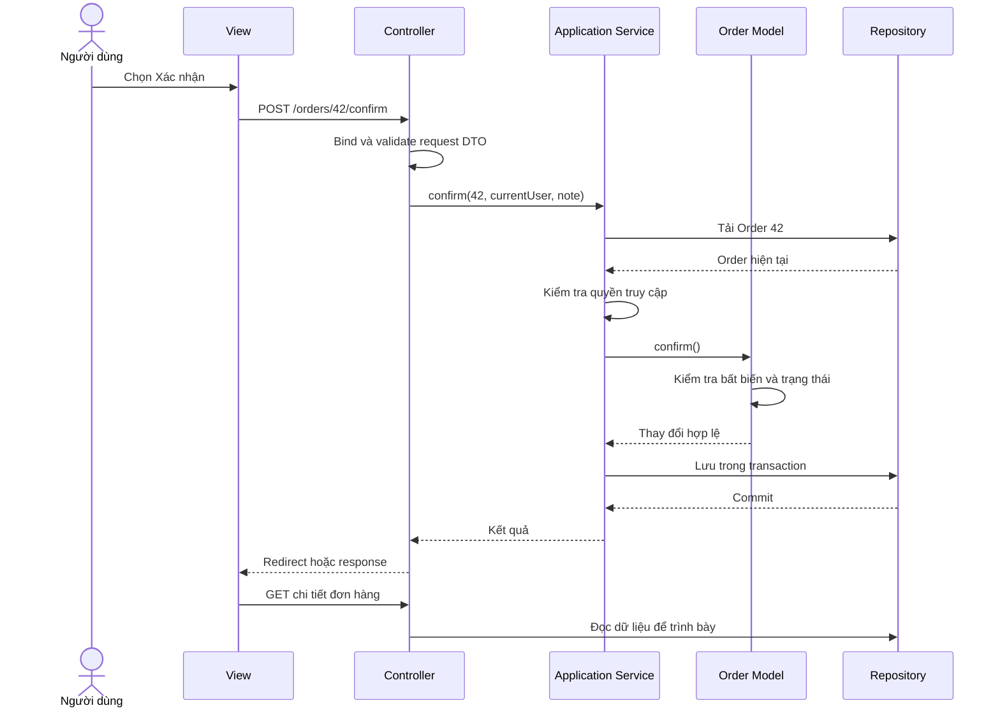

# Đóng gói dữ liệu và kiểm soát quyền thay đổi

Trong kiến trúc **MODEL_VIEW_CONTROLLER (MVC)**, Model giữ dữ liệu và hành vi mà ứng dụng cần quản lý; View trình bày dữ liệu; Controller tiếp nhận request và điều phối thao tác. Ranh giới này chỉ có ý nghĩa khi trạng thái quan trọng được bảo vệ đúng chỗ. Nếu bất kỳ đoạn mã nào cũng có thể sửa trực tiếp dữ liệu của Model, các quy tắc nghiệp vụ sẽ bị phân tán giữa controller, biểu mẫu, View và những dịch vụ khác. Ứng dụng khi đó khó giữ tính nhất quán, khó xác định ai được phép thay đổi dữ liệu và khó kiểm thử.

**Đóng gói dữ liệu** là cách tổ chức một đối tượng sao cho dữ liệu nội bộ được truy cập và thay đổi thông qua một giao diện có chủ đích. **Kiểm soát quyền thay đổi** là việc xác định thao tác nào được phép, trong điều kiện nào, do thành phần nào thực hiện và phải kiểm tra những quyền hạn gì. Hai ý này kết hợp để bảo vệ trạng thái Model trong suốt vòng đời request.

Bài học tập trung vào cách đóng gói trạng thái nghiệp vụ trong Model của ứng dụng web MVC, cách thiết kế API đọc và thay đổi dữ liệu, cách Controller và application service sử dụng API đó, cũng như cách tránh các lỗi phổ biến khi binding request, lưu trữ và xử lý đồng thời.

## 1. Đóng gói dữ liệu có ý nghĩa gì?

Một đối tượng nghiệp vụ thường chứa dữ liệu và các quy tắc liên quan đến dữ liệu đó. Ví dụ, đơn hàng có trạng thái, các dòng hàng, số lượng, giá tại thời điểm đặt hàng và những thao tác được phép trong từng giai đoạn. Nếu các trường này có thể bị sửa tùy ý, đối tượng có thể rơi vào trạng thái vô nghĩa: đơn đã thanh toán lại bị chuyển về bản nháp, dòng hàng có số lượng bằng không, hoặc tổng tiền không khớp với các dòng hàng.

Đóng gói dữ liệu yêu cầu đối tượng:

- Che giấu cách biểu diễn nội bộ, chẳng hạn danh sách đang được lưu bằng `ArrayList` hay trạng thái được lưu bằng một enum.
- Công khai những thao tác có ý nghĩa đối với người sử dụng đối tượng, chẳng hạn `addLine`, `confirm` hoặc `cancel`.
- Tự kiểm tra các điều kiện và bất biến mà nó chịu trách nhiệm bảo vệ trước khi chấp nhận thay đổi.
- Giới hạn khả năng sửa trực tiếp dữ liệu bằng cách kiểm soát phạm vi truy cập, tránh công khai trường hoặc setter tổng quát không cần thiết.
- Cung cấp dữ liệu đọc theo cách không cho bên gọi vô tình sửa cấu trúc nội bộ.

Vì vậy, đóng gói không chỉ là khai báo các trường `private`. Nếu một lớp có trường private nhưng cung cấp `setStatus`, `setTotal` và `setLines` công khai mà không có kiểm tra, trạng thái vẫn có thể bị sửa tùy ý. Điều quan trọng là **giao diện công khai phải thể hiện những thay đổi hợp lệ mà đối tượng cho phép**.

## 2. Bất biến và quyền thay đổi

**Bất biến (invariant)** là điều kiện phải luôn đúng đối với một đối tượng hợp lệ. Bất biến có thể được áp dụng cho một giá trị, một entity hoặc một nhóm đối tượng có quan hệ với nhau.

Ví dụ với đơn hàng:

- Số lượng mỗi dòng hàng phải lớn hơn 0.
- Đơn hàng cần có ít nhất một dòng hàng trước khi xác nhận.
- Đơn đã thanh toán không thể chuyển ngược về trạng thái bản nháp.
- Tổng tiền phải được tính từ các dòng hàng hợp lệ, không nhận một con số tùy ý từ biểu mẫu.
- Chỉ đơn hàng ở những trạng thái được chính sách cho phép mới có thể bị hủy.

Cần phân biệt hai nhóm điều kiện. Điều kiện nội tại của đối tượng, như số lượng phải dương hoặc không thể xác nhận đơn hàng rỗng, thường thuộc trách nhiệm của Model. Điều kiện phụ thuộc vào người đang thao tác, như người dùng có quyền xác nhận đơn của bộ phận khác hay không, thường cần được kiểm tra tại application service hoặc lớp chính sách truy cập. Một đối tượng có thể bảo vệ trạng thái hợp lệ của chính nó, nhưng không nên phải biết toàn bộ cơ chế xác thực và phân quyền của ứng dụng web.

| Câu hỏi | Trách nhiệm thường thuộc về | Ví dụ |
|---|---|---|
| Giá trị có hợp lệ về mặt miền không? | Value object hoặc Model | Số lượng phải lớn hơn 0 |
| Chuyển trạng thái này có hợp lệ không? | Model hoặc domain service | Đơn đã thanh toán không được hủy theo luồng thông thường |
| Người dùng hiện tại có được thực hiện thao tác không? | Application service hoặc authorization policy | Nhân viên chỉ được xác nhận đơn thuộc phạm vi phụ trách |
| Request có đúng định dạng không? | Tầng tiếp nhận/validation | Mã đơn không được để trống |
| Dữ liệu nào được phép hiển thị? | Query service, mapper và ViewModel | Không đưa ghi chú nội bộ vào trang khách hàng |

Phân chia này tránh hai cực đoan: để controller quyết định tất cả quy tắc, hoặc nhồi toàn bộ HTTP session, người dùng hiện tại và quyền truy cập vào entity nghiệp vụ.

## 3. Thiết kế Model với API thay đổi có chủ đích

Một ví dụ đơn giản cho thấy cách Model bảo vệ trạng thái bằng phương thức nghiệp vụ. Mã dưới đây dùng Java 17 trở lên để minh họa `record` và `switch` expression.

```java
import java.math.BigDecimal;
import java.util.ArrayList;
import java.util.List;
import java.util.Objects;

enum OrderStatus {
    DRAFT,
    CONFIRMED,
    PAID,
    CANCELLED
}

record OrderLine(String productId, int quantity, BigDecimal unitPrice) {
    OrderLine {
        if (productId == null || productId.isBlank()) {
            throw new IllegalArgumentException("Product is required");
        }
        if (quantity <= 0) {
            throw new IllegalArgumentException("Quantity must be positive");
        }
        Objects.requireNonNull(unitPrice, "Unit price is required");
        if (unitPrice.signum() < 0) {
            throw new IllegalArgumentException("Unit price cannot be negative");
        }
    }

    BigDecimal subtotal() {
        return unitPrice.multiply(BigDecimal.valueOf(quantity));
    }
}

final class Order {
    private final String id;
    private final List<OrderLine> lines = new ArrayList<>();
    private OrderStatus status;

    Order(String id) {
        if (id == null || id.isBlank()) {
            throw new IllegalArgumentException("Order id is required");
        }
        this.id = id;
        this.status = OrderStatus.DRAFT;
    }

    public String getId() {
        return id;
    }

    public OrderStatus getStatus() {
        return status;
    }

    public List<OrderLine> getLines() {
        return List.copyOf(lines);
    }

    public BigDecimal getTotal() {
        return lines.stream()
                .map(OrderLine::subtotal)
                .reduce(BigDecimal.ZERO, BigDecimal::add);
    }

    public void addLine(OrderLine line) {
        requireStatus(OrderStatus.DRAFT);
        lines.add(Objects.requireNonNull(line, "Line is required"));
    }

    public void confirm() {
        requireStatus(OrderStatus.DRAFT);
        if (lines.isEmpty()) {
            throw new IllegalStateException("An empty order cannot be confirmed");
        }
        status = OrderStatus.CONFIRMED;
    }

    public void markPaid() {
        requireStatus(OrderStatus.CONFIRMED);
        status = OrderStatus.PAID;
    }

    public void cancel() {
        if (status != OrderStatus.DRAFT && status != OrderStatus.CONFIRMED) {
            throw new IllegalStateException("This order cannot be cancelled");
        }
        status = OrderStatus.CANCELLED;
    }

    private void requireStatus(OrderStatus expected) {
        if (status != expected) {
            throw new IllegalStateException(
                    "Expected " + expected + " but was " + status);
        }
    }
}
```

Trong ví dụ:

- Trường `id`, `lines` và `status` đều là `private`; bên ngoài không thể gán trực tiếp.
- Không có `setStatus` hoặc `setTotal`. Bên gọi yêu cầu một hành động có ý nghĩa như `confirm()` hoặc `cancel()`.
- `confirm()` kiểm tra trạng thái hiện tại và yêu cầu đơn hàng có ít nhất một dòng.
- `getTotal()` tính tổng từ các dòng hàng, nhờ đó không tồn tại một trường tổng tiền riêng bị lệch với dữ liệu chi tiết.
- `getLines()` trả về bản sao không thể sửa của danh sách. `OrderLine` là record bất biến nên bên gọi không thể thay đổi một dòng đã nhận được.

Đây là ví dụ miền nghiệp vụ rút gọn, chưa bao gồm tích hợp ORM, tiền tệ đa đơn vị, giảm giá, thuế, tồn kho hoặc giao dịch thanh toán thực tế. Trong ứng dụng thật, các quy tắc đó cần được bổ sung theo miền và nguồn dữ liệu có thẩm quyền. Điểm cần giữ là mọi đường thay đổi trạng thái đều phải đi qua API có kiểm tra.

## 4. Getter, setter và giao diện công khai

Getter và setter không phải lúc nào cũng sai. Getter hữu ích khi bên gọi cần đọc dữ liệu; setter có thể phù hợp với một đối tượng cấu hình đơn giản hoặc một DTO dùng để binding. Vấn đề xuất hiện khi dùng setter công khai cho mọi trường của một đối tượng có bất biến nghiệp vụ.

| Thiết kế | Hệ quả |
|---|---|
| `setStatus(OrderStatus status)` công khai | Bên gọi có thể bỏ qua các bước chuyển trạng thái hợp lệ |
| `setTotal(BigDecimal total)` công khai | Tổng tiền có thể không khớp với các dòng hàng |
| `setLines(List<OrderLine> lines)` công khai | Có thể thay thế toàn bộ cấu trúc mà không kiểm tra trạng thái hoặc nội dung |
| `confirm()` và `cancel()` có kiểm tra | Ý định thay đổi rõ ràng, Model tự bảo vệ quy tắc |
| Getter trả về danh sách nội bộ | Bên gọi có thể thêm, xóa hoặc thay thế phần tử ngoài kiểm soát |
| Getter trả về bản sao/collection chỉ đọc | Bên gọi chỉ quan sát được dữ liệu theo hợp đồng |

Trước khi thêm một setter, hãy xác định:

1. Ai thực sự cần thay đổi thuộc tính này?
2. Thuộc tính có thể thay đổi độc lập hay phải thay cùng các thuộc tính khác?
3. Có điều kiện nào phải đúng trước và sau khi thay đổi không?
4. Thay đổi có phải là một hành động nghiệp vụ với ý nghĩa riêng không?
5. Có thể tính lại giá trị từ dữ liệu khác thay vì lưu một bản sao dễ mất đồng bộ không?

Nếu thay đổi mang ý nghĩa nghiệp vụ, hãy ưu tiên một phương thức diễn đạt hành động đó. Nếu giá trị chỉ là dữ liệu đầu vào chưa được chấp nhận, hãy giữ nó trong request DTO hoặc form object cho đến khi tầng nghiệp vụ xác thực và áp dụng thay đổi.

## 5. Không để View hoặc request sở hữu Model

Trong MVC, View cần dữ liệu để trình bày, còn Controller tiếp nhận dữ liệu do người dùng gửi. Cả hai đều không nên nắm quyền sửa trực tiếp entity nghiệp vụ.

### Tách request DTO khỏi entity

Giả sử form xác nhận đơn hàng chỉ cần một ghi chú xác nhận. Nếu Controller bind request thẳng vào entity `Order`, người dùng có thể gửi thêm các trường mà giao diện không hiển thị, như `status`, `total`, `ownerId` hoặc `paidAt`. Đây là một dạng over-posting/mass assignment: request có thể cố gắng ghi những thuộc tính mà thao tác hiện tại không được phép thay đổi.

Hãy tạo DTO chỉ chứa các trường được phép nhận:

```java
import jakarta.validation.constraints.Size;

record ConfirmOrderRequest(
        @Size(max = 500) String note
) {}
```

Controller chuyển request thành lời gọi có chủ đích:

```java
@PostMapping("/orders/{orderId}/confirm")
public String confirm(
        @PathVariable String orderId,
        @Valid @ModelAttribute ConfirmOrderRequest request,
        BindingResult bindingResult,
        Principal principal,
        RedirectAttributes redirectAttributes) {

    if (bindingResult.hasErrors()) {
        return "orders/confirm";
    }

    orderApplicationService.confirm(
            orderId,
            principal.getName(),
            request.note()
    );

    redirectAttributes.addFlashAttribute(
            "notice", "Đơn hàng đã được xác nhận");
    return "redirect:/orders/" + orderId;
}
```

Ví dụ sử dụng Spring MVC để minh họa; tên API và kiểu binding có thể khác ở framework khác. `ConfirmOrderRequest` chỉ đại diện cho dữ liệu người dùng được phép gửi. Dịch vụ vẫn phải tải đơn hàng từ repository, xác định người dùng hiện tại, kiểm tra quyền và gọi `order.confirm()` trong một giao dịch phù hợp. Không dùng dữ liệu `status` hoặc `total` do trình duyệt tự gửi để thay đổi entity.

### Tách ViewModel khỏi entity

View thường chỉ cần một phần dữ liệu và một số giá trị đã được định dạng. Hãy tạo ViewModel chuyên cho màn hình:

```java
import java.math.BigDecimal;
import java.util.List;

record OrderLineView(String productName, int quantity, BigDecimal subtotal) {}

record OrderDetailView(
        String orderNumber,
        String statusLabel,
        BigDecimal total,
        boolean showCancelAction,
        List<OrderLineView> lines
) {
    OrderDetailView {
        lines = List.copyOf(lines);
    }
}
```

Mapper hoặc query service tạo ViewModel từ dữ liệu có thẩm quyền. View chỉ đọc `orderNumber`, `statusLabel`, `total`, `lines` và cờ hiển thị. Khi người dùng chọn hủy, View gửi một request hủy đến endpoint tương ứng; nó không tự gán `status = CANCELLED` vào Model.

Lưu ý rằng cờ `showCancelAction` chỉ quyết định có nên hiển thị nút. Nó không phải cơ chế phân quyền. Endpoint vẫn phải kiểm tra quyền và trạng thái mới nhất vì request có thể được gửi thủ công hoặc trang đã cũ.

## 6. Luồng thay đổi dữ liệu trong MVC

Một luồng thay đổi điển hình gồm các bước sau:

1. Người dùng thao tác trên View và gửi request chứa ý định, ví dụ xác nhận đơn hàng.
2. Controller nhận request, xác thực cấu trúc và binding dữ liệu đầu vào vào một request DTO phù hợp.
3. Application service xác định người dùng, tải Model từ repository và kiểm tra quyền thực hiện hành động trên tài nguyên.
4. Model kiểm tra bất biến nội tại và điều kiện chuyển trạng thái trước khi thay đổi dữ liệu.
5. Repository lưu thay đổi trong transaction. Nếu có lỗi, transaction được rollback theo cấu hình và cơ chế lưu trữ.
6. Controller trả redirect hoặc response phù hợp. Một query mới tạo ViewModel từ trạng thái đã lưu để View trình bày kết quả.



Luồng này làm rõ quyền thay đổi nằm ở đâu. View có thể phát sinh ý định, Controller có thể kiểm tra request, application service kiểm tra quyền và điều phối, còn Model bảo vệ trạng thái nội tại. Việc lưu trữ xác nhận thay đổi đã được ghi nhận thành công.

## 7. Validation, authorization và business rule

Ba khái niệm này liên quan nhưng có mục đích khác nhau:

- **Validation đầu vào** kiểm tra dữ liệu request có đúng hình thức và giới hạn cơ bản không: trường bắt buộc, độ dài chuỗi, định dạng email, số lượng có phải số dương. Nó giúp phản hồi sớm cho người dùng.
- **Business rule** xác định hành động có hợp lệ theo miền và trạng thái hiện tại không: đơn rỗng không thể xác nhận, đơn đã thanh toán không thể hủy theo luồng thông thường. Model hoặc domain service bảo vệ các quy tắc này.
- **Authorization** xác định chủ thể hiện tại có quyền thực hiện hành động trên tài nguyên cụ thể không: người dùng có được xác nhận đơn này hay không. Thường do application service hoặc policy kiểm tra ở phía máy chủ.

Không nên coi validation phía trình duyệt là hàng rào bảo vệ. Người dùng có thể bỏ qua JavaScript hoặc gửi request trực tiếp. Cũng không nên nhầm việc người dùng đã đăng nhập với việc họ có quyền sửa mọi Model. Mỗi thao tác thay đổi cần kiểm tra quyền trên đúng tài nguyên và đúng hành động.

## 8. Collection, value object và dữ liệu lồng nhau

Đóng gói thường bị phá vỡ thông qua tham chiếu đến đối tượng con. Nếu Model trả về một `List` nội bộ, bên gọi có thể thêm hoặc xóa phần tử mà không đi qua các phương thức kiểm tra. Ngay cả khi getter trả về danh sách không thể sửa, phần tử bên trong vẫn có thể mutable; khi đó bên gọi vẫn có thể thay đổi trạng thái thông qua tham chiếu phần tử.

Một số cách bảo vệ thường dùng:

- Dùng value object bất biến cho các giá trị như tiền, địa chỉ đã chuẩn hóa hoặc dòng hàng có giá chụp tại thời điểm đặt.
- Trả về `List.copyOf(...)` hoặc một bản sao phù hợp thay vì tham chiếu đến collection nội bộ.
- Nếu phần tử con cần thay đổi, cung cấp phương thức trên Model hoặc aggregate root để điều phối thay đổi và kiểm tra bất biến tổng thể.
- Không trả về map hoặc collection mutable chứa trực tiếp cấu trúc nội bộ.
- Tránh lưu cùng một dữ kiện ở nhiều nơi nếu có thể tính lại an toàn. Ví dụ, tổng tiền có thể được tính từ các dòng hàng, hoặc được lưu như một giá trị đã chốt nếu miền cần snapshot; trong trường hợp lưu snapshot, phải bảo đảm cập nhật đồng bộ.

Khi nhiều đối tượng phải thay đổi cùng nhau để giữ một bất biến, hãy xác định ranh giới nhất quán phù hợp. Trong thiết kế domain-driven, aggregate root là cổng thay đổi cho các đối tượng thuộc cùng aggregate. Không nhất thiết mọi ứng dụng MVC đều phải áp dụng đầy đủ DDD, nhưng nguyên tắc một điểm kiểm soát cho một nhóm trạng thái nhất quán vẫn hữu ích.

## 9. ORM và persistence không phải lý do để mở toàn bộ dữ liệu

Một số ORM cần constructor, proxy hoặc cơ chế truy cập trường để khôi phục đối tượng từ cơ sở dữ liệu. Điều đó có thể tạo áp lực thêm setter công khai vào entity. Hãy chọn cách ánh xạ phù hợp với ORM và giữ API nghiệp vụ rõ ràng. Nhiều ORM hỗ trợ field access hoặc constructor visibility hạn chế; chi tiết tùy framework và cấu hình.

Không nên mặc định rằng:

- Mọi cột đều cần setter public.
- Entity phải được bind trực tiếp từ request.
- Cấu trúc entity phải trùng cấu trúc JSON hoặc form.
- Việc ORM có thể sửa trường đồng nghĩa mọi service khác cũng được phép sửa trường đó.

Repository có thể đảm nhiệm việc tải và lưu entity. Application service điều phối transaction và các thao tác nghiệp vụ. Việc persistence framework ghi trường khi hydrate entity là chi tiết kỹ thuật được kiểm soát trong tầng lưu trữ; nó không phải lý do để cung cấp quyền sửa tùy ý cho View hoặc Controller.

## 10. Kiểm soát thay đổi đồng thời

Đóng gói bảo vệ một đối tượng trong một luồng thực thi, nhưng ứng dụng web có thể nhận nhiều request cùng lúc. Hai người dùng có thể mở cùng một đơn hàng; một người xác nhận trong khi người kia hủy. Mỗi request đều có thể đã đọc một bản trạng thái cũ.

Để tránh ghi đè hoặc chuyển trạng thái sai:

- Đọc trạng thái mới nhất trong transaction khi thực hiện lệnh.
- Dùng optimistic locking với trường version nếu ORM/cơ sở dữ liệu hỗ trợ; khi version đã đổi, yêu cầu thao tác đọc lại hoặc trả lỗi xung đột phù hợp.
- Dùng khóa bi quan khi cần tuần tự hóa thao tác và chi phí khóa được chấp nhận.
- Đặt ràng buộc cần thiết ở cơ sở dữ liệu cho những điều kiện có thể biểu diễn bằng constraint, chẳng hạn unique key hoặc check constraint. Constraint bổ sung cho quy tắc miền, không thay thế toàn bộ logic nghiệp vụ.
- Với lệnh có thể được gửi lại do retry, cân nhắc idempotency key hoặc thiết kế thao tác có tính lặp an toàn.

Ví dụ, nếu một request xác nhận đơn đã đọc version 4 nhưng một request thanh toán đã ghi version 5, request xác nhận không được âm thầm ghi đè dữ liệu mới. Hệ thống cần phát hiện xung đột và quyết định cách xử lý. Các thao tác ngoài cơ sở dữ liệu như gửi email hoặc phát thông báo cũng cần được tổ chức phù hợp với transaction; không nên gửi thông báo “đã xác nhận” trước khi thay đổi được commit thành công.

## 11. Các lỗi thiết kế thường gặp

### Công khai setter cho mọi trường

Lớp có thể bị đưa vào bất kỳ trạng thái nào mà không thông qua quy tắc. Hãy thay setter của thuộc tính nghiệp vụ bằng phương thức hành động có kiểm tra, hoặc chỉ cho phép thay đổi ở phạm vi thật sự cần thiết.

### Trả về collection nội bộ

Bên gọi có thể sửa danh sách hoặc đối tượng con mà Model không biết. Hãy trả về bản sao/collection chỉ đọc và dùng value object bất biến khi thích hợp.

### Bind request trực tiếp vào entity

Request có thể ghi vào các trường ngoài ý định của form, gây over-posting và lộ bề mặt thay đổi. Hãy dùng DTO theo từng thao tác và chỉ ánh xạ các trường được phép.

### Đặt mọi quy tắc trong Controller

Một endpoint có thể kiểm tra đúng nhưng endpoint khác hoặc tác vụ nền có thể quên kiểm tra. Đưa bất biến và quy tắc chuyển trạng thái vào Model/domain service dùng chung; Controller giữ vai trò điều phối.

### Cho rằng ẩn nút là phân quyền

Người dùng vẫn có thể gọi endpoint trực tiếp. Luôn xác thực và phân quyền ở phía máy chủ trên từng thao tác.

### Dùng ViewModel làm entity có thể ghi

ViewModel phục vụ hợp đồng trình bày, có thể chứa nhãn, cờ hiển thị hoặc giá trị đã định dạng. Không nên dùng nó làm nguồn sự thật để ghi trực tiếp trạng thái nghiệp vụ. Hãy chuyển dữ liệu được phép thành command/request rồi xử lý qua application service.

### Lưu trùng dữ liệu dẫn xuất

Lưu cả danh sách dòng hàng và tổng tiền mà không có cơ chế đồng bộ sẽ tạo nguy cơ sai lệch. Hãy xác định dữ liệu nào là nguồn sự thật, dữ liệu nào được tính lại và dữ liệu nào cần snapshot vì lý do nghiệp vụ.

## 12. Kiểm thử khả năng đóng gói và quyền thay đổi

Kiểm thử nên xác minh rằng mọi con đường công khai đều giữ được quy tắc, thay vì chỉ kiểm tra getter/setter có tồn tại.

| Cấp kiểm thử | Nội dung cần xác minh | Ví dụ |
|---|---|---|
| Unit test Model | Bất biến và chuyển trạng thái | Không xác nhận đơn rỗng; không hủy đơn đã thanh toán |
| Unit test value object | Dữ liệu đầu vào hợp lệ và bất biến | Không tạo dòng hàng có số lượng bằng 0 |
| Unit test mapper | ViewModel chỉ chứa dữ liệu cần hiển thị | Không đưa ghi chú nội bộ vào View khách hàng |
| Test application service | Quyền và điều phối thao tác | Người không phụ trách không thể xác nhận đơn |
| Controller/MVC test | Binding, validation, response và lỗi | Request có trường ngoài DTO không làm thay đổi trạng thái ngoài ý muốn |
| Integration test | Transaction, persistence và concurrency | Version cũ bị từ chối khi có cập nhật đồng thời |

Ví dụ các trường hợp kiểm thử Model:

```java
@Test
void cannotConfirmAnEmptyOrder() {
    Order order = new Order("ORD-1");

    assertThrows(IllegalStateException.class, order::confirm);
    assertEquals(OrderStatus.DRAFT, order.getStatus());
}

@Test
void cannotCancelPaidOrder() {
    Order order = new Order("ORD-2");
    order.addLine(new OrderLine(
            "BOOK-1", 1, new BigDecimal("120.00")));
    order.confirm();
    order.markPaid();

    assertThrows(IllegalStateException.class, order::cancel);
    assertEquals(OrderStatus.PAID, order.getStatus());
}

@Test
void returnedLinesCannotChangeInternalCollection() {
    Order order = new Order("ORD-3");
    order.addLine(new OrderLine(
            "BOOK-2", 1, new BigDecimal("80.00")));

    assertThrows(UnsupportedOperationException.class,
            () -> order.getLines().clear());
    assertEquals(1, order.getLines().size());
}
```

Các đoạn kiểm thử minh họa dùng JUnit 5 và giả định lớp `Order` ở ví dụ trước. Trong dự án thật, cần bổ sung test cho quyền truy cập, lỗi lưu trữ, transaction và hành vi đồng thời ở cấp phù hợp.

## 13. Quy trình thiết kế một thao tác thay đổi Model

Khi thêm chức năng thay đổi dữ liệu trong ứng dụng MVC, có thể dùng trình tự sau:

1. **Xác định ý định người dùng:** thao tác là tạo, xác nhận, hủy, cập nhật địa chỉ hay điều chỉnh số lượng? Đặt tên command theo hành động có ý nghĩa.
2. **Liệt kê dữ liệu đầu vào được phép:** tạo request DTO chỉ chứa những trường thao tác cần nhận. Không nhận toàn bộ entity từ trình duyệt.
3. **Xác định bất biến:** điều kiện nào phải đúng trước và sau thao tác? Model nào chịu trách nhiệm bảo vệ chúng?
4. **Xác định quyền truy cập:** ai được thực hiện hành động trên tài nguyên nào? Kiểm tra ở phía máy chủ trong application service hoặc policy.
5. **Thiết kế API Model:** cung cấp phương thức hành động thay vì setter tổng quát; kiểm soát getter và collection để không lộ khả năng sửa nội bộ.
6. **Xác định transaction và concurrency:** thao tác cần lưu những gì, có thể xung đột với request khác không, retry có an toàn không?
7. **Tạo dữ liệu trình bày riêng:** sau khi xử lý, tạo ViewModel chứa đúng dữ liệu mà View cần đọc.
8. **Kiểm thử từng trách nhiệm:** Model bảo vệ bất biến, service kiểm tra quyền, controller xử lý request, repository bảo đảm lưu trữ.

## Kết luận

Đóng gói dữ liệu giúp Model bảo vệ cách biểu diễn và trạng thái nội bộ thông qua một giao diện công khai có chủ đích. Kiểm soát quyền thay đổi xác định ai được yêu cầu hành động, điều kiện nào phải thỏa mãn và thành phần nào chịu trách nhiệm thực thi. Trong MVC, View gửi ý định và đọc dữ liệu trình bày; Controller tiếp nhận request và điều phối; application service kiểm tra quyền và transaction; Model bảo vệ bất biến và các chuyển đổi trạng thái hợp lệ.

Thiết kế tốt không phụ thuộc vào việc có bao nhiêu getter hay setter, mà phụ thuộc vào việc mọi thay đổi có đi qua đúng ranh giới và giữ được các quy tắc của hệ thống hay không. Khi request DTO, Model, application service và ViewModel có trách nhiệm riêng, ứng dụng dễ kiểm thử, dễ mở rộng và an toàn hơn trước dữ liệu đầu vào không đáng tin cậy.
