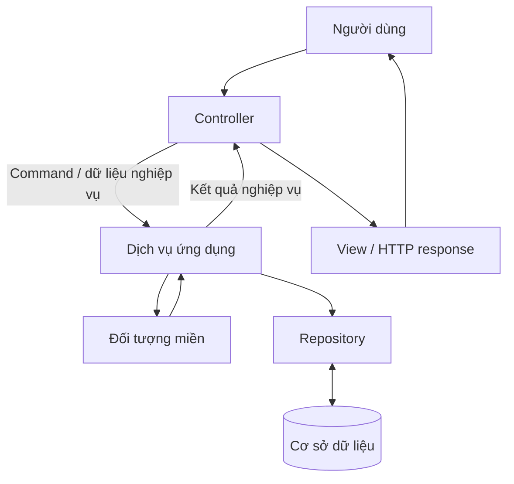

# Model quá tải và Model chỉ chứa dữ liệu

Trong kiến trúc Model–View–Controller (MVC), Model đại diện cho dữ liệu và các quy tắc nghiệp vụ mà ứng dụng quản lý. Khi thiết kế Model, hai thái cực thường gặp là dồn quá nhiều trách nhiệm vào một Model và biến Model thành những cấu trúc chỉ có thuộc tính cùng getter/setter. Cả hai cách đều làm ranh giới giữa dữ liệu và hành vi trở nên khó hiểu, khiến ứng dụng khó thay đổi và khó kiểm thử.

Một thiết kế cân bằng đặt hành vi nghiệp vụ gần dữ liệu mà hành vi đó bảo vệ, đồng thời phân chia việc điều phối ca sử dụng, truy cập dữ liệu và giao tiếp HTTP cho những thành phần phù hợp. Để hiểu cách tổ chức này, hãy xét một ứng dụng quản lý đơn hàng: người dùng có thể tạo, xác nhận, hủy đơn hàng và xem tổng tiền.

## 1. Model trong MVC không nhất thiết là một lớp duy nhất

Model trong MVC là phần của ứng dụng chịu trách nhiệm về trạng thái và nghiệp vụ. Trong một ứng dụng nhỏ, phần này có thể được biểu diễn bởi một vài lớp. Trong ứng dụng lớn hơn, Model thường gồm nhiều thành phần phối hợp:

- **Đối tượng miền (domain object):** biểu diễn khái niệm nghiệp vụ, trạng thái, hành vi và các bất biến cần được bảo vệ, ví dụ `Order` và `OrderLine`.
- **Dịch vụ ứng dụng (application service):** điều phối một ca sử dụng, ví dụ tải đơn hàng, gọi hành vi miền, quản lý giao dịch và trả kết quả cho lớp giao tiếp.
- **Kho lưu trữ (repository):** cung cấp cách đọc và lưu đối tượng nghiệp vụ mà không buộc quy tắc miền phụ thuộc trực tiếp vào chi tiết cơ sở dữ liệu.
- **Các thành phần hỗ trợ nghiệp vụ:** có thể gồm chính sách, dịch vụ miền hoặc bộ tính toán khi một quy tắc không thuộc tự nhiên về một đối tượng đơn lẻ.

Trong ứng dụng web, Controller tiếp nhận request và chuyển dữ liệu vào phần Model. View hoặc bộ tạo response sử dụng kết quả để trình bày cho người dùng. Vì vậy, không nên đánh đồng toàn bộ Model với một entity ORM hoặc một lớp Java tên `Model`.



Sơ đồ là một cách tổ chức phổ biến trong ứng dụng web dùng MVC và các lớp nghiệp vụ. Không phải dự án nào cũng cần đủ mọi thành phần. Mục tiêu là đặt mỗi trách nhiệm ở nơi có đủ thông tin và có lý do rõ ràng để thay đổi.

## 2. Model quá tải là gì?

Model quá tải (fat model hoặc God object trong một số trường hợp) xuất hiện khi một lớp hoặc một thành phần Model đảm nhận quá nhiều việc không cùng một mục đích. Chẳng hạn, lớp `Order` vừa giữ trạng thái đơn hàng, tính giá, kiểm tra quyền, truy vấn cơ sở dữ liệu, gửi email, tạo nội dung HTML và xử lý quy trình thanh toán.

Một đối tượng miền có thể có nhiều hành vi. Có nhiều phương thức không tự động làm nó trở thành Model quá tải. Vấn đề nằm ở việc các phương thức thuộc nhiều trách nhiệm khác nhau, khiến lớp phải biết quá nhiều chi tiết và có quá nhiều lý do để thay đổi.

### Dấu hiệu nhận biết

- Một lớp nghiệp vụ vừa chứa quy tắc miền vừa thực hiện SQL, gọi HTTP, gửi email hoặc thao tác trực tiếp với framework giao diện.
- Nhiều chức năng không liên quan cùng phụ thuộc vào một lớp lớn, chẳng hạn đơn hàng, hóa đơn, vận chuyển và thông báo đều được xử lý trong một `OrderManager`.
- Thay đổi một quy tắc nhỏ buộc phải sửa hoặc kiểm thử lại nhiều phần không liên quan.
- Khó tạo đối tượng trong kiểm thử vì phải khởi tạo cơ sở dữ liệu, máy chủ mail, request hoặc nhiều dịch vụ bên ngoài.
- Các phương thức có nhiều tham số và nhánh điều kiện, dùng chung nhiều trạng thái nội bộ không rõ ràng.

### Ví dụ về Model ôm quá nhiều trách nhiệm

Đoạn mã giả định một lớp `Order` vừa là đối tượng miền vừa tự thực hiện lưu trữ và thông báo:

```java
public class Order {
    private UUID id;
    private OrderStatus status;
    private List<OrderLine> lines;

    public void confirm(Connection connection, MailClient mail) {
        if (status != OrderStatus.DRAFT) {
            throw new IllegalStateException("Đơn hàng không hợp lệ");
        }

        BigDecimal total = calculateTotal();
        // Tự chạy câu lệnh SQL để cập nhật đơn hàng.
        mail.send("Đơn hàng " + id + " đã xác nhận. Tổng tiền: " + total);
        status = OrderStatus.CONFIRMED;
    }

    public BigDecimal calculateTotal() {
        return lines.stream()
            .map(OrderLine::subtotal)
            .reduce(BigDecimal.ZERO, BigDecimal::add);
    }
}
```

Ví dụ đã lược bỏ phần triển khai lưu trữ và gửi email, nhưng cho thấy `Order` phải biết về kết nối cơ sở dữ liệu và hệ thống mail. Quy tắc xác nhận đơn hàng bị trộn với cách lưu dữ liệu và cách gửi thông báo. Nếu thay JDBC bằng một cơ chế lưu trữ khác hoặc thay nhà cung cấp email, lớp miền cũng phải thay đổi.

### Hệ quả của Model quá tải

**Liên kết chặt:** quy tắc nghiệp vụ phụ thuộc vào framework, cơ sở dữ liệu hoặc dịch vụ bên ngoài. Một thay đổi hạ tầng có thể lan đến mã miền.

**Khó kiểm thử:** muốn kiểm tra một điều kiện đơn giản của đơn hàng nhưng phải dựng nhiều thành phần phụ thuộc. Kiểm thử đơn vị trở nên chậm hoặc dễ lỗi do môi trường.

**Khó tái sử dụng:** cùng một hành vi không dễ gọi từ API khác, tác vụ nền hoặc giao diện khác vì nó gắn với một luồng cụ thể.

**Khó cộng tác:** nhiều người cùng sửa một lớp lớn, dễ phát sinh xung đột và làm thay đổi một chức năng ảnh hưởng đến chức năng khác.

**Khó hiểu trách nhiệm:** tên lớp có thể vẫn là `Order`, nhưng người đọc không biết lớp này đại diện cho đơn hàng hay điều phối cả quy trình của hệ thống.

## 3. Model chỉ chứa dữ liệu là gì?

Model chỉ chứa dữ liệu thường được gọi là mô hình miền nghèo nàn (anemic domain model) khi các đối tượng miền chỉ có trường dữ liệu và các phương thức getter/setter, còn hầu hết quy tắc nghiệp vụ nằm bên ngoài đối tượng đó.

Ví dụ:

```java
public class Order {
    private UUID id;
    private OrderStatus status;
    private List<OrderLine> lines;

    public UUID getId() { return id; }
    public OrderStatus getStatus() { return status; }
    public void setStatus(OrderStatus status) { this.status = status; }
    public List<OrderLine> getLines() { return lines; }
    public void setLines(List<OrderLine> lines) { this.lines = lines; }
}
```

Lớp trên chỉ giữ trạng thái. Nếu Controller hoặc một dịch vụ thủ tục phải tự kiểm tra trạng thái, tính tổng tiền, xác nhận đơn hàng và cập nhật nhiều trường thông qua setter, đối tượng `Order` không còn bảo vệ được các quy tắc của chính nó.

### Quy tắc nghiệp vụ bị phân tán

Ví dụ, nhiều nơi có thể tự viết điều kiện xác nhận:

```java
if (order.getStatus() == OrderStatus.DRAFT
        && !order.getLines().isEmpty()) {
    order.setStatus(OrderStatus.CONFIRMED);
}
```

Nếu đoạn mã này xuất hiện trong Controller, dịch vụ báo cáo và tác vụ nền, mỗi nơi có thể dần có một cách kiểm tra khác nhau. Một nơi quên kiểm tra đơn hàng rỗng; nơi khác lại cho phép xác nhận đơn hàng đã bị hủy. Khi quy tắc thay đổi, lập trình viên phải tìm và sửa mọi nơi đã sao chép logic.

### Hệ quả của Model chỉ chứa dữ liệu

- **Mất tính đóng gói:** bất kỳ thành phần nào có tham chiếu đến đối tượng cũng có thể thay đổi trạng thái bằng setter, kể cả khi thay đổi đó vi phạm quy tắc nghiệp vụ.
- **Trùng lặp logic:** các điều kiện và phép tính được lặp lại ở nhiều dịch vụ hoặc Controller.
- **Khó bảo đảm bất biến:** đối tượng có thể ở trạng thái không hợp lệ vì không có một điểm tập trung kiểm soát chuyển đổi trạng thái.
- **Kiểm thử nghiệp vụ phân tán:** muốn xác minh một quy tắc phải kiểm tra nhiều lớp gọi khác nhau, thay vì kiểm tra hành vi tại đối tượng chịu trách nhiệm.
- **Dịch vụ phình to:** để bù cho đối tượng dữ liệu nghèo nàn, các lớp dịch vụ có thể trở thành nơi chứa toàn bộ quyết định nghiệp vụ và cũng dần quá tải.

## 4. So sánh hai thái cực

| Khía cạnh | Model quá tải | Model chỉ chứa dữ liệu |
|---|---|---|
| Phân chia trách nhiệm | Một lớp ôm nhiều công việc khác nhau | Hành vi bị đẩy ra ngoài đối tượng dữ liệu |
| Quy tắc nghiệp vụ | Trộn với lưu trữ, giao tiếp hoặc tích hợp | Phân tán trong Controller và dịch vụ thủ tục |
| Đóng gói trạng thái | Có thể bị che khuất bởi quá nhiều trách nhiệm | Thường yếu vì trạng thái bị sửa trực tiếp qua setter |
| Phụ thuộc | Nhiều phụ thuộc hạ tầng tập trung vào một lớp | Nhiều thành phần bên ngoài hiểu cấu trúc dữ liệu |
| Kiểm thử | Khó cô lập vì lớp phụ thuộc nhiều hệ thống | Khó tìm điểm kiểm thử duy nhất cho quy tắc |
| Khi thay đổi | Một thay đổi có thể ảnh hưởng nhiều trách nhiệm | Một quy tắc có thể phải sửa ở nhiều nơi |

Hai thái cực có vẻ đối lập nhưng thường cùng bắt nguồn từ việc chưa xác định rõ ai chịu trách nhiệm cho một quy tắc. Nếu mọi thứ được đặt vào một lớp, lớp đó trở nên quá tải. Nếu mọi hành vi bị lấy khỏi đối tượng dữ liệu mà không có nơi tổ chức rõ ràng, đối tượng trở nên nghèo nàn và các dịch vụ bên ngoài gánh hết công việc.

## 5. Tổ chức Model cân bằng

Thiết kế cân bằng không đặt mục tiêu làm cho mọi lớp có cùng số phương thức hoặc ép mọi quy tắc vào entity. Hãy xác định trách nhiệm dựa trên bản chất của hành vi:

| Thành phần | Trách nhiệm chính | Ví dụ với đơn hàng |
|---|---|---|
| Controller | Nhận request, kiểm tra cấu trúc đầu vào, gọi ca sử dụng và tạo response | Nhận `POST /orders/{id}/confirm` |
| Application service | Điều phối ca sử dụng, quản lý giao dịch, phối hợp các đối tượng và cổng bên ngoài | Tải đơn hàng, kiểm tra quyền, gọi `order.confirm()` và lưu |
| Domain object | Bảo vệ trạng thái, quy tắc và bất biến thuộc về đối tượng | Chỉ cho xác nhận đơn hàng ở trạng thái `DRAFT` và có dòng hàng |
| Repository | Đọc và lưu đối tượng miền | Tìm và lưu `Order` |
| DTO / View model | Mang dữ liệu qua ranh giới giao tiếp | `ConfirmOrderRequest`, `OrderResponse` |
| Thành phần tích hợp | Giao tiếp với hệ thống bên ngoài | Gửi thông báo qua cổng notification |

### Đặt hành vi gần dữ liệu mà nó bảo vệ

Nếu quy tắc chỉ liên quan đến trạng thái và dữ liệu nội tại của một đơn hàng, đối tượng `Order` thường là nơi phù hợp để thực hiện. Ví dụ: đơn hàng chỉ được xác nhận khi đang ở trạng thái nháp và có ít nhất một dòng hàng.

Nếu hành động cần phối hợp nhiều đối tượng, gọi repository, quản lý giao dịch hoặc thực hiện một ca sử dụng, application service là nơi phù hợp. Ví dụ: xác nhận đơn hàng cần tải đơn hàng, kiểm tra người thực hiện, gọi hành vi miền, lưu thay đổi và phát sự kiện hoặc yêu cầu gửi thông báo.

Nếu hành vi cần một chính sách độc lập hoặc dữ liệu từ nhiều nguồn, có thể tách thành policy hay domain service. Không nên tạo service chỉ để chuyển tiếp một lời gọi mà không có trách nhiệm rõ ràng.

### Ví dụ triển khai với Java và Spring MVC

Trong ví dụ dưới đây, Controller xử lý HTTP, application service điều phối ca sử dụng, `Order` giữ quy tắc chuyển trạng thái và repository chịu trách nhiệm lưu trữ. Các import, constructor, getter và kiểu hỗ trợ được lược bỏ để tập trung vào ranh giới trách nhiệm.

Đối tượng miền giữ hành vi xác nhận:

```java
public class Order {
    private UUID id;
    private OrderStatus status;
    private List<OrderLine> lines;
    private Instant confirmedAt;

    public void confirm(Instant now) {
        if (status != OrderStatus.DRAFT) {
            throw new InvalidOrderStateException(
                "Chỉ đơn hàng nháp mới được xác nhận"
            );
        }

        if (lines == null || lines.isEmpty()) {
            throw new EmptyOrderException();
        }

        status = OrderStatus.CONFIRMED;
        confirmedAt = now;
    }
}
```

Application service điều phối hành động:

```java
@Service
@RequiredArgsConstructor
public class OrderApplicationService {
    private final OrderRepository orderRepository;
    private final OrderAccessPolicy accessPolicy;
    private final Clock clock;

    @Transactional
    public Order confirm(UUID orderId, UUID actorId) {
        Order order = orderRepository.findById(orderId)
            .orElseThrow(() -> new OrderNotFoundException(orderId));

        accessPolicy.ensureCanConfirm(actorId, order);
        order.confirm(clock.instant());

        return orderRepository.save(order);
    }
}
```

Controller chuyển request thành lời gọi nghiệp vụ và tạo response:

```java
@RestController
@RequestMapping("/orders")
@RequiredArgsConstructor
public class OrderController {
    private final OrderApplicationService orderService;

    @PostMapping("/{id}/confirm")
    public ResponseEntity<OrderResponse> confirm(
            @PathVariable UUID id,
            @AuthenticationPrincipal AppPrincipal principal) {

        Order order = orderService.confirm(id, principal.userId());
        return ResponseEntity.ok(OrderResponse.from(order));
    }
}
```

`Order` không biết về HTTP, cơ sở dữ liệu hay gửi email. Nó bảo vệ quy tắc chuyển trạng thái. `OrderApplicationService` biết trình tự của ca sử dụng và quản lý giao dịch. Controller biết cách nhận request và trả response. Khi cần thay đổi định dạng API, quy tắc miền không phải thay đổi theo; khi cần thay đổi quy tắc xác nhận, hành vi của `Order` là một điểm tập trung để cập nhật và kiểm thử.

Việc kiểm tra quyền trong ví dụ được đặt ở `OrderAccessPolicy`, vì quyền xác nhận có thể phụ thuộc vào người thực hiện và dữ liệu đơn hàng. Đây là một quyết định chính sách của ứng dụng. Dù kiểm tra quyền ở lớp bảo mật, policy hay application service, request phải được kiểm tra ở phía máy chủ; việc ẩn nút trên giao diện không bảo vệ được endpoint.

## 6. Không phải mọi đối tượng chỉ chứa dữ liệu đều là thiết kế xấu

Khái niệm anemic domain model nói về mô hình miền trong đó các đối tượng miền thiếu hành vi và quy tắc bị đặt ở bên ngoài. Nó không có nghĩa mọi lớp chỉ chứa dữ liệu đều cần được bổ sung phương thức nghiệp vụ.

Các loại đối tượng sau thường nên tập trung vào dữ liệu:

- **Request DTO:** biểu diễn dữ liệu người dùng gửi lên.
- **Response DTO:** biểu diễn dữ liệu trả về cho API hoặc giao diện.
- **View model:** gom dữ liệu cần thiết để hiển thị một màn hình.
- **Projection hoặc bản ghi đọc:** mang dữ liệu được truy vấn để báo cáo hoặc hiển thị.
- **Đối tượng truyền dữ liệu giữa các tầng:** chuyển thông tin qua ranh giới mà không mang quy tắc miền.

Một ứng dụng CRUD đơn giản, ít quy tắc và chủ yếu lưu/đọc dữ liệu cũng có thể dùng entity mỏng cùng application service đơn giản. Điều đó không nhất thiết là vấn đề. Khi nghiệp vụ phát triển, có nhiều trạng thái, bất biến hoặc hành vi cần được bảo vệ, việc đưa các quy tắc thích hợp vào đối tượng miền sẽ giúp giảm trùng lặp và ngăn trạng thái không hợp lệ.

Điều cần tránh là dùng một DTO hoặc entity chỉ có setter như mô hình nghiệp vụ chính, rồi để mọi nơi tùy ý thay đổi trạng thái quan trọng. Hãy phân biệt rõ đối tượng dùng để vận chuyển dữ liệu với đối tượng chịu trách nhiệm duy trì quy tắc.

## 7. Cách nhận diện và cải thiện từng trường hợp

### Khi Model quá tải

1. Liệt kê các trách nhiệm mà lớp đang thực hiện: quy tắc miền, điều phối ca sử dụng, truy cập dữ liệu, giao tiếp HTTP, thông báo và trình bày.
2. Xác định phần nào thuộc bản chất của đối tượng. Giữ các hành vi bảo vệ trạng thái và bất biến của đối tượng ở lại với nó.
3. Chuyển việc điều phối nhiều bước sang application service.
4. Đưa thao tác lưu trữ vào repository và giao tiếp bên ngoài vào các cổng hoặc adapter thích hợp.
5. Loại bỏ phụ thuộc framework khỏi đối tượng miền khi những phụ thuộc đó không cần thiết cho quy tắc nghiệp vụ.
6. Kiểm thử lại các hành vi quan trọng và các luồng tích hợp sau khi tách trách nhiệm.

Không nên chia một lớp thành nhiều lớp nhỏ chỉ dựa trên số dòng mã. Mỗi lớp mới cần có một trách nhiệm có thể giải thích được và một hợp đồng rõ ràng.

### Khi Model chỉ chứa dữ liệu

1. Tìm các điều kiện và phép tính đang được lặp lại trong Controller hoặc service.
2. Xác định dữ liệu nào cần thiết để đánh giá quy tắc và đối tượng nào sở hữu dữ liệu đó.
3. Chuyển quy tắc liên quan trực tiếp đến trạng thái của đối tượng thành phương thức có tên theo ngôn ngữ nghiệp vụ, chẳng hạn `confirm()`, `cancel()` hoặc `changeAddress()`.
4. Giảm khả năng thay đổi trạng thái tùy ý bằng cách giới hạn setter, kiểm tra đầu vào trong constructor hoặc dùng phương thức nghiệp vụ.
5. Giữ việc điều phối, giao dịch và truy cập repository ở application service.
6. Tìm các nơi gọi cũ và chuyển chúng sang hành vi mới, tránh duy trì hai cách thực hiện cùng một quy tắc.

Ví dụ, thay vì để mọi nơi gọi `order.setStatus(CONFIRMED)`, hãy cung cấp `order.confirm(now)`. Phương thức này có thể kiểm tra trạng thái hiện tại và điều kiện cần thiết trước khi cập nhật. Mọi luồng thực hiện hành động xác nhận đều phải đi qua cùng một quy tắc.

## 8. Kiểm thử thiết kế Model

Kiểm thử cần phản ánh trách nhiệm của từng thành phần:

| Loại kiểm thử | Điều cần xác minh | Ví dụ |
|---|---|---|
| Kiểm thử đối tượng miền | Quy tắc và bất biến được bảo vệ | `Order` không xác nhận đơn hàng đã hủy hoặc đơn hàng rỗng |
| Kiểm thử application service | Trình tự ca sử dụng và phối hợp thành phần | Không lưu đơn hàng khi policy từ chối quyền |
| Kiểm thử repository / tích hợp dữ liệu | Ánh xạ và lưu trữ trạng thái đúng | Đơn hàng đã xác nhận được lưu và đọc lại đúng |
| Kiểm thử Controller | Hợp đồng HTTP và chuyển đổi request/response | Request hợp lệ gọi dịch vụ; lỗi được ánh xạ đúng |
| Kiểm thử tích hợp | Các thành phần hoạt động đúng khi kết hợp | Endpoint xác nhận đơn hàng cập nhật dữ liệu và trả response phù hợp |

Đối tượng miền có thể được kiểm thử bằng unit test mà không cần khởi tạo Spring context hoặc cơ sở dữ liệu. Application service có thể dùng repository giả hoặc mock để kiểm tra điều phối. Kiểm thử tích hợp kiểm tra những vấn đề không thể xác nhận chỉ bằng unit test, như giao dịch, ánh xạ ORM và cấu hình endpoint.

Một dấu hiệu tốt là có thể kiểm tra quy tắc `Order.confirm()` bằng cách tạo một đơn hàng trong bộ nhớ, gọi phương thức và xác minh trạng thái mới hoặc lỗi mong đợi. Nếu phải dựng HTTP request và cơ sở dữ liệu chỉ để kiểm tra điều kiện trạng thái của đơn hàng, có thể quy tắc đang nằm sai chỗ hoặc ranh giới kiểm thử chưa phù hợp.

## 9. Checklist khi thiết kế Model

- Mỗi lớp có một trách nhiệm chính và lý do thay đổi có thể giải thích được không?
- Đối tượng miền có bảo vệ các bất biến gắn trực tiếp với trạng thái của nó không?
- Quy tắc nghiệp vụ có bị lặp trong nhiều Controller hoặc dịch vụ không?
- Application service có tập trung vào điều phối ca sử dụng thay vì trở thành nơi chứa mọi quy tắc không?
- Repository có tách chi tiết lưu trữ khỏi hành vi miền không?
- Đối tượng miền có tránh phụ thuộc vào HTTP, View và các dịch vụ hạ tầng không cần thiết không?
- DTO và projection có được phân biệt với đối tượng miền không?
- Các hành vi quan trọng có thể được kiểm thử độc lập và luồng tích hợp có kiểm thử phù hợp không?

## Kết luận

Model quá tải làm nhiều trách nhiệm khác nhau dồn vào cùng một thành phần; Model chỉ chứa dữ liệu khiến hành vi và quy tắc bị đẩy ra ngoài, dễ phân tán. Trong MVC, thiết kế tốt đặt quy tắc bảo vệ trạng thái gần đối tượng miền, đặt việc điều phối ca sử dụng trong application service, tách lưu trữ qua repository và giữ Controller tập trung vào giao tiếp. Cách phân chia này giúp nghiệp vụ có một nơi thực thi rõ ràng, dễ kiểm thử và ít phụ thuộc vào cách ứng dụng trình bày hoặc lưu dữ liệu.
