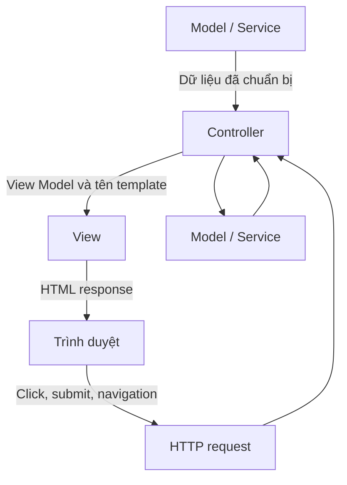

# View biểu diễn thông tin và khả năng tương tác

## 1. Vai trò của View trong MVC

Trong kiến trúc **Model–View–Controller (MVC)**, View là thành phần chịu trách nhiệm trình bày thông tin và cung cấp các điểm tương tác cho người dùng. View biến dữ liệu đã được chuẩn bị thành nội dung dễ hiểu, chẳng hạn trang HTML, bảng dữ liệu, biểu mẫu, thông báo hoặc một vùng giao diện.

Trong một ứng dụng web, View thường là template được máy chủ kết xuất thành HTML hoặc là các component giao diện chạy trong trình duyệt. Người dùng đọc nội dung và thao tác trên View; các thao tác đó được chuyển thành request hoặc sự kiện để Controller xử lý. Kết quả xử lý được đưa trở lại View dưới dạng dữ liệu, trạng thái hoặc phản hồi.

View có ba trách nhiệm chính:

- **Trình bày thông tin:** chọn cấu trúc, thứ tự, nhãn, định dạng và cách hiển thị dữ liệu.
- **Thể hiện trạng thái giao diện:** hiển thị nội dung, dữ liệu rỗng, đang tải, lỗi, thành công hoặc trạng thái không khả dụng.
- **Tiếp nhận tương tác:** cung cấp liên kết, nút, biểu mẫu và điều khiển để người dùng yêu cầu ứng dụng thực hiện hành động.

View không phải nơi sở hữu quy tắc nghiệp vụ hoặc quyền quyết định cuối cùng về tính hợp lệ của một thao tác. Ví dụ, View có thể hiển thị nút “Hủy đơn hàng” khi dữ liệu cho biết đơn có thể hủy, nhưng Controller và lớp nghiệp vụ vẫn phải kiểm tra lại trạng thái và quyền của người dùng khi nhận request.

## 2. View nhận dữ liệu và trả tương tác như thế nào?

Trong MVC phía máy chủ, Controller lấy dữ liệu từ Model hoặc lớp dịch vụ, đưa dữ liệu cần thiết vào hợp đồng dành cho View rồi chọn template. View sử dụng hợp đồng đó để tạo HTML. Khi người dùng thao tác, trình duyệt gửi request mới đến Controller.



Luồng cơ bản gồm các bước:

1. Controller nhận request và gọi nghiệp vụ cần thiết.
2. Controller chuẩn bị dữ liệu dành cho màn hình, thường qua DTO hoặc View Model.
3. View kết hợp dữ liệu với template để tạo nội dung phản hồi.
4. Trình duyệt hiển thị nội dung và cho phép người dùng tương tác.
5. Khi có thao tác, trình duyệt gửi request; Controller tiếp nhận và điều phối xử lý.

Với ứng dụng phía trình duyệt, View có thể được tạo từ component và cập nhật khi trạng thái client thay đổi. Dù render ở máy chủ hay trình duyệt, ranh giới trách nhiệm vẫn tương tự: View trình bày dữ liệu và gửi ý định thao tác; Controller hoặc lớp điều phối tiếp nhận ý định đó.

## 3. Những gì thuộc trách nhiệm của View

### 3.1. Tổ chức nội dung và bố cục

View quyết định cách người dùng tiếp nhận thông tin. Một trang chi tiết sản phẩm có thể chia thành tiêu đề, hình ảnh, giá, mô tả, tồn kho và khu vực hành động. Một trang quản trị có thể dùng bảng, bộ lọc, phân trang và thông báo trạng thái.

Các quyết định trình bày thường thuộc View:

- Chọn thành phần giao diện phù hợp: tiêu đề, đoạn văn, bảng, danh sách, thẻ thông tin hay biểu mẫu.
- Sắp xếp thông tin theo mức độ quan trọng và luồng công việc.
- Định dạng ngày, giờ, tiền tệ hoặc số lượng theo quy ước hiển thị.
- Hiển thị hoặc ẩn một vùng dựa trên dữ liệu và quyền đã được máy chủ xác định.
- Chia trang thành layout, fragment hoặc component có thể tái sử dụng.

Việc định dạng để hiển thị không đồng nghĩa với việc tính toán quy tắc nghiệp vụ. View có thể hiển thị `formattedTotal` do lớp trình bày chuẩn bị, nhưng không nên tự tính lại tổng đơn hàng theo những quy tắc giá, thuế hoặc chiết khấu phức tạp.

### 3.2. Hiển thị trạng thái

Một View tốt cần thể hiện rõ trạng thái hiện tại thay vì chỉ xử lý trường hợp có dữ liệu thành công. Các trạng thái phổ biến gồm:

| Trạng thái | Ý nghĩa | Cách View có thể thể hiện |
|---|---|---|
| Initial | Chưa có dữ liệu hoặc chưa bắt đầu thao tác | Hướng dẫn sử dụng hoặc vùng trống có chủ đích |
| Loading | Đang tải hoặc gửi yêu cầu | Spinner, skeleton hoặc thông báo đang xử lý |
| Success | Đã nhận kết quả hợp lệ | Nội dung, thông báo hoàn tất hoặc dữ liệu mới |
| Empty | Tải thành công nhưng không có mục nào | Thông báo chưa có dữ liệu và gợi ý bước tiếp theo |
| Validation error | Dữ liệu biểu mẫu chưa hợp lệ | Lỗi cạnh trường nhập và tóm tắt lỗi |
| Request error | Request thất bại hoặc không thể hoàn thành | Thông báo dễ hiểu và hành động thử lại nếu phù hợp |
| Disabled / unavailable | Hành động hiện không khả dụng | Điều khiển bị vô hiệu hóa kèm lý do khi cần |

Thông báo nên cho biết người dùng cần làm gì tiếp theo. Ví dụ, “Không tải được danh sách đơn hàng. Hãy thử lại.” hữu ích hơn một thông báo chung chung như “Có lỗi”. Không hiển thị chi tiết nội bộ như stack trace hoặc câu truy vấn.

### 3.3. Cung cấp khả năng tương tác

View cung cấp các điều khiển phù hợp với ý định người dùng:

- Liên kết để điều hướng đến tài nguyên hoặc trang khác.
- Nút để yêu cầu thực hiện một hành động.
- Biểu mẫu để thu thập dữ liệu đầu vào.
- Bộ lọc, tìm kiếm, phân trang hoặc sắp xếp để thay đổi cách xem dữ liệu.
- Điều khiển mở rộng, thu gọn, chọn tab hoặc hiển thị thêm thông tin.

Mỗi điều khiển cần có ý nghĩa và hành vi rõ ràng. Liên kết thường dùng cho điều hướng hoặc truy cập tài nguyên; nút thường dùng để thực hiện hành động. Không nên dùng một phần tử chỉ để tạo cảm giác có thể nhấn nhưng không có hành vi thực tế.

## 4. Hợp đồng dữ liệu giữa Controller và View

View cần biết dữ liệu nào có thể sử dụng và ý nghĩa của từng trường. Hợp đồng này thường được biểu diễn bằng View Model, Page Model hoặc DTO dành cho màn hình.

Ví dụ, một View danh sách sản phẩm có thể nhận:

```java
public record ProductListItem(
        long id,
        String name,
        String formattedPrice,
        boolean available,
        String detailUrl) {}

public record ProductListPageModel(
        List<ProductListItem> products,
        String keyword,
        int currentPage,
        int totalPages) {}
```

View chỉ cần biết tên, giá đã định dạng, trạng thái còn hàng, liên kết chi tiết và thông tin phân trang. Nó không cần biết cách truy vấn cơ sở dữ liệu, cấu trúc entity hoặc cách tính giá.

Một hợp đồng dữ liệu tốt nên:

- Chứa đúng những trường cần thiết để trình bày.
- Có tên trường và kiểu dữ liệu dễ hiểu, ổn định.
- Phân biệt dữ liệu hiển thị với dữ liệu đầu vào của biểu mẫu.
- Không để lộ mật khẩu, token, thông tin nội bộ hoặc trường không được phép xem.
- Biểu diễn rõ dữ liệu tùy chọn và trạng thái thiếu dữ liệu.

Không nên mặc định truyền trực tiếp entity từ ORM cho View. Entity có thể chứa dữ liệu nhạy cảm, quan hệ lớn hoặc hành vi tải dữ liệu lười. Dùng DTO hoặc View Model giúp kiểm soát hợp đồng và giảm phụ thuộc giữa giao diện với cấu trúc lưu trữ.

## 5. Ví dụ View phía máy chủ với Spring MVC và Thymeleaf

Controller có thể chuẩn bị dữ liệu và chọn template:

```java
@Controller
@RequestMapping("/products")
public class ProductController {
    private final ProductQueryService queryService;

    public ProductController(ProductQueryService queryService) {
        this.queryService = queryService;
    }

    @GetMapping
    public String list(
            @RequestParam(defaultValue = "") String keyword,
            Model model) {
        ProductListPageModel page = queryService.search(keyword);
        model.addAttribute("page", page);
        return "products/list";
    }
}
```

Template `products/list.html` có thể trình bày danh sách:

```html
<main>
  <h1>Danh sách sản phẩm</h1>

  <form method="get" action="/products">
    <label for="keyword">Tìm sản phẩm</label>
    <input id="keyword" name="keyword" type="search"
           th:value="${page.keyword}">
    <button type="submit">Tìm kiếm</button>
  </form>

  <p th:if="${#lists.isEmpty(page.products)}">
    Chưa tìm thấy sản phẩm phù hợp.
  </p>

  <table th:unless="${#lists.isEmpty(page.products)}">
    <thead>
      <tr><th>Tên</th><th>Giá</th><th>Trạng thái</th><th></th></tr>
    </thead>
    <tbody>
      <tr th:each="product : ${page.products}">
        <td th:text="${product.name}">Tên sản phẩm</td>
        <td th:text="${product.formattedPrice}">Giá</td>
        <td th:text="${product.available ? 'Còn hàng' : 'Hết hàng'}">
          Trạng thái
        </td>
        <td><a th:href="${product.detailUrl}">Xem chi tiết</a></td>
      </tr>
    </tbody>
  </table>
</main>
```

Trong ví dụ này, Controller chuẩn bị `page`, còn template chịu trách nhiệm trình bày. `th:each` lặp qua dữ liệu, `th:if` và `th:unless` chọn nội dung theo trạng thái, `th:text` đưa giá trị vào văn bản và `th:href` tạo liên kết. Các biểu thức này phục vụ trình bày; chúng không thực hiện nghiệp vụ tìm kiếm hoặc kiểm tra quyền.

Khi đưa dữ liệu động vào HTML, nên dùng cơ chế escape theo ngữ cảnh của template engine. Ví dụ `th:text` của Thymeleaf hiển thị nội dung dưới dạng văn bản đã được escape. Tránh dùng cơ chế chèn HTML thô cho dữ liệu do người dùng cung cấp.

## 6. Biểu mẫu là giao diện tương tác quan trọng

Biểu mẫu giúp View thu thập dữ liệu để Controller xử lý. Một biểu mẫu thường gồm nhãn, trường nhập, hướng dẫn, thông báo lỗi và nút gửi.

Ví dụ với Thymeleaf:

```html
<form th:action="@{/products}" th:object="${form}" method="post">
  <div>
    <label for="name">Tên sản phẩm</label>
    <input id="name" type="text" th:field="*{name}">
    <p th:if="${#fields.hasErrors('name')}"
       th:errors="*{name}">Tên không hợp lệ</p>
  </div>

  <div>
    <label for="price">Giá</label>
    <input id="price" type="number" step="0.01" th:field="*{price}">
    <p th:if="${#fields.hasErrors('price')}"
       th:errors="*{price}">Giá không hợp lệ</p>
  </div>

  <button type="submit">Lưu sản phẩm</button>
</form>
```

Trong luồng này:

1. View hiển thị biểu mẫu và các giá trị ban đầu.
2. Người dùng nhập dữ liệu và nhấn Lưu.
3. Trình duyệt gửi request POST đến Controller.
4. Controller bind dữ liệu vào đối tượng form và kiểm tra validation.
5. Nếu có lỗi, Controller trả lại View cùng dữ liệu và lỗi để hiển thị.
6. Nếu hợp lệ, Controller gọi lớp nghiệp vụ để thực hiện thao tác và trả phản hồi phù hợp.

View có thể dùng thuộc tính HTML như `required`, `min`, `maxlength` để hỗ trợ người dùng nhập đúng. Đây là kiểm tra tiện ích ở phía trình duyệt. Máy chủ vẫn phải kiểm tra dữ liệu vì client có thể bỏ qua hoặc thay đổi các ràng buộc này.

Với ứng dụng dùng cookie phiên đăng nhập, request thay đổi dữ liệu cần được bảo vệ bằng cơ chế CSRF phù hợp. Spring Security có thể tự thêm CSRF token vào biểu mẫu Thymeleaf khi tích hợp và cấu hình đúng; cần xác minh cấu hình thực tế của ứng dụng.

## 7. Phân biệt logic trình bày và logic nghiệp vụ

View có thể chứa một lượng logic nhỏ để chọn cách trình bày, nhưng không nên trở thành nơi thực hiện nghiệp vụ.

| Logic phù hợp trong View | Logic nên thuộc Model hoặc lớp nghiệp vụ |
|---|---|
| Hiển thị nhãn “Còn hàng” dựa trên cờ `available` | Xác định có thể bán sản phẩm hay không dựa trên tồn kho và chính sách bán |
| Ẩn vùng không có dữ liệu | Quyết định dữ liệu nào được phép truy cập |
| Định dạng ngày hoặc tiền tệ để đọc dễ hơn | Tính thuế, chiết khấu và tổng tiền theo quy tắc nghiệp vụ |
| Hiển thị lỗi validation nhận từ Controller | Xác định một giao dịch có vi phạm bất biến hay không |
| Chọn biểu tượng theo trạng thái đã được cung cấp | Quyết định chuyển trạng thái đơn hàng có hợp lệ không |

Một phép kiểm tra hiển thị như `if (products.isEmpty())` là hợp lý. Một phép kiểm tra phức tạp như “khách hàng được hưởng mức chiết khấu nào dựa trên lịch sử mua hàng, hạng thành viên và chương trình khuyến mại” cần được xử lý ở lớp nghiệp vụ hoặc dịch vụ phù hợp rồi cung cấp kết quả cho View.

Không đặt truy vấn cơ sở dữ liệu, gọi repository hoặc tự thực hiện giao dịch trong template. Điều đó làm View khó kiểm thử và khiến dữ liệu được tải ngoài luồng điều phối của Controller.

## 8. Khả năng truy cập và trải nghiệm tương tác

View cần sử dụng được với nhiều cách tương tác và khả năng khác nhau. Một số nguyên tắc cơ bản:

- Mỗi trường biểu mẫu cần có nhãn liên kết rõ ràng; placeholder không thay thế cho label.
- Có thể thao tác bằng bàn phím, với thứ tự focus hợp lý và trạng thái focus dễ nhận biết.
- Dùng phần tử HTML đúng ngữ nghĩa: `button` cho hành động, `a` cho điều hướng, `label` cho trường nhập.
- Không chỉ dùng màu sắc để biểu thị lỗi hoặc trạng thái; bổ sung văn bản hoặc biểu tượng có nhãn.
- Bảng dữ liệu cần có tiêu đề cột; vùng nội dung cần heading theo thứ bậc hợp lý.
- Thông báo lỗi nên gắn với trường tương ứng và có thể được công nghệ hỗ trợ đọc màn hình nhận biết.
- Nút hoặc điều khiển bị vô hiệu hóa cần có lý do dễ hiểu nếu người dùng cần biết cách khắc phục.
- Nội dung cần có khả năng đọc trên màn hình nhỏ và không phụ thuộc vào thao tác rê chuột.

Ví dụ, một lỗi nhập liệu có thể được liên kết với trường bằng `aria-describedby`, còn vùng thông báo cập nhật bất đồng bộ có thể dùng `aria-live` phù hợp để công nghệ hỗ trợ nhận biết nội dung mới. Cần dùng thuộc tính ARIA đúng ngữ nghĩa và kiểm tra bằng bàn phím cũng như trình đọc màn hình.

## 9. Bảo mật trong lớp View

View nằm ở ranh giới trình bày dữ liệu ra bên ngoài nên có một số trách nhiệm bảo mật quan trọng:

- **Escape đầu ra:** mã hóa dữ liệu theo đúng ngữ cảnh HTML text, attribute, URL hoặc JavaScript để giảm nguy cơ XSS.
- **Không chèn HTML không tin cậy:** tránh render trực tiếp chuỗi do người dùng gửi thành markup.
- **Giới hạn dữ liệu:** chỉ hiển thị các trường cần thiết và đã được phép cung cấp.
- **Không xem ẩn giao diện là phân quyền:** ẩn nút hoặc đường dẫn không ngăn được request trực tiếp đến máy chủ.
- **Bảo vệ biểu mẫu:** dùng CSRF token khi phù hợp, không đặt bí mật trong trường ẩn và không tin các giá trị do trình duyệt gửi lên.
- **Thông báo lỗi an toàn:** không hiển thị stack trace, đường dẫn nội bộ, thông tin kết nối hoặc dữ liệu nhạy cảm.

View có thể nhận một cờ như `canEdit` để quyết định có hiển thị nút Sửa hay không. Tuy nhiên, endpoint cập nhật vẫn phải xác thực người dùng và kiểm tra quyền trên tài nguyên ở phía máy chủ.

## 10. Kiểm thử View

View có thể được kiểm thử độc lập bằng dữ liệu mẫu, không cần truy cập cơ sở dữ liệu thật. Mục tiêu là xác minh nội dung và trạng thái giao diện phản ánh đúng hợp đồng dữ liệu.

| Mục tiêu | Trường hợp kiểm thử |
|---|---|
| Hiển thị dữ liệu | Tên, giá, ngày tháng và trạng thái được đặt đúng vị trí |
| Dữ liệu rỗng | Có thông báo phù hợp khi danh sách không có phần tử |
| Biểu mẫu | Label, giá trị ban đầu và nút gửi được hiển thị đúng |
| Validation | Lỗi được gắn với đúng trường và dữ liệu đã nhập được giữ lại khi phù hợp |
| Tương tác | Liên kết và nút tạo đúng request hoặc sự kiện dự kiến |
| Accessibility | Có thể điều hướng bằng bàn phím, nhãn rõ ràng và thông báo có ngữ nghĩa |
| Bảo mật | Dữ liệu chứa ký tự đặc biệt được escape; nội dung không tin cậy không trở thành HTML thực thi |

Ngoài kiểm thử template, có thể dùng kiểm thử giao diện hoặc kiểm thử đầu cuối để xác minh luồng người dùng: mở trang, nhập biểu mẫu, gửi request, nhận lỗi và thấy thông báo phù hợp. Kiểm thử Controller và nghiệp vụ vẫn cần được thực hiện ở phạm vi riêng để bảo đảm request được xử lý đúng.

## 11. Các lỗi thiết kế View thường gặp

1. **View chứa nghiệp vụ:** template tự tính giá, tự quyết định trạng thái đơn hàng hoặc thực hiện quy tắc quyền truy cập.
2. **View truy cập cơ sở dữ liệu:** việc lấy dữ liệu bị giấu trong lúc render, khiến hiệu năng và luồng xử lý khó kiểm soát.
3. **Truyền entity trực tiếp:** View phụ thuộc vào cấu trúc lưu trữ và có thể làm lộ trường không cần thiết.
4. **Không có trạng thái rỗng hoặc lỗi:** người dùng không biết hệ thống đang tải, không có dữ liệu hay request đã thất bại.
5. **Dùng nút và liên kết sai mục đích:** gây khó hiểu cho người dùng và công nghệ hỗ trợ.
6. **Chỉ kiểm tra dữ liệu ở trình duyệt:** request có thể được gửi trực tiếp hoặc dữ liệu có thể bị sửa trước khi đến máy chủ.
7. **Chèn nội dung không escape:** có thể tạo lỗ hổng XSS khi hiển thị dữ liệu không tin cậy.
8. **Ẩn điều khiển rồi xem đó là bảo mật:** endpoint vẫn phải tự kiểm tra quyền.

## 12. Kết luận

View là lớp trình bày và tương tác của MVC. Nó tổ chức nội dung, định dạng dữ liệu, biểu diễn trạng thái giao diện và cung cấp các điều khiển để người dùng gửi yêu cầu. Controller chuẩn bị dữ liệu cho View và tiếp nhận các request phát sinh từ tương tác; Model hoặc lớp nghiệp vụ quyết định trạng thái nào là hợp lệ.

Thiết kế View tốt cần có hợp đồng dữ liệu rõ ràng, tách logic trình bày khỏi nghiệp vụ, xử lý đầy đủ trạng thái và lỗi, hỗ trợ accessibility, escape đầu ra và không thay thế kiểm tra bảo mật phía máy chủ. Khi giữ đúng ranh giới này, giao diện dễ thay đổi, dễ kiểm thử và phối hợp ổn định với phần còn lại của ứng dụng.
