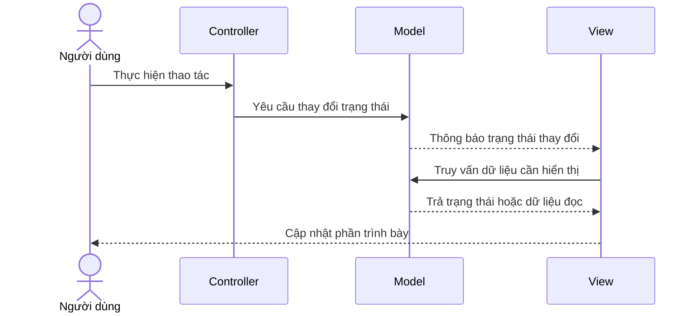
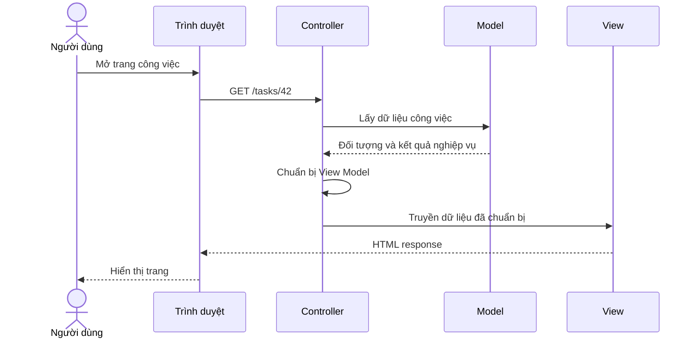

# View truy vấn Model hoặc nhận dữ liệu đã chuẩn bị

Trong MVC, View cần dữ liệu để trình bày trạng thái ứng dụng. Có hai cách tổ chức phổ biến để View có được dữ liệu đó: View chủ động truy vấn Model khi cần, hoặc Controller lấy dữ liệu trước rồi chuyển một cấu trúc đã chuẩn bị cho View. Cả hai cách đều có thể xuất hiện trong các biến thể MVC; lựa chọn phụ thuộc môi trường chạy, cách quản lý cập nhật và mức độ phụ thuộc mà nhóm phát triển muốn chấp nhận.

Điểm quan trọng là hiểu rõ dữ liệu đi theo chiều nào và thành phần nào chịu trách nhiệm chuẩn bị dữ liệu. View cần dữ liệu có ý nghĩa đối với việc trình bày, nhưng không nên tự gánh quy tắc nghiệp vụ, truy vấn lưu trữ tùy tiện hoặc quyền quyết định trạng thái hợp lệ của ứng dụng.

## Nhu cầu dữ liệu của View

Một View thường cần nhiều hơn một giá trị đơn lẻ. Trang chi tiết công việc có thể cần tiêu đề, trạng thái, người phụ trách, thời hạn, danh sách bình luận và những thao tác người dùng hiện tại được phép thực hiện. Trang danh sách có thể cần các hàng dữ liệu, thông tin phân trang, bộ lọc đang áp dụng và tổng số kết quả.

Những dữ liệu này có thể được lấy trực tiếp từ các đối tượng Model hoặc được tổng hợp thành một cấu trúc phù hợp với giao diện. Dù theo cách nào, View cần biết hợp đồng dữ liệu: tên trường, kiểu dữ liệu, ý nghĩa, khả năng vắng mặt và cách biểu diễn trạng thái rỗng hoặc lỗi.

Ví dụ, View danh sách công việc có thể cần dữ liệu như sau:

| Dữ liệu | Mục đích trình bày |
|---|---|
| `title` | Hiển thị tên công việc |
| `statusLabel` | Hiển thị trạng thái dễ hiểu |
| `assigneeName` | Hiển thị người phụ trách |
| `dueDateText` | Hiển thị thời hạn theo định dạng phù hợp |
| `canEdit` | Quyết định có hiển thị thao tác sửa hay không |
| `pageNumber`, `totalPages` | Hiển thị điều hướng phân trang |

Một số trường là dữ liệu nghiệp vụ trực tiếp; một số trường là dữ liệu đã được định dạng hoặc tính toán cho nhu cầu trình bày. Cần phân biệt chúng để tránh đưa logic giao diện vào đối tượng miền hoặc làm View phải tự tính toán quá nhiều.

## Cách 1: View chủ động truy vấn Model

Trong cách tiếp cận này, View biết một hợp đồng đọc của Model và yêu cầu dữ liệu khi cần trình bày. View có thể gọi phương thức truy vấn, đăng ký lắng nghe thay đổi rồi đọc trạng thái mới, hoặc nhận một tham chiếu đến đối tượng Model có thể quan sát.

Đây là cách thường gặp trong một số biến thể MVC truyền thống, ứng dụng desktop hoặc giao diện tương tác chạy lâu trong bộ nhớ. Khi Model thay đổi, nó phát thông báo hoặc sự kiện; View được thông báo rồi truy vấn phần trạng thái cần hiển thị.



Trong thiết kế này, View có thể chỉ lấy phần dữ liệu nó cần. Một màn hình tổng quan có thể đọc số liệu tổng hợp, trong khi một View chi tiết đọc thêm thuộc tính của một đối tượng. Khi nhiều View cùng quan sát một Model, mỗi View có thể tự cập nhật phần trình bày tương ứng sau khi nhận thông báo.

### Ví dụ với Model có thể quan sát

Ví dụ Java rút gọn sau minh họa một Model cung cấp dữ liệu chỉ đọc và thông báo khi trạng thái thay đổi:

```java
import java.util.ArrayList;
import java.util.List;
import java.util.function.Consumer;

public final class TaskModel {
    private String title;
    private boolean completed;
    private final List<Consumer<TaskModel>> listeners = new ArrayList<>();

    public TaskModel(String title) {
        this.title = title;
    }

    public String getTitle() {
        return title;
    }

    public boolean isCompleted() {
        return completed;
    }

    public void addListener(Consumer<TaskModel> listener) {
        listeners.add(listener);
    }

    public void complete() {
        if (!completed) {
            completed = true;
            listeners.forEach(listener -> listener.accept(this));
        }
    }
}
```

View đăng ký nhận thông báo và đọc lại dữ liệu cần thiết:

```java
TaskModel model = new TaskModel("Viết tài liệu MVC");

model.addListener(changedModel -> {
    String status = changedModel.isCompleted() ? "Hoàn thành" : "Đang mở";
    render(changedModel.getTitle(), status);
});

model.complete();
```

Đoạn mã chỉ minh họa cơ chế quan sát và đọc trạng thái. Ứng dụng thực tế cần quản lý vòng đời listener, tránh rò rỉ bộ nhớ, xử lý cập nhật trên đúng luồng giao diện và bảo vệ trạng thái bằng các quy tắc nghiệp vụ. View chỉ đọc dữ liệu để render; thao tác thay đổi trạng thái vẫn được điều phối qua Controller hoặc một hành động nghiệp vụ được công khai có kiểm soát.

### Lợi ích và giới hạn

View truy vấn Model có một số lợi ích:

- View chỉ lấy dữ liệu mà nó thực sự cần, vào thời điểm cần.
- Khi Model hỗ trợ cơ chế quan sát, View có thể cập nhật theo thay đổi mà không phải chờ một request tải lại toàn bộ trang.
- Nhiều View có thể cùng đọc một Model và trình bày những góc nhìn khác nhau.
- Controller không phải chuyển tiếp mọi trường dữ liệu chỉ để View có thể đọc trạng thái.

Tuy nhiên, cách này cũng tạo ra các ràng buộc:

- View phụ thuộc vào giao diện đọc của Model và có thể trở nên khó thay đổi nếu Model thay đổi cấu trúc.
- Nếu View truy vấn quá nhiều đối tượng hoặc thực hiện nhiều phép tính, logic trình bày khó kiểm soát và hiệu năng khó dự đoán.
- Nếu View truy vấn trực tiếp cơ sở dữ liệu hoặc repository hạ tầng, ranh giới MVC bị phá vỡ và giao diện bị gắn với cách lưu trữ.
- Với ứng dụng web phía máy chủ, mỗi request thường có vòng đời ngắn; việc giữ tham chiếu Model sống lâu và cập nhật View bằng observer không phải lúc nào cũng phù hợp.

Vì vậy, “View truy vấn Model” nên được hiểu là View đọc qua một hợp đồng Model có chủ đích. Điều đó không có nghĩa template được tự do gọi SQL, mở kết nối cơ sở dữ liệu hoặc thực hiện truy vấn nghiệp vụ tùy ý.

## Cách 2: Controller chuẩn bị dữ liệu rồi chuyển cho View

Trong cách tiếp cận này, Controller hoặc dịch vụ ứng dụng lấy dữ liệu từ Model trước khi render. Sau đó, Controller đưa dữ liệu vào một cấu trúc dành cho View, thường gọi là view model, presentation model hoặc DTO. View chỉ đọc cấu trúc đó để trình bày.

Đây là cách rất phổ biến trong web MVC phía máy chủ. Trình duyệt gửi request; Controller gọi Model hoặc dịch vụ nghiệp vụ; kết quả được chuyển thành dữ liệu render; template tạo HTML và response được gửi về trình duyệt.



View nhận dữ liệu đã có cấu trúc phù hợp với nhu cầu hiển thị. Template không cần biết dữ liệu đến từ một entity, nhiều repository hay một dịch vụ bên ngoài. Controller hoặc dịch vụ ứng dụng chịu trách nhiệm kết hợp dữ liệu và xử lý các trường hợp không tìm thấy hoặc không đủ quyền.

### Ví dụ View Model trong Spring MVC

Một DTO dành cho trang chi tiết có thể được định nghĩa như sau:

```java
public record TaskDetailsView(
        long id,
        String title,
        String statusLabel,
        String assigneeName,
        String dueDateText,
        boolean canEdit) {
}
```

Controller lấy dữ liệu và chuẩn bị đối tượng trình bày:

```java
@Controller
@RequestMapping("/tasks")
public class TaskController {
    private final TaskQueryService taskQueryService;

    public TaskController(TaskQueryService taskQueryService) {
        this.taskQueryService = taskQueryService;
    }

    @GetMapping("/{id}")
    public String details(
            @PathVariable long id,
            Principal principal,
            Model model) {

        TaskDetailsView details =
                taskQueryService.getDetails(id, principal.getName());
        model.addAttribute("task", details);
        return "tasks/details";
    }
}
```

Trong ví dụ, `TaskQueryService` chịu trách nhiệm lấy dữ liệu cần thiết và xác định thông tin được phép hiển thị cho người dùng hiện tại. `org.springframework.ui.Model` là vùng chứa thuộc tính để truyền `TaskDetailsView` vào template; nó không phải entity miền nghiệp vụ.

Template chỉ đọc các trường đã được chuẩn bị:

```html
<h1 th:text="${task.title}">Tên công việc</h1>
<p th:text="${task.statusLabel}">Trạng thái</p>
<p th:text="${task.assigneeName}">Người phụ trách</p>
<p th:text="${task.dueDateText}">Thời hạn</p>

<a th:if="${task.canEdit}"
   th:href="@{/tasks/{id}/edit(id=${task.id})}">
  Chỉnh sửa
</a>
```

Template không truy vấn repository và không tự xác định quy tắc quyền. Trường `canEdit` chỉ hỗ trợ quyết định trình bày. Endpoint chỉnh sửa vẫn phải kiểm tra quyền ở phía máy chủ khi nhận request; người dùng có thể tự nhập URL dù liên kết không được hiển thị.

### Lợi ích và giới hạn

Chuẩn bị dữ liệu trước khi render có những lợi ích sau:

- View nhận một hợp đồng rõ ràng, dễ đọc và dễ kiểm thử.
- Template ít phụ thuộc vào cấu trúc entity, ORM hoặc repository.
- Có thể định dạng dữ liệu, tổng hợp nhiều nguồn và loại bỏ trường không cần thiết trước khi gửi cho View.
- Việc truy vấn và kiểm tra quyền có thể được thực hiện tại tầng ứng dụng, nơi dễ kiểm soát transaction, lỗi và hiệu năng hơn.
- View có thể được render bằng dữ liệu mẫu mà không cần khởi tạo toàn bộ Model hoặc cơ sở dữ liệu.

Đổi lại, Controller hoặc dịch vụ chuẩn bị dữ liệu phải xác định đúng nhu cầu của View. Nếu mỗi View có nhiều trường riêng, có thể phát sinh nhiều DTO hoặc phép ánh xạ. Cần giữ cấu trúc gọn và tránh tạo lớp chỉ để đổi tên vài thuộc tính khi chưa có lợi ích thực tế.

## So sánh hai cách cung cấp dữ liệu

| Tiêu chí | View truy vấn Model | Controller chuyển dữ liệu đã chuẩn bị |
|---|---|---|
| Ai chủ động lấy dữ liệu? | View | Controller hoặc dịch vụ ứng dụng |
| Phụ thuộc của View | Biết hợp đồng đọc của Model | Biết cấu trúc View Model/DTO |
| Cập nhật giao diện | Có thể đọc lại khi Model thông báo thay đổi | Thường render lại hoặc nhận response mới |
| Kiểm soát truy vấn | Cần giới hạn rõ API đọc mà View được dùng | Tập trung tại tầng truy vấn/dịch vụ |
| Kiểm thử View | Cần Model giả hoặc Model có thể quan sát | Có thể truyền DTO hoặc dữ liệu mẫu |
| Phù hợp thường gặp | Desktop MVC, giao diện sống lâu, observer/pull | Web MVC phía máy chủ, template render theo request |

Hai cách không loại trừ nhau. Một ứng dụng có thể dùng dữ liệu đã chuẩn bị cho trang HTML, đồng thời có một View tương tác dùng API đọc để cập nhật một vùng màn hình. Điều quan trọng là xác định hợp đồng và ranh giới cho từng luồng.

## Chọn cách phù hợp theo môi trường

### Ứng dụng desktop hoặc giao diện sống lâu

Trong ứng dụng desktop, View và Model có thể tồn tại cùng lúc trong bộ nhớ. View đăng ký lắng nghe thay đổi, sau đó đọc trạng thái mới từ Model để cập nhật một phần giao diện. Cách này phù hợp khi trạng thái thay đổi thường xuyên và nhiều View cùng quan sát dữ liệu.

Khi áp dụng, cần chú ý đồng bộ luồng giao diện, quản lý đăng ký/hủy đăng ký listener và tránh để View giữ tham chiếu đến Model sau khi màn hình đã đóng.

### Ứng dụng web MVC phía máy chủ

Trong web MVC phía máy chủ, request thường bắt đầu một vòng xử lý độc lập. Controller gọi dịch vụ truy vấn, chuyển dữ liệu cần hiển thị vào View Model rồi render template. Cách này làm rõ dữ liệu nào được sử dụng trong response và giúp tránh để template phụ thuộc vào persistence layer.

Nếu trang cần cập nhật dữ liệu sau khi tải, trình duyệt có thể gửi request bất đồng bộ đến endpoint đọc và nhận JSON. Endpoint vẫn nên chuẩn bị response DTO rõ ràng. Mã phía trình duyệt cập nhật giao diện từ dữ liệu đó; nó không cần truy cập trực tiếp cơ sở dữ liệu của ứng dụng.

### Khi View cần nhiều nguồn dữ liệu

Giả sử trang tổng quan cần tên dự án, số công việc đang mở, công việc quá hạn và thông tin người dùng. Thay vì để template gọi nhiều nguồn riêng lẻ, tầng truy vấn có thể tổng hợp thành một View Model duy nhất. Cách này giúp xác định số lần truy vấn, giới hạn dữ liệu và xử lý lỗi ở một nơi.

Không nên vì thế tạo một DTO khổng lồ dùng cho mọi trang. Mỗi View Model nên phản ánh một nhu cầu trình bày hoặc một nhóm màn hình có hợp đồng thực sự giống nhau.

## Nguyên tắc khi View đọc dữ liệu

Dù View truy vấn Model hay nhận dữ liệu đã chuẩn bị, cần tuân theo một số nguyên tắc:

1. **Chỉ đọc trong quá trình trình bày:** render View không nên âm thầm thay đổi trạng thái nghiệp vụ. Các thao tác thay đổi phải đi qua hành động được kiểm soát.
2. **Không truy cập trực tiếp persistence từ template:** View không nên biết SQL, entity manager, JDBC connection hoặc repository hạ tầng.
3. **Cung cấp đúng lượng dữ liệu:** tránh gửi toàn bộ entity hoặc đồ thị đối tượng lớn khi View chỉ cần vài trường.
4. **Đặt quy tắc nghiệp vụ ở Model hoặc dịch vụ nghiệp vụ:** View có thể định dạng và chọn cách hiển thị, nhưng không tự quyết định hành động có hợp lệ hay không.
5. **Kiểm soát quyền trước khi đưa dữ liệu ra:** không gửi trường nhạy cảm rồi trông chờ View ẩn nó. Chỉ cung cấp dữ liệu người dùng được phép xem.
6. **Mã hóa đầu ra:** dữ liệu do người dùng cung cấp phải được mã hóa đúng ngữ cảnh khi render HTML để giảm nguy cơ XSS.
7. **Xác định hành vi khi dữ liệu vắng mặt:** View cần biết cách hiển thị danh sách rỗng, trường không có giá trị, tài nguyên không tồn tại và lỗi truy vấn.

### Tránh truy vấn quá mức và N+1

Nếu View đọc từng thuộc tính quan hệ của nhiều entity, việc render có thể vô tình kích hoạt nhiều truy vấn cơ sở dữ liệu. Ví dụ, trang danh sách 50 công việc hiển thị tên người phụ trách có thể phát sinh một truy vấn lấy danh sách và thêm một truy vấn cho từng người phụ trách nếu dữ liệu quan hệ được tải lười không đúng cách. Đây là vấn đề thường được gọi là N+1 query.

Giải pháp là chuẩn bị dữ liệu theo nhu cầu của trang: dùng projection, fetch join, batch fetching hoặc một truy vấn tổng hợp phù hợp. View nên đọc dữ liệu đã sẵn sàng, không quyết định chiến lược tải quan hệ của ORM.

## Những sai lầm thường gặp

- **Để template gọi repository:** khiến View phụ thuộc hạ tầng và khó xác định chi phí truy vấn. Hãy chuyển việc truy vấn sang tầng ứng dụng.
- **Truyền entity đầy đủ cho View:** có thể làm lộ trường nội bộ, tạo phụ thuộc vào ORM hoặc kích hoạt tải dữ liệu ngoài dự kiến. Hãy dùng DTO khi cần một hợp đồng trình bày ổn định.
- **Đưa quy tắc nghiệp vụ vào template:** ví dụ tự suy ra người dùng có quyền xóa hoặc trạng thái nào được phép chuyển. Hãy để Model/dịch vụ nghiệp vụ đưa ra quyết định.
- **Đưa mọi phép định dạng vào Model:** Model không nên biết tên cột, cấu trúc HTML hoặc cách viết ngày tháng theo locale của một màn hình. Hãy đặt phép định dạng trình bày ở View hoặc bộ chuyển đổi dành cho View.
- **Dùng một View Model cho mọi màn hình:** khiến DTO chứa nhiều trường không liên quan và khó thay đổi. Hãy tạo cấu trúc theo nhu cầu thực tế.
- **Coi dữ liệu đã ẩn trên View là an toàn:** ẩn nút hoặc trường không thay thế kiểm tra quyền và kiểm soát dữ liệu ở phía máy chủ.

## Kiểm thử cách View nhận dữ liệu

Có thể kiểm thử từng ranh giới riêng:

- **Kiểm thử truy vấn Model:** xác minh API đọc trả đúng dữ liệu và không làm thay đổi trạng thái nghiệp vụ.
- **Kiểm thử dịch vụ chuẩn bị View Model:** xác minh ánh xạ, định dạng, trường được phép hiển thị và trường hợp dữ liệu không tồn tại.
- **Kiểm thử View:** truyền dữ liệu mẫu rồi xác minh nội dung, trạng thái rỗng, thông báo lỗi và mã hóa đầu ra.
- **Kiểm thử tích hợp:** xác minh Controller lấy dữ liệu từ dịch vụ, đặt đúng thuộc tính và chọn đúng View hoặc response.

Ví dụ, với trang chi tiết công việc, có thể kiểm tra rằng `TaskDetailsView` chứa nhãn trạng thái đã định dạng, tên người phụ trách phù hợp và `canEdit` được tính theo người dùng hiện tại. Một kiểm thử View riêng có thể dùng DTO dựng sẵn để xác minh liên kết chỉnh sửa chỉ xuất hiện khi `canEdit` là `true`.

## Câu hỏi tự đánh giá

Khi thiết kế dữ liệu cho một View, hãy tự hỏi:

1. View cần những trường nào để trình bày đúng chức năng?
2. View sẽ đọc qua hợp đồng Model hay nhận một View Model đã chuẩn bị?
3. Nếu View truy vấn Model, API đọc có giới hạn rõ ràng và không cho phép truy cập persistence tùy tiện không?
4. Nếu Controller chuẩn bị dữ liệu, cấu trúc DTO có phản ánh đúng nhu cầu của View không?
5. Có dữ liệu nhạy cảm hoặc trường nội bộ nào đang được gửi không cần thiết không?
6. Việc tải dữ liệu có nguy cơ gây truy vấn N+1 hoặc tải quá nhiều không?
7. Có thể kiểm thử View độc lập bằng dữ liệu mẫu không?

View cần dữ liệu để trình bày một trạng thái có ý nghĩa. Cho View đọc Model hay nhận dữ liệu đã chuẩn bị đều có thể là lựa chọn hợp lý, miễn là hợp đồng rõ ràng, truy vấn được kiểm soát và quy tắc nghiệp vụ vẫn được bảo vệ ở đúng tầng.
