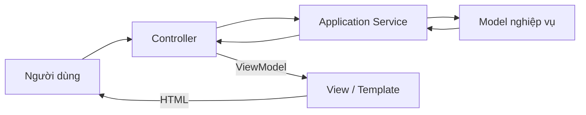
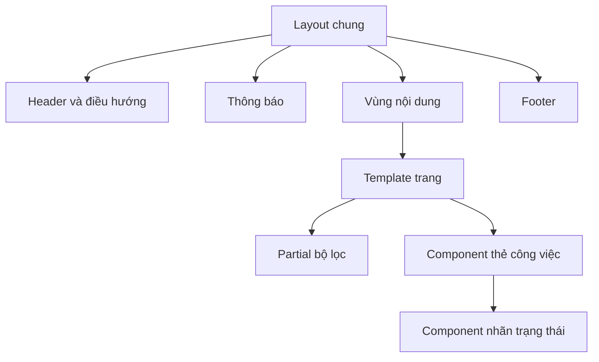

# Khuôn mẫu, bố cục và thành phần giao diện tái sử dụng

Một ứng dụng web thường có nhiều trang cùng dùng phần đầu trang, thanh điều hướng, chân trang, kiểu hiển thị thông báo và các thành phần như nút, nhãn trạng thái hoặc thẻ thông tin. Nếu mỗi trang tự viết lại toàn bộ cấu trúc HTML, giao diện sẽ nhanh chóng không đồng nhất và mỗi lần đổi thiết kế đều phải sửa ở nhiều nơi.

Trong mô hình Model–View–Controller (MVC), **View** chịu trách nhiệm trình bày dữ liệu và cung cấp cách tương tác cho người dùng. Ta có thể tổ chức View bằng **template**, **layout**, **partial** và **component** để dùng lại cấu trúc giao diện. Các mẫu này giúp trang có chung ngôn ngữ hình ảnh, giảm mã lặp và làm cho thay đổi giao diện dễ kiểm soát hơn.

Bài học sử dụng ví dụ ứng dụng quản lý công việc và Thymeleaf với Spring MVC để minh họa. Các khái niệm template, layout và component cũng áp dụng cho những công nghệ kết xuất giao diện khác.

## 1. View và trách nhiệm trình bày

View là phần giao diện mà người dùng quan sát và tương tác. Trong ứng dụng MVC kết xuất phía máy chủ, View thường là template được máy chủ kết xuất thành HTML. Với ứng dụng có frontend riêng, View có thể là các component phía trình duyệt nhận dữ liệu từ API.

View thường đảm nhiệm:

- Trình bày dữ liệu do Controller hoặc lớp ứng dụng cung cấp.
- Tổ chức cấu trúc trang, khu vực nội dung, điều hướng và các thành phần giao diện.
- Hiển thị trạng thái như đang tải, không có dữ liệu, thành công hoặc lỗi.
- Cung cấp điều khiển tương tác như liên kết, nút và biểu mẫu.
- Hỗ trợ khả năng truy cập, hiển thị trên nhiều kích thước màn hình và nhiều ngôn ngữ.

View không nên tự quyết định quy tắc nghiệp vụ. Ví dụ, giao diện có thể hiển thị nút **Hoàn thành** khi công việc đang thực hiện, nhưng máy chủ vẫn phải xác minh quyền và trạng thái trước khi chấp nhận request. Việc ẩn nút chỉ giúp giao diện phù hợp với trạng thái hiện tại; nó không phải cơ chế bảo vệ nghiệp vụ.

Trong ứng dụng MVC nhiều lớp, Controller lấy dữ liệu từ ca sử dụng, chuẩn bị một ViewModel rồi chuyển cho View. ViewModel là dữ liệu được chọn và định dạng phù hợp với nhu cầu trình bày, không nhất thiết là Domain Model hay thực thể ORM.



Sơ đồ minh họa một luồng kết xuất HTML phía máy chủ. Với frontend độc lập, Controller có thể trả Response DTO dạng JSON và frontend dùng dữ liệu đó để kết xuất View.

## 2. Bốn khái niệm: template, layout, partial và component

Các thuật ngữ này thường được dùng gần nhau, nhưng chúng mô tả những mức tái sử dụng khác nhau.

| Khái niệm | Vai trò | Ví dụ |
|---|---|---|
| **Template** | Khuôn mẫu trang hoặc một phần giao diện, có vị trí để gắn dữ liệu động | Template trang chi tiết công việc |
| **Layout** | Khung bố cục chung bao quanh nhiều trang | Header, navigation, vùng nội dung và footer |
| **Partial** | Đoạn giao diện nhỏ được tách ra để chèn vào nhiều template | Breadcrumb, thông báo, thanh phân trang |
| **Component** | Đơn vị giao diện có trách nhiệm và hợp đồng sử dụng tương đối rõ | Nút, badge trạng thái, thẻ công việc, hộp thoại xác nhận |

Một trang có thể kết hợp cả bốn mức. Layout cung cấp khung tổng thể; template định nghĩa nội dung riêng của trang; partial và component lấp đầy các khu vực hoặc hành vi cụ thể.



Đây là cấu trúc khái niệm, không phải quy định bắt buộc về số lượng file hoặc thư mục. Tùy framework, một component có thể là template fragment, custom tag, class hoặc một đơn vị giao diện có cả markup, style và logic hiển thị.

## 3. Layout: giữ khung trang nhất quán

Layout định nghĩa cấu trúc bao quanh nội dung của nhiều trang. Ví dụ, các trang danh sách, chi tiết và chỉnh sửa công việc đều có cùng header, thanh điều hướng, vùng thông báo và footer.

```text
+--------------------------------------------------+
| Logo                 Thanh điều hướng     Tài khoản|
+--------------------------------------------------+
| Breadcrumb                                        |
+--------------------------------------------------+
| Thông báo                                         |
+--------------------------------------------------+
|                                                  |
|            Nội dung riêng của trang              |
|                                                  |
+--------------------------------------------------+
| Footer                                           |
+--------------------------------------------------+
```

Layout giúp:

- Đặt cấu trúc điều hướng và vùng nội dung ở một nơi.
- Giữ khoảng cách, chiều rộng, typography và các vùng dùng chung nhất quán.
- Cập nhật header hoặc footer một lần cho nhiều trang.
- Tách cấu trúc tổng thể khỏi nội dung nghiệp vụ của từng trang.

Không nên đưa mọi nội dung vào layout. Layout nên cung cấp các vùng có chủ đích, chẳng hạn `pageTitle`, `breadcrumbs`, `content` và `scripts`. Trang cụ thể quyết định nội dung của vùng đó.

### Ví dụ layout với Thymeleaf

Một cách đơn giản là dùng fragment cho header và footer, rồi chèn chúng vào các template trang. Ví dụ dưới đây giả định dự án đặt fragment trong `templates/fragments/`.

```html
<!-- templates/fragments/header.html -->
<header th:fragment="siteHeader">
    <a th:href="@{/tasks}" class="brand">Quản lý công việc</a>
    <nav aria-label="Điều hướng chính">
        <a th:href="@{/tasks}">Công việc</a>
        <a th:href="@{/reports}">Báo cáo</a>
    </nav>
</header>
```

```html
<!-- templates/fragments/footer.html -->
<footer th:fragment="siteFooter">
    <p>&copy; 2026 - Ứng dụng quản lý công việc</p>
</footer>
```

Template trang sử dụng các fragment này:

```html
<!doctype html>
<html lang="vi" xmlns:th="http://www.thymeleaf.org">
<head>
    <meta charset="UTF-8">
    <meta name="viewport" content="width=device-width, initial-scale=1">
    <title th:text="${page.pageTitle}">Công việc</title>
</head>
<body>
    <div th:replace="~{fragments/header :: siteHeader}"></div>

    <main id="main-content">
        <h1 th:text="${page.pageTitle}">Danh sách công việc</h1>
        <section aria-label="Danh sách công việc">
            <th:block th:each="task : ${page.tasks}">
                <div th:replace="~{fragments/task-card :: taskCard(task=${task})}"></div>
            </th:block>
        </section>
    </main>

    <div th:replace="~{fragments/footer :: siteFooter}"></div>
</body>
</html>
```

Đoạn mã minh họa việc ghép fragment. Khi ứng dụng có nhiều layout hoặc cần vùng nội dung có thể thay thế theo trang, có thể dùng cơ chế layout của framework hoặc layout dialect phù hợp. Không nên tự tạo một hệ thống kế thừa template phức tạp nếu vài fragment đã đáp ứng được nhu cầu.

## 4. Partial: tách những vùng giao diện nhỏ

Partial là một phần template được dùng lại ở nhiều vị trí. Nó thường tập trung vào một vùng hiển thị và không cần sở hữu toàn bộ trang.

Các partial thường gặp:

- Thanh breadcrumb thể hiện vị trí hiện tại.
- Khối thông báo thành công hoặc lỗi.
- Bộ lọc và thanh tìm kiếm.
- Bảng dữ liệu hoặc phần phân trang.
- Trạng thái rỗng khi chưa có bản ghi.
- Khối xác nhận hoặc hướng dẫn ngắn.

Ví dụ fragment thông báo:

```html
<!-- templates/fragments/feedback.html -->
<div th:fragment="notice(message, kind)"
     class="notice"
     th:classappend="${kind}"
     role="status">
    <p th:text="${message}">Thông báo</p>
</div>
```

Template có thể chèn fragment với tham số:

```html
<div th:replace="~{fragments/feedback :: notice(
        message=${noticeMessage}, kind='success')}"></div>
```

Fragment nhận dữ liệu hiển thị và kết xuất nội dung. Nó không nên tự truy vấn cơ sở dữ liệu hoặc gọi nghiệp vụ. Nếu cần thêm dữ liệu, Controller hoặc lớp ứng dụng nên chuẩn bị dữ liệu đó và đưa vào hợp đồng của View.

## 5. Component: đơn vị giao diện có hợp đồng rõ ràng

Component là một phần giao diện có trách nhiệm cụ thể và có thể được dùng lại. Một component tốt thường có:

- **Mục đích:** giải quyết một nhu cầu trình bày hoặc tương tác rõ ràng.
- **Đầu vào:** dữ liệu hoặc thuộc tính cần thiết để hiển thị.
- **Đầu ra hoặc sự kiện:** liên kết, hành động hoặc callback mà component cung cấp, nếu có.
- **Trạng thái:** các trạng thái hiển thị như mặc định, đang tải, bị vô hiệu hóa hoặc có lỗi.
- **Quy tắc trình bày:** cấu trúc HTML, nhãn, khả năng truy cập và kiểu hiển thị nhất quán.

Ví dụ, badge trạng thái công việc có thể nhận một giá trị trạng thái đã được Controller chuẩn bị:

```html
<!-- templates/fragments/task-status.html -->
<span th:fragment="taskStatus(label, style)"
      class="status-badge"
      th:classappend="${style}"
      th:text="${label}">
    Đang thực hiện
</span>
```

Template chi tiết gọi component:

```html
<div th:replace="~{fragments/task-status :: taskStatus(
        label=${task.statusLabel}, style=${task.statusStyle})}"></div>
```

Ở đây, `statusLabel` và `statusStyle` là dữ liệu trình bày. Controller hoặc mapper ViewModel chịu trách nhiệm chuyển trạng thái miền thành nhãn và kiểu hiển thị; `statusStyle` nên được chọn từ một tập giá trị CSS đã cho phép, không lấy tùy ý từ request. Component không tự quyết định trạng thái nào được phép chuyển sang trạng thái nào.

### Hợp đồng đầu vào nên nhỏ và dễ hiểu

Một component hiển thị thẻ công việc có thể cần `title`, `assigneeName`, `dueDateLabel`, `statusLabel` và `detailUrl`. Không nên truyền toàn bộ entity ORM nếu component chỉ cần vài giá trị. Hợp đồng nhỏ giúp component ít phụ thuộc và dễ tái sử dụng ở nhiều trang.

Khi component có quá nhiều tham số, hãy xem lại liệu nó có đang gánh nhiều trách nhiệm hay không. Có thể chia thành component nhỏ hơn hoặc truyền một đối tượng ViewModel dành riêng cho component.

## 6. Ví dụ: tái sử dụng thẻ công việc

Giả sử trang danh sách công việc và trang tổng quan đều cần hiển thị một thẻ gồm tiêu đề, người phụ trách, hạn hoàn thành và trạng thái. Thay vì viết hai đoạn HTML gần giống nhau, ta định nghĩa một fragment.

```html
<!-- templates/fragments/task-card.html -->
<article th:fragment="taskCard(task)" class="task-card">
    <h2>
        <a th:href="${task.detailUrl}"
           th:text="${task.title}">Chuẩn bị báo cáo</a>
    </h2>

    <p>
        Người phụ trách:
        <span th:text="${task.assigneeName}">An</span>
    </p>

    <p>
        Hạn hoàn thành:
        <time th:datetime="${task.dueAtIso}"
              th:text="${task.dueDateLabel}">20/11/2026</time>
    </p>

    <div th:replace="~{fragments/task-status :: taskStatus(
            label=${task.statusLabel}, style=${task.statusStyle})}"></div>
</article>
```

Trang danh sách lặp qua dữ liệu ViewModel:

```html
<section aria-label="Danh sách công việc">
    <th:block th:each="task : ${tasks}">
        <div th:replace="~{fragments/task-card :: taskCard(task=${task})}"></div>
    </th:block>
</section>
```

Trang tổng quan có thể gọi cùng fragment với một tập dữ liệu đã được chuẩn bị khác. Cả hai trang dùng chung cách trình bày thẻ, trong khi mỗi trang vẫn kiểm soát tiêu đề khu vực, bộ lọc và bố cục riêng.

ViewModel cho thẻ có thể là một record đơn giản:

```java
public record TaskCardView(
        String title,
        String assigneeName,
        String dueAtIso,
        String dueDateLabel,
        String statusLabel,
        String statusStyle,
        String detailUrl) {
}
```

Lớp chuyển đổi dữ liệu có thể tạo `TaskCardView` từ Domain Model và thông tin liên quan. Nhờ vậy, template không phải biết cấu trúc entity, cách truy vấn người phụ trách hoặc cách diễn giải quy tắc nghiệp vụ.

## 7. Tổ chức file View dễ tìm và dễ mở rộng

Tên thư mục và cách chia file nên phản ánh cách đội ngũ tìm kiếm, sở hữu và thay đổi giao diện. Một cấu trúc ví dụ:

```text
templates/
├── layouts/
│   └── main.html
├── fragments/
│   ├── header.html
│   ├── footer.html
│   ├── feedback.html
│   ├── task-card.html
│   └── task-status.html
└── tasks/
    ├── list.html
    ├── detail.html
    └── form.html
```

Trong đó:

- `layouts/` chứa khung trang chung nếu dự án dùng layout riêng.
- `fragments/` chứa các vùng giao diện dùng lại ở nhiều trang.
- `tasks/` nhóm template theo chức năng hoặc miền giao diện.

Đây chỉ là một cách tổ chức. Dự án lớn có thể nhóm component theo feature để phần giao diện của một chức năng nằm gần nhau. Dự án nhỏ có thể giữ cấu trúc phẳng hơn. Điều cần đạt là người đọc dễ tìm template trang, thành phần dùng chung và nơi sở hữu style tương ứng.

Không nên tạo một partial chỉ để bọc một thẻ HTML đơn giản nếu nó chỉ xuất hiện một lần và không có ý nghĩa riêng. Tái sử dụng quá mức có thể làm luồng kết xuất khó theo dõi vì người đọc phải nhảy qua nhiều file cho một đoạn giao diện rất nhỏ.

## 8. Hợp đồng dữ liệu giữa Controller và View

View cần biết dữ liệu nào được cung cấp, tên thuộc tính là gì và trạng thái nào có thể xuất hiện. Một ViewModel tốt chỉ chứa thông tin cần để trình bày.

Ví dụ ViewModel cho trang danh sách:

```java
public record TaskListView(
        String pageTitle,
        List<TaskCardView> tasks,
        boolean hasTasks,
        String emptyMessage,
        int currentPage,
        int totalPages) {
}
```

Controller hoặc Application Service chuẩn bị ViewModel rồi trả tên template:

```java
@GetMapping
public String list(Model model) {
    TaskListView page = taskQueryService.getTaskList();
    model.addAttribute("page", page);
    return "tasks/list";
}
```

Template đọc dữ liệu từ hợp đồng đó:

```html
<main>
    <h1 th:text="${page.pageTitle}">Công việc</h1>

    <section th:if="${page.hasTasks}">
        <th:block th:each="task : ${page.tasks}">
            <div th:replace="~{fragments/task-card :: taskCard(task=${task})}"></div>
        </th:block>
    </section>

    <p th:unless="${page.hasTasks}"
       th:text="${page.emptyMessage}">
        Chưa có công việc.
    </p>
</main>
```

Trong Spring MVC, `org.springframework.ui.Model` là vùng chứa thuộc tính để Controller chuyển dữ liệu sang View. Nó không phải Domain Model. Đối tượng `TaskListView` trong ví dụ là ViewModel cụ thể mà template sử dụng.

Hợp đồng dữ liệu nên ổn định và có tên rõ ràng. Khi đổi tên một thuộc tính, cần cập nhật nơi tạo ViewModel và template đang sử dụng nó. Với component dùng lại nhiều nơi, nên ghi rõ đầu vào bắt buộc, đầu vào tùy chọn và giá trị mặc định.

## 9. Nguyên tắc thiết kế component dễ bảo trì

### Một trách nhiệm trình bày rõ ràng

Component nên giải quyết một nhu cầu cụ thể. Một badge chỉ hiển thị trạng thái; một thẻ hiển thị tóm tắt công việc; một thanh phân trang điều hướng giữa các trang dữ liệu. Component càng đảm nhiệm nhiều việc không liên quan, càng khó dùng lại.

### Dữ liệu đi vào qua hợp đồng tường minh

Ưu tiên truyền dữ liệu component cần dùng thay vì để component tự tìm dữ liệu từ session, request hoặc repository. Cách này giúp component có thể được dùng ở nhiều trang và kiểm thử với dữ liệu mẫu.

### Không để template chứa quy tắc nghiệp vụ

Điều kiện như `task.status == 'COMPLETED'` có thể dùng để chọn nhãn hiển thị, nhưng quy tắc cho phép chuyển trạng thái phải được bảo vệ ở Model hoặc lớp nghiệp vụ. Tránh đặt các biểu thức nghiệp vụ dài và phức tạp vào template.

### Tránh phụ thuộc ngược giữa component

Component nhỏ không nên phụ thuộc vào một trang cụ thể hoặc đọc biến toàn cục của template cha. Truyền dữ liệu và callback cần thiết qua hợp đồng rõ ràng. Với Thymeleaf, tham số fragment giúp thể hiện phụ thuộc này.

### Có thể tùy biến mà không phá cấu trúc

Nếu component cần hỗ trợ nội dung bên trong thay đổi, hãy xác định vùng nội dung hoặc slot theo khả năng của framework. Không nên thêm hàng loạt tham số Boolean như `showIcon`, `showBorder`, `compact`, `large`, `specialMode` nếu chúng làm hợp đồng khó hiểu. Có thể dùng biến thể có tên rõ ràng như `size="compact"` hoặc tách component khi hai trường hợp có cấu trúc khác nhau đáng kể.

### Dùng lại đúng mức

Tạo component khi có mẫu lặp ổn định, có ý nghĩa riêng hoặc cần được chuẩn hóa. Nếu hai đoạn giao diện chỉ giống nhau ở vài thẻ nhưng sẽ phát triển theo nhu cầu khác nhau, giữ chúng độc lập có thể dễ bảo trì hơn.

## 10. Khả năng truy cập và an toàn khi kết xuất

Một component dùng lại tốt phải giữ được chất lượng trải nghiệm ở mọi nơi nó xuất hiện.

**HTML ngữ nghĩa:** Dùng đúng phần tử như `nav`, `main`, `header`, `footer`, `button`, `form` và `label`. Không dùng `div` cho mọi mục đích khi HTML đã có phần tử thể hiện đúng ý nghĩa.

**Điều khiển bằng bàn phím:** Nút và liên kết cần có thể nhận focus và kích hoạt bằng bàn phím. Không loại bỏ đường viền focus nếu không cung cấp dấu hiệu focus thay thế dễ nhận biết.

**Nhãn và mô tả:** Mỗi trường nhập liệu cần có label gắn đúng với nó. Lỗi cần được liên kết với trường tương ứng và có thông báo đủ rõ để người dùng sửa.

**Tương phản và trạng thái:** Màu sắc không nên là tín hiệu duy nhất. Badge trạng thái cần có nhãn chữ; thông báo cập nhật động cần được công nghệ hỗ trợ đọc màn hình nhận biết khi phù hợp.

**Escape dữ liệu:** Dữ liệu do người dùng nhập phải được escape theo ngữ cảnh HTML. Trong Thymeleaf, `th:text` escape nội dung văn bản; chỉ dùng cơ chế chèn HTML thô khi nội dung đã được làm sạch và thực sự cần thiết. Không đưa chuỗi không tin cậy vào thuộc tính, JavaScript hoặc URL mà không xử lý theo đúng ngữ cảnh.

**Không dựa vào giao diện để bảo mật:** Ẩn liên kết hoặc nút không thay thế kiểm tra quyền ở máy chủ. Không đưa token bí mật hoặc dữ liệu nhạy cảm vào ViewModel nếu giao diện không cần chúng.

## 11. Responsive, đa ngôn ngữ và định dạng dữ liệu

Layout và component được dùng ở nhiều trang và thiết bị, vì vậy nên thiết kế để thích ứng với không gian hiển thị.

- Dùng bố cục linh hoạt như Flexbox hoặc CSS Grid thay vì cố định mọi chiều rộng bằng pixel.
- Kiểm tra nội dung khi tiêu đề dài, tên người dùng dài, màn hình hẹp hoặc phóng to văn bản.
- Đảm bảo menu, biểu mẫu và bảng vẫn dùng được trên màn hình cảm ứng và bằng bàn phím.
- Đưa chuỗi giao diện vào cơ chế message/resource bundle để hỗ trợ nhiều ngôn ngữ.
- Định dạng ngày, giờ và số theo locale ở lớp trình bày; giữ dữ liệu miền ở kiểu có ý nghĩa như `Instant`, `LocalDate` hoặc `BigDecimal`.

Ví dụ, ViewModel có thể cung cấp `dueDateLabel` đã được định dạng theo locale hiện tại, trong khi vẫn giữ `dueAtIso` để tạo thuộc tính `datetime` chuẩn. Tránh lưu ngày đã định dạng thành chuỗi trong Model nghiệp vụ vì cách hiển thị có thể khác theo ngôn ngữ và múi giờ.

## 12. Kiểm thử View và component

Kiểm thử giao diện nên xác nhận cả nội dung và hợp đồng. Có thể chia thành các mức:

1. **Kiểm thử template hoặc fragment:** xác nhận dữ liệu đầu vào được kết xuất đúng, nhánh có dữ liệu và trạng thái rỗng đều hoạt động.
2. **Kiểm thử component:** xác nhận nhãn, liên kết, thuộc tính và trạng thái hiển thị đúng với các bộ dữ liệu khác nhau.
3. **Kiểm thử tích hợp MVC:** gọi endpoint, xác nhận template được chọn, ViewModel có dữ liệu mong đợi và HTML phản hồi có cấu trúc chính.
4. **Kiểm thử trình duyệt:** kiểm tra điều hướng, biểu mẫu, tương tác bàn phím, responsive và thông báo lỗi trong môi trường gần với người dùng thật.

Ví dụ, component thẻ công việc nên được kiểm tra với tiêu đề bình thường, tiêu đề dài, thiếu người phụ trách, ngày đến hạn và trạng thái khác nhau. Trang danh sách cần kiểm tra cả trường hợp có nhiều công việc lẫn trường hợp chưa có dữ liệu.

Không cần kiểm thử lại toàn bộ HTML tĩnh ở mọi trang nếu component dùng chung đã được kiểm tra ở mức phù hợp. Tuy vậy, cần có kiểm thử tích hợp để xác nhận trang thực sự gắn đúng component và truyền đúng dữ liệu.

## 13. Những lỗi thường gặp khi tái sử dụng giao diện

| Lỗi | Hệ quả | Cách cải thiện |
|---|---|---|
| Sao chép toàn bộ header, footer vào từng trang | Giao diện nhanh chóng không đồng nhất | Đưa cấu trúc chung vào layout hoặc fragment |
| Component tự truy vấn dữ liệu | Khó kiểm thử, khó biết dữ liệu đến từ đâu | Chuẩn bị dữ liệu ở Controller hoặc lớp ứng dụng rồi truyền vào |
| Truyền cả entity ORM vào mọi component | Component phụ thuộc sâu vào cấu trúc lưu trữ | Tạo ViewModel nhỏ theo nhu cầu trình bày |
| Template chứa nhiều điều kiện nghiệp vụ | Quy tắc bị phân tán và khó bảo vệ | Chuyển quyết định nghiệp vụ về Model hoặc Service |
| Một component có quá nhiều tham số và chế độ | Hợp đồng khó hiểu, khó thay đổi | Chia trách nhiệm hoặc đặt tên biến thể rõ ràng |
| Tạo partial cho mọi thẻ HTML nhỏ | Luồng template bị chia vụn | Chỉ tách khi có ý nghĩa, lặp lại hoặc cần kiểm thử riêng |
| Chỉ dùng màu để thể hiện trạng thái | Người dùng khó nhận biết và công nghệ hỗ trợ không đọc được ý nghĩa | Kết hợp màu với nhãn chữ và ngữ nghĩa phù hợp |
| Dùng HTML thô với dữ liệu không tin cậy | Có thể dẫn đến XSS | Escape dữ liệu theo ngữ cảnh và làm sạch nội dung HTML nếu cần |

## 14. Quy trình thiết kế một View có thể tái sử dụng

Khi xây dựng một trang mới, có thể đi theo trình tự sau:

1. Xác định thông tin người dùng cần xem và hành động họ cần thực hiện trên trang.
2. Xác định ViewModel với các trường cần thiết, trạng thái rỗng và trạng thái lỗi.
3. Tìm layout, partial hoặc component hiện có có thể đáp ứng nhu cầu.
4. Nếu mẫu giao diện được dùng lại ổn định, định nghĩa component với đầu vào và trách nhiệm rõ ràng.
5. Xây dựng template trang để kết hợp layout và component.
6. Kiểm tra HTML ngữ nghĩa, khả năng truy cập, escape dữ liệu, responsive và bản dịch.
7. Kiểm thử fragment, component và luồng MVC để xác nhận dữ liệu được truyền đúng.

Khi sửa một component dùng chung, hãy xem những trang đang sử dụng nó và xác nhận thay đổi không làm hỏng hợp đồng đầu vào hoặc cách trình bày đã ổn định.

Template, layout, partial và component là các công cụ tổ chức View ở những mức khác nhau. Layout giữ khung trang nhất quán; template kết hợp nội dung của một trang; partial và component đóng gói những vùng giao diện có thể dùng lại. Khi View nhận một hợp đồng dữ liệu rõ ràng, tập trung vào trình bày và giữ được khả năng truy cập cũng như an toàn, giao diện MVC sẽ dễ phát triển mà vẫn nhất quán giữa các chức năng.
