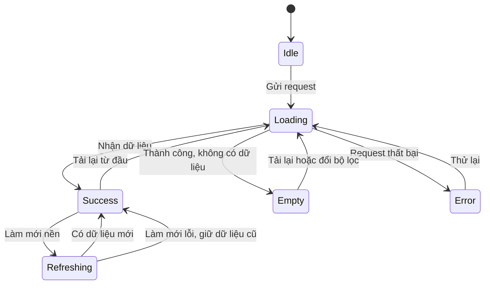
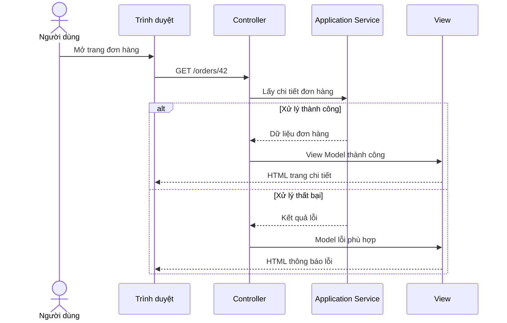

# Trạng thái đang tải, thành công và thất bại

Một View trong ứng dụng web không chỉ trình bày dữ liệu khi mọi thứ diễn ra thuận lợi. Khi người dùng mở trang, gửi biểu mẫu, tìm kiếm hoặc cập nhật một bản ghi, ứng dụng cần thời gian để xử lý request. Trong khoảng thời gian đó, dữ liệu có thể chưa sẵn sàng; request có thể hoàn tất thành công, trả về kết quả rỗng hoặc thất bại vì dữ liệu không hợp lệ, người dùng không có quyền hay dịch vụ tạm thời không hoạt động.

View cần thể hiện đúng trạng thái của quá trình này để người dùng hiểu ứng dụng đang làm gì và biết bước tiếp theo. Ba trạng thái thường gặp là **đang tải** (loading), **thành công** (success) và **thất bại** (error). Trong thực tế, nên phân biệt thêm trạng thái ban đầu chưa gửi request, trạng thái thành công nhưng không có dữ liệu và trạng thái đang làm mới dữ liệu cũ.

Trong MVC (Model–View–Controller), Model hoặc dịch vụ nghiệp vụ cung cấp dữ liệu và kết quả xử lý; Controller tiếp nhận tương tác, điều phối request và quyết định phản hồi; View trình bày trạng thái cùng dữ liệu phù hợp. Với thao tác bất đồng bộ ở trình duyệt, một bộ điều khiển phía client có thể quản lý vòng đời request và cập nhật View. Dù tổ chức theo cách nào, trạng thái hiển thị phải phản ánh kết quả thực tế từ phía ứng dụng, không được tự suy đoán rằng thao tác đã thành công chỉ vì người dùng đã bấm nút.

## 1. Vì sao View cần thể hiện trạng thái?

Giả sử người dùng mở trang danh sách đơn hàng. Trình duyệt gửi request đến server, server kiểm tra quyền, truy vấn dữ liệu và trả về kết quả. Quá trình này có thể mất vài mili giây hoặc vài giây. Nếu vùng nội dung để trống trong lúc chờ, người dùng khó biết trang đang tải, bị treo hay không có dữ liệu. Nếu request lỗi nhưng giao diện vẫn giữ nguyên, người dùng có thể tiếp tục thao tác dựa trên thông tin cũ.

Trạng thái giao diện giải quyết một số nhu cầu:

- **Tạo phản hồi tức thời:** cho người dùng biết request đã được gửi và ứng dụng đang xử lý.
- **Giải thích kết quả:** cho biết dữ liệu đã sẵn sàng, không có bản ghi phù hợp hay thao tác không thể hoàn tất.
- **Hướng dẫn bước tiếp theo:** cho phép thử lại, sửa dữ liệu, đăng nhập lại hoặc quay về màn hình phù hợp.
- **Ngăn thao tác lặp ngoài ý muốn:** thể hiện nút đang xử lý và tránh gửi cùng một biểu mẫu nhiều lần khi request vẫn đang chạy.
- **Hỗ trợ khả năng tiếp cận:** thông báo trạng thái để người dùng dùng trình đọc màn hình hoặc điều hướng bằng bàn phím cũng nhận biết được tiến trình.

Trạng thái là một phần của hợp đồng tương tác. Nếu giao diện báo thành công trước khi server xác nhận, người dùng có thể tin rằng dữ liệu đã được lưu dù giao dịch thực tế thất bại. Nếu giao diện báo lỗi chung chung cho mọi trường hợp, người dùng không biết nên sửa biểu mẫu, xin quyền hay thử lại sau.

## 2. Mô hình hóa vòng đời trạng thái

Một request đọc dữ liệu thường đi qua chuỗi trạng thái sau:



Các tên trạng thái có thể khác nhau giữa framework và dự án. Điều quan trọng là mỗi trạng thái có ý nghĩa rõ ràng và các chuyển đổi được điều khiển bởi kết quả thực tế.

| Trạng thái | Ý nghĩa | Cách View thường phản hồi |
|---|---|---|
| Idle (ban đầu) | Chưa gửi request hoặc chưa cần tải dữ liệu | Hiển thị hướng dẫn, bộ lọc hoặc vùng nội dung ban đầu |
| Loading (đang tải) | Request đã bắt đầu nhưng chưa có kết quả cuối cùng | Hiển thị spinner, skeleton hoặc thông báo đang xử lý |
| Success (thành công) | Request hoàn tất và có dữ liệu để trình bày | Hiển thị nội dung, kết quả và thao tác phù hợp |
| Empty (rỗng) | Request thành công nhưng không có dữ liệu phù hợp | Hiển thị thông báo rỗng và gợi ý hành động hữu ích |
| Error (thất bại) | Không thể hoàn tất request theo yêu cầu | Hiển thị thông báo an toàn, nguyên nhân ở mức phù hợp và cách khắc phục |
| Refreshing (đang làm mới) | Đang tải dữ liệu mới trong khi dữ liệu cũ vẫn có thể xem | Giữ nội dung cũ, biểu thị đang cập nhật và thông báo nếu làm mới thất bại |

`Empty` là một kết quả thành công, không phải lỗi. Một danh sách tìm kiếm không có kết quả có thể là điều hoàn toàn bình thường. `Refreshing` cũng khác `Loading`: ở lần tải đầu, chưa có dữ liệu để hiển thị; khi làm mới, có thể giữ dữ liệu hiện có để tránh làm màn hình nhấp nháy hoặc biến mất không cần thiết.

### 2.1. Trạng thái của request và trạng thái của toàn trang

Không phải lúc nào cả trang cũng chỉ có một trạng thái. Một trang quản trị có thể hiển thị thông tin tài khoản đã tải xong trong khi bảng lịch sử vẫn đang tải. Nếu gom tất cả thành một biến `isLoading`, một request nhỏ có thể làm ẩn toàn bộ trang hoặc khiến trạng thái của vùng này ghi đè vùng khác.

Hãy xác định phạm vi trạng thái theo vùng dữ liệu hoặc thao tác:

- Trang có thể có trạng thái tải ban đầu cho dữ liệu cốt lõi.
- Bảng kết quả có trạng thái riêng khi người dùng đổi bộ lọc.
- Biểu mẫu có trạng thái gửi riêng khi lưu.
- Một nút thao tác có thể có trạng thái đang xử lý riêng với phần còn lại của trang.

Mỗi trạng thái cần có chủ sở hữu rõ ràng. Controller phía server chịu trách nhiệm kết quả request phía server; thành phần tương tác phía client quản lý tiến trình của request bất đồng bộ do nó khởi tạo. Không nên để nhiều thành phần cùng ghi vào một trạng thái toàn cục mà không có quy tắc phối hợp.

## 3. Trạng thái đang tải (Loading)

Loading bắt đầu khi ứng dụng đã khởi tạo một request và chưa nhận được kết quả cuối cùng. View cần cho người dùng biết nội dung đang được tải hoặc thao tác đang được xử lý.

### 3.1. Chọn cách biểu thị phù hợp

Có một số cách phổ biến:

- **Spinner:** phù hợp với thao tác ngắn hoặc một vùng nhỏ, chẳng hạn nút lưu đang xử lý.
- **Skeleton:** mô phỏng bố cục nội dung sắp xuất hiện, hữu ích khi tải trang chi tiết hoặc danh sách có cấu trúc ổn định.
- **Progress bar:** phù hợp khi ứng dụng có thể ước lượng tiến độ, ví dụ tải tệp lớn. Không nên hiển thị phần trăm giả nếu không có dữ liệu tiến độ.
- **Thông báo bằng chữ:** như “Đang tải danh sách đơn hàng…” hoặc “Đang lưu thay đổi…”, đặc biệt hữu ích khi thao tác có thể kéo dài.

Ví dụ HTML cho một vùng nội dung đang tải:

```html
<section id="orders-panel" aria-busy="true">
  <p role="status" aria-live="polite">
    Đang tải danh sách đơn hàng…
  </p>
  <div class="orders-skeleton" aria-hidden="true">
    <div class="skeleton-row"></div>
    <div class="skeleton-row"></div>
    <div class="skeleton-row"></div>
  </div>
</section>
```

`aria-busy="true"` cho công nghệ hỗ trợ biết vùng đang được cập nhật. Nội dung có `role="status"` và `aria-live="polite"` giúp thông báo trạng thái mà không ngắt lời người dùng một cách đột ngột. Các khối skeleton chỉ mang tính trang trí nên được ẩn khỏi cây trợ năng.

### 3.2. Giữ giao diện ổn định trong khi chờ

Loading nên xuất hiện ở đúng phạm vi request. Nếu người dùng đang làm mới bảng đơn hàng, có thể giữ tiêu đề và bộ lọc, đồng thời hiển thị tiến trình trong vùng bảng. Không nhất thiết xóa toàn bộ nội dung trang.

Với biểu mẫu gửi đi, có thể tạm vô hiệu hóa nút gửi để tránh thao tác lặp. Cần giữ thông báo rõ ràng về việc đang xử lý và khôi phục nút nếu request thất bại. Nếu biểu mẫu có nhiều hành động độc lập, chỉ khóa hành động đang thực hiện thay vì vô hiệu hóa toàn bộ trang.

Ví dụ:

```html
<form id="profile-form">
  <label for="display-name">Tên hiển thị</label>
  <input id="display-name" name="displayName" required>
  <button id="save-button" type="submit">Lưu thay đổi</button>
  <p id="save-status" role="status" aria-live="polite"></p>
</form>
```

Khi submit bắt đầu, View có thể đổi nhãn nút thành “Đang lưu…” và đặt `disabled`. Sau khi nhận kết quả, View phải khôi phục trạng thái tương tác phù hợp. Với thao tác có thể mất nhiều thời gian, cần cân nhắc cho phép người dùng rời trang hoặc thông báo rõ rằng thao tác vẫn đang chạy.

### 3.3. Tránh loading vô hạn

Request có thể bị treo do mất mạng, server chậm hoặc kết nối bị đóng. View không nên giữ trạng thái loading vô hạn mà không có phản hồi. Client có thể đặt timeout phù hợp, hỗ trợ hủy request khi người dùng rời vùng nội dung và chuyển sang trạng thái lỗi khi biết request không thể tiếp tục.

Timeout phía client chỉ có nghĩa là client ngừng chờ. Nó không chứng minh server chưa thực hiện thao tác. Đối với thao tác ghi dữ liệu như tạo đơn hàng hoặc thanh toán, khi kết quả không rõ ràng cần kiểm tra trạng thái giao dịch hoặc dùng cơ chế idempotency phù hợp trước khi gửi lại để tránh tạo tác động trùng lặp.

## 4. Trạng thái thành công (Success)

Success có nghĩa là request đã hoàn tất và ứng dụng có kết quả hợp lệ để trình bày. View nên đưa dữ liệu vào đúng cấu trúc, thể hiện trạng thái hiện tại và cho phép những thao tác tiếp theo phù hợp.

Ví dụ, khi tải chi tiết đơn hàng thành công, View có thể hiển thị mã đơn, các dòng hàng, tổng tiền và trạng thái giao hàng. Khi lưu biểu mẫu thành công, View có thể thông báo “Đã lưu thay đổi” và cập nhật dữ liệu vừa lưu.

### 4.1. Phân biệt có dữ liệu và không có dữ liệu

Request trả về thành công không có nghĩa là luôn có bản ghi. Ví dụ:

- Danh sách đơn hàng trả về `[]` vì khách hàng chưa từng đặt hàng.
- Tìm kiếm trả về danh sách rỗng vì không có kết quả khớp từ khóa.
- Trang báo cáo trả về dữ liệu hợp lệ nhưng tất cả chỉ số đều bằng 0 trong khoảng thời gian đã chọn.

Đây là các trường hợp Empty. View nên giải thích trạng thái và gợi ý hành động như thay đổi bộ lọc, xóa từ khóa hoặc tạo bản ghi đầu tiên. Không nên hiển thị thông báo “Đã xảy ra lỗi” cho một kết quả rỗng hợp lệ.

### 4.2. Thông báo thành công phải đúng với tác động đã xác nhận

Thông báo như “Đã lưu thành công” chỉ nên xuất hiện sau khi server xác nhận thao tác đã được thực hiện. Nếu client dùng optimistic update để cập nhật giao diện ngay khi người dùng thao tác, cần có cơ chế hoàn tác hoặc điều chỉnh giao diện khi server từ chối.

Ví dụ, khi người dùng đánh dấu một công việc đã hoàn thành, giao diện có thể cập nhật trạng thái ngay để phản hồi nhanh. Nếu server trả về lỗi do công việc đã bị người khác thay đổi hoặc người dùng không còn quyền, View phải đồng bộ lại dữ liệu và thông báo rằng thao tác chưa được lưu.

### 4.3. Hiển thị dữ liệu đúng ngữ cảnh

View Model có thể cung cấp các trường đã được chuẩn bị cho giao diện, chẳng hạn nhãn trạng thái, ngày giờ theo múi giờ phù hợp và số tiền theo locale. View không nên tự tính lại quy tắc nghiệp vụ từ dữ liệu thô. Nếu nhiều màn hình cần cùng một phép tính có ý nghĩa nghiệp vụ, phép tính đó cần được thực hiện ở Model hoặc dịch vụ nghiệp vụ; View chỉ trình bày kết quả.

## 5. Trạng thái thất bại (Error)

Error xuất hiện khi request không thể hoàn tất theo yêu cầu. Nguyên nhân có thể đến từ dữ liệu đầu vào, quyền truy cập, trạng thái nghiệp vụ, dữ liệu không tồn tại, giới hạn dịch vụ hoặc sự cố hạ tầng. View cần chuyển lỗi kỹ thuật thành thông tin có ích và an toàn cho người dùng.

### 5.1. Phân loại lỗi trước khi hiển thị

Không nên gom mọi lỗi thành một thông báo duy nhất. Cần phân biệt lỗi có thể khắc phục bằng cách người dùng sửa dữ liệu, lỗi cần thay đổi quyền hoặc ngữ cảnh, và lỗi có thể thử lại sau.

| Kết quả hoặc mã HTTP thường gặp | Ý nghĩa | Cách View có thể phản hồi |
|---|---|---|
| `400 Bad Request` | Request sai cấu trúc hoặc không hợp lệ ở mức giao thức | Thông báo request không hợp lệ; không yêu cầu người dùng thử lại nguyên trạng |
| `401 Unauthorized` | Chưa xác thực hoặc phiên đăng nhập không còn hiệu lực | Hướng dẫn đăng nhập lại theo luồng của ứng dụng |
| `403 Forbidden` | Đã xác thực nhưng không có quyền thực hiện | Thông báo không đủ quyền; không hiển thị dữ liệu bị hạn chế |
| `404 Not Found` | Tài nguyên không tồn tại hoặc không được phép tiết lộ | Hiển thị trang không tìm thấy hoặc thông báo phù hợp |
| `409 Conflict` | Trạng thái hiện tại xung đột với thao tác | Yêu cầu tải lại dữ liệu hoặc giải quyết xung đột |
| `422 Unprocessable Content` | Dữ liệu có cấu trúc nhưng không vượt qua kiểm tra nghiệp vụ/validation | Hiển thị lỗi tại trường hoặc khu vực liên quan |
| `429 Too Many Requests` | Request vượt giới hạn cho phép | Thông báo chờ trước khi thử lại; tôn trọng `Retry-After` nếu có |
| `5xx` | Server hoặc dịch vụ phía sau gặp sự cố | Thông báo sự cố tạm thời và hướng dẫn thử lại khi phù hợp |

Mã HTTP chỉ là tín hiệu ở ranh giới giao thức. Nội dung và cách xử lý cụ thể cần dựa vào hợp đồng API hoặc quy ước của ứng dụng. Không phải mọi `400` đều là lỗi người dùng có thể sửa trên biểu mẫu; cũng không phải mọi lỗi `5xx` đều an toàn để tự động gửi lại thao tác ghi.

### 5.2. Thông báo hữu ích nhưng không làm lộ thông tin nội bộ

Người dùng cần biết điều gì đã xảy ra và có thể làm gì tiếp theo. Họ không cần stack trace, câu SQL, tên máy chủ, đường dẫn file hoặc thông tin xác thực.

Ví dụ:

| Không nên hiển thị | Nên hiển thị |
|---|---|
| `NullPointerException at OrderService.java:87` | “Chưa thể tải thông tin đơn hàng. Vui lòng thử lại sau.” |
| `SQLState 23505: duplicate key` | “Mã đơn hàng đã tồn tại. Vui lòng kiểm tra lại thông tin.” |
| `AccessDeniedException: /admin/orders` | “Bạn không có quyền xem nội dung này.” |
| `Connection refused: db.internal:5432` | “Dịch vụ đang tạm thời không khả dụng.” |

Chi tiết kỹ thuật nên được ghi vào log phía server với mã tương quan (correlation ID) hoặc mã lỗi có thể tra cứu. Nếu cần hỗ trợ, View có thể hiển thị mã tham chiếu không nhạy cảm để người dùng cung cấp cho bộ phận hỗ trợ.

### 5.3. Lỗi xác thực biểu mẫu và lỗi hệ thống cần hiển thị khác nhau

Lỗi xác thực dữ liệu đầu vào thường gắn với một hoặc nhiều trường. View nên chỉ rõ trường nào có vấn đề, lý do và cách sửa. Ví dụ, “Email không đúng định dạng” nên xuất hiện gần trường email và được liên kết bằng `aria-describedby`.

Lỗi hệ thống hoặc lỗi không gắn với trường, chẳng hạn server không khả dụng, nên xuất hiện ở vùng thông báo chung. Không nên xóa các giá trị người dùng đã nhập khi request thất bại; họ có thể cần sửa và gửi lại.

Ví dụ cấu trúc thông báo lỗi trường:

```html
<label for="email">Địa chỉ email</label>
<input
  id="email"
  name="email"
  type="email"
  aria-invalid="true"
  aria-describedby="email-error"
>
<p id="email-error" class="field-error">
  Vui lòng nhập địa chỉ email hợp lệ.
</p>
```

`aria-invalid` cho biết trường đang có lỗi; `aria-describedby` liên kết trường với thông báo tương ứng để công nghệ hỗ trợ đọc được ngữ cảnh.

### 5.4. Retry phải có điều kiện

Nút “Thử lại” phù hợp với lỗi tạm thời như mất kết nối hoặc dịch vụ chưa sẵn sàng. Nó không giải quyết được lỗi dữ liệu không hợp lệ, thiếu quyền hoặc tài nguyên không tồn tại. View nên cung cấp retry khi thao tác có khả năng thành công nếu thực hiện lại và không gây tác động ngoài ý muốn.

Với request đọc dữ liệu, retry thường an toàn hơn. Với request ghi dữ liệu, cần xem xét tính idempotent, mã idempotency, trạng thái giao dịch và thông tin phản hồi. Nếu client mất kết nối sau khi gửi lệnh tạo đơn, server có thể đã tạo đơn thành công dù client chưa nhận được phản hồi. Gửi lại một cách mù quáng có thể tạo đơn trùng.

## 6. Vai trò của Model, Controller và View trong quản lý trạng thái

Trạng thái hiển thị không nên trở thành nơi thực thi quy tắc nghiệp vụ. Mỗi phần của MVC có trách nhiệm riêng:

| Thành phần | Trách nhiệm liên quan đến trạng thái |
|---|---|
| Model và dịch vụ nghiệp vụ | Quản lý trạng thái miền, kiểm tra điều kiện hợp lệ, thực hiện hoặc từ chối thao tác |
| Controller phía server | Nhận request, xác thực đầu vào và quyền, gọi ca sử dụng, ánh xạ kết quả hoặc lỗi sang phản hồi HTTP/View |
| View | Trình bày loading, success, empty và error; hiển thị dữ liệu, thông báo và thao tác phù hợp |
| Bộ điều khiển phía client (nếu có) | Bắt đầu/hủy request bất đồng bộ, theo dõi tiến trình và cập nhật View theo phản hồi |

Ví dụ, View có thể ẩn nút hủy đơn khi `canCancel` là `false`. Tuy nhiên, khi nhận request hủy, Controller và tầng nghiệp vụ vẫn phải kiểm tra quyền và trạng thái đơn hàng. Người dùng có thể tự tạo request mà không thông qua nút trên giao diện.

### 6.1. Server-rendered MVC

Trong ứng dụng server-rendered, mỗi request thường nhận một phản hồi HTML hoàn chỉnh. Controller gọi dịch vụ, sau đó chọn View thành công hoặc View lỗi phù hợp. Nếu dữ liệu chưa tải xong, trình duyệt thường hiển thị trạng thái chờ tải trang ở cấp trình duyệt; ứng dụng có thể dùng trang trung gian cho tác vụ dài hoặc dùng JavaScript để cập nhật một vùng riêng.

Ví dụ luồng xử lý:



Trong server-rendered MVC, không nên cố nhồi mọi trạng thái vào cùng một template nếu trang lỗi có mục đích và bố cục khác hẳn trang thành công. Có thể dùng layout chung để giữ điều hướng và phong cách nhất quán, đồng thời chọn View hoặc fragment riêng cho từng kết quả.

### 6.2. Giao diện cập nhật bất đồng bộ

Với tìm kiếm tức thời, tải thêm dữ liệu hoặc cập nhật một phần trang, trình duyệt gửi request sau khi trang đã hiển thị. Bộ điều khiển phía client theo dõi trạng thái request rồi yêu cầu View render vùng tương ứng.

Ví dụ bằng JavaScript thuần:

```javascript
const panel = document.querySelector("#orders-panel");
const status = document.querySelector("#orders-status");
const list = document.querySelector("#orders-list");

async function loadOrders() {
  panel.setAttribute("aria-busy", "true");
  status.textContent = "Đang tải danh sách đơn hàng…";
  list.replaceChildren();

  try {
    const response = await fetch("/api/orders");

    if (!response.ok) {
      throw new Error(`Request failed: ${response.status}`);
    }

    const orders = await response.json();

    if (orders.length === 0) {
      status.textContent = "Chưa có đơn hàng phù hợp.";
      return;
    }

    for (const order of orders) {
      const item = document.createElement("li");
      item.textContent = `${order.orderNumber} - ${order.statusLabel}`;
      list.append(item);
    }

    status.textContent = `Đã tải ${orders.length} đơn hàng.`;
  } catch (error) {
    status.textContent =
      "Chưa thể tải danh sách đơn hàng. Vui lòng thử lại.";
  } finally {
    panel.setAttribute("aria-busy", "false");
  }
}
```

Đây là ví dụ rút gọn về chuyển trạng thái. Trong ứng dụng thực tế, cần xử lý riêng lỗi xác thực, quyền truy cập, validation và lỗi server theo hợp đồng API; có thể bổ sung nút retry và hủy request khi cần. Mã sử dụng `textContent` để đưa dữ liệu vào văn bản, tránh diễn giải dữ liệu server như HTML tùy ý. Không nên ghép dữ liệu không tin cậy vào `innerHTML` nếu chưa được xử lý an toàn.

`finally` bảo đảm vùng được đánh dấu không còn bận dù request thành công hay thất bại. Nếu hàm có thể được gọi nhiều lần liên tiếp, cần thêm kiểm soát request cũ để kết quả đến muộn không ghi đè dữ liệu mới.

## 7. Xử lý request đồng thời và dữ liệu cũ

Một lỗi thường gặp ở giao diện bất đồng bộ là người dùng thay đổi bộ lọc liên tục. Request A được gửi trước, request B được gửi sau, nhưng B có thể hoàn tất trước A. Nếu A hoàn tất muộn và cập nhật View sau B, màn hình sẽ hiển thị kết quả của bộ lọc cũ.

Có thể xử lý bằng cách hủy request trước hoặc gắn mã phiên bản cho mỗi lần tải. Ví dụ với `AbortController`:

```javascript
let activeController;

async function searchOrders(query) {
  activeController?.abort();
  activeController = new AbortController();

  const response = await fetch(
    `/api/orders?q=${encodeURIComponent(query)}`,
    { signal: activeController.signal }
  );

  if (!response.ok) {
    throw new Error("Không thể tìm đơn hàng");
  }

  return response.json();
}
```

Ứng dụng cần bắt riêng lỗi do `AbortController` chủ động hủy để không hiển thị nhầm thông báo lỗi cho người dùng. Hủy request ở trình duyệt cũng không bảo đảm server đã dừng xử lý; thao tác ghi vẫn cần quy tắc giao dịch và idempotency ở phía server.

Khi làm mới dữ liệu nền, có thể giữ nội dung cũ và hiển thị chỉ báo “Đang cập nhật”. Nếu lần làm mới thất bại, giao diện nên nói rõ dữ liệu đang hiển thị là dữ liệu cũ hoặc thời điểm cập nhật gần nhất. Tránh để người dùng hiểu nhầm rằng nội dung cũ phản ánh trạng thái hiện tại.

## 8. Trạng thái cho biểu mẫu và thao tác ghi

Biểu mẫu thường có vòng đời riêng: sẵn sàng nhập, đang gửi, gửi thành công hoặc gửi thất bại. Trạng thái lỗi có thể bao gồm lỗi validation ở từng trường, lỗi nghiệp vụ và lỗi hệ thống.

Một quy trình cập nhật hồ sơ có thể là:

1. Người dùng nhập dữ liệu; View hiển thị các giá trị hiện tại.
2. Người dùng gửi biểu mẫu; Controller nhận request và xác thực dữ liệu đầu vào.
3. Dịch vụ nghiệp vụ kiểm tra quyền và điều kiện cập nhật, sau đó lưu thay đổi.
4. Nếu thành công, Controller trả về redirect hoặc phản hồi thành công; View hiển thị dữ liệu mới và thông báo xác nhận.
5. Nếu thất bại do validation, View giữ lại dữ liệu phù hợp và hiển thị lỗi tại trường; nếu thất bại do sự cố hệ thống, View hiển thị thông báo chung và cho phép thử lại khi an toàn.

Trong mô hình Post/Redirect/Get (PRG), sau khi xử lý POST thành công, server chuyển hướng sang GET để tránh trình duyệt gửi lại biểu mẫu khi người dùng refresh. Thông báo thành công có thể được lưu tạm trong session/flash attribute theo cơ chế framework. Với API bất đồng bộ, client cập nhật giao diện theo response và cần xử lý trường hợp kết quả không rõ ràng do mất kết nối.

Không nên chỉ dựa vào việc nút gửi đã bị vô hiệu hóa để chống gửi trùng. Server vẫn cần kiểm tra dữ liệu, trạng thái, quyền và tính lặp an toàn của thao tác vì client có thể gửi request trực tiếp hoặc gửi nhiều lần.

## 9. Khả năng tiếp cận và chất lượng thông báo

Trạng thái không chỉ cần đẹp mắt; nó phải có thể nhận biết và hiểu được. Một số nguyên tắc:

- Dùng văn bản để truyền đạt trạng thái, không chỉ dùng màu sắc hoặc biểu tượng.
- Đặt thông báo gần vùng nội dung hoặc thao tác liên quan.
- Dùng `role="status"` hoặc `aria-live="polite"` cho cập nhật thông thường; dùng vùng cảnh báo phù hợp cho lỗi cần chú ý ngay.
- Giữ tiêu điểm bàn phím hợp lý khi mở hộp thoại lỗi hoặc chuyển sang trang lỗi.
- Liên kết lỗi biểu mẫu với trường tương ứng và cung cấp phần tóm tắt lỗi khi có nhiều trường.
- Không xóa nội dung người dùng đã nhập khi request thất bại, trừ khi có lý do rõ ràng và đã thông báo.
- Không nhấp nháy hoặc thay đổi bố cục quá mạnh khi chuyển giữa loading và success.

Thông báo nên ngắn gọn, cụ thể và có hành động tiếp theo. “Có lỗi” không giúp người dùng giải quyết vấn đề. “Mã bưu chính cần có 5 chữ số” hoặc “Phiên đăng nhập đã hết hạn; hãy đăng nhập lại để tiếp tục” hữu ích hơn.

## 10. Kiểm thử các trạng thái của View

Kiểm thử cần bao phủ cả đường đi thành công lẫn những trạng thái ít gặp. Một trang chỉ được kiểm tra khi API trả về dữ liệu bình thường có thể vẫn gặp lỗi nghiêm trọng khi server chậm, danh sách rỗng hoặc người dùng không có quyền.

| Trường hợp | Điều cần kiểm tra |
|---|---|
| Bắt đầu request | Loading xuất hiện đúng vùng và trạng thái bận được thông báo |
| Request thành công có dữ liệu | Nội dung và thao tác được hiển thị đúng |
| Request thành công nhưng rỗng | Empty state xuất hiện, không bị coi là lỗi |
| Validation thất bại | Lỗi được gắn với trường và dữ liệu người dùng không bị mất ngoài ý muốn |
| Không có quyền hoặc hết phiên | Thông báo phù hợp, không lộ dữ liệu hạn chế |
| Server hoặc mạng lỗi | Thông báo an toàn, retry chỉ xuất hiện khi phù hợp |
| Request bị hủy hoặc đến muộn | Không hiển thị lỗi giả và không ghi đè kết quả mới |
| Gửi biểu mẫu nhiều lần | UI phản hồi rõ ràng; server bảo vệ thao tác khỏi tác động trùng lặp |
| Làm mới nền thất bại | Dữ liệu cũ được nhận diện đúng, không bị trình bày như dữ liệu mới |

Nên kết hợp các mức kiểm thử:

- **Unit test cho View Model hoặc hàm trình bày:** xác minh dữ liệu được ánh xạ thành trạng thái, nhãn và thông báo đúng.
- **Component test:** xác minh View render đúng khi nhận `loading`, `success`, `empty` hoặc `error`.
- **Kiểm thử Controller/API:** xác minh mã HTTP và hợp đồng lỗi/thành công mà View dựa vào.
- **Kiểm thử tích hợp hoặc đầu-cuối:** mô phỏng request chậm, dữ liệu rỗng, mất kết nối, hết phiên và thao tác gửi biểu mẫu.

Không nên kiểm thử chỉ bằng cách so sánh toàn bộ HTML nếu điều đó khiến bài kiểm thử dễ vỡ khi bố cục thay đổi. Ưu tiên kiểm tra nội dung, vai trò trợ năng, trạng thái tương tác và hành vi quan sát được.

## 11. Những lỗi thiết kế thường gặp

**Chỉ có trạng thái loading và success.** Khi request thất bại, giao diện có thể bị kẹt hoặc không giải thích được điều gì đã xảy ra. Hãy xác định rõ đường đi lỗi và cách khôi phục.

**Coi danh sách rỗng là lỗi.** Không có dữ liệu có thể là kết quả hợp lệ. Hãy phân biệt Empty với Error để người dùng biết có nên đổi bộ lọc hay thử lại.

**Dùng một `isLoading` cho toàn trang.** Một request ở vùng nhỏ có thể làm ẩn hoặc khóa toàn bộ giao diện. Hãy giới hạn trạng thái theo vùng dữ liệu hoặc thao tác.

**Báo thành công trước khi server xác nhận.** Điều này khiến người dùng tin rằng dữ liệu đã được lưu dù thao tác có thể thất bại. Nếu dùng optimistic update, phải có cơ chế đồng bộ và hoàn tác.

**Hiển thị thông báo kỹ thuật thô.** Stack trace, SQL hoặc tên máy chủ không giúp người dùng và có thể tiết lộ thông tin nội bộ. Hãy ánh xạ lỗi sang thông báo an toàn và ghi chi tiết ở server.

**Retry mọi lỗi.** Retry không sửa được dữ liệu sai hoặc quyền bị từ chối; retry mù quáng thao tác ghi có thể tạo dữ liệu trùng. Hãy phân loại lỗi và xem xét idempotency.

**Không kiểm soát request cũ.** Kết quả đến muộn có thể ghi đè dữ liệu mới. Hãy hủy request không còn cần thiết hoặc kiểm tra mã phiên bản trước khi cập nhật View.

**Chỉ dùng màu sắc để biểu thị trạng thái.** Người dùng không phân biệt được nếu thiếu chữ hoặc thông tin trợ năng. Hãy kết hợp văn bản, biểu tượng và cấu trúc ngữ nghĩa.

## 12. Checklist thiết kế trạng thái View

Khi xây dựng một màn hình hoặc thao tác bất đồng bộ, hãy kiểm tra:

1. Trạng thái ban đầu, loading, success, empty và error đã được xác định chưa?
2. Trạng thái thuộc về toàn trang, một vùng nội dung hay một thao tác cụ thể?
3. Loading có thông báo rõ ràng và tránh thao tác lặp ngoài ý muốn không?
4. Success chỉ xuất hiện sau khi kết quả được xác nhận chưa?
5. Empty có được phân biệt với Error không?
6. Lỗi có được phân loại để hướng dẫn người dùng sửa, đăng nhập, xin quyền hoặc thử lại không?
7. Thông báo có tránh lộ stack trace, câu truy vấn và dữ liệu nhạy cảm không?
8. Biểu mẫu có giữ dữ liệu hợp lệ khi thất bại và liên kết lỗi với trường không?
9. Request cũ, timeout và retry có thể gây cập nhật sai hoặc tác động trùng lặp không?
10. Người dùng bàn phím và trình đọc màn hình có nhận biết được thay đổi trạng thái không?
11. Có kiểm thử các nhánh thành công, rỗng, validation, quyền, lỗi server và request bị hủy không?

## Kết luận

Loading, success và error là những trạng thái cơ bản giúp View phản ánh vòng đời request một cách rõ ràng. Một thiết kế tốt còn phân biệt trạng thái ban đầu, kết quả rỗng và làm mới dữ liệu cũ; xác định phạm vi trạng thái theo từng vùng hoặc thao tác; cung cấp thông báo an toàn, có ích và hỗ trợ khôi phục. Trong MVC, Model và dịch vụ nghiệp vụ quyết định tính hợp lệ của dữ liệu và thao tác, Controller điều phối và ánh xạ kết quả, còn View trình bày trạng thái mà người dùng cần biết. Khi các trách nhiệm này được giữ rõ ràng và các nhánh được kiểm thử, giao diện trở nên đáng tin cậy ngay cả khi request chậm hoặc thất bại.
