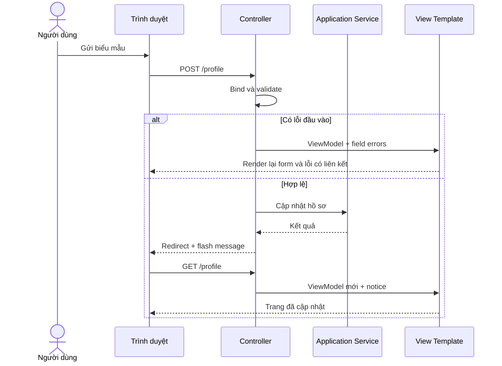

# Khả năng tiếp cận và phản hồi thao tác cho người dùng

Trong kiến trúc **MODEL_VIEW_CONTROLLER (MVC)**, View chịu trách nhiệm trình bày dữ liệu và cung cấp điểm tương tác để người dùng làm việc với ứng dụng. Một View tốt cần giúp nhiều nhóm người dùng hiểu nội dung, thao tác bằng phương thức phù hợp và nhận biết kết quả sau mỗi hành động. Vì vậy, khả năng tiếp cận (accessibility, thường viết tắt là a11y) và phản hồi thao tác là hai phần quan trọng của thiết kế View.

Một biểu mẫu có thể hoạt động với chuột nhưng không dùng được bằng bàn phím. Một thông báo lỗi có thể xuất hiện bằng màu đỏ nhưng người dùng trình đọc màn hình không nhận biết được. Một nút có thể chuyển sang trạng thái đang tải nhưng không cho biết thao tác có đang diễn ra hay không. Những trường hợp này cho thấy giao diện không chỉ cần hiển thị đúng dữ liệu; nó cần truyền đạt ý nghĩa, trạng thái và kết quả theo cách người dùng có thể tiếp nhận.

Trong ứng dụng web MVC, View thường được render từ dữ liệu do Controller cung cấp. Khi người dùng gửi biểu mẫu, Controller và tầng nghiệp vụ xử lý request rồi trả View, redirect hoặc response khác. View cần trình bày cả dữ liệu ban đầu, lỗi validation, kết quả thành công và trạng thái tương tác phát sinh trong quá trình đó. Bài học này tập trung vào cách thiết kế các phần trình bày ấy để có thể tiếp cận, dễ hiểu và nhất quán.

## 1. Khả năng tiếp cận là yêu cầu của toàn bộ luồng tương tác

Khả năng tiếp cận không chỉ là thêm thuộc tính ARIA vào HTML. Nó bắt đầu từ cấu trúc tài liệu, cách chọn phần tử HTML, thứ tự điều hướng, nội dung nhãn, độ tương phản và cách thông báo thay đổi. Một giao diện tiếp cận tốt giúp người dùng có thể:

- Nhận biết nội dung và mối quan hệ giữa các phần mà không phụ thuộc hoàn toàn vào màu sắc, hình ảnh hoặc vị trí trực quan.
- Di chuyển và thực hiện thao tác bằng bàn phím hoặc thiết bị hỗ trợ.
- Hiểu mục đích của nút, liên kết, trường nhập và các điều khiển.
- Nhận biết trường bắt buộc, lỗi, tiến trình đang xử lý và kết quả thao tác.
- Phóng to, thay đổi cách hiển thị hoặc sử dụng công nghệ hỗ trợ mà không làm mất thông tin thiết yếu.

Khả năng tiếp cận có lợi cho nhiều tình huống: người dùng khiếm thị sử dụng trình đọc màn hình, người không thể dùng chuột, người có khó khăn về vận động, người gặp khó khăn về nhận thức, người dùng màn hình nhỏ, hoặc người đang ở môi trường nhiều ánh sáng/chói hay kết nối chậm. Thiết kế rõ ràng và phản hồi dễ hiểu giúp tất cả người dùng giảm nhầm lẫn.

Có thể dùng **WCAG (Web Content Accessibility Guidelines)** làm khung tham chiếu. WCAG tổ chức yêu cầu theo bốn nguyên tắc thường được gọi là POUR:

| Nguyên tắc | Ý nghĩa trong View | Ví dụ |
|---|---|---|
| Perceivable – Có thể cảm nhận | Thông tin phải có cách trình bày mà người dùng có thể tiếp nhận | Văn bản thay thế cho ảnh có ý nghĩa, độ tương phản đủ |
| Operable – Có thể thao tác | Thành phần tương tác phải sử dụng được | Điều hướng bằng bàn phím, không bẫy focus |
| Understandable – Có thể hiểu | Nội dung và hành vi phải dễ dự đoán | Nhãn rõ ràng, lỗi chỉ ra cách sửa |
| Robust – Tương thích | Nội dung hoạt động với trình duyệt và công nghệ hỗ trợ | HTML ngữ nghĩa, ARIA dùng đúng vai trò |

Khi đặt mục tiêu tuân thủ, cần xác định phiên bản WCAG và mức phù hợp mà sản phẩm hoặc hợp đồng yêu cầu. Các hướng dẫn trong bài giúp thiết kế và kiểm thử, nhưng không tự động chứng minh một trang đạt chứng nhận tuân thủ.

## 2. Dùng HTML ngữ nghĩa trước khi thêm ARIA

HTML ngữ nghĩa mô tả vai trò của nội dung bằng phần tử phù hợp. Trình duyệt và công nghệ hỗ trợ có thể dựa vào cấu trúc đó để cung cấp cách điều hướng và thông tin nhất quán.

Một trang điển hình nên có các vùng chính:

```html
<body>
  <header>
    <a href="/" aria-label="Trang chủ">Tên ứng dụng</a>
    <nav aria-label="Điều hướng chính">
      <a href="/orders">Đơn hàng</a>
      <a href="/account">Tài khoản</a>
    </nav>
  </header>

  <main id="main-content">
    <h1>Chi tiết đơn hàng</h1>
    <!-- Nội dung chính của trang -->
  </main>

  <footer>
    <p>Thông tin hỗ trợ</p>
  </footer>
</body>
```

Các phần tử `header`, `nav`, `main`, `footer`, `section`, `article`, `form`, `button` và tiêu đề giúp mô tả cấu trúc trang. Nếu có nhiều vùng điều hướng, đặt nhãn khác nhau cho từng `nav` để người dùng phân biệt. Một trang nên có tiêu đề chính rõ ràng; các cấp tiêu đề tiếp theo phản ánh cấu trúc nội dung, không chỉ được chọn vì kích thước chữ.

Hãy chọn phần tử theo hành vi:

- Dùng `<a href="...">` để điều hướng đến một địa chỉ hoặc tài nguyên.
- Dùng `<button type="button">` hoặc `<button type="submit">` để thực hiện hành động.
- Dùng `<label>` liên kết với trường nhập.
- Dùng `<fieldset>` và `<legend>` để nhóm các trường có quan hệ, như một nhóm lựa chọn.
- Dùng danh sách `<ul>` hoặc `<ol>` khi nội dung thực sự là một tập hợp mục.
- Dùng bảng `<table>` cho dữ liệu có quan hệ hàng/cột và cung cấp tiêu đề hàng/cột phù hợp.

Không dùng một `<div>` hoặc `<span>` có sự kiện click thay cho nút hay liên kết chỉ vì dễ định dạng. Phần tử tương tác gốc đã hỗ trợ bàn phím, focus, vai trò và hành vi quen thuộc. Khi dùng phần tử ngữ nghĩa đúng, thường không cần thêm ARIA để tái tạo vai trò vốn đã có.

**ARIA bổ sung ngữ nghĩa khi HTML chưa đủ; ARIA không tự tạo hành vi.** Nếu thêm `role="button"` vào một phần tử không tương tác, nhà phát triển vẫn phải tự triển khai focus, phím Enter/Space, trạng thái disabled và các hành vi liên quan. Hãy ưu tiên HTML gốc để giảm lỗi.

## 3. Nhãn, hướng dẫn và tên truy cập

Mỗi điều khiển cần có tên truy cập (accessible name) mô tả mục đích. Người dùng trình đọc màn hình thường điều hướng qua danh sách nút, liên kết hoặc trường nhập; các nhãn như “Bấm vào đây”, “Xem thêm” lặp lại nhiều lần không cung cấp đủ ngữ cảnh.

### Gắn nhãn biểu mẫu với trường nhập

```html
<div class="form-field">
  <label for="email">Địa chỉ email</label>
  <input
    id="email"
    name="email"
    type="email"
    autocomplete="email"
    required
    aria-describedby="email-help">
  <p id="email-help">Dùng email bạn có thể truy cập để nhận thông báo.</p>
</div>
```

`for` của label phải khớp với `id` của trường. Placeholder không thay thế label: nội dung placeholder thường biến mất khi người dùng nhập, có thể có độ tương phản thấp và không phải lúc nào cũng được công nghệ hỗ trợ thông báo như nhãn. Hướng dẫn bổ sung có thể liên kết bằng `aria-describedby`.

Đối với nhóm lựa chọn, dùng `fieldset` và `legend`:

```html
<fieldset>
  <legend>Phương thức nhận hóa đơn</legend>

  <label>
    <input type="radio" name="receipt" value="email">
    Qua email
  </label>

  <label>
    <input type="radio" name="receipt" value="paper">
    Bản giấy
  </label>
</fieldset>
```

Đối với nút chỉ có biểu tượng, cung cấp tên truy cập có ý nghĩa. Nếu nút chứa văn bản nhìn thấy được, chính văn bản đó thường nên là tên chính. Tránh đặt `aria-label` khác nội dung hiển thị vì có thể khiến người dùng điều khiển bằng giọng nói khó gọi đúng nút.

### Nhãn không chỉ là hình thức

Một trường “Mã” có thể là mã đơn hàng, mã khách hàng hoặc mã xác thực. Hãy ghi tên cụ thể. Nếu trường bắt buộc, biểu thị bằng văn bản hoặc ký hiệu kèm giải thích; đừng chỉ dùng màu. Nếu có giới hạn độ dài hoặc định dạng, nêu trước khi gửi để người dùng có thể chuẩn bị dữ liệu.

## 4. Bàn phím và quản lý focus

Mọi chức năng có thể thao tác bằng chuột cần có phương thức thao tác bằng bàn phím tương đương, trừ những trường hợp đặc thù được tiêu chuẩn cho phép. Người dùng thường dùng `Tab` và `Shift+Tab` để di chuyển giữa các điều khiển, `Enter` để kích hoạt liên kết hoặc gửi form, và `Space` để kích hoạt nút hoặc lựa chọn tùy loại phần tử.

Các nguyên tắc cơ bản:

- Mọi thành phần tương tác phải có thể nhận focus bằng bàn phím theo thứ tự hợp lý.
- Thứ tự focus nên theo thứ tự đọc và luồng công việc tự nhiên của trang.
- Focus phải luôn nhìn thấy được; không xóa outline nếu không cung cấp chỉ báo thay thế đủ rõ.
- Không tạo keyboard trap khiến người dùng không thể rời khỏi một vùng.
- Không dùng `tabindex` dương để ép thứ tự focus; hãy sửa thứ tự DOM và dùng `tabindex="0"` hoặc `-1` khi có lý do cụ thể.
- Thành phần bị vô hiệu hóa phải có trạng thái và hành vi nhất quán; nếu người dùng cần biết lý do bị vô hiệu hóa, hãy giải thích bằng văn bản gần điều khiển.

Ví dụ chỉ báo focus:

```css
:focus-visible {
  outline: 3px solid #155eef;
  outline-offset: 3px;
}

button:disabled {
  cursor: not-allowed;
  opacity: 0.65;
}
```

Không được loại bỏ outline toàn cục bằng `outline: none` mà không có chỉ báo thay thế. Kiểm tra độ tương phản của vòng focus với nền và các thành phần xung quanh; đừng dựa vào một khác biệt màu quá nhẹ.

### Focus sau điều hướng và cập nhật nội dung

Khi điều hướng đến trang mới bằng tải trang đầy đủ, trình duyệt thường đưa người dùng về đầu tài liệu. Tiêu đề chính rõ ràng giúp họ nhận biết trang mới. Với ứng dụng cập nhật nội dung bằng JavaScript mà không tải lại trang, cần quản lý focus có chủ đích để người dùng biết nội dung mới xuất hiện ở đâu.

Ví dụ, sau khi mở một hộp thoại:

1. Đưa focus vào một phần tử phù hợp bên trong hộp thoại.
2. Giữ focus trong hộp thoại khi nó đang mở nếu đó là modal dialog.
3. Cho phép đóng bằng bàn phím, thường là phím Escape nếu phù hợp với hành vi sản phẩm.
4. Khi đóng, trả focus về điều khiển đã mở hộp thoại.

Sau khi gửi form và có lỗi, có thể đưa focus đến tiêu đề tóm tắt lỗi hoặc trường lỗi đầu tiên, tùy cách tổ chức trang. Sau một hành động bất đồng bộ, không tự ý chuyển focus nếu người dùng đang làm việc ở vị trí khác; dùng vùng thông báo trạng thái để công bố kết quả khi phù hợp.

## 5. Màu sắc, độ tương phản và nội dung phi văn bản

Màu sắc có thể giúp phân loại trạng thái, nhưng không được là phương tiện duy nhất truyền đạt thông tin. Ví dụ, thay vì chỉ tô đỏ trường lỗi, hãy hiển thị dòng “Email không hợp lệ” và liên kết lỗi đó với trường nhập. Thay vì chỉ dùng màu xanh cho trạng thái thành công, hãy thêm nhãn “Đã lưu”.

Đối với văn bản thông thường, WCAG 2.2 mức AA yêu cầu tỷ lệ tương phản tối thiểu 4.5:1; văn bản lớn có ngưỡng 3:1. Thành phần giao diện và dấu hiệu đồ họa cần thiết để nhận biết trạng thái hoặc điều khiển cũng có yêu cầu tương phản riêng. Cần kiểm tra thực tế với màu nền, trạng thái hover, focus, disabled và chế độ giao diện khác nhau.

Hình ảnh cần văn bản thay thế phù hợp:

- Ảnh truyền tải thông tin cần `alt` mô tả ý nghĩa trong ngữ cảnh.
- Ảnh trang trí nên có `alt=""` để công nghệ hỗ trợ bỏ qua.
- Ảnh chức năng, ví dụ nút gửi có biểu tượng, cần tên truy cập mô tả hành động.
- Biểu đồ phức tạp cần phần tóm tắt và dữ liệu tương đương, chẳng hạn bảng dữ liệu.

Không nên đặt nội dung thiết yếu chỉ trong CSS background hoặc hình ảnh không có mô tả. Văn bản cần co giãn khi người dùng phóng to và không bị cắt hoặc chồng lấn khi tăng khoảng cách chữ, chiều cao dòng hay kích thước viewport.

## 6. Phản hồi thao tác: người dùng cần biết điều gì?

Sau khi người dùng thực hiện thao tác, giao diện cần trả lời được ba câu hỏi:

1. **Hệ thống đã nhận thao tác chưa?** Người dùng cần biết click hoặc submit đã được ghi nhận.
2. **Thao tác đang ở trạng thái nào?** Nếu xử lý mất thời gian, cần chỉ ra đang tải, đang lưu hoặc đang chờ.
3. **Kết quả là gì và cần làm gì tiếp theo?** Thông báo nên xác nhận thành công, giải thích lỗi hoặc hướng dẫn bước tiếp theo.

Một tập trạng thái thường gặp trong View:

| Trạng thái | Ý nghĩa | Phản hồi phù hợp |
|---|---|---|
| Idle/Ready | Có thể thao tác | Điều khiển và hướng dẫn rõ ràng |
| Submitting | Request đang được gửi | Cho biết đang xử lý, tránh gửi lặp ngoài ý muốn |
| Loading | Đang tải dữ liệu | Thông báo tiến trình hoặc vùng đang tải |
| Success | Thao tác hoàn tất | Xác nhận kết quả và cập nhật dữ liệu liên quan |
| Validation error | Dữ liệu nhập chưa hợp lệ | Nêu trường lỗi và cách sửa |
| Business error | Thao tác không được phép theo quy tắc nghiệp vụ | Giải thích lý do có thể hành động tiếp theo |
| Network/server error | Không thể hoàn tất do lỗi hệ thống | Thông báo rõ, hướng dẫn thử lại hoặc liên hệ hỗ trợ |
| Empty | Không có dữ liệu để hiển thị | Giải thích trạng thái rỗng và gợi ý hành động phù hợp |

Không phải mọi thao tác đều cần spinner. Một hành động rất nhanh có thể chỉ cần xác nhận sau khi hoàn tất. Một thao tác dài nên cung cấp thông tin tiến trình nhưng tránh cập nhật liên tục gây nhiễu. Thông báo cần ngắn gọn, cụ thể và đặt gần nội dung liên quan khi điều đó giúp người dùng hiểu ngữ cảnh.

## 7. Thông báo trạng thái cho công nghệ hỗ trợ

Khi nội dung thay đổi mà focus không di chuyển, người dùng trình đọc màn hình có thể không biết có thông báo mới. ARIA live region giúp công bố cập nhật phù hợp.

### Thành công và thông tin không khẩn cấp

```html
<p id="save-status" role="status" aria-live="polite" aria-atomic="true">
  Đã lưu thay đổi.
</p>
```

`role="status"` phù hợp với thông báo trạng thái không khẩn cấp; nội dung thường được công bố khi công nghệ hỗ trợ có thời điểm thích hợp. Vùng live nên tồn tại trong DOM trước khi nội dung thay đổi để trình đọc màn hình nhận biết cập nhật. Tránh xóa và tạo lại vùng live cùng lúc với thông báo theo cách khiến một số công nghệ hỗ trợ bỏ lỡ nội dung.

### Lỗi nghiêm trọng cần chú ý ngay

```html
<div role="alert">
  Không thể lưu thay đổi. Vui lòng thử lại.
</div>
```

`role="alert"` là thông báo có mức ưu tiên cao và thường được công bố ngay. Không dùng nó cho mọi thông tin hoặc cho từng lỗi nhỏ trên form vì có thể làm gián đoạn người dùng. Với form có nhiều lỗi, một phần tóm tắt lỗi có tiêu đề và danh sách liên kết thường hữu ích hơn việc phát liên tiếp nhiều alert.

`aria-live="polite"` và `aria-live="assertive"` cần được dùng có chủ đích. Đặt nhiều vùng assertive trên cùng trang có thể gây nhiễu. Không đưa toàn bộ trang hoặc danh sách lớn vào live region mỗi khi một phần tử thay đổi.

### Trạng thái tải

```html
<section aria-busy="true" aria-describedby="orders-loading">
  <p id="orders-loading" role="status">Đang tải danh sách đơn hàng…</p>
  <div id="orders-content">
    <!-- Nội dung sẽ được cập nhật khi tải xong -->
  </div>
</section>
```

`aria-busy="true"` có thể cho công nghệ hỗ trợ biết vùng đang được cập nhật. Khi hoàn tất, đổi thành `false` và cập nhật vùng nội dung. Chỉ dùng khi có trạng thái tải thực sự; không để thuộc tính này mắc kẹt ở `true` nếu request lỗi.

## 8. Thiết kế biểu mẫu và trình bày lỗi

Biểu mẫu là một trong những điểm giao nhau rõ nhất giữa View và luồng request MVC. View cung cấp trường nhập và hướng dẫn; Controller nhận request; tầng validation và nghiệp vụ kiểm tra dữ liệu; sau đó View trình bày kết quả.

### Ví dụ biểu mẫu có nhãn và liên kết lỗi

```html
<form action="/account/profile" method="post">
  <div class="form-field">
    <label for="display-name">Tên hiển thị</label>
    <input
      id="display-name"
      name="displayName"
      type="text"
      autocomplete="nickname"
      required
      aria-describedby="display-name-error">
    <p id="display-name-error" class="field-error">
      Vui lòng nhập tên hiển thị.
    </p>
  </div>

  <button type="submit">Lưu hồ sơ</button>
</form>
```

Ví dụ trên minh họa cấu trúc khi trường có lỗi; trong template thực tế, chỉ render `aria-invalid="true"` và phần tử lỗi khi có lỗi tương ứng. Không nên để một vùng lỗi rỗng được liên kết vô điều kiện nếu điều đó khiến trải nghiệm đọc khó hiểu.

### Tóm tắt lỗi ở đầu biểu mẫu

Khi có nhiều lỗi, cung cấp một phần tóm tắt giúp người dùng hiểu số lượng lỗi và đi thẳng đến trường cần sửa:

```html
<div class="error-summary" role="alert" tabindex="-1" id="error-summary">
  <h2>Không thể lưu biểu mẫu</h2>
  <p>Vui lòng kiểm tra 2 trường sau:</p>
  <ul>
    <li><a href="#display-name">Tên hiển thị: trường này là bắt buộc.</a></li>
    <li><a href="#email">Email: địa chỉ email chưa đúng định dạng.</a></li>
  </ul>
</div>
```

Liên kết trong phần tóm tắt đưa focus đến đúng trường thông qua fragment ID. Nếu cần focus ngay vào phần tóm tắt sau khi server trả lại trang lỗi, có thể dùng một đoạn JavaScript nhỏ để focus phần tử có `tabindex="-1"`; chỉ chạy trong ngữ cảnh vừa có lỗi và tránh cướp focus ngoài ý muốn. Với một số luồng, focus trường lỗi đầu tiên phù hợp hơn. Hãy kiểm thử với bàn phím và trình đọc màn hình.

Trên trường đang lỗi, có thể dùng:

```html
<label for="email">Địa chỉ email</label>
<input
  id="email"
  name="email"
  type="email"
  value="example"
  aria-invalid="true"
  aria-describedby="email-help email-error">
<p id="email-help">Ví dụ: name@example.com</p>
<p id="email-error" class="field-error">
  Hãy nhập địa chỉ email hợp lệ.
</p>
```

`aria-invalid="true"` cho biết giá trị hiện tại không hợp lệ. `aria-describedby` liên kết cả hướng dẫn và lỗi để người dùng nhận được ngữ cảnh. Không dựa vào màu viền đỏ làm dấu hiệu duy nhất.

### Phân biệt lỗi đầu vào và lỗi nghiệp vụ

Lỗi định dạng, trường bắt buộc hoặc giới hạn độ dài thường gắn với trường cụ thể. Lỗi nghiệp vụ có thể liên quan đến toàn bộ thao tác, ví dụ “Đơn hàng đã được thanh toán nên không thể hủy”. Hãy trình bày lỗi nghiệp vụ ở vị trí dễ nhận biết, giải thích lý do và gợi ý hành động hợp lệ nếu có.

Không hiển thị stack trace, câu SQL, tên lớp nội bộ, token hoặc thông tin nhạy cảm trong thông báo cho người dùng. Log kỹ thuật ở phía máy chủ có thể chứa chi tiết cần thiết cho vận hành theo chính sách bảo vệ dữ liệu; View chỉ nên nhận thông báo an toàn và hữu ích.

Giữ lại dữ liệu đầu vào hợp lệ khi trả lại form lỗi để người dùng không phải nhập lại. Tuy nhiên, không phản chiếu nội dung không đáng tin cậy vào HTML mà không escape đúng ngữ cảnh. Với dữ liệu nhạy cảm như mật khẩu hoặc mã xác thực, không giữ lại trong response sau lỗi.

## 9. Phản hồi cho thao tác bất đồng bộ

Khi dùng fetch/AJAX để cập nhật một phần trang, View phải quản lý trạng thái tương tác ở phía trình duyệt và đồng bộ với kết quả máy chủ. Ví dụ sau minh họa một nút lưu:

```html
<button id="save-button" type="button">Lưu thay đổi</button>
<p id="save-status" role="status" aria-live="polite"></p>

<script>
  const button = document.querySelector("#save-button");
  const status = document.querySelector("#save-status");

  button.addEventListener("click", async () => {
    button.disabled = true;
    button.textContent = "Đang lưu…";
    status.textContent = "Đang lưu thay đổi.";

    try {
      const response = await fetch("/account/profile", {
        method: "POST",
        headers: { "Content-Type": "application/json" },
        body: JSON.stringify({ displayName: "An" })
      });

      if (!response.ok) {
        throw new Error("save_failed");
      }

      status.textContent = "Đã lưu thay đổi.";
    } catch (error) {
      status.textContent = "Không thể lưu thay đổi. Vui lòng thử lại.";
    } finally {
      button.disabled = false;
      button.textContent = "Lưu thay đổi";
    }
  });
</script>
```

Đây là minh họa cho cơ chế phản hồi, không phải mã hoàn chỉnh để dùng trực tiếp trong sản phẩm. Ứng dụng thực tế cần gửi dữ liệu biểu mẫu thực, xử lý xác thực, CSRF nếu dùng cookie session, kiểm tra response body và hiển thị lỗi validation theo trường. Không nên đưa dữ liệu người dùng mẫu cố định vào request.

Một số lưu ý khi thiết kế thao tác bất đồng bộ:

- Cập nhật trạng thái ngay khi request bắt đầu để người dùng biết thao tác đã được nhận.
- Chống gửi lặp khi thao tác không idempotent; chỉ disable điều khiển trong khoảng thời gian hợp lý và luôn phục hồi ở nhánh thành công lẫn thất bại.
- Không đổi nút thành một nhãn khác quá lâu hoặc làm mất tên truy cập của nó. Có thể giữ tên nút và thông báo tiến trình trong vùng trạng thái riêng.
- Nếu thao tác hoàn tất và cập nhật nội dung, công bố kết quả qua live region phù hợp.
- Nếu thao tác thất bại, giữ dữ liệu người dùng đã nhập và cung cấp cách thử lại hoặc sửa lỗi.
- Khi cập nhật một vùng lớn, cân nhắc `aria-busy` và chỉ cập nhật live region với thông tin cần thiết.

Nếu dùng form POST truyền thống với server render, nhiều trạng thái có thể được biểu diễn bằng response HTML, redirect và flash message. Không cần thêm JavaScript cho mọi tương tác. Progressive enhancement giúp chức năng cơ bản vẫn hoạt động khi JavaScript lỗi hoặc bị tắt.

## 10. Empty state, disabled state và trạng thái không khả dụng

Trạng thái rỗng không nên chỉ là một khoảng trống. Nếu người dùng chưa có đơn hàng, View có thể giải thích “Bạn chưa có đơn hàng nào” và đưa ra hành động tiếp theo như “Tạo đơn hàng”. Nếu bộ lọc không có kết quả, thông báo nên cho biết không tìm thấy kết quả và cung cấp cách xóa bộ lọc.

Với điều khiển disabled, hãy giải thích lý do khi điều đó không hiển nhiên:

```html
<p id="cancel-help">
  Đơn đã thanh toán nên không thể hủy từ màn hình này.
</p>
<button type="button" disabled aria-describedby="cancel-help">
  Hủy đơn hàng
</button>
```

`disabled` khiến điều khiển không thể nhận focus theo hành vi HTML thông thường. Nếu người dùng cần focus vào điều khiển để hiểu vì sao nó không khả dụng, có thể cân nhắc `aria-disabled="true"` trên một phần tử vẫn nhận focus, nhưng khi đó ứng dụng phải tự ngăn hành động và xử lý bàn phím đúng cách. Chỉ dùng khi có lý do trải nghiệm rõ ràng; không thay `disabled` bằng `aria-disabled` mà quên chặn hành vi.

Không làm cho điều khiển biến mất mà không giải thích nếu người dùng cần hiểu vì sao một hành động không có sẵn. Mặt khác, không hiển thị quá nhiều nút disabled khiến giao diện rối; có thể chỉ hiển thị hành động phù hợp và cung cấp giải thích tại vị trí liên quan.

## 11. Bảo mật và an toàn nội dung trong View

View thường hiển thị dữ liệu đến từ người dùng, cơ sở dữ liệu hoặc hệ thống bên ngoài. Dữ liệu đó phải được xử lý an toàn theo ngữ cảnh đầu ra:

- Escape dữ liệu khi đưa vào nội dung HTML để ngăn script hoặc markup không mong muốn được thực thi.
- Không nối chuỗi người dùng vào thuộc tính HTML, URL, JavaScript hoặc CSS mà không mã hóa/kiểm tra theo ngữ cảnh.
- Dùng template engine có cơ chế escape mặc định và tránh API render HTML thô trừ khi nội dung đã được làm sạch bằng bộ lọc đáng tin cậy.
- Không đưa secret, access token, thông tin nội bộ hoặc dữ liệu cá nhân không cần thiết vào HTML, thuộc tính `data-*`, comment hay thông báo lỗi.
- Dùng CSRF protection cho request thay đổi trạng thái khi mô hình xác thực dựa trên cookie/session; token cần được gửi và kiểm tra ở phía máy chủ theo framework.
- Dùng đúng phương thức HTTP và xác nhận quyền ở phía máy chủ. Ẩn nút hoặc không render liên kết không bảo vệ endpoint.

Khả năng tiếp cận và bảo mật có điểm giao nhau. Ví dụ, thông báo lỗi không được làm lộ thông tin nội bộ; tên truy cập không nên tiết lộ dữ liệu riêng tư; nội dung người dùng cung cấp cần vừa được escape an toàn vừa được trình bày đủ ngữ cảnh.

## 12. Áp dụng trong ứng dụng MVC server-rendered

Trong mô hình server-rendered, Controller thường nhận kết quả từ application service và đặt dữ liệu vào Model dành cho View hoặc một ViewModel riêng. View template dùng các trường đó để dựng HTML.

Ví dụ một ViewModel:

```java
record ProfileFormView(
        String displayName,
        String email,
        List<String> fieldErrors,
        String pageMessage,
        boolean canEdit
) {}
```

Controller nên chuẩn bị dữ liệu đủ để View hiển thị trạng thái ban đầu hoặc lỗi. Khi validation thất bại, response có thể render lại form cùng dữ liệu hợp lệ và lỗi đã được ánh xạ. Khi thao tác thành công, Post/Redirect/Get có thể tránh gửi lại form khi refresh; flash message cung cấp thông báo ngắn cho request kế tiếp.

Ví dụ luồng:



Trong trường hợp render lại form, Controller cần chuyển lỗi từ validation hoặc nghiệp vụ thành thông tin có thể trình bày, tránh đưa exception nội bộ trực tiếp vào View. View chịu trách nhiệm hiển thị nhãn, hướng dẫn, trạng thái lỗi và thông báo. Nó không tự quyết định rằng request hợp lệ hoặc thay đổi nghiệp vụ đã được commit.

## 13. Kiểm thử khả năng tiếp cận và phản hồi

Kiểm thử tự động giúp phát hiện nhiều lỗi cấu trúc, nhưng không thể thay thế hoàn toàn việc thao tác bằng bàn phím và kiểm tra với công nghệ hỗ trợ. Nên kết hợp nhiều lớp:

| Cấp kiểm thử | Nội dung | Ví dụ |
|---|---|---|
| Kiểm tra HTML/template | Cấu trúc ngữ nghĩa, label, heading, alt | Mỗi input có tên truy cập; trang có main và tiêu đề phù hợp |
| Accessibility automation | Một số lỗi WCAG phổ biến | Thiếu label, role không hợp lệ, tương phản được công cụ phát hiện |
| Keyboard test | Thứ tự focus và khả năng thao tác | Có thể gửi form, mở/đóng dialog và thoát khỏi vùng tương tác |
| Screen reader test | Tên, vai trò, trạng thái và thông báo | Lỗi trường và thông báo lưu được công bố đúng |
| Visual test | Tương phản, zoom, reflow, focus indicator | Nội dung không bị cắt ở zoom 200% hoặc viewport hẹp |
| MVC/controller test | Mapping lỗi và kết quả sang ViewModel | Lỗi validation hiển thị đúng trường; thành công có notice |
| End-to-end test | Toàn bộ hành trình người dùng | Gửi form lỗi, sửa dữ liệu, lưu thành công và nhận phản hồi |

Một checklist thủ công hữu ích:

1. Chỉ dùng bàn phím để đi qua trang; kiểm tra thứ tự focus và chỉ báo focus.
2. Dùng Tab, Shift+Tab, Enter, Space và Escape ở các thành phần phù hợp.
3. Tắt CSS hoặc xem cấu trúc tài liệu để xác nhận nội dung vẫn có thứ tự và ý nghĩa.
4. Phóng to trang và kiểm tra nội dung không bị mất hoặc cần cuộn ngang không hợp lý.
5. Kiểm tra độ tương phản của văn bản, nút, focus ring, lỗi và trạng thái disabled.
6. Dùng trình đọc màn hình để đọc tiêu đề, vùng điều hướng, label, lỗi và thông báo cập nhật.
7. Gửi form với dữ liệu thiếu/sai, lỗi nghiệp vụ và mô phỏng lỗi mạng; kiểm tra phản hồi của từng trường hợp.
8. Kiểm tra trạng thái loading luôn kết thúc khi request thành công hoặc thất bại.

Các công cụ tự động như axe hoặc Lighthouse có thể hỗ trợ rà soát, nhưng điểm số tốt không đồng nghĩa mọi luồng đều tiếp cận được. Một trang có đủ thuộc tính ARIA vẫn có thể có thứ tự focus khó hiểu hoặc thông báo quá dài. Kiểm thử với người dùng và công nghệ hỗ trợ thực tế đem lại bằng chứng bổ sung quan trọng.

## 14. Những lỗi thiết kế thường gặp

### Chỉ dùng màu để truyền đạt lỗi hoặc thành công

Người dùng không phân biệt được màu hoặc trình đọc màn hình không nhận được ý nghĩa. Hãy kết hợp màu với nhãn, biểu tượng có tên truy cập và thông báo văn bản.

### Dùng placeholder thay label

Placeholder biến mất khi nhập và không phải nhãn bền vững. Hãy dùng label nhìn thấy được, bổ sung placeholder chỉ khi có ví dụ thực sự hữu ích.

### Dùng div làm nút

Phần tử không có hành vi bàn phím và vai trò mặc định. Hãy dùng button hoặc link phù hợp.

### Thông báo chỉ xuất hiện trực quan

Thông báo thành công hoặc lỗi được thêm vào DOM nhưng không được công bố. Hãy chọn live region đúng mức ưu tiên và kiểm thử với trình đọc màn hình.

### Dùng alert cho mọi cập nhật

Thông báo assertive liên tục ngắt quãng nội dung người dùng đang đọc. Hãy dành `role="alert"` cho tình huống thật sự khẩn cấp; dùng `role="status"` cho cập nhật thông thường.

### Mất focus sau khi cập nhật nội dung

Người dùng không biết vị trí hiện tại hoặc bị đưa về đầu trang. Hãy giữ focus ổn định, hoặc chuyển focus có chủ đích khi ngữ cảnh thay đổi lớn.

### Chỉ kiểm thử bằng chuột

Các lỗi về tab order, focus, bàn phím và dialog không được phát hiện. Hãy đưa kiểm thử bàn phím vào quy trình xác minh.

### Hiển thị thông báo thành công trước khi máy chủ xác nhận

Giao diện có thể báo “Đã lưu” trong khi transaction thất bại. Chỉ hiển thị kết quả thành công sau khi nhận phản hồi xác nhận từ máy chủ; nếu dùng optimistic UI, cần thể hiện rõ trạng thái tạm thời và xử lý rollback.

## 15. Quy trình thiết kế một tương tác có thể tiếp cận

Khi thêm một hành động vào View, có thể làm theo trình tự sau:

1. **Xác định mục tiêu:** người dùng muốn xem, điều hướng, gửi dữ liệu hay thay đổi trạng thái?
2. **Chọn phần tử HTML đúng:** link cho điều hướng, button cho hành động, label cho trường nhập, cấu trúc tiêu đề và vùng nội dung phù hợp.
3. **Thiết kế tên và hướng dẫn:** điều khiển có tên truy cập rõ ràng không, người dùng biết định dạng và hậu quả của thao tác chưa?
4. **Thiết kế bàn phím và focus:** thứ tự focus có hợp lý, có chỉ báo nhìn thấy được, dialog có trả focus đúng nơi không?
5. **Xác định các trạng thái:** idle, loading, success, validation error, business error, network error và empty state có cần trình bày không?
6. **Thiết kế thông báo:** trạng thái nào cần live region, mức ưu tiên nào phù hợp, thông báo có ngắn gọn và an toàn không?
7. **Kết nối với MVC:** Controller cung cấp ViewModel và lỗi; tầng nghiệp vụ xác nhận kết quả; View chỉ trình bày thông tin đã được chuẩn bị.
8. **Kiểm thử:** dùng bàn phím, trình đọc màn hình, kiểm tra tương phản, zoom và test luồng request thành công/thất bại.

## Kết luận

View có thể tiếp cận khi cấu trúc và điều khiển có ngữ nghĩa, nhãn rõ ràng, thao tác được bằng bàn phím, focus dễ theo dõi và nội dung không phụ thuộc vào một giác quan duy nhất. Phản hồi tốt cho người dùng khi giao diện cho biết thao tác đã được nhận, đang xử lý hay đã hoàn tất, đồng thời trình bày lỗi và bước tiếp theo một cách cụ thể.

Trong MVC, Controller và tầng nghiệp vụ quyết định request có hợp lệ và thay đổi đã thành công hay chưa; ViewModel mang dữ liệu cần thiết sang View; View trình bày kết quả bằng HTML ngữ nghĩa và trạng thái tương tác phù hợp. Giữ ranh giới này giúp thông báo trên giao diện phản ánh đúng kết quả của hệ thống, đồng thời tạo trải nghiệm dễ tiếp cận, nhất quán và đáng tin cậy.
