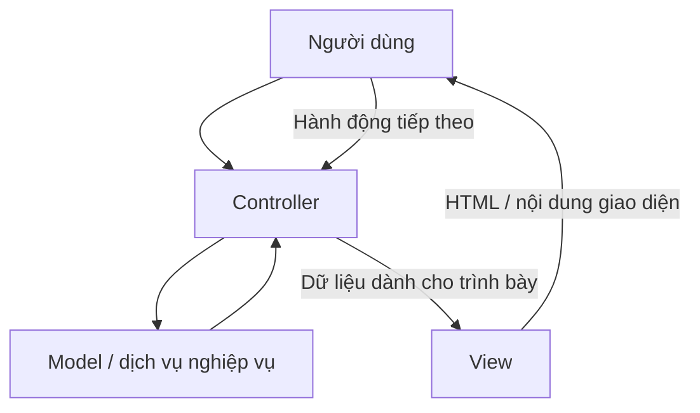
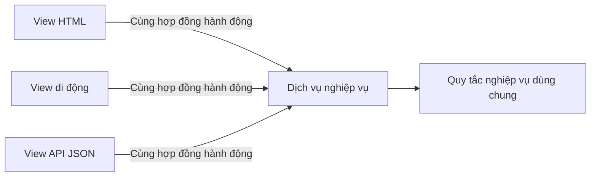

# Giữ View có thể thay đổi mà không làm đổi quy tắc nghiệp vụ

Trong kiến trúc Model–View–Controller (MVC), View chịu trách nhiệm trình bày thông tin và cung cấp cách người dùng tương tác với ứng dụng. Một giao diện có thể thay đổi màu sắc, bố cục, ngôn ngữ, công nghệ hiển thị hoặc cách sắp xếp dữ liệu mà không làm thay đổi quy tắc nghiệp vụ. Điều đó chỉ đạt được khi View nhận dữ liệu qua một hợp đồng rõ ràng và không tự sở hữu các quyết định nghiệp vụ.

Ví dụ, ứng dụng quản lý đơn hàng có thể hiển thị chi tiết đơn hàng bằng trang HTML, giao diện di động hoặc API JSON. Dù cách trình bày khác nhau, quy tắc như “chỉ đơn hàng ở trạng thái nháp mới được xác nhận” vẫn phải được thực thi tại Model hoặc lớp nghiệp vụ. View có thể hiển thị nút xác nhận khi ứng dụng cho biết thao tác đang khả dụng, nhưng việc gửi request trực tiếp vẫn phải được kiểm tra lại ở phía máy chủ.

## 1. Vai trò của View trong MVC

View nhận dữ liệu đã được chuẩn bị và chuyển dữ liệu đó thành nội dung mà người dùng có thể quan sát hoặc tương tác. Trong ứng dụng web, View có thể là template HTML, trang được dựng ở phía máy khách, một thành phần giao diện hoặc một định dạng biểu diễn khác.

View thường đảm nhiệm các việc sau:

- Hiển thị dữ liệu theo bố cục phù hợp với mục đích của màn hình.
- Định dạng ngày giờ, số tiền, số lượng và trạng thái để người dùng dễ hiểu.
- Hiển thị nhãn, thông báo, lỗi biểu mẫu và trạng thái rỗng.
- Cung cấp điều khiển giao diện như liên kết, nút bấm, biểu mẫu và bộ lọc.
- Thể hiện trạng thái tương tác như đang tải, đã lưu hoặc có lỗi.
- Hỗ trợ ngôn ngữ, khả năng truy cập và các kích thước màn hình khác nhau.

View không nên quyết định một hành động có hợp lệ theo nghiệp vụ hay không. Nó cũng không nên tự truy vấn cơ sở dữ liệu, tự cập nhật trạng thái đơn hàng hoặc tự thực hiện giao dịch. Những công việc đó thuộc các thành phần nghiệp vụ và lớp điều phối.



Controller nhận yêu cầu, gọi Model hoặc dịch vụ ứng dụng, rồi cung cấp dữ liệu cho View. View chỉ sử dụng dữ liệu đó để trình bày. Khi người dùng gửi một hành động tiếp theo, request quay lại Controller và được xử lý theo luồng nghiệp vụ tương ứng.

### Phân biệt Model nghiệp vụ và `Model` của Spring MVC

Trong Spring MVC, tham số `org.springframework.ui.Model` của một phương thức Controller là nơi chứa các thuộc tính để template sử dụng khi render. Nó không đồng nghĩa với toàn bộ Model nghiệp vụ của kiến trúc MVC.

Ví dụ:

```java
@GetMapping("/orders/{id}")
public String details(@PathVariable UUID id, Locale locale, Model model) {
    OrderDetailsView view = orderPresenter.present(orderQueryService.getDetails(id), locale);
    model.addAttribute("order", view);
    return "orders/details";
}
```

Ở đây, `Model` của Spring chỉ mang thuộc tính `order` sang template `orders/details`. Quy tắc nghiệp vụ vẫn nằm trong các thành phần nghiệp vụ được gọi thông qua `orderQueryService` và các đối tượng miền liên quan.

## 2. Vì sao View cần tách khỏi quy tắc nghiệp vụ?

Giao diện thay đổi thường xuyên vì nhu cầu sử dụng, nhận diện thương hiệu, thiết bị, ngôn ngữ hoặc công nghệ trình bày. Quy tắc nghiệp vụ thường thay đổi theo chính sách và yêu cầu vận hành của tổ chức. Hai loại thay đổi có lý do khác nhau.

Hãy xét quy tắc xác nhận đơn hàng:

> Một đơn hàng chỉ được xác nhận nếu đang ở trạng thái `DRAFT` và có ít nhất một dòng hàng.

Quy tắc này phải được giữ nguyên dù người dùng thực hiện hành động từ trang HTML, ứng dụng di động, API dành cho đối tác hay một tác vụ nội bộ. Nếu quy tắc được viết trong template, từng giao diện sẽ phải tự triển khai lại. Một giao diện mới có thể quên điều kiện, còn giao diện cũ có thể vẫn dùng quy tắc đã lỗi thời.

Khi quy tắc nằm trong Model hoặc dịch vụ nghiệp vụ:

- Các giao diện cùng sử dụng một hành vi nghiệp vụ thống nhất.
- Có thể thay template hoặc chuyển từ giao diện server-side sang client-side mà không viết lại quy tắc.
- Kiểm thử nghiệp vụ không cần khởi tạo giao diện.
- Nhóm phát triển giao diện có thể thay đổi bố cục và cách trình bày theo hợp đồng dữ liệu ổn định.
- Các lỗi nghiệp vụ được xử lý tập trung và có thể được ánh xạ khác nhau cho từng kênh giao tiếp.



Các View có thể trình bày khác nhau, nhưng đều gọi cùng ca sử dụng. Quy tắc không được nhân bản theo số lượng giao diện.

## 3. Phân biệt quy tắc nghiệp vụ và logic trình bày

Một số điều kiện xuất hiện trong View là hợp lý. Điều quan trọng là xác định điều kiện đó chỉ ảnh hưởng đến cách hiển thị hay quyết định tính hợp lệ của hành động.

| Tình huống | Thuộc về đâu? | Ví dụ |
|---|---|---|
| Định dạng số tiền theo đơn vị và locale | View hoặc presenter | `1.250.000 ₫` |
| Hiển thị ngày theo múi giờ của người dùng | View hoặc presenter | `19/11/2026` |
| Chọn nhãn và màu cho trạng thái | View hoặc presenter | `Đang xử lý` |
| Chia dữ liệu thành các nhóm để trình bày | View hoặc presenter | Nhóm đơn hàng theo tháng |
| Kiểm tra đơn hàng có đủ điều kiện xác nhận | Model / dịch vụ nghiệp vụ | Trạng thái phải là `DRAFT` và có dòng hàng |
| Tính số tiền phải thanh toán theo chính sách giảm giá | Model / dịch vụ nghiệp vụ | Áp dụng mức giảm hợp lệ và thuế |
| Kiểm tra người dùng có quyền hủy đơn hàng | Lớp bảo mật / policy nghiệp vụ | Chủ đơn hàng hoặc nhân viên có quyền phù hợp |
| Bảo đảm không hủy đơn hàng đã giao | Model / dịch vụ nghiệp vụ | Chặn chuyển trạng thái không hợp lệ |

### Điều kiện hiển thị không phải là hàng rào bảo mật

View có thể ẩn nút “Hủy đơn hàng” khi dữ liệu cho biết thao tác không khả dụng. Điều này giúp giao diện dễ dùng, nhưng người dùng vẫn có thể gửi request bằng công cụ khác hoặc gọi trực tiếp endpoint. Controller, lớp bảo mật và dịch vụ nghiệp vụ phải xác minh quyền cùng điều kiện trước khi thay đổi dữ liệu.

Tương tự, việc vô hiệu hóa nút gửi biểu mẫu khi trường còn trống giúp phản hồi nhanh, nhưng máy chủ vẫn phải kiểm tra dữ liệu đầu vào. Không được coi trạng thái giao diện là bằng chứng rằng request hợp lệ.

## 4. Dùng ViewModel để tạo hợp đồng trình bày ổn định

View không nên phụ thuộc trực tiếp vào cấu trúc nội bộ của entity hoặc đối tượng miền. Thay vào đó, Controller hoặc một thành phần chuyển đổi dữ liệu có thể tạo ViewModel (còn gọi là presentation model) chỉ chứa những thông tin mà màn hình cần.

Ví dụ, entity `Order` có thể chứa quan hệ với khách hàng, dòng hàng, lịch sử thay đổi, thông tin thanh toán và các trường kỹ thuật của ORM. Trang chi tiết đơn hàng chỉ cần mã đơn, tên khách hàng, tổng tiền, nhãn trạng thái và khả năng hiển thị các thao tác.

```java
public record OrderDetailsView(
    UUID id,
    String orderNumber,
    String customerName,
    String totalText,
    String statusLabel,
    boolean showConfirmAction,
    boolean showCancelAction
) {}
```

ViewModel được thiết kế theo nhu cầu trình bày. Nó không nhất thiết phải giống entity hoặc response DTO của API. Khi bố cục thay đổi, có thể thay đổi ViewModel hoặc presenter mà không cần thay đổi đối tượng miền.

### Ai tạo ViewModel?

Tùy quy mô ứng dụng, có thể tạo ViewModel ở Controller, presenter hoặc một lớp mapper. Với màn hình đơn giản, Controller có thể chuyển đổi trực tiếp. Khi logic định dạng, nhãn đa ngôn ngữ hoặc cấu trúc màn hình phức tạp hơn, tách presenter sẽ giúp Controller gọn và dễ kiểm thử.

Ví dụ kiểu dữ liệu truy vấn mà application service cung cấp:

```java
public record OrderDetailsData(
    UUID id,
    String orderNumber,
    String customerName,
    BigDecimal total,
    OrderStatus status,
    boolean canConfirm,
    boolean canCancel
) {}
```

Ví dụ presenter:

```java
@Component
@RequiredArgsConstructor
public class OrderDetailsPresenter {
    private final MessageSource messages;

    public OrderDetailsView present(OrderDetailsData data, Locale locale) {
        NumberFormat currency = NumberFormat.getCurrencyInstance(locale);
        currency.setCurrency(Currency.getInstance("VND"));

        String statusLabel = messages.getMessage(
            "order.status." + data.status().name(), null, locale
        );

        return new OrderDetailsView(
            data.id(),
            data.orderNumber(),
            data.customerName(),
            currency.format(data.total()),
            statusLabel,
            data.canConfirm(),
            data.canCancel()
        );
    }
}
```

`OrderDetailsData` là dữ liệu truy vấn được cung cấp bởi lớp ứng dụng. `canConfirm` và `canCancel` là thông tin về khả năng thao tác do ứng dụng tính theo chính sách hiện tại. Presenter chỉ chuyển dữ liệu thành nhãn và định dạng phù hợp với locale. Khi người dùng gửi thao tác, dịch vụ vẫn phải kiểm tra lại điều kiện vì trạng thái có thể đã thay đổi sau khi trang được tải.

### Controller cung cấp dữ liệu cho View

```java
@Controller
@RequiredArgsConstructor
@RequestMapping("/orders")
public class OrderPageController {
    private final OrderQueryService orderQueryService;
    private final OrderDetailsPresenter orderPresenter;

    @GetMapping("/{id}")
    public String details(
            @PathVariable UUID id,
            Locale locale,
            Model model) {

        OrderDetailsData data = orderQueryService.getDetails(id);
        model.addAttribute("order", orderPresenter.present(data, locale));
        return "orders/details";
    }
}
```

Controller nhận mã đơn hàng, gọi dịch vụ truy vấn, tạo ViewModel và chọn tên template. Nó không tự viết quy tắc xác nhận hoặc hủy đơn hàng. View chỉ nhận đối tượng `order` với các trường dành cho trình bày.

## 5. Ví dụ View bằng Thymeleaf

Template có thể sử dụng ViewModel để hiển thị nội dung:

```html
<main>
  <h1>Chi tiết đơn hàng</h1>

  <dl>
    <dt>Mã đơn hàng</dt>
    <dd th:text="${order.orderNumber}">ORD-001</dd>

    <dt>Khách hàng</dt>
    <dd th:text="${order.customerName}">Nguyễn An</dd>

    <dt>Tổng tiền</dt>
    <dd th:text="${order.totalText}">1.250.000 ₫</dd>

    <dt>Trạng thái</dt>
    <dd th:text="${order.statusLabel}">Đang xử lý</dd>
  </dl>

  <form th:if="${order.showConfirmAction}"
        th:action="@{/orders/{id}/confirm(id=${order.id})}"
        method="post">
    <button type="submit">Xác nhận đơn hàng</button>
  </form>

  <form th:if="${order.showCancelAction}"
        th:action="@{/orders/{id}/cancel(id=${order.id})}"
        method="post">
    <button type="submit">Hủy đơn hàng</button>
  </form>
</main>
```

Các biểu thức trong template chỉ đọc dữ liệu và quyết định có hiển thị một thành phần giao diện hay không. Template không tự tính tổng tiền, truy vấn dữ liệu hoặc thay đổi trạng thái. ViewModel có trường `id` riêng cho route và `orderNumber` để hiển thị, vì mã định danh nội bộ và mã đơn hàng người dùng nhìn thấy có thể khác nhau.

Một biểu thức như `th:if="${order.showConfirmAction}"` là quyết định hiển thị. Nó không thay thế kiểm tra quyền hoặc quy tắc trong endpoint xác nhận. Request POST vẫn cần được bảo vệ bằng xác thực, phân quyền, CSRF protection phù hợp và kiểm tra điều kiện nghiệp vụ.

## 6. Khi giao diện thay đổi, điều gì nên thay đổi?

Tách View khỏi nghiệp vụ giúp các thay đổi trình bày tập trung ở lớp trình bày và hợp đồng dữ liệu dành cho nó.

| Yêu cầu thay đổi | Phần thường cần thay đổi | Phần nên giữ ổn định |
|---|---|---|
| Đổi màu sắc, font và bố cục | CSS, component hoặc template | Quy tắc miền và ca sử dụng |
| Chuyển từ Thymeleaf sang React | View, adapter giao tiếp và cách cung cấp dữ liệu | Hành vi nghiệp vụ |
| Thêm giao diện di động | ViewModel và bố cục dành cho thiết bị | Quy tắc xác nhận/hủy đơn hàng |
| Thêm ngôn ngữ mới | Message bundle, nhãn và định dạng locale | Trạng thái và quy tắc đơn hàng |
| Hiển thị thêm trường trên trang | Query/ViewModel/template | Quy tắc miền nếu trường chỉ phục vụ trình bày |
| Thay đổi điều kiện được phép xác nhận | Model hoặc policy nghiệp vụ, cùng kiểm thử | Cấu trúc giao diện nếu không cần thay đổi nội dung hiển thị |

Không phải mọi thay đổi giao diện đều hoàn toàn không ảnh hưởng đến Controller hoặc hợp đồng dữ liệu. Ví dụ, thêm một biểu đồ có thể cần bổ sung dữ liệu truy vấn hoặc ViewModel. Điều quan trọng là thay đổi đó không buộc phải sao chép hay viết lại quy tắc nghiệp vụ.

### Nhiều View cho cùng một nghiệp vụ

Một ca sử dụng có thể có nhiều cách trình bày:

- Trang HTML hiển thị thông tin chi tiết cho khách hàng.
- Giao diện quản trị hiển thị thêm lịch sử và thông tin vận hành.
- Ứng dụng di động hiển thị các hành động phù hợp với màn hình nhỏ.
- API trả JSON cho hệ thống tích hợp.
- Báo cáo xuất PDF hoặc CSV phục vụ nghiệp vụ nội bộ.

Mỗi View có thể dùng một ViewModel hoặc response DTO riêng. Chúng cùng gọi các ca sử dụng và tuân theo cùng quy tắc miền. Không nên trả toàn bộ entity ra mọi giao diện chỉ để tránh viết mapper; việc đó dễ làm lộ dữ liệu nội bộ và khiến hợp đồng bên ngoài phụ thuộc cấu trúc lưu trữ.

## 7. Xử lý biểu mẫu và lỗi mà không đưa nghiệp vụ vào View

View có thể hiển thị biểu mẫu, gợi ý định dạng và lỗi để người dùng sửa dữ liệu. Cần phân biệt hai nhóm kiểm tra:

- **Kiểm tra đầu vào ở biên giao tiếp:** trường bắt buộc, độ dài, kiểu dữ liệu, định dạng email hoặc ngày tháng. Có thể dùng validation annotation và hiển thị lỗi ngay cạnh trường tương ứng.
- **Kiểm tra nghiệp vụ:** đơn hàng có được phép thay đổi địa chỉ sau khi giao hay không, tài khoản có đủ quyền thực hiện hành động hay không, số lượng đặt có đáp ứng quy tắc tồn kho hay không. Các điều kiện này phải được kiểm tra trong lớp nghiệp vụ.

Ví dụ, biểu mẫu có thể yêu cầu người dùng nhập ghi chú xác nhận:

```java
public record ConfirmOrderForm(
    @Size(max = 300, message = "Ghi chú không được vượt quá 300 ký tự")
    String note
) {}
```

Controller nhận và chuyển dữ liệu sang ca sử dụng:

```java
@PostMapping("/{id}/confirm")
public String confirm(
        @PathVariable UUID id,
        @Valid @ModelAttribute("form") ConfirmOrderForm form,
        BindingResult errors,
        @AuthenticationPrincipal AppPrincipal principal,
        RedirectAttributes redirectAttributes) {

    if (errors.hasErrors()) {
        return "orders/confirm";
    }

    orderApplicationService.confirm(id, principal.userId(), form.note());
    redirectAttributes.addFlashAttribute("message", "Đã gửi yêu cầu xác nhận");
    return "redirect:/orders/" + id;
}
```

Đoạn mã minh họa việc kiểm tra cấu trúc biểu mẫu và điều phối ca sử dụng. Dịch vụ vẫn cần xác minh đơn hàng còn ở trạng thái có thể xác nhận tại thời điểm xử lý. Nếu quy tắc nghiệp vụ không thỏa mãn, Controller hoặc bộ xử lý lỗi ánh xạ lỗi đó thành thông báo phù hợp để View hiển thị.

Không nên đưa thông báo lỗi kỹ thuật, câu SQL hoặc stack trace vào View. Hãy cung cấp thông báo rõ ràng cho người dùng, đồng thời ghi log chi tiết ở phía máy chủ theo chính sách của ứng dụng.

## 8. Bảo mật và chất lượng trình bày

Tách View khỏi nghiệp vụ không làm giảm yêu cầu bảo mật của giao diện. Một View tốt cần bảo vệ dữ liệu và cung cấp trải nghiệm rõ ràng:

- **Mã hóa đầu ra:** dùng cơ chế escape theo ngữ cảnh của template để dữ liệu người dùng không bị diễn giải thành HTML hoặc JavaScript. Tránh chèn chuỗi chưa tin cậy vào HTML thô.
- **Không lộ dữ liệu nội bộ:** chỉ đưa các trường cần hiển thị vào ViewModel; không gửi mật khẩu, token, thông tin nhạy cảm hoặc trường nội bộ của entity ra giao diện.
- **Bảo vệ thao tác thay đổi trạng thái:** dùng xác thực, phân quyền, CSRF protection cho biểu mẫu phù hợp và kiểm tra lại quy tắc tại máy chủ.
- **Khả năng truy cập:** dùng nhãn cho trường biểu mẫu, cấu trúc heading hợp lý, thông báo lỗi có thể nhận biết bằng công nghệ hỗ trợ và điều khiển dùng được bằng bàn phím.
- **Đa ngôn ngữ:** đặt nhãn và thông báo trong message bundle; định dạng ngày, số và tiền theo locale thay vì gắn chuỗi cố định vào quy tắc miền.
- **Thiết kế đáp ứng:** bố cục có thể thích nghi với điện thoại, máy tính bảng và màn hình lớn mà không làm thay đổi hành vi nghiệp vụ.

Ví dụ, nếu một khách hàng không được phép xem ghi chú nội bộ, Controller/query service phải loại dữ liệu đó khỏi ViewModel theo quyền truy cập. Ẩn phần tử bằng CSS hoặc `th:if` không đủ để bảo vệ dữ liệu nếu thông tin vẫn được gửi xuống trình duyệt.

## 9. Kiểm thử View độc lập với nghiệp vụ

Tách trách nhiệm cho phép kiểm thử từng lớp theo mục tiêu riêng:

| Loại kiểm thử | Nội dung cần xác minh | Ví dụ |
|---|---|---|
| Unit test nghiệp vụ | Quy tắc vẫn đúng khi không có giao diện | Đơn hàng đã hủy không thể xác nhận |
| Unit test presenter/mapper | Dữ liệu được định dạng và ánh xạ đúng | Tổng tiền hiển thị theo locale, trạng thái có nhãn phù hợp |
| Kiểm thử Controller | Request được chuyển đúng và chọn View/response phù hợp | Mã đơn hàng được truyền vào query service |
| Kiểm thử template | Các trường và trạng thái giao diện được render đúng | Hiển thị tên khách hàng và thông báo lỗi |
| Kiểm thử tích hợp | Luồng request đến nghiệp vụ và phản hồi hoạt động cùng nhau | Gửi biểu mẫu hợp lệ làm thay đổi trạng thái và chuyển hướng |
| Kiểm thử bảo mật giao diện | Dữ liệu không tin cậy được escape và dữ liệu riêng tư không bị lộ | Chuỗi HTML trong tên khách hàng hiển thị như văn bản |

Ví dụ unit test cho quy tắc miền không cần biết View đang dùng Thymeleaf hay React:

```java
@Test
void cannotConfirmCancelledOrder() {
    // Hàm fixture tạo một đơn hàng có trạng thái CANCELLED.
    Order order = anOrderWithStatus(OrderStatus.CANCELLED);

    assertThrows(InvalidOrderStateException.class,
        () -> order.confirm(Instant.parse("2026-11-19T10:00:00Z")));
}
```

Presenter có thể được kiểm thử riêng bằng dữ liệu truy vấn mẫu. Kiểm thử template nên tập trung vào cấu trúc quan trọng, trường dữ liệu, liên kết và thông báo. Tránh phụ thuộc quá mức vào toàn bộ HTML sinh ra nếu một thay đổi nhỏ về khoảng trắng hoặc cấu trúc không ảnh hưởng đến hành vi người dùng.

## 10. Những dấu hiệu View đang chứa quá nhiều nghiệp vụ

| Dấu hiệu | Vấn đề | Hướng cải thiện |
|---|---|---|
| Template tự tính giá hoặc giảm giá | Quy tắc bị gắn với cách hiển thị | Tính trong Model/dịch vụ nghiệp vụ; View chỉ định dạng kết quả |
| Template kiểm tra trạng thái để quyết định request có hợp lệ không | Quy tắc không được bảo vệ khi endpoint được gọi trực tiếp | Kiểm tra trong Model hoặc policy nghiệp vụ |
| View truy vấn repository hoặc gọi trực tiếp cơ sở dữ liệu | Lớp trình bày phụ thuộc hạ tầng và khó kiểm thử | Controller/application service cung cấp dữ liệu |
| Nhiều View tự triển khai cùng một quy tắc | Các giao diện có thể cho kết quả khác nhau | Tập trung quy tắc trong một ca sử dụng hoặc đối tượng miền |
| View nhận toàn bộ entity và quan hệ ORM | Có thể lộ dữ liệu và tạo phụ thuộc vào cấu trúc lưu trữ | Dùng ViewModel/DTO phù hợp |
| Template chứa nhiều biểu thức lồng nhau để xử lý nghiệp vụ | Khó đọc và khó thay đổi | Chuyển việc chuẩn bị dữ liệu sang presenter hoặc application service |

Một template có điều kiện không mặc nhiên là sai. Ví dụ, `th:if` để ẩn phần mô tả khi dữ liệu không có là logic trình bày. Vấn đề xuất hiện khi template trở thành nơi quyết định quyền, giá trị giao dịch, tính hợp lệ của chuyển trạng thái hoặc những điều kiện phải đúng với mọi kênh truy cập.

## 11. Checklist giữ View độc lập

- View có nhận dữ liệu đã được chuẩn bị qua một hợp đồng rõ ràng không?
- ViewModel có chỉ chứa dữ liệu cần cho màn hình hoặc định dạng đầu ra không?
- Quy tắc nghiệp vụ có được thực thi ở Model hoặc dịch vụ nghiệp vụ không?
- Controller có tập trung vào tiếp nhận request, điều phối và chọn phản hồi không?
- View có tránh truy vấn cơ sở dữ liệu và cập nhật trực tiếp trạng thái nghiệp vụ không?
- Các điều kiện hiển thị có được xem là hỗ trợ trải nghiệm thay vì cơ chế phân quyền không?
- Dữ liệu đầu ra có được escape và giới hạn theo quyền truy cập không?
- Nhãn, định dạng, khả năng truy cập và bố cục có thể thay đổi mà không sửa quy tắc nghiệp vụ không?
- Có kiểm thử riêng cho nghiệp vụ, presenter, Controller, template và luồng tích hợp không?

## Kết luận

Giữ View độc lập nghĩa là để View tập trung vào trình bày và tương tác, nhận dữ liệu qua ViewModel hoặc hợp đồng phản hồi phù hợp. Controller điều phối request và cung cấp dữ liệu; Model cùng dịch vụ nghiệp vụ bảo vệ quy tắc và trạng thái của ứng dụng. Nhờ ranh giới này, nhóm phát triển có thể thay đổi template, bố cục, ngôn ngữ, thiết bị hoặc công nghệ giao diện mà không phải sao chép hay viết lại quy tắc nghiệp vụ.
