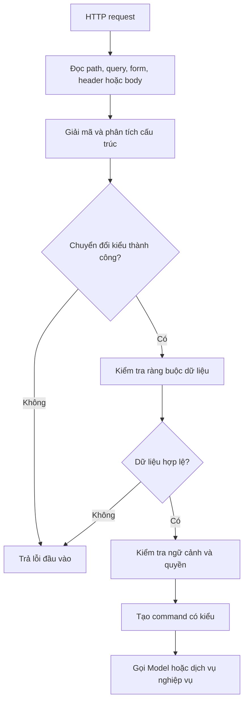

# Đọc đầu vào và chuyển đổi sang dữ liệu có kiểu

Trong MVC, Controller là ranh giới tiếp nhận tương tác từ bên ngoài ứng dụng. Với ứng dụng web, dữ liệu thường đến dưới dạng chuỗi trong URL, query string, header hoặc biểu mẫu; nội dung JSON có thể chứa số, chuỗi, giá trị boolean, mảng và đối tượng. Model và dịch vụ nghiệp vụ cần nhận dữ liệu có kiểu và ý nghĩa rõ ràng, chẳng hạn `long taskId`, `LocalDate dueDate` hoặc một lệnh `CreateTaskCommand`.

Vì vậy, Controller cần đọc đầu vào, chuyển biểu diễn bên ngoài thành kiểu dữ liệu mà ứng dụng hiểu, kiểm tra dữ liệu và chỉ sau đó mới gọi nghiệp vụ. Việc chuyển đổi đúng giúp mã xử lý dễ đọc, phát hiện lỗi sớm và tránh để quy tắc miền phải xử lý những chuỗi thô không đáng tin cậy.

## Đầu vào của Controller đến từ đâu?

Một HTTP request có thể mang dữ liệu ở nhiều vị trí. Mỗi vị trí có mục đích và quy tắc giải mã riêng:

| Nguồn đầu vào | Ví dụ | Kiểu dữ liệu thường cần |
|---|---|---|
| Path variable | `/tasks/42` | `TaskId`, `long`, `UUID` |
| Query parameter | `/tasks?page=2&active=true` | `int`, `boolean`, enum, bộ lọc |
| Form field | `title=Viết tài liệu` | Form object hoặc command |
| JSON body | `{"title":"Viết tài liệu"}` | DTO/request object |
| Header | `If-Match`, `Accept-Language` | Chuỗi đã phân tích theo hợp đồng header |
| Cookie hoặc session | mã phiên, tùy chọn giao diện | Kiểu dữ liệu phiên hoặc giá trị đã xác thực |
| Multipart upload | tệp và metadata | `MultipartFile`, metadata có kiểu |

Controller cần biết dữ liệu nào là bắt buộc, dữ liệu nào có thể vắng mặt, định dạng được chấp nhận và giới hạn kích thước. Không nên mặc định mọi giá trị do trình duyệt gửi lên đều hợp lệ hoặc đáng tin cậy. Client có thể gửi request trực tiếp mà không dùng giao diện do ứng dụng cung cấp.

## Từ biểu diễn bên ngoài đến dữ liệu có kiểu

Đầu vào HTTP thường là biểu diễn văn bản hoặc byte. Ví dụ, path `/tasks/42` chứa chuỗi `"42"`; để gọi nghiệp vụ, ứng dụng cần chuyển chuỗi đó thành một số nguyên hoặc kiểu định danh `TaskId`. Tương tự, `"2026-12-01"` cần được phân tích thành `LocalDate` nếu hợp đồng quy định ngày theo định dạng ISO.

Một luồng xử lý đầu vào thường gồm các bước:

1. **Tiếp nhận:** đọc path variable, query parameter, form field, header hoặc body.
2. **Giải mã:** chuyển byte theo charset và content type; phân tích JSON hoặc dữ liệu biểu mẫu.
3. **Chuẩn hóa có chủ đích:** loại bỏ khoảng trắng ở trường văn bản nếu hợp đồng cho phép, chuẩn hóa định dạng hoặc quy ước chữ hoa/thường khi phù hợp.
4. **Chuyển đổi kiểu:** phân tích số, ngày, boolean, enum, UUID hoặc tạo request object.
5. **Kiểm tra dữ liệu:** kiểm tra trường bắt buộc, độ dài, khoảng giá trị, định dạng và quan hệ giữa các trường.
6. **Kiểm tra ngữ cảnh và quyền:** xác định người dùng hiện tại, quyền thực hiện và các điều kiện phụ thuộc trạng thái hiện tại.
7. **Tạo lệnh nghiệp vụ:** chuyển dữ liệu đã được chấp nhận thành command hoặc tham số có ý nghĩa để gọi Model/dịch vụ.



Các bước có thể được framework thực hiện tự động qua argument resolver, data binder, JSON deserializer và validation framework. Dù tự động hay viết tường minh, ứng dụng vẫn cần xác định hợp đồng và cách xử lý lỗi.

## Phân biệt chuyển đổi, validation và quy tắc nghiệp vụ

Ba loại kiểm tra này có liên quan nhưng không giống nhau:

| Giai đoạn | Câu hỏi cần trả lời | Ví dụ |
|---|---|---|
| Chuyển đổi kiểu | Giá trị có thể được biểu diễn bằng kiểu đích không? | `"42"` có chuyển thành `long` được không? |
| Validation đầu vào | Giá trị có đáp ứng ràng buộc của request không? | `page` có lớn hơn 0 và không vượt giới hạn không? |
| Kiểm tra nghiệp vụ | Hành động có hợp lệ trong ngữ cảnh hiện tại không? | Người dùng có được sửa công việc này và công việc có đang bị khóa không? |

Ví dụ, chuỗi `"-5"` chuyển thành `int` thành công, nhưng có thể không hợp lệ với trường `page`. Ngày `"2026-02-30"` không thể chuyển thành `LocalDate` vì không tồn tại trong lịch. Một ngày hợp lệ vẫn có thể vi phạm quy tắc nghiệp vụ nếu thời hạn phải nằm trong thời gian dự án được phép hoạt động.

Không nên dồn tất cả vào một câu lệnh parse hoặc một annotation. Tách các bước giúp ứng dụng trả thông báo đúng nguyên nhân và đặt quy tắc ở đúng nơi.

## Thiết kế dữ liệu đầu vào có kiểu

### Số nguyên và số thập phân

Dùng `int` hoặc `long` cho số đếm, số lượng và định danh số khi phạm vi giá trị phù hợp. Phải kiểm tra trường hợp tràn số và giới hạn nghiệp vụ. Không nên parse một số rất lớn vào kiểu nhỏ rồi để lỗi xuất hiện sâu trong nghiệp vụ.

Với tiền tệ hoặc giá trị thập phân cần độ chính xác, Java thường dùng `BigDecimal` thay vì `float` hoặc `double`. Kiểu dấu phẩy động nhị phân có thể biểu diễn một số thập phân quen thuộc bằng giá trị gần đúng, gây sai số trong phép tính tài chính.

```java
import java.math.BigDecimal;

int quantity = Integer.parseInt("12");
long taskId = Long.parseLong("42");
BigDecimal amount = new BigDecimal("125000.50");
```

Nên tạo `BigDecimal` từ chuỗi đầu vào đã được kiểm tra định dạng, tránh tạo từ một giá trị `double` đã có sai số. Quy tắc làm tròn, số chữ số thập phân và đơn vị tiền tệ cần được quy định rõ trong nghiệp vụ.

### Ngày, giờ và múi giờ

Chọn kiểu thời gian theo ý nghĩa dữ liệu:

- `LocalDate` cho ngày lịch không gắn với thời điểm cụ thể, ví dụ ngày đến hạn.
- `LocalTime` cho giờ trong ngày không gắn với ngày hoặc múi giờ.
- `LocalDateTime` cho ngày giờ địa phương khi hợp đồng thực sự không mang thông tin múi giờ; cần thận trọng khi dùng nó cho sự kiện toàn cầu.
- `Instant` cho một thời điểm tuyệt đối trên dòng thời gian.
- `OffsetDateTime` hoặc `ZonedDateTime` khi cần giữ offset hoặc vùng múi giờ.

Ví dụ, `2026-12-01` phù hợp với `LocalDate`. Một thời điểm như `2026-12-01T09:30:00+07:00` có offset và có thể được phân tích thành `OffsetDateTime`. Không nên tự giả định mọi thời gian nhận được đều thuộc múi giờ máy chủ.

### Boolean và giá trị mặc định

Boolean trong query string có thể được gửi dưới nhiều dạng tùy hợp đồng. Hãy công bố dạng chấp nhận, ví dụ chỉ cho phép `true` và `false`, thay vì tự hiểu các chuỗi như `"yes"`, `"1"` hoặc `"on"` nếu API chưa quy định.

Đặc biệt, cần phân biệt trường bị thiếu với trường có giá trị `false`. Với form cập nhật, trường checkbox không được gửi khi bỏ chọn; nếu dùng kiểu boolean nguyên thủy, ứng dụng có thể không phân biệt được “người dùng gửi false” với “trường không xuất hiện”. Có thể dùng wrapper `Boolean`, một request object có trạng thái hiện diện, hoặc quy ước rõ ràng theo loại thao tác.

Không nên áp giá trị mặc định một cách âm thầm nếu điều đó làm thay đổi ý nghĩa request. Ví dụ, query thiếu `page` có thể dùng trang đầu theo hợp đồng; nhưng trường `approved` bị thiếu không nên tự chuyển thành `false` hoặc `true` nếu nghiệp vụ cần biết người dùng có chủ ý gửi trường đó hay không.

### Enum và tập giá trị được phép

Với trường chỉ chấp nhận một tập giá trị hữu hạn, enum giúp loại bỏ chuỗi tùy ý:

```java
public enum TaskPriority {
    LOW,
    NORMAL,
    HIGH
}
```

Khi nhận `priority=HIGH`, Controller hoặc binder có thể chuyển thành `TaskPriority.HIGH`. Nếu nhận `URGENT` mà enum không hỗ trợ, request cần bị từ chối với lỗi rõ ràng. Không nên dùng `Enum.valueOf` mà không bắt và ánh xạ lỗi phù hợp, cũng không nên tự chấp nhận giá trị gần giống nếu hợp đồng không cho phép.

### Định danh và kiểu miền

Một giá trị số có thể là số lượng, số trang hoặc mã định danh. Dùng cùng kiểu `long` cho tất cả khiến mã dễ truyền nhầm tham số. Với miền nghiệp vụ lớn, có thể tạo kiểu định danh riêng như `TaskId` hoặc `UserId` để tăng tính rõ nghĩa và ngăn nhầm lẫn.

```java
public record TaskId(long value) {
    public TaskId {
        if (value <= 0) {
            throw new IllegalArgumentException("TaskId phải lớn hơn 0");
        }
    }
}
```

Việc parse chuỗi thành `TaskId` có thể được đặt trong converter hoặc một hàm chuyển đổi chuyên biệt. Nhờ đó, các phương thức nghiệp vụ nhận kiểu định danh đã có ý nghĩa thay vì một số bất kỳ.

### Danh sách, tập hợp và giá trị lặp

Query string có thể chứa nhiều giá trị, ví dụ `?status=OPEN&status=IN_PROGRESS`. Hãy xác định endpoint chấp nhận một giá trị hay nhiều giá trị, có cho phép trùng lặp không, thứ tự có quan trọng không và giới hạn số phần tử là bao nhiêu.

Không nên nhận danh sách không giới hạn. Một request có hàng chục nghìn ID hoặc bộ lọc có thể tiêu tốn bộ nhớ và làm tăng chi phí truy vấn. Hãy giới hạn số phần tử, kiểm tra từng phần tử và cân nhắc giới hạn độ dài URL/body.

## Dùng Form Object hoặc Request DTO

Không nên truyền một tập tham số rời rạc cho mọi phương thức Controller khi chúng tạo thành một yêu cầu có ý nghĩa. Form object hoặc request DTO gom các trường liên quan, mô tả hợp đồng đầu vào và cung cấp vị trí để khai báo validation.

Ví dụ một form tạo công việc:

```java
import jakarta.validation.constraints.NotBlank;
import jakarta.validation.constraints.Size;
import org.springframework.format.annotation.DateTimeFormat;

import java.time.LocalDate;

public class CreateTaskForm {
    @NotBlank
    @Size(max = 120)
    private String title;

    @DateTimeFormat(iso = DateTimeFormat.ISO.DATE)
    private LocalDate dueDate;

    private TaskPriority priority = TaskPriority.NORMAL;

    public String getTitle() {
        return title;
    }

    public void setTitle(String title) {
        this.title = title;
    }

    public LocalDate getDueDate() {
        return dueDate;
    }

    public void setDueDate(LocalDate dueDate) {
        this.dueDate = dueDate;
    }

    public TaskPriority getPriority() {
        return priority;
    }

    public void setPriority(TaskPriority priority) {
        this.priority = priority;
    }
}
```

Controller nhận form object và kiểm tra lỗi binding/validation:

```java
@PostMapping("/tasks")
public String create(
        @Valid @ModelAttribute("form") CreateTaskForm form,
        BindingResult errors) {

    if (errors.hasErrors()) {
        return "tasks/new";
    }

    CreateTaskCommand command = new CreateTaskCommand(
            form.getTitle().trim(),
            form.getDueDate(),
            form.getPriority());

    taskService.create(command);
    return "redirect:/tasks";
}
```

Trong Spring MVC, data binder chuyển các giá trị request thành thuộc tính có kiểu. `@DateTimeFormat` chỉ định định dạng ngày cho trường; `@Valid` kích hoạt kiểm tra các ràng buộc Bean Validation. `BindingResult` cần đứng ngay sau tham số được validate để Controller có thể kiểm tra lỗi và trả lại biểu mẫu. Nếu một chuỗi không thể chuyển thành `LocalDate`, binder ghi nhận lỗi kiểu dữ liệu; nếu ngày chuyển đổi được nhưng vi phạm một ràng buộc, validation ghi nhận lỗi tương ứng.

Đoạn mã là ví dụ minh họa. Ứng dụng cần định nghĩa `CreateTaskCommand`, `taskService`, các annotation Spring và validation dependency tương ứng. Khi dữ liệu hợp lệ, Controller chuyển sang command có ý nghĩa nghiệp vụ; Model không cần biết form HTML được gửi với tên trường nào.

## Cấu hình binding có kiểm soát trong Spring MVC

Data binding rất tiện lợi nhưng cần giới hạn những trường được phép bind. Nếu binder tự động ghi mọi thuộc tính có setter vào một đối tượng, client có thể cố gửi thêm `ownerId`, `approved` hoặc `role`. Đây là một dạng rủi ro mass assignment.

Có thể giới hạn các trường được phép bind:

```java
@InitBinder("form")
void configureTaskFormBinder(WebDataBinder binder) {
    binder.setAllowedFields("title", "dueDate", "priority");
}
```

Tên trong `@InitBinder` cần khớp với tên model attribute. Chỉ cho phép các trường mà form thực sự hỗ trợ. Với request DTO riêng và danh sách trường nhỏ, việc thiết kế DTO giới hạn trường vẫn là lớp bảo vệ quan trọng; không nên dựa duy nhất vào cấu hình binder.

## Nhận và chuyển đổi JSON body

Với endpoint API, dữ liệu thường nằm trong JSON body. Framework dùng message converter để giải mã JSON thành request DTO. Ví dụ:

```java
public record CreateTaskRequest(
        @NotBlank @Size(max = 120) String title,
        TaskPriority priority) {
}
```

```java
@PostMapping(
        path = "/api/tasks",
        consumes = MediaType.APPLICATION_JSON_VALUE)
public ResponseEntity<TaskResponse> create(
        @Valid @RequestBody CreateTaskRequest request) {

    TaskResponse created = taskService.create(
            new CreateTaskCommand(request.title(), request.priority()));
    return ResponseEntity.status(HttpStatus.CREATED).body(created);
}
```

JSON không đúng cú pháp hoặc không ánh xạ được kiểu có thể bị từ chối trước khi phương thức Controller chạy. Dữ liệu JSON hợp lệ về cú pháp vẫn cần validation và kiểm tra nghiệp vụ. Cần thống nhất `Content-Type`, định dạng ngày, quy ước tên trường, cách xử lý trường lạ và cấu trúc response lỗi giữa server và client.

## Chuyển đổi kiểu tùy chỉnh

Các kiểu miền như `TaskId`, `EmailAddress` hoặc `OrderNumber` có thể cần converter riêng để framework chuyển từ chuỗi sang kiểu tương ứng. Một converter nên có trách nhiệm rõ ràng: parse định dạng, tạo kiểu đích và báo lỗi nếu giá trị không hợp lệ.

Ví dụ với Spring:

```java
import org.springframework.core.convert.converter.Converter;

public class StringToTaskIdConverter implements Converter<String, TaskId> {
    @Override
    public TaskId convert(String source) {
        try {
            return new TaskId(Long.parseLong(source));
        } catch (NumberFormatException ex) {
            throw new IllegalArgumentException("Mã công việc phải là số nguyên", ex);
        }
    }
}
```

Trong ứng dụng thực tế, converter cần được đăng ký với hệ thống conversion của Spring. Lỗi chuyển đổi nên được ánh xạ thành thông báo đầu vào phù hợp, không để exception nội bộ lộ ra response. Nếu `TaskId` có quy tắc phạm vi, constructor hoặc factory của kiểu đó tiếp tục bảo vệ điều kiện như giá trị phải lớn hơn 0.

Không nên tạo converter riêng cho mọi chuỗi đơn giản. Chỉ tạo kiểu miền và converter khi nó giúp thể hiện ý nghĩa, tái sử dụng quy tắc hoặc tránh truyền nhầm dữ liệu.

## Chuẩn hóa dữ liệu mà không làm mất ý nghĩa

Chuẩn hóa có thể giúp dữ liệu nhất quán, nhưng không nên thay đổi đầu vào tùy tiện:

- Có thể `trim()` khoảng trắng ở đầu/cuối của trường tên hoặc tiêu đề nếu nghiệp vụ quy định như vậy.
- Không tự xóa khoảng trắng bên trong văn bản nếu nó có ý nghĩa.
- Không tự đổi chữ hoa/thường với mật khẩu, token hoặc mã phân biệt chữ hoa/thường.
- Không tự chuyển dấu phẩy thành dấu chấm trong số thập phân nếu hợp đồng API không quy định locale đó.
- Không tự sửa ngày sai hoặc giá trị enum không tồn tại để “đoán” ý định người dùng.
- Với email hoặc định danh, chuẩn hóa phải dựa trên quy tắc đã chọn và được áp dụng nhất quán ở mọi điểm nhập dữ liệu.

API máy-máy nên ưu tiên định dạng ổn định, độc lập locale, chẳng hạn ngày ISO-8601 và số theo quy ước JSON. Biểu mẫu dành cho người dùng có thể hỗ trợ định dạng địa phương, nhưng việc chuyển đổi phải được khai báo rõ để tránh hiểu nhầm `1,234` là một nghìn hai trăm ba mươi tư hay một phẩy hai ba bốn.

## Phản hồi lỗi đầu vào

Lỗi đầu vào cần chỉ rõ trường nào có vấn đề và cách sửa, trong giới hạn không tiết lộ thông tin nội bộ. Có thể phân loại:

| Loại lỗi | Ví dụ | Cách phản hồi thường dùng |
|---|---|---|
| Thiếu trường bắt buộc | Không gửi `title` | Lỗi gắn với trường hoặc response 400 |
| Sai định dạng | `dueDate=ngaymai` | Thông báo định dạng ngày không hợp lệ |
| Sai kiểu hoặc tràn số | `page=abc`, số vượt giới hạn `long` | Lỗi chuyển đổi, không gọi nghiệp vụ |
| Vi phạm ràng buộc | Tiêu đề dài hơn giới hạn | Thông báo validation |
| Vi phạm quy tắc miền | Thời hạn nằm ngoài thời gian dự án | Lỗi nghiệp vụ được ánh xạ riêng |

Với biểu mẫu HTML, Controller thường trả lại View cùng giá trị đã nhập và lỗi theo trường để người dùng sửa. Với API, nên dùng cấu trúc lỗi ổn định, có mã lỗi và thông tin trường khi thích hợp. Một số API dùng 400 cho request không thể phân tích hoặc không hợp lệ, 401/403 cho vấn đề xác thực và quyền, 404 cho tài nguyên không tồn tại; 422 có thể được dùng cho nội dung có cú pháp hợp lệ nhưng không thỏa điều kiện xử lý nếu hợp đồng API quy định như vậy. Điều quan trọng là dùng nhất quán.

Không nên trả stack trace, tên lớp nội bộ, câu SQL hoặc dữ liệu nhạy cảm. Hãy ghi log ở phía máy chủ với mã tương quan phù hợp để có thể điều tra mà không đưa chi tiết đó cho client.

## Bảo mật khi đọc và chuyển đổi đầu vào

Chuyển đổi kiểu và validation là một phần của bảo vệ đầu vào, nhưng không thay thế các biện pháp bảo mật khác:

- **Giới hạn kích thước:** đặt giới hạn cho body, độ dài chuỗi, số phần tử trong danh sách và kích thước tệp tải lên.
- **Chống mass assignment:** chỉ nhận các trường được phép qua DTO/form object; không bind trực tiếp request vào entity có thuộc tính nhạy cảm.
- **Phân quyền phía máy chủ:** không tin `userId`, `ownerId`, `isAdmin` hoặc `approved` do client gửi. Lấy danh tính từ ngữ cảnh đã xác thực và kiểm tra quyền trên tài nguyên.
- **Truy vấn an toàn:** dùng parameter binding hoặc API truy vấn có tham số; không ghép chuỗi đầu vào thành SQL.
- **Đường dẫn và tên tệp:** không dùng trực tiếp tên tệp hoặc đường dẫn client gửi để truy cập hệ thống tệp; chuẩn hóa và giới hạn vị trí lưu trữ.
- **Mã hóa đầu ra:** validation đầu vào không loại bỏ nhu cầu mã hóa dữ liệu khi hiển thị HTML. Dữ liệu hợp lệ vẫn có thể chứa ký tự đặc biệt.
- **Bảo vệ request thay đổi trạng thái:** với ứng dụng dùng session/cookie, áp dụng cơ chế CSRF phù hợp; kiểm tra này là trách nhiệm bảo vệ request, không phải bước parse kiểu.

Mục tiêu là tạo dữ liệu có kiểu và đáng tin cậy trong phạm vi hợp đồng đã định, đồng thời giữ các quyết định quyền và quy tắc miền ở phía máy chủ.

## Kiểm thử quá trình chuyển đổi đầu vào

Nên kiểm thử cả trường hợp hợp lệ lẫn dữ liệu lỗi tại ranh giới Controller:

1. **Kiểm thử chuyển đổi:** chuỗi số hợp lệ, chuỗi không phải số, số âm, số vượt giới hạn; ngày hợp lệ và ngày không tồn tại; enum được hỗ trợ và enum không tồn tại.
2. **Kiểm thử validation:** thiếu trường bắt buộc, chuỗi rỗng, độ dài vượt giới hạn, giá trị ngoài khoảng và danh sách quá dài.
3. **Kiểm thử binding:** trường được phép được ánh xạ đúng; trường không được phép không thể ghi đè dữ liệu nhạy cảm.
4. **Kiểm thử phản hồi lỗi:** lỗi gắn đúng trường, status code đúng hợp đồng và response không lộ thông tin nội bộ.
5. **Kiểm thử tích hợp:** gửi request thực qua framework để xác minh content type, message converter, data binder và validation hoạt động như dự kiến.

Ví dụ ma trận kiểm thử cho form tạo công việc:

| Đầu vào | Kết quả mong đợi |
|---|---|
| `title=Viết tài liệu`, `priority=HIGH` | Chuyển đổi thành công và gọi dịch vụ |
| `title` chỉ chứa khoảng trắng | Lỗi validation, không gọi dịch vụ |
| `dueDate=2026-12-01` | Chuyển thành `LocalDate` |
| `dueDate=2026-02-30` | Lỗi chuyển đổi ngày |
| `priority=URGENT` | Lỗi chuyển đổi enum |
| Gửi thêm `ownerId=1` | Không được bind thành trường có quyền kiểm soát |

Các bài kiểm thử này giúp phát hiện lỗi ngay tại ranh giới request thay vì để lỗi kiểu dữ liệu xuất hiện sâu trong Model hoặc cơ sở dữ liệu.

## Câu hỏi tự đánh giá

Khi thiết kế một endpoint hoặc biểu mẫu, hãy tự hỏi:

1. Dữ liệu đến từ path, query, form, header hay body?
2. Kiểu dữ liệu đích và định dạng bên ngoài được quy định rõ chưa?
3. Trường bị thiếu có khác với trường mang giá trị rỗng hoặc `false` không?
4. Chuyển đổi kiểu, validation và quy tắc nghiệp vụ đã được phân biệt chưa?
5. Có trường nào không nên cho client gửi hoặc chỉnh sửa không?
6. Giới hạn kích thước, số phần tử và phạm vi số đã được đặt chưa?
7. Lỗi chuyển đổi được trả về rõ ràng và an toàn chưa?
8. Có thể kiểm thử các trường hợp sai định dạng mà không cần chạy toàn bộ nghiệp vụ không?

Controller làm cầu nối giữa biểu diễn bên ngoài và dữ liệu có kiểu của ứng dụng. Khi hợp đồng đầu vào rõ ràng, chuyển đổi có kiểm soát và lỗi được xử lý ngay tại ranh giới, Model có thể tập trung vào trạng thái và quy tắc nghiệp vụ, còn View tập trung vào trình bày và hướng dẫn người dùng.
