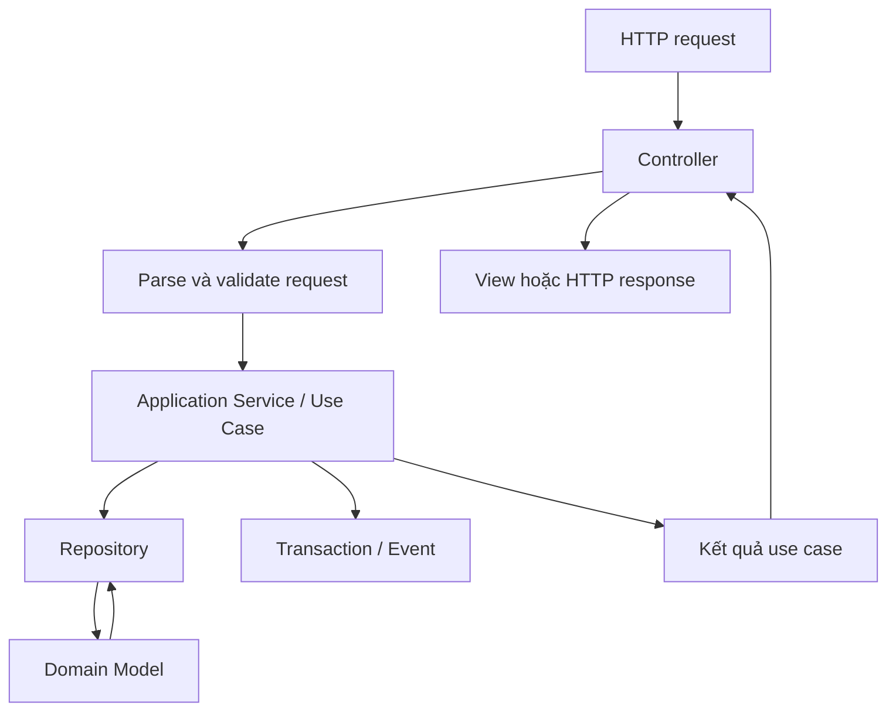

# Phối hợp dịch vụ ứng dụng hoặc thao tác trên Model

## 1. Vai trò điều phối của Controller

Trong kiến trúc **Model–View–Controller (MVC)**, Controller tiếp nhận tương tác từ bên ngoài và điều phối cách ứng dụng xử lý tương tác đó. Với ứng dụng web, đầu vào thường là HTTP request; đầu ra có thể là một View HTML, một redirect hoặc dữ liệu JSON.

Controller cần chuyển yêu cầu ở mức giao thức thành một thao tác mà ứng dụng hiểu được. Ví dụ, request `POST /orders/42/cancel` thể hiện ý định hủy đơn hàng có mã `42`. Controller đọc mã đơn, thông tin người dùng và dữ liệu request, sau đó chuyển yêu cầu đến nơi có thẩm quyền thực hiện quy tắc hủy đơn.

Có hai cách tổ chức thường gặp:

- **Thao tác trực tiếp trên Model:** Controller gọi một hành vi đơn giản của Model khi thao tác có phạm vi nhỏ và không cần phối hợp nhiều thành phần.
- **Phối hợp qua dịch vụ ứng dụng (Application Service):** Controller gọi một use case hoặc dịch vụ ứng dụng khi thao tác cần phối hợp nhiều Model, repository, giao dịch, quyền truy cập hoặc tác động phụ.

Hai cách này không loại trừ nhau. Dịch vụ ứng dụng thường gọi các hành vi của Domain Model để thực hiện nghiệp vụ. Điểm quan trọng là Controller giữ vai trò điều phối request, còn quy tắc nghiệp vụ được đặt ở thành phần có thể bảo vệ và tái sử dụng chúng.

## 2. Controller nên làm gì?

Một Controller web thường đảm nhận các công việc sau:

1. Nhận request và xác định hành động dựa trên route, HTTP method và tham số.
2. Đọc dữ liệu đầu vào, chuyển đổi kiểu và thực hiện validation ở ranh giới request.
3. Lấy thông tin ngữ cảnh cần thiết như người dùng hiện tại hoặc locale.
4. Gọi hành vi Model hoặc dịch vụ ứng dụng phù hợp.
5. Chuyển kết quả thành dữ liệu dành cho View hoặc response theo hợp đồng HTTP.
6. Chọn View, redirect, mã trạng thái hoặc định dạng phản hồi.

Controller cũng có thể phối hợp các chi tiết giao thức như query parameter, path variable, header, cookie và multipart upload. Những chi tiết đó nên được chuyển thành kiểu dữ liệu hoặc command rõ ràng trước khi đi vào nghiệp vụ.

Controller không nên trở thành nơi chứa toàn bộ quy tắc như tính giá, xác định quyền sở hữu, chuyển trạng thái đơn hàng, tính phí vận chuyển hay phối hợp hoàn tiền. Khi các quy tắc đó nằm trong Controller, chúng dễ bị lặp lại ở endpoint khác và khó kiểm thử ngoài môi trường web.

## 3. Thao tác trực tiếp trên Model

Trong MVC, Controller có thể gọi trực tiếp hành vi của Model khi thao tác đơn giản, có phạm vi rõ và không cần điều phối nhiều thành phần. Đây là cách thường thấy trong ví dụ MVC nhỏ hoặc một số ứng dụng có Model gắn với trạng thái giao diện.

Ví dụ, một Model danh sách có thể quản lý mục đang được chọn:

```java
public class ProductSelectionModel {
    private Long selectedProductId;

    public void select(Long productId) {
        if (productId == null || productId <= 0) {
            throw new IllegalArgumentException("Mã sản phẩm không hợp lệ");
        }
        this.selectedProductId = productId;
    }

    public Optional<Long> selectedProductId() {
        return Optional.ofNullable(selectedProductId);
    }
}
```

Controller có thể tiếp nhận thao tác chọn sản phẩm và gọi `model.select(productId)`. Model tự bảo vệ điều kiện cơ bản của trạng thái mà nó quản lý. Nếu Model thông báo thay đổi cho View theo cơ chế Observer, View có thể đọc lại trạng thái mới và cập nhật giao diện.

Với ứng dụng web dùng Spring MVC, một ví dụ đơn giản hơn là Controller lấy một đối tượng miền từ service/repository rồi gọi hành vi của nó:

```java
@PostMapping("/{id}/rename")
public String rename(
        @PathVariable long id,
        @Valid @ModelAttribute("form") RenameProductForm form,
        BindingResult errors) {
    if (errors.hasErrors()) {
        return "products/rename";
    }

    Product product = productRepository.findById(id)
            .orElseThrow(() -> new ProductNotFoundException(id));
    product.rename(form.name());
    productRepository.save(product);

    return "redirect:/products/" + id;
}
```

Đoạn mã này minh họa việc gọi hành vi `rename` trên Model. Tuy nhiên, khi ứng dụng có quy tắc phân quyền, giao dịch, kiểm tra trùng tên, ghi lịch sử hoặc phát sự kiện, đưa toàn bộ các bước vào Controller sẽ làm Controller phình to. Khi đó nên chuyển use case sang dịch vụ ứng dụng.

## 4. Khi nào cần dịch vụ ứng dụng?

**Application Service** đại diện cho một thao tác ở cấp ứng dụng, thường được gọi là use case. Nó điều phối các thành phần cần thiết để hoàn tất thao tác và xác định ranh giới giao dịch phù hợp.

Nên cân nhắc dịch vụ ứng dụng khi một request cần:

- Đọc hoặc thay đổi nhiều Domain Model hay aggregate.
- Phối hợp nhiều repository hoặc nguồn dữ liệu.
- Áp dụng quy tắc phân quyền gắn với tài nguyên và người dùng hiện tại.
- Thực hiện một giao dịch gồm nhiều bước cần tính nguyên tử.
- Ghi audit log, phát domain event hoặc gửi thông điệp sau khi nghiệp vụ thành công.
- Được gọi từ nhiều giao diện, chẳng hạn web MVC, REST API, tác vụ nền hoặc message consumer.
- Có luồng xử lý đủ phức tạp để cần kiểm thử như một use case độc lập.

Ví dụ, hủy đơn hàng có thể yêu cầu kiểm tra trạng thái đơn, xác nhận người dùng có quyền hủy, giải phóng tồn kho đã giữ, tạo yêu cầu hoàn tiền và ghi nhận lịch sử. Controller không nên tự điều phối từng bước đó. Nó chỉ cần gọi `orderApplicationService.cancel(...)` và chuyển kết quả thành phản hồi.

## 5. Ranh giới trách nhiệm giữa Controller, Application Service và Model

| Thành phần | Trách nhiệm chính | Ví dụ |
|---|---|---|
| Controller | Nhận request, chuyển đổi đầu vào, gọi use case, chọn response | Đọc `orderId`, lấy người dùng hiện tại, trả redirect |
| Application Service | Điều phối một use case, quản lý giao dịch, gọi các thành phần nghiệp vụ | Hủy đơn, giải phóng tồn kho, tạo yêu cầu hoàn tiền |
| Domain Model | Bảo vệ bất biến và hành vi của miền nghiệp vụ | `Order.cancel()`, `Inventory.reserve()` |
| Repository | Lưu và truy xuất aggregate hoặc dữ liệu theo hợp đồng | `OrderRepository.findById()` |
| View / Response DTO | Trình bày kết quả theo hợp đồng đầu ra | Trang chi tiết đơn hoặc JSON response |

Sơ đồ luồng điển hình:



Application Service không nhất thiết chứa mọi quy tắc. Nó điều phối hành vi của Domain Model. Ví dụ, `OrderApplicationService` có thể tải `Order`, gọi `order.cancel(reason)`, rồi lưu lại. Quy tắc “đơn đã giao không thể hủy” nên thuộc `Order` hoặc domain policy thích hợp, để bất kỳ luồng gọi nào cũng phải tuân thủ.

## 6. Ví dụ hoàn chỉnh với Spring MVC

Giả sử chức năng hủy đơn hàng cần xác định người dùng, kiểm tra quyền, kiểm tra trạng thái đơn và ghi nhận thay đổi.

### 6.1. Đối tượng đầu vào

```java
public record CancelOrderRequest(
        @NotBlank @Size(max = 300) String reason) {}
```

Đối tượng này mô tả dữ liệu mà request được phép gửi. Không dùng entity `Order` làm đối tượng bind trực tiếp từ trình duyệt, vì client không nên được quyền gửi tùy ý các trường như `status`, `approvedBy` hoặc `cancelledAt`.

### 6.2. Domain Model giữ quy tắc

```java
public class Order {
    private OrderStatus status;
    private String cancellationReason;

    public void cancel(String reason) {
        if (status == OrderStatus.SHIPPED
                || status == OrderStatus.DELIVERED) {
            throw new OrderCannotBeCancelledException();
        }
        if (status == OrderStatus.CANCELLED) {
            throw new OrderAlreadyCancelledException();
        }

        this.status = OrderStatus.CANCELLED;
        this.cancellationReason = reason;
    }
}
```

`Order` bảo vệ quy tắc chuyển trạng thái. Nó không cần biết request đến từ Spring MVC, REST API hay tác vụ nền.

### 6.3. Application Service điều phối use case

```java
@Service
public class OrderApplicationService {
    private final OrderRepository orderRepository;
    private final OrderAuthorization authorization;
    private final InventoryService inventoryService;
    private final RefundService refundService;

    public OrderApplicationService(
            OrderRepository orderRepository,
            OrderAuthorization authorization,
            InventoryService inventoryService,
            RefundService refundService) {
        this.orderRepository = orderRepository;
        this.authorization = authorization;
        this.inventoryService = inventoryService;
        this.refundService = refundService;
    }

    @Transactional
    public void cancel(long orderId, UserId actor, String reason) {
        Order order = orderRepository.findById(orderId)
                .orElseThrow(() -> new OrderNotFoundException(orderId));

        authorization.checkCanCancel(actor, order);
        order.cancel(reason);
        inventoryService.releaseReservation(order);
        refundService.requestRefundIfRequired(order);

        orderRepository.save(order);
    }
}
```

Đây là ví dụ minh họa về điều phối. Trong hệ thống thực tế, hoàn tiền hoặc giao tiếp với dịch vụ ngoài thường không thể nằm trọn trong một giao dịch cơ sở dữ liệu. Có thể cần transactional outbox, message queue, saga hoặc quy trình xử lý bất đồng bộ để bảo đảm nhất quán và xử lý thử lại an toàn. Không nên giữ transaction cơ sở dữ liệu mở trong lúc chờ một dịch vụ ngoài phản hồi lâu.

### 6.4. Controller tiếp nhận request và chọn phản hồi

```java
@Controller
@RequestMapping("/orders")
public class OrderController {
    private final OrderApplicationService orderService;
    private final CurrentUser currentUser;

    public OrderController(
            OrderApplicationService orderService,
            CurrentUser currentUser) {
        this.orderService = orderService;
        this.currentUser = currentUser;
    }

    @PostMapping("/{id}/cancel")
    public String cancel(
            @PathVariable long id,
            @Valid @ModelAttribute("form") CancelOrderRequest form,
            BindingResult errors,
            RedirectAttributes redirectAttributes) {
        if (errors.hasErrors()) {
            return "orders/detail";
        }

        orderService.cancel(id, currentUser.id(), form.reason());
        redirectAttributes.addFlashAttribute(
                "message", "Đơn hàng đã được gửi yêu cầu hủy.");
        return "redirect:/orders/" + id;
    }
}
```

Controller không cần biết tồn kho được giải phóng như thế nào hoặc yêu cầu hoàn tiền được gửi ra sao. Nó chỉ chuyển dữ liệu đã kiểm tra ở cấp request đến use case và quyết định cách phản hồi.

Thông báo ví dụ cần phù hợp với ngữ nghĩa thực tế của hệ thống. Nếu hoàn tiền được xử lý bất đồng bộ, không nên khẳng định tiền đã hoàn ngay; có thể thông báo rằng yêu cầu hủy đã được tiếp nhận và đang xử lý.

## 7. Validation ở Controller và quy tắc trong Model

Validation thường có nhiều lớp vì mỗi lớp bảo vệ một loại điều kiện khác nhau.

| Loại kiểm tra | Ví dụ | Nơi phù hợp |
|---|---|---|
| Cú pháp và kiểu dữ liệu | `orderId` phải là số, `reason` không được rỗng | Binding / Controller |
| Ràng buộc đầu vào | Độ dài lý do không vượt quá 300 ký tự | Request DTO / validation layer |
| Quy tắc nghiệp vụ | Đơn đã giao không được hủy | Domain Model / Domain Policy |
| Quyền trên tài nguyên | Người dùng chỉ được hủy đơn thuộc phạm vi của họ | Application Service / authorization policy |
| Ràng buộc lưu trữ | Mã đơn phải duy nhất | Database constraint và lớp nghiệp vụ |

Kiểm tra ở Controller giúp phản hồi sớm và gắn lỗi với trường nhập. Tuy nhiên, không nên chỉ kiểm tra nghiệp vụ ở Controller vì cùng một use case có thể được gọi từ nhiều adapter khác nhau. Domain Model và Application Service cần bảo vệ các điều kiện cốt lõi ngay cả khi request không đến từ giao diện web.

## 8. Giao dịch và tác động phụ

Application Service thường là nơi thích hợp để xác định ranh giới giao dịch của use case. Ví dụ, việc chuyển trạng thái đơn và lưu lịch sử có thể cần thành công hoặc thất bại cùng nhau. Domain Model quyết định chuyển trạng thái có hợp lệ; repository lưu thay đổi; transaction manager bảo đảm các thao tác cơ sở dữ liệu trong transaction tuân theo tính nguyên tử.

Các tác động phụ như gửi email, phát thông điệp hoặc gọi dịch vụ thanh toán cần được cân nhắc riêng:

- Không gửi email trước khi giao dịch dữ liệu được commit nếu email thông báo một thay đổi đã lưu.
- Không giả định transaction cơ sở dữ liệu có thể rollback một request HTTP đã gửi đến dịch vụ ngoài.
- Dùng cơ chế phát sự kiện sau commit hoặc transactional outbox khi cần bảo đảm sự kiện không bị mất giữa commit và publish.
- Thiết kế idempotency hoặc khóa nghiệp vụ cho thao tác có thể được gửi lại, chẳng hạn tạo thanh toán hoặc yêu cầu hoàn tiền.
- Ghi log và correlation ID để có thể lần theo một use case qua nhiều thành phần.

Controller không nên tự mở transaction cho mọi endpoint theo thói quen. Ranh giới giao dịch nên phản ánh use case và thường được đặt tại Application Service hoặc lớp điều phối tương ứng.

## 9. Xử lý lỗi và chuyển kết quả thành response

Application Service và Domain Model có thể trả kết quả thành công hoặc phát sinh lỗi miền nghiệp vụ. Controller hoặc cơ chế xử lý lỗi tập trung chuyển kết quả đó thành phản hồi phù hợp với giao thức.

Ví dụ các trường hợp thường gặp:

| Tình huống | HTTP response thường dùng | Phản hồi cho View |
|---|---|---|
| Request sai định dạng | `400 Bad Request` | Lỗi gắn với trường hoặc nội dung request |
| Chưa đăng nhập | `401 Unauthorized` hoặc chuyển đến trang đăng nhập tùy ứng dụng | Hướng dẫn xác thực |
| Không có quyền | `403 Forbidden` hoặc `404 Not Found` theo chính sách bảo vệ tài nguyên | Thông báo không thể thực hiện |
| Không tìm thấy đơn | `404 Not Found` | Trang không tìm thấy hoặc response lỗi |
| Trạng thái nghiệp vụ không cho phép | `409 Conflict` trong nhiều API | Giải thích vì sao thao tác không thể hoàn tất |
| Lỗi không dự kiến | `500 Internal Server Error` | Thông báo chung và mã theo dõi nếu có |

Trong Spring, có thể dùng `@ControllerAdvice` và `@ExceptionHandler` để chuyển exception thành trang lỗi hoặc response JSON nhất quán. Không để mỗi Controller tự sao chép logic xử lý mọi loại lỗi.

Không trả stack trace, câu truy vấn, thông tin kết nối hoặc dữ liệu nhạy cảm cho client. Chi tiết điều tra nên được ghi ở log phía máy chủ với quyền truy cập phù hợp.

## 10. Controller cho View HTML và Controller cho API

Một use case có thể được gọi từ nhiều adapter. Ví dụ, chức năng hủy đơn có thể có một Controller trả HTML và một REST Controller trả JSON. Cả hai nên gọi cùng Application Service thay vì sao chép quy tắc nghiệp vụ.

```java
@RestController
@RequestMapping("/api/orders")
public class OrderApiController {
    private final OrderApplicationService orderService;
    private final CurrentUser currentUser;

    public OrderApiController(
            OrderApplicationService orderService,
            CurrentUser currentUser) {
        this.orderService = orderService;
        this.currentUser = currentUser;
    }

    @PostMapping("/{id}/cancel")
    public ResponseEntity<Void> cancel(
            @PathVariable long id,
            @Valid @RequestBody CancelOrderRequest request) {
        orderService.cancel(id, currentUser.id(), request.reason());
        return ResponseEntity.noContent().build();
    }
}
```

Controller HTML có thể trả tên View hoặc redirect; REST Controller trả status và body theo hợp đồng API. Cả hai đều là adapter của cùng use case. Application Service không cần biết client đang dùng HTML hay JSON.

## 11. Kiểm thử Controller và Application Service

Phân tách trách nhiệm giúp kiểm thử từng lớp với mục tiêu khác nhau:

| Phạm vi | Điều cần kiểm tra | Cách kiểm thử |
|---|---|---|
| Controller | Route, binding, validation, lời gọi use case, View hoặc status được chọn | Web layer test / MockMvc |
| Application Service | Thứ tự điều phối, quyền, giao dịch và phản ứng với kết quả từ các dependency | Unit test với dependency giả lập; integration test cho transaction |
| Domain Model | Bất biến và chuyển trạng thái hợp lệ | Unit test độc lập |
| Repository | Ánh xạ và truy vấn dữ liệu | Repository integration test |
| Toàn use case | Request đi qua adapter, dịch vụ, lưu trữ và phản hồi | Integration test |

Ví dụ kiểm thử use case hủy đơn nên có trường hợp đơn được phép hủy, đơn đã giao, người dùng không có quyền, không tìm thấy đơn và lỗi khi giải phóng tồn kho. Controller test có thể xác minh request sai định dạng không gọi Application Service và khi thành công sẽ redirect đúng trang.

Không cần dựng toàn bộ giao diện để kiểm thử quy tắc hủy đơn. Ngược lại, unit test của Domain Model cũng không thay thế kiểm thử HTTP binding, status code và response của Controller.

## 12. Các lỗi thiết kế thường gặp

1. **Fat Controller:** Controller chứa truy vấn, tính toán, phân quyền, giao dịch và tác động phụ. Hãy chuyển use case sang Application Service và quy tắc sang Domain Model phù hợp.
2. **Anemic Model với quy tắc rải rác:** Model chỉ có getter/setter trong khi quy tắc chuyển trạng thái nằm ở nhiều Controller. Hãy đưa bất biến về Model hoặc domain policy.
3. **Controller gọi Controller khác:** làm nghiệp vụ phụ thuộc vào giao thức HTTP. Dùng Application Service hoặc thành phần dùng chung ở tầng ứng dụng.
4. **Application Service chứa toàn bộ quy tắc:** dịch vụ điều phối không nên biến thành một lớp khổng lồ. Hãy để Domain Model sở hữu hành vi và bất biến của nó.
5. **Dùng entity làm request object:** client có thể bind vào trường nhạy cảm hoặc trường không được phép cập nhật. Dùng request DTO rõ ràng.
6. **Đặt giao dịch ở sai ranh giới:** một phần use case được commit trong khi phần khác thất bại. Xác định transaction theo thao tác nghiệp vụ và thiết kế riêng cho tác động ngoài hệ thống.
7. **Nuốt exception trong Controller:** trả về thành công dù use case thất bại hoặc làm mất thông tin chẩn đoán. Chuyển lỗi qua cơ chế xử lý tập trung và response đúng.

## 13. Cách quyết định giữa thao tác Model trực tiếp và Application Service

Có thể dùng các câu hỏi sau khi thiết kế một action:

- Thao tác chỉ thay đổi một trạng thái đơn giản, có quy tắc cục bộ và không cần phối hợp repository hay dịch vụ khác không? Nếu có, gọi hành vi Model trực tiếp có thể đủ.
- Thao tác có nhiều bước, nhiều Model hoặc cần một ranh giới giao dịch không? Nếu có, dùng Application Service để điều phối.
- Cùng use case có thể được gọi từ web, API, tác vụ nền hoặc message consumer không? Nếu có, tách use case khỏi Controller để tái sử dụng.
- Quy tắc có cần luôn đúng dù được gọi từ bất kỳ adapter nào không? Đặt quy tắc trong Domain Model hoặc domain policy, không chỉ trong Controller.
- Controller có đang phải biết chi tiết lưu trữ, thanh toán, gửi thông báo hoặc thứ tự nhiều thao tác không? Nếu có, chuyển phần điều phối vào Application Service.

Không cần tạo một service cho mỗi dòng code hoặc một lớp trung gian không có trách nhiệm thực tế. Hãy dùng service khi nó biểu diễn một use case hoặc ranh giới điều phối có ý nghĩa.

## 14. Kết luận

Controller là adapter nhận tương tác và điều phối request trong MVC. Với thao tác nhỏ, Controller có thể gọi trực tiếp hành vi Model. Khi use case cần phối hợp nhiều Model, repository, quyền truy cập, giao dịch hoặc tác động phụ, Controller nên gọi Application Service. Application Service điều phối quy trình, còn Domain Model giữ các quy tắc và bất biến của miền nghiệp vụ.

Giữ Controller tập trung vào giao thức và phản hồi, đặt quy tắc ở đúng nơi, xác định ranh giới giao dịch, xử lý lỗi nhất quán và kiểm thử từng lớp theo hợp đồng của nó. Cách tổ chức này giúp cùng một nghiệp vụ được sử dụng qua nhiều giao diện mà không phải sao chép logic xử lý.
