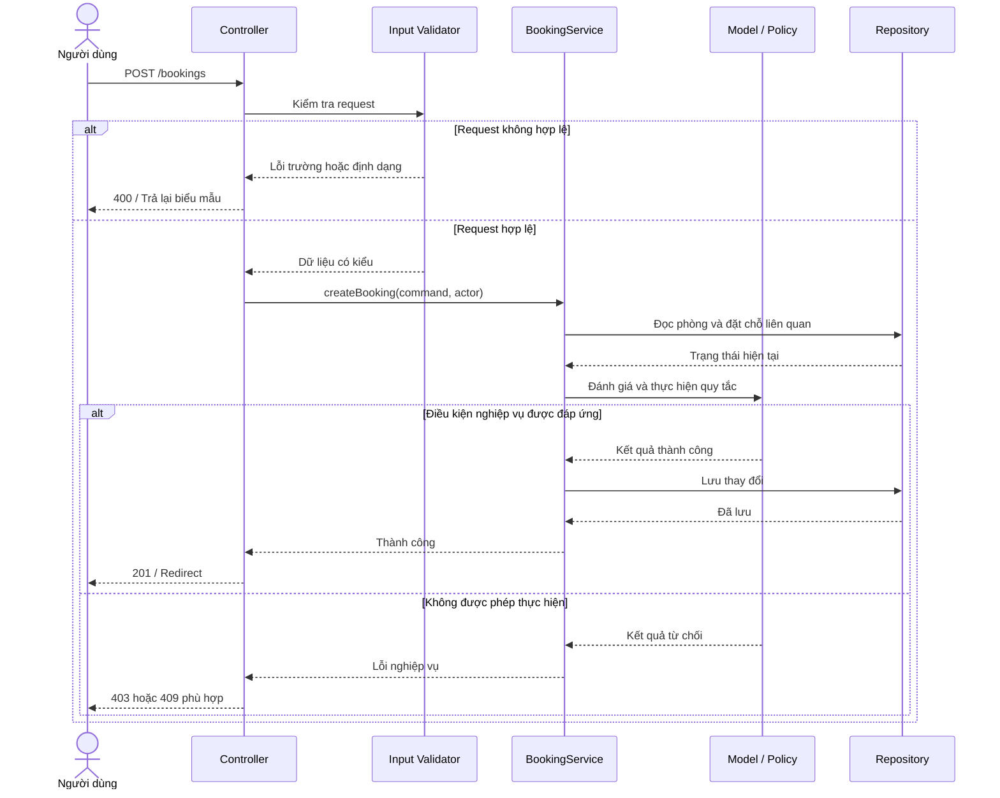

# Phân biệt xác thực đầu vào và quyết định nghiệp vụ

Trong MVC, Controller tiếp nhận dữ liệu từ request và cần xác định dữ liệu đó có đúng hợp đồng đầu vào hay không. Sau khi dữ liệu được chấp nhận về mặt cấu trúc và định dạng, ứng dụng còn phải quyết định hành động mà người dùng yêu cầu có được phép thực hiện trong trạng thái hiện tại hay không. Hai việc này liên quan nhưng khác nhau: **xác thực đầu vào (input validation)** kiểm tra dữ liệu gửi lên có đúng hình dạng và ràng buộc của request; **quyết định nghiệp vụ (business decision)** xác định hành động có hợp lệ theo quy tắc và ngữ cảnh của miền nghiệp vụ.

Ví dụ, một request đặt phòng có thể chứa mã phòng hợp lệ, thời điểm bắt đầu và kết thúc đúng định dạng, thời lượng dương. Những điều kiện đó cho biết request có thể được hiểu và xử lý. Tuy nhiên, phòng có thể đã được đặt bởi người khác, người dùng có thể đã hết hạn mức đặt phòng hoặc phòng có thể đang ngừng hoạt động. Đây là các quyết định nghiệp vụ cần được đánh giá dựa trên trạng thái hiện tại của ứng dụng.

Phân biệt đúng hai lớp giúp Controller giữ vai trò tiếp nhận và điều phối, còn Model hoặc dịch vụ nghiệp vụ bảo vệ các quy tắc quyết định trạng thái ứng dụng.

## Hai câu hỏi khác nhau

Khi nhận một request, hãy tách hai câu hỏi:

1. **Dữ liệu gửi lên có hợp lệ theo hợp đồng của endpoint không?** Trường bắt buộc có được gửi không? Chuỗi có đúng định dạng không? Số có nằm trong phạm vi cho phép không? Các trường có thể chuyển đổi thành kiểu dữ liệu đích không?
2. **Với dữ liệu đó và trạng thái hiện tại, ứng dụng có nên thực hiện hành động không?** Người dùng có quyền thao tác trên tài nguyên này không? Trạng thái hiện tại có cho phép chuyển đổi không? Hạn mức còn đủ không? Tài nguyên có đang sẵn sàng không?

Câu hỏi thứ nhất thuộc ranh giới tiếp nhận request và hợp đồng dữ liệu. Câu hỏi thứ hai thuộc nghiệp vụ và ngữ cảnh thực tế của ứng dụng.

Lưu ý thuật ngữ: trong bài này, “xác thực đầu vào” được dùng theo nghĩa *validation* của dữ liệu. Nó khác với **xác thực danh tính (authentication)**, tức xác định người gửi request là ai. Sau khi biết danh tính, ứng dụng vẫn cần kiểm tra quyền và quy tắc nghiệp vụ tương ứng.

## Xác thực đầu vào kiểm tra điều gì?

Xác thực đầu vào kiểm tra dữ liệu request có đáp ứng hợp đồng đã công bố hay không. Các kiểm tra thường gặp gồm:

- **Sự hiện diện:** trường bắt buộc có được gửi hay không.
- **Kiểu và định dạng:** giá trị có chuyển được thành `long`, `LocalDate`, enum hoặc DTO hay không.
- **Độ dài và kích thước:** chuỗi, danh sách, body hoặc tệp có vượt giới hạn hay không.
- **Khoảng giá trị:** số lượng có dương, trang có nằm trong phạm vi chấp nhận, phần trăm có nằm trong khoảng quy định.
- **Ràng buộc trường:** email có đúng định dạng cơ bản, mã có đúng mẫu, ngày có tồn tại trong lịch.
- **Quan hệ giữa các trường của request:** ngày kết thúc phải sau ngày bắt đầu, hoặc ít nhất một trong hai trường tìm kiếm phải được cung cấp.

Những điều kiện này thường có thể kiểm tra chỉ từ request và quy tắc hợp đồng, chưa cần truy vấn trạng thái nghiệp vụ hiện tại.

Ví dụ với request tạo đặt phòng:

```java
public record CreateBookingRequest(
        @NotNull Long roomId,
        @NotNull LocalDateTime startsAt,
        @NotNull LocalDateTime endsAt,
        @NotBlank @Size(max = 200) String purpose) {
}
```

Các annotation cho biết `roomId`, `startsAt`, `endsAt` không được thiếu và `purpose` phải có nội dung với độ dài giới hạn. Có thể bổ sung một class-level constraint để kiểm tra `endsAt` sau `startsAt`, vì đây là quan hệ giữa các trường trong cùng request. Khi một giá trị không thể parse thành `LocalDateTime`, framework có thể báo lỗi chuyển đổi trước khi validation chạy.

Không phải mọi quy tắc có thể biểu diễn bằng annotation đều là validation đầu vào. Ví dụ, “người dùng chỉ được đặt tối đa ba phòng đang hoạt động” cần biết người dùng là ai và hiện đang có bao nhiêu đặt phòng. Đây là quyết định nghiệp vụ dù kết quả cuối cùng có thể là từ chối request.

Ranh giới không được xác định chỉ bởi vị trí viết mã hay tên annotation. Một custom validator có thể truy vấn cơ sở dữ liệu để kiểm tra email đã tồn tại; về bản chất, điều kiện duy nhất đó phụ thuộc trạng thái đang lưu. Có thể kiểm tra sớm để hiển thị thông báo thân thiện, nhưng dịch vụ và cơ sở dữ liệu vẫn phải bảo vệ tính duy nhất khi ghi vì hai request đồng thời có thể cùng vượt qua lần kiểm tra trước khi lưu. Hãy phân loại theo nguồn thông tin và ý nghĩa của quy tắc, không chỉ theo công cụ được dùng để cài đặt.

## Quyết định nghiệp vụ phụ thuộc điều gì?

Quyết định nghiệp vụ đánh giá hành động trong bối cảnh của ứng dụng. Nó có thể phụ thuộc vào:

- trạng thái hiện tại của entity hoặc quy trình;
- các đối tượng liên quan và dữ liệu đã lưu;
- danh tính, vai trò và quyền trên tài nguyên của người thực hiện;
- hạn mức, chính sách hoặc quy tắc của tổ chức;
- thời gian hiện tại, thời hạn và lịch hoạt động;
- kết quả của các bước nghiệp vụ trước đó;
- điều kiện đồng thời, chẳng hạn tài nguyên vừa được một request khác sử dụng.

Các quy tắc này thường thuộc Model, domain service hoặc application service tùy phạm vi. Entity phù hợp để bảo vệ bất biến gắn với chính trạng thái của nó. Dịch vụ nghiệp vụ phối hợp nhiều entity, repository, quyền và quy trình. Controller nhận kết quả rồi chuyển thành response phù hợp.

Ví dụ với đặt phòng:

| Điều kiện | Loại kiểm tra | Lý do |
|---|---|---|
| `roomId` bị thiếu | Xác thực đầu vào | Request không đủ trường bắt buộc |
| `startsAt` không parse được | Chuyển đổi đầu vào | Không thể hiểu giá trị thời gian |
| `endsAt` không sau `startsAt` | Xác thực đầu vào | Hai trường vi phạm hợp đồng thời gian của request |
| Phòng không tồn tại | Kết quả nghiệp vụ/truy xuất | Cần tra cứu tài nguyên theo mã |
| Phòng đang bảo trì | Quyết định nghiệp vụ | Phụ thuộc trạng thái hiện tại của phòng |
| Khoảng thời gian đã có người đặt | Quyết định nghiệp vụ | Phụ thuộc các đặt phòng đã lưu và đồng thời |
| Người dùng đã hết hạn mức | Quyết định nghiệp vụ | Phụ thuộc chính sách và dữ liệu của người dùng |
| Người dùng không có quyền đặt phòng này | Quyết định phân quyền | Phụ thuộc danh tính và quyền trên tài nguyên |

## Ranh giới trách nhiệm trong MVC

Controller có thể thực hiện hoặc kích hoạt kiểm tra đầu vào bằng framework, sau đó chuyển dữ liệu hợp lệ thành command có kiểu. Controller gọi dịch vụ nghiệp vụ để yêu cầu thực hiện hành động. Dịch vụ kiểm tra điều kiện theo ngữ cảnh, yêu cầu Model thực hiện hành vi và phối hợp lưu kết quả. Cuối cùng Controller ánh xạ kết quả thành View hoặc HTTP response.



Sơ đồ thể hiện ranh giới logic; trong một framework cụ thể, validation có thể chạy tự động trước khi phương thức Controller được gọi, còn quyền truy cập có thể được kiểm tra bởi security filter hoặc annotation. Vị trí triển khai có thể khác nhau, nhưng trách nhiệm vẫn cần rõ ràng.

## Ví dụ Spring MVC: kiểm tra request trước khi gọi nghiệp vụ

Request DTO chỉ mô tả dữ liệu client được phép gửi:

```java
import jakarta.validation.constraints.NotBlank;
import jakarta.validation.constraints.NotNull;
import jakarta.validation.constraints.Size;
import java.time.LocalDateTime;

public record CreateBookingRequest(
        @NotNull Long roomId,
        @NotNull LocalDateTime startsAt,
        @NotNull LocalDateTime endsAt,
        @NotBlank @Size(max = 200) String purpose) {
}
```

Controller tiếp nhận request và chuyển nó thành command:

```java
@RestController
@RequestMapping("/api/bookings")
public class BookingController {
    private final BookingService bookingService;

    public BookingController(BookingService bookingService) {
        this.bookingService = bookingService;
    }

    @PostMapping
    public ResponseEntity<BookingResponse> create(
            @Valid @RequestBody CreateBookingRequest request,
            Principal principal) {

        CreateBookingCommand command = new CreateBookingCommand(
                request.roomId(),
                request.startsAt(),
                request.endsAt(),
                request.purpose());

        BookingResponse created = bookingService.create(
                command, principal.getName());
        return ResponseEntity.status(HttpStatus.CREATED).body(created);
    }
}
```

Nếu JSON sai định dạng hoặc vi phạm annotation validation, Spring có thể từ chối request trước khi phần nghiệp vụ được gọi. Danh tính được lấy từ `Principal` của ngữ cảnh đã xác thực, không lấy từ một trường `userId` do client tự khai báo.

Controller không tự kết luận phòng còn trống chỉ vì request hợp lệ. Nó chuyển command đến dịch vụ để đánh giá theo dữ liệu hiện tại.

## Ví dụ quyết định nghiệp vụ trong dịch vụ và Model

Dịch vụ nghiệp vụ có thể phối hợp việc tìm người dùng, phòng và các đặt chỗ hiện có:

```java
@Transactional
public BookingResponse create(
        CreateBookingCommand command,
        String authenticatedUsername) {

    User actor = userRepository.findByUsername(authenticatedUsername)
            .orElseThrow(UserNotFoundException::new);
    Room room = roomRepository.findById(command.roomId())
            .orElseThrow(RoomNotFoundException::new);

    bookingPolicy.checkCanBook(actor, room);
    room.ensureAvailableFor(command.startsAt(), command.endsAt());

    if (bookingRepository.existsOverlapping(
            room.getId(), command.startsAt(), command.endsAt())) {
        throw new BookingConflictException();
    }

    Booking booking = Booking.create(
            room, actor, command.startsAt(), command.endsAt(), command.purpose());
    bookingRepository.save(booking);
    return BookingResponse.from(booking);
}
```

`bookingPolicy` đánh giá chính sách có liên quan đến người dùng và phòng. `room.ensureAvailableFor` có thể bảo vệ những quy tắc gắn với trạng thái của phòng, chẳng hạn phòng đang hoạt động và khoảng thời gian nằm trong giờ mở cửa. Repository cung cấp dữ liệu đã lưu để dịch vụ đánh giá xung đột.

Ví dụ trên là mã minh họa cấu trúc trách nhiệm. Trong hệ thống có nhiều request đặt cùng một phòng, chỉ truy vấn `existsOverlapping` rồi mới lưu là chưa đủ để bảo đảm không trùng lịch. Hai request có thể cùng đọc kết quả “chưa có đặt chỗ” trước khi một request kịp lưu. Cần cơ chế bảo vệ đồng thời phù hợp như transaction với khóa, ràng buộc loại trừ/unique phù hợp ở cơ sở dữ liệu, hoặc một chiến lược đặt chỗ nguyên tử. Quyết định nghiệp vụ phải được bảo vệ tại thời điểm cập nhật trạng thái, không chỉ ở một lần kiểm tra trước đó.

## Không nhầm validation với xác thực danh tính và phân quyền

Ba khái niệm cần được phân biệt:

| Khái niệm | Câu hỏi | Ví dụ |
|---|---|---|
| Input validation | Dữ liệu request có đúng hợp đồng không? | `roomId` có được gửi và có định dạng số hợp lệ không? |
| Authentication | Ai đang gửi request? | Session hoặc token xác định người dùng hiện tại |
| Authorization / business policy | Người đó có được thực hiện hành động này trong ngữ cảnh hiện tại không? | Người dùng có quyền đặt phòng của bộ phận khác không? |

Một request có thể hợp lệ về dữ liệu nhưng đến từ người chưa đăng nhập. Một người đã đăng nhập vẫn có thể không có quyền trên tài nguyên. Một người có quyền chung vẫn có thể không thực hiện được hành động vì trạng thái nghiệp vụ không cho phép. Mỗi lớp cần được kiểm tra rõ ràng.

Không tin các trường do client gửi như `ownerId`, `role`, `isAdmin`, `approved` hoặc `currentStatus` để quyết định quyền hay trạng thái. Hãy lấy danh tính từ ngữ cảnh đã xác thực, tải trạng thái đáng tin cậy từ hệ thống và áp dụng chính sách ở phía máy chủ.

## Phân loại và ánh xạ lỗi

Khi từ chối một request, ứng dụng cần phản hồi theo nguyên nhân. Một số quy ước thường dùng:

| Nguyên nhân | Ví dụ | Response thường phù hợp |
|---|---|---|
| Request sai cấu trúc hoặc validation thất bại | Thiếu `roomId`, ngày không parse được | `400 Bad Request` |
| Chưa xác thực | Không có session/token hợp lệ | `401 Unauthorized` |
| Không có quyền | Người dùng không được phép đặt phòng này | `403 Forbidden` |
| Không tìm thấy tài nguyên | Mã phòng không tồn tại | `404 Not Found` |
| Xung đột trạng thái | Phòng vừa được đặt trong cùng khoảng thời gian | `409 Conflict` |
| Lỗi hệ thống không dự kiến | Hạ tầng lưu trữ gặp sự cố | `500 Internal Server Error` |

Mã trạng thái chính xác cần tuân theo hợp đồng API của ứng dụng. Không nên dùng một mã lỗi chung cho mọi trường hợp, vì client cần biết nên sửa dữ liệu, đăng nhập, xin quyền hay chọn thời gian khác.

Với biểu mẫu HTML, Controller có thể trả lại View cùng lỗi theo trường khi validation thất bại. Nếu dữ liệu hợp lệ nhưng quy tắc nghiệp vụ từ chối, View có thể hiển thị thông báo ở mức biểu mẫu hoặc trang. Với API, nên dùng cấu trúc lỗi ổn định, có mã lỗi máy đọc được và thông điệp an toàn. Không trả stack trace, câu SQL hoặc dữ liệu nhạy cảm cho client.

## Tránh kiểm tra trùng lặp và lỗi bỏ qua quy tắc

Một số vấn đề xuất hiện khi validation và nghiệp vụ bị trộn lẫn:

- **Chỉ kiểm tra trên giao diện:** client khác có thể bỏ qua HTML validation và gửi request trực tiếp. Mọi dữ liệu quan trọng phải được kiểm tra ở phía máy chủ.
- **Đưa quy tắc nghiệp vụ vào Controller:** một endpoint có thể được bảo vệ, nhưng endpoint khác hoặc tác vụ nền có thể quên áp dụng cùng quy tắc. Hãy đặt quyết định miền trong Model hoặc dịch vụ dùng chung.
- **Đưa trạng thái hiện tại vào request để tự kiểm tra:** client có thể gửi trạng thái cũ hoặc giả mạo. Hãy đọc trạng thái đáng tin cậy từ hệ thống.
- **Dùng validation để thay thế phân quyền:** `@NotNull userId` chỉ chứng minh trường có giá trị, không chứng minh người gửi được phép thao tác với người dùng đó.
- **Kiểm tra rồi bỏ qua kết quả:** nếu nghiệp vụ thay đổi giữa lúc kiểm tra và lúc ghi, kết quả kiểm tra cũ không còn đủ tin cậy. Cần transaction và kiểm soát đồng thời phù hợp.
- **Lặp cùng một quy tắc ở nhiều nơi:** các bản sao có thể lệch nhau theo thời gian. Hãy có một nguồn quyết định chính và dùng validation ở ranh giới để phản hồi sớm khi có thể.

Có thể kiểm tra một số quy tắc ở nhiều lớp vì mục đích khác nhau. Ví dụ, form có thể kiểm tra ngày kết thúc sau ngày bắt đầu để người dùng nhận lỗi sớm; Model vẫn cần bảo vệ bất biến tương ứng khi một command được gọi từ API khác. Điều cần tránh là để các lớp có những định nghĩa mâu thuẫn về cùng một quy tắc.

## Kiểm thử riêng hai loại trách nhiệm

Tách kiểm thử giúp xác định lỗi nằm ở hợp đồng request hay quy tắc miền.

**Kiểm thử input validation** nên bao gồm:

- trường bắt buộc bị thiếu hoặc `null`;
- sai định dạng, sai kiểu hoặc giá trị vượt giới hạn;
- chuỗi rỗng, chỉ có khoảng trắng hoặc quá dài;
- quan hệ giữa các trường trong cùng request;
- request không hợp lệ không gọi dịch vụ nghiệp vụ.

**Kiểm thử quyết định nghiệp vụ** nên bao gồm:

- hành động hợp lệ khi trạng thái cho phép;
- hành động bị từ chối khi trạng thái không cho phép;
- người dùng không có quyền trên tài nguyên;
- hạn mức đã đạt hoặc chính sách không thỏa;
- tài nguyên đã được sử dụng hoặc thay đổi bởi request khác;
- kết quả không làm thay đổi trạng thái khi nghiệp vụ thất bại.

Ví dụ ma trận cho chức năng đặt phòng:

| Tình huống | Lớp kiểm thử chính | Kết quả mong đợi |
|---|---|---|
| `roomId` bị thiếu | Controller/validation | Trả 400, không gọi service |
| `endsAt` trước `startsAt` | Validation request | Trả lỗi trường hoặc lỗi request |
| Phòng không tồn tại | Dịch vụ nghiệp vụ | Kết quả not found |
| Người dùng hết hạn mức | Policy/service | Từ chối theo chính sách |
| Phòng đang bảo trì | Model/policy | Không tạo đặt chỗ |
| Hai request đặt cùng khung giờ | Kiểm thử tích hợp đồng thời | Chỉ một giao dịch thành công |

Kiểm thử Controller có thể dùng MockMvc để gửi request và xác minh response. Kiểm thử Model hoặc policy có thể gọi trực tiếp phương thức với trạng thái đầu vào xác định. Kiểm thử tích hợp cần xác minh transaction, ràng buộc lưu trữ và hành vi khi có truy cập đồng thời.

## Cách quyết định một quy tắc thuộc lớp nào

Khi chưa rõ một điều kiện là validation hay quyết định nghiệp vụ, hãy xem xét các câu hỏi sau:

1. Có thể đánh giá điều kiện chỉ từ dữ liệu request và hợp đồng endpoint không? Nếu có, nó thường phù hợp với validation đầu vào.
2. Điều kiện có cần đọc trạng thái hiện tại, dữ liệu liên quan hoặc danh tính người dùng không? Nếu có, nó thường là quyết định nghiệp vụ hoặc phân quyền.
3. Điều kiện có phải luôn đúng bất kể request đến từ web, API hay tác vụ nền không? Nếu có, hãy bảo vệ nó trong Model hoặc dịch vụ nghiệp vụ dùng chung.
4. Điều kiện có liên quan đến nhiều entity hoặc quy trình không? Nếu có, dịch vụ nghiệp vụ thường là nơi phối hợp phù hợp.
5. Nếu hai request chạy đồng thời, điều kiện có thể thay đổi sau khi kiểm tra không? Nếu có, cần bảo vệ quyết định trong transaction hoặc cơ chế cập nhật nguyên tử.

Controller làm tốt nhiệm vụ khi từ chối sớm request sai hợp đồng, chuyển dữ liệu hợp lệ thành command rõ nghĩa và giao việc đánh giá trạng thái cho tầng nghiệp vụ. Model và dịch vụ nghiệp vụ bảo vệ các quyết định quan trọng dù hành động đến từ bất kỳ kênh nào. Cách phân chia đó giúp ứng dụng phản hồi lỗi chính xác, giữ trạng thái nhất quán và dễ kiểm thử.
