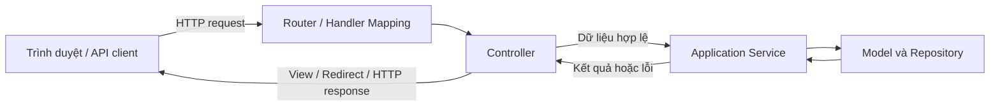
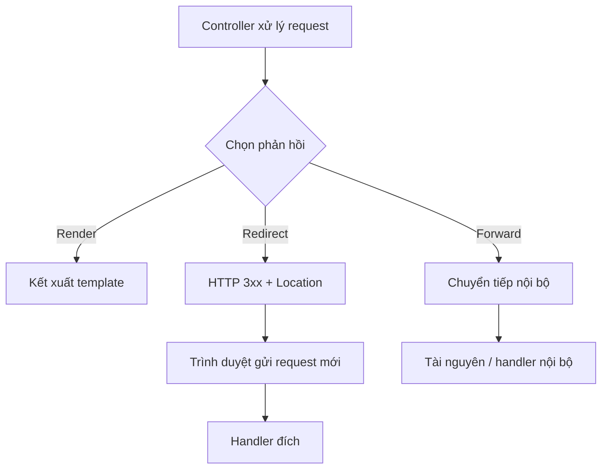
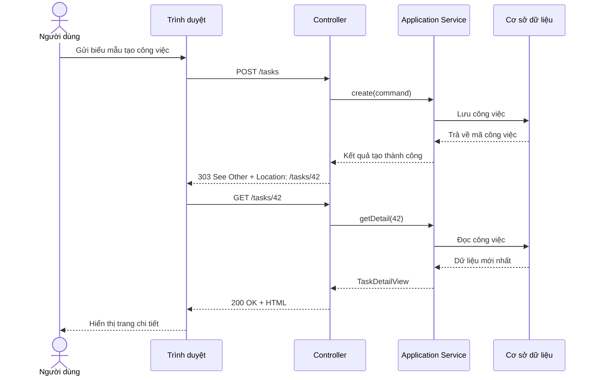
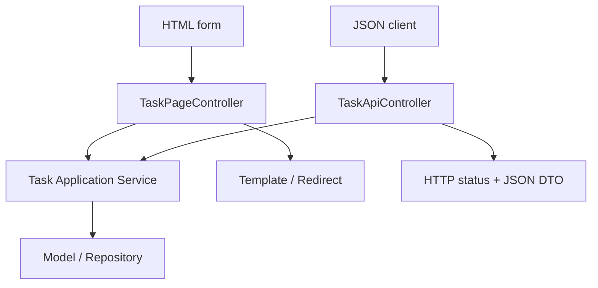

# Quản lý điều hướng và kết quả sau thao tác

Trong một ứng dụng web, Controller không chỉ nhận request và gọi nghiệp vụ. Sau khi xử lý, nó còn quyết định ứng dụng sẽ phản hồi như thế nào: hiển thị lại biểu mẫu, mở trang chi tiết, chuyển hướng đến danh sách, trả dữ liệu JSON hay thông báo lỗi. Những quyết định này tạo nên luồng điều hướng mà người dùng trải nghiệm.

Trong mô hình **Model–View–Controller (MVC)**, Controller là điểm tiếp nhận tương tác từ bên ngoài và điều phối yêu cầu đến phần xử lý phù hợp. Controller chuyển kết quả của ca sử dụng thành phản hồi phù hợp với giao thức và loại client. Với ứng dụng web dùng Spring MVC, phản hồi có thể là tên template, redirect, nội dung JSON hoặc một HTTP status cụ thể.

Bài học này dùng ví dụ ứng dụng quản lý công việc. Người dùng tạo một công việc mới, sửa công việc hiện có hoặc đánh dấu công việc hoàn thành. Ta sẽ theo dõi cách Controller nhận request, gọi nghiệp vụ, xử lý kết quả và đưa người dùng đến trạng thái giao diện tiếp theo.

## 1. Controller nối request với phản hồi

Một request HTTP thường có method, URL, header và có thể có query parameter hoặc body. Router của framework tìm handler phù hợp dựa trên method và đường dẫn. Trong Spring MVC, `DispatcherServlet` tiếp nhận request và các thành phần mapping chọn phương thức Controller tương ứng.

Controller thường thực hiện các công việc sau:

- Khai báo hoặc tiếp nhận route và HTTP method.
- Bind dữ liệu từ path variable, query parameter, form hoặc JSON vào tham số có kiểu.
- Kiểm tra cấu trúc và tính hợp lệ của đầu vào ở ranh giới giao tiếp.
- Lấy danh tính người dùng và phối hợp kiểm tra quyền.
- Gọi Application Service hoặc ca sử dụng tương ứng.
- Chuyển kết quả thành View, redirect, HTTP status hoặc response DTO.
- Chuyển lỗi thành phản hồi có ý nghĩa thông qua handler cục bộ hoặc cơ chế xử lý lỗi tập trung.

Controller nên giữ vai trò điều phối. Quy tắc như công việc nào được phép hoàn thành, ai có thể sửa một tài nguyên và dữ liệu phải thay đổi ra sao cần được bảo vệ trong Model hoặc lớp nghiệp vụ. Controller không nên tự chứa truy vấn SQL, tự dựng chuỗi HTML hoặc lặp lại quy tắc nghiệp vụ ở nhiều endpoint.



Luồng trên là cấu trúc phổ biến trong ứng dụng MVC nhiều lớp. Một ứng dụng nhỏ có thể gọi trực tiếp Model hoặc Repository, nhưng vẫn cần phân định rõ trách nhiệm nhận request, xử lý nghiệp vụ và tạo phản hồi.

## 2. Route và HTTP method xác định hành động

Route ánh xạ một tổ hợp HTTP method và URL tới handler. Method thể hiện ý nghĩa của thao tác ở mức giao thức; URL xác định tài nguyên hoặc nhóm tài nguyên đang được truy cập.

| HTTP method | Cách dùng thường gặp | Ví dụ |
|---|---|---|
| `GET` | Đọc hoặc hiển thị tài nguyên; không tạo thay đổi nghiệp vụ | `GET /tasks/42` |
| `POST` | Gửi dữ liệu để tạo tài nguyên hoặc thực hiện một thao tác | `POST /tasks` hoặc `POST /tasks/42/complete` |
| `PUT` | Thay thế toàn bộ biểu diễn của tài nguyên theo hợp đồng API | `PUT /api/tasks/42` |
| `PATCH` | Cập nhật một phần tài nguyên | `PATCH /api/tasks/42` |
| `DELETE` | Yêu cầu xóa tài nguyên | `DELETE /api/tasks/42` |

Trong HTTP, `GET` được định nghĩa là phương thức an toàn (safe): client không yêu cầu thay đổi trạng thái nghiệp vụ thông qua request này. `PUT` và `DELETE` được định nghĩa là idempotent theo ngữ nghĩa HTTP; gửi lại cùng một yêu cầu có hiệu lực cuối cùng tương đương gửi một lần. `POST` không mặc nhiên idempotent. Cần chọn method đúng với hợp đồng và cách client sử dụng endpoint.

Ví dụ khai báo route trong Spring MVC:

```java
@Controller
@RequestMapping("/tasks")
public class TaskController {

    @GetMapping
    public String list() {
        return "tasks/list";
    }

    @GetMapping("/{id}")
    public String detail(@PathVariable long id, Model model) {
        TaskDetailView task = taskQueryService.getDetail(id);
        model.addAttribute("task", task);
        return "tasks/detail";
    }

    @GetMapping("/new")
    public String newForm(Model model) {
        model.addAttribute("form", new CreateTaskForm());
        return "tasks/form";
    }
}
```

`@RequestMapping("/tasks")` đặt tiền tố chung. Các annotation `@GetMapping` khai báo route chỉ nhận `GET`. `@PathVariable` lấy mã từ URL, còn `Model` của Spring MVC chứa dữ liệu Controller chuyển cho template. Tên template như `tasks/detail` được View resolver dùng để tìm file giao diện.

Với API, có thể dùng `@RestController` hoặc `@ResponseBody` để trả dữ liệu trực tiếp thay vì tên template. Không nên để một endpoint mơ hồ vừa trả HTML vừa trả JSON mà không có hợp đồng rõ ràng về content negotiation.

## 3. Ba kiểu phản hồi phổ biến: render, redirect và forward

Sau khi gọi nghiệp vụ, Controller cần chọn cách phản hồi phù hợp với request và loại client.

### Render View

Controller chuẩn bị dữ liệu cho View rồi trả tên template hoặc `ModelAndView`. Spring MVC kết xuất template thành HTML và gửi về trình duyệt.

```java
@GetMapping("/{id}")
public String detail(@PathVariable long id, Model model) {
    TaskDetailView task = taskQueryService.getDetail(id);
    model.addAttribute("task", task);
    return "tasks/detail";
}
```

Render trực tiếp phù hợp với request đọc dữ liệu như `GET /tasks/42`, hoặc khi cần hiển thị lại biểu mẫu có lỗi validation. URL trên trình duyệt không thay đổi vì không có request điều hướng mới.

### Redirect

Redirect yêu cầu trình duyệt gửi một request mới đến URL khác. Phản hồi HTTP chứa mã trạng thái redirect và header `Location`. Trình duyệt cập nhật URL rồi thực hiện request tiếp theo.

```java
@PostMapping("/{id}/complete")
public String complete(@PathVariable long id) {
    taskCommandService.complete(id);
    return "redirect:/tasks/" + id;
}
```

Trong Spring MVC, tiền tố `redirect:` yêu cầu framework tạo redirect. Mặc định thường là `302 Found`; có thể cấu hình mã khác nếu hợp đồng cần chỉ rõ ngữ nghĩa. Redirect phù hợp sau khi một thao tác thay đổi dữ liệu đã hoàn tất và người dùng cần xem trang tiếp theo.

### Forward

Forward là chuyển tiếp nội bộ phía máy chủ đến một tài nguyên hoặc handler khác trong cùng ứng dụng. Trình duyệt không nhận một redirect và URL trên thanh địa chỉ thường giữ nguyên. Request hiện tại được chuyển tiếp nội bộ, nên đây không phải một lần điều hướng mới do client khởi tạo.

Trong Spring MVC có thể dùng `forward:/...` khi có lý do cụ thể để chuyển tiếp nội bộ. Tuy nhiên, với luồng web thông thường, render trực tiếp một View hoặc redirect sau thao tác thường dễ hiểu hơn. Không dùng forward như thể nó tương đương với redirect.

| Tiêu chí | Render View | Redirect | Forward |
|---|---|---|---|
| Có request HTTP mới từ trình duyệt? | Không | Có | Không |
| URL trình duyệt đổi? | Không | Có | Không |
| Dữ liệu request hiện tại | Dùng để kết xuất phản hồi hiện tại | Request sau là request mới | Request được chuyển tiếp nội bộ |
| Trường hợp thường dùng | Hiển thị trang hoặc biểu mẫu lỗi | Sau khi tạo, sửa, xóa hoặc thực hiện hành động | Chuyển tiếp nội bộ có chủ đích |



## 4. Post/Redirect/Get sau thao tác thay đổi dữ liệu

Nếu một biểu mẫu `POST` được xử lý và Controller trả HTML trực tiếp, người dùng tải lại trang có thể được trình duyệt hỏi có gửi lại biểu mẫu hay không. Mẫu **Post/Redirect/Get (PRG)** xử lý tình huống này bằng cách redirect sau khi thao tác thành công.

Luồng PRG gồm ba giai đoạn:

1. **POST:** trình duyệt gửi dữ liệu biểu mẫu để tạo hoặc cập nhật tài nguyên.
2. **Redirect:** máy chủ xác nhận xử lý thành công và trả redirect tới URL có thể truy cập bằng `GET`.
3. **GET:** trình duyệt gửi request mới để lấy trang kết quả.



Với request `POST`, `303 See Other` chỉ rõ rằng trình duyệt nên truy cập URL đích bằng `GET`. Ví dụ Spring MVC có thể đặt status tường minh bằng `RedirectView`:

```java
@PostMapping
public RedirectView create(
        @ModelAttribute("form") CreateTaskForm form,
        RedirectAttributes redirectAttributes) {

    long id = taskCommandService.create(form.toCommand());
    redirectAttributes.addFlashAttribute(
            "notice", "Công việc đã được tạo.");

    RedirectView redirect = new RedirectView("/tasks/" + id, true);
    redirect.setStatusCode(HttpStatus.SEE_OTHER);
    return redirect;
}
```

Đoạn mã trên giả định dữ liệu đầu vào đã được kiểm tra trước khi gọi ca sử dụng; phần xử lý validation và render lại biểu mẫu khi có lỗi được trình bày ở mục tiếp theo.

PRG giảm nguy cơ gửi lại `POST` khi người dùng refresh trang kết quả. Tuy nhiên, nó không ngăn được hai lần nhấn nút gần như đồng thời, retry từ client hoặc hai request đến máy chủ cùng lúc. Với thao tác có chi phí hoặc không được phép lặp, cần thêm biện pháp ở tầng nghiệp vụ như idempotency key, kiểm soát trạng thái, unique constraint hoặc xử lý đồng thời phù hợp.

## 5. Validation và điều hướng khi biểu mẫu không hợp lệ

Khi dữ liệu biểu mẫu sai, người dùng thường cần quay lại chính biểu mẫu để sửa. Trong trường hợp này, Controller có thể render lại template với dữ liệu đã nhập và lỗi gắn với từng trường. Redirect thường không phù hợp vì request mới không tự giữ `BindingResult` và dữ liệu biểu mẫu.

Ví dụ form object:

```java
public class CreateTaskForm {
    @NotBlank(message = "Vui lòng nhập tiêu đề.")
    @Size(max = 200, message = "Tiêu đề không được vượt quá 200 ký tự.")
    private String title;

    @Size(max = 1000, message = "Mô tả quá dài.")
    private String description;

    // Getter và setter được lược bỏ.

    public CreateTaskCommand toCommand() {
        return new CreateTaskCommand(title, description);
    }
}
```

Controller xử lý cả hai kết quả:

```java
@PostMapping
public String create(
        @Valid @ModelAttribute("form") CreateTaskForm form,
        BindingResult bindingResult,
        RedirectAttributes redirectAttributes) {

    if (bindingResult.hasErrors()) {
        return "tasks/form";
    }

    long id = taskCommandService.create(form.toCommand());
    redirectAttributes.addFlashAttribute(
            "notice", "Công việc đã được tạo.");
    return "redirect:/tasks/" + id;
}
```

Trong Spring MVC, `BindingResult` phải đứng ngay sau tham số được bind và validate để nhận lỗi tương ứng. Khi có lỗi, Controller trả template biểu mẫu. Thymeleaf có thể đọc lỗi từ binding status để hiển thị thông báo cạnh trường nhập liệu.

```html
<form method="post" th:action="@{/tasks}" th:object="${form}">
    <label for="title">Tiêu đề</label>
    <input id="title" type="text" th:field="*{title}"
           th:classappend="${#fields.hasErrors('title')} ? 'invalid'">
    <p th:if="${#fields.hasErrors('title')}"
       th:errors="*{title}" role="alert"></p>

    <label for="description">Mô tả</label>
    <textarea id="description" th:field="*{description}"></textarea>

    <button type="submit">Tạo công việc</button>
</form>
```

Trình duyệt và JavaScript có thể kiểm tra dữ liệu trước khi gửi để cải thiện trải nghiệm, nhưng máy chủ phải xác thực lại. Client có thể bỏ qua mọi kiểm tra ở giao diện.

## 6. Flash attribute và thông báo sau redirect

Sau khi redirect, Controller có thể muốn hiển thị thông báo như “Đã lưu thay đổi”. Nếu đặt thông báo trong request model trước redirect, dữ liệu đó không tự động tồn tại ở request `GET` tiếp theo.

Spring MVC cung cấp `RedirectAttributes` để truyền dữ liệu redirect. Có hai nhóm chính:

- **Redirect attribute:** thường được đưa vào URL dưới dạng path hoặc query parameter khi được xử lý như URI variable.
- **Flash attribute:** dữ liệu tạm thời được lưu để request kế tiếp nhận được, sau đó được tiêu thụ. Thường dùng cho thông báo thành công hoặc lỗi sau redirect.

Ví dụ:

```java
redirectAttributes.addFlashAttribute(
        "notice", "Thay đổi đã được lưu.");
return "redirect:/tasks/" + id;
```

Trang đích đọc `notice` và hiển thị:

```html
<div th:if="${notice}" role="status" class="notice">
    <p th:text="${notice}">Thay đổi đã được lưu.</p>
</div>
```

Flash attribute phù hợp với thông báo ngắn hạn gắn với một lần điều hướng. Không dùng nó làm nơi lưu dữ liệu nghiệp vụ hoặc dữ liệu dài hạn. Không đưa bí mật, token hoặc thông tin nhạy cảm vào URL redirect.

## 7. Chọn HTTP status và response phù hợp

HTTP status cho client biết request đã thành công, cần điều hướng, có lỗi ở đầu vào hay gặp vấn đề ở máy chủ. Chọn status đúng giúp trình duyệt, frontend, proxy và công cụ giám sát hiểu kết quả thống nhất.

| Status | Ý nghĩa | Trường hợp thường dùng |
|---|---|---|
| `200 OK` | Request thành công | Trả trang HTML hoặc dữ liệu JSON |
| `201 Created` | Tạo tài nguyên thành công | API tạo công việc, thường kèm header `Location` |
| `202 Accepted` | Đã tiếp nhận xử lý chưa hoàn tất | Tác vụ chạy nền hoặc xử lý bất đồng bộ |
| `204 No Content` | Thành công, không có nội dung response | API cập nhật hoặc xóa không cần body trả về |
| `302 Found` | Redirect tạm thời | Điều hướng trình duyệt trong nhiều luồng web |
| `303 See Other` | Điều hướng request tiếp theo bằng `GET` | PRG sau `POST` |
| `400 Bad Request` | Request không hợp lệ | Cú pháp hoặc dữ liệu request sai |
| `401 Unauthorized` | Chưa xác thực | Thiếu hoặc hết hạn thông tin đăng nhập |
| `403 Forbidden` | Đã xác thực nhưng không được phép | Người dùng không có quyền thao tác |
| `404 Not Found` | Không tìm thấy tài nguyên | Mã công việc không tồn tại hoặc không được phép tiết lộ |
| `409 Conflict` | Xung đột với trạng thái hiện tại | Chuyển trạng thái không hợp lệ hoặc cập nhật đồng thời |
| `422 Unprocessable Content` | Nội dung hiểu được nhưng không thể xử lý theo ngữ nghĩa | API dùng status này cho lỗi validation theo hợp đồng |
| `500 Internal Server Error` | Lỗi không dự kiến phía máy chủ | Sự cố ngoài dự kiến, không tiết lộ chi tiết nội bộ |

Không có một status duy nhất phù hợp với mọi ứng dụng. Cần chọn theo hợp đồng client, cách xác thực và quy ước API của hệ thống. Đặc biệt, `401` và `403` có ý nghĩa khác nhau; `404` đôi khi được dùng có chủ đích để tránh tiết lộ sự tồn tại của tài nguyên.

## 8. Trả JSON cho API client

Khi client là frontend JavaScript hoặc một hệ thống khác, Controller thường trả DTO và HTTP status thay vì tên template. `ResponseEntity` cho phép xác định status, header và body rõ ràng.

```java
@RestController
@RequestMapping("/api/tasks")
public class TaskApiController {
    private final TaskCommandService taskCommandService;

    public TaskApiController(TaskCommandService taskCommandService) {
        this.taskCommandService = taskCommandService;
    }

    @PostMapping
    public ResponseEntity<TaskResponse> create(
            @Valid @RequestBody CreateTaskRequest request) {

        TaskResponse created = taskCommandService.create(request);
        URI location = URI.create("/api/tasks/" + created.id());

        return ResponseEntity.created(location).body(created);
    }

    @DeleteMapping("/{id}")
    public ResponseEntity<Void> delete(@PathVariable long id) {
        taskCommandService.delete(id);
        return ResponseEntity.noContent().build();
    }
}
```

Endpoint tạo tài nguyên trả `201 Created` và `Location` để client biết tài nguyên mới ở đâu. Endpoint xóa trả `204 No Content` khi không cần body. `@RequestBody` bind JSON vào request DTO; `@Valid` kích hoạt validation. Quy tắc nghiệp vụ và quyền vẫn được kiểm tra ở phía máy chủ.

Response DTO nên ổn định và chỉ chứa trường được phép công khai. Không trả trực tiếp entity ORM nếu nó chứa quan hệ nội bộ, dữ liệu nhạy cảm hoặc cấu trúc có thể thay đổi theo cách lưu trữ.

## 9. Xử lý lỗi tập trung

Nếu mỗi Controller tự bắt mọi exception và tự định dạng response, mã xử lý lỗi sẽ lặp lại. Spring MVC hỗ trợ `@ControllerAdvice` để tập trung ánh xạ exception thành View lỗi hoặc response API.

Ví dụ cho API:

```java
@RestControllerAdvice
public class ApiExceptionHandler {

    @ExceptionHandler(TaskNotFoundException.class)
    public ResponseEntity<ProblemDetail> handleNotFound(
            TaskNotFoundException exception) {

        ProblemDetail problem = ProblemDetail.forStatusAndDetail(
                HttpStatus.NOT_FOUND,
                "Không tìm thấy công việc được yêu cầu.");
        problem.setTitle("Không tìm thấy tài nguyên");
        return ResponseEntity.status(HttpStatus.NOT_FOUND).body(problem);
    }

    @ExceptionHandler(InvalidTaskTransitionException.class)
    public ResponseEntity<ProblemDetail> handleConflict(
            InvalidTaskTransitionException exception) {

        ProblemDetail problem = ProblemDetail.forStatusAndDetail(
                HttpStatus.CONFLICT,
                exception.getMessage());
        problem.setTitle("Trạng thái công việc không phù hợp");
        return ResponseEntity.status(HttpStatus.CONFLICT).body(problem);
    }
}
```

`ProblemDetail` là kiểu biểu diễn lỗi có cấu trúc trong Spring Framework hiện đại. Nếu dùng phiên bản cũ hơn hoặc hợp đồng API riêng, có thể định nghĩa error DTO tương ứng. Với ứng dụng trả HTML, có thể dùng `@ControllerAdvice` trả tên template lỗi và các thuộc tính cần hiển thị.

Nguyên tắc xử lý lỗi:

- Chuyển lỗi nghiệp vụ đã biết thành status và thông báo phù hợp.
- Không trả stack trace, câu SQL, đường dẫn nội bộ hoặc bí mật cấu hình cho client.
- Ghi log đủ thông tin để chẩn đoán, đồng thời tránh ghi token và dữ liệu nhạy cảm.
- Dùng mã tham chiếu lỗi để liên kết thông báo người dùng với log nội bộ khi cần.
- Giữ cấu trúc lỗi API nhất quán để client có thể xử lý mà không phải phân tích chuỗi thông báo tự do.

## 10. Điều hướng an toàn và bảo vệ request

Redirect và route là một phần của bề mặt bảo mật. Controller cần bảo đảm URL đích và hành động được phép đã được kiểm soát.

**Không tin URL quay về do client cung cấp.** Một tham số như `returnUrl` có thể bị sửa thành địa chỉ ngoài hệ thống, tạo lỗ hổng open redirect. Nếu cần quay về trang trước, hãy chỉ chấp nhận đường dẫn nội bộ đã được kiểm tra hoặc dùng một allowlist rõ ràng.

**Kiểm tra quyền trên từng tài nguyên.** Không suy ra quyền từ việc người dùng nhìn thấy nút hoặc biết mã tài nguyên. Mỗi request thay đổi dữ liệu phải xác minh danh tính và quyền phù hợp ở phía máy chủ.

**Bảo vệ request thay đổi trạng thái khỏi CSRF.** Với ứng dụng dùng cookie phiên đăng nhập, cần bật và sử dụng cơ chế CSRF phù hợp. Không dùng `GET` để thực hiện thao tác thay đổi dữ liệu.

**Kiểm soát dữ liệu đầu vào.** Dùng DTO hoặc form object chỉ có các trường client được phép gửi. Không bind mù quáng request vào entity chứa `ownerId`, `role`, `status` hoặc các trường nội bộ.

**Xử lý lặp và cập nhật đồng thời.** PRG không phải cơ chế chống gửi lặp tuyệt đối. Với thao tác quan trọng, cần ràng buộc tính duy nhất, optimistic locking, idempotency key hoặc quy tắc nghiệp vụ phù hợp.

**Không tạo redirect từ chuỗi tùy ý.** Ghép URL từ định danh đã được kiểm tra và route nội bộ đã biết. Nếu dùng `UriComponentsBuilder`, cần encode biến đường dẫn đúng cách thay vì nối chuỗi từ đầu vào không tin cậy.

## 11. Tách Controller cho HTML và API

Một nghiệp vụ có thể được dùng từ trang HTML và API, nhưng hai loại client có nhu cầu phản hồi khác nhau. Có thể dùng chung Application Service, trong khi Controller và DTO được thiết kế riêng.



Page Controller thường trả template hoặc redirect, sử dụng flash attribute và binding errors. API Controller thường trả status, header và DTO; lỗi được biểu diễn theo một schema ổn định. Cả hai có thể gọi chung Service để quy tắc nghiệp vụ không bị nhân đôi.

Việc tách riêng giúp tránh một phương thức Controller có nhiều nhánh dựa trên `Accept` header hoặc tham số tùy chọn, khiến hợp đồng phản hồi khó hiểu. Nếu thực sự dùng content negotiation, hãy khai báo rõ media type được hỗ trợ và kiểm thử từng dạng phản hồi.

## 12. Kiểm thử điều hướng và kết quả

Kiểm thử Controller cần xác nhận không chỉ nghiệp vụ được gọi mà cả phản hồi và điều hướng có đúng hay không.

Với Spring MVC, `MockMvc` có thể kiểm tra endpoint mà không cần khởi chạy server thật. Các trường hợp nên có:

1. `GET` trang chi tiết trả `200 OK`, chọn đúng template và đưa dữ liệu vào Model.
2. `POST` hợp lệ gọi đúng ca sử dụng, trả redirect đến URL mong đợi và đưa flash attribute phù hợp.
3. `POST` không hợp lệ trả lại form, giữ dữ liệu đã nhập và có lỗi ở đúng trường.
4. Request không có quyền trả `403 Forbidden` hoặc phản hồi được quy ước trong chính sách bảo mật.
5. Tài nguyên không tồn tại trả `404 Not Found`.
6. Xung đột nghiệp vụ trả `409 Conflict` hoặc phản hồi tương ứng trong hợp đồng.
7. API tạo tài nguyên trả `201 Created`, body đúng DTO và header `Location` chính xác.

Ví dụ kiểm thử redirect:

```java
mockMvc.perform(post("/tasks/42/complete")
        .with(csrf()))
    .andExpect(status().isSeeOther())
    .andExpect(header().string("Location", "/tasks/42"));
```

Ví dụ này giả định Controller trả `303 See Other` rõ ràng và Spring Security CSRF được bật. Nếu ứng dụng dùng redirect mặc định `302`, expectation cần khớp với hợp đồng thực tế. Kiểm thử không nên buộc implementation dùng một status nếu yêu cầu sản phẩm chưa xác định status đó.

Ngoài kiểm thử Controller, cần kiểm thử Application Service cho quy tắc nghiệp vụ và kiểm thử trình duyệt cho luồng người dùng thực tế như refresh, back, double click, hết phiên đăng nhập và hiển thị thông báo.

## 13. Lỗi thiết kế thường gặp

| Lỗi | Hệ quả | Cách cải thiện |
|---|---|---|
| Dùng `GET` để cập nhật hoặc xóa dữ liệu | Có thể bị kích hoạt ngoài ý muốn bởi prefetch, crawler hoặc refresh | Dùng method thay đổi trạng thái phù hợp như `POST`, `PUT`, `PATCH`, `DELETE` |
| Render trực tiếp sau mọi `POST` thành công | Refresh có thể gửi lại biểu mẫu | Dùng PRG khi luồng phù hợp |
| Redirect sau lỗi validation mà không giữ dữ liệu | Người dùng mất dữ liệu và lỗi theo trường | Render lại form với `BindingResult` |
| Controller chứa toàn bộ nghiệp vụ | Khó tái sử dụng và kiểm thử | Chuyển xử lý vào Application Service và Model |
| Trả status `200` cho mọi trường hợp | Client khó phân biệt thành công, lỗi và xung đột | Chọn status theo ngữ nghĩa HTTP và hợp đồng |
| Dùng flash attribute cho dữ liệu dài hạn | Dữ liệu biến mất hoặc gắn sai request | Chỉ dùng flash cho thông báo ngắn hạn sau redirect |
| Tin URL quay về từ client | Có nguy cơ open redirect | Kiểm tra đường dẫn nội bộ hoặc allowlist |
| Cho rằng PRG ngăn mọi request lặp | Thao tác vẫn có thể chạy hai lần | Dùng idempotency hoặc ràng buộc nghiệp vụ khi cần |
| Bắt exception chung rồi trả `200 OK` | Che giấu lỗi và gây sai lệch giám sát | Ánh xạ exception sang status và phản hồi đúng |

## 14. Quy trình chọn phản hồi sau một thao tác

Khi viết một handler, hãy xác định kết quả mong muốn trước khi chọn kiểu trả về:

1. Đây là request đọc dữ liệu hay thay đổi trạng thái?
2. Client đang cần một trang HTML, một lần điều hướng hay dữ liệu JSON?
3. Nếu thao tác thành công, tài nguyên hoặc trang tiếp theo nằm ở đâu?
4. Nếu validation thất bại, người dùng cần giữ lại dữ liệu và nhìn thấy lỗi ở vị trí nào?
5. Nếu không có quyền, không tìm thấy tài nguyên hoặc trạng thái xung đột, status và thông báo nào phù hợp?
6. Nếu request được gửi lại, nghiệp vụ có an toàn không và cần biện pháp idempotency nào?
7. URL redirect, dữ liệu flash và response DTO có chứa thông tin nhạy cảm hoặc chịu ảnh hưởng từ đầu vào không tin cậy không?

Controller quản lý điều hướng và kết quả bằng cách kết nối request với ca sử dụng rồi chọn phản hồi phù hợp. Render giúp hiển thị trang từ request hiện tại; redirect tạo một lần truy cập mới đến URL đích; forward chuyển tiếp nội bộ phía máy chủ. PRG là lựa chọn hữu ích sau thao tác thay đổi dữ liệu thành công, trong khi validation và lỗi cần được phản ánh theo cách giúp client tiếp tục hoặc xử lý đúng. Khi route, status, dữ liệu phản hồi và quy tắc bảo mật được xác định rõ, luồng MVC trở nên dễ dự đoán cho cả người dùng lẫn hệ thống gọi API.
