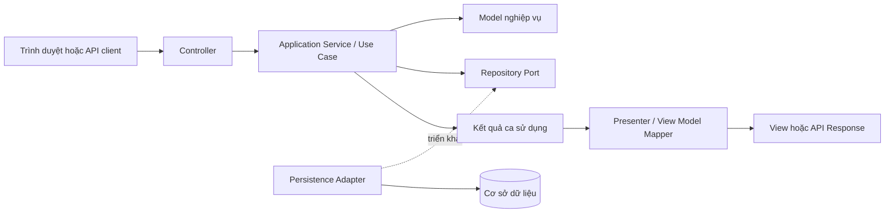

# Tránh phụ thuộc trực tiếp vào chi tiết giao diện hoặc cơ sở dữ liệu

Controller là điểm tiếp nhận request và điều phối một thao tác trong ứng dụng MVC. Vì nằm giữa giao diện và phần xử lý ứng dụng, Controller thường biết request đến từ đâu, cần gọi ca sử dụng nào và kết quả sẽ được trả về theo cách nào. Tuy nhiên, nếu Controller phụ thuộc trực tiếp vào cấu trúc template, thành phần giao diện, câu SQL, bảng dữ liệu hoặc API riêng của một thư viện lưu trữ, một thay đổi ở những chi tiết đó có thể kéo theo sửa đổi ở nhiều Controller.

Thiết kế tốt giữ Controller ở ranh giới giao tiếp: nhận dữ liệu đầu vào, kiểm tra cấu trúc và ràng buộc ở mức request, gọi một thao tác ứng dụng có ý nghĩa, rồi chuyển kết quả thành phản hồi phù hợp. Phần trình bày và phần truy cập dữ liệu được đặt sau các hợp đồng rõ ràng. Cách tổ chức này giúp ứng dụng dễ thay đổi giao diện, thay cơ chế lưu trữ và kiểm thử luồng xử lý hơn.

## 1. Vì sao cần giới hạn phụ thuộc của Controller?

Trong ứng dụng web, một request có thể đi qua nhiều phần: trình duyệt gửi HTTP request, Controller tiếp nhận, dịch vụ ứng dụng thực hiện ca sử dụng, Model nghiệp vụ kiểm tra quy tắc, repository truy xuất dữ liệu, rồi kết quả được chuyển thành HTML hoặc JSON.

Controller cần phối hợp các phần đó, nhưng không cần biết mọi chi tiết bên trong. Nếu Controller vừa định dạng chuỗi hiển thị, vừa tạo HTML, vừa viết SQL và quản lý transaction, nó sẽ có nhiều lý do để thay đổi:

- Bố cục hoặc tên trường trong trang thay đổi.
- Ứng dụng chuyển từ HTML server-rendered sang API JSON.
- Cơ sở dữ liệu đổi bảng, cột hoặc hệ quản trị.
- Quy tắc nghiệp vụ thay đổi.
- Cách xử lý transaction, cache hoặc truy vấn được tối ưu.

Khi các lý do này tập trung trong cùng một lớp, thay đổi nhỏ có thể gây ảnh hưởng rộng và kiểm thử trở nên khó khăn. Controller cũng khó tái sử dụng vì nó gắn với một giao diện cụ thể và một cách lưu trữ cụ thể.

Mục tiêu không phải là loại bỏ mọi hiểu biết về HTTP hoặc View khỏi Controller. Controller vốn là adapter của giao thức và giao diện: nó cần biết route, phương thức HTTP, kiểu phản hồi và có thể chọn tên View logic. Điều cần giới hạn là sự phụ thuộc vào **chi tiết triển khai** như selector DOM, cấu trúc HTML nội bộ, tên bảng, câu SQL hoặc API cụ thể của một nhà cung cấp cơ sở dữ liệu.

## 2. Nhận diện hai nhóm chi tiết dễ gây ràng buộc

### 2.1. Chi tiết giao diện

Các chi tiết giao diện là những quyết định về cách dữ liệu được trình bày hoặc cách người dùng tương tác. Chúng có thể gồm:

- Cấu trúc HTML, tên thẻ, CSS class, selector DOM và bố cục của một trang.
- Tên component hoặc thư viện UI cụ thể.
- Chuỗi văn bản đã dịch, định dạng ngày giờ, số tiền và cách hiển thị trạng thái.
- Cách một vùng giao diện mở modal, cập nhật một phần trang hoặc điều khiển animation.
- Tên file template hoặc cấu trúc thư mục view cụ thể của một engine.

Controller có thể chọn một View logic như `orders/detail` trong ứng dụng Spring MVC. Đây là một phần của hợp đồng giữa Controller và framework. Nhưng Controller không nên tự dựng HTML, truy vấn phần tử DOM, quyết định CSS class hoặc lặp lại quy tắc định dạng cho từng trang.

Ví dụ, Controller không nên tự tạo chuỗi HTML cho từng dòng đơn hàng:

```java
// Ví dụ không nên: Controller trộn điều phối request với trình bày.
@GetMapping("/{id}")
@ResponseBody
String detail(@PathVariable long id) {
    Order order = orderRepository.findById(id).orElseThrow();
    return "<h1>Đơn hàng " + order.getId()
        + "</h1><p>Tổng tiền: " + order.getTotal() + "</p>";
}
```

Đoạn mã gắn Controller với cấu trúc HTML và cách định dạng dữ liệu. Nếu cùng thông tin cần hiển thị trong một trang khác hoặc API, phần trình bày có thể bị sao chép. Việc escape dữ liệu, đổi ngôn ngữ và thay bố cục cũng trở nên khó quản lý.

### 2.2. Chi tiết cơ sở dữ liệu

Chi tiết lưu trữ là những quyết định về cách dữ liệu được ghi và đọc. Ví dụ:

- Tên bảng, tên cột, khóa ngoại và câu SQL cụ thể.
- `JdbcTemplate`, `EntityManager`, `ResultSet` hoặc API của một thư viện ORM.
- Annotation ánh xạ persistence, lazy-loading proxy và cấu trúc entity phụ thuộc ORM.
- Cách phân trang, khóa bản ghi, tối ưu truy vấn hoặc dùng tính năng riêng của một hệ quản trị.
- Cách kết nối, transaction và retry ở tầng hạ tầng.

Controller không nên biết đơn hàng được lưu trong bảng `orders`, tách thành nhiều bảng hay lấy từ một dịch vụ bên ngoài. Nó chỉ cần gọi thao tác ứng dụng như `getOrderDetail(id)` hoặc `placeOrder(command)` và xử lý kết quả theo hợp đồng.

Ví dụ không nên:

```java
@Controller
public class OrderController {
    private final JdbcTemplate jdbcTemplate;

    public OrderController(JdbcTemplate jdbcTemplate) {
        this.jdbcTemplate = jdbcTemplate;
    }

    @PostMapping("/orders")
    public String create(@RequestParam String customerId,
                         @RequestParam BigDecimal total) {
        jdbcTemplate.update(
            "insert into orders(customer_id, total, status) values (?, ?, ?)",
            customerId, total, "PENDING"
        );
        return "redirect:/orders";
    }
}
```

Controller đang biết schema, câu SQL, tên cột và giá trị trạng thái được lưu. Nếu đổi schema hoặc thay cách lưu trữ, lớp điều phối cũng phải sửa. Ví dụ còn bỏ qua quy tắc tính tổng tiền, kiểm tra quyền, transaction và các điều kiện nghiệp vụ của đơn hàng.

## 3. Ranh giới phụ thuộc nên được tổ chức như thế nào?

Một cách tổ chức phổ biến là để Controller gọi application service hoặc use case. Dịch vụ ứng dụng điều phối nghiệp vụ và phụ thuộc vào các hợp đồng cần thiết, chẳng hạn repository interface. Thành phần hạ tầng triển khai các hợp đồng đó bằng JDBC, JPA hoặc một cơ chế lưu trữ khác.



Controller gọi use case thông qua hợp đồng ứng dụng. Use case sử dụng Model nghiệp vụ và một abstraction để đọc hoặc ghi dữ liệu. Adapter ở hạ tầng triển khai abstraction đó. Như vậy, mã nghiệp vụ không cần phụ thuộc vào chi tiết của cơ sở dữ liệu cụ thể.

Đây là cách áp dụng nguyên tắc đảo ngược phụ thuộc (Dependency Inversion Principle) ở ranh giới phù hợp. Abstraction được đặt ở phía cần sử dụng năng lực lưu trữ; implementation cụ thể nằm ở phía hạ tầng. Không nhất thiết dự án nào cũng cần đầy đủ các tầng hoặc đặt tên theo Clean Architecture. Quy mô và độ phức tạp của ứng dụng quyết định số lượng thành phần cần thiết.

### 3.1. Hợp đồng ứng dụng thay cho chi tiết lưu trữ

Một hợp đồng ứng dụng nên diễn đạt mục tiêu của ca sử dụng, không diễn đạt cách truy vấn dữ liệu. Ví dụ:

```java
public interface OrderDetailQuery {
    OrderDetailData getById(long orderId);
}

public interface PlaceOrderUseCase {
    PlaceOrderResult execute(PlaceOrderCommand command);
}
```

Tên `getById` và `execute` thể hiện thao tác mà ứng dụng cung cấp. Hợp đồng không để lộ `SELECT`, tên bảng, kiểu `ResultSet` hoặc annotation ORM. Implementation có thể dùng JPA, JDBC, truy vấn đọc tối ưu hoặc gọi một dịch vụ khác mà Controller không phải biết.

### 3.2. Hợp đồng trình bày thay cho cấu trúc View

Controller có thể chuyển dữ liệu sang một View Model hoặc response DTO. Kiểu dữ liệu này chứa những trường mà View hoặc client cần, không nhất thiết giống entity hoặc cấu trúc bảng.

```java
public record OrderDetailViewModel(
    String orderNumber,
    String customerName,
    String statusLabel,
    String formattedTotal
) {}
```

View Model tách hợp đồng trình bày khỏi Model nghiệp vụ và persistence. Nếu template đổi bố cục, View Model có thể vẫn giữ nguyên. Nếu entity thay đổi cách ánh xạ ORM, View Model cũng không cần thay đổi nếu dữ liệu đầu ra vẫn đáp ứng hợp đồng.

Controller vẫn có thể chọn View logic trong Spring MVC, ví dụ `orders/detail`. Đây là quyết định định tuyến phản hồi ở ranh giới web. Nó không đồng nghĩa Controller phải biết template bên trong có bao nhiêu fragment, class CSS nào được dùng hoặc component được dựng ra sao.

## 4. Ví dụ: Controller điều phối qua use case

Giả sử ứng dụng bán hàng có chức năng tạo đơn hàng và xem chi tiết đơn. Người dùng gửi biểu mẫu gồm thông tin nhận hàng và các sản phẩm được chọn. Controller nhận request, kiểm tra dữ liệu biểu mẫu, chuyển thành command và gọi use case. Use case xác minh quy tắc nghiệp vụ, tính tổng tiền và lưu đơn qua repository abstraction.

### 4.1. Mô hình đầu vào và hợp đồng use case

Không nên bind trực tiếp entity ORM từ request. Hãy định nghĩa một request model với các trường client được phép gửi:

```java
public record PlaceOrderForm(
    @NotBlank String shippingName,
    @NotBlank String shippingAddress,
    @NotEmpty List<@Valid OrderLineForm> lines
) {}

public record OrderLineForm(
    @Positive long productId,
    @Positive int quantity
) {}
```

Command thể hiện yêu cầu ở mức ứng dụng:

```java
public record PlaceOrderCommand(
    CustomerId customerId,
    String shippingName,
    String shippingAddress,
    List<RequestedOrderLine> lines
) {}

public record RequestedOrderLine(long productId, int quantity) {}

public record PlaceOrderResult(String orderNumber) {}
```

`customerId` trong command được lấy từ danh tính đã xác thực ở server, không tin một giá trị tùy ý do client gửi lên. Use case sẽ kiểm tra sản phẩm, giá hiện hành, điều kiện đặt hàng và các quy tắc khác trước khi lưu.

### 4.2. Controller HTML mỏng

Controller tiếp nhận dữ liệu và chuyển tiếp ca sử dụng. Nó không biết entity được lưu ra sao hoặc template tạo biểu mẫu như thế nào:

```java
@Controller
@RequestMapping("/orders")
public class OrderController {
    private final PlaceOrderUseCase placeOrder;

    public OrderController(PlaceOrderUseCase placeOrder) {
        this.placeOrder = placeOrder;
    }

    @PostMapping
    public String create(
            @Valid @ModelAttribute("form") PlaceOrderForm form,
            BindingResult errors,
            @AuthenticationPrincipal AppPrincipal principal,
            RedirectAttributes redirectAttributes) {

        if (errors.hasErrors()) {
            return "orders/new";
        }

        PlaceOrderCommand command = new PlaceOrderCommand(
            principal.customerId(),
            form.shippingName(),
            form.shippingAddress(),
            form.lines().stream()
                .map(line -> new RequestedOrderLine(
                    line.productId(), line.quantity()
                ))
                .toList()
        );

        PlaceOrderResult result = placeOrder.execute(command);
        redirectAttributes.addFlashAttribute(
            "message", "Đơn hàng đã được tạo."
        );
        return "redirect:/orders/" + result.orderNumber();
    }
}
```

Đây là ví dụ rút gọn theo Spring MVC. Controller biết HTTP POST, request model, principal đã xác thực và redirect logic. Nó không biết câu SQL, tên bảng, entity ORM hoặc cấu trúc template. Khi validation thất bại, Controller trả về View nhập liệu để framework render lỗi; khi thành công, nó chuyển hướng đến trang chi tiết theo mô hình Post/Redirect/Get.

Trong hệ thống lớn, có thể chuyển việc ánh xạ `PlaceOrderForm` sang `PlaceOrderCommand` vào một mapper để Controller ngắn hơn. Tuy nhiên, không cần tạo mapper riêng nếu việc chuyển đổi chỉ vài trường và không làm luồng xử lý khó đọc.

### 4.3. Repository abstraction và implementation lưu trữ

Use case có thể phụ thuộc vào một interface repository:

```java
public interface OrderRepository {
    void save(Order order);
    Optional<Order> findById(OrderId id);
}
```

Adapter hạ tầng triển khai interface bằng Spring Data JPA hoặc JDBC. Ví dụ minh họa với JPA:

```java
@Repository
public class JpaOrderRepositoryAdapter implements OrderRepository {
    private final SpringDataOrderJpaRepository jpaRepository;
    private final OrderPersistenceMapper mapper;

    public JpaOrderRepositoryAdapter(
            SpringDataOrderJpaRepository jpaRepository,
            OrderPersistenceMapper mapper) {
        this.jpaRepository = jpaRepository;
        this.mapper = mapper;
    }

    @Override
    public void save(Order order) {
        jpaRepository.save(mapper.toEntity(order));
    }

    @Override
    public Optional<Order> findById(OrderId id) {
        return jpaRepository.findById(id.value())
            .map(mapper::toDomain);
    }
}
```

`SpringDataOrderJpaRepository`, entity JPA và mapper persistence thuộc về hạ tầng. Controller và use case không cần tham chiếu đến chúng. Nếu sau này thay JPA bằng JDBC, adapter có thể được thay hoặc viết lại mà hợp đồng `OrderRepository` vẫn giữ nguyên nếu ngữ nghĩa nghiệp vụ không đổi.

## 5. Không phụ thuộc vào cấu trúc giao diện

Controller cần biết loại phản hồi mà request yêu cầu, nhưng không nên trở thành nơi mô tả chi tiết giao diện. Có thể tổ chức như sau:

1. Controller nhận request và gọi query hoặc use case.
2. Kết quả ứng dụng được chuyển thành View Model hoặc response DTO.
3. View render View Model thành HTML; API serializer chuyển response DTO thành JSON.
4. Chi tiết bố cục, component, CSS và văn bản trình bày được quản lý trong phần giao diện.

### 5.1. Một ca sử dụng, nhiều cách trình bày

Thông tin chi tiết đơn hàng có thể được dùng ở trang web và API cho ứng dụng di động. Hai adapter có thể gọi cùng query:

```java
@Controller
@RequestMapping("/orders")
class WebOrderController {
    private final OrderDetailQuery query;

    WebOrderController(OrderDetailQuery query) {
        this.query = query;
    }

    @GetMapping("/{id}")
    String detail(@PathVariable long id, Model model) {
        OrderDetailData data = query.getById(id);
        model.addAttribute("order", OrderDetailViewModel.from(data));
        return "orders/detail";
    }
}

@RestController
@RequestMapping("/api/orders")
class OrderApiController {
    private final OrderDetailQuery query;

    OrderApiController(OrderDetailQuery query) {
        this.query = query;
    }

    @GetMapping("/{id}")
    OrderDetailResponse detail(@PathVariable long id) {
        return OrderDetailResponse.from(query.getById(id));
    }
}
```

Hai Controller có thể dùng cùng nghiệp vụ truy vấn nhưng trả về hợp đồng khác nhau. Web Controller chọn View logic; API Controller trả về DTO JSON. Cả hai không cần biết dữ liệu được lấy bằng join SQL, cache hay repository JPA.

### 5.2. Tách nội dung trình bày khỏi quy tắc nghiệp vụ

Những việc sau thường thuộc tầng trình bày hoặc presenter:

- Định dạng số tiền, ngày giờ và đơn vị theo locale.
- Chuyển enum nội bộ thành nhãn thân thiện với người dùng.
- Nhóm dữ liệu thành các section, tab hoặc card.
- Tạo chuỗi thông báo thành công và hướng dẫn thao tác.
- Chọn trường nào được phép xuất hiện trong một response công khai.

Những việc như tính tổng tiền đơn hàng, kiểm tra có được phép hủy hay xác định giá hiện hành thuộc về nghiệp vụ. View Model có thể có trường `canCancel` để hỗ trợ hiển thị nút, nhưng server vẫn phải xác thực quyền và kiểm tra trạng thái khi nhận request hủy.

## 6. Không phụ thuộc vào chi tiết cơ sở dữ liệu

### 6.1. Dùng repository hoặc port có ngữ nghĩa nghiệp vụ

Repository abstraction nên cung cấp thao tác theo ngôn ngữ của miền hoặc ca sử dụng, ví dụ `findOpenOrdersForCustomer(customerId)`. Nó không nên buộc Controller truyền tên bảng, chuỗi SQL hoặc kiểu kết quả phụ thuộc vào driver.

Trong một số ứng dụng, application service gọi repository interface. Với truy vấn đọc phức tạp, có thể dùng query service hoặc read port trả về projection phù hợp. Dù dùng cách nào, hợp đồng ở tầng ứng dụng nên thể hiện dữ liệu và hành vi cần thiết thay vì phơi bày công nghệ lưu trữ.

### 6.2. Giữ entity ORM ở ranh giới persistence khi cần

Entity JPA có thể mang annotation, lazy relationship, proxy và quy tắc vòng đời gắn với persistence context. Nếu Controller nhận trực tiếp entity này, nó có thể vô tình:

- Kích hoạt truy vấn bổ sung khi View đọc quan hệ lazy.
- Serialize cả một đồ thị đối tượng lớn hoặc có vòng tham chiếu.
- Làm lộ trường nội bộ khi trả JSON.
- Bị ràng buộc với tên thuộc tính và quan hệ của mô hình lưu trữ.
- Cho phép dữ liệu request ghi đè trường mà client không được phép thay đổi.

Có thể dùng entity JPA đồng thời làm Domain Model trong ứng dụng đơn giản nếu các ràng buộc vẫn phù hợp. Điều cần tránh là để Controller phụ thuộc vào các chi tiết ORM hoặc coi cấu trúc persistence là hợp đồng giao diện. Khi hai mô hình có nhịp thay đổi khác nhau, hãy chuyển đổi qua mapper hoặc DTO ở ranh giới.

### 6.3. Đặt transaction đúng nơi

Transaction thường thuộc application service hoặc một ranh giới ca sử dụng vì một thao tác có thể cập nhật nhiều aggregate hoặc gọi nhiều repository. Controller không nên tự quản lý transaction bằng cách mở kết nối và commit sau khi render response.

Ví dụ, thao tác đặt hàng có thể cần tạo đơn, ghi các dòng hàng và giữ tồn kho trong một transaction hoặc một quy trình nhất quán phù hợp. Application service điều phối ranh giới này; repository adapter thực hiện thao tác lưu trữ. Cách xử lý transaction cụ thể phụ thuộc hệ thống và không nên bị nhúng vào Controller.

## 7. Xử lý lỗi mà không rò rỉ chi tiết hạ tầng

Controller cần chuyển kết quả lỗi của ca sử dụng thành phản hồi giao thức phù hợp. Tuy nhiên, nó không nên phụ thuộc vào exception của driver cơ sở dữ liệu hoặc mã lỗi riêng của một nhà cung cấp để quyết định nội dung giao diện.

Một cách tổ chức là để application layer trả về kết quả có ý nghĩa hoặc ném các exception ứng dụng đã được chuẩn hóa, chẳng hạn:

- `OrderNotFound` — không tìm thấy đơn hàng theo hợp đồng ứng dụng.
- `OrderCannotBeCancelled` — trạng thái nghiệp vụ hiện tại không cho phép hủy.
- `CustomerNotAuthorized` — người gọi không có quyền thực hiện thao tác.
- `DuplicateOrderReference` — mã tham chiếu đã được sử dụng.

Adapter lưu trữ có thể chuyển lỗi unique constraint hoặc lỗi truy vấn thành lỗi ứng dụng phù hợp. Controller hoặc `@ControllerAdvice` ánh xạ lỗi ứng dụng sang status code, View lỗi hoặc response DTO. Thông tin như SQL, tên bảng, stack trace và địa chỉ máy chủ chỉ nên nằm trong log nội bộ.

Ví dụ ánh xạ lỗi tập trung trong Spring MVC:

```java
@ControllerAdvice
public class WebErrorHandler {

    @ExceptionHandler(OrderNotFound.class)
    public ResponseEntity<ApiError> notFound(OrderNotFound error) {
        return ResponseEntity.status(HttpStatus.NOT_FOUND)
            .body(new ApiError("ORDER_NOT_FOUND", "Không tìm thấy đơn hàng."));
    }

    @ExceptionHandler(OrderCannotBeCancelled.class)
    public ResponseEntity<ApiError> conflict(
            OrderCannotBeCancelled error) {
        return ResponseEntity.status(HttpStatus.CONFLICT)
            .body(new ApiError(
                "ORDER_STATE_CONFLICT",
                "Đơn hàng không thể hủy ở trạng thái hiện tại."
            ));
    }
}
```

Đây là ví dụ cho API; với Controller trả HTML, handler có thể trả về một View lỗi hoặc redirect kèm thông báo. Điểm quan trọng là mã web chỉ cần biết lỗi ở mức hợp đồng ứng dụng, không cần biết exception ban đầu đến từ JDBC hay JPA.

## 8. Kiểm soát dữ liệu đầu vào và bảo mật tại ranh giới

Giảm phụ thuộc không có nghĩa là bỏ qua trách nhiệm bảo mật của Controller. Controller là ranh giới tiếp nhận dữ liệu từ bên ngoài nên vẫn cần xác thực cấu trúc request, áp dụng kiểm tra đầu vào phù hợp và chuyển danh tính đã xác thực vào use case.

Một số nguyên tắc:

- Dùng request model hoặc form object có danh sách trường cho phép; tránh bind trực tiếp entity persistence.
- Kiểm tra kiểu, định dạng, trường bắt buộc và giới hạn kích thước ở ranh giới web.
- Lấy định danh người dùng từ security context đã xác thực, không tin `userId` tùy ý trong request.
- Để application service và Model nghiệp vụ thực thi quyền và điều kiện nghiệp vụ có ý nghĩa bảo vệ dữ liệu.
- Không trả trực tiếp entity hoặc exception nội bộ ra client.
- Không đưa dữ liệu không tin cậy vào HTML, SQL hoặc log mà không xử lý phù hợp.

Kiểm tra ở Controller có thể ngăn request sai cấu trúc sớm, nhưng không thay thế quy tắc nghiệp vụ. Một use case có thể được gọi từ nhiều Controller hoặc tác vụ nền, vì vậy điều kiện quan trọng cần được thực thi ở tầng ứng dụng hoặc miền.

## 9. Kiểm thử khi Controller phụ thuộc vào hợp đồng

Khi Controller chỉ phụ thuộc vào use case, query service hoặc presenter abstraction, có thể kiểm thử nó mà không cần dựng cơ sở dữ liệu thật. Test có thể cung cấp mock/fake cho hợp đồng, gửi request và xác minh kết quả ở ranh giới HTTP.

| Phạm vi kiểm thử | Phụ thuộc có thể thay thế | Nội dung cần xác minh |
|---|---|---|
| Unit test Controller | Fake hoặc mock application service | Request được chuyển thành command đúng; kết quả chọn đúng View hoặc response |
| MVC slice test | Mock use case và cấu hình web liên quan | Route, binding, validation, status code và View logic |
| Unit test application service | Fake repository port | Ca sử dụng điều phối đúng và thực thi quy tắc nghiệp vụ |
| Test repository adapter | Cơ sở dữ liệu kiểm thử | Ánh xạ ORM/SQL, truy vấn và transaction hoạt động đúng |
| Integration test | Các adapter và thành phần thật trong môi trường kiểm thử | Luồng request đi qua các ranh giới và trả kết quả chính xác |

Trong Spring MVC, `MockMvc` có thể kiểm tra route và response mà không cần khởi chạy máy chủ HTTP thật. Repository adapter cần được kiểm thử riêng với cơ sở dữ liệu phù hợp để phát hiện lỗi mapping hoặc truy vấn. Unit test Controller không chứng minh SQL đúng; test repository cũng không chứng minh giao diện hiển thị đúng. Mỗi lớp kiểm thử có mục tiêu riêng.

Ví dụ kiểm thử Controller với mock use case:

```java
@WebMvcTest(OrderController.class)
class OrderControllerTest {
    @Autowired
    MockMvc mockMvc;

    @MockBean
    PlaceOrderUseCase placeOrder;

    @Test
    void redirectsAfterOrderIsCreated() throws Exception {
        given(placeOrder.execute(any(PlaceOrderCommand.class)))
            .willReturn(new PlaceOrderResult("ORD-1001"));

        mockMvc.perform(post("/orders")
                .with(user("customer-1"))
                .param("shippingName", "An")
                .param("shippingAddress", "12 Nguyễn Huệ")
                .param("lines[0].productId", "7")
                .param("lines[0].quantity", "2"))
            .andExpect(status().is3xxRedirection())
            .andExpect(redirectedUrl("/orders/ORD-1001"));
    }
}
```

Đoạn kiểm thử minh họa ý tưởng; cấu hình security, tên field và annotation mock phụ thuộc phiên bản Spring và cấu hình dự án. Kiểm thử xác nhận hành vi HTTP của Controller trong khi use case được thay thế bằng mock, không cần biết dữ liệu được lưu bằng công nghệ nào.

## 10. Những sai lầm thường gặp và cách điều chỉnh

**Controller truy vấn SQL trực tiếp.** Khi Controller tự viết SQL, nó bị ràng buộc với schema và driver. Hãy chuyển thao tác dữ liệu sang repository adapter và để Controller gọi use case hoặc query service.

**Controller phụ thuộc vào entity ORM.** Khi Controller truyền entity ra View hoặc API, chi tiết persistence có thể rò rỉ sang giao diện. Hãy cân nhắc View Model hoặc response DTO khi cần hợp đồng độc lập, đặc biệt với API công khai hoặc entity có quan hệ phức tạp.

**Controller tạo HTML hoặc định dạng mọi trường.** Điều này trộn điều phối với trình bày. Hãy để View hoặc presenter xử lý bố cục và định dạng; Controller chỉ chuyển dữ liệu đã chuẩn bị.

**Application service trả về kiểu phụ thuộc framework web.** Nếu use case trả `ModelAndView`, `HttpServletResponse` hoặc kiểu request của Spring, nó bị gắn với một adapter web. Hãy ưu tiên kiểu dữ liệu ứng dụng độc lập, sau đó để Controller chuyển thành response cụ thể.

**Repository interface chỉ đổi tên nhưng vẫn lộ SQL.** Một interface nhận `String tableName`, trả `ResultSet` hoặc yêu cầu Controller cung cấp câu SQL vẫn để lộ chi tiết lưu trữ. Hợp đồng nên mô tả nhu cầu truy xuất theo ngôn ngữ ứng dụng.

**Tạo quá nhiều tầng chuyển tiếp.** Không phải mỗi lời gọi đều cần một interface, mapper và service mới. Nếu một lớp không tạo ra ranh giới, chính sách hoặc khả năng thay thế có giá trị, nó có thể làm luồng khó theo dõi. Hãy bổ sung abstraction khi có lý do thay đổi độc lập hoặc cần kiểm thử/thay thế thực sự.

**Đẩy mọi logic vào application service.** Giữ Controller mỏng không có nghĩa là chuyển toàn bộ quy tắc miền vào một service lớn. Application service điều phối ca sử dụng; Model nghiệp vụ vẫn cần bảo vệ các bất biến và hành vi thuộc về miền.

## 11. Khi nào cần mức độ tách biệt nào?

Không phải mọi ứng dụng MVC đều cần kiến trúc nhiều tầng phức tạp. Có thể lựa chọn mức độ tách biệt theo rủi ro và khả năng thay đổi:

| Bối cảnh | Cách tổ chức phù hợp |
|---|---|
| Ứng dụng nhỏ, CRUD đơn giản, một giao diện và một cơ sở dữ liệu | Controller gọi một service hoặc repository abstraction đơn giản; tránh đưa SQL và entity persistence vào View |
| Nghiệp vụ có nhiều quy tắc và trạng thái | Controller gọi use case; application service điều phối Model nghiệp vụ và repository port |
| Có cả HTML, API và ứng dụng di động | Mỗi adapter có request/response model phù hợp; chia sẻ use case và quy tắc nghiệp vụ |
| Có nhiều loại lưu trữ hoặc cần thay đổi hạ tầng | Đặt port ở phía ứng dụng và triển khai adapter riêng cho từng công nghệ |
| Truy vấn đọc phức tạp hoặc cần hiệu năng riêng | Dùng query service/read model; không để Controller biết SQL hay cấu trúc bảng |

Mục tiêu là tách những quyết định có nhịp thay đổi khác nhau. Nếu giao diện thay đổi thường xuyên nhưng nghiệp vụ ổn định, hợp đồng View Model giúp giảm ảnh hưởng. Nếu cơ sở dữ liệu có thể được thay hoặc tối ưu độc lập, repository port và adapter giúp giữ Controller cùng use case ổn định.

## 12. Checklist rà soát Controller

Khi review một Controller, có thể đặt các câu hỏi sau:

1. Controller có tập trung vào nhận request, kiểm tra đầu vào ở ranh giới và điều phối use case không?
2. Nó có tự tạo HTML, thao tác DOM, định dạng dữ liệu hoặc chứa quy tắc bố cục không?
3. Nó có biết tên bảng, tên cột, SQL, `EntityManager`, `ResultSet` hoặc API cụ thể của database không?
4. Nó có nhận hoặc trả trực tiếp entity ORM ở nơi cần một hợp đồng giao diện riêng không?
5. Dữ liệu đầu vào có giới hạn trường được phép gửi và lấy danh tính từ nguồn đã xác thực không?
6. Quy tắc nghiệp vụ và quyền hạn có được thực thi ở tầng ứng dụng/miền thay vì chỉ ẩn nút trên giao diện không?
7. Lỗi hạ tầng có được chuyển thành lỗi ứng dụng và phản hồi an toàn không?
8. Có thể kiểm thử Controller bằng mock use case mà không cần cơ sở dữ liệu thật không?
9. Có abstraction nào được tạo mà không đem lại khả năng thay đổi, thay thế hoặc kiểm thử có ý nghĩa không?

Nếu Controller có quá nhiều phụ thuộc vào chi tiết giao diện hoặc lưu trữ, hãy bắt đầu bằng việc xác định phần nào thay đổi độc lập. Tạo một hợp đồng đầu vào, một thao tác ứng dụng và một hợp đồng đầu ra rõ ràng thường đã đủ để thu hẹp phạm vi ảnh hưởng.

## Kết luận

Controller nên phụ thuộc vào hợp đồng giao tiếp và thao tác ứng dụng có ý nghĩa, trong khi chi tiết trình bày được giữ ở View/presenter và chi tiết lưu trữ được giữ trong repository adapter. Controller vẫn biết HTTP, route và cách chọn phản hồi, nhưng không cần biết HTML được dựng ra sao hoặc dữ liệu nằm ở bảng nào. Khi ranh giới này rõ ràng, giao diện và cơ sở dữ liệu có thể thay đổi độc lập hơn, nghiệp vụ được dùng lại qua nhiều kênh và Controller có thể được kiểm thử mà không phải dựng toàn bộ hạ tầng.
