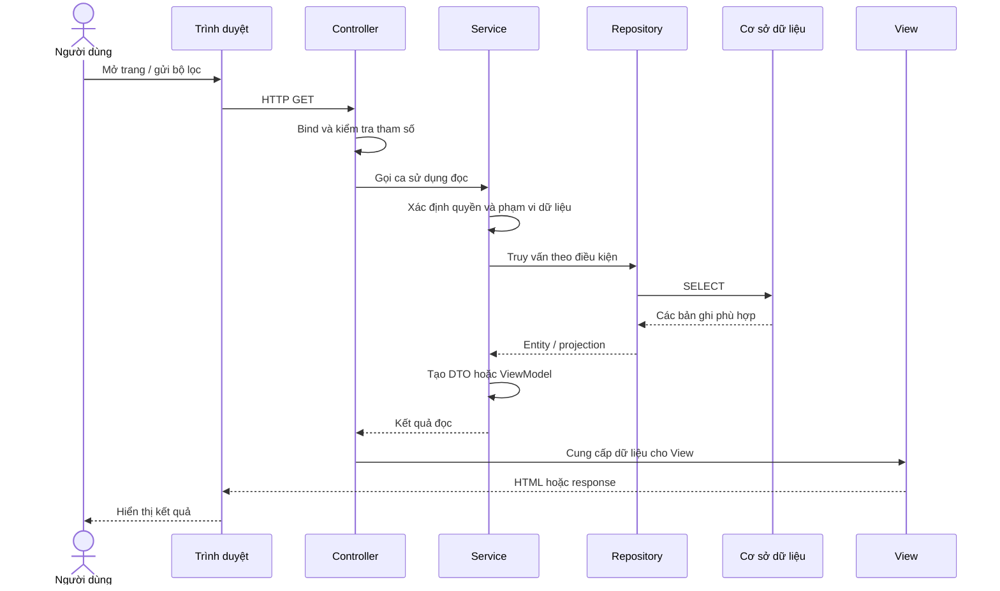

# Luồng đọc và hiển thị dữ liệu

Trong ứng dụng web theo MVC, luồng đọc dữ liệu bắt đầu khi người dùng mở một trang hoặc gửi yêu cầu tìm kiếm. Ứng dụng tiếp nhận request, xác định tài nguyên cần đọc, kiểm tra quyền truy cập, lấy dữ liệu từ nguồn lưu trữ, chuyển dữ liệu thành cấu trúc phù hợp cho giao diện rồi trả View hoặc phản hồi API.

Luồng này cần giữ ranh giới rõ ràng: Controller điều phối request, Service thực hiện ca sử dụng và quy tắc truy cập, Repository truy vấn dữ liệu, Model biểu diễn dữ liệu và nghiệp vụ, còn View trình bày kết quả. Khi các trách nhiệm được phân chia hợp lý, ứng dụng dễ kiểm thử, bảo vệ dữ liệu và tối ưu hiệu năng hơn.

## 1. Luồng đọc dữ liệu trong MVC là gì?

Luồng đọc dữ liệu là quá trình lấy thông tin hiện có để hiển thị hoặc trả về cho một client. Ví dụ:

- Người dùng mở trang chi tiết một đơn hàng.
- Nhân viên xem danh sách yêu cầu nghỉ phép đang chờ duyệt.
- Người dùng tìm kiếm khóa học theo từ khóa và lọc theo cấp độ.
- Trang quản trị xem báo cáo doanh thu theo khoảng thời gian.

Các thao tác trên thường dùng HTTP GET. Theo ngữ nghĩa HTTP, GET được dùng để lấy biểu diễn của tài nguyên và cần an toàn: request không được tạo ra thay đổi nghiệp vụ có chủ ý. GET cũng được xem là idempotent, nghĩa là gọi lặp lại cùng một request không làm thay đổi kết quả nghiệp vụ chỉ vì số lần gọi. Việc ghi log truy cập hoặc cập nhật số liệu vận hành nội bộ không làm thay đổi nguyên tắc thiết kế này.

Một luồng đọc điển hình có thể biểu diễn như sau:



Tên lớp và thứ tự chi tiết có thể khác giữa các framework. Một số framework dùng middleware, filter, interceptor hoặc handler trước Controller; một số ứng dụng API không render HTML mà serialize DTO thành JSON. Điều cốt lõi là dữ liệu được truy vấn có kiểm soát và được chuyển thành hợp đồng phản hồi phù hợp.

## 2. Trách nhiệm của từng thành phần

### 2.1. Trình duyệt và HTTP request

Trình duyệt gửi request đến URL, kèm các thông tin cần thiết như:

- Path xác định tài nguyên, ví dụ `/orders/8f...`.
- Query parameters xác định bộ lọc, phân trang hoặc sắp xếp, ví dụ `?status=PAID&page=0&size=20`.
- Header thể hiện loại nội dung được chấp nhận, ngôn ngữ, thông tin xác thực hoặc cache validator.
- Cookie hoặc token xác định phiên đăng nhập theo cơ chế bảo mật của ứng dụng.

Request chỉ nên chứa dữ liệu cần để xác định nội dung cần đọc. Không gửi toàn bộ đối tượng Model từ trình duyệt rồi coi đó là dữ liệu đáng tin cậy.

### 2.2. Controller

Controller là điểm tiếp nhận request trong tầng MVC. Nó thường thực hiện các việc:

- Ánh xạ URL và HTTP method vào hành động tương ứng.
- Đọc path variable, query parameter và thông tin request.
- Kiểm tra định dạng, kiểu dữ liệu và giới hạn cơ bản.
- Gọi Service phù hợp.
- Đưa kết quả vào Model của framework để View sử dụng, hoặc trả DTO cho bộ chuyển đổi JSON.
- Chọn View, redirect hoặc mã trạng thái HTTP phù hợp.

Controller nên mỏng và tập trung vào điều phối. Không nên đặt câu truy vấn phức tạp, quy tắc phân quyền theo nghiệp vụ hoặc logic tổng hợp lớn trực tiếp trong phương thức Controller.

### 2.3. Service hoặc lớp xử lý ca sử dụng

Service biểu diễn một thao tác có ý nghĩa đối với ứng dụng, chẳng hạn xem chi tiết đơn hàng hoặc tìm danh sách khóa học. Trong luồng đọc, Service có thể:

- Kiểm tra người dùng có quyền xem tài nguyên hay không.
- Xác định phạm vi dữ liệu theo người dùng, tổ chức hoặc tenant.
- Kết hợp dữ liệu từ nhiều Repository hoặc nguồn khác nhau.
- Áp dụng quy tắc nghiệp vụ để xác định dữ liệu nào được phép hiển thị.
- Chuyển Entity hoặc projection thành DTO/ViewModel.
- Xử lý trường hợp không tìm thấy dữ liệu hoặc dữ liệu không đủ điều kiện hiển thị.

Không phải mọi truy vấn đều cần một lớp Service riêng. Với ứng dụng nhỏ, một query handler hoặc use-case class có thể đảm nhiệm vai trò này. Điều quan trọng là quy tắc dùng chung và quyền truy cập không bị lặp lại tùy tiện ở nhiều Controller.

### 2.4. Repository và nguồn dữ liệu

Repository che giấu chi tiết truy cập dữ liệu, giúp Service làm việc với khái niệm nghiệp vụ thay vì câu SQL hoặc API lưu trữ cụ thể.

Repository có thể trả về:

- Entity khi cần trạng thái và hành vi của đối tượng.
- Projection chỉ chứa các cột cần thiết cho màn hình.
- DTO đọc được tạo từ truy vấn.
- Một trang dữ liệu cùng tổng số kết quả hoặc metadata phân trang.

Với màn hình chỉ đọc, projection có thể tiết kiệm tài nguyên so với tải toàn bộ Entity và các quan hệ không cần thiết. Truy vấn cần có tham số rõ ràng, dùng parameter binding và giới hạn kết quả hợp lý.

### 2.5. Model

Trong kiến trúc MVC, Model đại diện cho dữ liệu và quy tắc nghiệp vụ mà ứng dụng quản lý. Model không đồng nghĩa với mọi đối tượng được truyền vào View.

Cần phân biệt:

- **Domain Model/Entity:** mô tả trạng thái và quy tắc của miền nghiệp vụ.
- **Query model hoặc projection:** cấu trúc tối ưu cho một nhu cầu đọc cụ thể.
- **DTO:** cấu trúc dữ liệu trao đổi giữa các tầng hoặc qua API.
- **ViewModel:** cấu trúc được chuẩn bị riêng cho một màn hình.

Một số framework, như Spring MVC, còn có kiểu `Model` riêng dùng làm nơi chứa thuộc tính để template đọc. Kiểu `Model` của framework là cơ chế truyền dữ liệu đến View; nó không phải Domain Model của ứng dụng.

### 2.6. View

View nhận dữ liệu đã được chuẩn bị và trình bày cho người dùng. View chịu trách nhiệm:

- Chọn bố cục và thành phần giao diện.
- Hiển thị dữ liệu, trạng thái rỗng và thông báo.
- Định dạng ngày giờ, số và nội dung theo Locale.
- Tạo liên kết, biểu mẫu hoặc nút điều hướng đến thao tác tiếp theo.
- Escape nội dung động theo ngữ cảnh để hạn chế XSS.

View không nên tự truy cập cơ sở dữ liệu hoặc tự quyết định quyền nghiệp vụ. Việc ẩn một liên kết trên giao diện không thay thế kiểm tra quyền ở phía máy chủ.

## 3. Các bước xử lý request đọc dữ liệu

### Bước 1: Nhận request và định tuyến

Web server hoặc framework nhận HTTP request. Bộ định tuyến tìm Controller/action phù hợp dựa trên URL, method và cấu hình route.

Ví dụ:

| Request | Mục đích |
|---|---|
| `GET /orders` | Xem danh sách đơn hàng |
| `GET /orders/123` | Xem chi tiết đơn hàng có mã 123 |
| `GET /courses?keyword=java` | Tìm khóa học theo từ khóa |
| `GET /reports/sales?from=2026-01-01&to=2026-01-31` | Xem báo cáo trong khoảng thời gian |

Route nên thể hiện tài nguyên hoặc mục đích đọc một cách dễ hiểu. Tránh dùng GET cho thao tác thay đổi trạng thái như xác nhận đơn, xóa bản ghi hoặc duyệt yêu cầu.

### Bước 2: Xác định danh tính và ngữ cảnh request

Middleware, filter hoặc cơ chế bảo mật của framework có thể xác thực phiên đăng nhập trước khi Controller chạy. Controller và Service sử dụng danh tính đã được xác thực để xác định quyền.

Ngoài danh tính, request có thể có Locale, múi giờ, tenant hoặc cấu hình hiển thị. Những thông tin này cần được lấy từ nguồn có thẩm quyền và kiểm tra trước khi dùng.

### Bước 3: Bind và kiểm tra tham số

Ví dụ request danh sách có thể nhận:

- `status`: trạng thái cần lọc.
- `keyword`: từ khóa tìm kiếm.
- `page`: chỉ số trang.
- `size`: số phần tử mỗi trang.
- `sort`: trường và hướng sắp xếp.

Cần kiểm tra kiểu dữ liệu và giới hạn: `page` không âm, `size` không vượt mức tối đa, ngày bắt đầu không sau ngày kết thúc, trạng thái thuộc danh sách cho phép. Trường sort nên ánh xạ qua danh sách trường được hỗ trợ, không nối trực tiếp giá trị tùy ý vào SQL.

### Bước 4: Gọi Service và áp dụng quyền truy cập

Service cần xác định người dùng có quyền xem tài nguyên được yêu cầu hay không. Với dữ liệu đa tổ chức, phạm vi tenant phải được áp dụng ngay trong truy vấn hoặc trước khi trả dữ liệu.

Ví dụ, truy vấn chi tiết nên giới hạn theo cả mã đơn hàng và tổ chức mà người dùng được phép truy cập. Không nên tải một đơn hàng bất kỳ rồi chỉ dựa vào việc giao diện không hiển thị liên kết để bảo vệ dữ liệu.

### Bước 5: Truy vấn và chuyển đổi dữ liệu

Repository lấy đúng dữ liệu cần thiết. Service chuyển dữ liệu đó thành DTO hoặc ViewModel có cấu trúc ổn định, tránh đưa những trường nội bộ không cần thiết ra ngoài.

Nếu màn hình cần tên khách hàng, mã đơn, ngày tạo và tổng tiền, truy vấn có thể chỉ lấy các trường đó. Không nhất thiết tải toàn bộ quan hệ của Entity.

### Bước 6: Tạo phản hồi

Với ứng dụng server-side rendering, Controller thêm ViewModel vào Model của framework và trả tên template. Template engine kết xuất HTML.

Với API, Controller trả DTO để framework serialize thành JSON hoặc định dạng được hợp đồng quy định.

### Bước 7: Trình duyệt hiển thị kết quả

Trình duyệt nhận status code, header và nội dung phản hồi. Nó phân tích HTML, tải các tài nguyên giao diện cần thiết và hiển thị kết quả. Nếu là JSON, frontend sử dụng dữ liệu để cập nhật giao diện phía client.

## 4. Thiết kế hợp đồng dữ liệu cho màn hình đọc

Hợp đồng dữ liệu xác định đầu vào và đầu ra của một luồng đọc. Hợp đồng rõ ràng giúp Controller, Service, Repository và View phối hợp mà không phụ thuộc cấu trúc nội bộ của nhau.

### 4.1. Đầu vào của truy vấn

Với một trang danh sách đơn hàng, có thể định nghĩa tiêu chí tìm kiếm:

```java
public record OrderSearchCriteria(
    String keyword,
    OrderStatus status,
    int page,
    int size,
    OrderSortField sortField,
    SortDirection direction
) {}
```

Đối tượng này biểu diễn những điều kiện được hỗ trợ. Controller chuyển tham số HTTP thành tiêu chí có kiểu, sau đó Service kiểm tra và áp dụng mặc định phù hợp.

Không nên nhận tên cột SQL hoặc biểu thức sắp xếp tùy ý từ client. Hãy dùng enum hoặc bảng ánh xạ từ giá trị API sang trường được phép.

### 4.2. Đầu ra dành cho View

Ví dụ ViewModel cho danh sách:

```java
public record OrderRowView(
    UUID id,
    String orderNumber,
    String customerName,
    String statusLabel,
    String createdAtText,
    String totalText
) {}

public record OrderListView(
    List<OrderRowView> items,
    int page,
    int pageSize,
    long totalItems,
    int totalPages
) {}
```

ViewModel có thể chứa các chuỗi đã định dạng dành riêng cho giao diện. Nếu cần hỗ trợ nhiều Locale, Service hoặc lớp mapper trình bày nhận Locale và ZoneId tường minh để tạo những chuỗi đó. Không dùng lại các chuỗi này cho tính toán nghiệp vụ.

Với API công khai, thường nên trả dữ liệu có kiểu và mã ổn định, để client tự trình bày. Nếu trả nhãn đã dịch, hợp đồng cần nêu rõ Locale áp dụng.

### 4.3. Phân biệt dữ liệu không tìm thấy và danh sách rỗng

Hai trường hợp có ý nghĩa khác nhau:

- Trang chi tiết với mã định danh không tồn tại thường trả 404.
- Truy vấn danh sách hợp lệ nhưng không có bản ghi phù hợp thường trả 200 cùng danh sách rỗng và metadata phân trang.

Không nên biến một truy vấn danh sách không có kết quả thành lỗi hệ thống. View có thể hiển thị trạng thái rỗng cùng gợi ý xóa bộ lọc hoặc thử từ khóa khác.

## 5. Ví dụ: đọc và hiển thị danh sách đơn hàng bằng Spring MVC

Giả sử ứng dụng có trang danh sách đơn hàng. Người dùng có thể lọc theo trạng thái và từ khóa, đồng thời phân trang kết quả.

### 5.1. Controller tiếp nhận request

```java
@Controller
@RequestMapping("/orders")
public class OrderController {

    private final OrderQueryService orderQueryService;

    public OrderController(OrderQueryService orderQueryService) {
        this.orderQueryService = orderQueryService;
    }

    @GetMapping
    public String list(
            @RequestParam(required = false) String keyword,
            @RequestParam(required = false) OrderStatus status,
            @RequestParam(defaultValue = "0") int page,
            @RequestParam(defaultValue = "20") int size,
            Authentication authentication,
            Model model) {

        OrderListView result = orderQueryService.search(
            new OrderSearchCriteria(
                keyword,
                status,
                page,
                size,
                OrderSortField.CREATED_AT,
                SortDirection.DESC
            ),
            authentication.getName()
        );

        model.addAttribute("orders", result);
        model.addAttribute("keyword", keyword);
        model.addAttribute("selectedStatus", status);

        return "orders/list";
    }
}
```

Trong Spring MVC, `@GetMapping` ánh xạ request GET vào phương thức Controller. `@RequestParam` bind query parameter vào tham số có kiểu. `Model` là nơi đưa dữ liệu sang template. Tên `orders/list` là tên View mà cấu hình ViewResolver dùng để tìm template.

Ví dụ trên minh họa luồng điều phối. Trong ứng dụng thực tế, nên thêm kiểm tra giới hạn trang, xử lý tham số sai định dạng và xác thực/phân quyền bằng cơ chế bảo mật thống nhất của dự án.

### 5.2. Service thực hiện truy vấn đọc

```java
@Service
public class OrderQueryService {

    private final OrderRepository orderRepository;
    private final OrderViewMapper orderViewMapper;
    private final OrderAccessPolicy orderAccessPolicy;

    public OrderListView search(
            OrderSearchCriteria criteria,
            String username) {

        int page = Math.max(criteria.page(), 0);
        int size = Math.min(Math.max(criteria.size(), 1), 100);

        OrderSearchCriteria safeCriteria =
            new OrderSearchCriteria(
                criteria.keyword(),
                criteria.status(),
                page,
                size,
                criteria.sortField(),
                criteria.direction()
            );

        UserContext viewer = orderAccessPolicy.requireViewer(username);

        Page<OrderListProjection> result =
            orderRepository.searchVisibleTo(safeCriteria, viewer);

        return orderViewMapper.toListView(result, viewer.locale());
    }
}
```

Service kiểm soát giới hạn phân trang, xác định người xem và yêu cầu Repository chỉ trả về đơn hàng nằm trong phạm vi người đó được phép xem. Phần mapper chuyển kết quả đọc thành ViewModel.

Đây là ví dụ kiến trúc, các kiểu `Page`, `OrderListProjection`, `UserContext` và API repository phụ thuộc cách triển khai cụ thể.

### 5.3. View trình bày dữ liệu

Với Thymeleaf, template có thể hiển thị dữ liệu như sau:

```html
<h1>Danh sách đơn hàng</h1>

<p th:if="${#lists.isEmpty(orders.items)}">
    Không tìm thấy đơn hàng phù hợp.
</p>

<table th:if="${!#lists.isEmpty(orders.items)}">
  <thead>
    <tr>
      <th>Mã đơn</th>
      <th>Khách hàng</th>
      <th>Trạng thái</th>
      <th>Ngày tạo</th>
      <th>Tổng tiền</th>
    </tr>
  </thead>
  <tbody>
    <tr th:each="order : ${orders.items}">
      <td th:text="${order.orderNumber}">ORD-001</td>
      <td th:text="${order.customerName}">Khách hàng</td>
      <td th:text="${order.statusLabel}">Đã thanh toán</td>
      <td th:text="${order.createdAtText}">19/11/2026</td>
      <td th:text="${order.totalText}">1.000.000 ₫</td>
    </tr>
  </tbody>
</table>
```

`th:text` của Thymeleaf escape nội dung theo cơ chế mặc định, giúp tránh diễn giải dữ liệu động như HTML. Không dùng `th:utext` với nội dung người dùng hoặc dữ liệu chưa được làm sạch. Nội dung HTML có chủ đích cần được kiểm soát và sanitize theo chính sách riêng.

### 5.4. Liên kết phân trang và giữ bộ lọc

Khi người dùng chuyển trang, View nên giữ lại các bộ lọc hiện tại. Ví dụ URL trang tiếp theo có thể là:

```text
/orders?keyword=laptop&status=PAID&page=1&size=20
```

Cần kiểm tra số trang nằm trong giới hạn và xử lý trường hợp dữ liệu bị xóa hoặc thay đổi khiến trang yêu cầu không còn kết quả. Có thể chuyển về trang hợp lệ hoặc hiển thị danh sách rỗng theo quy ước của sản phẩm.

## 6. Đọc dữ liệu chi tiết và xử lý trường hợp không tìm thấy

Luồng đọc chi tiết thường nhận mã định danh từ path:

```java
@GetMapping("/{orderId}")
public String detail(
        @PathVariable UUID orderId,
        Authentication authentication,
        Model model) {

    OrderDetailView order = orderQueryService.getDetail(
        orderId,
        authentication.getName()
    );

    model.addAttribute("order", order);
    return "orders/detail";
}
```

Service có thể gọi truy vấn giới hạn theo người xem:

```java
public OrderDetailView getDetail(UUID orderId, String username) {
    UserContext viewer = orderAccessPolicy.requireViewer(username);

    OrderDetailProjection order = orderRepository
        .findVisibleDetail(orderId, viewer)
        .orElseThrow(OrderNotFoundException::new);

    return orderViewMapper.toDetailView(order, viewer.locale());
}
```

Cách truy vấn này có thể đồng thời xử lý hai điều kiện: bản ghi phải tồn tại và phải nằm trong phạm vi người dùng được xem. Với tài nguyên nhạy cảm, trả 404 cho cả trường hợp không tồn tại và không thuộc phạm vi truy cập có thể giúp tránh tiết lộ sự tồn tại của tài nguyên. Chính sách 403 hay 404 cần nhất quán với yêu cầu bảo mật và hợp đồng API.

Không nên trả toàn bộ Entity ra View hoặc API nếu nó chứa dữ liệu nhạy cảm như thông tin xác thực, ghi chú nội bộ, dữ liệu cá nhân không cần thiết hoặc thông tin quản trị. DTO/ViewModel giúp giới hạn chính xác trường được công khai.

## 7. Hiệu năng của luồng đọc

Luồng đọc có thể trở thành điểm nghẽn khi dữ liệu tăng hoặc nhiều người truy cập cùng lúc. Một số nguyên tắc thường hữu ích:

### Chỉ truy vấn dữ liệu cần thiết

Màn hình danh sách thường chỉ cần vài cột. Projection hoặc DTO query giúp tránh tải toàn bộ Entity và các quan hệ không dùng đến.

### Tránh lỗi N+1

Nếu View hiển thị danh sách 50 đơn hàng và mỗi đơn lại truy vấn riêng khách hàng, ứng dụng có thể thực hiện hàng chục truy vấn thay vì một vài truy vấn có kiểm soát. Hãy cân nhắc join phù hợp, projection, batch fetching hoặc chiến lược tải quan hệ.

Không nên eager-load mọi quan hệ để tránh N+1, vì việc đó có thể tải quá nhiều dữ liệu và tạo truy vấn lớn. Chọn chiến lược theo màn hình và đo hiệu năng thực tế.

### Phân trang và giới hạn kích thước

Không tải toàn bộ dữ liệu khi danh sách có thể tăng không giới hạn. Dùng phân trang hoặc cursor pagination khi phù hợp. Giới hạn kích thước trang ở phía máy chủ; không tin client có thể yêu cầu hàng triệu bản ghi.

Với tập dữ liệu rất lớn hoặc thay đổi liên tục, cursor pagination dựa trên khóa sắp xếp ổn định có thể tránh một số nhược điểm của offset pagination. Cần xác định thứ tự sắp xếp duy nhất, chẳng hạn kết hợp thời gian tạo và ID.

### Tạo chỉ mục cho truy vấn phổ biến

Các bộ lọc thường dùng như tenant, trạng thái, thời gian tạo hoặc khóa tìm kiếm có thể cần chỉ mục. Chỉ mục phải dựa trên truy vấn thực tế và được đánh giá bằng kế hoạch thực thi; tạo quá nhiều chỉ mục làm tăng chi phí ghi và lưu trữ.

### Cache khi dữ liệu phù hợp

Cache có thể giảm truy vấn cho dữ liệu ít thay đổi hoặc có thể chấp nhận độ trễ cập nhật. Cache key cần bao gồm các yếu tố làm thay đổi kết quả như người dùng, tenant, Locale, bộ lọc và quyền truy cập khi phù hợp. Không dùng chung cache của dữ liệu riêng tư giữa những người dùng khác nhau.

Với HTTP, có thể dùng `ETag` hoặc `Last-Modified` để trình duyệt kiểm tra nội dung có thay đổi hay không. Phản hồi chứa dữ liệu riêng tư cần có chính sách cache phù hợp, ví dụ `private` hoặc `no-store` tùy mức độ nhạy cảm.

## 8. Bảo mật khi đọc và hiển thị dữ liệu

Luồng đọc thường không thay đổi dữ liệu nghiệp vụ, nhưng vẫn có rủi ro bảo mật:

- **Xác thực:** chỉ cho phép request vào các khu vực cần đăng nhập khi phiên hoặc token hợp lệ.
- **Phân quyền đối tượng:** kiểm tra người dùng có được xem chính tài nguyên được yêu cầu hay không, không chỉ kiểm tra vai trò chung.
- **Cô lập tenant:** mọi truy vấn đa tenant phải giới hạn đúng tổ chức hoặc không gian dữ liệu của người dùng.
- **Giảm thiểu dữ liệu:** chỉ trả các trường cần thiết cho màn hình và người nhận.
- **SQL injection:** dùng query parameter binding hoặc API truy vấn an toàn; không nối chuỗi từ query parameter vào SQL.
- **XSS:** escape dữ liệu động theo ngữ cảnh khi render HTML; nội dung HTML cho phép cần được sanitize.
- **Thông tin nhạy cảm:** không đưa token, mật khẩu, dữ liệu cá nhân không cần thiết hoặc chi tiết nội bộ vào ViewModel, JSON hay log.
- **Cache:** không để cache công khai chứa dữ liệu phụ thuộc người dùng hoặc quyền truy cập.

Vì GET được dùng để đọc, request GET không nên thực hiện hành động thay đổi nghiệp vụ. Việc xóa, duyệt hoặc xác nhận cần dùng method và luồng cập nhật phù hợp, kèm xác thực, phân quyền và biện pháp chống request giả mạo khi dùng cookie.

## 9. Xử lý lỗi và trạng thái giao diện

Không phải request đọc nào cũng trả dữ liệu thành công. Ứng dụng cần có quy ước phản hồi rõ ràng.

| Tình huống | HTTP response thường dùng | Hành vi giao diện |
|---|---|---|
| Đọc thành công | `200 OK` | Hiển thị nội dung |
| Danh sách hợp lệ nhưng không có kết quả | `200 OK` | Hiển thị trạng thái rỗng |
| Tài nguyên không tồn tại | `404 Not Found` | Hiển thị trang không tìm thấy |
| Chưa xác thực | `401 Unauthorized` hoặc redirect đăng nhập theo ứng dụng | Yêu cầu đăng nhập |
| Không đủ quyền | `403 Forbidden` hoặc `404` theo chính sách che giấu | Thông báo phù hợp |
| Tham số không hợp lệ | `400 Bad Request` | Báo lỗi bộ lọc hoặc tham số |
| Lỗi máy chủ bất ngờ | `500 Internal Server Error` | Trang lỗi chung, có mã tham chiếu nếu cần |

Với server-side rendering, có thể dùng exception handler chung để ánh xạ lỗi sang trang lỗi hoặc status code. Với API, nên trả cấu trúc lỗi ổn định, ví dụ mã lỗi, thông điệp có thể hiển thị và mã tham chiếu hỗ trợ.

Không hiển thị stack trace, câu SQL hoặc thông tin cấu hình trong phản hồi cho người dùng. Ghi chi tiết kỹ thuật vào log có kiểm soát và tránh lưu dữ liệu nhạy cảm không cần thiết.

## 10. Kiểm thử luồng đọc và hiển thị

Nên kiểm thử theo ranh giới trách nhiệm:

- **Unit test cho Service:** xác nhận Service áp dụng bộ lọc, quyền truy cập và chuyển đổi kết quả đúng.
- **Repository integration test:** xác nhận truy vấn, join, phân trang, thứ tự sắp xếp và giới hạn tenant.
- **Controller test:** xác nhận route, HTTP method, bind tham số, mã trạng thái, tên View và dữ liệu được đưa vào Model.
- **View test hoặc UI test:** xác nhận dữ liệu được render đúng, trạng thái rỗng, thông báo và escape nội dung.
- **End-to-end test:** kiểm tra hành trình người dùng từ mở trang, lọc, chuyển trang đến xem chi tiết.

Một ma trận kiểm thử cho trang danh sách đơn hàng:

| Trường hợp | Kết quả mong đợi |
|---|---|
| Người dùng có quyền mở danh sách | Trả trang hoặc JSON thành công |
| Người dùng không có quyền | Không lộ dữ liệu ngoài phạm vi |
| Không có đơn hàng phù hợp | Trả danh sách rỗng, không phải lỗi 500 |
| Tham số trang âm hoặc kích thước quá lớn | Chuẩn hóa hoặc từ chối theo hợp đồng |
| Giá trị sort không được hỗ trợ | Dùng mặc định hoặc trả lỗi tham số |
| Từ khóa có ký tự đặc biệt | Không gây SQL injection hoặc lỗi truy vấn |
| Dữ liệu có nội dung HTML do người dùng nhập | Hiển thị an toàn, không thực thi script |
| Tài nguyên chi tiết không tồn tại | Trả 404 theo quy ước |
| Người dùng truy cập ID thuộc tenant khác | Không tiết lộ dữ liệu |
| Danh sách lớn | Phân trang và truy vấn trong giới hạn hiệu năng |

Kiểm thử không chỉ xác nhận status code. Cần xác nhận dữ liệu trả về không chứa trường nhạy cảm và View không nhận những đối tượng không thuộc phạm vi truy cập.

## 11. Những lỗi thiết kế thường gặp

### Để Controller truy vấn trực tiếp cơ sở dữ liệu

Controller chứa SQL hoặc logic truy vấn phức tạp sẽ khó tái sử dụng và kiểm thử. Hãy chuyển truy vấn vào Repository hoặc query service.

### Trả Entity trực tiếp cho View hoặc API

Entity có thể chứa quan hệ lazy, dữ liệu nội bộ hoặc trường nhạy cảm. Dùng DTO/ViewModel để xác định rõ dữ liệu nào được hiển thị.

### Đặt quyền truy cập ở View

Ẩn nút hoặc liên kết chỉ là điều chỉnh giao diện. Mọi truy vấn dữ liệu cần được bảo vệ ở phía máy chủ theo người dùng và đối tượng cụ thể.

### Tải quá nhiều dữ liệu

Lấy toàn bộ bảng hoặc tải toàn bộ quan hệ làm tăng thời gian phản hồi và bộ nhớ. Chọn projection, phân trang và chiến lược tải phù hợp.

### Dùng GET để thay đổi trạng thái

GET có thể được gọi tự động bởi trình duyệt, crawler, preview bot hoặc cache. Hành động làm thay đổi nghiệp vụ phải dùng luồng ghi phù hợp.

### Trộn chuỗi hiển thị vào dữ liệu nghiệp vụ

Lưu trạng thái đã dịch, ngày đã định dạng hoặc số tiền có ký hiệu làm dữ liệu gốc khiến việc lọc, sắp xếp và trao đổi giữa hệ thống khó chính xác. Giữ dữ liệu có kiểu và chỉ định dạng ở ranh giới View.

## 12. Checklist trước khi hoàn thiện luồng đọc

1. Route dùng đúng HTTP method và thể hiện rõ tài nguyên cần đọc.
2. Path và query parameter được bind, kiểm tra kiểu và giới hạn.
3. Danh tính, quyền đối tượng và phạm vi tenant được xác minh phía máy chủ.
4. Service điều phối ca sử dụng; Controller không chứa truy vấn hoặc nghiệp vụ phức tạp.
5. Repository chỉ lấy dữ liệu cần thiết và dùng truy vấn có tham số.
6. DTO/ViewModel giới hạn trường được đưa ra View hoặc API.
7. Danh sách có phân trang, sắp xếp được kiểm soát và trạng thái rỗng.
8. View escape dữ liệu động và không tự truy cập nguồn lưu trữ.
9. Lỗi được ánh xạ nhất quán; phản hồi không làm lộ chi tiết nội bộ.
10. Cache, chỉ mục và chiến lược tải dữ liệu phù hợp với quy mô.
11. Có kiểm thử quyền truy cập, truy vấn, controller, render và dữ liệu biên.

## Kết luận

Luồng đọc và hiển thị dữ liệu là sự phối hợp giữa HTTP, Controller, Service, Repository, Model và View. Controller tiếp nhận request và điều phối, Service áp dụng ca sử dụng cùng quyền truy cập, Repository truy vấn dữ liệu, DTO/ViewModel xác định hợp đồng trình bày, còn View kết xuất kết quả an toàn. Khi dữ liệu được giới hạn đúng phạm vi, truy vấn hiệu quả và phản hồi có cấu trúc rõ ràng, ứng dụng MVC có thể hiển thị thông tin nhất quán, bảo mật và dễ bảo trì.

