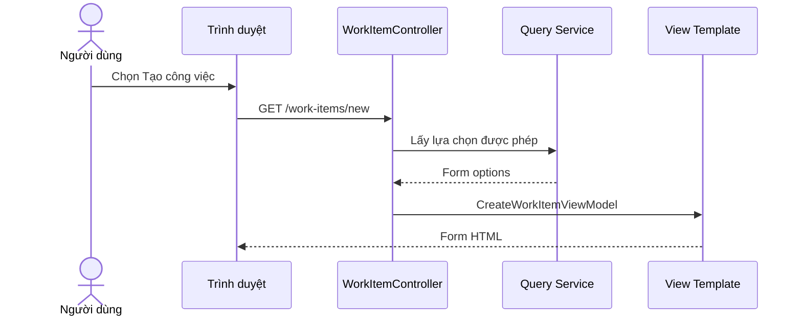
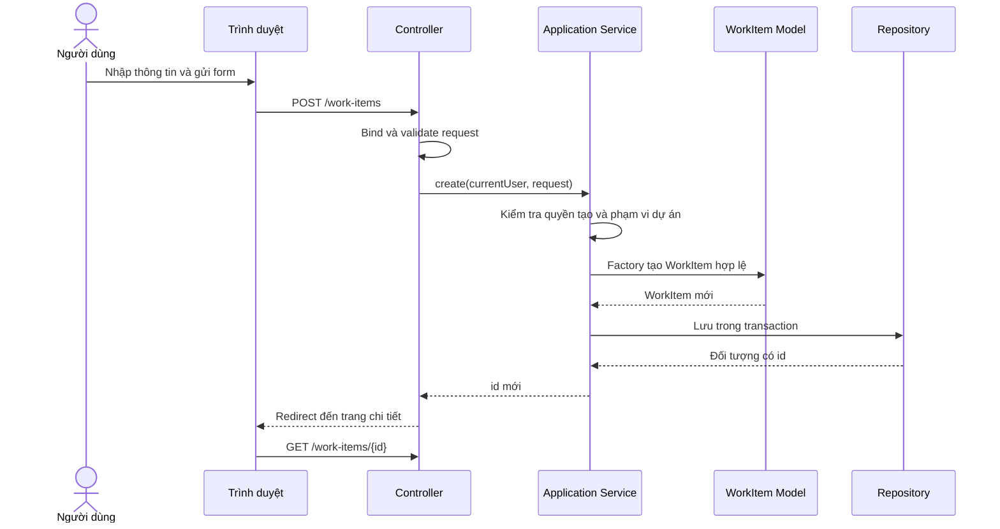
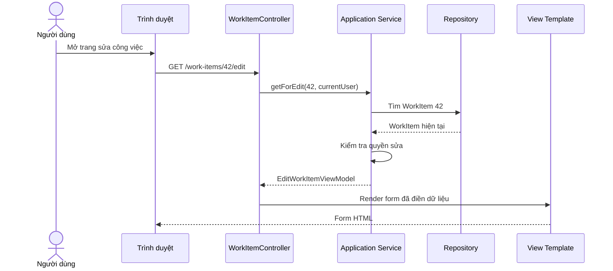
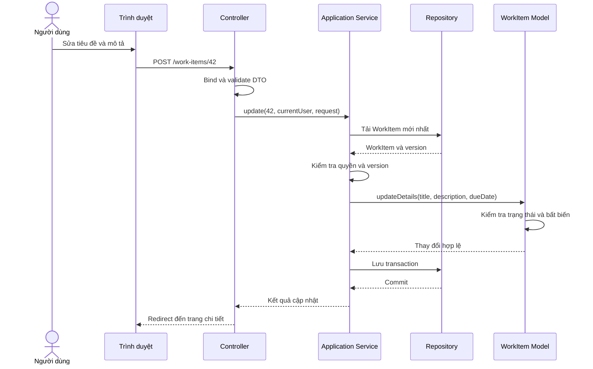

# Luồng tạo mới và cập nhật đối tượng nghiệp vụ

Trong ứng dụng web theo kiến trúc **MODEL_VIEW_CONTROLLER (MVC)**, tạo mới và cập nhật là hai luồng tương tác quan trọng. Người dùng nhập dữ liệu trên View, gửi request đến Controller, ứng dụng kiểm tra dữ liệu và quyền truy cập, áp dụng quy tắc nghiệp vụ, lưu thay đổi rồi trả kết quả để View trình bày. Mỗi bước có trách nhiệm riêng; nếu bỏ qua một bước, dữ liệu có thể sai, quyền hạn có thể bị vượt qua hoặc giao diện có thể thông báo kết quả không đúng với trạng thái đã lưu.

Ví dụ, một nhân viên tạo công việc mới bằng cách nhập tiêu đề, mô tả và hạn hoàn thành. Sau đó, họ mở công việc để cập nhật mô tả hoặc thay đổi hạn. Hai thao tác nhìn gần giống nhau vì đều sử dụng biểu mẫu, nhưng có khác biệt quan trọng: tạo mới khởi tạo một đối tượng và định danh của nó; cập nhật tác động lên một đối tượng đã tồn tại, cần xác định đúng đối tượng, kiểm tra quyền sửa và bảo vệ dữ liệu trước những thay đổi đồng thời.

Bài học này mô tả hai luồng từ trình duyệt đến tầng nghiệp vụ và kho lưu trữ, cách thiết kế request DTO, validation, authorization, transaction, phản hồi lỗi và kiểm thử trong MVC.

## 1. Phân biệt tạo mới và cập nhật

### Tạo mới (Create)

Tạo mới bắt đầu từ một ý định tạo đối tượng chưa tồn tại. Hệ thống thường phải:

- Xác thực người gửi request và xác định chủ thể tạo đối tượng.
- Kiểm tra dữ liệu bắt buộc, định dạng và các giới hạn đầu vào.
- Áp dụng quy tắc nghiệp vụ để xác định đối tượng mới có hợp lệ không.
- Gán định danh và các dữ liệu do hệ thống quản lý, chẳng hạn `id`, `createdAt`, người tạo hoặc trạng thái khởi đầu.
- Lưu đối tượng trong transaction và trả định danh hoặc tài nguyên vừa tạo.

Trình duyệt thường không được tự quyết định những trường như `id`, `ownerId`, `createdAt`, `approvedAt` hoặc trạng thái đã được hệ thống xác nhận. Những giá trị này phải được tạo hoặc xác định từ nguồn có thẩm quyền ở phía máy chủ.

### Cập nhật (Update)

Cập nhật bắt đầu từ một đối tượng đã tồn tại. Hệ thống phải:

- Xác định đối tượng cần cập nhật từ định danh trong URL hoặc một tham chiếu đã được xác thực.
- Tải đối tượng hiện tại từ kho lưu trữ.
- Kiểm tra người dùng có quyền sửa đúng đối tượng đó không.
- Kiểm tra phiên bản hoặc trạng thái hiện tại nếu có thể xảy ra xung đột.
- Chỉ áp dụng những trường mà thao tác cho phép thay đổi.
- Để Model hoặc domain service bảo vệ bất biến và quy tắc chuyển trạng thái.
- Lưu thay đổi và phản hồi kết quả.

Một request cập nhật không nên tạo một entity mới với dữ liệu từ trình duyệt rồi ghi đè lên entity cũ một cách mù quáng. Cách làm đó có thể làm mất trường hệ thống, quan hệ, dữ liệu mới hơn hoặc các quy tắc mà đối tượng hiện tại đang bảo vệ.

### Bảng so sánh

| Tiêu chí | Tạo mới | Cập nhật |
|---|---|---|
| Đối tượng trước request | Chưa tồn tại | Đã tồn tại |
| Định danh | Thường do máy chủ sinh | Tham chiếu đến đối tượng hiện có |
| Nguồn dữ liệu | Form tạo mới hoặc request DTO | Form sửa hoặc request DTO chỉ chứa trường được phép đổi |
| Kiểm tra chính | Dữ liệu đầu vào và điều kiện tạo | Tồn tại, quyền sửa, trạng thái hiện tại và dữ liệu thay đổi |
| Dữ liệu hệ thống | Khởi tạo khi tạo | Thường phải được bảo toàn hoặc thay đổi theo quy tắc riêng |
| Rủi ro đặc trưng | Tạo trùng do gửi lặp | Ghi đè dữ liệu mới, sửa nhầm tài nguyên hoặc mass assignment |
| Kết quả thường gặp | Trả tài nguyên mới hoặc chuyển đến trang chi tiết | Trả tài nguyên đã cập nhật hoặc chuyển về trang chi tiết |

## 2. Hợp đồng request và dữ liệu được phép thay đổi

Request là dữ liệu không đáng tin cậy cho đến khi máy chủ kiểm tra. Hãy thiết kế một hợp đồng riêng cho từng hành động thay vì bind toàn bộ request vào entity.

Giả sử ứng dụng quản lý công việc. Người dùng có thể tạo công việc với tiêu đề, mô tả và hạn hoàn thành. Khi sửa, họ cũng có thể thay đổi các trường đó, nhưng không được tự đặt người tạo, trạng thái phê duyệt hay thời điểm tạo.

```java
import jakarta.validation.constraints.NotBlank;
import jakarta.validation.constraints.Size;
import java.time.LocalDate;

record CreateWorkItemRequest(
        @NotBlank @Size(max = 120) String title,
        @Size(max = 4000) String description,
        LocalDate dueDate
) {}

record UpdateWorkItemRequest(
        @NotBlank @Size(max = 120) String title,
        @Size(max = 4000) String description,
        LocalDate dueDate,
        long version
) {}
```

Hai DTO này cho biết mỗi thao tác chấp nhận trường nào. `version` trong request cập nhật là ví dụ về thông tin phiên bản để phát hiện dữ liệu cũ; ứng dụng có thể truyền nó bằng hidden input hoặc một header/ETag trong API. Không phải mọi hệ thống đều cần cùng một hợp đồng.

Không đưa các trường sau vào DTO nếu người dùng không được quyền điều khiển chúng trong thao tác đó:

- `id` nếu định danh được máy chủ tạo.
- `createdAt`, `createdBy` và thông tin audit do hệ thống quản lý.
- `ownerId` hoặc `tenantId` dùng để xác định phạm vi dữ liệu.
- `approved`, `paid`, `archived` hoặc các trạng thái cần lệnh nghiệp vụ riêng.
- Các trường nội bộ, cờ bảo mật hoặc dữ liệu chỉ dùng cho persistence.

Việc bỏ một trường khỏi DTO giúp thu hẹp bề mặt binding, nhưng service vẫn cần kiểm tra quyền và quy tắc. Người dùng có thể gọi endpoint trực tiếp, thay đổi URL hoặc gửi request được tạo thủ công.

## 3. Luồng tạo mới trong MVC

### Hiển thị biểu mẫu tạo mới

Người dùng thường bắt đầu bằng một request GET đến trang tạo mới. Controller chuẩn bị dữ liệu cần thiết cho form, chẳng hạn danh sách loại công việc hoặc lựa chọn dự án mà người dùng được phép sử dụng. View nhận một ViewModel/form model phù hợp và hiển thị biểu mẫu rỗng với hướng dẫn.



GET hiển thị form không nên tạo bản ghi nghiệp vụ. Nếu GET làm thay đổi dữ liệu, refresh hoặc crawler có thể vô tình tạo tác động không mong muốn.

### Gửi biểu mẫu tạo mới

Khi người dùng gửi form, Controller nhận request DTO, kiểm tra validation đầu vào rồi gọi application service. Service xác định người dùng hiện tại, kiểm tra quyền tạo trong phạm vi phù hợp, khởi tạo Model qua constructor hoặc factory, lưu đối tượng và trả định danh.



Một factory hoặc constructor giúp khởi tạo trạng thái hợp lệ ngay từ đầu. Ví dụ, trạng thái ban đầu có thể luôn là `OPEN`, người tạo lấy từ principal đã xác thực và thời điểm tạo lấy từ clock của máy chủ.

```java
public static WorkItem create(
        String title,
        String description,
        LocalDate dueDate,
        UserId creator,
        Instant now) {

    if (title == null || title.isBlank()) {
        throw new IllegalArgumentException("Title is required");
    }

    return new WorkItem(
            WorkItemId.newId(),
            title.trim(),
            description,
            dueDate,
            creator,
            WorkItemStatus.OPEN,
            now
    );
}
```

Đây là ví dụ minh họa, các kiểu `UserId`, `WorkItemId` và constructor phụ thuộc vào mô hình của ứng dụng. Ý chính là dữ liệu do hệ thống quản lý được gán tại ranh giới tạo đối tượng, thay vì nhận trực tiếp từ form.

## 4. Luồng cập nhật trong MVC

### Tải dữ liệu cho biểu mẫu sửa

Khi người dùng mở trang sửa, Controller lấy định danh từ URL, yêu cầu service hoặc query service tải đối tượng và kiểm tra quyền xem/sửa. ViewModel chỉ chứa những trường cần hiển thị trong form, cùng thông tin phiên bản nếu cần phát hiện cập nhật đồng thời.



Không nên dựa vào việc một liên kết “Sửa” có được hiển thị hay không để quyết định quyền. Request GET và request cập nhật đều cần kiểm tra quyền ở phía máy chủ. Nếu người dùng không có quyền, trả kết quả phù hợp với chính sách ứng dụng, chẳng hạn 403 hoặc 404 để tránh tiết lộ sự tồn tại của tài nguyên.

### Gửi thay đổi

Khi người dùng gửi form sửa, service tải lại đối tượng từ repository. Nó kiểm tra quyền trên đối tượng hiện tại, kiểm tra version nếu có, sau đó gọi phương thức nghiệp vụ chỉ thay đổi các thuộc tính được phép. Repository lưu thay đổi trong transaction.



Một phương thức `updateDetails` có thể giới hạn thời điểm được sửa:

```java
public void updateDetails(
        String title,
        String description,
        LocalDate dueDate) {

    if (status == WorkItemStatus.ARCHIVED) {
        throw new IllegalStateException("Archived item cannot be edited");
    }
    if (title == null || title.isBlank()) {
        throw new IllegalArgumentException("Title is required");
    }

    this.title = title.trim();
    this.description = description;
    this.dueDate = dueDate;
}
```

Model kiểm tra quy tắc nội tại như trạng thái có cho phép sửa hay không. Service vẫn kiểm tra người dùng hiện tại có quyền sửa đối tượng đó không. Không nên truyền `currentUser` hoặc HTTP request vào entity chỉ để thực hiện phân quyền web.

## 5. Tổ chức trách nhiệm giữa các thành phần

Luồng tạo mới và cập nhật dễ hiểu hơn khi phân chia trách nhiệm rõ ràng:

| Thành phần | Trách nhiệm trong tạo mới | Trách nhiệm trong cập nhật |
|---|---|---|
| View | Hiển thị form trống, hướng dẫn và lựa chọn | Hiển thị dữ liệu hiện tại, trường được phép sửa và lỗi |
| Controller | Nhận request, bind DTO, validation đầu vào, chọn response | Nhận id, bind DTO, validation đầu vào, chọn response |
| Application service | Kiểm tra quyền tạo, áp dụng quy tắc và điều phối lưu | Tải đối tượng, kiểm tra quyền sửa, điều phối cập nhật và lưu |
| Model/domain service | Khởi tạo trạng thái hợp lệ, bảo vệ bất biến | Bảo vệ bất biến và điều kiện thay đổi |
| Repository | Lưu đối tượng mới và trả định danh | Tải và lưu đối tượng hiện có, phối hợp kiểm soát đồng thời |
| ViewModel mapper/query | Chuẩn bị dữ liệu cho form và trang kết quả | Chuẩn bị dữ liệu hiện tại, version và thông tin hiển thị |

Controller nên mỏng và tập trung vào giao thức web. Application service thể hiện ca sử dụng như `createWorkItem` hoặc `updateWorkItem`. Model bảo vệ trạng thái nội tại. Repository che giấu chi tiết lưu trữ. View chỉ nhận dữ liệu cần thiết để trình bày.

## 6. Chọn phương thức HTTP và phản hồi

Trong ứng dụng web server-rendered, form HTML truyền thống thường gửi `GET` để đọc và `POST` để gửi dữ liệu. Một số framework hỗ trợ hidden method hoặc cơ chế riêng để biểu diễn `PUT`/`PATCH`/`DELETE`. Với API, có thể dùng các phương thức HTTP theo ý nghĩa tài nguyên.

| Phương thức | Ý nghĩa thường dùng | Lưu ý |
|---|---|---|
| GET | Hiển thị form hoặc đọc tài nguyên | Không dùng để thay đổi trạng thái nghiệp vụ |
| POST | Tạo tài nguyên hoặc thực hiện command | Gửi lặp có thể tạo nhiều bản ghi nếu không có cơ chế chống trùng |
| PUT | Thay thế biểu diễn tài nguyên tại URI | Theo ngữ nghĩa HTTP, PUT được thiết kế idempotent; cần xác định rõ trường nào được thay thế |
| PATCH | Cập nhật một phần tài nguyên | Tính idempotent phụ thuộc vào loại patch và cách thiết kế |
| DELETE | Yêu cầu xóa tài nguyên | Phải kiểm tra quyền và quy tắc xóa/soft delete |

Đừng chọn phương thức chỉ theo tên nút trên giao diện. Hãy dựa vào hợp đồng endpoint, ý nghĩa thao tác và khả năng retry.

### Response trong server-rendered MVC

Với form tạo hoặc sửa, một mẫu phổ biến là **Post/Redirect/Get (PRG)**:

1. Browser gửi POST.
2. Server xử lý và lưu thành công.
3. Server trả redirect, thường là 303 See Other sau POST.
4. Browser gửi GET đến trang kết quả.

PRG giúp refresh trang kết quả không gửi lại POST vừa thực hiện. Flash message có thể truyền thông báo qua lần redirect kế tiếp. Tuy vậy, PRG không tự chống việc người dùng double-click hoặc gửi lại request do mạng retry; thao tác tạo mới quan trọng có thể cần idempotency key hoặc cơ chế chống trùng ở tầng nghiệp vụ/cơ sở dữ liệu.

Khi validation thất bại, thường render lại form với dữ liệu đã nhập hợp lệ và lỗi được ánh xạ vào ViewModel. Không redirect một cách máy móc nếu redirect làm mất lỗi và dữ liệu cần thiết, trừ khi ứng dụng có cơ chế lưu trạng thái lỗi an toàn.

### Response trong API

Một số mã trạng thái thường gặp:

| Mã | Trường hợp thường dùng |
|---|---|
| 201 Created | Tạo tài nguyên thành công; thường kèm `Location` đến tài nguyên mới |
| 200 OK | Đọc hoặc cập nhật thành công và có response body |
| 204 No Content | Thao tác thành công nhưng không cần response body |
| 400 Bad Request | Request không đúng cấu trúc hoặc không thể xử lý |
| 401 Unauthorized | Chưa xác thực hoặc thông tin xác thực không hợp lệ |
| 403 Forbidden | Đã xác thực nhưng không được phép thực hiện |
| 404 Not Found | Không tìm thấy tài nguyên hoặc ứng dụng chủ động không tiết lộ sự tồn tại |
| 409 Conflict | Xung đột với trạng thái hiện tại hoặc version |
| 422 Unprocessable Content | Cú pháp request hợp lệ nhưng dữ liệu không thỏa điều kiện xử lý theo hợp đồng API |

Mã trạng thái cần nhất quán với hợp đồng API và framework. Không trả 200 cho mọi trường hợp lỗi rồi đặt thông tin lỗi trong body nếu điều đó làm client khó xử lý.

## 7. Validation và lỗi trong hai luồng

Validation nên được thực hiện ở nhiều lớp với mục đích khác nhau:

1. **Binding và validation đầu vào:** kiểm tra request có thể chuyển kiểu, trường bắt buộc, độ dài và định dạng. Ví dụ, tiêu đề không rỗng và không vượt 120 ký tự.
2. **Quy tắc nghiệp vụ:** kiểm tra hành động có hợp lệ trong trạng thái hiện tại không. Ví dụ, công việc đã lưu trữ không thể sửa mô tả.
3. **Quyền truy cập:** kiểm tra chủ thể hiện tại có quyền tạo trong dự án hoặc sửa đúng công việc không.
4. **Ràng buộc lưu trữ:** cơ sở dữ liệu bảo vệ những điều kiện cần nhất quán ở cấp dữ liệu, chẳng hạn unique key hoặc foreign key.

Không coi client-side validation là bảo vệ cuối cùng. Trình duyệt có thể bị sửa hoặc request có thể được gửi ngoài giao diện. Mọi quy tắc quan trọng phải được kiểm tra ở phía máy chủ.

### Lỗi thường gặp và cách phản hồi

| Tình huống | Tạo mới | Cập nhật |
|---|---|---|
| Thiếu tiêu đề | Trả form với lỗi trường tiêu đề | Trả form sửa với lỗi trường tiêu đề |
| Người dùng không có quyền | Từ chối tạo trong phạm vi dự án | Từ chối sửa tài nguyên |
| Tham chiếu dự án không tồn tại | Báo lựa chọn không hợp lệ | Không áp dụng nếu thay đổi dự án không được phép |
| Tài nguyên không tồn tại | Không áp dụng cho id mới | Trả 404 hoặc kết quả theo chính sách |
| Trạng thái không cho phép | Factory/service từ chối khởi tạo nếu điều kiện không đạt | Model/service từ chối thay đổi |
| Trùng dữ liệu | Xử lý unique constraint hoặc idempotency | Xử lý quy tắc duy nhất và xung đột |
| Lỗi cơ sở dữ liệu | Rollback và trả lỗi an toàn | Rollback, giữ dữ liệu nhập và thông báo phù hợp |
| Version đã cũ | Ít phổ biến với tạo mới; kiểm tra khóa/idempotency nếu cần | Báo xung đột, cho người dùng tải lại hoặc hợp nhất |

Thông báo cho người dùng cần mô tả vấn đề và bước tiếp theo. Không đưa stack trace, SQL, tên bảng hoặc thông tin nội bộ vào response. Chi tiết kỹ thuật được ghi log phía máy chủ theo chính sách phù hợp.

## 8. Bảo vệ dữ liệu và quyền truy cập

Tạo mới và cập nhật đều là thao tác thay đổi trạng thái nên cần bảo vệ ở phía máy chủ.

### Xác thực và phân quyền theo tài nguyên

Xác thực trả lời “ai đang gửi request?”. Phân quyền trả lời “người đó có được thực hiện hành động này trên tài nguyên cụ thể không?”. Đã đăng nhập không có nghĩa là được sửa mọi đối tượng.

Khi cập nhật, không chỉ kiểm tra vai trò chung như `EDITOR`; cần kiểm tra quyền trên chính đối tượng hoặc phạm vi dữ liệu. Ví dụ, người dùng chỉ sửa được công việc thuộc dự án mà họ tham gia. Hãy tải đối tượng và kiểm tra chính sách trên dữ liệu có thẩm quyền ở phía máy chủ.

### Tránh mass assignment và over-posting

Không bind request trực tiếp vào entity có nhiều trường nội bộ. Dùng DTO theo hành động, ánh xạ rõ từng trường được phép. Không tin `ownerId`, `tenantId`, `role`, `status` hoặc `createdAt` do trình duyệt gửi.

### CSRF và phương thức HTTP

Nếu ứng dụng dùng cookie/session để xác thực, request thay đổi trạng thái cần cơ chế bảo vệ CSRF phù hợp. Dùng token do máy chủ cấp và xác minh token khi nhận request. Không thực hiện thay đổi bằng GET; trình duyệt, crawler hoặc liên kết bên ngoài có thể kích hoạt GET ngoài dự kiến.

### XSS và dữ liệu đầu ra

Mô tả hoặc tiêu đề do người dùng nhập cần được escape khi hiển thị trong HTML. Không render HTML thô từ dữ liệu không đáng tin cậy. Khi tạo response JSON, vẫn cần xử lý an toàn tại nơi dữ liệu được đưa vào DOM phía client.

### Phạm vi tenant và quyền sở hữu

Với hệ thống nhiều tenant, mọi thao tác tải, tạo và cập nhật phải ràng buộc tenant từ ngữ cảnh đã xác thực. Không lấy `tenantId` từ hidden field làm nguồn tin cậy. Repository/query cần áp dụng phạm vi phù hợp và service phải kiểm tra quyền tương ứng.

## 9. Giao dịch và tính nhất quán

Một luồng tạo mới hoặc cập nhật có thể thay đổi nhiều bản ghi: đối tượng chính, bảng liên kết, lịch sử thay đổi hoặc bản ghi audit. Nếu các thay đổi phải thành công hoặc thất bại cùng nhau, hãy thực hiện trong một transaction phù hợp.

Ví dụ, tạo công việc và gắn công việc vào dự án cần đảm bảo dự án hợp lệ và thao tác lưu không để lại công việc mồ côi. Nếu tạo đối tượng xong rồi gửi email thông báo, không nên để lỗi gửi email làm đảo ngược một giao dịch đã commit nếu nghiệp vụ không yêu cầu điều đó. Có thể dùng outbox hoặc cơ chế phát sự kiện sau commit để phối hợp với hệ thống ngoài.

Đối với cập nhật, cần bảo vệ trước lost update. Hai người dùng có thể cùng mở một bản ghi ở version 3. Người thứ nhất lưu và tạo version 4; người thứ hai gửi bản version 3 sau đó. Nếu server ghi đè không kiểm tra, thay đổi của người thứ nhất có thể mất.

### Optimistic locking

Một cách phổ biến là dùng trường version. Với JPA, có thể khai báo:

```java
@Version
private long version;
```

Khi lưu, ORM kiểm tra version đã đọc có còn hiện hành không. Nếu có request khác đã cập nhật, thao tác có thể phát sinh optimistic locking exception. Service chuyển lỗi này thành kết quả xung đột phù hợp, ví dụ HTTP 409 cho API hoặc thông báo “Dữ liệu đã được người khác cập nhật; hãy tải lại trước khi lưu” cho form.

Không nên âm thầm lấy dữ liệu mới rồi áp dụng toàn bộ form cũ nếu không có chính sách merge rõ ràng. Một số trường có thể hợp nhất tự động, nhưng các trường quan trọng cần người dùng xem lại xung đột.

## 10. Ví dụ cấu trúc Controller và Service

Đoạn mã sau minh họa cấu trúc Spring MVC ở mức khái niệm. Các kiểu repository, policy, ViewModel và exception cần được triển khai theo dự án thực tế.

```java
@Controller
@RequestMapping("/work-items")
class WorkItemController {

    private final WorkItemApplicationService service;

    WorkItemController(WorkItemApplicationService service) {
        this.service = service;
    }

    @GetMapping("/new")
    String newForm(Model model) {
        model.addAttribute("form", new CreateWorkItemRequest("", "", null));
        return "work-items/new";
    }

    @PostMapping
    String create(
            @Valid @ModelAttribute("form") CreateWorkItemRequest request,
            BindingResult errors,
            Principal principal,
            RedirectAttributes redirect) {

        if (errors.hasErrors()) {
            return "work-items/new";
        }

        WorkItemId id = service.create(principal.getName(), request);
        redirect.addFlashAttribute("notice", "Đã tạo công việc.");
        return "redirect:/work-items/" + id.value();
    }

    @GetMapping("/{id}/edit")
    String editForm(
            @PathVariable String id,
            Principal principal,
            Model model) {

        model.addAttribute("form", service.getForEdit(id, principal.getName()));
        return "work-items/edit";
    }

    @PostMapping("/{id}")
    String update(
            @PathVariable String id,
            @Valid @ModelAttribute("form") UpdateWorkItemRequest request,
            BindingResult errors,
            Principal principal,
            RedirectAttributes redirect) {

        if (errors.hasErrors()) {
            return "work-items/edit";
        }

        service.update(id, principal.getName(), request);
        redirect.addFlashAttribute("notice", "Đã cập nhật công việc.");
        return "redirect:/work-items/" + id;
    }
}
```

Trong ví dụ, form tạo và form sửa có request DTO riêng. `Principal` cung cấp danh tính đã xác thực; service chịu trách nhiệm kiểm tra quyền và xử lý nghiệp vụ. Với code thực tế, cần bổ sung cách nạp lại ViewModel và dữ liệu lựa chọn khi validation thất bại, xử lý lỗi nghiệp vụ, lỗi không tìm thấy, lỗi xung đột và CSRF theo cấu hình bảo mật của ứng dụng.

Service có thể được tổ chức như sau:

```java
@Service
class WorkItemApplicationService {

    private final WorkItemRepository repository;
    private final WorkItemAccessPolicy accessPolicy;
    private final Clock clock;

    @Transactional
    WorkItemId create(String actorId, CreateWorkItemRequest request) {
        accessPolicy.requireCanCreate(actorId);

        WorkItem item = WorkItem.create(
                request.title(),
                request.description(),
                request.dueDate(),
                new UserId(actorId),
                clock.instant()
        );

        return repository.save(item).getId();
    }

    @Transactional(readOnly = true)
    UpdateWorkItemRequest getForEdit(String id, String actorId) {
        WorkItem item = repository.findById(new WorkItemId(id))
                .orElseThrow(WorkItemNotFoundException::new);
        accessPolicy.requireCanEdit(actorId, item);

        return new UpdateWorkItemRequest(
                item.getTitle(),
                item.getDescription(),
                item.getDueDate(),
                item.getVersion()
        );
    }

    @Transactional
    void update(String id, String actorId, UpdateWorkItemRequest request) {
        WorkItem item = repository.findById(new WorkItemId(id))
                .orElseThrow(WorkItemNotFoundException::new);
        accessPolicy.requireCanEdit(actorId, item);
        item.requireVersion(request.version());
        item.updateDetails(
                request.title(),
                request.description(),
                request.dueDate()
        );
    }
}
```

Đây là mã khung để thể hiện trách nhiệm; cần điều chỉnh constructor, kiểu định danh, transaction và cơ chế version theo persistence framework thực tế. Một repository JPA có thể tự phát hiện entity managed đã thay đổi và flush khi transaction commit; repository khác có thể yêu cầu gọi `save` tường minh. Không nên coi ví dụ rút gọn là mã có thể biên dịch độc lập khi các kiểu miền và hạ tầng chưa được định nghĩa.

## 11. Kiểm thử luồng tạo mới và cập nhật

Kiểm thử cần bao phủ đường thành công và các nhánh lỗi. Chỉ kiểm tra Controller trả về tên view là chưa đủ; cần xác minh dữ liệu, quyền và trạng thái được xử lý đúng.

| Cấp kiểm thử | Tạo mới | Cập nhật |
|---|---|---|
| Unit test Model | Khởi tạo trạng thái hợp lệ, từ chối dữ liệu sai | Chỉ cho phép thay đổi khi trạng thái phù hợp |
| Unit test service | Kiểm tra quyền tạo, gán owner từ actor, gọi repository | Tải đúng id, kiểm tra quyền và version, không lưu khi bị từ chối |
| Controller test | Bind DTO, validation, redirect và flash message | Bind id/DTO, trả form lỗi hoặc redirect phù hợp |
| Integration test | Sinh id, lưu quan hệ, unique constraint và transaction | Persistence, optimistic locking và rollback |
| Security test | Không tạo ngoài phạm vi được cấp, chống CSRF | Không sửa tài nguyên của người khác, chống mass assignment |
| End-to-end test | Gửi form tạo và thấy trang chi tiết mới | Sửa dữ liệu, tải lại và xác nhận dữ liệu đã lưu |

### Các kịch bản cần có

- Tạo mới với dữ liệu hợp lệ: chỉ có một đối tượng được lưu và response dẫn đến tài nguyên mới.
- Tạo mới với tiêu đề rỗng: trả form cùng lỗi rõ ràng, không tạo bản ghi.
- Tạo mới với project/tenant không thuộc quyền: từ chối và không lưu.
- Gửi lặp request tạo: xác minh chính sách chống trùng hoặc idempotency nếu thao tác yêu cầu.
- Cập nhật đối tượng tồn tại và người dùng có quyền: chỉ các trường được phép thay đổi.
- Cập nhật một id không tồn tại: trả kết quả không tìm thấy theo hợp đồng.
- Cập nhật tài nguyên của người khác: từ chối và không tiết lộ dữ liệu ngoài chính sách.
- Gửi thêm `ownerId`, `status` hoặc `createdAt` không nằm trong DTO: những trường đó không bị thay đổi.
- Cập nhật với version cũ: phát hiện xung đột, không ghi đè dữ liệu mới.
- Lỗi lưu trữ giữa transaction: không để lại trạng thái dở dang.

## 12. Những lỗi thiết kế thường gặp

### Dùng chung một DTO cho mọi thao tác

DTO dùng chung thường có nhiều trường chỉ phù hợp với một số luồng. Nó làm tăng nguy cơ nhận dữ liệu không cần thiết và khiến validation khó diễn đạt. Hãy tạo hợp đồng theo hành động khi quyền thay đổi khác nhau.

### Bind thẳng request vào entity

Entity có thể chứa trường hệ thống hoặc trường nhạy cảm. Bind trực tiếp tạo bề mặt mass assignment. Hãy dùng request DTO và ánh xạ rõ ràng.

### Cập nhật bằng cách thay toàn bộ entity

Tạo một entity mới từ form rồi ghi đè có thể làm mất `createdAt`, owner, quan hệ hoặc dữ liệu mới hơn. Hãy tải entity hiện tại, kiểm tra quyền và gọi phương thức cập nhật có chủ đích.

### Chỉ kiểm tra quyền ở giao diện

Ẩn nút sửa không bảo vệ endpoint. Mọi request tạo và cập nhật cần được xác thực và phân quyền ở phía máy chủ.

### Không kiểm tra trạng thái hiện tại

Một đối tượng có thể đã bị lưu trữ, phê duyệt hoặc khóa bởi tiến trình khác. Hãy kiểm tra trạng thái mới nhất trong luồng cập nhật.

### Không có chiến lược cho request gửi lặp

Người dùng double-click hoặc client retry có thể tạo hai đối tượng. Với thao tác tạo quan trọng, cân nhắc idempotency key, unique constraint hoặc phát hiện yêu cầu trùng theo quy tắc miền.

### Báo thành công trước khi commit

Nếu thông báo thành công được phát trước khi transaction hoàn tất, giao diện có thể nói đã lưu trong khi dữ liệu rollback. Chỉ trả kết quả thành công sau khi thao tác lưu đã hoàn tất theo cơ chế transaction.

## 13. Quy trình thiết kế một luồng tạo hoặc cập nhật

Khi xây dựng chức năng mới, hãy đi qua các bước sau:

1. **Mô tả hành động:** người dùng muốn tạo mới hay sửa đối tượng nào? Kết quả mong đợi là gì?
2. **Xác định định danh và phạm vi:** ai tạo, đối tượng thuộc tenant/dự án nào, ai được phép đọc hoặc sửa?
3. **Thiết kế request DTO:** chỉ nhận trường cần thiết cho hành động; xác định trường hệ thống do máy chủ gán.
4. **Xác định validation:** trường bắt buộc, kiểu dữ liệu, giới hạn và thông báo có thể hiển thị.
5. **Đặt quy tắc vào đúng lớp:** Model bảo vệ bất biến; service điều phối và kiểm tra quyền; repository quản lý lưu trữ.
6. **Xác định transaction và retry:** thay đổi có nhiều bước không, request gửi lặp có tạo trùng không, cập nhật đồng thời được phát hiện ra sao?
7. **Thiết kế response:** render lại form, redirect PRG hay trả status/body API; cung cấp ViewModel và thông báo tương ứng.
8. **Kiểm thử các nhánh:** thành công, validation lỗi, không có quyền, không tìm thấy, xung đột và lỗi lưu trữ.

## Kết luận

Tạo mới và cập nhật đều bắt đầu từ request do người dùng gửi, nhưng chúng có vòng đời và rủi ro khác nhau. Tạo mới cần khởi tạo định danh, chủ sở hữu và trạng thái ban đầu từ nguồn có thẩm quyền. Cập nhật cần tải đối tượng hiện có, kiểm tra quyền trên đúng tài nguyên, bảo vệ version và chỉ áp dụng các trường được phép thay đổi.

Trong MVC, View thu thập dữ liệu và trình bày kết quả; Controller xử lý giao thức HTTP và validation đầu vào; application service điều phối ca sử dụng, quyền và transaction; Model bảo vệ bất biến; Repository lưu và truy xuất đối tượng. Khi các ranh giới này được giữ rõ ràng, luồng tạo mới và cập nhật dễ hiểu, an toàn, có thể kiểm thử và phản ánh chính xác kết quả nghiệp vụ cho người dùng.
