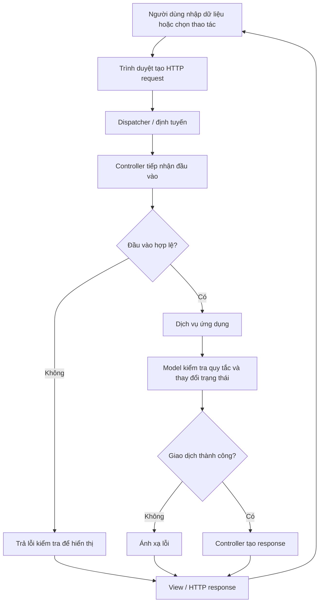
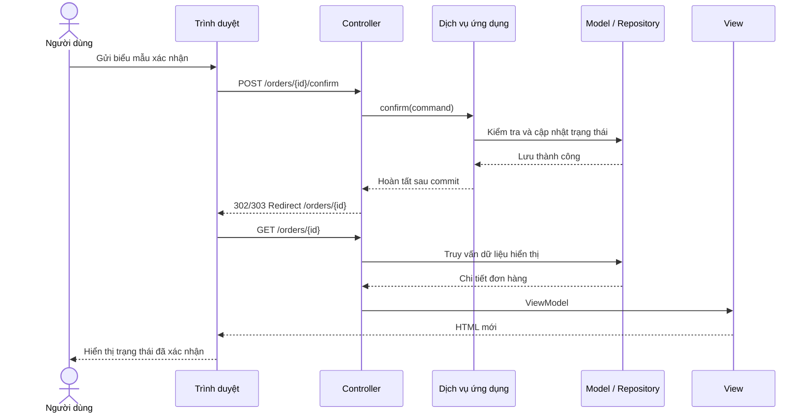

# Trình tự tiếp nhận đầu vào, thay đổi trạng thái và cập nhật View

Trong kiến trúc Model–View–Controller (MVC), một tương tác thường bắt đầu khi người dùng nhập dữ liệu hoặc chọn một thao tác trên giao diện. Ứng dụng tiếp nhận đầu vào, kiểm tra yêu cầu, gọi nghiệp vụ để thay đổi hoặc truy vấn trạng thái, rồi tạo phản hồi để View hiển thị kết quả. Hiểu đúng trình tự này giúp mỗi thành phần giữ được trách nhiệm rõ ràng và tránh cập nhật giao diện khi dữ liệu nghiệp vụ chưa được xử lý thành công.

Hãy xét chức năng xác nhận đơn hàng. Người dùng mở trang chi tiết, nhập ghi chú và nhấn **Xác nhận**. Ứng dụng cần nhận request, xác thực người dùng, kiểm tra dữ liệu, xác định đơn hàng có được phép xác nhận hay không, lưu trạng thái mới và hiển thị kết quả. Dù giao diện dùng HTML server-side hay JavaScript, trình tự xử lý nghiệp vụ ở phía máy chủ vẫn cần bảo đảm tính đúng đắn.

## 1. Bức tranh tổng thể của một tương tác MVC

Một vòng tương tác web điển hình gồm các giai đoạn:

1. **Người dùng tạo đầu vào:** nhập biểu mẫu, chọn bộ lọc, nhấn nút hoặc mở một liên kết.
2. **Trình duyệt gửi request:** dữ liệu được gửi qua URL, query string, header hoặc request body cùng HTTP method phù hợp.
3. **Ứng dụng định tuyến request:** bộ điều phối web tìm Controller và handler tương ứng với route và method.
4. **Controller tiếp nhận và kiểm tra đầu vào:** chuyển dữ liệu request thành kiểu dữ liệu ứng dụng cần, kiểm tra cấu trúc, định dạng và điều kiện xác thực ở biên giao tiếp.
5. **Lớp ứng dụng gọi nghiệp vụ:** Controller chuyển dữ liệu cần thiết thành tham số hoặc command và gọi ca sử dụng phù hợp.
6. **Model xử lý trạng thái:** thành phần nghiệp vụ đọc trạng thái hiện tại, kiểm tra quyền và bất biến, thực hiện hành vi miền rồi phối hợp lưu thay đổi.
7. **Giao dịch hoàn tất:** nếu thao tác thành công, thay đổi được commit; nếu có lỗi thuộc giao dịch, các thay đổi cần thiết được rollback.
8. **Controller tạo phản hồi:** chọn dữ liệu hiển thị, View, redirect hoặc response JSON cùng mã trạng thái thích hợp.
9. **View được cập nhật:** trình duyệt nhận HTML mới hoặc dữ liệu phản hồi để cập nhật giao diện.



Sơ đồ mô tả luồng tổng quát. Trong một ứng dụng Spring MVC, `DispatcherServlet` thường tiếp nhận request và điều phối đến handler phù hợp. Bộ lọc bảo mật có thể chạy trước Controller. Việc kiểm tra đầu vào, gọi nghiệp vụ và render View có thể được hỗ trợ bởi framework, nhưng trách nhiệm kiến trúc vẫn cần được phân chia rõ ràng.

## 2. Giai đoạn 1: Tiếp nhận đầu vào

Đầu vào của một tương tác có thể đến từ nhiều vị trí:

| Nguồn đầu vào | Ví dụ | Cách đọc trong ứng dụng web |
|---|---|---|
| Path parameter | `/orders/42` | `@PathVariable` |
| Query parameter | `/orders?status=DRAFT` | `@RequestParam` |
| Request body JSON | `{"note":"Đã kiểm tra"}` | `@RequestBody` |
| Form field | `note=Đã kiểm tra` | `@ModelAttribute` |
| Header | `Accept-Language: vi` | `@RequestHeader` hoặc locale resolver |
| Danh tính đã xác thực | Người dùng hiện tại | Security context / principal |

Controller nhận dữ liệu qua các cơ chế của framework rồi chuyển thành kiểu dữ liệu có ý nghĩa với ứng dụng. Không nên để Model nghiệp vụ phụ thuộc trực tiếp vào `HttpServletRequest`, `HttpSession` hoặc các đối tượng HTTP tương tự.

### Chọn HTTP method theo ý nghĩa thao tác

- `GET` dùng để truy vấn hoặc hiển thị dữ liệu và không nên gây thay đổi trạng thái nghiệp vụ.
- `POST` thường dùng để gửi biểu mẫu hoặc thực hiện một hành động tạo hay xử lý dữ liệu.
- `PUT` thường biểu diễn việc thay thế một tài nguyên theo hợp đồng API.
- `PATCH` thường biểu diễn việc cập nhật một phần tài nguyên.
- `DELETE` biểu diễn yêu cầu xóa một tài nguyên theo hợp đồng API.

Việc chọn method cần nhất quán với ngữ nghĩa endpoint và đặc tính idempotent của thao tác. Không nên dùng `GET` để xác nhận, hủy hoặc thanh toán đơn hàng, vì request GET có thể được trình duyệt, proxy hoặc công cụ khác tự động gửi lại để tải tài nguyên.

### Dùng DTO để giới hạn dữ liệu đầu vào

Ví dụ, biểu mẫu xác nhận đơn hàng chỉ cần nhận ghi chú:

```java
public record ConfirmOrderForm(
    @Size(max = 300, message = "Ghi chú không được vượt quá 300 ký tự")
    String note
) {}
```

Đối tượng này mô tả dữ liệu mà giao diện được phép gửi. Không nên bind trực tiếp request vào entity `Order` rồi cho phép người dùng gửi các trường như `status`, `total`, `ownerId` hoặc `approvedBy`. Việc bind trực tiếp có thể tạo ra lỗ hổng mass assignment: người dùng tự gửi thêm trường mà giao diện không hiển thị để cố thay đổi dữ liệu nhạy cảm.

## 3. Giai đoạn 2: Kiểm tra đầu vào và quyền truy cập

Kiểm tra đầu vào diễn ra ở nhiều lớp, mỗi lớp bảo vệ một loại điều kiện khác nhau.

### Kiểm tra cấu trúc ở biên giao tiếp

Controller hoặc bộ chuyển đổi dữ liệu kiểm tra những điều kiện có thể xác định từ request:

- Trường bắt buộc có được gửi hay không.
- Giá trị có đúng kiểu, độ dài và định dạng hay không.
- Path parameter có chuyển được sang UUID hoặc số nguyên hay không.
- Người dùng đã đăng nhập hay chưa.
- Request có chứa token CSRF hợp lệ khi endpoint dùng cookie/session và chính sách bảo mật yêu cầu hay không.

Ví dụ với Spring MVC:

```java
@PostMapping("/{id}/confirm")
public String confirm(
        @PathVariable UUID id,
        @Valid @ModelAttribute("form") ConfirmOrderForm form,
        BindingResult errors,
        @AuthenticationPrincipal AppPrincipal principal,
        RedirectAttributes redirectAttributes) {

    if (errors.hasErrors()) {
        return "orders/confirm";
    }

    ConfirmOrderCommand command = new ConfirmOrderCommand(
        id, principal.userId(), form.note()
    );
    orderApplicationService.confirm(command);
    redirectAttributes.addFlashAttribute("message", "Đơn hàng đã được xác nhận");
    return "redirect:/orders/" + id;
}
```

Trong Spring MVC, `BindingResult` cần đặt ngay sau tham số được kiểm tra để Controller có thể xử lý lỗi binding và validation. Khi có lỗi, Controller trả lại template biểu mẫu cùng các lỗi để View hiển thị. Nếu đầu vào hợp lệ, Controller gọi ca sử dụng và chuyển hướng sau khi xử lý thành công.

### Kiểm tra quyền và quy tắc nghiệp vụ

Đăng nhập thành công không có nghĩa người dùng được phép thao tác trên mọi tài nguyên. Ứng dụng cần kiểm tra người dùng có quyền xác nhận chính đơn hàng đang yêu cầu hay không. Quyền có thể được kiểm tra ở lớp bảo mật, policy hoặc dịch vụ ứng dụng tùy mô hình phân quyền.

Ngoài quyền truy cập, Model phải kiểm tra bất biến nghiệp vụ. Ví dụ, đơn hàng phải đang ở trạng thái `DRAFT` và có ít nhất một dòng hàng. Điều kiện này cần được kiểm tra tại thời điểm thực hiện hành động, vì dữ liệu có thể đã thay đổi kể từ lúc View được tải.

Phân biệt hai nhóm kiểm tra:

| Loại kiểm tra | Ví dụ | Nơi thực hiện thường gặp |
|---|---|---|
| Hình thức / định dạng | Ghi chú tối đa 300 ký tự | DTO validation / Controller |
| Xác thực danh tính | Người dùng đã đăng nhập | Security filter / framework bảo mật |
| Quyền trên tài nguyên | Người dùng có quyền xác nhận đơn hàng này | Security policy / application service |
| Bất biến nghiệp vụ | Đơn hàng ở trạng thái `DRAFT` | Domain object / Model |
| Nhất quán dữ liệu | Không ghi đè thay đổi mới hơn | Giao dịch / cơ chế đồng thời |

## 4. Giai đoạn 3: Chuyển đầu vào thành yêu cầu nghiệp vụ

Sau khi kiểm tra cấu trúc request, Controller chuyển các dữ liệu cần thiết thành lời gọi nghiệp vụ. Có thể dùng command để đặt tên rõ ràng cho ý định của người dùng.

```java
public record ConfirmOrderCommand(
    UUID orderId,
    UUID actorId,
    String note
) {}
```

Controller khi đó chỉ cần tạo command và gọi application service:

```java
ConfirmOrderCommand command = new ConfirmOrderCommand(
    id,
    principal.userId(),
    form.note()
);

orderApplicationService.confirm(command);
```

Command không phải lúc nào cũng bắt buộc. Với thao tác nhỏ, truyền một vài tham số có tên rõ ràng là đủ. Khi hành động có nhiều dữ liệu hoặc cần một hợp đồng ổn định, command giúp tránh truyền cả đối tượng request của framework vào Model.

Controller không nên tự thực hiện chuỗi quy tắc như tải đơn hàng, kiểm tra trạng thái, cập nhật trường và lưu repository. Nó gọi ca sử dụng; Model hoặc dịch vụ nghiệp vụ chịu trách nhiệm thực thi quyết định nghiệp vụ.

## 5. Giai đoạn 4: Model kiểm tra và thay đổi trạng thái

Một hành động thay đổi trạng thái thường cần đọc trạng thái hiện tại trước khi quyết định. Ví dụ, dịch vụ ứng dụng tải đơn hàng, kiểm tra quyền, yêu cầu đối tượng miền xác nhận và lưu kết quả.

Đối tượng miền bảo vệ quy tắc chuyển trạng thái:

```java
public class Order {
    private OrderStatus status;
    private List<OrderLine> lines;
    private String confirmationNote;
    private Instant confirmedAt;

    public void confirm(String note, Instant now) {
        if (status != OrderStatus.DRAFT) {
            throw new InvalidOrderStateException(
                "Chỉ đơn hàng nháp mới được xác nhận"
            );
        }

        if (lines == null || lines.isEmpty()) {
            throw new EmptyOrderException();
        }

        status = OrderStatus.CONFIRMED;
        confirmationNote = note;
        confirmedAt = now;
    }
}
```

Dịch vụ ứng dụng điều phối ca sử dụng và giao dịch:

```java
@Service
@RequiredArgsConstructor
public class OrderApplicationService {
    private final OrderRepository orderRepository;
    private final OrderAccessPolicy accessPolicy;
    private final Clock clock;

    @Transactional
    public void confirm(ConfirmOrderCommand command) {
        Order order = orderRepository.findById(command.orderId())
            .orElseThrow(() -> new OrderNotFoundException(command.orderId()));

        accessPolicy.ensureCanConfirm(command.actorId(), order);
        order.confirm(command.note(), clock.instant());
        orderRepository.save(order);
    }
}
```

`Order` bảo vệ điều kiện chuyển trạng thái. `OrderApplicationService` tải đối tượng, phối hợp policy và repository, đồng thời đặt các thao tác dữ liệu trong một ranh giới giao dịch. Controller không cần biết cách đơn hàng được lưu.

### Giao dịch và thời điểm trạng thái có hiệu lực

Với Spring, `@Transactional` thường được áp dụng thông qua proxy. Khi phương thức dịch vụ kết thúc bình thường, transaction interceptor thực hiện commit trước khi lời gọi trả kết quả về Controller. Nếu có ngoại lệ khiến transaction rollback, Controller không nên thông báo thành công.

Với mặc định của Spring, unchecked exception thường kích hoạt rollback; checked exception không mặc nhiên rollback trong mọi cấu hình. Nếu nghiệp vụ dùng checked exception, cần khai báo chính sách rollback phù hợp, chẳng hạn `rollbackFor`, và kiểm thử hành vi giao dịch.

Một hành động cập nhật nhiều bản ghi liên quan nên có ranh giới giao dịch phù hợp. Ví dụ, xác nhận đơn hàng đồng thời ghi trạng thái đơn hàng và một bản ghi giữ hàng. Nếu bước bắt buộc thất bại, các thay đổi trong cùng transaction phải được hoàn tác để tránh trạng thái dở dang.

### Xử lý request đồng thời

Có thể hai người dùng cùng mở một đơn hàng ở trạng thái `DRAFT`. Người thứ nhất xác nhận thành công; người thứ hai gửi request từ trang cũ. Nếu ứng dụng không bảo vệ cập nhật đồng thời, request thứ hai có thể ghi đè hoặc thực hiện hành động dựa trên dữ liệu lỗi thời.

Với JPA, có thể dùng optimistic locking bằng trường `@Version`:

```java
@Version
private long version;
```

Khi hai giao dịch cùng cập nhật một phiên bản, giao dịch commit sau có thể nhận lỗi xung đột thay vì âm thầm ghi đè. Ứng dụng cần ánh xạ lỗi này thành thông báo phù hợp, chẳng hạn yêu cầu người dùng tải lại dữ liệu. Với các nghiệp vụ có mức cạnh tranh cao, có thể cần chiến lược khóa hoặc cơ chế đồng bộ phù hợp hơn.

## 6. Giai đoạn 5: Tạo phản hồi và cập nhật View

Sau khi ca sử dụng hoàn tất, Controller tạo phản hồi dựa trên kết quả. Cách phản hồi phụ thuộc vào kiểu giao diện.

### Server-side rendering

Với ứng dụng render HTML ở máy chủ, Controller thường:

1. Chọn template cần hiển thị.
2. Lấy dữ liệu cần thiết từ dịch vụ truy vấn.
3. Chuyển dữ liệu thành ViewModel nếu cần.
4. Đưa ViewModel vào model của framework.
5. Trả tên View hoặc redirect.

Ví dụ GET để hiển thị chi tiết đơn hàng sau khi xác nhận:

```java
public record OrderDetailsData(
    String orderNumber,
    OrderStatus status
) {}

public record OrderDetailsView(
    String orderNumber,
    String statusLabel
) {}
```

`OrderQueryService` trả `OrderDetailsData`; presenter chuyển trạng thái nghiệp vụ thành nhãn phù hợp với ngôn ngữ để tạo `OrderDetailsView`. Các lớp hỗ trợ và phần import được lược bỏ để tập trung vào trình tự MVC.

```java
@GetMapping("/{id}")
public String details(
        @PathVariable UUID id,
        Locale locale,
        Model model) {

    OrderDetailsData data = orderQueryService.getDetails(id);
    OrderDetailsView view = orderPresenter.present(data, locale);
    model.addAttribute("order", view);
    return "orders/details";
}
```

Template đọc dữ liệu để trình bày:

```html
<h1>Chi tiết đơn hàng</h1>
<p>Mã đơn: <span th:text="${order.orderNumber}">ORD-001</span></p>
<p>Trạng thái: <span th:text="${order.statusLabel}">Đã xác nhận</span></p>
```

Template không tự đọc cơ sở dữ liệu hoặc quyết định có thể xác nhận đơn hàng hay không. Nó chỉ trình bày trạng thái đã được ứng dụng cung cấp.

### Mẫu Post/Redirect/Get

Sau khi nhận POST thành công, Controller thường redirect đến một URL GET. Đây là mẫu Post/Redirect/Get (PRG):



PRG giúp việc tải lại trang không gửi lại POST vừa thực hiện, giảm nguy cơ người dùng vô tình lặp hành động khi refresh. Redirect không thay thế idempotency hoặc các biện pháp bảo vệ thao tác trùng ở cấp nghiệp vụ khi cần.

### Giao diện dùng JavaScript hoặc SPA

Với giao diện client-side, Controller có thể trả JSON thay vì tên template:

```java
public record ConfirmOrderRequest(
    @Size(max = 300) String note
) {}

public record OrderDetailsResponse(
    String orderNumber,
    String status
) {
    public static OrderDetailsResponse from(OrderDetailsData data) {
        return new OrderDetailsResponse(
            data.orderNumber(), data.status().name()
        );
    }
}
```

```java
@RestController
@RequestMapping("/api/orders")
@RequiredArgsConstructor
public class OrderApiController {
    private final OrderApplicationService orderService;
    private final OrderQueryService orderQueryService;

    @PostMapping("/{id}/confirm")
    public OrderDetailsResponse confirm(
            @PathVariable UUID id,
            @AuthenticationPrincipal AppPrincipal principal,
            @Valid @RequestBody ConfirmOrderRequest request) {

        orderService.confirm(new ConfirmOrderCommand(
            id, principal.userId(), request.note()
        ));

        return OrderDetailsResponse.from(orderQueryService.getDetails(id));
    }
}
```

JavaScript nhận JSON rồi cập nhật state của giao diện, ví dụ thay nhãn trạng thái từ “Nháp” thành “Đã xác nhận” và ẩn nút xác nhận. Đây là bước cập nhật View phía trình duyệt. Quy tắc chuyển trạng thái vẫn được thực hiện tại máy chủ; frontend không được tự coi việc đổi nhãn trên màn hình là bằng chứng dữ liệu đã lưu thành công.

## 7. Luồng lỗi và cách phục hồi giao diện

Không phải mọi tương tác đều thành công. Ứng dụng cần xác định lỗi xảy ra ở giai đoạn nào và trả thông tin phù hợp để người dùng có thể xử lý.

| Tình huống | Nơi thường phát hiện | Phản hồi thường dùng |
|---|---|---|
| Thiếu trường hoặc sai định dạng | Binding / validation | `400 Bad Request` hoặc render lại form |
| Chưa đăng nhập | Security filter | `401 Unauthorized` hoặc redirect đến trang đăng nhập |
| Không có quyền thao tác | Security policy / application service | `403 Forbidden` |
| Không tìm thấy đơn hàng | Dịch vụ truy vấn / repository | `404 Not Found` |
| Đơn hàng đã chuyển trạng thái | Model / nghiệp vụ | `409 Conflict` hoặc thông báo xung đột trên form |
| Dữ liệu đã bị người khác cập nhật | Optimistic locking / transaction | `409 Conflict` hoặc yêu cầu tải lại |
| Lỗi hạ tầng ngoài dự kiến | Hạ tầng / exception handler | `500 Internal Server Error` |

Với biểu mẫu server-side, lỗi định dạng có thể trả lại cùng View và giữ lại giá trị hợp lệ để người dùng sửa. Lỗi nghiệp vụ có thể được hiển thị như thông báo chung của biểu mẫu. Với API, nên dùng cấu trúc lỗi ổn định gồm mã lỗi, thông báo an toàn và thông tin trường nếu phù hợp.

Ví dụ ánh xạ lỗi nghiệp vụ trong Spring:

```java
@RestControllerAdvice
public class ApiExceptionHandler {
    @ExceptionHandler(OrderNotFoundException.class)
    public ResponseEntity<ApiError> notFound(OrderNotFoundException ex) {
        return ResponseEntity.status(HttpStatus.NOT_FOUND)
            .body(new ApiError("ORDER_NOT_FOUND", "Không tìm thấy đơn hàng"));
    }

    @ExceptionHandler(InvalidOrderStateException.class)
    public ResponseEntity<ApiError> invalidState(InvalidOrderStateException ex) {
        return ResponseEntity.status(HttpStatus.CONFLICT)
            .body(new ApiError("INVALID_ORDER_STATE", "Đơn hàng hiện không thể xác nhận"));
    }
}
```

Thông báo gửi cho người dùng không nên chứa stack trace, câu SQL, token hoặc chi tiết hạ tầng. Chi tiết kỹ thuật cần được ghi log ở máy chủ với thông tin tương quan phù hợp để điều tra.

## 8. Những nguyên tắc bảo vệ tính đúng đắn của luồng

Một luồng MVC tốt không chỉ có đúng thứ tự gọi lớp mà còn phải bảo vệ trạng thái trong các tình huống thực tế:

- **Kiểm tra ở phía máy chủ:** mọi dữ liệu từ trình duyệt đều có thể bị sửa. Không tin các trường hidden, nút bị disable hoặc giá trị do JavaScript tính.
- **Phân quyền theo tài nguyên:** kiểm tra người dùng có quyền trên đúng đơn hàng, không chỉ kiểm tra họ đã đăng nhập.
- **Ranh giới giao dịch rõ ràng:** nhóm các thay đổi cần nhất quán vào cùng transaction hoặc thiết kế cơ chế phối hợp phù hợp nếu trải qua nhiều hệ thống.
- **Xử lý gửi lại:** xác định thao tác có thể lặp hay cần idempotency key, khóa nghiệp vụ hoặc kiểm tra trạng thái để ngăn xử lý trùng.
- **Đồng thời:** dùng optimistic locking, pessimistic locking hoặc chiến lược khác phù hợp với mức cạnh tranh dữ liệu.
- **Không cập nhật View trước khi xác nhận lưu thành công:** giao diện có thể hiển thị trạng thái đang gửi, nhưng chỉ hiển thị thành công khi máy chủ trả kết quả thành công.
- **Giới hạn dữ liệu phản hồi:** chỉ gửi những trường người dùng được phép xem và cần cho giao diện.

Với thao tác gửi email hoặc gọi dịch vụ bên ngoài sau khi commit, không nên giả định một transaction cơ sở dữ liệu có thể rollback tác động đã xảy ra ở hệ thống khác. Có thể dùng sự kiện sau commit, transactional outbox hoặc cơ chế retry có kiểm soát tùy yêu cầu độ tin cậy.

## 9. Kiểm thử toàn bộ trình tự tương tác

Kiểm thử nên bao phủ từng giai đoạn và ít nhất một luồng tích hợp từ request đến phản hồi.

| Loại kiểm thử | Điều cần xác minh | Ví dụ |
|---|---|---|
| Unit test validation | Đầu vào sai bị từ chối đúng | Ghi chú vượt giới hạn không đi vào ca sử dụng |
| Unit test domain | Quy tắc chuyển trạng thái đúng | Đơn hàng đã hủy không thể xác nhận |
| Unit test application service | Điều phối và quyền đúng | Không lưu đơn hàng khi policy từ chối |
| Kiểm thử repository/transaction | Trạng thái được lưu nhất quán | Thay đổi rollback khi bước lưu bắt buộc thất bại |
| Kiểm thử Controller | Request được chuyển đúng và response phù hợp | POST thành công redirect đến URL chi tiết |
| Kiểm thử View | Dữ liệu mới và lỗi được hiển thị đúng | Trang chi tiết hiển thị trạng thái đã xác nhận |
| Kiểm thử tích hợp | Các thành phần phối hợp đúng | Gửi POST, theo redirect, GET và xác minh HTML/trạng thái |
| Kiểm thử đồng thời | Cập nhật lỗi thời được phát hiện | Hai request cùng cập nhật một version không âm thầm ghi đè |

Với Spring MVC, có thể dùng `MockMvc` để gửi request, kiểm tra status, redirect, model attribute hoặc nội dung HTML. Unit test cho đối tượng miền không cần khởi tạo Spring; kiểm thử transaction và repository cần môi trường tích hợp phù hợp.

Một kịch bản tích hợp hữu ích cho chức năng xác nhận đơn hàng:

1. Tạo đơn hàng ở trạng thái `DRAFT` có ít nhất một dòng hàng.
2. Đăng nhập bằng người dùng có quyền xác nhận đơn hàng.
3. Gửi POST với ghi chú hợp lệ và CSRF token nếu cấu hình yêu cầu.
4. Xác minh response redirect hoặc JSON thành công.
5. Đọc lại đơn hàng từ repository và xác minh trạng thái là `CONFIRMED`.
6. Tải trang chi tiết và xác minh View hiển thị trạng thái mới, đồng thời không còn nút xác nhận.
7. Gửi lại hành động hoặc dùng một người dùng không có quyền để xác minh quy tắc và phân quyền vẫn được bảo vệ.

## 10. Những sai lầm thường gặp khi xử lý luồng tương tác

| Sai lầm | Hệ quả | Cách xử lý phù hợp |
|---|---|---|
| Controller tự cập nhật entity và lưu dữ liệu | Controller chứa quy tắc nghiệp vụ và phụ thuộc lưu trữ | Gọi application service / Model |
| View tự thay đổi trạng thái trước khi server xác nhận | Giao diện có thể hiển thị thành công giả | Hiển thị trạng thái đang xử lý; cập nhật thành công sau response |
| Chỉ kiểm tra dữ liệu ở trình duyệt | Request trực tiếp có thể vượt qua kiểm tra | Validate lại ở máy chủ và trong nghiệp vụ |
| Dùng GET để thay đổi trạng thái | Link preview, crawler hoặc refresh có thể kích hoạt hành động | Dùng method thay đổi trạng thái như POST và bảo vệ CSRF phù hợp |
| Bind trực tiếp request vào entity | Người dùng có thể sửa trường nhạy cảm ngoài dự kiến | Dùng DTO/form chỉ chứa trường được phép |
| Thông báo thành công trước khi transaction commit | Giao diện báo thành công dù dữ liệu rollback | Chỉ phản hồi thành công sau khi ca sử dụng hoàn tất |
| Không xử lý request đồng thời | Cập nhật cũ có thể ghi đè dữ liệu mới | Dùng optimistic/pessimistic locking phù hợp |
| Trả toàn bộ entity cho View | Lộ dữ liệu và gắn View với cấu trúc ORM | Dùng ViewModel hoặc response DTO |

## 11. Checklist thiết kế một luồng MVC

- Request có route và HTTP method phù hợp với ý nghĩa thao tác không?
- Đầu vào có được chuyển thành DTO hoặc command rõ ràng không?
- Dữ liệu có được kiểm tra cả ở biên giao tiếp lẫn trong nghiệp vụ không?
- Danh tính và quyền trên tài nguyên có được xác minh ở phía máy chủ không?
- Controller có tập trung vào tiếp nhận, điều phối và tạo phản hồi không?
- Model có bảo vệ trạng thái và bất biến khi thay đổi dữ liệu không?
- Các thay đổi liên quan có nằm trong ranh giới giao dịch phù hợp không?
- Ứng dụng có xử lý request gửi lại và cập nhật đồng thời không?
- View chỉ cập nhật thành công sau khi nhận kết quả đáng tin cậy từ máy chủ không?
- Lỗi có được ánh xạ thành thông báo an toàn, hữu ích và nhất quán không?
- Có kiểm thử từ request qua nghiệp vụ đến dữ liệu đã lưu và View cuối cùng không?

## Kết luận

Một tương tác MVC đi từ đầu vào của người dùng đến request, qua Controller để kiểm tra và điều phối, đến Model để xác minh quy tắc và thay đổi trạng thái, rồi quay lại Controller để tạo phản hồi cho View. Giao dịch cần hoàn tất trước khi ứng dụng thông báo thành công; View chỉ trình bày trạng thái đã được máy chủ xác nhận. Khi giữ đúng trình tự và ranh giới trách nhiệm, ứng dụng dễ kiểm thử, bảo vệ dữ liệu tốt hơn và có thể thay đổi giao diện mà không làm sai lệch nghiệp vụ.
