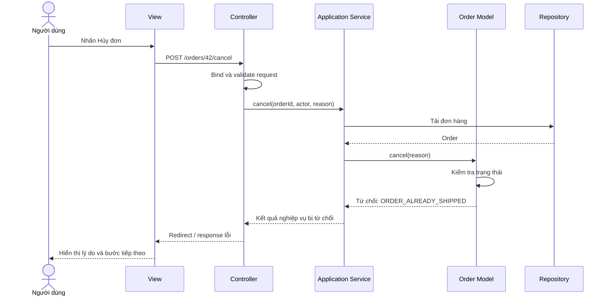

# Phản hồi khi nghiệp vụ từ chối thao tác

## 1. Từ chối nghiệp vụ là gì?

Trong ứng dụng MVC, một request có thể đúng cú pháp, đã được xác thực và đi đến đúng Controller nhưng thao tác vẫn không được phép thực hiện theo quy tắc nghiệp vụ. Đây là tình huống **nghiệp vụ từ chối thao tác**.

Ví dụ, người dùng gửi request `POST /orders/42/cancel` để hủy đơn hàng. Request có thể hợp lệ về mặt HTTP, người dùng đã đăng nhập và có quyền truy cập đơn hàng, nhưng đơn đã giao nên không thể hủy. Hệ thống cần từ chối thao tác, giữ trạng thái đơn hàng nhất quán và trả lời rõ ràng để người dùng hiểu điều gì đã xảy ra.

Từ chối nghiệp vụ là một kết quả có thể dự đoán trong quá trình xử lý. Nó khác với lỗi kỹ thuật như mất kết nối cơ sở dữ liệu, timeout hoặc lỗi lập trình. Cách phân biệt này ảnh hưởng đến mã HTTP, thông báo giao diện, logging và cách người dùng có thể tiếp tục.

Trong MVC, các trách nhiệm thường được phân chia như sau:

- **Model / Domain Model** kiểm tra quy tắc và quyết định thao tác có hợp lệ với trạng thái hiện tại hay không.
- **Application Service** điều phối use case, quyền truy cập, giao dịch và chuyển kết quả nghiệp vụ đến adapter.
- **Controller** chuyển kết quả thành phản hồi phù hợp với HTTP và loại client.
- **View** trình bày lý do từ chối bằng ngôn ngữ dễ hiểu và chỉ ra bước tiếp theo nếu có.

## 2. Phân biệt từ chối nghiệp vụ với các loại lỗi khác

Không phải mọi phản hồi thất bại đều là cùng một loại lỗi. Cần xác định lỗi phát sinh ở lớp nào và có ý nghĩa gì đối với người gọi.

| Loại tình huống | Ví dụ | Nơi xử lý chính | Ý nghĩa |
|---|---|---|---|
| Lỗi cú pháp request | Thiếu tham số bắt buộc, ID không chuyển được thành số, JSON sai định dạng | HTTP binding / Controller | Request không thể được hiểu đúng |
| Lỗi validation đầu vào | Tên rỗng, số lượng âm, lý do vượt giới hạn ký tự | Request DTO / validation layer | Dữ liệu đầu vào không đáp ứng hợp đồng |
| Từ chối nghiệp vụ | Đơn đã giao nên không thể hủy; tài khoản không đủ số dư để rút | Domain Model / Application Service | Request hiểu được nhưng hành động không hợp lệ theo trạng thái hoặc chính sách |
| Từ chối quyền truy cập | Người dùng không được phép sửa đơn của người khác | Authorization / Application Service / Security layer | Người gọi không có quyền trên tài nguyên hoặc hành động |
| Xung đột đồng thời | Dữ liệu đã được người khác cập nhật trước khi lưu | Persistence / Application Service | Trạng thái thay đổi khiến thao tác không còn áp dụng được |
| Lỗi kỹ thuật | Cơ sở dữ liệu mất kết nối, dịch vụ ngoài timeout | Infrastructure / error handling | Hệ thống không thể hoàn tất xử lý vì sự cố |

Phân loại đúng giúp tránh hai vấn đề: trả lỗi 500 cho một tình huống nghiệp vụ bình thường, hoặc che giấu sự cố kỹ thuật dưới một thông báo từ chối chung chung.

## 3. Luồng xử lý khi Model từ chối thao tác

Một luồng điển hình với request hủy đơn hàng:



Các điểm cần bảo đảm:

1. Request được kiểm tra cú pháp và ràng buộc đầu vào trước khi gọi use case.
2. Quy tắc nghiệp vụ được kiểm tra ở Model hoặc domain policy có thẩm quyền.
3. Khi từ chối, trạng thái không được cập nhật dở dang.
4. Application Service trả một kết quả có ý nghĩa ổn định, không buộc Controller phải phân tích câu thông báo tự do.
5. Controller ánh xạ kết quả sang HTTP response hoặc View phù hợp.
6. View trình bày thông báo an toàn, không tiết lộ chi tiết nội bộ.

## 4. Biểu diễn kết quả từ chối ở tầng nghiệp vụ

Có hai cách phổ biến để biểu diễn một quy tắc từ chối:

- **Kết quả có kiểu (result):** phù hợp khi từ chối là nhánh xử lý dự kiến, ví dụ đơn đã giao hoặc hạn mức đã đạt.
- **Domain exception:** phù hợp khi một thao tác vi phạm hợp đồng hoặc trạng thái mà caller không thể tiếp tục bình thường, và hệ thống có cơ chế chuyển exception thành kết quả.

Không nên dùng một chuỗi văn bản tùy ý làm mã lỗi. Controller và View cần một mã ổn định để ánh xạ sang HTTP status, thông báo đã bản địa hóa và cách xử lý tiếp theo.

### 4.1. Ví dụ dùng kết quả có kiểu

```java
public enum CancelRejection {
    ALREADY_SHIPPED,
    ALREADY_CANCELLED
}

public record CancelDecision(
        boolean accepted,
        CancelRejection rejection) {

    public static CancelDecision allow() {
        return new CancelDecision(true, null);
    }

    public static CancelDecision reject(CancelRejection reason) {
        return new CancelDecision(false, reason);
    }
}
```

Domain Model kiểm tra quy tắc và chỉ thay đổi trạng thái khi thao tác được chấp nhận:

```java
public class Order {
    private OrderStatus status;
    private String cancellationReason;

    public CancelDecision cancel(String reason) {
        if (status == OrderStatus.SHIPPED
                || status == OrderStatus.DELIVERED) {
            return CancelDecision.reject(CancelRejection.ALREADY_SHIPPED);
        }

        if (status == OrderStatus.CANCELLED) {
            return CancelDecision.reject(CancelRejection.ALREADY_CANCELLED);
        }

        this.status = OrderStatus.CANCELLED;
        this.cancellationReason = reason;
        return CancelDecision.allow();
    }
}
```

Model không biết HTTP status hay câu chữ trên giao diện. Nó chỉ trả về quyết định thuộc miền nghiệp vụ. Application Service có thể lưu thay đổi khi quyết định được chấp nhận:

```java
public record CancelOrderOutcome(
        boolean accepted,
        String code) {
    public static CancelOrderOutcome success() {
        return new CancelOrderOutcome(true, null);
    }

    public static CancelOrderOutcome rejected(String code) {
        return new CancelOrderOutcome(false, code);
    }
}

@Service
public class OrderApplicationService {
    private final OrderRepository repository;

    public OrderApplicationService(OrderRepository repository) {
        this.repository = repository;
    }

    @Transactional
    public CancelOrderOutcome cancel(long orderId, String reason) {
        Order order = repository.findByIdForUpdate(orderId)
                .orElseThrow(() -> new OrderNotFoundException(orderId));

        CancelDecision decision = order.cancel(reason);
        if (!decision.accepted()) {
            return CancelOrderOutcome.rejected(decision.rejection().name());
        }

        repository.save(order);
        return CancelOrderOutcome.success();
    }
}
```

Tên phương thức `findByIdForUpdate` ở đây biểu thị một cách khóa dữ liệu trong lúc xử lý; ứng dụng cũng có thể dùng optimistic locking với version. Cần chọn cơ chế phù hợp với cơ sở dữ liệu và mức độ cạnh tranh. Việc chỉ đọc trạng thái rồi cập nhật mà không bảo vệ trước request đồng thời có thể khiến hai thao tác cùng vượt qua một kiểm tra cũ.

### 4.2. Khi nào dùng exception?

Một số hệ thống dùng exception như `OrderCannotBeCancelledException` khi Model phát hiện vi phạm quy tắc. Nếu chọn cách này, hãy dùng loại exception miền cụ thể và chuyển nó thành phản hồi ở một ranh giới tập trung như `@ControllerAdvice`.

Không nên dùng exception chung chung như `RuntimeException("Không hợp lệ")` cho mọi nhánh. Mã lỗi có kiểu giúp phân biệt nguyên nhân, viết kiểm thử rõ ràng và tránh phụ thuộc vào nội dung câu chữ.

Với các kết quả từ chối thường gặp trong quy trình bình thường, result object thường giúp luồng điều khiển dễ đọc. Với lỗi hạ tầng hoặc lỗi không dự kiến, exception vẫn là cơ chế phù hợp. Dù chọn cách nào, quy tắc phải được bảo vệ ở phía nghiệp vụ và trạng thái không được ghi dở dang.

## 5. Controller ánh xạ kết quả sang phản hồi HTML

Với ứng dụng render HTML ở máy chủ, Controller thường dùng Post/Redirect/Get (PRG) sau khi nhận một request POST. Nếu nghiệp vụ từ chối, Controller có thể đưa mã lỗi hoặc thông báo an toàn vào flash attribute rồi redirect về trang chi tiết.

```java
@PostMapping("/{id}/cancel")
public String cancel(
        @PathVariable long id,
        @Valid @ModelAttribute("form") CancelOrderForm form,
        BindingResult errors,
        RedirectAttributes redirectAttributes) {

    if (errors.hasErrors()) {
        return "orders/detail";
    }

    CancelOrderOutcome outcome = orderService.cancel(id, form.reason());
    if (!outcome.accepted()) {
        redirectAttributes.addFlashAttribute(
                "errorCode", outcome.code());
        return "redirect:/orders/" + id;
    }

    redirectAttributes.addFlashAttribute(
            "successCode", "ORDER_CANCELLED");
    return "redirect:/orders/" + id;
}
```

Trang chi tiết có thể ánh xạ `errorCode` thành thông báo phù hợp:

| Mã nghiệp vụ | Thông báo cho người dùng |
|---|---|
| `ALREADY_SHIPPED` | Đơn hàng đã được bàn giao cho đơn vị vận chuyển nên không thể hủy tại đây. Hãy liên hệ bộ phận hỗ trợ nếu cần thay đổi. |
| `ALREADY_CANCELLED` | Đơn hàng đã được hủy trước đó. |
| `ORDER_NOT_FOUND` | Không tìm thấy đơn hàng hoặc bạn không thể truy cập đơn hàng này. |

Flash attribute tồn tại qua lần redirect kế tiếp và phù hợp cho thông báo một lần. Không đưa nội dung nhạy cảm hoặc dữ liệu nghiệp vụ đầy đủ vào URL query string.

Nếu cần hiển thị lỗi gắn với một trường biểu mẫu, Controller có thể trả lại View ngay cùng `BindingResult` và dữ liệu đã nhập. Với từ chối ở cấp toàn thao tác, có thể hiển thị lỗi tổng quát ở đầu biểu mẫu hoặc vùng thông báo. Cần quyết định theo trải nghiệm người dùng và cách ứng dụng quản lý trạng thái form.

## 6. Controller ánh xạ kết quả sang REST API

REST API thường trả mã trạng thái HTTP và một body có cấu trúc. Với lỗi nghiệp vụ, có thể dùng định dạng **Problem Details** theo RFC 9457 (`application/problem+json`) hoặc một hợp đồng lỗi tương đương đã được thống nhất trong API.

Ví dụ với Spring:

```java
@PostMapping("/{id}/cancel")
public ResponseEntity<ProblemDetail> cancel(
        @PathVariable long id,
        @Valid @RequestBody CancelOrderRequest request) {

    CancelOrderOutcome outcome = orderService.cancel(id, request.reason());
    if (!outcome.accepted()) {
        ProblemDetail problem = ProblemDetail.forStatusAndDetail(
                HttpStatus.CONFLICT,
                "Đơn hàng không thể hủy ở trạng thái hiện tại.");
        problem.setTitle("Không thể hủy đơn hàng");
        problem.setType(URI.create("https://api.example.test/problems/order-cannot-cancel"));
        problem.setProperty("code", outcome.code());
        return ResponseEntity.status(HttpStatus.CONFLICT).body(problem);
    }

    return ResponseEntity.noContent().build();
}
```

Trong sản phẩm thực tế, `type` nên trỏ đến tài liệu lỗi ổn định do tổ chức kiểm soát hoặc dùng URI định danh phù hợp. Không dùng domain ví dụ ở trên làm địa chỉ thật.

Một response Problem Details có thể có các trường chuẩn:

```json
{
  "type": "https://api.example.test/problems/order-cannot-cancel",
  "title": "Không thể hủy đơn hàng",
  "status": 409,
  "detail": "Đơn hàng không thể hủy ở trạng thái hiện tại.",
  "instance": "/api/orders/42/cancel",
  "code": "ALREADY_SHIPPED"
}
```

Client nên dựa vào `status` và mã `code` ổn định để quyết định hành vi; `title` và `detail` dành cho con người. Không nên yêu cầu client phân tích câu thông báo để suy ra mã lỗi.

## 7. Chọn HTTP status phù hợp

Mã trạng thái cần phản ánh bản chất vấn đề. Một số lựa chọn thường gặp:

| HTTP status | Dùng khi | Ví dụ |
|---|---|---|
| `400 Bad Request` | Request sai cú pháp, thiếu dữ liệu bắt buộc hoặc không thể bind | JSON không hợp lệ, ID sai định dạng |
| `401 Unauthorized` | Request cần xác thực nhưng chưa có thông tin xác thực hợp lệ | Phiên đăng nhập hết hạn |
| `403 Forbidden` | Người gọi đã xác thực nhưng không được phép thực hiện hành động | Không có quyền hủy đơn |
| `404 Not Found` | Tài nguyên không tồn tại hoặc chính sách bảo mật không tiết lộ sự tồn tại | Không tìm thấy đơn hoặc không được phép biết đơn đó |
| `409 Conflict` | Thao tác xung đột với trạng thái hiện tại của tài nguyên | Đơn đã giao, phiên bản dữ liệu đã thay đổi |
| `422 Unprocessable Content` | Cú pháp request hợp lệ nhưng nội dung không thể xử lý theo hợp đồng ngữ nghĩa của API | Trường có giá trị không được chấp nhận theo quy ước API |
| `500 Internal Server Error` | Lỗi không dự kiến phía máy chủ | Null pointer, lỗi lập trình hoặc trạng thái hệ thống bất thường |
| `503 Service Unavailable` | Dịch vụ tạm thời không sẵn sàng | Phụ thuộc quan trọng đang bảo trì hoặc quá tải |

Không có một status duy nhất bắt buộc cho mọi từ chối nghiệp vụ. `409` thường phù hợp khi trạng thái tài nguyên khiến hành động không thể thực hiện. `422` có thể phù hợp với lỗi ngữ nghĩa của nội dung request theo hợp đồng API. Hãy giữ quy ước nhất quán giữa các endpoint và mô tả trong tài liệu API.

Nếu người dùng không có quyền, không được dùng `409` chỉ vì nghiệp vụ không cho phép họ thao tác. Hãy phân biệt quyền truy cập với điều kiện trạng thái. Trong một số hệ thống, trả `404` thay cho `403` là lựa chọn bảo mật để tránh tiết lộ tài nguyên có tồn tại hay không.

## 8. Thiết kế thông báo từ chối cho View

Thông báo tốt cần trả lời ba câu hỏi: thao tác có thành công không, vì sao bị từ chối và người dùng có thể làm gì tiếp theo.

Một thông báo nên:

- Dùng ngôn ngữ rõ ràng, tránh thuật ngữ nội bộ như tên exception hoặc tên bảng dữ liệu.
- Nêu đúng điều kiện từ chối mà người dùng cần biết.
- Đưa ra bước tiếp theo nếu có, chẳng hạn thử lại sau khi cập nhật dữ liệu hoặc liên hệ bộ phận hỗ trợ.
- Không đổ lỗi cho người dùng và không tiết lộ thông tin của người khác.
- Có thể bản địa hóa theo ngôn ngữ và vùng của người dùng.
- Phân biệt thông báo lỗi toàn thao tác với lỗi gắn vào một trường biểu mẫu.

Ví dụ:

| Thông báo kém hữu ích | Thông báo tốt hơn |
|---|---|
| Thao tác thất bại. | Đơn hàng đã được giao cho đơn vị vận chuyển nên không thể hủy trực tuyến. |
| Invalid state: SHIPPED | Đơn hàng đã được bàn giao cho đơn vị vận chuyển. Hãy liên hệ hỗ trợ để được tư vấn. |
| Error 409 | Đơn hàng đã thay đổi trong lúc bạn thao tác. Hãy tải lại trang để xem trạng thái mới nhất. |

Thông báo trên giao diện có thể được ánh xạ từ mã lỗi ổn định qua message bundle hoặc một lớp trình bày. Không nên lưu câu thông báo đã dịch trong Domain Model vì Model cần độc lập với ngôn ngữ và giao diện.

## 9. Giữ trạng thái nhất quán khi từ chối

Một từ chối nghiệp vụ cần bảo đảm không để lại trạng thái nửa chừng. Ví dụ, khi hủy đơn hàng, hệ thống không được cập nhật đơn thành `CANCELLED` rồi thất bại khi giải phóng tồn kho mà không có chiến lược phục hồi.

Các nguyên tắc cần cân nhắc:

- Kiểm tra các điều kiện có thể kiểm tra trước khi thay đổi trạng thái.
- Đặt các thao tác dữ liệu cần tính nguyên tử trong cùng transaction khi chúng cùng một ranh giới lưu trữ.
- Dùng optimistic locking hoặc pessimistic locking nếu nhiều request có thể cùng thay đổi một tài nguyên.
- Nếu thao tác liên quan đến hệ thống ngoài, dùng cơ chế nhất quán phù hợp như outbox, saga hoặc quy trình bất đồng bộ; không giả định rollback cơ sở dữ liệu sẽ hoàn tác tác động bên ngoài.
- Chỉ phát thông báo thành công sau khi thay đổi đã được chấp nhận và lưu theo đúng ngữ nghĩa của use case.
- Với request có thể gửi lặp, xác định hành vi idempotent hoặc dùng idempotency key cho thao tác quan trọng.

Ví dụ, nếu đơn đã được hủy bởi request trước đó, sản phẩm có thể chọn trả thành công idempotent vì mục tiêu cuối cùng đã đạt; hoặc trả `409` để cho biết trạng thái hiện tại không cho phép thực hiện lại. Quyết định phụ thuộc hợp đồng nghiệp vụ, nhưng phải nhất quán và được ghi rõ.

## 10. Bảo mật khi phản hồi từ chối

Thông báo lỗi là dữ liệu gửi ra bên ngoài nên cần được kiểm soát:

- Không trả stack trace, câu SQL, tên class nội bộ, đường dẫn máy chủ hoặc thông tin cấu hình.
- Không tiết lộ dữ liệu của người dùng khác trong phần `detail`.
- Cân nhắc trả cùng một thông báo cho “không tồn tại” và “không có quyền” nếu cần bảo vệ sự tồn tại của tài nguyên.
- Không đưa nội dung request không tin cậy vào HTML mà không escape.
- Không ghi lý do từ chối có chứa dữ liệu nhạy cảm vào log mở rộng hoặc URL.
- Giữ mã lỗi ổn định nhưng tránh mã hóa thông tin bí mật vào chính mã đó.

Ở phía máy chủ, log có thể ghi mã use case, mã lỗi, correlation ID, actor ID theo chính sách dữ liệu và định danh tài nguyên cần thiết. Log phải có kiểm soát truy cập và tránh lưu dữ liệu cá nhân quá mức.

## 11. Kiểm thử luồng từ chối nghiệp vụ

Kiểm thử nên xác minh cả quyết định nghiệp vụ, trạng thái lưu trữ và phản hồi được gửi ra ngoài.

| Phạm vi | Trường hợp | Kết quả cần xác minh |
|---|---|---|
| Domain Model | Hủy đơn đang chờ xử lý | Chấp nhận và đổi trạng thái đúng |
| Domain Model | Hủy đơn đã giao | Từ chối với mã lý do phù hợp; trạng thái không đổi |
| Application Service | Từ chối nghiệp vụ | Không lưu thay đổi dở dang hoặc phát sự kiện thành công |
| Application Service | Người dùng không có quyền | Use case bị chặn theo chính sách; không thay đổi dữ liệu |
| Controller HTML | Kết quả từ chối | Redirect hoặc render đúng View, có thông báo phù hợp |
| Controller API | Kết quả từ chối | Status code và Problem Details đúng hợp đồng |
| Concurrent request | Hai request cập nhật cùng tài nguyên | Một request không được ghi đè trạng thái mới bằng dữ liệu cũ |
| Security | Lỗi có dữ liệu nhạy cảm | Response không làm lộ chi tiết nội bộ |

Ngoài trường hợp bình thường, cần kiểm thử khi repository lỗi, dịch vụ ngoài timeout và transaction rollback. Những trường hợp này là lỗi kỹ thuật hoặc lỗi điều phối, không được trả nhầm thành một từ chối nghiệp vụ thông thường.

## 12. Lỗi thiết kế thường gặp

1. **Trả 500 cho mọi từ chối:** khiến client và hệ thống giám sát hiểu nhầm quy tắc nghiệp vụ là sự cố máy chủ.
2. **Chỉ trả câu “Không thành công”:** người dùng không biết lý do hoặc bước tiếp theo.
3. **Để View tự quyết định nghiệp vụ:** nút bị ẩn hoặc disabled không bảo vệ được endpoint.
4. **Đưa thông báo đã dịch vào Model:** làm Domain Model phụ thuộc vào ngôn ngữ và giao diện.
5. **Dùng chuỗi tự do làm mã lỗi:** khiến client phải phân tích văn bản và dễ hỏng khi đổi câu chữ.
6. **Ghi một phần trạng thái trước khi từ chối:** tạo dữ liệu không nhất quán hoặc cần thao tác sửa thủ công.
7. **Dùng cùng một status cho mọi nguyên nhân:** làm mất khác biệt giữa validation, quyền, xung đột trạng thái và lỗi kỹ thuật.
8. **Tiết lộ chi tiết nội bộ:** response lỗi chứa stack trace, câu SQL hoặc dữ liệu người khác.

## 13. Quy trình thiết kế phản hồi từ chối

Khi xây dựng một use case có thể bị từ chối, hãy xác định trước các nhánh kết quả:

1. Liệt kê điều kiện nghiệp vụ có thể khiến thao tác bị từ chối.
2. Gán mã lỗi ổn định cho từng nguyên nhân có ý nghĩa khác nhau đối với client.
3. Xác định thành phần có thẩm quyền kiểm tra từng điều kiện: request validation, authorization hay Domain Model.
4. Bảo đảm trạng thái không đổi nếu thao tác bị từ chối và giao dịch được xử lý đúng.
5. Định nghĩa cách ánh xạ từng kết quả sang HTTP status và response body hoặc View.
6. Viết thông báo dễ hiểu, an toàn, có thể bản địa hóa và hướng dẫn bước tiếp theo.
7. Kiểm thử cả kết quả từ chối, dữ liệu sau xử lý và phản hồi bên ngoài.

## 14. Kết luận

Khi nghiệp vụ từ chối thao tác, ứng dụng cần xem đó là một kết quả có ý nghĩa thay vì một lỗi kỹ thuật chung. Model hoặc domain policy quyết định quy tắc, Application Service điều phối use case và bảo vệ tính nhất quán, Controller ánh xạ kết quả sang hợp đồng HTTP, còn View trình bày lý do và hướng xử lý tiếp theo.

Phân biệt rõ validation, quyền truy cập, từ chối nghiệp vụ, xung đột đồng thời và lỗi kỹ thuật giúp chọn status code đúng, tạo thông báo hữu ích và hỗ trợ kiểm thử. Mã lỗi ổn định, response an toàn và trạng thái dữ liệu nhất quán là nền tảng để luồng tương tác MVC xử lý thất bại một cách đáng tin cậy.
