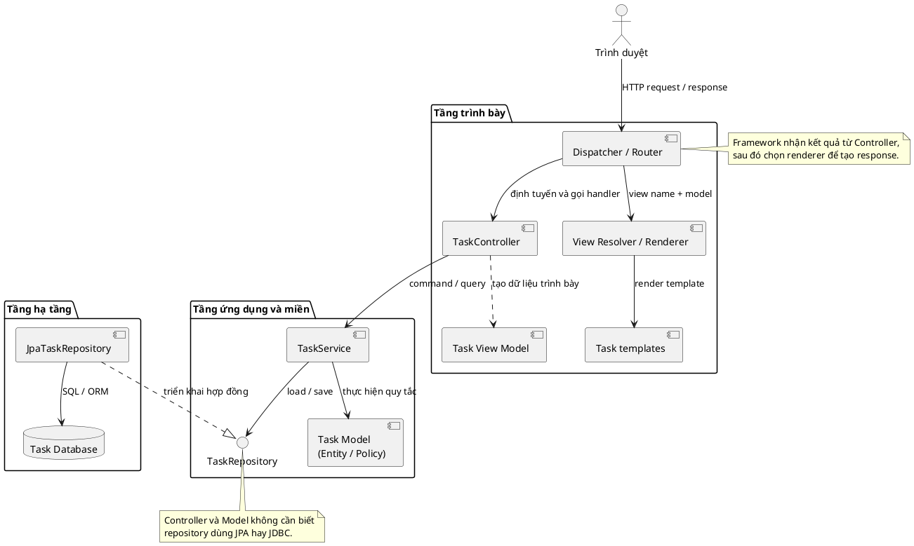
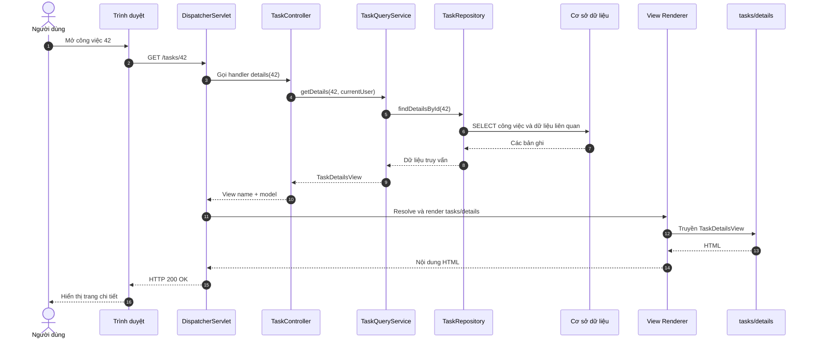
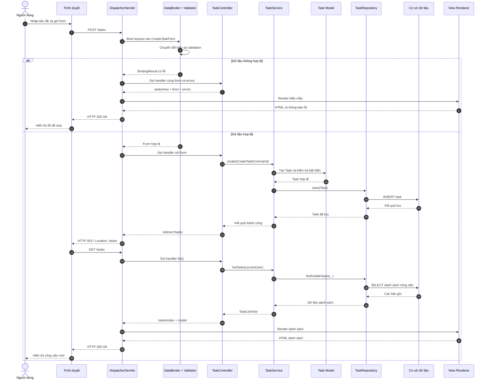
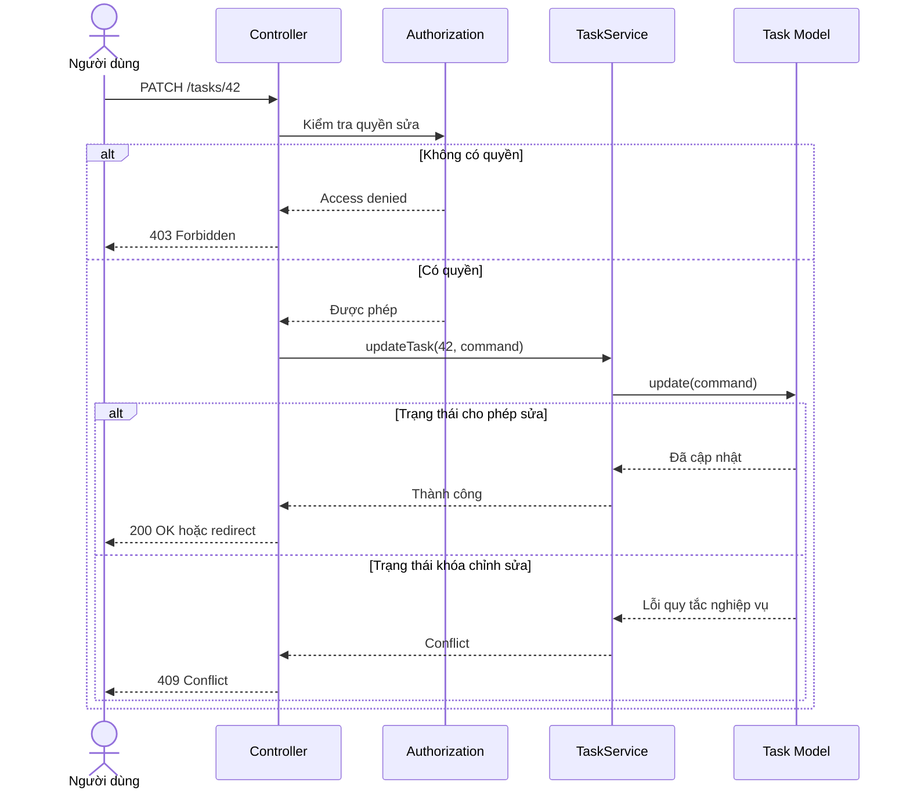

# Biểu diễn luồng bằng sơ đồ thành phần và sơ đồ trình tự

Trong MVC, một chức năng web thường đi qua nhiều thành phần: trình duyệt gửi request, bộ định tuyến tìm Controller, Controller gọi nghiệp vụ, Model kiểm tra và thay đổi trạng thái, repository đọc hoặc ghi dữ liệu, rồi View tạo response để trả về trình duyệt. Khi hệ thống có nhiều lớp và nhiều nhánh xử lý, chỉ mô tả bằng lời hoặc nhìn vào mã nguồn có thể khiến quan hệ giữa các phần khó theo dõi.

Sơ đồ thành phần (component diagram) và sơ đồ trình tự (sequence diagram) giúp nhìn cùng một chức năng ở hai góc độ bổ sung. Sơ đồ thành phần mô tả cấu trúc tương đối ổn định: hệ thống gồm những thành phần nào, chúng cung cấp hoặc sử dụng hợp đồng nào và phụ thuộc vào nhau ra sao. Sơ đồ trình tự mô tả hành vi tại thời điểm chạy: những đối tượng hoặc thành phần nào tham gia một kịch bản, thông điệp được gửi theo thứ tự nào và luồng thay đổi ra sao khi có điều kiện hoặc lỗi.

Kết hợp hai loại sơ đồ giúp người đọc trả lời hai câu hỏi: **các phần của ứng dụng được tổ chức và kết nối thế nào?** và **một request cụ thể đi qua các phần đó theo trình tự nào?**

## Hai góc nhìn khác nhau

| Góc nhìn | Sơ đồ thành phần | Sơ đồ trình tự |
|---|---|---|
| Trọng tâm | Cấu trúc và quan hệ phụ thuộc | Thứ tự tương tác theo thời gian |
| Đơn vị chính | Component, interface, dependency | Actor, lifeline, message, activation |
| Câu hỏi | Ai phụ thuộc vào ai và qua hợp đồng nào? | Ai gọi ai, lúc nào và nhận kết quả gì? |
| Phạm vi thường dùng | Kiến trúc một ứng dụng hoặc một phân hệ | Một use case hoặc một nhánh xử lý |
| Điều không thể hiện đầy đủ | Thứ tự gọi chi tiết của một request | Toàn bộ cấu trúc tĩnh và mọi phụ thuộc của hệ thống |

Hai sơ đồ không thay thế nhau. Sơ đồ thành phần không phải là sơ đồ luồng điều khiển theo thời gian; sơ đồ trình tự cũng không phải bản đồ đầy đủ của kiến trúc. Nếu cần giải thích một chức năng, thường nên có một sơ đồ cấu trúc vừa đủ và một hoặc vài sơ đồ trình tự cho các kịch bản quan trọng.

## Sơ đồ thành phần trong ứng dụng MVC

### Thành phần và giao diện

Trong UML, component là một đơn vị có trách nhiệm và ranh giới tương đối rõ. Component có thể là một phần logic trong ứng dụng, một module, một dịch vụ hoặc một phần có thể thay thế độc lập. Nó không nhất thiết tương ứng với một class Java hay một tiến trình riêng.

Các thành phần thường xuất hiện trong một ứng dụng web MVC gồm:

- **HTTP client / trình duyệt:** gửi request và nhận response.
- **Router hoặc Dispatcher:** ánh xạ URL và phương thức HTTP đến handler phù hợp.
- **Controller:** tiếp nhận request, đọc dữ liệu, điều phối và chọn response.
- **Application service:** phối hợp một use case, gọi Model và các cổng truy cập dữ liệu.
- **Model miền:** biểu diễn trạng thái, hành vi và quy tắc nghiệp vụ.
- **Repository:** cung cấp hợp đồng đọc/ghi dữ liệu miền; phần triển khai kết nối với cơ sở dữ liệu hoặc nguồn lưu trữ khác.
- **View renderer và template:** chuyển dữ liệu trình bày thành HTML hoặc định dạng giao diện tương ứng.

Một component có thể cung cấp giao diện (provided interface) để thành phần khác sử dụng, đồng thời yêu cầu (required interface) những dịch vụ mà nó phụ thuộc. Ví dụ, `TaskRepository` là hợp đồng mà `TaskService` cần để tải và lưu công việc. `JpaTaskRepository` hoặc `JdbcTaskRepository` có thể triển khai hợp đồng đó.

Trong ký pháp UML, interface được cung cấp thường có thể biểu diễn bằng ký hiệu hình tròn nhỏ (lollipop); interface được yêu cầu có thể biểu diễn bằng nửa vòng tròn (socket). Sơ đồ cũng có thể dùng mũi tên dependency để chỉ thành phần khách hàng phụ thuộc vào thành phần cung cấp hợp đồng. Khi dùng một công cụ vẽ, cần giữ quy ước mũi tên nhất quán và ghi nhãn những quan hệ dễ gây nhầm lẫn.

### Ví dụ sơ đồ thành phần cho ứng dụng quản lý công việc

Sơ đồ dưới đây mô tả cấu trúc logic của một ứng dụng web MVC. Các hộp là component; mũi tên thể hiện quan hệ sử dụng hoặc phụ thuộc được ghi nhãn. Đây là sơ đồ kiến trúc ở mức khái quát, không mô tả từng class hay từng lời gọi khi chạy.

Điểm cần chú ý trong sơ đồ:

1. Trình duyệt giao tiếp với ứng dụng qua HTTP. Router/Dispatcher chọn Controller dựa trên route và phương thức.
2. Controller phụ thuộc vào dịch vụ ứng dụng để thực hiện query hoặc command. Controller không cần biết câu SQL hay cách entity được lưu.
3. Dịch vụ ứng dụng phối hợp Model và repository. Model giữ quy tắc miền; repository che giấu chi tiết truy cập dữ liệu.
4. Controller cung cấp tên View và dữ liệu trình bày. Framework hoặc renderer chọn template và tạo response.
5. Phần triển khai repository phụ thuộc cơ sở dữ liệu, còn phần nghiệp vụ chỉ cần hợp đồng repository.

Trong một ứng dụng nhỏ, nhiều vai trò có thể nằm trong cùng module hoặc được framework cung cấp. Sơ đồ nên phản ánh cấu trúc thật của hệ thống. Không cần vẽ một component riêng cho từng class chỉ để làm sơ đồ lớn hơn.

### Cách đọc các mũi tên và quan hệ

Khi đọc sơ đồ thành phần, hãy phân biệt:

- **Gọi hoặc sử dụng:** component A gọi một dịch vụ do component B cung cấp.
- **Phụ thuộc hợp đồng:** A cần một interface mà B triển khai; A nên phụ thuộc interface thay vì chi tiết triển khai của B.
- **Render hoặc cung cấp dữ liệu:** Controller trả dữ liệu và lựa chọn View; framework sử dụng kết quả đó để render.
- **Truy cập lưu trữ:** repository implementation giao tiếp với cơ sở dữ liệu. Đây là chi tiết hạ tầng.

Không nên diễn giải mọi mũi tên thành “dữ liệu chảy theo chiều này”. Mũi tên dependency biểu diễn quan hệ phụ thuộc; lời gọi runtime và dữ liệu trả về có thể đi theo các chiều khác nhau. Hãy dùng nhãn quan hệ để người đọc không phải đoán ý nghĩa.

## Sơ đồ trình tự cho một request MVC

### Thành phần của sơ đồ trình tự

Sơ đồ trình tự mô tả một kịch bản theo trục thời gian từ trên xuống dưới. Các thành phần chính gồm:

- **Actor:** người dùng hoặc hệ thống bên ngoài khởi tạo tương tác.
- **Participant:** đối tượng hoặc component tham gia kịch bản, ví dụ trình duyệt, Controller, service và repository.
- **Lifeline:** đường nét đứt thẳng đứng biểu diễn sự tồn tại của participant trong khoảng thời gian của kịch bản.
- **Message:** mũi tên biểu diễn lời gọi, request, sự kiện hoặc phản hồi giữa các participant.
- **Activation:** thanh hẹp trên lifeline biểu diễn khoảng thời gian participant đang thực thi một hành động.
- **Return message:** thông điệp trả kết quả, thường được vẽ bằng đường nét đứt.
- **Combined fragment:** vùng điều khiển như `alt`, `opt`, `loop` dùng để thể hiện nhánh điều kiện, hành động tùy chọn hoặc vòng lặp.

Thông điệp đồng bộ (synchronous) thường có nghĩa bên gọi chờ thao tác được thực hiện và nhận kết quả. Thông điệp bất đồng bộ (asynchronous) thể hiện việc gửi đi mà bên gửi không chờ kết quả trực tiếp theo cùng cơ chế. Cần chọn ký hiệu đúng với hành vi thực tế; không nên dùng mũi tên bất đồng bộ chỉ vì lời gọi chạy qua HTTP hoặc vì mã có từ khóa `async`.

### Ví dụ: mở trang chi tiết công việc

Kịch bản GET giúp thấy rõ luồng đọc dữ liệu và render View trong web MVC phía máy chủ:

Đọc sơ đồ từ trên xuống dưới: trình duyệt gửi GET; Dispatcher định tuyến; Controller gọi dịch vụ truy vấn; dịch vụ lấy dữ liệu qua repository; kết quả được ánh xạ thành `TaskDetailsView`; framework render template rồi trả HTML. View không cần tự gọi repository hoặc truy vấn cơ sở dữ liệu.

Sơ đồ là mô hình khái niệm. Trong framework cụ thể, một số bước có thể do cùng một component thực hiện, chẳng hạn handler adapter và DispatcherServlet, hoặc renderer và template engine có thể được gộp. Hãy điều chỉnh participant theo kiến trúc thật khi dùng sơ đồ để review mã nguồn.

### Ví dụ: gửi biểu mẫu tạo công việc

Một request ghi dữ liệu có nhiều nhánh hơn: lỗi chuyển đổi/validation, lỗi nghiệp vụ và thành công. Sơ đồ dưới đây minh họa cả hai nhánh chính:

Trong Spring MVC, data binding và Bean Validation thường được thực hiện trước khi phần thân phương thức Controller xử lý. Khi có lỗi, `BindingResult` cho phép handler trả lại form cùng lỗi. Khi hợp lệ, Controller tạo command và gọi service. Sau khi lưu thành công, chuyển hướng theo mô hình Post/Redirect/Get giúp thao tác tải lại trang không gửi lại POST ngay lập tức.

Mã trạng thái redirect có thể là 302 hoặc 303 tùy cách framework và response được cấu hình. Với Post/Redirect/Get, 303 thể hiện rõ request tiếp theo là GET. Sơ đồ nên ghi đúng hành vi ứng dụng thực tế thay vì giả định mọi framework luôn trả cùng một mã.

## Biểu diễn nhánh lỗi và trường hợp tùy chọn

Không phải kịch bản nào cũng đi qua đường thành công. Một sơ đồ trình tự hữu ích cần thể hiện các nhánh có ảnh hưởng đến hành vi người dùng hoặc tính đúng đắn của hệ thống.

| Fragment UML | Ý nghĩa | Ví dụ MVC |
|---|---|---|
| `alt` | Các nhánh loại trừ nhau theo điều kiện | Validation hợp lệ / không hợp lệ |
| `opt` | Một đoạn chỉ chạy khi điều kiện đúng | Gửi email thông báo nếu người dùng bật tùy chọn |
| `loop` | Lặp lại một đoạn theo điều kiện hoặc số lần | Xử lý từng mục trong danh sách |
| `par` | Các đoạn có thể chạy song song | Gọi hai dịch vụ độc lập để tổng hợp dữ liệu |
| `break` | Dừng phần tương tác còn lại khi điều kiện xảy ra | Từ chối sớm khi không có quyền |

Ví dụ, nếu người dùng không có quyền sửa công việc, Controller hoặc security layer có thể từ chối trước khi gọi dịch vụ cập nhật. Nếu công việc đã hoàn thành và không thể sửa, dịch vụ nghiệp vụ có thể trả lỗi trạng thái. Hai lỗi có nguyên nhân khác nhau nên thường cần hai nhánh riêng trong sơ đồ.

Không cần vẽ mọi exception kỹ thuật hoặc mọi dòng log. Hãy tập trung vào các nhánh làm thay đổi kết quả của use case, hợp đồng API, trạng thái dữ liệu hoặc trải nghiệm người dùng.

## Từ yêu cầu đến hai sơ đồ

Một cách làm có hệ thống là bắt đầu từ một use case cụ thể, sau đó tạo hai góc nhìn:

1. **Chọn kịch bản:** ví dụ xem chi tiết, tạo mới, cập nhật, xóa hoặc tìm kiếm. Xác định actor, trigger và kết quả mong đợi.
2. **Xác định ranh giới:** liệt kê thành phần ở ngoài hệ thống, tầng trình bày, tầng nghiệp vụ và tầng lưu trữ.
3. **Vẽ sơ đồ thành phần:** nhóm các component theo trách nhiệm; thể hiện interface và dependency chính; ghi nhãn giao tiếp như HTTP, command/query, repository contract hoặc render.
4. **Kiểm tra chiều phụ thuộc:** Controller điều phối dịch vụ; dịch vụ phụ thuộc hợp đồng nghiệp vụ và lưu trữ; phần hạ tầng triển khai các hợp đồng. Tránh để View hoặc Controller phụ thuộc trực tiếp vào cơ sở dữ liệu.
5. **Vẽ sơ đồ trình tự cho luồng chính:** đưa actor và các participant thực sự tham gia vào một kịch bản; ghi message theo thứ tự từ lúc nhận request đến response.
6. **Bổ sung nhánh quan trọng:** validation lỗi, không tìm thấy tài nguyên, không có quyền, vi phạm quy tắc nghiệp vụ và thành công.
7. **Đối chiếu hai sơ đồ:** mỗi message trong sơ đồ trình tự phải có một quan hệ hợp lý trong cấu trúc thành phần. Nếu sơ đồ trình tự gọi một service không xuất hiện trong sơ đồ cấu trúc, hãy xem component đó có cần được thể hiện hay sơ đồ thành phần đang ở mức trừu tượng cao hơn.
8. **Đối chiếu với mã nguồn:** kiểm tra route, tên handler, service, repository, view và response thực tế. Sơ đồ cần được cập nhật khi kiến trúc hoặc luồng xử lý thay đổi.

## Mức chi tiết phù hợp

Sơ đồ quá sơ lược không giúp người đọc hiểu ranh giới; sơ đồ quá chi tiết lại nhanh lỗi thời và khó đọc. Hãy chọn mức chi tiết theo mục đích:

- **Trao đổi kiến trúc:** dùng component ở mức module hoặc tầng, chỉ thể hiện phụ thuộc quan trọng.
- **Thiết kế một chức năng:** thể hiện Controller, application service, Model, repository và View renderer có tham gia.
- **Debug một lỗi:** tập trung vào participant và nhánh liên quan đến lỗi, không cần vẽ toàn hệ thống.
- **Review bảo mật:** bổ sung actor, authentication/authorization, validation, nơi kiểm tra quyền và nơi dữ liệu nhạy cảm được lọc.
- **Review hiệu năng:** thể hiện số lần truy vấn, lời gọi từ xa, các nhánh song song và điểm có thể gây N+1.

Không nên đặt mọi lớp Java vào một sơ đồ thành phần. Không nên tạo một sơ đồ trình tự khổng lồ chứa toàn bộ chức năng của ứng dụng. Chia theo use case hoặc kịch bản giúp sơ đồ có thể đọc và kiểm chứng.

## Những lỗi thường gặp khi vẽ

- **Dùng sơ đồ thành phần để mô tả thứ tự gọi:** nếu cần biết ai gọi trước, ai trả kết quả sau, hãy dùng sơ đồ trình tự.
- **Dùng sơ đồ trình tự để thay thế kiến trúc:** một kịch bản chỉ thể hiện participant tham gia kịch bản đó, không cho biết toàn bộ dependency của hệ thống.
- **Nhầm class với component:** một class có thể là thành phần nội bộ của component; chỉ tách thành component khi có ranh giới hoặc hợp đồng đáng kể.
- **Mũi tên không có ý nghĩa rõ:** ghi nhãn mũi tên là dependency, gọi service, gửi HTTP hay trả kết quả.
- **Đưa mọi chi tiết framework vào sơ đồ cấp cao:** chỉ thêm DispatcherServlet, data binder hoặc template engine khi chúng giúp giải thích trách nhiệm hoặc luồng cần phân tích.
- **Bỏ qua nhánh lỗi:** sơ đồ chỉ có đường thành công có thể che giấu việc validation, quyền và quy tắc nghiệp vụ được xử lý ở đâu.
- **Vẽ repository như thể là Model:** repository hỗ trợ truy xuất và lưu trữ; quy tắc miền vẫn cần được thể hiện trong Model hoặc dịch vụ nghiệp vụ.
- **Để sơ đồ lệch khỏi mã:** sơ đồ cũ có thể khiến người đọc đưa ra quyết định dựa trên kiến trúc không còn tồn tại. Nên lưu sơ đồ gần tài liệu của chức năng và cập nhật cùng thay đổi mã.

## Dùng sơ đồ để kiểm tra chất lượng thiết kế MVC

Hai sơ đồ không chỉ dùng để giải thích. Chúng còn giúp phát hiện vấn đề trong thiết kế:

| Dấu hiệu trên sơ đồ | Vấn đề có thể có | Hướng xem xét |
|---|---|---|
| Controller gọi trực tiếp database | Controller phụ thuộc persistence | Đưa truy vấn qua repository/service |
| View gọi nhiều repository | Logic truy xuất bị đẩy vào trình bày | Chuẩn bị View Model ở tầng ứng dụng |
| Nhiều Controller lặp cùng chuỗi nghiệp vụ | Quy tắc bị phân tán | Tách dịch vụ hoặc hành vi Model dùng chung |
| Model phụ thuộc template hoặc HTTP | Miền nghiệp vụ bị gắn với giao diện | Đảo chiều phụ thuộc, truyền DTO qua Controller |
| Một message gọi service lặp nhiều lần | Có thể có truy vấn thừa hoặc N+1 | Xem lại API truy vấn và cách tải dữ liệu |
| Không có nhánh kiểm tra quyền | Có thể thiếu kiểm soát truy cập | Xác định nơi xác thực và phân quyền phía máy chủ |
| Hai request đồng thời có thể cùng vượt kiểm tra | Có nguy cơ race condition | Bảo vệ cập nhật bằng transaction, khóa hoặc constraint |

Khi sơ đồ cho thấy một component có quá nhiều trách nhiệm hoặc quá nhiều phụ thuộc, đó là tín hiệu để xem lại ranh giới. Khi sơ đồ trình tự có nhiều nhánh khó hiểu hoặc một Controller điều phối quá nhiều bước, có thể cần chuyển phần phối hợp sang dịch vụ ứng dụng hoặc tách use case.

## Checklist trước khi chia sẻ sơ đồ

- Sơ đồ thành phần có thể hiện đúng ranh giới và trách nhiệm của các component không?
- Interface được cung cấp và interface được yêu cầu có được thể hiện hoặc ghi nhãn khi cần không?
- Chiều dependency có nhất quán và không tạo ra phụ thuộc ngược ngoài ý muốn không?
- Sơ đồ trình tự có actor, trigger và kết quả kết thúc rõ ràng không?
- Thứ tự message có khớp với luồng request thực tế không?
- Các nhánh validation, authorization và lỗi nghiệp vụ quan trọng đã có chưa?
- Tên participant và operation có thể đối chiếu với mã nguồn không?
- Mức chi tiết có phù hợp với người đọc và mục đích sử dụng không?

Sơ đồ thành phần giúp người đọc hiểu ứng dụng MVC được chia thành những phần nào và các phần phụ thuộc qua hợp đồng gì. Sơ đồ trình tự cho thấy một request cụ thể đi qua các phần đó ra sao, bao gồm cả kết quả và nhánh lỗi. Khi hai góc nhìn nhất quán với nhau và với mã nguồn, chúng trở thành công cụ hữu ích để thiết kế, review, kiểm thử và bảo trì ứng dụng.
