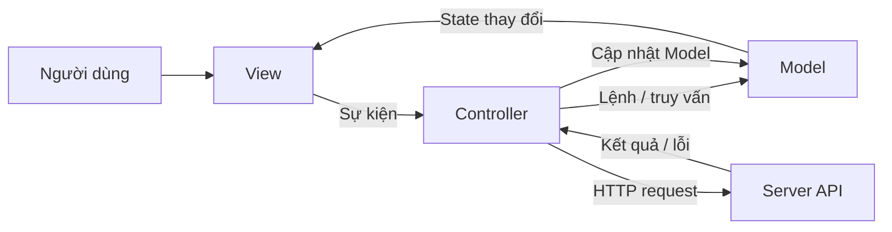
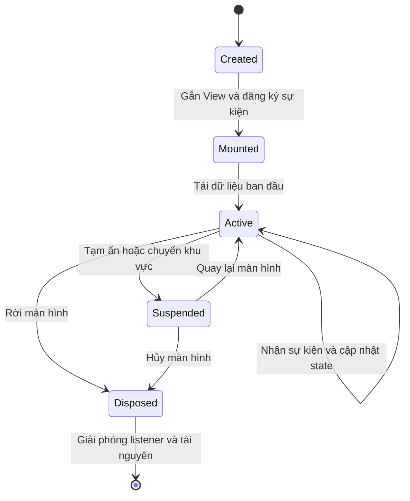

# Đặc điểm MVC trong giao diện tương tác chạy dài

Một trang web truyền thống thường gửi request lên máy chủ rồi nhận về một trang HTML mới. Sau mỗi lần điều hướng, trình duyệt tải trang và người dùng tiếp tục thao tác. Với giao diện tương tác chạy dài, trang hoặc màn hình có thể được giữ nguyên trong suốt một phiên làm việc: người dùng lọc danh sách, mở chi tiết, sửa dữ liệu, nhận thông báo và chuyển giữa các khu vực mà không tải lại toàn bộ trang.

Ví dụ, trên màn hình quản lý công việc, người dùng có thể tìm kiếm theo thời gian thực, đánh dấu một công việc đã hoàn thành, mở hộp thoại chỉnh sửa rồi quay lại danh sách. Giao diện cần phản hồi ngay với từng thao tác, đồng bộ dữ liệu với máy chủ và duy trì trạng thái hợp lý trong suốt thời gian màn hình hoạt động.

Mô hình **Model–View–Controller (MVC)** vẫn giúp phân tách trạng thái, trình bày và xử lý tương tác trong loại giao diện này. Điểm khác biệt là luồng xử lý diễn ra nhiều lần trong vòng đời của cùng một màn hình. View thường được cập nhật từng phần; Controller tiếp nhận các sự kiện liên tục; Model giữ trạng thái đang hiển thị và phối hợp đồng bộ với dữ liệu phía máy chủ.

## 1. Giao diện tương tác chạy dài là gì?

Trong bài học này, “chạy dài” mô tả một giao diện được khởi tạo một lần rồi tồn tại qua nhiều lượt tương tác, chẳng hạn một trang ứng dụng đơn trang (Single Page Application – SPA), màn hình quản trị hoặc giao diện desktop. Nó không có nghĩa một request HTTP chạy mãi hoặc một tác vụ máy chủ không bao giờ kết thúc.

Một giao diện chạy dài thường có các đặc điểm:

- **Nhiều sự kiện liên tiếp:** nhấn nút, nhập liệu, chọn bộ lọc, kéo thả, chuyển tab hoặc mở hộp thoại.
- **Cập nhật một phần:** chỉ danh sách, badge, biểu mẫu hoặc vùng thông báo cần thay đổi được kết xuất lại.
- **Trạng thái tồn tại qua nhiều thao tác:** bộ lọc, lựa chọn hiện tại, dữ liệu đã tải và trạng thái chỉnh sửa có thể được giữ trong bộ nhớ giao diện.
- **Xử lý bất đồng bộ:** dữ liệu được tải hoặc lưu qua HTTP request, WebSocket hay một nguồn sự kiện khác trong khi người dùng vẫn có thể tương tác.
- **Có vòng đời rõ ràng:** màn hình được mount, hoạt động, có thể tạm ẩn, chuyển route rồi unmount; các listener và subscription cần được quản lý tương ứng.

So sánh hai cách tương tác:

| Khía cạnh | Trang kết xuất theo request | Giao diện tương tác chạy dài |
|---|---|---|
| Nhịp xử lý | Request thường dẫn đến một response trang | Một màn hình xử lý nhiều sự kiện trong suốt vòng đời |
| Cập nhật giao diện | Thường thay thế toàn bộ tài liệu | Thường cập nhật vùng hoặc component liên quan |
| Trạng thái phía client | Chủ yếu nằm trong URL, form hoặc session phía máy chủ | Có thêm state trong bộ nhớ giao diện hoặc store |
| Giao tiếp máy chủ | Thường gắn với điều hướng trang | Có thể dùng fetch/XHR, WebSocket hoặc cơ chế bất đồng bộ khác |
| Vấn đề cần quan tâm | Điều hướng, validation và PRG | Đồng bộ state, request đến sai thứ tự, vòng đời listener và cập nhật đồng thời |

Hai kiểu có thể cùng tồn tại trong một ứng dụng. Một trang kết xuất phía máy chủ vẫn có thể dùng JavaScript để cập nhật một phần; một SPA vẫn có thể điều hướng URL và tải lại trang khi cần.

## 2. Ba vai trò MVC trong màn hình tương tác

### Model: giữ trạng thái và dữ liệu có ý nghĩa

Model đại diện cho dữ liệu và trạng thái mà giao diện cần làm việc. Trong giao diện tương tác, Model thường có cả dữ liệu miền được tải từ máy chủ và trạng thái trình bày tạm thời.

Ví dụ màn hình công việc có thể giữ:

- Danh sách công việc và thông tin của từng công việc.
- Bộ lọc tìm kiếm, trạng thái đang chọn và trang hiện tại.
- Trạng thái tải dữ liệu, lỗi và thông báo.
- Danh sách ID đang được lưu hoặc xử lý.
- Dữ liệu biểu mẫu chưa gửi và trạng thái chỉnh sửa.

Model có thể cung cấp các thao tác như thay thế danh sách, cập nhật một công việc, đặt trạng thái tải hoặc đăng ký người quan sát. Model không nên phụ thuộc vào DOM, CSS selector hay chi tiết của một template cụ thể.

Trong thiết kế lớn, nên phân biệt **Domain Model** với **UI state**. Domain Model biểu diễn ý nghĩa và quy tắc nghiệp vụ; UI state lưu các trạng thái tạm thời như tab đang mở, từ khóa tìm kiếm hoặc spinner đang hiển thị. Chúng có thể được chứa trong cùng một store nhỏ, nhưng không nên nhầm UI state với dữ liệu nghiệp vụ đã được máy chủ xác nhận.

### View: hiển thị state và phát sinh sự kiện

View kết xuất trạng thái hiện tại thành giao diện và cung cấp các điều khiển cho người dùng. Khi người dùng nhập từ khóa hoặc nhấn nút, View phát sinh sự kiện để Controller xử lý.

View nên tập trung vào:

- Hiển thị dữ liệu và các trạng thái như loading, empty, success, error.
- Gắn điều khiển với hành động có tên rõ ràng.
- Cung cấp phản hồi trực quan và khả năng truy cập.
- Kết xuất lại phần cần thiết khi state thay đổi.

View không nên tự quyết định một thao tác có hợp lệ theo nghiệp vụ hay người dùng có quyền thực hiện hay không. Nó có thể vô hiệu hóa nút khi request đang chạy để tránh thao tác lặp, nhưng máy chủ vẫn phải xác minh quyền và trạng thái.

### Controller: xử lý sự kiện và điều phối hành động

Controller nhận sự kiện từ View, đọc dữ liệu cần thiết, gọi Model hoặc Application Service, rồi quyết định phản hồi tiếp theo. Trong giao diện chạy dài, Controller thường tồn tại trong suốt vòng đời màn hình và xử lý nhiều sự kiện khác nhau.

Controller có thể:

- Xử lý sự kiện tìm kiếm, chọn bộ lọc, phân trang và mở chi tiết.
- Kiểm tra dữ liệu đầu vào ở phía giao diện để phản hồi sớm.
- Gọi API để tải, tạo, cập nhật hoặc xóa dữ liệu.
- Quản lý trạng thái pending, lỗi và kết quả của thao tác bất đồng bộ.
- Điều phối điều hướng, xác nhận rời trang hoặc đồng bộ state sau khi server trả kết quả.

Controller không nên chứa markup, thao tác DOM rải rác hoặc toàn bộ quy tắc nghiệp vụ. Nó điều phối sự kiện; Model hoặc lớp nghiệp vụ chịu trách nhiệm bảo vệ trạng thái đúng.



Sơ đồ mô tả một biến thể MVC hướng sự kiện. Ở một số triển khai, Model chủ động thông báo cho View qua observer hoặc subscription. Ở biến thể khác, Controller yêu cầu View kết xuất lại sau khi cập nhật Model. Không có một cơ chế thông báo duy nhất bắt buộc cho mọi MVC; điều quan trọng là luồng thay đổi state có thể theo dõi và kiểm thử.

## 3. Vòng đời của một màn hình tương tác

Một màn hình chạy dài có nhiều giai đoạn. Nếu không xác định vòng đời, ứng dụng dễ đăng ký listener nhiều lần, giữ dữ liệu cũ hoặc tiếp tục cập nhật một View đã bị tháo khỏi giao diện.



Các giai đoạn thường gặp:

1. **Khởi tạo:** tạo Model, Controller và View; xác định state ban đầu.
2. **Mount:** gắn View vào DOM hoặc vùng hiển thị; đăng ký event listener và subscription.
3. **Tải dữ liệu:** Controller gọi API hoặc truy vấn Model để lấy dữ liệu ban đầu.
4. **Hoạt động:** người dùng tạo sự kiện; Controller xử lý; Model thay đổi; View phản ánh state mới.
5. **Tạm dừng hoặc ẩn:** màn hình có thể giữ state để người dùng quay lại, tùy chính sách của ứng dụng.
6. **Unmount / dispose:** hủy subscription, event listener, timer và request không còn cần thiết; giải phóng tài nguyên.

Không phải framework nào cũng dùng tên `mount` hoặc `dispose`, nhưng trách nhiệm quản lý vòng đời vẫn tồn tại. Một component bị tháo khỏi giao diện không nên tiếp tục cập nhật DOM hoặc giữ tham chiếu khiến bộ nhớ không được giải phóng.

## 4. Phân loại state trong giao diện chạy dài

Tách các loại state giúp xác định dữ liệu nào được lưu lâu, dữ liệu nào có thể khôi phục và dữ liệu nào phải lấy lại từ máy chủ.

| Loại state | Ví dụ | Vị trí hoặc cách quản lý thường gặp |
|---|---|---|
| Domain state | Tiêu đề, người phụ trách, trạng thái công việc | Server là nguồn dữ liệu có thẩm quyền; client giữ bản sao/cache |
| UI state | Tab đang mở, bộ lọc đang chọn, panel đang đóng/mở | Model hoặc store của màn hình |
| Form state | Nội dung chưa lưu, lỗi validation cục bộ, trường đang focus | Form model hoặc state riêng của component |
| Request state | Đang tải, đang lưu, lỗi mạng, request đang chờ | Controller phối hợp với Model/store |
| Navigation state | Route, ID tài nguyên, bộ lọc có thể chia sẻ | URL/history và router |
| Session state | Người dùng hiện tại, quyền đã được xác thực, thông tin phiên | Cơ chế xác thực phía máy chủ và client theo thiết kế bảo mật |

Không phải mọi state đều cần đưa vào một global store. State chỉ dùng trong một biểu mẫu có thể ở ngay component biểu mẫu. Bộ lọc cần giữ khi chuyển giữa các trang có thể nằm trong route hoặc store cấp màn hình. Dữ liệu nhạy cảm không nên được lưu tùy tiện trong URL hoặc bộ nhớ phía client.

Một nguyên tắc hữu ích là xác định **nguồn có thẩm quyền** cho từng dữ liệu. Ví dụ, trạng thái hoàn thành của công việc do server xác nhận; tab đang mở chỉ là lựa chọn trình bày của người dùng. Client có thể dự đoán kết quả để giao diện phản hồi nhanh, nhưng phải xử lý trường hợp server từ chối hoặc trả về trạng thái khác.

## 5. Ví dụ: màn hình danh sách công việc

Giả sử màn hình có danh sách công việc, ô tìm kiếm và nút **Hoàn thành**. Khi mở màn hình, ứng dụng tải dữ liệu. Khi nhập từ khóa, danh sách được lọc. Khi nhấn Hoàn thành, giao diện hiển thị trạng thái đang xử lý, gửi request tới server rồi cập nhật dữ liệu theo kết quả.

### Model giữ state và thông báo thay đổi

Ví dụ JavaScript rút gọn:

```javascript
class TaskModel {
    #state = {
        tasks: [],
        loadStatus: "idle",
        error: null,
        pendingTaskIds: new Set()
    };

    #listeners = new Set();

    getSnapshot() {
        return {
            ...this.#state,
            tasks: [...this.#state.tasks],
            pendingTaskIds: new Set(this.#state.pendingTaskIds)
        };
    }

    subscribe(listener) {
        this.#listeners.add(listener);
        return () => this.#listeners.delete(listener);
    }

    #update(changes) {
        this.#state = { ...this.#state, ...changes };
        const snapshot = this.getSnapshot();
        for (const listener of this.#listeners) {
            listener(snapshot);
        }
    }

    setLoadStatus(loadStatus) {
        this.#update({ loadStatus });
    }

    setError(error) {
        this.#update({ error });
    }

    setTasks(tasks) {
        this.#update({ tasks, error: null });
    }

    replaceTask(updatedTask) {
        const tasks = this.#state.tasks.map(task =>
            task.id === updatedTask.id ? updatedTask : task
        );
        this.#update({ tasks });
    }

    isPending(taskId) {
        return this.#state.pendingTaskIds.has(String(taskId));
    }

    setPending(taskId, pending) {
        const pendingTaskIds = new Set(this.#state.pendingTaskIds);
        if (pending) pendingTaskIds.add(String(taskId));
        else pendingTaskIds.delete(String(taskId));
        this.#update({ pendingTaskIds });
    }
}
```

`TaskModel` giữ state trong bộ nhớ và thông báo cho listener sau mỗi lần cập nhật. `getSnapshot()` trả bản sao các collection để View không vô tình thay đổi trực tiếp state nội bộ. Đây là một cách triển khai observer đơn giản; ứng dụng có thể dùng store hoặc thư viện reactive thay cho mã tự viết.

### Controller xử lý sự kiện và request bất đồng bộ

Controller gọi API, đặt trạng thái pending và cập nhật Model khi có kết quả:

```javascript
class TaskController {
    constructor(model, taskApi) {
        this.model = model;
        this.taskApi = taskApi;
    }

    async loadTasks() {
        this.model.setLoadStatus("loading");
        this.model.setError(null);

        try {
            const tasks = await this.taskApi.list();
            this.model.setTasks(tasks);
            this.model.setLoadStatus(tasks.length ? "success" : "empty");
        } catch (error) {
            this.model.setError("Không thể tải danh sách công việc.");
            this.model.setLoadStatus("error");
        }
    }

    async completeTask(taskId) {
        if (this.model.isPending(taskId)) return;

        this.model.setPending(taskId, true);
        this.model.setError(null);

        try {
            const updatedTask = await this.taskApi.complete(taskId);
            this.model.replaceTask(updatedTask);
        } catch (error) {
            this.model.setError("Không thể hoàn thành công việc. Hãy thử lại.");
        } finally {
            this.model.setPending(taskId, false);
        }
    }
}
```

Controller không tự sửa DOM. Nó thay đổi Model để View nhận thông báo và kết xuất lại. Khi request thất bại, Model giữ dữ liệu trước đó và cung cấp lỗi để View hiển thị. Ví dụ này dùng cách chờ server xác nhận rồi mới cập nhật trạng thái công việc; phần pending chỉ thể hiện thao tác đang chạy.

### View hiển thị state và chuyển sự kiện cho Controller

View có thể đăng ký một listener khi được mount và dùng event delegation để xử lý các nút được tạo lại trong quá trình kết xuất:

Markup tối thiểu mà `TaskView` sử dụng:

```html
<section id="task-screen">
    <p data-error role="alert"></p>
    <section data-task-list aria-label="Danh sách công việc"></section>
</section>
```

```javascript
class TaskView {
    constructor(root, model, controller) {
        this.root = root;
        this.model = model;
        this.controller = controller;
        this.handleClick = this.handleClick.bind(this);
    }

    mount() {
        this.unsubscribe = this.model.subscribe(state => this.render(state));
        this.root.addEventListener("click", this.handleClick);
        this.render(this.model.getSnapshot());
        void this.controller.loadTasks();
    }

    handleClick(event) {
        const button = event.target.closest("[data-action='complete']");
        if (!button || !this.root.contains(button)) return;
        void this.controller.completeTask(button.dataset.taskId);
    }

    render(state) {
        const list = this.root.querySelector("[data-task-list]");
        list.replaceChildren();

        for (const task of state.tasks) {
            const item = document.createElement("article");
            const title = document.createElement("h2");
            title.textContent = task.title;

            const button = document.createElement("button");
            button.type = "button";
            button.dataset.action = "complete";
            button.dataset.taskId = String(task.id);
            button.textContent = state.pendingTaskIds.has(String(task.id))
                ? "Đang lưu..."
                : "Hoàn thành";
            button.disabled = state.pendingTaskIds.has(String(task.id));

            item.append(title, button);
            list.append(item);
        }

        const error = this.root.querySelector("[data-error]");
        error.textContent = state.error ?? "";
    }

    unmount() {
        this.unsubscribe?.();
        this.root.removeEventListener("click", this.handleClick);
    }
}
```

Ví dụ tập trung vào luồng MVC nên lược bỏ phần hiển thị loading, empty và thông báo thành công. `textContent` được dùng để đưa dữ liệu vào DOM dưới dạng văn bản; không nên nối dữ liệu người dùng vào HTML thô. Trong ứng dụng thực tế, cần giữ nguyên các vùng DOM không cần cập nhật để tránh mất focus, vị trí con trỏ hoặc state nội bộ của component.

`mount()` đăng ký listener và subscription đúng một lần cho vòng đời View. `unmount()` gỡ cả hai. Nếu màn hình còn timer, WebSocket hoặc request đang chạy, cần giải phóng chúng trong cùng bước dọn dẹp.

## 6. Cập nhật bất đồng bộ và thứ tự phản hồi

Trong giao diện tương tác, request có thể hoàn thành theo thứ tự khác với thứ tự người dùng gửi. Ví dụ, người dùng gõ `ma`, rồi nhanh chóng gõ tiếp `may`. Request tìm kiếm thứ hai có thể trả về trước request thứ nhất. Nếu ứng dụng áp dụng kết quả cũ sau cùng, danh sách sẽ hiển thị kết quả không còn khớp với từ khóa hiện tại.

Đây là **race condition** ở phía giao diện. Có thể giải quyết bằng số thứ tự request hoặc hủy request cũ:

```javascript
class TaskSearchController {
    constructor(taskApi, model) {
        this.taskApi = taskApi;
        this.model = model;
        this.searchVersion = 0;
        this.activeRequest = null;
    }

    async search(query) {
        const version = ++this.searchVersion;
        this.activeRequest?.abort();

        const request = new AbortController();
        this.activeRequest = request;
        this.model.setLoadStatus("loading");

        try {
            const tasks = await this.taskApi.search(query, {
                signal: request.signal
            });

            if (version !== this.searchVersion) return;
            this.model.setTasks(tasks);
            this.model.setLoadStatus(tasks.length ? "success" : "empty");
        } catch (error) {
            if (error.name === "AbortError") return;
            if (version !== this.searchVersion) return;
            this.model.setError("Tìm kiếm không thành công.");
            this.model.setLoadStatus("error");
        }
    }
}
```

Số phiên bản bảo đảm chỉ kết quả của lần tìm kiếm mới nhất được áp dụng. `AbortController` yêu cầu trình duyệt hủy request cũ; việc hủy ở client không bảo đảm máy chủ đã dừng xử lý nếu request đã đến server. Vì vậy, với thao tác thay đổi dữ liệu, vẫn cần quy tắc nghiệp vụ và cơ chế kiểm soát ở phía máy chủ.

Với tìm kiếm theo từng ký tự, có thể thêm **debounce** để chỉ gửi request sau khi người dùng ngừng nhập một khoảng ngắn. Debounce giảm số request, còn kiểm tra phiên bản hoặc hủy request giải quyết việc phản hồi đến sai thứ tự; hai kỹ thuật có mục đích khác nhau.

## 7. Đồng bộ state giữa client và server

Giao diện chạy dài thường giữ một bản sao dữ liệu trên client để phản hồi nhanh. Bản sao này có thể cũ do người dùng khác cập nhật, do request trước thất bại hoặc do mạng bị ngắt.

Một luồng đồng bộ cơ bản:

1. Client gửi command hoặc query đến API.
2. Server xác thực, kiểm tra quyền và thực hiện quy tắc nghiệp vụ.
3. Server trả dữ liệu mới hoặc lỗi có cấu trúc.
4. Controller cập nhật Model phía client theo kết quả.
5. View kết xuất state mới và thông báo phù hợp.

Server vẫn là nguồn có thẩm quyền đối với dữ liệu nghiệp vụ được lưu trữ. Client không được coi một thay đổi cục bộ là đã thành công chỉ vì View đã hiển thị trạng thái mới.

### Chờ xác nhận rồi cập nhật

Ví dụ `completeTask` ở phần trước giữ trạng thái công việc cho đến khi API trả kết quả. Cách này đơn giản và phù hợp khi thao tác không cần cảm giác phản hồi tức thì. Có thể hiển thị trạng thái pending trên nút để người dùng biết request đang chạy.

### Optimistic UI

Với thao tác đơn giản, ứng dụng có thể cập nhật giao diện ngay trước khi server xác nhận. Đây là **optimistic update**. Nếu server chấp nhận, client đồng bộ lại bằng response mới nhất. Nếu server từ chối, client khôi phục state trước đó hoặc tải lại dữ liệu chuẩn.

Quy trình cần có:

- Lưu đủ state trước thay đổi để có thể rollback.
- Đánh dấu thao tác đang chờ và ngăn gửi lặp không chủ ý.
- Áp dụng response server để đồng bộ dữ liệu cuối cùng.
- Khi lỗi, khôi phục state và hiển thị thông báo có thể hành động.
- Nếu nhiều thay đổi đồng thời, tránh rollback một thao tác làm mất kết quả của thao tác mới hơn.

Không nên dùng optimistic UI cho mọi thao tác. Những thao tác thanh toán, phân quyền, xóa dữ liệu quan trọng hoặc có tác động khó đảo ngược thường cần xác nhận rõ ràng và xử lý thận trọng hơn.

### Xung đột do nhiều người cùng cập nhật

Hai người dùng có thể cùng mở một công việc và sửa gần như đồng thời. Client A cập nhật trước; client B gửi bản dữ liệu cũ sau đó. Nếu server ghi đè mà không kiểm tra phiên bản, thay đổi của A có thể bị mất.

Một cách phổ biến là optimistic locking. Server lưu trường version; client gửi version đang có; server chỉ cập nhật nếu version vẫn khớp. Nếu đã có thay đổi mới, server trả xung đột như `409 Conflict` hoặc status theo hợp đồng API. Controller phía client có thể yêu cầu tải lại dữ liệu và cho người dùng quyết định cách xử lý.

## 8. Điều hướng trong giao diện chạy dài

Giao diện không tải lại toàn bộ trang vẫn cần điều hướng rõ ràng. Router phía client có thể ánh xạ URL tới màn hình hoặc trạng thái hiển thị. URL nên phản ánh những phần state mà người dùng cần bookmark, chia sẻ hoặc khôi phục khi refresh, chẳng hạn mã tài nguyên, bộ lọc và trang hiện tại.

Không phải mọi state đều cần ghi vào URL. Trạng thái đang mở hộp thoại, trường đang focus hoặc nội dung chưa lưu thường chỉ tồn tại trong màn hình. Hãy chọn nơi lưu state theo vòng đời và nhu cầu khôi phục của nó.

Khi chuyển route:

- Xác định phần state cần giữ, phần state cần tải mới và phần cần xóa.
- Hủy hoặc bỏ qua response của request thuộc màn hình cũ khi không còn phù hợp.
- Gỡ listener và subscription của View cũ.
- Kiểm tra quyền truy cập ở server cho tài nguyên của route mới.
- Hỗ trợ nút Back/Forward và URL có thể tải trực tiếp.

## 9. Vòng đời sự kiện và tránh rò rỉ tài nguyên

Một màn hình hoạt động lâu có thể tạo nhiều listener, timer và subscription. Nếu mỗi lần render lại đều đăng ký thêm listener mà không gỡ listener cũ, một lần nhấn nút có thể kích hoạt nhiều handler. Nếu component đã unmount nhưng subscription còn tồn tại, Model vẫn giữ tham chiếu đến View và có thể gây rò rỉ bộ nhớ.

Các nguyên tắc nên áp dụng:

- Đăng ký listener ở một điểm rõ ràng trong lifecycle, không đăng ký lặp lại trong mỗi lần render.
- Dùng event delegation khi danh sách phần tử thay đổi thường xuyên.
- Lưu hàm unsubscribe và gọi khi View bị tháo khỏi màn hình.
- Hủy timer, interval, observer, WebSocket subscription hoặc request không còn cần thiết.
- Không cập nhật DOM sau khi component đã dispose.
- Tránh tạo subscription toàn cục cho dữ liệu chỉ cần trong một màn hình.

Với request bất đồng bộ, việc unmount không nhất thiết phải dừng server đang xử lý. Có thể hủy request ở client hoặc đánh dấu kết quả không còn được phép cập nhật Model của màn hình cũ.

## 10. Hiệu năng và khả năng phản hồi

Giao diện chạy dài có thể cập nhật rất thường xuyên. Nếu mỗi thay đổi nhỏ khiến toàn bộ cây giao diện kết xuất lại, hiệu năng và trải nghiệm có thể giảm.

- Chỉ cập nhật vùng giao diện bị ảnh hưởng khi có thể xác định rõ.
- Chia state theo phạm vi sử dụng để tránh mọi component nhận thông báo không cần thiết.
- Dùng debounce cho tìm kiếm theo ký tự và throttle cho sự kiện phát sinh quá thường xuyên như scroll hoặc resize khi phù hợp.
- Phân trang hoặc virtualize danh sách lớn để không tạo hàng nghìn phần tử DOM cùng lúc.
- Hiển thị loading, pending và trạng thái disabled rõ ràng để tránh người dùng nhấn lặp.
- Tránh gọi API liên tục cho cùng dữ liệu; cân nhắc cache, thời hạn hợp lệ và cơ chế làm mới.
- Đo hiệu năng trước khi tối ưu để xác định nút thắt thực tế.

Không nên tối ưu bằng cách gom mọi state vào một biến toàn cục lớn. Cấu trúc state theo màn hình hoặc miền dữ liệu giúp giới hạn phạm vi cập nhật và làm luồng phụ thuộc dễ hiểu hơn.

## 11. Khả năng truy cập trong tương tác liên tục

Khi giao diện cập nhật mà không tải lại trang, người dùng bàn phím và công nghệ hỗ trợ cần biết điều gì đã thay đổi.

- Giữ thứ tự focus hợp lý khi mở và đóng dialog; khi đóng dialog, trả focus về điều khiển đã mở nó.
- Nút và liên kết phải có tên dễ hiểu, có thể kích hoạt bằng bàn phím.
- Dùng vùng thông báo phù hợp như `aria-live` hoặc `role="status"` cho kết quả cập nhật động.
- Khi form có lỗi, liên kết thông báo với trường tương ứng và đưa focus đến vị trí cần sửa khi phù hợp.
- Không dùng màu hoặc animation làm tín hiệu duy nhất cho trạng thái.
- Tôn trọng tùy chọn giảm chuyển động và tránh thông báo liên tục gây nhiễu.

Khả năng truy cập cần được thiết kế trong component dùng chung để mọi màn hình sử dụng component đều nhận được hành vi nhất quán.

## 12. Kiểm thử MVC tương tác

Giao diện chạy dài cần được kiểm thử ở nhiều mức vì lỗi có thể xuất hiện trong Model, Controller, View hoặc khi các phần phối hợp bất đồng bộ.

| Mức kiểm thử | Điều cần xác nhận | Ví dụ |
|---|---|---|
| Model unit test | State và quy tắc cập nhật | Thay công việc theo ID; pending được thêm rồi xóa; lỗi được lưu đúng |
| Controller test | Sự kiện gọi đúng hành động và API | Nhấn Hoàn thành gọi đúng endpoint; lỗi API cập nhật error state |
| View test | State được phản ánh đúng và sự kiện được phát sinh đúng | Nút bị disable khi pending; click tạo command đúng ID |
| Integration test | Model, Controller, View và API phối hợp đúng | Tải danh sách, hoàn thành công việc và hiển thị kết quả server |
| Browser / E2E test | Hành vi trong trình duyệt thực tế | Tìm kiếm nhanh liên tiếp, Back/Forward, refresh, mất mạng và khôi phục |

Các tình huống đáng kiểm tra gồm:

1. Hai request tìm kiếm trả về sai thứ tự; chỉ kết quả mới nhất được hiển thị.
2. Người dùng nhấn nút nhiều lần; thao tác không bị gửi lặp ngoài ý muốn.
3. API từ chối thao tác; giao diện không giữ trạng thái thành công giả.
4. Màn hình unmount trong lúc request đang chạy; response cũ không cập nhật màn hình khác.
5. Người dùng khác cập nhật cùng tài nguyên; client xử lý xung đột và tải lại dữ liệu.
6. Listener không bị đăng ký lặp sau nhiều lần mount/unmount.
7. Focus và thông báo vẫn hợp lý khi danh sách được cập nhật.

## 13. Những lỗi thiết kế thường gặp

| Lỗi | Hệ quả | Cách cải thiện |
|---|---|---|
| View tự cập nhật nhiều bản sao dữ liệu | Các vùng giao diện hiển thị trạng thái không nhất quán | Dùng Model/store làm nguồn state chung cho phạm vi phù hợp |
| Controller thao tác DOM ở khắp nơi | Logic sự kiện và trình bày bị trộn lẫn | Để View kết xuất từ state; Controller điều phối hành động |
| Mọi state đặt trong global store | Phụ thuộc rộng và khó xác định vòng đời | Chia state theo miền, route hoặc component |
| Bỏ qua request cũ | Kết quả cũ ghi đè kết quả mới | Dùng request version, cancellation hoặc cơ chế hợp nhất |
| Coi client state là dữ liệu đã lưu | UI có thể báo thành công dù server từ chối | Phân biệt optimistic state với server-confirmed state |
| Không dọn listener và subscription | Sự kiện chạy nhiều lần, rò rỉ bộ nhớ | Quản lý mount/unmount và unsubscribe |
| Cập nhật toàn bộ DOM sau mọi sự kiện | Mất focus, chậm và tốn tài nguyên | Giới hạn vùng render và giữ state của điều khiển |
| Chỉ kiểm thử đường đi thành công | Lỗi mạng, xung đột và lifecycle không được phát hiện | Kiểm thử thứ tự request, lỗi, unmount và retry |

## 14. Cách thiết kế một luồng MVC tương tác

Khi xây dựng một màn hình mới, hãy lần lượt trả lời các câu hỏi sau:

1. Màn hình cần hiển thị dữ liệu nào và nguồn có thẩm quyền của dữ liệu đó ở đâu?
2. Những state nào là dữ liệu nghiệp vụ, UI state, form state hoặc request state?
3. Người dùng có thể tạo những sự kiện nào và Controller cần xử lý chúng ra sao?
4. Model thay đổi theo hành động nào, và View nhận biết state mới bằng cách nào?
5. Request bất đồng bộ có thể trả về sai thứ tự hoặc thất bại như thế nào?
6. Nếu người dùng rời màn hình giữa lúc request đang chạy, cần hủy hoặc bỏ qua điều gì?
7. Khi server trả xung đột, client sẽ khôi phục, tải lại hay yêu cầu người dùng quyết định?
8. Listener, subscription và timer được giải phóng ở đâu?
9. Có thể kiểm thử riêng Model, Controller, View và toàn bộ luồng ở trình duyệt không?

MVC trong giao diện tương tác chạy dài vẫn phân tách Model, View và Controller, nhưng cần quan tâm nhiều hơn đến state phía client, sự kiện liên tục, request bất đồng bộ và vòng đời màn hình. Model giữ trạng thái có cấu trúc; View phản ánh trạng thái và phát sinh sự kiện; Controller điều phối hành động và đồng bộ với server. Khi nguồn dữ liệu có thẩm quyền, thứ tự phản hồi, vòng đời và trách nhiệm của từng phần được xác định rõ, giao diện có thể phản hồi nhanh mà vẫn giữ dữ liệu nhất quán và dễ bảo trì.
