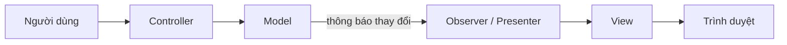
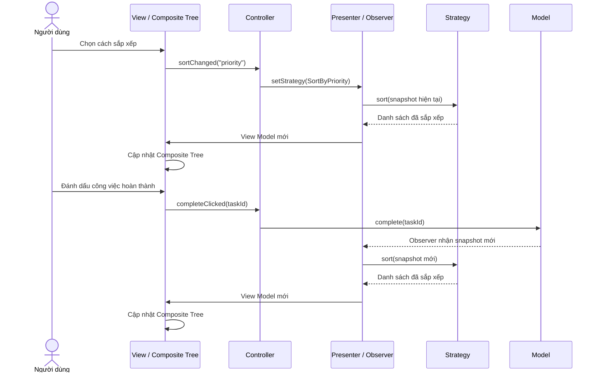

# Kết hợp Observer, Strategy và Composite trong thiết kế giao diện

Một giao diện web tương tác thường phải xử lý nhiều việc cùng lúc: cập nhật khi dữ liệu thay đổi, cho phép người dùng chọn cách sắp xếp hoặc lọc, và ghép nhiều thành phần nhỏ thành một màn hình hoàn chỉnh. Nếu mọi hành vi được viết trực tiếp trong Controller hoặc trong một View lớn, mã nguồn nhanh chóng chứa nhiều nhánh điều kiện, phụ thuộc chặt và khó kiểm thử.

Ba mẫu thiết kế **Observer**, **Strategy** và **Composite** giải quyết ba vấn đề khác nhau nhưng có thể phối hợp trong cùng một ứng dụng MVC:

- **Observer** thông báo cho các thành phần quan tâm khi trạng thái thay đổi.
- **Strategy** cho phép thay thế một thuật toán hoặc cách xử lý mà không phải viết lại phần điều phối.
- **Composite** tổ chức các thành phần giao diện thành cây, để một nhóm thành phần và một thành phần đơn lẻ có thể được xử lý qua cùng hợp đồng.

Trong MVC (Model–View–Controller), Observer thường nối Model với View hoặc presenter; Strategy có thể thay đổi cách lọc, sắp xếp hay trình bày dữ liệu; Composite thường tổ chức cấu trúc bên trong View. Các mẫu này bổ sung cho trách nhiệm MVC, không thay thế Model, View hoặc Controller.

## 1. Bài toán cần giải quyết

Hãy xét một trang quản lý công việc. Người dùng có thể:

- Xem danh sách công việc và trạng thái hiện tại.
- Đánh dấu một công việc đã hoàn thành.
- Chọn sắp xếp theo hạn hoàn thành hoặc mức ưu tiên.
- Lọc theo trạng thái.
- Mở rộng một nhóm để xem các công việc con.
- Nhìn thấy phần danh sách được cập nhật sau khi dữ liệu thay đổi.

Nếu Controller tự cập nhật từng nhãn, từng dòng và từng vùng giao diện, nó phải biết cấu trúc nội bộ của View. Nếu View tự truy vấn Model và tự quyết định quy tắc nghiệp vụ, ranh giới MVC trở nên mờ. Nếu thuật toán sắp xếp được viết thành nhiều nhánh `if/else` rải rác, thêm một cách sắp xếp mới sẽ buộc sửa nhiều nơi.

Ta có thể chia vấn đề thành ba câu hỏi:

1. Khi trạng thái công việc thay đổi, làm thế nào để các vùng giao diện cần thiết nhận được thông tin mới?
2. Khi người dùng đổi cách sắp xếp, làm thế nào để thay thuật toán mà không làm phức tạp Controller hoặc View?
3. Khi màn hình có nhiều nhóm và thành phần lồng nhau, làm thế nào để tổ chức chúng theo một cấu trúc thống nhất?

Observer, Strategy và Composite lần lượt cung cấp câu trả lời cho các câu hỏi đó.

## 2. Observer: thông báo khi trạng thái thay đổi

### 2.1. Ý tưởng và vai trò

Observer là mẫu hành vi (behavioral pattern) xác định quan hệ một-nhiều giữa một đối tượng phát thông báo và các đối tượng đăng ký quan tâm. Khi đối tượng phát thông báo thay đổi, nó thông báo cho các observer để chúng cập nhật công việc của mình.

Các vai trò chính:

| Vai trò | Trách nhiệm | Ví dụ trong trang công việc |
|---|---|---|
| Subject / Publisher | Quản lý trạng thái hoặc sự kiện và danh sách subscriber | `TaskModel` |
| Observer / Subscriber | Nhận thông báo và phản ứng với thay đổi | `TaskListPresenter`, bộ đếm công việc |
| Subscription | Đại diện cho việc đăng ký và hủy đăng ký | Đối tượng trả về từ `subscribe()` |

Thay vì để Model gọi trực tiếp một View cụ thể, Model phát thông báo qua một hợp đồng chung. Một presenter có thể đăng ký nhận trạng thái; nhiều vùng giao diện khác cũng có thể đăng ký nếu chúng cần cùng dữ liệu.

### 2.2. Observer trong MVC

Trong cách hiểu MVC cổ điển, View có thể quan sát Model. Khi Model thay đổi, View được thông báo và đọc trạng thái mới để cập nhật phần trình bày. Trong ứng dụng web hiện đại, cùng ý tưởng có thể được triển khai qua listener, callback, event emitter, observable stream hoặc thư viện quản lý state.

Luồng tổng quát:



Controller tiếp nhận hành động và yêu cầu Model hoặc dịch vụ ứng dụng thực hiện thay đổi. Model giữ trạng thái và phát thông báo sau khi thay đổi hợp lệ. Observer nhận trạng thái mới, chuẩn bị dữ liệu cho View và yêu cầu View cập nhật.

### 2.3. Ví dụ Observer bằng Java

Đoạn mã sau minh họa Model công việc phát một snapshot bất biến cho các observer. `Task` là record để trạng thái được thay bằng một danh sách mới, tránh việc subscriber giữ tham chiếu đến một đối tượng có thể bị sửa âm thầm.

```java
public record Task(
    String id,
    String title,
    LocalDate dueDate,
    int priority,
    boolean completed
) {}

@FunctionalInterface
public interface Observer<T> {
    void update(T snapshot);
}

@FunctionalInterface
public interface Subscription {
    void unsubscribe();
}

public final class TaskModel {
    private final Set<Observer<List<Task>>> observers =
        new CopyOnWriteArraySet<>();

    private List<Task> tasks = List.of();

    public TaskModel(List<Task> initialTasks) {
        this.tasks = List.copyOf(initialTasks);
    }

    public synchronized List<Task> snapshot() {
        return List.copyOf(tasks);
    }

    public Subscription subscribe(Observer<List<Task>> observer) {
        observers.add(observer);
        observer.update(snapshot());
        return () -> observers.remove(observer);
    }

    public void complete(String taskId) {
        List<Task> updated;
        synchronized (this) {
            boolean exists = tasks.stream()
                .anyMatch(task -> task.id().equals(taskId));
            if (!exists) {
                throw new NoSuchElementException("Không tìm thấy công việc");
            }

            tasks = tasks.stream()
                .map(task -> task.id().equals(taskId)
                    ? new Task(task.id(), task.title(), task.dueDate(),
                        task.priority(), true)
                    : task)
                .toList();
            updated = List.copyOf(tasks);
        }

        // Gửi thông báo sau khi cập nhật trạng thái và ra khỏi khóa.
        for (Observer<List<Task>> observer : observers) {
            observer.update(updated);
        }
    }
}
```

Đây là ví dụ minh họa cơ chế Observer trong bộ nhớ. Ứng dụng thực tế cần bổ sung cách xử lý lỗi của subscriber, ghi log và đồng bộ thực thi phù hợp với môi trường. Ví dụ dùng `CopyOnWriteArraySet` để việc đăng ký hoặc hủy đăng ký không làm hỏng vòng lặp đang thông báo; cấu trúc này phù hợp khi số lần đọc/deliver nhiều hơn số lần thay đổi subscription.

Một presenter có thể đăng ký với Model:

```java
public final class TaskListPresenter implements Observer<List<Task>> {
    private final TaskListView view;
    private List<Task> latestTasks = List.of();

    public TaskListPresenter(TaskListView view) {
        this.view = view;
    }

    @Override
    public void update(List<Task> snapshot) {
        latestTasks = snapshot;
        render();
    }

    private void render() {
        List<TaskRowViewModel> rows = latestTasks.stream()
            .map(task -> new TaskRowViewModel(
                task.id(), task.title(), task.completed()
            ))
            .toList();
        view.showTasks(rows);
    }
}
```

`TaskListPresenter` chỉ nhận snapshot và chuyển thành View Model. Nó không cần biết dữ liệu được lưu trong bảng nào, và Model cũng không cần biết View được render bằng template nào.

Đối tượng sở hữu màn hình giữ handle subscription và hủy đăng ký khi presenter không còn được sử dụng:

```java
Subscription subscription = taskModel.subscribe(taskListPresenter);

// Khi đóng màn hình hoặc giải phóng presenter:
subscription.unsubscribe();
```

### 2.4. Observer phát sự kiện hay phát snapshot?

Có hai kiểu thông báo thường gặp:

- **Thông báo sự kiện:** ví dụ `TaskCompleted(taskId)`. Subscriber biết điều gì vừa xảy ra và có thể tự truy vấn dữ liệu cần thiết.
- **Thông báo snapshot:** gửi trạng thái hiện tại, ví dụ danh sách công việc sau khi cập nhật. Subscriber có thể render dựa trên dữ liệu nhận được.

Sự kiện nhỏ gọn và hữu ích khi nhiều subscriber cần phản ứng khác nhau. Snapshot thuận tiện cho View vì nó có dữ liệu để dựng lại trạng thái. Một hệ thống có thể kết hợp cả hai, nhưng cần định nghĩa rõ sự kiện là thông tin về điều đã xảy ra hay một lệnh yêu cầu thực hiện hành động.

### 2.5. Lưu ý khi dùng Observer

- Hủy đăng ký khi View hoặc presenter không còn hoạt động để tránh giữ tham chiếu và rò rỉ bộ nhớ.
- Không để observer sửa trực tiếp snapshot mà publisher gửi; ưu tiên dữ liệu bất biến hoặc bản sao chỉ đọc.
- Tránh callback gọi ngược vào Subject theo cách tạo vòng lặp thông báo.
- Không để lỗi ở một subscriber làm mất thông báo của các subscriber còn lại; xác định chính sách cô lập lỗi phù hợp.
- Nếu cập nhật giao diện trên trình duyệt, phải thực hiện trên UI thread hoặc cơ chế cập nhật state do framework quản lý.
- Không dùng Observer trong bộ nhớ để thay thế cơ chế truyền sự kiện bền vững giữa các tiến trình hoặc dịch vụ.

Trong ứng dụng web server-rendered truyền thống, mỗi HTTP request thường tạo một vòng đời ngắn và trả về HTML; không nhất thiết cần Observer trong bộ nhớ. Observer hữu ích hơn khi có View tương tác lâu dài, cập nhật bất đồng bộ, nhiều widget cùng theo dõi một state hoặc giao diện kiểu SPA.

## 3. Strategy: thay đổi thuật toán mà không đổi luồng điều phối

### 3.1. Ý tưởng và vai trò

Strategy là mẫu hành vi đóng gói một họ thuật toán vào các đối tượng riêng có cùng hợp đồng. Thành phần sử dụng thuật toán làm việc với interface chung và có thể nhận một Strategy khác khi cần.

Trong giao diện quản lý công việc, người dùng có thể chọn sắp xếp:

- Theo hạn hoàn thành gần nhất.
- Theo mức ưu tiên cao nhất.
- Theo tiêu đề theo thứ tự bảng chữ cái.

Nếu tất cả thuật toán nằm trong một phương thức dài với nhiều nhánh điều kiện, mỗi lần thêm lựa chọn sẽ làm phương thức phức tạp hơn. Strategy tách từng cách sắp xếp thành một lớp hoặc hàm độc lập.

| Vai trò | Trách nhiệm | Ví dụ |
|---|---|---|
| Strategy | Hợp đồng thuật toán | `TaskSortStrategy` |
| Concrete Strategy | Một cách thực hiện cụ thể | `SortByDueDate`, `SortByPriority` |
| Context | Sử dụng Strategy hiện tại | `TaskListPresenter` hoặc query service |
| Selector / Registry | Chọn Strategy theo tùy chọn được cho phép | `TaskSortStrategies` |

### 3.2. Ví dụ Strategy bằng Java

```java
public interface TaskSortStrategy {
    List<Task> sort(List<Task> tasks);
}

public final class SortByDueDate implements TaskSortStrategy {
    @Override
    public List<Task> sort(List<Task> tasks) {
        return tasks.stream()
            .sorted(Comparator.comparing(
                Task::dueDate,
                Comparator.nullsLast(Comparator.naturalOrder())
            ))
            .toList();
    }
}

public final class SortByPriority implements TaskSortStrategy {
    @Override
    public List<Task> sort(List<Task> tasks) {
        return tasks.stream()
            .sorted(Comparator.comparingInt(Task::priority).reversed())
            .toList();
    }
}
```

Để kết hợp Strategy, `TaskListPresenter` ở ví dụ trước được mở rộng như sau. Trong cùng dự án, đây là phiên bản thay thế cho presenter đơn giản ở mục 2.3:

```java
public final class TaskListPresenter implements Observer<List<Task>> {
    private final TaskListView view;
    private List<Task> latestTasks = List.of();
    private TaskSortStrategy sortStrategy = new SortByDueDate();

    public TaskListPresenter(TaskListView view) {
        this.view = view;
    }

    @Override
    public void update(List<Task> snapshot) {
        latestTasks = snapshot;
        render();
    }

    public void setSortStrategy(TaskSortStrategy strategy) {
        this.sortStrategy = Objects.requireNonNull(strategy);
        render();
    }

    private void render() {
        List<TaskRowViewModel> rows = sortStrategy.sort(latestTasks).stream()
            .map(task -> new TaskRowViewModel(
                task.id(), task.title(), task.completed()
            ))
            .toList();
        view.showTasks(rows);
    }
}
```

Khi người dùng chọn cách sắp xếp khác, Presenter thay Strategy và dựng lại dữ liệu trình bày. Khi Model phát snapshot mới, Presenter dùng Strategy hiện tại để sắp xếp dữ liệu mới. Luồng cập nhật không cần biết thuật toán cụ thể.

### 3.3. Controller chọn Strategy qua danh sách cho phép

Controller tiếp nhận lựa chọn của người dùng và chọn một Strategy đã được ứng dụng đăng ký:

```java
public final class TaskListController {
    private final TaskModel model;
    private final TaskListPresenter presenter;
    private final Map<String, TaskSortStrategy> strategies;

    public TaskListController(
            TaskModel model,
            TaskListPresenter presenter,
            Map<String, TaskSortStrategy> strategies) {
        this.model = model;
        this.presenter = presenter;
        this.strategies = Map.copyOf(strategies);
    }

    public void onSortChanged(String option) {
        TaskSortStrategy strategy = strategies.get(option);
        if (strategy == null) {
            throw new IllegalArgumentException("Kiểu sắp xếp không hợp lệ");
        }
        presenter.setSortStrategy(strategy);
    }

    public void onCompleteClicked(String taskId) {
        model.complete(taskId);
    }
}
```

Ứng dụng có thể cấu hình registry bằng các khóa như `due-date` và `priority`. Không nên nhận tên class tùy ý từ request rồi dùng reflection để khởi tạo. Client chỉ được chọn trong danh sách chức năng mà server hoặc ứng dụng đã cho phép.

### 3.4. Strategy có thể áp dụng cho việc gì trong giao diện?

Ngoài sắp xếp, Strategy có thể đóng gói:

- Bộ lọc theo trạng thái, thời hạn hoặc người phụ trách.
- Cách phân trang hoặc nhóm kết quả.
- Quy tắc định dạng theo locale hoặc loại nội dung.
- Cách xác định bố cục phù hợp với loại màn hình.
- Chính sách hiển thị nội dung theo ngữ cảnh sản phẩm.

Không phải mọi `if/else` đều cần Strategy. Nếu chỉ có hai nhánh nhỏ, ít thay đổi và không có thuật toán độc lập, điều kiện trực tiếp có thể dễ đọc hơn. Strategy có giá trị khi có nhiều biến thể, các biến thể thay đổi độc lập, cần kiểm thử riêng hoặc cần chọn ở runtime.

Một điểm quan trọng: Strategy phục vụ trình bày, như cách sắp xếp danh sách trên màn hình, có thể nằm ở presenter hoặc query layer. Nếu thuật toán là quy tắc nghiệp vụ, chẳng hạn tính mức phí hoặc quyết định một giao dịch có đủ điều kiện hay không, nó phải được thực thi ở tầng nghiệp vụ phía server. Không được xem một Strategy chạy trong trình duyệt là cơ chế bảo mật hoặc phân quyền.

## 4. Composite: tổ chức giao diện thành cây thành phần

### 4.1. Ý tưởng và vai trò

Composite là mẫu cấu trúc (structural pattern) cho phép ghép các đối tượng thành cấu trúc cây và xử lý đối tượng đơn lẻ cùng nhóm đối tượng qua một hợp đồng chung.

Trong giao diện, một trang có thể gồm:

- `TaskPage` chứa thanh tiêu đề, thanh công cụ và vùng danh sách.
- `TaskList` chứa nhiều `TaskRow`.
- Một `TaskRow` chứa tiêu đề, nhãn trạng thái và nút thao tác.
- Một nhóm công việc có thể chứa nhiều nhóm con hoặc dòng công việc.

Thành phần lá (Leaf) thực hiện công việc cụ thể và không chứa thành phần con. Thành phần tổng hợp (Composite) quản lý danh sách thành phần con và ủy quyền thao tác chung cho chúng.

| Vai trò | Trách nhiệm | Ví dụ |
|---|---|---|
| Component | Hợp đồng chung cho mọi nút trong cây | `UiComponent` |
| Leaf | Thành phần đơn, không có con | `TaskRowComponent`, `TextComponent` |
| Composite | Chứa và quản lý các Component con | `TaskListComponent`, `TaskPageComponent` |
| Client | Xây dựng hoặc sử dụng cây qua hợp đồng chung | View assembler hoặc page renderer |

### 4.2. Ví dụ Composite cho HTML View

Đoạn mã sau minh họa cách một thành phần lá và một nhóm thành phần cùng triển khai `UiComponent`:

```java
public interface UiComponent {
    String render();
}

public final class TextComponent implements UiComponent {
    private final String text;

    public TextComponent(String text) {
        this.text = text;
    }

    @Override
    public String render() {
        return Html.escape(text);
    }
}

public final class CompositeComponent implements UiComponent {
    private static final Set<String> ALLOWED_TAGS =
        Set.of("main", "div", "ul", "section");

    private final String tag;
    private final List<UiComponent> children = new ArrayList<>();

    public CompositeComponent(String tag) {
        if (!ALLOWED_TAGS.contains(tag)) {
            throw new IllegalArgumentException("HTML tag không được hỗ trợ");
        }
        this.tag = tag;
    }

    public void add(UiComponent child) {
        children.add(Objects.requireNonNull(child));
    }

    public void remove(UiComponent child) {
        children.remove(child);
    }

    @Override
    public String render() {
        String body = children.stream()
            .map(UiComponent::render)
            .collect(Collectors.joining());
        return "<" + tag + ">" + body + "</" + tag + ">";
    }
}
```

`TextComponent` là Leaf. `CompositeComponent` là Composite vì nó chứa các `UiComponent` khác và gọi cùng phương thức `render()` trên từng con. Một trang có thể được dựng bằng cách lồng các Composite:

```java
CompositeComponent taskList = new CompositeComponent("ul");
taskList.add(new TaskRowComponent("T-01", "Thiết kế API", false));
taskList.add(new TaskRowComponent("T-02", "Viết kiểm thử", true));

CompositeComponent toolbar = new CompositeComponent("div");
toolbar.add(new TextComponent("Danh sách công việc"));
toolbar.add(new SortControlComponent("due-date"));

CompositeComponent page = new CompositeComponent("main");
page.add(toolbar);
page.add(taskList);

String html = page.render();
```

`TaskRowComponent` và `SortControlComponent` là các thành phần lá chuyên biệt được lược bỏ phần triển khai. Ví dụ cũng giả định `tag` được chọn từ danh sách tag cố định do ứng dụng kiểm soát; không đưa tag HTML tùy ý từ dữ liệu người dùng vào constructor. Mọi giá trị động phải được escape đúng ngữ cảnh trước khi đưa vào HTML.

### 4.3. Vì sao Composite phù hợp với View?

View có thể render toàn bộ trang bằng cách yêu cầu nút gốc `page.render()`. Nút gốc không cần biết bên dưới có bao nhiêu dòng, bao nhiêu nhóm hoặc thành phần nào đang được lồng. Khi cần thêm vùng thông báo hoặc nhóm công việc con, View assembler chỉ cần thêm một component vào cây.

Composite hỗ trợ:

- Tái sử dụng các component ở nhiều trang.
- Chia giao diện lớn thành các phần nhỏ có trách nhiệm rõ ràng.
- Tổ chức cấu trúc lồng nhau như menu, bảng, cây thư mục hoặc nhóm biểu mẫu.
- Duyệt, render hoặc áp dụng thao tác chung trên cả cây.
- Kiểm thử component độc lập và kiểm thử việc ghép cây ở cấp trang.

Không phải mọi View đều cần tự xây một hệ thống Composite. Framework UI hiện đại thường đã cung cấp component tree. Khi đó, ta đang sử dụng Composite thông qua cơ chế component lồng nhau của framework, không cần viết thêm một bộ khung riêng.

## 5. Kết hợp ba mẫu trong một luồng MVC

Ba mẫu có thể phối hợp trong trang quản lý công việc như sau:

1. Người dùng chọn “Sắp xếp theo ưu tiên” trong toolbar.
2. View phát sự kiện tương tác đến Controller.
3. Controller tra cứu Strategy `SortByPriority` trong registry và yêu cầu Presenter đổi Strategy.
4. Presenter sắp xếp snapshot hiện tại bằng Strategy mới và gửi View Model cho View.
5. View cập nhật cây Composite để hiển thị danh sách theo thứ tự mới.
6. Người dùng đánh dấu một công việc hoàn thành. Controller gọi Model hoặc use case tương ứng.
7. Model cập nhật trạng thái và phát snapshot mới qua Observer.
8. Presenter nhận snapshot, tiếp tục áp dụng Strategy đang chọn và yêu cầu View render lại.
9. Cây Composite dựng lại hoặc cập nhật những component bị ảnh hưởng.

Sơ đồ trình tự:



### 5.1. Phân chia trách nhiệm trong ví dụ

| Thành phần MVC | Mẫu thiết kế hỗ trợ | Trách nhiệm |
|---|---|---|
| Model | Observer | Phát thông báo sau khi trạng thái nghiệp vụ thay đổi |
| Presenter hoặc ViewModel adapter | Observer, Strategy | Theo dõi snapshot, áp dụng cách sắp xếp và tạo dữ liệu trình bày |
| Controller | Điều phối, chọn Strategy | Nhận hành động người dùng và gọi thao tác phù hợp |
| View | Composite | Ghép toolbar, danh sách, dòng dữ liệu và thông báo thành cây giao diện |

Một ứng dụng có thể đặt Presenter trong tầng trình bày hoặc gộp một phần chức năng vào ViewModel tùy framework. Điều quan trọng là không để Model phụ thuộc vào HTML hoặc component cụ thể, không để View tự quyết định quy tắc nghiệp vụ, và không để Controller phải quản lý từng nút trong cây giao diện.

### 5.2. Thay đổi một phần giao diện

Khi Model phát snapshot mới, View không nhất thiết phải dựng lại toàn bộ trang. Presenter có thể so sánh trạng thái trước và sau, tạo một bản cập nhật nhỏ hoặc phát view model theo vùng. Composite tree cho phép xác định nhóm thành phần bị ảnh hưởng, ví dụ chỉ thay danh sách công việc và bộ đếm, giữ nguyên toolbar.

Tuy nhiên, tối ưu cập nhật từng nút chỉ nên làm khi có lợi ích đo được. Render lại một vùng nhỏ bằng cơ chế của framework thường đơn giản và ít lỗi hơn tự xây thuật toán diff. Với danh sách lớn, có thể cân nhắc virtualization hoặc phân trang.

## 6. Các biến thể triển khai trong ứng dụng web

### 6.1. Server-rendered MVC

Trong ứng dụng server-rendered, Controller nhận request, gọi application service và trả về một View Model. View engine render các template và fragment thành HTML. Cấu trúc template lồng nhau có thể thể hiện ý tưởng Composite: layout chứa header, navigation, content và footer; trang cụ thể lại chứa form, bảng và component con.

Mỗi HTTP request thường là một vòng xử lý độc lập. Không nhất thiết giữ một Subject trong bộ nhớ để thông báo cho mọi View giữa các request. Nếu dữ liệu thay đổi do request khác, trang có thể được tải lại hoặc cập nhật bằng polling, Server-Sent Events hoặc WebSocket tùy nhu cầu.

### 6.2. SPA hoặc giao diện cập nhật bất đồng bộ

Trong SPA, View tồn tại lâu hơn và thường đăng ký theo dõi state store hoặc observable. Observer có thể là subscription vào store; Strategy có thể là hàm sắp xếp hoặc lọc được chọn theo thao tác; Composite được thể hiện bằng cây component của framework.

Khi component không còn được sử dụng, framework hoặc mã ứng dụng phải hủy subscription và giải phóng listener. Nếu không, component cũ có thể tiếp tục nhận cập nhật hoặc bị giữ lại trong bộ nhớ.

### 6.3. Event-driven UI

Với giao diện có nhiều tương tác, một event bus có thể phát các sự kiện như `TaskCompleted`, `FilterChanged` hoặc `SelectionChanged`. Event bus giúp giảm phụ thuộc trực tiếp giữa publisher và subscriber, nhưng nếu mọi tương tác đều đi qua một bus toàn cục, luồng điều khiển sẽ khó lần theo.

Chỉ nên dùng event bus khi có nhiều subscriber độc lập hoặc sự kiện cần truyền qua nhiều vùng. Với một View và một Controller, callback hoặc interface trực tiếp có thể dễ hiểu hơn.

## 7. Lựa chọn đúng nơi đặt từng mẫu

Ba mẫu không nên được áp dụng máy móc vào mọi lớp:

| Nhu cầu | Vị trí thường phù hợp | Điều cần tránh |
|---|---|---|
| Nhiều vùng cần biết Model đã đổi | Model/store phát thông báo; presenter hoặc View đăng ký | Model gọi trực tiếp một View cụ thể |
| Có nhiều thuật toán sắp xếp/lọc có thể thay đổi | Presenter, query service hoặc application service tùy ý nghĩa thuật toán | Đặt quy tắc nghiệp vụ quan trọng trong JavaScript phía client |
| Giao diện có cấu trúc lồng nhau và component dùng chung | View/component tree | Để Controller tạo và điều khiển từng node giao diện |
| Một thao tác chỉ có một nhánh đơn giản | Điều kiện trực tiếp trong nơi phù hợp | Tạo Strategy chỉ để thay một dòng mã ít thay đổi |
| View chỉ có vài phần cố định | Template/layout thông thường | Tự xây framework Composite lớn không cần thiết |

Nếu thuật toán sắp xếp chỉ nhằm thay đổi thứ tự trình bày, nó thuộc tầng trình bày hoặc query. Nếu thuật toán xác định quyền, giá, điều kiện phê duyệt hoặc kết quả nghiệp vụ, phải đặt ở phía server trong tầng ứng dụng/miền và kiểm tra lại khi xử lý request.

## 8. Những vấn đề cần kiểm soát khi kết hợp

### 8.1. Vòng lặp thông báo

Một observer nhận cập nhật, rồi lại thay đổi Model và làm Model phát thông báo lần nữa có thể tạo vòng lặp hoặc nhiều lần render. Nên quy định rõ ai là nơi phát lệnh thay đổi, ai chỉ quan sát, và tránh việc render View tự động phát ngược một lệnh cập nhật state.

### 8.2. Trạng thái không nhất quán

Nếu nhiều subscriber nhận sự kiện bất đồng bộ, chúng có thể xử lý ở thời điểm khác nhau. Với giao diện, cần quyết định subscriber nhận event hay snapshot, có cần thứ tự sự kiện hay không và cách xử lý khi một cập nhật cũ đến muộn. Dùng phiên bản state hoặc snapshot có version giúp phát hiện dữ liệu cũ.

### 8.3. Vòng đời subscription

View hoặc presenter phải hủy subscription khi bị tháo khỏi cây component. Đối với listener đăng ký theo từng lần render, cần tránh đăng ký lặp. Nên giữ handle của subscription để có thể unsubscribe rõ ràng.

### 8.4. Strategy không an toàn hoặc không hợp lệ

Chỉ cho phép chọn Strategy đã đăng ký. Kiểm tra giá trị đầu vào, có mặc định hợp lý và xử lý trường hợp option không tồn tại. Không dùng lựa chọn sắp xếp ở client làm căn cứ phân quyền hoặc quyết định nghiệp vụ.

### 8.5. Composite quá sâu hoặc quá tổng quát

Một cây component có quá nhiều tầng wrapper khiến việc truy vết và render tốn kém. Composite nên phản ánh cấu trúc có ý nghĩa trong giao diện. Component dùng chung cần có API rõ ràng; không nên có quá nhiều cờ boolean để phục vụ các màn hình khác nhau hoàn toàn.

### 8.6. Xử lý dữ liệu không tin cậy trong View

Composite có thể ghép nhiều nội dung động thành HTML. Mọi dữ liệu do người dùng hoặc hệ thống bên ngoài cung cấp phải được escape theo ngữ cảnh; không ghép chuỗi HTML tùy ý. Các component cũng cần giữ quy tắc accessibility, nhãn và quan hệ điều khiển phù hợp.

## 9. Kiểm thử ba mẫu và luồng kết hợp

Mỗi mẫu có thể được kiểm thử độc lập, sau đó kiểm thử cách chúng phối hợp:

| Phạm vi | Trường hợp cần kiểm tra |
|---|---|
| Observer / Model | Subscriber nhận snapshot mới sau khi trạng thái thay đổi; unsubscribe thì không nhận thông báo tiếp |
| Observer / Presenter | Snapshot mới được chuyển thành View Model; lỗi của một subscriber không làm hỏng toàn bộ luồng thông báo |
| Strategy | Mỗi chiến lược tạo thứ tự đúng; đổi chiến lược không làm thay đổi dữ liệu gốc |
| Strategy Registry | Khóa hợp lệ chọn đúng chiến lược; khóa không hợp lệ được xử lý rõ ràng |
| Composite Leaf | Component đơn render đúng nội dung và escape dữ liệu động |
| Composite Tree | Component cha render đủ con theo đúng thứ tự; thêm hoặc xóa con cập nhật cây đúng |
| Tích hợp MVC | Người dùng đổi sắp xếp, Model phát snapshot, Presenter áp dụng Strategy và View cập nhật đúng cây component |

Một kịch bản kiểm thử tích hợp có thể là:

1. Tạo Model với ba công việc có hạn và mức ưu tiên khác nhau.
2. Đăng ký Presenter làm observer.
3. Chọn Strategy sắp xếp theo ưu tiên.
4. Xác minh View nhận danh sách theo thứ tự ưu tiên.
5. Đánh dấu một công việc hoàn thành qua Controller.
6. Xác minh Observer nhận snapshot mới và View cập nhật mà vẫn giữ Strategy đang chọn.
7. Hủy subscription, thay đổi Model lần nữa và xác minh Presenter cũ không nhận cập nhật.

Kiểm thử component không cần khởi chạy cơ sở dữ liệu. Kiểm thử tích hợp với server vẫn cần xác minh use case và repository ở phạm vi riêng nếu hành động cập nhật có ghi dữ liệu thật.

## 10. Ví dụ tổng hợp và cách đọc luồng mã

Với trang công việc, có thể lần theo một thay đổi theo thứ tự:

```text
Người dùng
  -> View: chọn sắp xếp / bấm hoàn thành
  -> Controller: nhận hành động
  -> Strategy Registry: lấy thuật toán được phép (khi đổi sắp xếp)
  -> Model hoặc Use Case: thay đổi trạng thái (khi hoàn thành)
  -> Observer: thông báo snapshot mới
  -> Presenter: áp dụng Strategy và tạo View Model
  -> Composite View: cập nhật cây component
  -> Trình duyệt: hiển thị kết quả
```

Khi đọc hoặc review mã, hãy tìm ba điểm:

- **Ai phát thông báo?** Model/store phải phát sau khi thay đổi có hiệu lực; không phát thông báo thành công trước khi thao tác được xác nhận.
- **Ai chọn thuật toán?** Controller tiếp nhận lựa chọn, registry cung cấp Strategy hợp lệ, presenter hoặc use case áp dụng đúng nơi.
- **Ai sở hữu cây giao diện?** View hoặc component framework xây dựng và quản lý Composite; Controller chỉ gửi dữ liệu và lệnh ở mức tương tác.

Nếu một lớp vừa quản lý danh sách subscriber, vừa chọn thuật toán, vừa tạo HTML và vừa ghi cơ sở dữ liệu, các trách nhiệm đang bị trộn. Hãy tách theo lý do thay đổi thực tế, không chỉ theo tên mẫu thiết kế.

## 11. Checklist lựa chọn và kết hợp

Trước khi áp dụng ba mẫu, hãy tự hỏi:

1. Có nhiều thành phần thực sự cần biết cùng một thay đổi không? Nếu có, Observer có thể giảm phụ thuộc trực tiếp.
2. Các thuật toán có cùng mục đích nhưng cần thay thế độc lập không? Nếu có, Strategy có thể gom chúng sau một hợp đồng.
3. Giao diện có cấu trúc lồng nhau mà nhóm và phần tử đơn cần được xử lý tương tự không? Nếu có, Composite có thể làm cấu trúc rõ ràng.
4. Trạng thái được phát có bất biến hoặc có phiên bản để subscriber không đọc nhầm dữ liệu cũ không?
5. Subscription có được hủy đúng vòng đời component không?
6. Strategy được chọn từ danh sách cho phép và có mặc định an toàn không?
7. Composite có kiểm soát việc thêm/xóa con, escape dữ liệu và khả năng tiếp cận không?
8. Có thể kiểm thử từng mẫu độc lập và kiểm thử luồng kết hợp qua hành vi quan sát được không?
9. Mức độ phức tạp do các mẫu thêm vào có tương xứng với nhu cầu thực tế không?

## Kết luận

Observer giúp các thành phần phản ứng khi Model thay đổi mà không cần phụ thuộc trực tiếp vào nhau. Strategy tách các cách xử lý có thể thay thế, chẳng hạn sắp xếp hoặc lọc, thành những đơn vị có cùng hợp đồng. Composite tổ chức các thành phần giao diện thành cây và cho phép render nhóm thành phần theo cách thống nhất với phần tử đơn. Khi kết hợp trong MVC, Controller điều phối tương tác, Model giữ trạng thái và quy tắc, presenter chuyển đổi dữ liệu, còn View quản lý cây component. Chọn đúng ranh giới và quản lý vòng đời subscription, Strategy cùng component sẽ giúp giao diện tương tác dễ mở rộng và kiểm thử hơn mà không làm kiến trúc phức tạp quá mức.
