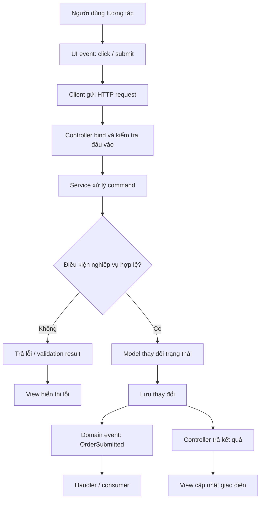

# Phân biệt sự kiện giao diện và sự kiện nghiệp vụ

Trong ứng dụng MVC tương tác, một thao tác của người dùng có thể tạo ra nhiều loại sự kiện ở những tầng khác nhau. Người dùng nhấn nút, nhập nội dung, chọn một mục hoặc gửi biểu mẫu sẽ làm trình duyệt phát sinh sự kiện giao diện. Máy chủ tiếp nhận request, kiểm tra quyền và quy tắc nghiệp vụ, rồi có thể ghi nhận một sự kiện nghiệp vụ như `OrderSubmitted` hoặc `PaymentAuthorized`.

Hai loại sự kiện này có liên quan nhưng không đồng nghĩa. Sự kiện giao diện mô tả điều vừa xảy ra trong quá trình tương tác với màn hình. Sự kiện nghiệp vụ mô tả một sự việc có ý nghĩa đối với miền nghiệp vụ và đã được hệ thống xác nhận. Phân biệt chúng giúp tránh để giao diện quyết định trạng thái nghiệp vụ, đồng thời giúp ứng dụng xử lý thông báo, tích hợp và kiểm thử nhất quán.

## 1. Sự kiện giao diện là gì?

Sự kiện giao diện (UI event) được phát sinh bởi trình duyệt, thành phần giao diện hoặc thư viện phía client khi có tương tác hoặc thay đổi trong giao diện.

Một số ví dụ thường gặp:

- `click`: người dùng nhấn nút hoặc liên kết.
- `input`: giá trị của trường nhập thay đổi.
- `change`: giá trị được chọn hoặc nhập đã thay đổi theo quy tắc của phần tử.
- `submit`: biểu mẫu được gửi.
- `focus` và `blur`: một phần tử nhận hoặc mất focus.
- `keydown`: người dùng nhấn phím.
- `scroll`: vùng nội dung được cuộn.
- Sự kiện tùy chỉnh do ứng dụng phía client phát ra, ví dụ `cart:item-selected`.

UI event thường có phạm vi và vòng đời gắn với trang hoặc thành phần giao diện. Nó có thể chỉ dùng để cập nhật trạng thái hiển thị, kiểm tra dữ liệu đầu vào ban đầu, mở hộp thoại, thay đổi bộ lọc hoặc gửi request đến máy chủ.

Ví dụ, khi người dùng nhấn nút “Gửi đơn”, trình duyệt phát sinh `click`. Nếu nút nằm trong biểu mẫu, trình duyệt có thể tiếp tục phát sinh `submit`. Hai sự kiện này chỉ cho biết tương tác đã xảy ra; chúng chưa chứng minh rằng đơn hàng hợp lệ hoặc đã được lưu thành công.

### 1.1. Đặc điểm của UI event

| Đặc điểm | Mô tả |
|---|---|
| Nơi phát sinh | Trình duyệt, component hoặc mã phía client |
| Ý nghĩa | Mô tả thao tác hoặc thay đổi trong giao diện |
| Phạm vi | Trang, component, form hoặc phiên tương tác |
| Vòng đời | Thường ngắn, có thể kết thúc khi trang bị tải lại |
| Dữ liệu kèm theo | Phần tử nguồn, giá trị nhập, phím, vị trí chuột hoặc payload tùy chỉnh |
| Độ tin cậy | Có thể bị sửa đổi hoặc giả lập bởi client |
| Người tiêu thụ | Event handler, component khác hoặc mã gửi request |

UI event không phải bằng chứng về trạng thái đã được máy chủ chấp nhận. Một người dùng có thể tự gọi JavaScript, sửa request hoặc gửi request bằng công cụ khác mà không cần thao tác qua giao diện.

### 1.2. Ví dụ sự kiện giao diện

HTML:

```html
<form id="order-form">
  <label for="customer-note">Ghi chú</label>
  <input id="customer-note" name="note" />

  <button type="submit">Gửi đơn</button>
</form>

<p id="form-message" aria-live="polite"></p>
```

JavaScript:

```javascript
const form = document.querySelector("#order-form");
const message = document.querySelector("#form-message");

form.addEventListener("submit", async (event) => {
  event.preventDefault();

  message.textContent = "Đang gửi đơn...";

  const formData = new FormData(form);

  const response = await fetch("/orders", {
    method: "POST",
    body: formData
  });

  if (response.ok) {
    message.textContent = "Yêu cầu đã được tiếp nhận.";
  } else {
    message.textContent = "Không thể gửi đơn. Vui lòng kiểm tra lại.";
  }
});
```

Ở đây, `submit` là UI event. JavaScript ngăn trình duyệt gửi biểu mẫu theo cách mặc định và tạo HTTP POST. Chỉ khi máy chủ xử lý request thành công, giao diện mới nhận phản hồi thành công. Câu “Yêu cầu đã được tiếp nhận” trong ví dụ chỉ là thông báo phản hồi; nó không tự tạo ra sự kiện nghiệp vụ.

Trong ứng dụng thực tế, cần xử lý cả lỗi mạng, phản hồi không phải JSON nếu có, trạng thái đang gửi và thao tác gửi lặp. Việc kiểm tra phía client chỉ hỗ trợ trải nghiệm; máy chủ vẫn phải xác thực và kiểm tra dữ liệu.

## 2. Sự kiện nghiệp vụ là gì?

Sự kiện nghiệp vụ (business event hoặc domain event) biểu diễn một sự việc có ý nghĩa trong miền nghiệp vụ, đã xảy ra và được hệ thống xác nhận. Ví dụ:

- `OrderSubmitted`: đơn hàng đã được gửi hợp lệ.
- `OrderConfirmed`: đơn hàng đã được xác nhận.
- `PaymentAuthorized`: khoản thanh toán đã được cấp phép.
- `LeaveRequestApproved`: yêu cầu nghỉ phép đã được duyệt.
- `InventoryReserved`: lượng hàng đã được giữ cho một đơn.
- `UserRegistered`: tài khoản người dùng đã được đăng ký thành công.

Sự kiện nghiệp vụ diễn đạt một sự thật trong miền nghiệp vụ, thường được đặt tên ở thì quá khứ hoặc theo dạng “đã xảy ra”. Nó không chỉ mô tả ý định của người dùng.

Ví dụ:

- “Người dùng nhấn nút Gửi đơn” là sự kiện giao diện.
- “Người dùng yêu cầu gửi đơn” là ý định hoặc command.
- “Đơn hàng đã được gửi” là sự kiện nghiệp vụ, chỉ được phát ra sau khi hệ thống xác nhận thao tác hợp lệ.

### 2.1. Đặc điểm của domain event

| Đặc điểm | Mô tả |
|---|---|
| Nơi phát sinh | Miền nghiệp vụ hoặc thành phần ứng dụng xác nhận kết quả nghiệp vụ |
| Ý nghĩa | Một sự thật có ý nghĩa đối với nghiệp vụ đã xảy ra |
| Phạm vi | Aggregate, bounded context hoặc quy trình nghiệp vụ |
| Vòng đời | Có thể được xử lý ngay, sau commit hoặc lưu để xử lý về sau |
| Dữ liệu kèm theo | Định danh sự kiện, đối tượng liên quan, thời điểm và dữ liệu cần cho consumer |
| Độ tin cậy | Phải được tạo từ kết quả đã được xác nhận ở phía máy chủ |
| Người tiêu thụ | Handler nghiệp vụ, thành phần ứng dụng hoặc hệ thống tích hợp |

Domain event có thể được dùng để thông báo cho các thành phần khác mà không buộc nơi phát sinh phải biết tất cả consumer. Ví dụ, sau khi đơn hàng được gửi thành công, hệ thống có thể ghi lịch sử, gửi thông báo, cập nhật chỉ số hoặc bắt đầu quy trình xử lý tiếp theo.

Không phải mọi thao tác giao diện đều cần tạo domain event. Việc mở tab, focus ô nhập hoặc rê chuột thường không mang ý nghĩa nghiệp vụ cần lưu lại.

### 2.2. Một sự kiện nghiệp vụ nên mô tả điều gì?

Một event thường có các thông tin:

- **Event ID:** định danh duy nhất để truy vết và hỗ trợ chống xử lý trùng.
- **Event type:** tên loại sự kiện, ví dụ `OrderSubmitted`.
- **Aggregate ID:** đối tượng nghiệp vụ liên quan, ví dụ mã đơn hàng.
- **Occurred at:** thời điểm sự kiện xảy ra.
- **Version hoặc sequence:** thứ tự trong phạm vi đối tượng nếu nghiệp vụ cần.
- **Payload:** dữ liệu cần thiết cho consumer để xử lý.

Ví dụ cấu trúc minh họa:

```json
{
  "eventId": "evt-8f6c",
  "eventType": "OrderSubmitted",
  "orderId": "ord-1024",
  "occurredAt": "2026-11-19T10:30:00Z",
  "version": 3
}
```

Đây là hợp đồng minh họa, không phải định dạng bắt buộc. Payload nên chứa lượng thông tin tối thiểu cần thiết. Tránh đưa mật khẩu, token, dữ liệu thanh toán nhạy cảm hoặc toàn bộ đối tượng nội bộ vào event.

## 3. Phân biệt UI event, command và business event

Một điểm dễ nhầm là coi mọi thứ được gọi là “event” đều cùng loại. Trong thiết kế ứng dụng, cần phân biệt ít nhất ba khái niệm:

- **UI event:** điều đã xảy ra ở giao diện, ví dụ người dùng nhấn nút.
- **Command:** yêu cầu hệ thống thực hiện một hành động, ví dụ `SubmitOrder`.
- **Business/domain event:** sự việc đã xảy ra sau khi hệ thống xử lý thành công, ví dụ `OrderSubmitted`.

Command thể hiện ý định và có thể bị từ chối. Domain event thể hiện kết quả đã được xác nhận. UI event có thể dẫn đến command, nhưng không phải lúc nào cũng vậy.

| Tình huống | Loại | Ý nghĩa |
|---|---|---|
| Người dùng nhấn “Gửi đơn” | UI event: `click` | Một tương tác trên giao diện đã xảy ra |
| Biểu mẫu được gửi | UI event: `submit` | Client bắt đầu gửi dữ liệu |
| Client gửi yêu cầu tạo đơn | Command/request: `SubmitOrder` | Đề nghị máy chủ thực hiện nghiệp vụ |
| Máy chủ kiểm tra đơn hợp lệ | Bước xử lý nghiệp vụ | Hệ thống xác minh điều kiện và quyền |
| Đơn được lưu ở trạng thái đã gửi | Thay đổi trạng thái Model | Kết quả nghiệp vụ được ghi nhận |
| Hệ thống phát `OrderSubmitted` | Domain event | Đơn hàng đã được gửi thành công |
| Dịch vụ thông báo gửi email | Consumer/handler | Một thành phần phản ứng với sự kiện |

Một command có thể không thành công vì dữ liệu sai, người dùng không có quyền, hàng hóa hết tồn hoặc trạng thái hiện tại không cho phép. Trong những trường hợp đó, không được phát `OrderSubmitted` như thể đơn đã được gửi.

## 4. Đặt hai loại sự kiện ở đâu trong MVC?

MVC phân chia trách nhiệm tiếp nhận tương tác, xử lý dữ liệu/nghiệp vụ và trình bày. UI event thường bắt đầu ở View hoặc mã phía client; request được Controller tiếp nhận; Service điều phối ca sử dụng; Model bảo vệ quy tắc nghiệp vụ và có thể ghi nhận domain event; View phản hồi trạng thái mới.



### 4.1. View và JavaScript: nhận UI event

View tạo phần tử giao diện và gắn hành vi tương tác. Event handler có thể:

- Cập nhật trạng thái hiển thị, ví dụ mở/đóng menu.
- Kiểm tra dữ liệu sơ bộ, ví dụ trường bắt buộc.
- Gửi request đến Controller.
- Hiển thị trạng thái chờ hoặc lỗi phản hồi.

View không nên tự tuyên bố một nghiệp vụ đã thành công chỉ vì người dùng nhấn nút. Nó cần đợi phản hồi từ máy chủ hoặc cập nhật từ luồng dữ liệu có thẩm quyền.

### 4.2. Controller: chuyển tương tác thành request có cấu trúc

Controller nhận HTTP request, kiểm tra dữ liệu đầu vào ở mức phù hợp và gọi Service. Controller không cần biết sự kiện DOM nào đã phát sinh trước đó. Từ góc nhìn máy chủ, nó xử lý một request có phương thức, đường dẫn, danh tính và payload cụ thể.

Không nên gửi một chuỗi như `"OrderSubmitted"` từ JavaScript rồi để máy chủ tin rằng đơn đã được gửi. Client chỉ có thể yêu cầu `SubmitOrder`; máy chủ tự quyết định kết quả và phát sự kiện nghiệp vụ sau khi thành công.

### 4.3. Service: điều phối command

Service kiểm tra quyền, tải dữ liệu mới nhất, áp dụng chính sách nghiệp vụ và điều phối việc thay đổi trạng thái. Nếu điều kiện không thỏa mãn, Service trả lỗi hoặc kết quả từ chối phù hợp.

Service cũng là nơi thường kết nối domain event với transaction hoặc cơ chế phát sự kiện của ứng dụng. Tùy cách thiết kế, aggregate có thể ghi nhận event nội bộ trong quá trình thay đổi trạng thái; application layer thu thập và phát chúng sau khi lưu thành công.

### 4.4. Model/Domain Model: bảo vệ quy tắc và ghi nhận sự kiện

Model bảo vệ các bất biến và chuyển trạng thái hợp lệ. Ví dụ, một đơn hàng chỉ được gửi khi còn ở trạng thái nháp và có ít nhất một dòng hàng.

Khi chuyển trạng thái thành công, Model hoặc aggregate có thể ghi nhận `OrderSubmitted`. Event phải phản ánh điều đã xảy ra, không phải yêu cầu đang chờ xử lý.

### 4.5. Handler và consumer: phản ứng với sự kiện nghiệp vụ

Handler nhận domain event để thực hiện công việc liên quan. Có thể có nhiều consumer:

- Ghi lịch sử đơn hàng.
- Gửi email xác nhận.
- Cập nhật bộ đếm hoặc báo cáo.
- Tạo yêu cầu chuẩn bị giao hàng.
- Phát integration event cho hệ thống khác.

Các handler cần có quy tắc lỗi và xử lý trùng phù hợp. Nếu consumer chạy bất đồng bộ, không nên giả định mọi tác vụ phụ đã hoàn tất trước khi Controller trả response.

## 5. Ví dụ hoàn chỉnh: gửi đơn hàng từ giao diện

Giả sử trang đặt hàng có nút “Gửi đơn”. Người dùng nhập địa chỉ giao hàng rồi nhấn nút.

### 5.1. Ở phía giao diện

```html
<form id="checkout-form">
  <label for="address">Địa chỉ giao hàng</label>
  <input id="address" name="address" required />

  <button type="submit">Gửi đơn</button>
  <p id="message" aria-live="polite"></p>
</form>
```

```javascript
const form = document.querySelector("#checkout-form");
const message = document.querySelector("#message");

form.addEventListener("submit", async (event) => {
  event.preventDefault();

  message.textContent = "Đang gửi yêu cầu...";

  const response = await fetch("/orders/1024/submit", {
    method: "POST",
    headers: { "Content-Type": "application/json" },
    body: JSON.stringify({
      shippingAddress: form.address.value
    })
  });

  if (response.ok) {
    message.textContent = "Đơn hàng đã được gửi.";
  } else {
    message.textContent = "Không thể gửi đơn hàng.";
  }
});
```

Sự kiện `submit` chỉ khởi đầu request. Client không tự phát ra sự kiện nghiệp vụ `OrderSubmitted`. Thông báo thành công chỉ được hiển thị sau khi máy chủ trả kết quả thành công.

Ví dụ thực tế cần xử lý lỗi mạng, timeout, phản hồi validation và việc người dùng nhấn gửi nhiều lần. Có thể vô hiệu hóa nút trong lúc chờ để cải thiện trải nghiệm, nhưng máy chủ vẫn cần cơ chế chống xử lý lặp khi nghiệp vụ yêu cầu.

### 5.2. Controller tiếp nhận command

```java
public record SubmitOrderRequest(String shippingAddress) {}

@RestController
@RequestMapping("/orders")
public class OrderController {

    private final OrderApplicationService orderService;

    public OrderController(OrderApplicationService orderService) {
        this.orderService = orderService;
    }

    @PostMapping("/{orderId}/submit")
    public ResponseEntity<Void> submit(
            @PathVariable UUID orderId,
            @Valid @RequestBody SubmitOrderRequest request,
            Authentication authentication) {

        orderService.submit(
            orderId,
            request,
            authentication.getName()
        );

        return ResponseEntity.noContent().build();
    }
}
```

Controller ánh xạ POST thành thao tác command. Danh tính được lấy từ ngữ cảnh xác thực của máy chủ, không nhận `userId` tùy ý trong body làm nguồn sự thật.

### 5.3. Model bảo vệ chuyển trạng thái

```java
public class Order {

    private UUID id;
    private OrderStatus status;
    private List<OrderLine> lines;
    private final List<Object> domainEvents = new ArrayList<>();

    public void submit(String shippingAddress) {
        if (status != OrderStatus.DRAFT) {
            throw new InvalidOrderStateException(
                "Only draft orders can be submitted"
            );
        }

        if (lines.isEmpty()) {
            throw new EmptyOrderException();
        }

        if (shippingAddress == null || shippingAddress.isBlank()) {
            throw new InvalidShippingAddressException();
        }

        this.status = OrderStatus.SUBMITTED;

        domainEvents.add(new OrderSubmitted(
            id,
            Instant.now()
        ));
    }

    public List<Object> domainEvents() {
        return List.copyOf(domainEvents);
    }
}
```

Đây là mã minh họa. Trong ứng dụng thật, có thể inject `Clock` để kiểm thử thời gian, dùng kiểu event cụ thể thay vì `Object`, và cung cấp phương thức thu hồi/xóa event sau khi đã chuyển giao thành công.

Điểm quan trọng là phương thức `submit` tự bảo vệ chuyển trạng thái. Event chỉ được ghi nhận sau khi các điều kiện nghiệp vụ được đáp ứng và Model chuyển sang trạng thái đã gửi.

### 5.4. Service điều phối và lưu thay đổi

```java
@Service
public class OrderApplicationService {

    private final OrderRepository orderRepository;
    private final ApplicationEventPublisher eventPublisher;

    @Transactional
    public void submit(
            UUID orderId,
            SubmitOrderRequest request,
            String username) {

        Order order = orderRepository.findById(orderId)
            .orElseThrow(OrderNotFoundException::new);

        authorization.requireCanSubmit(username, order);

        order.submit(request.shippingAddress());

        orderRepository.save(order);

        order.domainEvents().forEach(eventPublisher::publishEvent);
    }
}
```

Ví dụ này giúp thấy vị trí điều phối, nhưng có một điểm cần chú ý: nếu publish event trong transaction trước khi transaction commit, listener có thể chạy trong khi thay đổi chưa được commit. Nếu listener thực hiện tác vụ bên ngoài hoặc đọc lại dữ liệu, cần chọn thời điểm xử lý phù hợp.

Với xử lý trong cùng ứng dụng, Spring cung cấp `@TransactionalEventListener(phase = AFTER_COMMIT)` để chạy listener sau khi transaction commit. Cơ chế này phù hợp với một số tác vụ phụ, nhưng event trong bộ nhớ có thể bị mất nếu tiến trình dừng ngay sau commit trước khi listener hoàn tất.

Với sự kiện cần bảo đảm không mất khi hệ thống gặp sự cố, nên dùng Transactional Outbox: lưu thay đổi nghiệp vụ và bản ghi outbox trong cùng transaction; một tiến trình riêng đọc outbox và gửi message đến broker. Consumer cần hỗ trợ idempotency vì message có thể được gửi lại.

### 5.5. Handler xử lý domain event

```java
@Component
public class OrderSubmittedHandler {

    private final OrderHistoryService historyService;

    @TransactionalEventListener(phase = TransactionPhase.AFTER_COMMIT)
    public void on(OrderSubmitted event) {
        historyService.recordSubmission(
            event.orderId(),
            event.occurredAt()
        );
    }
}
```

Handler này minh họa việc ghi lịch sử sau commit. Nếu handler ghi thêm dữ liệu vào cơ sở dữ liệu, cần mở transaction riêng cho thao tác đó (ví dụ dùng `REQUIRES_NEW` khi phù hợp), vì transaction ban đầu đã commit. Nếu cần gửi email hoặc gọi dịch vụ bên ngoài, nên xem xét xử lý bất đồng bộ, retry và outbox tùy mức độ bảo đảm cần có.

## 6. Domain event, application event và integration event

Các thuật ngữ event thường được dùng gần nhau nhưng có phạm vi khác nhau:

| Loại | Phạm vi | Ví dụ | Mục đích |
|---|---|---|---|
| UI event | Trình duyệt/thành phần giao diện | `submit`, `click` | Phản hồi tương tác |
| Domain event | Miền nghiệp vụ | `OrderSubmitted` | Mô tả sự thật nghiệp vụ |
| Application event | Trong một ứng dụng | Event được Spring publisher phát cho listener | Kết nối các thành phần trong tiến trình |
| Integration event | Ranh giới giữa các hệ thống | `order.submitted.v1` gửi qua broker | Thông báo sự kiện cho hệ thống khác |

Một domain event có thể được chuyển thành integration event, nhưng không nên mặc định gửi nguyên đối tượng nội bộ ra ngoài. Integration event là hợp đồng công khai hơn, cần có schema ổn định, phiên bản, quy tắc tương thích và kiểm soát dữ liệu.

Application event là thuật ngữ rộng chỉ sự kiện được truyền giữa các thành phần ứng dụng. Nó có thể đại diện cho domain event, nhưng không phải application event nào cũng là sự thật nghiệp vụ.

## 7. Đồng bộ, bất đồng bộ và thứ tự xử lý

Không phải mọi domain event đều phải xử lý bất đồng bộ. Chọn cách xử lý dựa trên yêu cầu của nghiệp vụ.

### Xử lý đồng bộ

Handler chạy ngay trong cùng luồng xử lý. Cách này phù hợp khi kết quả của handler cần thiết để hoàn tất ca sử dụng và thời gian xử lý ngắn.

Ưu điểm là luồng dễ hiểu và phản hồi lỗi ngay. Nhược điểm là request có thể chậm, các thành phần bị phụ thuộc chặt hơn và lỗi handler có thể ảnh hưởng thao tác chính.

### Xử lý sau commit trong cùng tiến trình

Handler được kích hoạt sau khi transaction commit. Cách này tránh thực hiện tác vụ phụ trước khi dữ liệu chính thức được lưu. Tuy nhiên, nếu tiến trình dừng trước khi handler chạy xong, event trong bộ nhớ có thể không còn.

### Xử lý bất đồng bộ qua message broker

Ứng dụng ghi event vào outbox hoặc cơ chế bền vững, sau đó publisher gửi message đến broker. Consumer xử lý độc lập, có thể retry và mở rộng riêng.

Cách này tăng độ bền và giảm phụ thuộc thời gian giữa các hệ thống, nhưng đòi hỏi quản lý message trùng, thứ tự, retry, dead-letter và giám sát.

### Thứ tự và tính nhất quán

Nếu hai event của cùng một đơn hàng phải xử lý theo thứ tự, ví dụ `OrderSubmitted` trước `OrderCancelled`, hệ thống cần có sequence/version hoặc khóa phân vùng theo aggregate ID. Không nên giả định message broker luôn bảo đảm thứ tự toàn cục.

## 8. Chống xử lý trùng và thiết kế consumer an toàn

Trong môi trường bất đồng bộ, một message có thể được giao nhiều lần do retry hoặc mất xác nhận. Consumer cần có khả năng xử lý idempotent: nhận lại cùng một event không làm lặp hiệu ứng nghiệp vụ.

Một số cách phổ biến:

- Lưu `eventId` đã xử lý và kiểm tra trước khi thực hiện.
- Dùng unique constraint cho bản ghi xử lý hoặc tác vụ tạo ra.
- Thiết kế thao tác cập nhật có điều kiện để không áp dụng hai lần.
- Ghi nhận trạng thái xử lý và lỗi để có thể retry an toàn.
- Tách việc gửi email/thanh toán/gọi dịch vụ ngoài thành thao tác có idempotency key nếu nhà cung cấp hỗ trợ.

Ví dụ bảng inbox của consumer có thể lưu:

| event_id | consumer_name | processed_at |
|---|---|---|
| evt-8f6c | order-history | 2026-11-19T10:31:00Z |

Consumer chỉ thực hiện hiệu ứng khi chưa có bản ghi tương ứng. Việc kiểm tra và ghi dấu đã xử lý cần nằm trong transaction phù hợp để hai consumer đồng thời không xử lý trùng.

## 9. Bảo mật và độ tin cậy của event

Một số nguyên tắc cần tuân thủ:

- Không tin event name hoặc payload do trình duyệt tự gửi để khẳng định một nghiệp vụ đã xảy ra.
- Xác thực và phân quyền request trước khi chạy command.
- Chỉ phát domain event sau khi quy tắc nghiệp vụ cho phép và trạng thái được cập nhật.
- Giới hạn payload theo nhu cầu consumer, tránh dữ liệu cá nhân hoặc bí mật không cần thiết.
- Xác minh nguồn gửi integration event và kiểm tra schema.
- Có event ID, correlation ID hoặc trace ID để truy vết chuỗi xử lý.
- Thiết lập retry có giới hạn, dead-letter và cảnh báo cho lỗi không thể tự phục hồi.
- Không ghi token, mật khẩu hoặc dữ liệu nhạy cảm vào log sự kiện.

Client có thể gửi một command hợp lệ, nhưng máy chủ mới là nơi xác nhận kết quả. Nếu giao diện gửi payload `{"eventType":"PaymentAuthorized"}`, điều đó không có nghĩa thanh toán đã được cấp phép. Trạng thái thanh toán phải được xác nhận từ quy trình nghiệp vụ hoặc nhà cung cấp thanh toán đáng tin cậy.

## 10. Kiểm thử UI event và business event

Hai loại sự kiện cần được kiểm thử ở các tầng khác nhau.

### Kiểm thử UI event

Kiểm tra hành vi của giao diện:

- Nhấn nút gửi đơn có kích hoạt submit handler hay không.
- Biểu mẫu có ngăn submit khi dữ liệu bắt buộc chưa hợp lệ không.
- Khi request đang chạy, giao diện có thể hiện trạng thái chờ và hạn chế thao tác lặp không.
- Khi server trả lỗi, thông báo có hiển thị đúng không.
- Khi server trả thành công, giao diện có chuyển sang trạng thái phù hợp không.

### Kiểm thử domain event

Kiểm tra quy tắc nghiệp vụ:

- Khi đơn hàng hợp lệ chuyển từ DRAFT sang SUBMITTED, có ghi nhận `OrderSubmitted`.
- Khi đơn hàng không có dòng hàng, thao tác bị từ chối và không có event.
- Khi người dùng không có quyền, trạng thái không đổi và không có event.
- Event chứa đúng aggregate ID và thời điểm.
- Event chỉ được consumer xử lý sau commit theo thiết kế.
- Consumer nhận cùng event nhiều lần không tạo hiệu ứng lặp.

### Bảng ma trận kiểm thử

| Tình huống | UI event/request | Kết quả nghiệp vụ | Domain event |
|---|---|---|---|
| Người dùng gửi đơn hợp lệ | Submit + POST | Đơn chuyển sang SUBMITTED | Có `OrderSubmitted` |
| Thiếu địa chỉ giao hàng | Submit + POST | Validation thất bại | Không có |
| Đơn không có dòng hàng | Submit + POST | Bị từ chối theo quy tắc | Không có |
| Người dùng không có quyền | Submit + POST | Bị từ chối | Không có |
| Request bị gửi lại | Hai POST cùng command | Chỉ một kết quả hợp lệ theo chính sách idempotency | Không phát hiệu ứng trùng |
| Consumer nhận message hai lần | Không có UI event mới | Hiệu ứng được áp dụng một lần | Consumer xử lý idempotent |

Kiểm thử tích hợp cần xác nhận transaction rollback khi lưu thất bại và event không được phát như một sự kiện đã hoàn tất. Với outbox, cần kiểm thử cả trường hợp transaction lưu dữ liệu và outbox cùng thành công, publisher gửi lại message, consumer lỗi rồi retry.

## 11. Những lỗi thiết kế thường gặp

### Gọi click là sự kiện nghiệp vụ

Click chỉ chứng minh người dùng tương tác. Nó không chứng minh server đã chấp nhận nghiệp vụ. Hãy ánh xạ click/submit thành request hoặc command rồi để server xác nhận kết quả.

### Cho client tự phát domain event

Tên event và payload phía client có thể bị sửa. Client gửi ý định; server kiểm tra và phát domain event từ kết quả nghiệp vụ đã xác nhận.

### Phát event trước khi transaction commit

Consumer có thể nhìn thấy trạng thái chưa được commit hoặc thực hiện tác vụ ngoài rồi transaction chính lại rollback. Dùng after-commit hoặc outbox tùy yêu cầu bảo đảm.

### Dùng domain event như một lệnh

Event mô tả điều đã xảy ra. Nếu muốn yêu cầu hệ thống thực hiện điều gì, hãy dùng command với tên thể hiện ý định, ví dụ `SubmitOrder`, thay vì `OrderSubmitted`.

### Gộp mọi sự kiện vào một loại chung

Sự kiện DOM, command, domain event và integration event có vòng đời, độ tin cậy và consumer khác nhau. Gộp chúng làm một khiến trách nhiệm và hợp đồng khó kiểm soát.

### Không xử lý message trùng

Retry là hành vi bình thường trong hệ thống phân tán. Consumer không idempotent có thể gửi email nhiều lần, cộng điểm hai lần hoặc tạo dữ liệu trùng.

### Đưa quá nhiều dữ liệu vào payload

Event có thể được lưu lâu hoặc truyền qua nhiều hệ thống. Payload quá lớn, chứa dữ liệu nhạy cảm hoặc phụ thuộc cấu trúc Entity nội bộ sẽ gây rủi ro bảo mật và khó nâng cấp schema.

## 12. Checklist khi thiết kế sự kiện trong MVC tương tác

1. Xác định sự kiện phát sinh ở trình duyệt hay trong miền nghiệp vụ.
2. Phân biệt UI event, command, domain event và integration event.
3. UI event chỉ điều khiển tương tác hoặc khởi tạo request.
4. Controller nhận command/request có cấu trúc và kiểm tra dữ liệu đầu vào.
5. Service xác thực quyền và điều phối ca sử dụng.
6. Model bảo vệ bất biến và chỉ ghi nhận domain event khi chuyển trạng thái hợp lệ.
7. Event phản ánh sự thật đã xảy ra, có tên và payload rõ ràng.
8. Xác định event được xử lý đồng bộ, after-commit hay qua outbox/broker.
9. Consumer có idempotency, retry và quan sát lỗi phù hợp.
10. Payload không chứa bí mật và chỉ có dữ liệu cần thiết.
11. Có kiểm thử cho thành công, từ chối, rollback, gửi trùng và consumer lỗi.

## Kết luận

Sự kiện giao diện và sự kiện nghiệp vụ thuộc hai ranh giới khác nhau trong ứng dụng MVC. UI event phản ánh thao tác trên màn hình và thường dẫn đến một request hoặc command. Domain event phản ánh sự thật nghiệp vụ sau khi máy chủ xác nhận điều kiện và lưu thay đổi hợp lệ. Khi giữ rõ ranh giới này, View tập trung vào tương tác, Controller điều phối request, Service xử lý ca sử dụng, Model bảo vệ quy tắc, còn handler phản ứng với các sự kiện nghiệp vụ một cách có kiểm soát.

