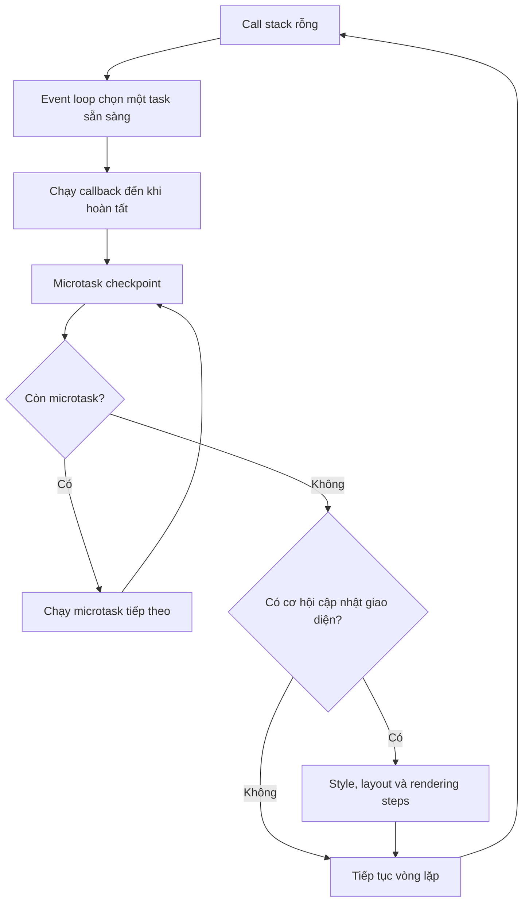
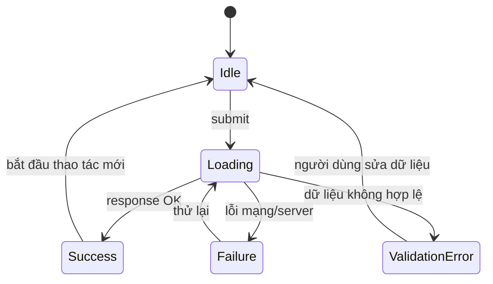

# Vòng lặp sự kiện và giới hạn của luồng giao diện

Trong **MVC tương tác (interactive MVC)**, giao diện nhận thao tác của người dùng, điều phối hành động và cập nhật phần trình bày khi trạng thái thay đổi. Trên trình duyệt, phần lớn mã JavaScript của giao diện chạy trên main thread và được điều phối bởi **event loop (vòng lặp sự kiện)**. Event loop quyết định khi nào callback của sự kiện, timer, Promise hoặc thao tác bất đồng bộ được thực thi, cũng như khi nào trình duyệt có cơ hội cập nhật giao diện.

Hiểu event loop giúp giải thích những hiện tượng quen thuộc: vì sao một vòng lặp tính toán dài làm trang bị đơ, vì sao `setTimeout(..., 0)` không chạy ngay, vì sao Promise callback thường chạy trước timer, vì sao kết quả tìm kiếm cũ đôi khi ghi đè kết quả mới và vì sao gọi `async` không tự làm công việc CPU nặng chạy ở luồng khác.

Bài học này trình bày mô hình thực thi của trình duyệt, phân biệt task và microtask, thời điểm render, giới hạn của main thread, cách xử lý công việc bất đồng bộ và các nguyên tắc tổ chức tương tác MVC để giao diện phản hồi ổn định.

## 1. Main thread và event loop

Trình duyệt có nhiều thành phần thực thi: main thread xử lý JavaScript giao diện, DOM và nhiều bước liên quan đến style/layout; các luồng khác có thể xử lý mạng, giải mã hình ảnh, compositing hoặc công việc nội bộ. Không nên giả định toàn bộ trình duyệt chỉ có một luồng. Tuy nhiên, mã JavaScript chạy trong một window thường thực thi trên main thread theo mô hình run-to-completion: một callback đang chạy sẽ tiếp tục cho đến khi trả quyền điều khiển, trừ khi nó gọi API đồng bộ có hành vi lồng hoặc phát sinh ngoại lệ.

**Call stack** theo dõi các hàm đang thực thi. Khi một hàm gọi hàm khác, một frame được thêm vào stack; khi hàm kết thúc, frame được lấy ra. Khi stack rỗng và event loop chọn một công việc phù hợp, callback tiếp theo có thể được thực thi.

Event loop là cơ chế điều phối công việc đã sẵn sàng. Nó không phải một vòng `while` do ứng dụng viết, cũng không đơn giản là một hàng đợi duy nhất chứa mọi callback. Trình duyệt có các task source và quy tắc chọn task; microtask được xử lý tại các checkpoint; bước cập nhật render diễn ra khi trình duyệt có cơ hội phù hợp.



Sơ đồ là mô hình học tập rút gọn. Thuật toán event loop của nền tảng web có thêm nhiều bước và quy tắc ưu tiên. Đặc biệt, trình duyệt không bắt buộc phải vẽ lại sau mỗi task; nó có thể gộp nhiều thay đổi trước lần render tiếp theo.

## 2. Task queue và microtask queue

### Task (macrotask)

Một **task** là đơn vị công việc mà event loop chọn để thực thi. Những nguồn thường tạo task trong ứng dụng web gồm:

- Sự kiện người dùng như `click`, `keydown`, `submit` hoặc `input`.
- Callback của timer như `setTimeout` và `setInterval` khi thời điểm cho phép đã đến.
- Một số callback liên quan đến thao tác mạng, thông điệp hoặc API trình duyệt.
- Các công việc được đưa vào hàng đợi bởi những cơ chế của nền tảng web.

Tên “macrotask” thường được dùng trong tài liệu học tập để phân biệt với microtask; thuật ngữ trong mô tả chuẩn của nền tảng web thường là task. Các task không nhất thiết đến từ một hàng đợi FIFO duy nhất; trình duyệt có thể chọn giữa các task source theo chính sách của event loop.

### Microtask

**Microtask** là công việc nhỏ được xử lý tại microtask checkpoint, thường sau khi task hiện tại kết thúc và trước khi trình duyệt tiếp tục một số bước khác như cập nhật render. Các nguồn thường gặp:

- Hàm callback truyền cho `Promise.prototype.then`, `catch` và `finally`.
- Phần tiếp tục sau `await` khi Promise tương ứng đã settle.
- `queueMicrotask(callback)`.
- Một số cơ chế nội bộ của nền tảng web, chẳng hạn cập nhật `MutationObserver`.

Trong một checkpoint, trình duyệt tiếp tục lấy microtask cho đến khi hàng đợi rỗng. Microtask mới được tạo bởi một microtask đang chạy cũng có thể được xử lý trong cùng checkpoint. Vì vậy, tạo microtask vô hạn có thể ngăn trình duyệt tiến tới cơ hội render hoặc xử lý task tiếp theo.

### Ví dụ thứ tự thực thi

```javascript
console.log("A: bắt đầu");

setTimeout(() => {
  console.log("D: timer");
}, 0);

Promise.resolve().then(() => {
  console.log("C: Promise callback");
});

queueMicrotask(() => {
  console.log("C2: microtask được xếp sau");
});

console.log("B: kết thúc task hiện tại");
```

Với môi trường trình duyệt thông thường, thứ tự log là:

```text
A: bắt đầu
B: kết thúc task hiện tại
C: Promise callback
C2: microtask được xếp sau
D: timer
```

Hai dòng đầu chạy đồng bộ trong task hiện tại. Callback Promise và `queueMicrotask` được xếp vào microtask queue; chúng chạy tại checkpoint sau task. Timer tạo một task và chỉ đủ điều kiện chạy khi thời gian chờ đã qua cùng các quy tắc scheduling khác. Vì vậy, delay `0` không có nghĩa callback chạy ngay lập tức.

## 3. `setTimeout` không phải đồng hồ chính xác

`setTimeout(callback, delay)` yêu cầu trình duyệt gọi callback sau khi khoảng delay tối thiểu đã qua và khi event loop có thể chọn task đó. Nó không bảo đảm callback chạy đúng tại thời điểm đó.

Ví dụ:

```javascript
setTimeout(() => {
  console.log("Có thể chạy muộn hơn 100 ms");
}, 100);
```

Callback có thể chạy trễ nếu main thread đang bận, tab bị hạn chế hoạt động nền, hệ thống tiết kiệm năng lượng hoặc trình duyệt áp dụng giới hạn timer. Timer lồng nhau và timer ở tab nền có thể bị clamp hoặc throttling theo chính sách trình duyệt.

Không dùng timer để đo thời gian chính xác của hoạt động hoặc để giả định một animation sẽ chạy đều. Nếu cần tính thời lượng, dùng `performance.now()` cho phép đo đơn điệu trong ngữ cảnh phù hợp. Nếu cần đồng bộ với chu kỳ render, cân nhắc `requestAnimationFrame`. Nếu cần lập lịch công việc nền khi trình duyệt rảnh, `requestIdleCallback` có thể hữu ích nhưng không được hỗ trợ đồng nhất và không bảo đảm chạy đúng thời điểm; công việc quan trọng không nên phụ thuộc vào nó.

## 4. Microtask có thể làm giao diện đói thời gian

Microtask được xử lý đến khi checkpoint rỗng. Nếu mỗi microtask lại xếp thêm một microtask mới, trình duyệt có thể không thoát khỏi checkpoint để xử lý task người dùng hoặc cập nhật giao diện.

```javascript
function keepQueueBusy() {
  queueMicrotask(keepQueueBusy);
}

// Không gọi trong ứng dụng thực tế:
// keepQueueBusy();
```

Đoạn mã trên tạo microtask liên tục. Dù mỗi callback rất ngắn, chuỗi công việc không kết thúc có thể làm trang không phản hồi. Tương tự, lặp Promise liên tục qua `.then()` có thể gây starvation.

Hãy dùng microtask cho việc tiếp tục logic nhỏ cần chạy sau task hiện tại, ví dụ gom các cập nhật trạng thái đồng bộ. Không dùng nó để chia nhỏ một phép tính lớn nếu mục tiêu là nhường cơ hội cho trình duyệt render. Muốn nhường main thread, cần trả quyền điều khiển cho event loop, chẳng hạn thông qua task mới, hoặc chuyển phép tính sang Web Worker.

## 5. Rendering và `requestAnimationFrame`

Trình duyệt cần có cơ hội cập nhật giao diện để người dùng nhìn thấy thay đổi. Một chu kỳ render có thể bao gồm việc tính style, layout, paint và compositing; chi tiết phụ thuộc trình duyệt và thay đổi theo loại cập nhật. JavaScript trên main thread có thể trì hoãn các bước cần thực hiện trên luồng đó.

Ở màn hình 60 Hz, một khung hình có khoảng 16,7 ms; ở 120 Hz, khoảng 8,3 ms. Đây là ngân sách gần đúng cho toàn bộ pipeline của một frame, không phải toàn bộ thời gian có thể dùng cho JavaScript. Nếu một callback chiếm phần lớn khoảng thời gian này, animation hoặc cuộn có thể giật.

`requestAnimationFrame(callback)` yêu cầu callback được gọi trước lần repaint tiếp theo mà trình duyệt dự định thực hiện. Nó phù hợp với cập nhật trực quan cần đồng bộ frame:

```javascript
const box = document.querySelector("#box");
let position = 0;

function animate(timestamp) {
  position += 2;
  box.style.transform = `translateX(${position}px)`;

  if (position < 300) {
    requestAnimationFrame(animate);
  }
}

requestAnimationFrame(animate);
```

Trong animation thực tế, nên dựa vào tham số `timestamp` để tính tiến độ theo thời gian thay vì tăng một lượng cố định mỗi frame; nếu không, tốc độ sẽ phụ thuộc tần số refresh và frame bị bỏ lỡ. Cũng cần dừng animation khi không còn cần thiết.

### Không thể ép trình duyệt render giữa hai dòng JavaScript đồng bộ

```javascript
status.textContent = "Đang xử lý…";
doHeavyCalculation();
status.textContent = "Hoàn tất";
```

Nếu `doHeavyCalculation()` chạy lâu trong cùng một task, trình duyệt thường chưa có cơ hội vẽ dòng “Đang xử lý…” trước khi tính toán kết thúc. DOM đã được cập nhật trong bộ nhớ, nhưng người dùng chưa chắc đã nhìn thấy thay đổi.

Nếu cần trình duyệt có cơ hội render trước khi bắt đầu công việc nặng, có thể tách phần công việc sang task sau:

```javascript
status.textContent = "Đang xử lý…";

setTimeout(() => {
  const result = doHeavyCalculation();
  status.textContent = `Hoàn tất: ${result}`;
}, 0);
```

Đây chỉ là ví dụ về việc nhường một lượt cho event loop; `setTimeout` không bảo đảm trình duyệt chắc chắn đã vẽ trước callback. Với phép tính CPU nặng, giải pháp tốt hơn thường là chia nhỏ công việc có chủ đích hoặc chuyển nó sang Web Worker.

## 6. Bất đồng bộ không đồng nghĩa với chạy song song

JavaScript có thể khởi động một thao tác bất đồng bộ rồi tiếp tục xử lý công việc khác trong lúc chờ. Ví dụ, `fetch` cho phép gửi request mạng mà không chặn main thread trong suốt thời gian chờ. Tuy nhiên, đoạn JavaScript xử lý kết quả vẫn chạy trên main thread trừ khi được chuyển sang worker.

```javascript
async function loadProfile() {
  const response = await fetch("/api/profile");

  if (!response.ok) {
    throw new Error("Không thể tải hồ sơ");
  }

  return response.json();
}

loadProfile()
  .then((profile) => renderProfile(profile))
  .catch((error) => showError(error.message));
```

`await` tạm dừng phần tiếp tục của hàm async cho đến khi Promise settle; nó không chặn toàn bộ event loop. Khi Promise hoàn tất, phần tiếp tục được xếp để chạy dưới dạng microtask. Việc parse JSON lớn, lọc một mảng rất lớn hoặc dựng hàng nghìn node DOM vẫn có thể tốn CPU trên main thread.

Phân biệt các khái niệm:

| Khái niệm | Ý nghĩa | Ví dụ |
|---|---|---|
| Đồng bộ (synchronous) | Hàm thực thi ngay trên call stack hiện tại | Tính tổng một mảng nhỏ |
| Bất đồng bộ (asynchronous) | Kết quả được xử lý sau khi thao tác hoàn tất hoặc callback được lập lịch | `fetch`, timer, Promise |
| Đồng thời (concurrent) | Nhiều hoạt động có thể tiến triển xen kẽ trong một khoảng thời gian | Nhiều request đang chờ và hoàn tất theo thứ tự khác nhau |
| Song song (parallel) | Nhiều công việc thực sự thực thi cùng lúc trên các lõi/luồng khác nhau | Hai Web Worker tính toán trên hai luồng |

Một ứng dụng có thể có nhiều hoạt động concurrent mà không có nhiều đoạn JavaScript giao diện chạy song song trên cùng main thread.

## 7. Giới hạn của main thread

Main thread phục vụ nhiều nhiệm vụ quan trọng: xử lý sự kiện, chạy JavaScript giao diện, cập nhật DOM, style và layout, cùng các công việc khác của trình duyệt. Khi một callback chiếm main thread quá lâu, các thao tác mới phải chờ.

Hậu quả thường gặp:

- Click hoặc phím bấm không được phản hồi ngay.
- Cuộn và animation bị giật.
- Trình duyệt hiển thị cảnh báo trang không phản hồi.
- Người dùng nhập liệu nhưng ký tự xuất hiện chậm.
- Các thông báo loading hoặc lỗi bị trì hoãn.
- Đo lường tương tác và cảm nhận hiệu năng bị xấu đi.

Một **long task** thường được định nghĩa là task trên main thread kéo dài hơn 50 ms trong các API đo lường của trình duyệt. Ngưỡng này là dấu hiệu chẩn đoán, không phải cam kết rằng mọi task dưới 50 ms đều tốt; một callback 40 ms vẫn có thể gây giật ở màn hình tần số cao hoặc khi trình duyệt còn nhiều việc khác phải làm.

Những nguồn gây nghẽn phổ biến gồm:

- Tính toán đồng bộ trên mảng hoặc cây dữ liệu rất lớn.
- Parse hoặc serialize JSON lớn.
- Tạo, xóa hoặc sửa hàng nghìn DOM node trong một lần.
- Đọc/ghi layout xen kẽ gây forced synchronous layout.
- Xử lý ảnh, mã hóa hoặc giải mã dữ liệu nặng trên main thread.
- Một microtask chain không kết thúc.
- Event handler làm quá nhiều việc trước khi trả quyền điều khiển.

## 8. Chia nhỏ công việc và nhường main thread

Nếu công việc có thể chia thành các phần độc lập, hãy xử lý theo từng lô và nhường event loop giữa các lô. Ví dụ:

```javascript
function processInChunks(items, chunkSize = 200) {
  let index = 0;

  return new Promise((resolve, reject) => {
    function processNextChunk() {
      try {
        const end = Math.min(index + chunkSize, items.length);

        for (; index < end; index += 1) {
          processItem(items[index]);
        }

        if (index < items.length) {
          setTimeout(processNextChunk, 0);
        } else {
          resolve();
        }
      } catch (error) {
        reject(error);
      }
    }

    processNextChunk();
  });
}
```

Ví dụ này giúp mỗi lô có giới hạn số phần tử và tạo cơ hội để event loop xử lý công việc khác giữa các lô. Kích thước lô cần đo và điều chỉnh theo chi phí thực tế của `processItem`; 200 không phải con số tối ưu chung. Nếu một phần tử đơn lẻ đã tốn nhiều thời gian, chia lô không giải quyết được vấn đề.

Một số lựa chọn khác:

- Dùng `requestAnimationFrame` cho cập nhật cần đồng bộ với frame.
- Dùng `requestIdleCallback` cho công việc nền không khẩn cấp nếu có fallback và không cần bảo đảm thời điểm.
- Dùng `scheduler.postTask` khi nền tảng hỗ trợ và ứng dụng có chiến lược fallback phù hợp.
- Giảm lượng DOM được tạo, dùng phân trang hoặc virtualization cho danh sách lớn.
- Debounce hoặc throttle sự kiện có tần suất cao như `input`, `scroll` và `resize`.

Chia nhỏ công việc chỉ cải thiện khả năng nhường lượt. Nó không làm giảm tổng lượng CPU cần dùng; cần tối ưu thuật toán và dữ liệu nếu tổng công việc quá lớn.

## 9. Web Worker: chuyển công việc CPU sang luồng khác

Khi phép tính nặng không cần truy cập DOM, Web Worker có thể chạy JavaScript trên một luồng riêng, giúp main thread tiếp tục phản hồi tương tác.

Main thread tạo worker và gửi dữ liệu:

```javascript
const worker = new Worker("/workers/report-worker.js", {
  type: "module"
});

worker.addEventListener("message", (event) => {
  renderReport(event.data);
});

worker.addEventListener("error", () => {
  showError("Không thể tạo báo cáo.");
});

worker.postMessage({
  type: "BUILD_REPORT",
  rows: reportRows
});
```

Trong file `report-worker.js`:

```javascript
self.addEventListener("message", (event) => {
  const message = event.data;

  if (message.type === "BUILD_REPORT") {
    const report = buildReport(message.rows);
    self.postMessage({
      type: "REPORT_READY",
      report
    });
  }
});
```

Worker không có quyền thao tác trực tiếp với DOM của trang. Nó giao tiếp với main thread qua message. Dữ liệu gửi qua `postMessage` thường được structured clone; một số loại dữ liệu hỗ trợ transferable để chuyển quyền sở hữu buffer mà không sao chép toàn bộ. Không phải mọi đối tượng đều clone được, và truyền dữ liệu rất lớn cũng có chi phí.

Web Worker phù hợp với tính toán, parse dữ liệu lớn hoặc xử lý độc lập với DOM. Nó không phải giải pháp cho mọi callback chậm: chi phí khởi tạo worker, đóng gói dữ liệu và trao đổi message có thể lớn hơn lợi ích với công việc nhỏ. Cần xử lý lỗi, hủy worker khi không còn cần và tránh tạo quá nhiều worker không giới hạn.

## 10. Sự kiện giao diện và vòng đời callback

Event handler thường chạy đồng bộ trong task được tạo bởi sự kiện. Khi người dùng click một nút, trình duyệt thực hiện quá trình dispatch event theo pha capture, target và bubble. Các listener được gọi theo thứ tự và quy tắc của DOM event.

```javascript
const form = document.querySelector("#profile-form");

form.addEventListener("submit", (event) => {
  event.preventDefault();
  submitProfileForm(form);
});
```

`preventDefault()` ngăn hành vi mặc định nếu event có thể hủy, ví dụ submit form hoặc điều hướng của một liên kết. `stopPropagation()` ngăn event tiếp tục lan truyền qua các node cha nhưng không tự hủy hành vi mặc định. `stopImmediatePropagation()` còn ngăn các listener còn lại trên cùng target được gọi. Chỉ dùng các API này khi có lý do rõ ràng; chặn event tràn lan có thể làm hỏng tương tác của thành phần khác.

### Event delegation

Với danh sách động, có thể gắn một listener trên phần tử cha và xác định phần tử con được tương tác:

```javascript
const list = document.querySelector("#work-items");

list.addEventListener("click", (event) => {
  const button = event.target.closest("[data-action='edit']");

  if (!button || !list.contains(button)) {
    return;
  }

  openEditForm(button.dataset.id);
});
```

Event delegation giảm số listener cần đăng ký cho danh sách có nhiều phần tử được tạo/xóa thường xuyên. Cần kiểm tra phần tử đích thuộc vùng quản lý, tránh xử lý click từ một vùng khác hoặc dữ liệu `data-*` không hợp lệ.

### Handler async không tự được trình duyệt chờ

```javascript
button.addEventListener("click", async () => {
  await saveChanges();
});
```

DOM event system không chờ Promise trả về từ listener. Nếu Promise bị reject mà không được bắt, lỗi có thể trở thành unhandled rejection. Hãy xử lý lỗi ngay trong handler:

```javascript
button.addEventListener("click", async () => {
  button.disabled = true;

  try {
    await saveChanges();
    showSuccess("Đã lưu thay đổi.");
  } catch (error) {
    showError("Không thể lưu thay đổi.");
  } finally {
    button.disabled = false;
  }
});
```

Với form submit, gọi `preventDefault()` đồng bộ trong listener nếu cần ngăn submit mặc định. Không đợi một `await` rồi mới gọi `preventDefault()`, vì khi đó trình duyệt có thể đã tiếp tục hành vi mặc định.

## 11. Race condition và kết quả bất đồng bộ đến sai thứ tự

JavaScript trên một main thread tránh việc hai callback cùng sửa một object tại chính xác cùng một thời điểm, nhưng điều đó không loại bỏ race condition. Các hoạt động bất đồng bộ có thể hoàn tất theo thứ tự khác với thứ tự được khởi tạo. Trong lúc chờ một Promise, state có thể đã thay đổi bởi event khác hoặc request khác.

Ví dụ, người dùng nhập từ khóa tìm kiếm nhanh:

1. Request A tìm `ja` được gửi trước.
2. Người dùng nhập tiếp `java`, request B được gửi sau.
3. Request B hoàn tất trước và hiển thị kết quả mới.
4. Request A hoàn tất sau và ghi đè kết quả mới bằng dữ liệu cũ.

Có thể dùng số thứ tự request để chỉ nhận kết quả mới nhất:

```javascript
let latestRequestId = 0;

async function search(query) {
  const requestId = ++latestRequestId;
  const response = await fetch(`/api/search?q=${encodeURIComponent(query)}`);

  if (!response.ok) {
    throw new Error("Search failed");
  }

  const results = await response.json();

  if (requestId !== latestRequestId) {
    return; // Kết quả của request cũ, bỏ qua.
  }

  renderSearchResults(results);
}
```

Một cách khác là hủy request cũ bằng `AbortController`:

```javascript
let activeController;

async function search(query) {
  activeController?.abort();
  activeController = new AbortController();

  try {
    const response = await fetch(
      `/api/search?q=${encodeURIComponent(query)}`,
      { signal: activeController.signal }
    );

    if (!response.ok) {
      throw new Error("Search failed");
    }

    renderSearchResults(await response.json());
  } catch (error) {
    if (error.name !== "AbortError") {
      showError("Không thể tìm kiếm.");
    }
  }
}
```

Hủy fetch giúp client ngừng chờ hoặc đọc response của request đó, nhưng không bảo đảm máy chủ chưa xử lý request hoặc không có side effect. Với lệnh thay đổi dữ liệu, vẫn cần idempotency, kiểm soát version và quy tắc ở phía máy chủ.

## 12. Event loop trong tương tác MVC

Trong MVC tương tác phía trình duyệt, có thể hình dung:

- **Model** giữ state phía client cần cho trải nghiệm và cung cấp các thao tác thay đổi state. Dữ liệu nghiệp vụ có thẩm quyền vẫn nằm ở máy chủ nếu ứng dụng dùng backend làm nguồn sự thật.
- **View** hiển thị state hiện tại và phát ra sự kiện người dùng.
- **Controller** nhận sự kiện, kiểm tra đầu vào ở mức giao diện, gọi API hoặc use case phù hợp và điều phối cập nhật.

Event loop là cơ chế nền để các callback của View và Controller được thực thi. Nó không thay thế phân chia trách nhiệm MVC. Callback không nên tự ý chứa toàn bộ logic nghiệp vụ chỉ vì nó được gọi khi người dùng click.

```mermaid
sequenceDiagram
    actor User as Người dùng
    participant View as View/DOM
    participant Loop as Browser Event Loop
    participant Controller as UI Controller
    participant API as Backend MVC
    participant Model as Client View Model

    User->>View: Nhập từ khóa và nhấn tìm
    View->>Loop: Dispatch input/submit event
    Loop->>Controller: Chạy event handler
    Controller->>Controller: Kiểm tra và tạo request
    Controller->>API: fetch /api/search
    Note over Loop,API: Main thread có thể xử lý tương tác khác trong lúc chờ mạng
    API-->>Controller: Response bất đồng bộ
    Controller->>Loop: Promise continuation được xếp microtask
    Loop->>Controller: Tiếp tục xử lý response
    Controller->>Model: Cập nhật kết quả mới nhất
    Model-->>View: State change / render
    View-->>User: Hiển thị kết quả
```

Khi request đang chờ, event loop vẫn có thể xử lý thao tác khác. Vì vậy, Controller cần xác định kết quả response còn phù hợp với state hiện tại hay không trước khi cập nhật Model. Nếu người dùng đã chuyển trang, đổi bộ lọc hoặc hủy thao tác, response cũ không nên làm giao diện quay về trạng thái trước đó.

## 13. Quản lý state và tránh cập nhật DOM tùy tiện

Một lỗi phổ biến trong ứng dụng tương tác là nhiều callback cùng thay đổi DOM và state theo những quy tắc riêng. Ví dụ, một callback đổi text của nút, callback khác thay danh sách, callback thứ ba cập nhật badge; nếu một request thất bại, các phần có thể không còn đồng bộ.

Hãy xác định một nguồn state phía client có trách nhiệm rõ ràng và quy tắc cập nhật:

```javascript
const state = {
  status: "idle",
  query: "",
  results: [],
  error: null
};

function setState(nextState) {
  Object.assign(state, nextState);
  render(state);
}

function render(current) {
  const status = document.querySelector("#status");
  const results = document.querySelector("#results");

  status.textContent = current.status === "loading"
    ? "Đang tải…"
    : current.error ?? "";

  results.replaceChildren(
    ...current.results.map((item) => {
      const li = document.createElement("li");
      li.textContent = item.title;
      return li;
    })
  );
}
```

Ví dụ dùng state object đơn giản để minh họa. Trong ứng dụng thực tế, cần cân nhắc immutable update, kiểm soát side effect, escape nội dung và tối ưu render. Dùng `textContent` thay vì nối dữ liệu không tin cậy vào `innerHTML` giúp tránh một số rủi ro XSS.

Có thể mô hình hóa tương tác bằng state machine:



State machine làm rõ trạng thái hợp lệ và chuyển tiếp được phép. Ví dụ, không nên cho phép hiển thị `Success` chỉ vì người dùng vừa click; phải chờ kết quả xác nhận từ backend nếu thao tác cần được lưu bền vững.

## 14. Debounce, throttle và hủy công việc

Các sự kiện `input`, `scroll` và `resize` có thể phát sinh rất thường xuyên. Nếu mỗi sự kiện đều gọi API hoặc thực hiện tính toán nặng, giao diện sẽ lãng phí tài nguyên.

**Debounce** đợi một khoảng yên lặng trước khi chạy, phù hợp với tìm kiếm khi người dùng ngừng gõ:

```javascript
function debounce(callback, delay = 300) {
  let timerId;

  return (...args) => {
    clearTimeout(timerId);
    timerId = setTimeout(() => callback(...args), delay);
  };
}

const searchLater = debounce((query) => search(query), 300);
searchInput.addEventListener("input", (event) => {
  searchLater(event.target.value);
});
```

**Throttle** giới hạn tần suất chạy trong một khoảng thời gian, phù hợp với một số tác vụ theo dõi cuộn hoặc kích thước cửa sổ:

```javascript
function throttle(callback, interval = 100) {
  let lastRun = 0;
  let timerId;

  return (...args) => {
    const now = performance.now();
    const remaining = interval - (now - lastRun);

    if (remaining <= 0) {
      clearTimeout(timerId);
      timerId = undefined;
      lastRun = now;
      callback(...args);
    } else if (!timerId) {
      timerId = setTimeout(() => {
        lastRun = performance.now();
        timerId = undefined;
        callback(...args);
      }, remaining);
    }
  };
}
```

Debounce và throttle không thay thế kiểm soát kết quả cũ, phân quyền hay idempotency. Chúng điều tiết tần suất khởi chạy công việc ở client. Với thao tác cần kết quả tức thời hoặc mọi sự kiện đều có ý nghĩa, chọn chiến lược khác phù hợp.

## 15. Giới hạn của luồng giao diện

Luồng giao diện có một số giới hạn cần được tính đến khi thiết kế:

1. **Không thể xử lý JavaScript CPU nặng mà vẫn phản hồi đồng thời trên cùng main thread.** `async` chỉ tổ chức việc chờ; nó không tự tạo thread.
2. **DOM gắn với môi trường window.** Web Worker không thể truy cập trực tiếp DOM của trang; cần trao đổi message.
3. **Thứ tự hoàn tất bất đồng bộ không được bảo đảm.** Response có thể về sai thứ tự; Controller phải kiểm tra request nào còn hiệu lực.
4. **Timer không chính xác tuyệt đối.** Tab nền, throttling và main thread bận có thể làm callback chạy trễ.
5. **Render có giới hạn theo frame.** Cập nhật DOM liên tục hoặc layout nặng có thể làm animation và tương tác giật.
6. **Microtask có thể gây starvation.** Một chuỗi microtask không kết thúc sẽ trì hoãn task và render.
7. **Hủy ở client không đảo ngược side effect phía server.** Backend vẫn phải bảo vệ lệnh thay đổi bằng transaction, idempotency và kiểm tra quyền.
8. **State phía client có thể lỗi thời hoặc bị sửa.** Không dùng state trong trình duyệt làm nguồn thẩm quyền cho quyền truy cập, giá tiền hoặc trạng thái nghiệp vụ.

Không phải mọi ứng dụng MVC đều cần Web Worker, state machine hoặc một thư viện quản lý state. Hãy chọn công cụ theo mức độ phức tạp, chi phí tính toán và yêu cầu trải nghiệm. Với một form đơn giản, HTML form và server render có thể là giải pháp đầy đủ.

## 16. Kiểm thử và quan sát event loop

Các vấn đề event loop thường phụ thuộc timing và tải thực tế, vì vậy cần kết hợp kiểm thử chức năng với đo lường hiệu năng.

| Cấp kiểm thử/quan sát | Nội dung cần kiểm tra | Công cụ hoặc cách làm |
|---|---|---|
| Unit test | Logic debounce/throttle, reducer hoặc state machine | Fake timers, kiểm tra chuyển trạng thái |
| Component test | Handler cập nhật đúng trạng thái loading/success/error | Test DOM và mock fetch |
| Integration test | Request cũ không ghi đè kết quả mới | Điều khiển thứ tự Promise resolve trong test |
| End-to-end test | Tương tác vẫn phản hồi trong luồng thực | Browser automation với dữ liệu đủ lớn |
| Performance profiling | Long task, layout, paint và scripting | Chrome DevTools Performance hoặc công cụ tương đương |
| Runtime monitoring | Tần suất long task và lỗi Promise | PerformanceObserver, logging và telemetry |

Có thể quan sát long task bằng API hỗ trợ:

```javascript
if (
  typeof PerformanceObserver !== "undefined" &&
  PerformanceObserver.supportedEntryTypes?.includes("longtask")
) {
  const observer = new PerformanceObserver((list) => {
    for (const entry of list.getEntries()) {
      console.warn("Long task:", entry.duration, "ms");
    }
  });

  observer.observe({ type: "longtask", buffered: true });
}
```

Hỗ trợ API và mức chi tiết có thể khác nhau giữa trình duyệt. Đo lường trong môi trường phát triển cần được đối chiếu với thiết bị, mạng và dữ liệu gần thực tế. Không nên ghi log quá nhiều hoặc thu thập dữ liệu nhạy cảm trong quá trình đo.

## 17. Quy trình thiết kế một tương tác bất đồng bộ

Khi thêm một tương tác vào MVC phía trình duyệt, hãy xác định:

1. **Sự kiện bắt đầu:** click, submit, input, message hay một thay đổi state khác?
2. **Công việc đồng bộ:** phần nào cần chạy ngay, phần nào có thể chờ I/O hoặc chia nhỏ?
3. **Nguồn state:** state nào thuộc client để trình bày, state nào chỉ backend mới có thẩm quyền xác nhận?
4. **Trạng thái tương tác:** idle, loading, success, validation error, failure hoặc cancelled được biểu diễn ra sao?
5. **Tính hợp lệ của response:** nếu người dùng đã thay đổi lựa chọn hoặc rời trang, response cũ có cần bị bỏ qua không?
6. **Giới hạn main thread:** có phép tính, parse hoặc cập nhật DOM nào có thể trở thành long task không?
7. **Chiến lược điều tiết:** có cần debounce, throttle, chunking hoặc Web Worker không?
8. **Hủy và retry:** việc hủy có an toàn không, request gửi lại có tạo side effect trùng không?
9. **Phản hồi người dùng:** loading và lỗi có thể tiếp cận bằng bàn phím và công nghệ hỗ trợ không?
10. **Kiểm thử:** xác minh thứ tự Promise, response out-of-order, lỗi mạng, trạng thái stale và hiệu năng trên thiết bị phù hợp.

## Kết luận

Event loop điều phối task, microtask và cơ hội cập nhật giao diện trong trình duyệt. Main thread giúp mô hình tương tác JavaScript đơn giản, nhưng một callback đồng bộ dài, microtask chain không kết thúc hoặc thao tác DOM quá nặng có thể làm giao diện mất phản hồi. Bất đồng bộ cho phép ứng dụng chờ I/O mà không khóa toàn bộ giao diện, nhưng không đồng nghĩa với chạy song song.

Trong MVC tương tác, View phát sinh sự kiện và trình bày state; Controller điều phối callback, request và kết quả; Model phía client giữ state cần thiết cho trải nghiệm, còn backend vẫn bảo vệ dữ liệu nghiệp vụ có thẩm quyền. Chia nhỏ công việc, dùng Web Worker khi phù hợp, kiểm soát response cũ và thiết kế trạng thái rõ ràng giúp giao diện phản hồi tốt mà vẫn giữ tính nhất quán của ứng dụng.
