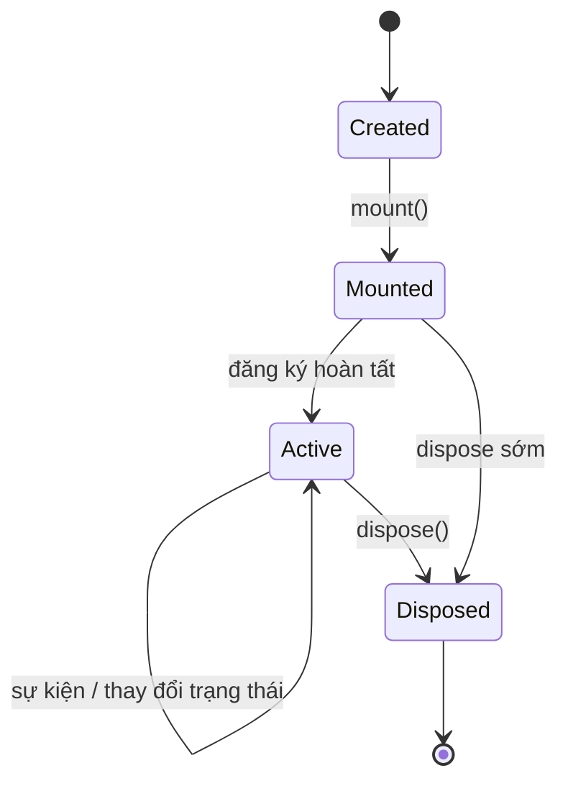

# Quản lý đăng ký theo dõi và giải phóng tài nguyên

Trong một ứng dụng MVC có tương tác, các thành phần thường đăng ký lắng nghe sự kiện hoặc theo dõi thay đổi trạng thái để cập nhật giao diện. Ví dụ, View lắng nghe thao tác nhấn nút, Controller theo dõi trạng thái của Model, một thành phần giao diện quan sát kích thước vùng hiển thị hoặc ứng dụng nhận dữ liệu mới qua WebSocket. Những đăng ký này giúp giao diện phản hồi theo thời gian thực, nhưng chúng cũng tạo ra mối liên kết và giữ tham chiếu giữa các đối tượng.

Khi một màn hình hoặc thành phần giao diện không còn được sử dụng, các đăng ký và tài nguyên thuộc về nó cần được giải phóng. Nếu không, callback cũ vẫn có thể chạy, một sự kiện có thể bị xử lý nhiều lần, request có thể tiếp tục tiêu tốn tài nguyên và các đối tượng giao diện đã rời màn hình vẫn bị giữ trong bộ nhớ. Vì vậy, quản lý vòng đời đăng ký và giải phóng tài nguyên là một phần của thiết kế MVC tương tác.

## 1. Subscription và resource là gì?

**Subscription (đăng ký theo dõi)** là việc một thành phần thông báo cho nguồn phát rằng nó muốn nhận sự kiện hoặc thay đổi trong tương lai. Nguồn phát có thể là Model, event emitter, DOM element, observable, WebSocket hoặc một dịch vụ thông báo.

Ví dụ:

- View đăng ký nhận sự kiện `click` từ nút xác nhận.
- Controller đăng ký nhận thay đổi trạng thái từ Model để cập nhật giao diện.
- Một widget đăng ký sự kiện thay đổi kích thước từ `ResizeObserver`.
- Một màn hình đăng ký nhận thông báo mới từ WebSocket.
- Một thành phần đăng ký nhận kết quả từ luồng dữ liệu hoặc thư viện reactive.

**Resource (tài nguyên)** là thứ mà ứng dụng tạo ra, mở hoặc chiếm dụng và cần được quản lý trong một khoảng thời gian. Tài nguyên có thể là listener, timer, kết nối mạng, stream, file handle, observer, subscription hoặc một đối tượng giữ tham chiếu đến nhiều thành phần khác.

**Unsubscribe / dispose / close** là các thao tác ngừng nhận sự kiện hoặc giải phóng tài nguyên. Tên phương thức phụ thuộc API, nhưng mục tiêu giống nhau: chấm dứt việc sử dụng tài nguyên khi vòng đời của chủ sở hữu kết thúc.

| Khái niệm | Ý nghĩa | Ví dụ |
|---|---|---|
| Subscribe | Bắt đầu nhận sự kiện hoặc thay đổi | `model.subscribe(listener)` |
| Unsubscribe | Ngừng nhận sự kiện | Gọi hàm hủy đăng ký được trả về |
| Dispose | Kết thúc vòng đời một thành phần và dọn tài nguyên thuộc nó | `view.dispose()` |
| Close | Đóng một tài nguyên có trạng thái mở | `socket.close()` hoặc `stream.close()` |
| Abort / cancel | Yêu cầu dừng một công việc đang chạy | `AbortController.abort()` |

Subscription không chỉ là một callback. Nguồn phát thường lưu callback trong một danh sách hoặc cấu trúc tương tự. Nếu không xóa callback, nguồn phát vẫn giữ tham chiếu đến hàm; hàm có thể tiếp tục giữ View, Controller hoặc DOM node trong closure của nó. Đây là một nguyên nhân phổ biến gây rò rỉ bộ nhớ.

## 2. Vai trò của Model, View và Controller

Trong một ứng dụng MVC tương tác, mỗi thành phần có thể tạo hoặc sở hữu những đăng ký khác nhau:

| Thành phần | Đăng ký thường gặp | Trách nhiệm khi kết thúc vòng đời |
|---|---|---|
| Model | Listener theo dõi thay đổi dữ liệu, subscription đến nguồn dữ liệu bên ngoài | Ngừng phát sự kiện hoặc đóng tài nguyên do Model sở hữu khi chính Model bị hủy |
| View | DOM event listener, observer, timer phục vụ hiển thị | Gỡ listener, ngắt observer và dừng timer khi View bị tháo khỏi giao diện |
| Controller | Theo dõi Model, lắng nghe sự kiện từ View, điều phối request bất đồng bộ | Hủy subscription, dừng công việc còn thuộc Controller và tháo các liên kết đã tạo |
| Ứng dụng / composition root | Tài nguyên dùng chung như kết nối, event bus hoặc dịch vụ nền | Đóng tài nguyên dùng chung khi ứng dụng kết thúc |

Một quy tắc quan trọng là **thành phần tạo hoặc nhận quyền sở hữu một tài nguyên phải xác định nơi và thời điểm giải phóng nó**. Thành phần chỉ mượn hoặc sử dụng tài nguyên dùng chung không được tự ý đóng tài nguyên đó.

Ví dụ, một View đăng ký nhận thay đổi từ Model dùng chung. Khi View biến mất, View phải hủy subscription của mình. Nó không được hủy toàn bộ Model nếu Model còn được các View khác hoặc tác vụ khác sử dụng.

## 3. Vòng đời của một thành phần giao diện

Một thành phần tương tác thường có bốn giai đoạn:

1. **Tạo (create):** khởi tạo đối tượng, nhận dependency và chuẩn bị trạng thái ban đầu.
2. **Gắn vào giao diện (mount / attach):** đăng ký event listener, theo dõi Model, bắt đầu observer hoặc công việc cần thiết.
3. **Hoạt động (active):** nhận sự kiện, cập nhật trạng thái và phản hồi tương tác.
4. **Tháo khỏi giao diện (unmount / detach / dispose):** ngừng nhận sự kiện, hủy subscription, dừng công việc và giải phóng tài nguyên thuộc thành phần.



`mount()` và `dispose()` nên có hành vi rõ ràng. Nếu một thành phần có thể được mount nhiều lần trong suốt vòng đời ứng dụng, cần xác định liệu mount lần hai là hợp lệ hay phải tạo một instance mới. Không nên để mỗi lần mount tự động thêm một listener mới mà không có cơ chế ngăn đăng ký trùng.

### Tại sao phải cleanup đúng thời điểm?

Giả sử người dùng mở trang chi tiết đơn hàng, sau đó chuyển sang trang khác. Nếu Controller cũ vẫn đăng ký với Model dùng chung, mỗi lần Model thay đổi nó vẫn gọi View cũ. Điều này có thể gây ra các lỗi:

- Cập nhật DOM đã bị tháo khỏi tài liệu.
- Callback thao tác trên trạng thái cũ hoặc dữ liệu không còn phù hợp.
- Một hành động bị thực hiện nhiều lần do listener được đăng ký lặp.
- Đối tượng View không được garbage collector thu hồi vì còn được nguồn phát giữ tham chiếu.
- Timer, kết nối hoặc request tiếp tục chạy dù người dùng không còn nhìn thấy thành phần.

Cleanup không phải chỉ để tiết kiệm bộ nhớ. Nó còn bảo đảm tính đúng đắn của luồng tương tác và ngăn các tác động ngoài ý muốn sau khi một thành phần đã kết thúc vòng đời.

## 4. Đăng ký và hủy theo dõi thay đổi của Model

Một Model có thể cung cấp phương thức `subscribe()` để thành phần khác nhận thông báo khi trạng thái thay đổi. Một hợp đồng tốt thường trả về một hàm unsubscribe để bên đăng ký chủ động kết thúc subscription.

Ví dụ Model JavaScript đơn giản:

```javascript
class OrderModel {
  #state;
  #listeners = new Set();

  constructor(initialState) {
    this.#state = { ...initialState };
  }

  getSnapshot() {
    return { ...this.#state };
  }

  subscribe(listener) {
    let active = true;
    const subscription = { listener };
    const unsubscribe = () => {
      if (!active) return;
      active = false;
      this.#listeners.delete(subscription);
    };

    this.#listeners.add(subscription);
    try {
      listener(this.getSnapshot());
    } catch (error) {
      unsubscribe();
      throw error;
    }
    return unsubscribe;
  }

  update(patch) {
    this.#state = { ...this.#state, ...patch };
    for (const subscription of [...this.#listeners]) {
      try {
        subscription.listener(this.getSnapshot());
      } catch (error) {
        console.error("Model listener failed", error);
      }
    }
  }
}
```

Trong ví dụ, `subscribe()` trả về một hàm có thể gọi nhiều lần mà không gây lỗi. Model phát một snapshot mới khi trạng thái thay đổi. Dùng bản sao danh sách listener trong lúc phát sự kiện giúp vòng lặp ổn định nếu một listener hủy đăng ký trong khi sự kiện đang được xử lý.

Controller có thể đăng ký theo dõi Model và chuyển snapshot đến View:

```javascript
class OrderController {
  #stopWatching = null;

  constructor(model, view) {
    this.model = model;
    this.view = view;
  }

  mount() {
    if (this.#stopWatching) return;

    this.#stopWatching = this.model.subscribe(state => {
      this.view.render(state);
    });
  }

  dispose() {
    this.#stopWatching?.();
    this.#stopWatching = null;
  }
}
```

Controller giữ lại hàm unsubscribe vì Controller là thành phần đã tạo subscription. Khi Controller kết thúc vòng đời, nó gọi hàm đó và xóa tham chiếu. Nếu Model tiếp tục được dùng ở nơi khác, Model vẫn hoạt động bình thường.

### Subscription nên có hợp đồng rõ ràng

Khi thiết kế API đăng ký, cần xác định:

- Callback có được gọi ngay với trạng thái hiện tại hay chỉ nhận thay đổi tiếp theo?
- Callback nhận snapshot bất biến, bản sao dữ liệu hay tham chiếu đến trạng thái nội bộ?
- Hàm unsubscribe có thể gọi nhiều lần không?
- Nếu listener phát sinh lỗi, các listener khác có tiếp tục được gọi không?
- Thứ tự thông báo có được bảo đảm không?
- Subscription có tự kết thúc khi nguồn phát bị đóng hay không?

Những quy ước này giúp các thành phần dùng chung cơ chế theo dõi mà không phải đoán hành vi của nguồn phát.

## 5. Quản lý DOM event listener trong View

View thường đăng ký sự kiện DOM để nhận thao tác người dùng. Với `addEventListener`, listener có thể được gỡ bằng `removeEventListener`, nhưng cần truyền đúng tham chiếu hàm và tùy chọn `capture` tương ứng.

Ví dụ dễ mắc lỗi:

```javascript
button.addEventListener("click", () => controller.confirm());

// Không thể gỡ bằng cách tạo một arrow function mới:
button.removeEventListener("click", () => controller.confirm());
```

Hai arrow function trên là hai đối tượng hàm khác nhau. Vì vậy, lời gọi `removeEventListener` không gỡ listener ban đầu.

Có thể lưu tham chiếu hàm:

```javascript
class ConfirmButtonView {
  constructor(button, controller) {
    this.button = button;
    this.controller = controller;
    this.handleClick = this.handleClick.bind(this);
  }

  mount() {
    this.button.addEventListener("click", this.handleClick);
  }

  handleClick() {
    this.controller.confirm();
  }

  dispose() {
    this.button.removeEventListener("click", this.handleClick);
  }
}
```

Một lựa chọn tiện lợi trên trình duyệt hiện đại là dùng `AbortController` làm scope cho các listener:

```javascript
class OrderView {
  #listenerScope = null;

  constructor(root, actions) {
    this.root = root;
    this.actions = actions;
  }

  mount() {
    if (this.#listenerScope) return;

    this.#listenerScope = new AbortController();
    this.root.addEventListener("click", event => {
      const button = event.target.closest("[data-action='confirm']");
      if (!button || !this.root.contains(button) || button.disabled) return;
      this.actions.confirm();
    }, { signal: this.#listenerScope.signal });
  }

  dispose() {
    this.#listenerScope?.abort();
    this.#listenerScope = null;
  }
}
```

Gọi `abort()` sẽ gỡ các listener đã đăng ký với signal đó. Cách này phù hợp khi một View có nhiều listener thuộc cùng vòng đời. Nếu trình duyệt hoặc môi trường mục tiêu không hỗ trợ tùy chọn `signal`, hãy lưu hàm listener và gỡ bằng `removeEventListener`.

### Event delegation và listener trùng

Thay vì gắn listener cho hàng trăm phần tử con, View có thể gắn một listener ở phần tử cha rồi xác định phần tử phát sinh sự kiện bằng `closest()`. Cách này gọi là event delegation. Nó giảm số listener và vẫn hoạt động khi các phần tử con được render lại.

Tuy nhiên, listener ở phần tử cha cũng phải được gỡ khi View kết thúc vòng đời. Event delegation giảm số đăng ký, không loại bỏ nhu cầu cleanup.

## 6. Quản lý các loại tài nguyên khác

Mỗi API có phương thức giải phóng riêng. Cần ghi nhận thao tác cleanup ngay tại nơi tạo hoặc đăng ký tài nguyên.

| Tài nguyên | Cách bắt đầu | Cách kết thúc |
|---|---|---|
| DOM event listener | `addEventListener()` | `removeEventListener()` hoặc `AbortController.abort()` |
| Model subscription | `subscribe()` | Gọi hàm unsubscribe |
| Event emitter listener | `on()` / `addListener()` | `off()` / `removeListener()` |
| RxJS subscription | `observable.subscribe()` | `subscription.unsubscribe()` |
| `MutationObserver` | `observe()` | `disconnect()` |
| `ResizeObserver` | `observe()` | `unobserve()` hoặc `disconnect()` |
| `IntersectionObserver` | `observe()` | `unobserve()` hoặc `disconnect()` |
| Timeout / interval | `setTimeout()` / `setInterval()` | `clearTimeout()` / `clearInterval()` |
| Fetch đang chạy | `fetch(..., { signal })` | `AbortController.abort()` |
| WebSocket | `new WebSocket()` | Gỡ handler cần thiết và `close()` |
| EventSource | `new EventSource()` | `close()` |
| Readable stream | Đọc stream | `cancel()` và giải phóng reader lock khi phù hợp |
| File / database handle | Mở tài nguyên | `close()` hoặc `release()` |

Không phải tài nguyên nào cũng được giải phóng bằng cách xóa một callback. Một WebSocket cần đóng kết nối; timer cần được dừng; stream có thể cần hủy việc đọc và nhả lock. Hãy dùng đúng phương thức do API cung cấp.

## 7. Gom cleanup vào một scope

Một thành phần có thể tạo nhiều đăng ký trong `mount()`. Nếu mỗi nơi phải nhớ một biến riêng và tự gọi cleanup, rất dễ bỏ sót một tài nguyên. Có thể dùng một danh sách hàm dọn dẹp hoặc một đối tượng quản lý vòng đời để gom chúng lại.

Ví dụ một cleanup scope nhỏ:

```javascript
class CleanupScope {
  #cleanups = [];
  #disposed = false;

  add(cleanup) {
    if (this.#disposed) {
      cleanup();
      return () => {};
    }

    let active = true;
    const disposeOne = () => {
      if (!active) return;
      active = false;
      cleanup();
    };

    this.#cleanups.push(disposeOne);
    return disposeOne;
  }

  dispose() {
    if (this.#disposed) return;
    this.#disposed = true;

    const cleanups = this.#cleanups.splice(0).reverse();
    for (const cleanup of cleanups) {
      try {
        cleanup();
      } catch (error) {
        console.error("Cleanup failed", error);
      }
    }
  }
}
```

Scope gọi cleanup theo thứ tự ngược với thứ tự đăng ký. Điều này hữu ích khi tài nguyên được tạo theo quan hệ phụ thuộc: một tài nguyên được tạo sau thường phụ thuộc vào tài nguyên được tạo trước. Việc bắt lỗi riêng từng cleanup giúp các tài nguyên còn lại vẫn được giải phóng nếu một thao tác cleanup gặp lỗi.

Sử dụng scope trong View:

```javascript
class DashboardView {
  #scope = null;

  mount(model) {
    if (this.#scope) return;

    this.#scope = new CleanupScope();

    const unsubscribe = model.subscribe(state => this.render(state));
    this.#scope.add(unsubscribe);

    const observer = new ResizeObserver(entries => {
      this.updateLayout(entries[0].contentRect);
    });
    observer.observe(this.root);
    this.#scope.add(() => observer.disconnect());

    const timerId = setInterval(() => this.refreshClock(), 1000);
    this.#scope.add(() => clearInterval(timerId));
  }

  dispose() {
    this.#scope?.dispose();
    this.#scope = null;
  }
}
```

Ví dụ minh họa cách gom các cleanup có vòng đời giống nhau. Trong ứng dụng thực tế, chỉ tạo timer hoặc observer khi giao diện thật sự cần chúng; không tạo một interval chỉ để cập nhật dữ liệu mà không có yêu cầu rõ ràng.

## 8. Hủy request bất đồng bộ và ngăn kết quả cũ cập nhật View

Một request có thể bắt đầu khi View đang mở nhưng hoàn tất sau khi người dùng đã chuyển trang. Nếu callback vẫn cập nhật View cũ, ứng dụng có thể phát sinh lỗi hoặc ghi đè trạng thái của màn hình mới.

Với Fetch API, `AbortController` cho phép yêu cầu trình duyệt hủy việc chờ kết quả:

```javascript
class SearchController {
  #request = null;
  #disposed = false;

  constructor(api, view) {
    this.api = api;
    this.view = view;
  }

  async search(query) {
    if (this.#disposed) return;
    this.#request?.abort();

    const request = new AbortController();
    this.#request = request;
    this.view.showLoading();

    try {
      const results = await this.api.search(query, {
        signal: request.signal
      });

      if (request.signal.aborted || this.#request !== request) return;
      this.view.showResults(results);
    } catch (error) {
      if (error.name !== "AbortError" && this.#request === request) {
        this.view.showError("Không thể tải kết quả tìm kiếm");
      }
    } finally {
      if (this.#request === request) {
        this.#request = null;
        this.view.hideLoading();
      }
    }
  }

  dispose() {
    if (this.#disposed) return;
    this.#disposed = true;
    this.#request?.abort();
    this.#request = null;
  }
}
```

So sánh tham chiếu `this.#request !== request` giúp bỏ qua kết quả của request cũ khi một tìm kiếm mới đã bắt đầu. Đây là cách ngăn kết quả đến sai thứ tự làm View hiển thị dữ liệu lỗi thời.

**Lưu ý:** `AbortController.abort()` hủy việc chờ hoặc đọc response ở phía trình duyệt khi API hỗ trợ signal. Nó không bảo đảm máy chủ chưa nhận request hoặc đã rollback một thao tác nghiệp vụ. Nếu request thay đổi trạng thái đã đến máy chủ, máy chủ vẫn có thể xử lý và commit. Vì vậy, thao tác quan trọng cần có quy tắc idempotency, kiểm tra trạng thái và cơ chế xác nhận kết quả phù hợp.

## 9. Quản lý vòng đời trong ứng dụng server-side và tài nguyên dùng chung

Trong ứng dụng MVC server-side, mỗi HTTP request thường có vòng đời ngắn: request được tiếp nhận, Controller xử lý, response được tạo và request kết thúc. Những tài nguyên gắn với request nên được giải phóng khi xử lý xong.

Với tài nguyên Java hỗ trợ `AutoCloseable`, dùng try-with-resources để bảo đảm đóng cả khi có ngoại lệ:

```java
try (InputStream input = fileStorage.open(fileId)) {
    return input.readAllBytes();
}
```

Đối với bean Spring có vòng đời ứng dụng, có thể dùng `@PreDestroy` để đóng subscription hoặc tài nguyên nền do bean sở hữu:

```java
@Component
public class NotificationBridge {
    private final Subscription subscription;

    public NotificationBridge(NotificationBus bus) {
        this.subscription = bus.subscribe(this::onNotification);
    }

    private void onNotification(Notification event) {
        // Xử lý thông báo dùng chung ở cấp ứng dụng.
    }

    @PreDestroy
    public void shutdown() {
        subscription.unsubscribe();
    }
}
```

Ví dụ trên giả định `NotificationBus.subscribe()` trả về một `Subscription` có phương thức `unsubscribe()`. Với thư viện khác, tên kiểu và phương thức có thể khác.

Không nên đăng ký listener theo từng request vào một singleton bean rồi giữ callback có tham chiếu đến request, session hoặc View. Singleton sống lâu hơn request; nếu không gỡ listener đúng cách, dữ liệu request cũ có thể bị giữ trong bộ nhớ hoặc callback có thể chạy sai ngữ cảnh. Tài nguyên dùng chung nên được quản lý ở scope ứng dụng; tài nguyên riêng của màn hình hoặc request nên được quản lý ở scope tương ứng.

## 10. Tránh các lỗi thường gặp

| Lỗi | Nguyên nhân | Cách phòng tránh |
|---|---|---|
| Listener bị đăng ký nhiều lần | `mount()` được gọi lặp mà không có guard hoặc cleanup | Làm `mount()` idempotent hoặc tạo instance mới cho mỗi vòng đời |
| View cũ vẫn nhận thay đổi | Quên unsubscribe khỏi Model hoặc event bus | Giữ disposer và gọi trong `dispose()` |
| Listener không thể gỡ | Tạo hàm callback mới khi gọi `removeEventListener()` | Lưu tham chiếu hàm hoặc dùng `AbortSignal` |
| Timer chạy sau khi đóng màn hình | Không gọi `clearInterval()` / `clearTimeout()` | Ghi nhận timer ID và gắn cleanup vào scope |
| Request cũ ghi đè kết quả mới | Không hủy request hoặc không kiểm tra request hiện hành | Abort request cũ và bỏ qua kết quả lỗi thời |
| Đóng tài nguyên dùng chung quá sớm | Thành phần sử dụng nhầm quyền sở hữu | Phân biệt owner với borrower; chỉ owner đóng tài nguyên |
| Cleanup đầu tiên lỗi khiến các cleanup sau không chạy | Dừng vòng lặp khi một hàm cleanup ném lỗi | Cô lập lỗi từng cleanup và tiếp tục giải phóng |
| Singleton giữ tham chiếu đến View hoặc request | Đăng ký callback ngắn hạn vào nguồn phát sống lâu | Unsubscribe khi scope ngắn hạn kết thúc |
| Callback chạy sau dispose | Công việc bất đồng bộ đã xếp hàng trước khi cleanup | Kiểm tra cờ disposed hoặc token vòng đời trước khi cập nhật |

### Cleanup nên an toàn khi gọi nhiều lần

Một hàm `dispose()` tốt thường có tính idempotent: gọi lần đầu giải phóng tài nguyên, những lần tiếp theo không gây lỗi hoặc tác động phụ. Điều này hữu ích vì nhiều đường điều hướng có thể cùng yêu cầu đóng một thành phần.

Ví dụ:

```javascript
class PollingController {
  #timerId = null;

  start() {
    if (this.#timerId !== null) return;
    this.#timerId = setInterval(() => this.refresh(), 5000);
  }

  dispose() {
    if (this.#timerId === null) return;
    clearInterval(this.#timerId);
    this.#timerId = null;
  }
}
```

Tính idempotent giúp lifecycle dễ dự đoán và làm cho việc cleanup ở nhiều cấp an toàn hơn.

## 11. Kiểm thử subscription và cleanup

Kiểm thử cần xác minh cả hành vi khi thành phần đang hoạt động lẫn sau khi nó đã được dispose.

| Kịch bản | Điều cần xác minh |
|---|---|
| Mount lần đầu | Listener và subscription được đăng ký đúng một lần |
| Model thay đổi khi View đang mở | View nhận snapshot mới và hiển thị đúng |
| Dispose View | Listener DOM và subscription không còn hoạt động |
| Model tiếp tục thay đổi sau dispose | View cũ không được gọi lại |
| Mount/dispose lặp | Không tăng số listener theo mỗi vòng lặp |
| Request đang chạy khi dispose | Request bị abort hoặc kết quả đến muộn bị bỏ qua |
| Một cleanup phát sinh lỗi | Các cleanup còn lại vẫn được thực hiện |
| Hai thành phần cùng dùng Model | Dispose một thành phần không làm hỏng thành phần còn lại |

Ví dụ kiểm thử một subscription:

```javascript
it("does not notify a listener after unsubscribe", () => {
  const model = new OrderModel({ status: "DRAFT" });
  const received = [];
  const unsubscribe = model.subscribe(state => received.push(state.status));

  model.update({ status: "CONFIRMED" });
  unsubscribe();
  model.update({ status: "CANCELLED" });

  expect(received).toEqual(["DRAFT", "CONFIRMED"]);
});
```

Ví dụ kiểm thử trên tập trung vào hợp đồng subscribe/unsubscribe của Model. Kiểm thử View có thể dùng DOM giả hoặc công cụ kiểm thử giao diện để xác minh nút không còn kích hoạt Controller sau khi View đã dispose.

## 12. Checklist quản lý vòng đời

- Mỗi listener, subscription, observer, timer hoặc request có chủ sở hữu rõ ràng không?
- Nơi đăng ký có lưu lại cách hủy đăng ký hoặc giải phóng không?
- `mount()` có tránh đăng ký trùng khi được gọi lại không?
- `dispose()` có idempotent và giải phóng mọi tài nguyên thuộc thành phần không?
- Callback có kiểm tra trạng thái vòng đời trước khi cập nhật giao diện không?
- Request bất đồng bộ có thể được abort hoặc bỏ qua nếu kết quả đã lỗi thời không?
- Tài nguyên dùng chung có được phân biệt với tài nguyên riêng của View/Controller không?
- Cleanup có tiếp tục chạy khi một thao tác giải phóng bị lỗi không?
- Có kiểm thử hành vi trước và sau dispose, kể cả khi Model vẫn tiếp tục hoạt động không?

## Kết luận

Trong MVC tương tác, đăng ký theo dõi giúp View và Controller phản ứng với sự kiện cùng thay đổi trạng thái. Mỗi đăng ký và tài nguyên cần gắn với một vòng đời cụ thể, có chủ sở hữu và có cách giải phóng tương ứng. Khi thành phần bị tháo khỏi giao diện hoặc scope kết thúc, cần hủy subscription, gỡ listener, dừng timer, đóng kết nối và xử lý request còn chạy. Cleanup rõ ràng giúp tránh listener trùng, callback lỗi thời, rò rỉ bộ nhớ và hành vi sai sau khi giao diện đã đóng.
