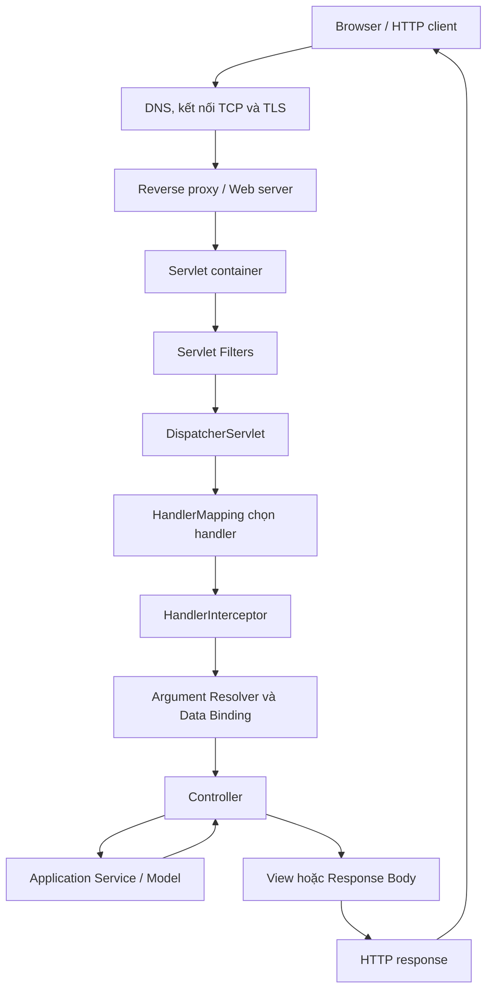
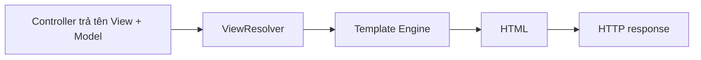

# Vòng đời yêu cầu HTTP và phản hồi

## 1. Tổng quan vòng đời HTTP trong Web MVC

Trong ứng dụng Web MVC, trình duyệt gửi một **HTTP request** để yêu cầu máy chủ đọc dữ liệu hoặc thực hiện một thao tác. Ứng dụng tiếp nhận request, xác định Controller phù hợp, xử lý nghiệp vụ thông qua Model hoặc dịch vụ ứng dụng, rồi tạo **HTTP response** trả về cho client.

Vòng đời này nối ba thành phần MVC với giao thức web:

- **Controller** là điểm tiếp nhận request, chuyển dữ liệu giao thức thành lời gọi ứng dụng và chọn cách phản hồi.
- **Model** hoặc lớp nghiệp vụ xử lý dữ liệu và quy tắc của ứng dụng.
- **View** trình bày kết quả thành HTML. Với API, Controller có thể trả JSON hoặc một định dạng khác thay cho template HTML.

Một request không nhất thiết luôn đi qua toàn bộ các bước giống nhau. Request có thể bị từ chối ở lớp bảo mật, không khớp route, lỗi khi bind dữ liệu hoặc phát sinh exception trong lúc nghiệp vụ chạy. Vì vậy, thiết kế Web MVC cần hiểu cả luồng thành công lẫn các điểm kết thúc sớm.

## 2. HTTP request gồm những gì?

HTTP là giao thức trao đổi theo mô hình request/response. Một request thường có các thành phần:

| Thành phần | Ý nghĩa | Ví dụ |
|---|---|---|
| Method | Ý định thao tác với tài nguyên | `GET`, `POST`, `PUT`, `PATCH`, `DELETE` |
| Request target | Đường dẫn và query string | `/products?keyword=book&page=2` |
| Headers | Metadata về nội dung, client, xác thực và điều kiện request | `Accept`, `Content-Type`, `Authorization`, `Cookie` |
| Body | Dữ liệu gửi kèm khi cần | JSON, form fields, file upload |

Ví dụ một request HTTP:

```http
POST /orders/42/cancel HTTP/1.1
Host: shop.example.test
Content-Type: application/x-www-form-urlencoded
Accept: text/html
Cookie: SESSION=...

reason=Changed+my+mind
```

Request trên yêu cầu hủy đơn hàng số `42`, gửi lý do dưới dạng form và cho biết client mong muốn nhận HTML. Cookie có thể mang định danh phiên đăng nhập; máy chủ dùng định danh đó để tìm trạng thái phiên đã lưu.

### 2.1. Method và ngữ nghĩa

HTTP method thể hiện ý định của client:

- `GET` lấy biểu diễn của tài nguyên và được thiết kế để an toàn, không yêu cầu thay đổi trạng thái nghiệp vụ.
- `POST` gửi dữ liệu để xử lý, tạo tài nguyên hoặc thực hiện một hành động.
- `PUT` thường thay thế toàn bộ biểu diễn tài nguyên tại URI đích và có ngữ nghĩa idempotent.
- `PATCH` áp dụng một phần thay đổi theo định dạng được API quy định.
- `DELETE` yêu cầu xóa tài nguyên; method này cũng có ngữ nghĩa idempotent theo HTTP dù phản hồi giữa các lần gọi có thể khác nhau.

Không dùng `GET` cho hành động thay đổi dữ liệu như thanh toán, hủy đơn hoặc xóa tài khoản. Trình duyệt, proxy hoặc crawler có thể tự động truy cập URL GET, gây ra thao tác ngoài ý muốn.

### 2.2. Headers và content negotiation

Header cho máy chủ biết cách diễn giải request và cách client muốn nhận response:

- `Content-Type` mô tả định dạng của body request, ví dụ `application/json` hoặc `application/x-www-form-urlencoded`.
- `Accept` mô tả những định dạng response client chấp nhận, ví dụ `text/html` hoặc `application/json`.
- `Authorization` mang thông tin xác thực theo cơ chế được ứng dụng hỗ trợ.
- `Cookie` gửi cookie đã được trình duyệt lưu cho origin phù hợp.
- `If-None-Match` hoặc `If-Modified-Since` cho phép request có điều kiện để tái sử dụng cache.

Khi hỗ trợ nhiều kiểu client, ứng dụng có thể chọn HTML hoặc JSON theo route riêng, hoặc dùng content negotiation. Hợp đồng response phải rõ ràng để client không nhận nhầm HTML lỗi trong khi đang chờ JSON.

## 3. HTTP response gồm những gì?

Response là thông điệp máy chủ gửi lại cho client. Nó thường gồm:

| Thành phần | Ý nghĩa | Ví dụ |
|---|---|---|
| Status code | Kết quả xử lý ở mức HTTP | `200 OK`, `201 Created`, `302 Found`, `400 Bad Request`, `404 Not Found`, `500 Internal Server Error` |
| Headers | Metadata về response và cache | `Content-Type`, `Location`, `Cache-Control`, `Set-Cookie` |
| Body | Nội dung trả về nếu có | HTML, JSON, file hoặc nội dung lỗi |

Ví dụ response HTML:

```http
HTTP/1.1 200 OK
Content-Type: text/html; charset=UTF-8
Cache-Control: no-store

<!doctype html>
<html lang="vi">
  <head><title>Chi tiết đơn hàng</title></head>
  <body><h1>Đơn hàng #42</h1></body>
</html>
```

Ví dụ response API:

```http
HTTP/1.1 201 Created
Content-Type: application/json
Location: /api/orders/43

{"id":43,"status":"PENDING"}
```

Status code và headers là một phần của hợp đồng HTTP. Client nên dựa vào chúng để quyết định bước tiếp theo thay vì chỉ đọc nội dung body.

## 4. Các bước từ trình duyệt đến Controller

Trong triển khai Spring MVC trên Servlet stack, request thường đi qua các lớp sau. Tên và thứ tự chi tiết có thể khác ở framework hoặc kiến trúc triển khai khác.



### 4.1. Client tạo kết nối và gửi request

Trình duyệt phân giải tên miền, thiết lập kết nối đến máy chủ và thương lượng TLS nếu dùng HTTPS. Trong môi trường thực tế, request có thể đi qua CDN, load balancer, reverse proxy hoặc API gateway trước khi đến ứng dụng.

Các lớp hạ tầng có thể xử lý TLS termination, giới hạn kích thước request, rate limiting, nén, chuyển tiếp header hoặc định tuyến đến instance ứng dụng. Ứng dụng cần cấu hình tin cậy proxy một cách chính xác; không nên tin mọi `X-Forwarded-*` header từ client tùy ý.

### 4.2. Servlet container và Filter

Servlet container như Tomcat tiếp nhận request và chuyển đến servlet phù hợp. Trong Spring MVC, `DispatcherServlet` là front controller nhận request để điều phối đến handler.

Trước `DispatcherServlet`, servlet filter có thể xử lý các mối quan tâm xuyên suốt như:

- Xác thực và tích hợp security context.
- CORS và kiểm tra header.
- CSRF protection trong cấu hình bảo mật phù hợp.
- Ghi log, correlation ID và tracing.
- Nén response hoặc giới hạn request.

Filter hoạt động ở mức Servlet API và có thể bao quanh cả request lẫn response. Filter bảo mật có thể chặn request trước khi Controller được gọi.

### 4.3. DispatcherServlet chọn Controller

`DispatcherServlet` nhận request và dùng các `HandlerMapping` để tìm handler phù hợp dựa trên route, HTTP method, điều kiện header và các cấu hình mapping khác.

Ví dụ:

```java
@Controller
@RequestMapping("/products")
public class ProductController {

    @GetMapping("/{id}")
    public String detail(@PathVariable long id, Model model) {
        // Chuẩn bị dữ liệu và chọn View
        return "products/detail";
    }
}
```

Request `GET /products/42` có thể được ánh xạ đến phương thức `detail`. Nếu không có handler phù hợp, ứng dụng thường trả `404 Not Found` hoặc một phản hồi tương ứng theo cấu hình.

### 4.4. Interceptor và chuẩn bị tham số

Spring MVC có thể gọi `HandlerInterceptor` quanh quá trình thực thi handler. Interceptor thường phù hợp với logging, đo thời gian hoặc kiểm tra điều kiện chung ở tầng MVC. Các kiểm soát bảo mật quan trọng nên được đặt trong Spring Security hoặc lớp authorization có thẩm quyền, tránh dựa vào interceptor tùy tiện để bảo vệ nghiệp vụ.

Các `HandlerMethodArgumentResolver`, message converter và data binder giúp chuyển dữ liệu request thành tham số phương thức Controller:

- `@PathVariable` đọc giá trị từ đường dẫn.
- `@RequestParam` đọc query parameter hoặc form parameter.
- `@RequestHeader` đọc header.
- `@CookieValue` đọc cookie.
- `@ModelAttribute` bind dữ liệu form vào đối tượng.
- `@RequestBody` dùng message converter để đọc body, thường là JSON, thành đối tượng Java.

Nếu chuyển đổi kiểu hoặc binding thất bại, Controller có thể chưa được gọi; framework sẽ chuyển lỗi đến cơ chế xử lý lỗi phù hợp.

## 5. Controller gọi Model hoặc dịch vụ ứng dụng

Sau khi request được bind, Controller thực hiện validation ở ranh giới đầu vào rồi gọi nghiệp vụ. Với thao tác đơn giản, Controller có thể gọi hành vi Model. Với use case gồm nhiều bước hoặc nhiều thành phần, Controller thường gọi Application Service.

Ví dụ tạo sản phẩm:

```java
public record CreateProductRequest(
        @NotBlank @Size(max = 120) String name,
        @NotNull @PositiveOrZero BigDecimal price) {}

@Controller
@RequestMapping("/products")
public class ProductController {
    private final ProductApplicationService productService;

    public ProductController(ProductApplicationService productService) {
        this.productService = productService;
    }

    @PostMapping
    public String create(
            @Valid @ModelAttribute("form") CreateProductRequest form,
            BindingResult errors,
            RedirectAttributes redirectAttributes) {
        if (errors.hasErrors()) {
            return "products/new";
        }

        long id = productService.create(form.name(), form.price());
        redirectAttributes.addFlashAttribute("message", "Đã tạo sản phẩm.");
        return "redirect:/products/" + id;
    }
}
```

Trong ví dụ này:

1. Spring bind form fields vào `CreateProductRequest`.
2. `@Valid` kích hoạt validation theo các annotation khai báo.
3. `BindingResult` chứa lỗi để Controller trả lại biểu mẫu khi dữ liệu không hợp lệ.
4. Khi hợp lệ, Controller gọi `ProductApplicationService`.
5. Dịch vụ ứng dụng áp dụng quy tắc nghiệp vụ và lưu sản phẩm.
6. Controller chuyển hướng đến trang chi tiết sau khi thành công.

Validation phía trình duyệt có thể cải thiện trải nghiệm nhưng không thay thế validation phía máy chủ. Domain Model hoặc dịch vụ nghiệp vụ vẫn cần bảo vệ các bất biến như tên duy nhất hoặc điều kiện giá hợp lệ trong mọi luồng gọi.

## 6. Tạo response HTML: View Resolution và rendering

Khi Controller trả về tên View hoặc `ModelAndView`, Spring MVC có thể dùng `ViewResolver` để tìm template phù hợp. Framework truyền dữ liệu trong Model cho View; View engine kết hợp dữ liệu với template để tạo HTML.



Ví dụ Controller:

```java
@GetMapping("/{id}")
public String detail(@PathVariable long id, Model model) {
    ProductDetailPage page = productQueryService.getDetail(id);
    model.addAttribute("page", page);
    return "products/detail";
}
```

Chuỗi `products/detail` là logical view name. Cấu hình ứng dụng quyết định template file tương ứng. View chỉ nên nhận dữ liệu đã chuẩn bị cho trình bày, không tự truy vấn repository hoặc thực hiện quy tắc nghiệp vụ.

Sau khi render, response thường có `Content-Type: text/html; charset=UTF-8`. Servlet container ghi response về client. Nếu response đã được commit, việc thay đổi status hoặc headers sau đó không còn thực hiện được.

## 7. Tạo response JSON: REST Controller

Với API, Controller có thể trả đối tượng Java để framework serialize thành JSON qua `HttpMessageConverter` như Jackson.

```java
public record ProductResponse(
        long id,
        String name,
        BigDecimal price) {}

@RestController
@RequestMapping("/api/products")
public class ProductApiController {
    private final ProductQueryService queryService;

    public ProductApiController(ProductQueryService queryService) {
        this.queryService = queryService;
    }

    @GetMapping("/{id}")
    public ResponseEntity<ProductResponse> detail(@PathVariable long id) {
        ProductResponse response = queryService.getResponse(id);
        return ResponseEntity.ok(response);
    }
}
```

`@RestController` kết hợp `@Controller` và `@ResponseBody`, vì vậy giá trị trả về được ghi vào response body thay vì được hiểu là tên template. Có thể dùng `ResponseEntity` để kiểm soát status, headers và body.

HTML Controller và REST Controller có thể gọi cùng Application Service hoặc query service. Chúng chỉ khác nhau ở adapter và cách biểu diễn response.

## 8. Status code và các kiểu phản hồi thường gặp

Status code mô tả kết quả ở mức HTTP. Một số nhóm thường gặp:

| Nhóm / mã | Ý nghĩa | Tình huống thường dùng |
|---|---|---|
| `2xx` | Request được xử lý thành công | `200 OK`, `201 Created`, `202 Accepted`, `204 No Content` |
| `3xx` | Client cần thực hiện điều hướng hoặc dùng cache | `301`, `302`, `303`, `304`, `307`, `308` |
| `400` | Request không hợp lệ | Body sai định dạng hoặc dữ liệu đầu vào không đáp ứng hợp đồng |
| `401` | Thiếu hoặc không hợp lệ thông tin xác thực | Phiên đăng nhập hết hạn |
| `403` | Đã xác thực nhưng không được phép | Người dùng không có quyền thao tác |
| `404` | Không tìm thấy tài nguyên hoặc route | ID không tồn tại |
| `409` | Xung đột với trạng thái hiện tại | Đơn đã giao nên không thể hủy |
| `422` | Nội dung request hợp lệ về cú pháp nhưng không thể xử lý theo ngữ nghĩa | Dữ liệu không đáp ứng quy tắc API đã quy định |
| `500` | Lỗi không dự kiến phía máy chủ | Lỗi lập trình hoặc trạng thái hệ thống bất thường |
| `503` | Dịch vụ tạm thời không sẵn sàng | Quá tải hoặc phụ thuộc đang bảo trì |

Không chọn status chỉ theo cảm giác. Cần dựa trên ngữ nghĩa HTTP và hợp đồng của ứng dụng. Với API, nên định nghĩa cấu trúc lỗi ổn định; với HTML, có thể render trang lỗi hoặc redirect kèm thông báo phù hợp.

## 9. Post/Redirect/Get và xử lý form

Với biểu mẫu HTML thay đổi dữ liệu, mẫu **Post/Redirect/Get (PRG)** thường được dùng:

1. Trình duyệt gửi POST để thực hiện thao tác.
2. Máy chủ xử lý request và lưu kết quả.
3. Máy chủ trả redirect, thường là `303 See Other` hoặc cơ chế redirect phù hợp.
4. Trình duyệt gửi GET đến trang kết quả.

PRG giúp khi người dùng refresh trang kết quả, trình duyệt tải lại GET thay vì gửi lại POST vừa thực hiện. Nó giảm việc gửi lặp do thao tác refresh thông thường, nhưng không thay thế idempotency hoặc kiểm soát trùng lặp cho nghiệp vụ quan trọng.

Ví dụ:

```java
@PostMapping
public String create(@Valid @ModelAttribute("form") CreateProductRequest form,
                     BindingResult errors,
                     RedirectAttributes attributes) {
    if (errors.hasErrors()) {
        return "products/new";
    }

    long id = productService.create(form.name(), form.price());
    attributes.addFlashAttribute("message", "Đã tạo sản phẩm.");
    return "redirect:/products/" + id;
}
```

Flash attribute được giữ cho request tiếp theo để hiển thị thông báo một lần. Khi validation thất bại, Controller thường trả lại View ngay để giữ dữ liệu đã nhập và hiển thị lỗi gắn với trường.

Lưu ý: tiền tố `redirect:` trong Spring MVC biểu thị một lần chuyển hướng; status cụ thể phụ thuộc cấu hình `RedirectView` và phiên bản/framework. Nếu hợp đồng yêu cầu rõ `303 See Other`, hãy cấu hình status đó tường minh thay vì giả định mọi redirect đều tự động là `303`.

## 10. Session, cookie và tính không trạng thái của HTTP

HTTP được thiết kế theo mô hình stateless: mỗi request có thể được xử lý độc lập và giao thức không tự ghi nhớ các request trước. Tuy vậy, ứng dụng web thường cần duy trì trạng thái đăng nhập, giỏ hàng hoặc tùy chọn người dùng qua nhiều request.

Một cách phổ biến là dùng session:

1. Máy chủ tạo session và lưu trạng thái phía máy chủ.
2. Máy chủ gửi cookie chứa session identifier về trình duyệt qua `Set-Cookie`.
3. Trình duyệt gửi cookie đó trong các request phù hợp.
4. Máy chủ tra cứu session để khôi phục ngữ cảnh người dùng.

Cookie phiên nên được cấu hình `Secure`, `HttpOnly` và `SameSite` phù hợp với luồng ứng dụng. `Secure` yêu cầu gửi qua HTTPS; `HttpOnly` ngăn JavaScript đọc cookie; `SameSite` giúp giảm một số rủi ro gửi cookie cross-site nhưng không thay thế đầy đủ CSRF protection.

Session không làm HTTP trở thành stateful ở cấp giao thức; nó là cơ chế ứng dụng dùng thông tin định danh để liên kết nhiều request. Nếu dùng token thay session cookie, cần xác định nơi lưu token, vòng đời, thu hồi và cách bảo vệ token khỏi lộ lọt.

## 11. Bảo mật trong vòng đời request/response

Các lớp khác nhau có thể thực hiện kiểm soát bảo mật, nhưng không lớp nào thay thế được kiểm tra nghiệp vụ cần thiết:

- **HTTPS:** bảo vệ tính bí mật và toàn vẹn của dữ liệu trên đường truyền.
- **Authentication:** xác định người gửi request.
- **Authorization:** kiểm tra người đó có quyền trên tài nguyên và hành động cụ thể hay không.
- **CSRF protection:** bảo vệ request thay đổi trạng thái khi dùng cơ chế xác thực tự động gửi như cookie.
- **Input validation:** kiểm tra kiểu, kích thước, định dạng và ràng buộc đầu vào.
- **Output encoding:** escape dữ liệu động theo ngữ cảnh để giảm nguy cơ XSS.
- **Security headers:** cấu hình các header phù hợp như Content-Security-Policy, X-Content-Type-Options và Referrer-Policy.
- **Rate limiting và giới hạn body:** giảm nguy cơ lạm dụng endpoint hoặc gửi request quá lớn.
- **Error handling:** không trả stack trace, thông tin kết nối hay dữ liệu nhạy cảm.

Đặc biệt, không xem việc ẩn nút trên View là phân quyền. Client có thể gửi request trực tiếp; Controller, security layer hoặc Application Service phải kiểm tra quyền ở phía máy chủ.

## 12. Cache và response có điều kiện

Không phải response nào cũng cần tạo lại toàn bộ nội dung. HTTP hỗ trợ cache để giảm tải và tăng tốc độ:

- `Cache-Control` quy định response có thể được cache và trong bao lâu.
- `ETag` cung cấp validator cho một phiên bản biểu diễn.
- `Last-Modified` cho biết thời điểm nội dung được cập nhật.
- `If-None-Match` và `If-Modified-Since` cho phép client hỏi nội dung có thay đổi không.
- `304 Not Modified` cho biết client có thể dùng bản cache hiện có.

Ví dụ, một trang danh mục công khai có thể được cache trong thời gian ngắn. Trang chứa dữ liệu cá nhân hoặc thông tin tài khoản cần chính sách cache chặt chẽ hơn, thường là `private` hoặc `no-store` tùy yêu cầu. Không đặt cache công khai cho response chứa dữ liệu riêng tư chỉ vì nó được tạo từ một View HTML.

## 13. Xử lý exception trong Spring MVC

Exception có thể phát sinh khi bind dữ liệu, chạy Controller, gọi nghiệp vụ hoặc render View. Spring MVC có cơ chế `HandlerExceptionResolver`; ứng dụng cũng có thể dùng `@ControllerAdvice` và `@ExceptionHandler` để ánh xạ lỗi tập trung.

Ví dụ:

```java
@ControllerAdvice
public class WebExceptionHandler {

    @ExceptionHandler(ProductNotFoundException.class)
    public ResponseEntity<ProblemDetail> handleNotFound(
            ProductNotFoundException exception) {
        ProblemDetail problem = ProblemDetail.forStatusAndDetail(
                HttpStatus.NOT_FOUND,
                "Không tìm thấy sản phẩm.");
        problem.setTitle("Không tìm thấy tài nguyên");
        return ResponseEntity.status(HttpStatus.NOT_FOUND).body(problem);
    }
}
```

Trong ứng dụng HTML, handler có thể trả về tên trang lỗi hoặc `ModelAndView`; trong API, có thể trả Problem Details hoặc error DTO. Cần giữ thông báo cho client an toàn, đồng thời ghi log phía máy chủ với correlation ID để điều tra.

Không phải mọi exception đều nên được chuyển thành cùng một status. Lỗi validation, từ chối nghiệp vụ, không có quyền, tài nguyên không tồn tại và lỗi hạ tầng có ngữ nghĩa khác nhau.

## 14. Các điểm kết thúc sớm của request

Request có thể kết thúc trước khi Controller hoàn thành:

| Điểm phát sinh | Ví dụ | Phản hồi thường gặp |
|---|---|---|
| Reverse proxy / gateway | Request quá lớn, rate limit, upstream không sẵn sàng | `413`, `429`, `502`, `503` |
| Filter bảo mật | Chưa đăng nhập hoặc CSRF token không hợp lệ | `401`, redirect đăng nhập hoặc `403` theo cấu hình |
| Handler mapping | Không có route phù hợp | `404` |
| Method mapping | Route có nhưng HTTP method không được hỗ trợ | `405 Method Not Allowed` |
| Data binding | Kiểu dữ liệu không chuyển đổi được | `400` hoặc trang lỗi validation theo ứng dụng |
| Application Service / Model | Từ chối nghiệp vụ hoặc không tìm thấy tài nguyên | `409`, `422`, `404` hoặc status theo hợp đồng |
| Infrastructure | Database hoặc dịch vụ ngoài lỗi | `500`, `502`, `503` hoặc phản hồi phù hợp |
| View rendering | Template lỗi hoặc dữ liệu render không hợp lệ | Thường là lỗi máy chủ nếu response chưa commit |

Khi response đã commit, ứng dụng có thể không còn khả năng đổi status hoặc thay body bằng trang lỗi khác. Vì vậy, xử lý lỗi nên được thực hiện trước khi ghi response khi có thể; log cần ghi nhận nếu lỗi xảy ra trong lúc stream response.

## 15. Kiểm thử vòng đời HTTP

Kiểm thử Web MVC nên xác minh cả đầu vào, quá trình điều phối và response:

| Phạm vi | Nội dung kiểm thử | Công cụ hoặc cách làm |
|---|---|---|
| Routing | Route, method và path variable được ánh xạ đúng | Spring MockMvc / WebMvcTest |
| Binding | Query, form, JSON và header được đọc đúng | MockMvc với request mẫu |
| Validation | Dữ liệu sai không gọi nghiệp vụ và lỗi được trả đúng | Controller test |
| Security | Authentication, authorization, CSRF và CORS theo cấu hình | Spring Security test support |
| Application Service | Use case thành công, từ chối và lỗi dependency | Unit test và integration test |
| View rendering | Template, dữ liệu, trạng thái rỗng và lỗi hiển thị đúng | View/template test |
| HTTP response | Status, headers, content type, redirect và body đúng | MockMvc hoặc API integration test |
| End-to-end | Trình duyệt hoàn tất luồng người dùng từ request đến response | Browser test |

Một bộ kiểm thử cơ bản cho tạo sản phẩm nên bao gồm: GET biểu mẫu trả `200`; POST dữ liệu hợp lệ tạo sản phẩm rồi redirect; POST dữ liệu không hợp lệ trả lại biểu mẫu cùng lỗi; người chưa đăng nhập bị yêu cầu xác thực; và lỗi không dự kiến không làm lộ stack trace.

## 16. Kết luận

Vòng đời HTTP trong Web MVC bắt đầu khi client gửi request và kết thúc khi máy chủ gửi response. Request đi qua hạ tầng web, filter và bộ định tuyến; Controller nhận dữ liệu đã bind, gọi Model hoặc dịch vụ ứng dụng; kết quả được render thành HTML hoặc serialize thành JSON. Các lớp bảo mật, xử lý lỗi, session và cache tác động đến luồng ở những điểm khác nhau.

Hiểu rõ method, headers, body, status code, View Resolution, response serialization và các điểm kết thúc sớm giúp thiết kế Controller đúng trách nhiệm. Khi kết hợp validation phía máy chủ, phân quyền, CSRF, output encoding, xử lý lỗi nhất quán và kiểm thử hợp đồng HTTP, ứng dụng Web MVC sẽ có luồng tương tác dễ dự đoán và đáng tin cậy hơn.
