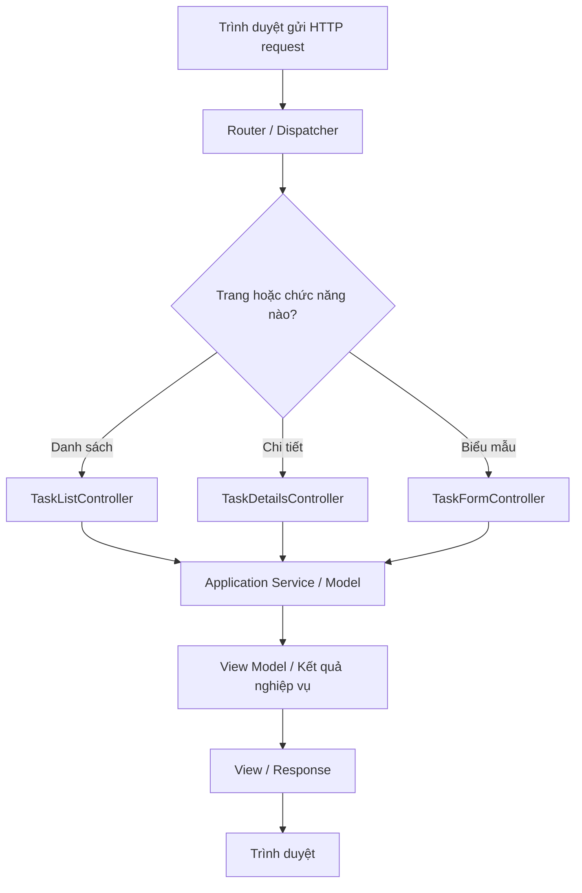

# Mẫu Page Controller và phạm vi áp dụng

Page Controller là mẫu tổ chức xử lý request trong ứng dụng web: mỗi trang logic hoặc nhóm trang có liên quan được giao cho một Controller chuyên trách. Controller nhận request dành cho trang đó, đọc tham số, gọi nghiệp vụ cần thiết, chuẩn bị dữ liệu trình bày và chọn response phù hợp. Trong MVC, Page Controller đảm nhiệm phần Controller ở ranh giới web; Model vẫn giữ trạng thái và quy tắc nghiệp vụ, còn View chịu trách nhiệm trình bày.

Ví dụ, một ứng dụng quản lý công việc có thể có `TaskListController` cho trang danh sách, `TaskDetailsController` cho trang chi tiết và `TaskFormController` cho các thao tác hiển thị/gửi biểu mẫu. Mỗi Controller hiểu các request liên quan đến khu vực giao diện của mình. Khi ứng dụng có nhiều trang với luồng xử lý khác nhau, cách tổ chức này giúp tìm đúng nơi xử lý một request và giới hạn phạm vi thay đổi.

Page Controller phù hợp khi các trang có hành vi tương đối độc lập và ứng dụng chủ yếu render giao diện theo request. Khi số lượng trang, quy tắc dùng chung hoặc luồng nghiệp vụ tăng lên, cần tổ chức các phần dùng chung thành dịch vụ và cân nhắc một điểm điều phối chung để tránh lặp mã.

## Page Controller là gì?

Trong một ứng dụng web, mỗi request bắt đầu từ một URL và phương thức HTTP, ví dụ `GET /tasks`, `GET /tasks/42` hoặc `POST /tasks`. Page Controller là đối tượng hoặc handler chịu trách nhiệm xử lý request cho một trang logic cụ thể.

“Trang” ở đây là một đơn vị giao diện hoặc một nhóm hành động có quan hệ chặt chẽ, không nhất thiết là một tệp HTML duy nhất. Một Page Controller có thể cung cấp nhiều handler cho cùng một khu vực, chẳng hạn hiển thị biểu mẫu và nhận dữ liệu gửi từ biểu mẫu. Ngược lại, một trang có thể có nhiều request khác nhau nhưng vẫn dùng chung Controller nếu chúng thuộc cùng một chức năng và có cùng ngữ cảnh.

Page Controller thường thực hiện các việc sau:

- nhận request được router ánh xạ đến trang hoặc chức năng phụ trách;
- đọc path variable, query parameter, header hoặc dữ liệu biểu mẫu;
- chuyển đổi và kiểm tra dữ liệu ở ranh giới HTTP;
- lấy danh tính và ngữ cảnh bảo mật từ cơ chế xác thực của ứng dụng;
- gọi application service hoặc Model để đọc/thay đổi dữ liệu;
- chuyển kết quả thành dữ liệu dành cho View;
- chọn template, redirect hoặc response khác;
- chuyển lỗi đầu vào và lỗi nghiệp vụ thành phản hồi phù hợp.

Page Controller là nơi điều phối một request. Nó không nên trở thành nơi chứa mọi quy tắc nghiệp vụ, truy vấn SQL hoặc mã dựng HTML. Những trách nhiệm đó cần nằm ở Model, dịch vụ nghiệp vụ, repository và View tương ứng.

## Cấu trúc Page Controller trong MVC trên web

Một luồng web MVC điển hình gồm trình duyệt gửi request, router/dispatcher chọn Page Controller, Controller gọi nghiệp vụ, rồi trả View hoặc response. Page Controller có thể được framework tạo và quản lý; lập trình viên thường chỉ viết lớp Controller và khai báo route.



Sơ đồ thể hiện mỗi trang logic có Controller chuyên trách. Các Controller vẫn có thể sử dụng cùng một dịch vụ nghiệp vụ, repository hoặc thành phần xác thực. Việc chia Controller theo trang không có nghĩa mỗi Controller phải có một bản sao Model hoặc một kết nối cơ sở dữ liệu riêng.

### Page Controller và Front Controller

Hai mẫu này thường xuất hiện cùng nhau và giải quyết hai vấn đề khác nhau:

| Tiêu chí | Page Controller | Front Controller |
|---|---|---|
| Vai trò | Xử lý request cho một trang hoặc nhóm trang cụ thể | Tiếp nhận tập trung các request của ứng dụng hoặc một phân hệ |
| Phạm vi | Theo trang/chức năng | Theo điểm vào chung |
| Công việc chính | Điều phối hành vi riêng của trang | Điều phối xử lý chung như routing, authentication filter, logging hoặc chọn handler |
| Ví dụ | `TaskDetailsController` | `DispatcherServlet` hoặc một gateway/dispatcher của ứng dụng |
| Quan hệ | Có thể được Front Controller gọi | Có thể định tuyến đến nhiều Page Controller |

Front Controller không thay thế Page Controller. Trong nhiều framework, một servlet hoặc dispatcher chung tiếp nhận request rồi định tuyến đến Controller chuyên trách. Ví dụ, `DispatcherServlet` của Spring MVC là điểm vào tập trung ở tầng framework; các lớp được chú thích `@Controller` hoặc `@RestController` là handler cho những route cụ thể.

### Page Controller và Application Controller

Page Controller tập trung vào request của một trang. Application Controller thường điều phối luồng của một ứng dụng hoặc một use case phức hợp, quyết định bước tiếp theo và điều hướng giữa các màn hình. Một ứng dụng đơn giản có thể chỉ cần Page Controller; quy trình nhiều bước như đăng ký, thanh toán hoặc phê duyệt có thể cần một dịch vụ điều phối hoặc workflow riêng. Không nên đưa một workflow lớn vào một Page Controller chỉ vì nó liên quan đến vài trang.

## Ví dụ: chia Controller theo các trang quản lý công việc

Giả sử ứng dụng có ba trang logic:

- Trang danh sách `/tasks` hỗ trợ tìm kiếm và phân trang.
- Trang chi tiết `/tasks/{id}` hiển thị một công việc.
- Trang biểu mẫu `/tasks/new` và request `POST /tasks` tạo công việc.

Có thể tổ chức thành ba Page Controller. Mỗi Controller tập trung vào một nhóm request và gọi dịch vụ nghiệp vụ dùng chung.

### Controller cho trang danh sách

```java
@Controller
@RequestMapping("/tasks")
public class TaskListController {
    private final TaskQueryService taskQueryService;

    public TaskListController(TaskQueryService taskQueryService) {
        this.taskQueryService = taskQueryService;
    }

    @GetMapping
    public String list(
            @RequestParam(defaultValue = "") String q,
            @RequestParam(defaultValue = "1") int page,
            Principal principal,
            Model model) {

        TaskListView result = taskQueryService.findVisibleTasks(
                principal.getName(), q, page);
        model.addAttribute("tasks", result);
        return "tasks/list";
    }
}
```

`TaskListController` nhận các tham số tìm kiếm và phân trang, lấy danh tính từ `Principal`, gọi dịch vụ truy vấn rồi chọn template `tasks/list`. Trong ứng dụng thực tế, `page` cần được kiểm tra phạm vi và giới hạn số lượng kết quả; dịch vụ cần bảo đảm chỉ trả công việc mà người dùng được phép xem.

### Controller cho trang chi tiết

```java
@Controller
@RequestMapping("/tasks")
public class TaskDetailsController {
    private final TaskQueryService taskQueryService;

    public TaskDetailsController(TaskQueryService taskQueryService) {
        this.taskQueryService = taskQueryService;
    }

    @GetMapping("/{id}")
    public String details(
            @PathVariable long id,
            Principal principal,
            Model model) {

        TaskDetailsView task = taskQueryService.getDetails(
                id, principal.getName());
        model.addAttribute("task", task);
        return "tasks/details";
    }
}
```

Controller này chỉ xử lý trang chi tiết. Nếu không tìm thấy công việc hoặc người dùng không được phép xem, dịch vụ có thể trả kết quả hoặc exception có kiểu; cơ chế xử lý lỗi chung ánh xạ kết quả đó thành 404 hoặc 403 theo chính sách của ứng dụng.

### Controller cho biểu mẫu tạo mới

```java
@Controller
@RequestMapping("/tasks")
public class TaskFormController {
    private final TaskService taskService;

    public TaskFormController(TaskService taskService) {
        this.taskService = taskService;
    }

    @GetMapping("/new")
    public String showForm(Model model) {
        model.addAttribute("form", new CreateTaskForm());
        return "tasks/new";
    }

    @PostMapping
    public String create(
            @Valid @ModelAttribute("form") CreateTaskForm form,
            BindingResult errors,
            Principal principal) {

        if (errors.hasErrors()) {
            return "tasks/new";
        }

        taskService.create(
                new CreateTaskCommand(form.getTitle(), form.getDueDate()),
                principal.getName());
        return "redirect:/tasks";
    }
}
```

Controller xử lý cả hai request của cùng một luồng biểu mẫu: GET để hiển thị form và POST để tiếp nhận dữ liệu. Form object giới hạn các trường đầu vào; `@Valid` kiểm tra ràng buộc; `BindingResult` cho phép trả lại trang cùng lỗi. Khi thành công, Controller chuyển hướng về danh sách theo mô hình Post/Redirect/Get.

Các đoạn mã là ví dụ minh họa, cần có DTO, service, view và cấu hình Spring tương ứng. Trong dự án, có thể chọn một lớp `TaskController` chứa cả ba handler nếu chúng thuộc một nhóm chức năng nhỏ. Việc tách thành ba lớp ở đây nhằm cho thấy cách tổ chức Page Controller khi từng trang có trách nhiệm riêng.

## Phạm vi áp dụng

Page Controller thường phù hợp trong những tình huống sau:

### Ứng dụng web render phía máy chủ

Khi mỗi request trả về một trang HTML hoàn chỉnh hoặc một phần trang, Page Controller là cách tổ chức trực quan. Mỗi trang có thể có query, form và quy tắc điều hướng riêng. Controller chuẩn bị dữ liệu rồi chọn View tương ứng.

### Các trang có hành vi khác nhau

Trang danh sách có tìm kiếm và phân trang; trang chi tiết có quyền xem; trang chỉnh sửa có validation; trang xác nhận có thao tác thay đổi trạng thái. Tách Controller theo nhóm trang giúp logic riêng không dồn vào một lớp lớn.

### Ứng dụng nhỏ đến vừa với các use case dễ nhận diện

Khi số lượng trang và quy trình còn kiểm soát được, Page Controller giúp định vị code nhanh, dễ onboarding và dễ kiểm thử ở cấp request. Không cần thêm một tầng điều phối phức tạp nếu từng trang chỉ thực hiện vài bước rõ ràng.

### Nhóm phát triển chia theo khu vực chức năng

Các nhóm có thể phụ trách từng khu vực như tài khoản, dự án hoặc công việc. Page Controller theo khu vực giúp ranh giới mã dễ nhận biết, miễn là các dịch vụ và Model dùng chung có hợp đồng rõ ràng.

## Khi nào cần cân nhắc cách tổ chức khác?

Page Controller không tự giải quyết mọi vấn đề về điều phối và tái sử dụng. Hãy cân nhắc các cách tổ chức khác hoặc bổ sung lớp dùng chung khi:

- **Có nhiều request cần xử lý chung trước khi đến Controller:** authentication, logging, locale, rate limiting và xử lý lỗi có thể được đặt trong middleware, filter hoặc Front Controller.
- **Nhiều trang lặp cùng một chuỗi nghiệp vụ:** đưa chuỗi đó vào application service hoặc use case dùng chung thay vì sao chép giữa các Page Controller.
- **Một quy trình trải dài nhiều bước và nhiều trang:** cân nhắc Application Controller, workflow service hoặc state machine để điều phối trạng thái quy trình.
- **API chủ yếu trả JSON theo tài nguyên:** Resource Controller hoặc nhóm Controller theo resource/aggregate có thể diễn tả hợp đồng API rõ hơn việc xem mỗi endpoint như một trang HTML.
- **Một Controller có quá nhiều route và nhánh:** tách theo nhóm hành động hoặc use case, nhưng giữ số lớp phù hợp với độ phức tạp thực tế.
- **Các thao tác cần phản hồi bất đồng bộ hoặc cập nhật một phần giao diện:** Page Controller vẫn có thể cung cấp endpoint, nhưng View phía trình duyệt có thể dùng API endpoint và response DTO thay vì render toàn trang.

Không có ngưỡng số lượng trang cố định để quyết định chuyển mẫu. Hãy nhìn vào mức độ lặp, số trách nhiệm, sự khác nhau giữa các luồng và chi phí điều phối. Nếu một Controller vẫn ngắn, dễ hiểu và có một mục đích rõ, không cần tách nhỏ chỉ để tăng số lớp.

## Page Controller không phải nơi chứa nghiệp vụ

Một sai lầm thường gặp là để Page Controller xử lý cả dữ liệu HTTP, quy tắc nghiệp vụ và lưu trữ. Ví dụ, một phương thức `create()` có thể đọc form, tự kiểm tra quyền, tự tính hạn mức, chạy SQL, thay đổi trạng thái và dựng HTML. Khi đó, Controller có nhiều lý do để thay đổi và không thể tái sử dụng nghiệp vụ từ API hoặc tác vụ nền.

Nên phân chia như sau:

| Trách nhiệm | Nơi phù hợp |
|---|---|
| Đọc path/query/form và chuyển đổi kiểu | Page Controller và cơ chế binding |
| Kiểm tra cấu trúc, định dạng và giới hạn request | Validation ở ranh giới web |
| Xác định người dùng và kiểm tra quyền | Security layer và chính sách nghiệp vụ khi cần |
| Quy tắc trạng thái của một đối tượng | Model/entity |
| Phối hợp nhiều đối tượng và repository | Application service / domain service |
| Truy vấn và lưu dữ liệu | Repository / tầng hạ tầng |
| Chọn template và truyền dữ liệu trình bày | Page Controller và View renderer |
| Định dạng HTML và thông báo trên trang | View |

Controller có thể kiểm tra một điều kiện đơn giản liên quan trực tiếp đến request, nhưng quyết định nghiệp vụ phải được bảo vệ tại tầng nghiệp vụ để mọi kênh gọi đều tuân theo cùng quy tắc.

## Quan hệ với routing và URL

Page Controller được kết nối với request qua cơ chế routing. Một route thường xác định ít nhất:

- phương thức HTTP như GET, POST, PUT, PATCH hoặc DELETE;
- đường dẫn như `/tasks/{id}`;
- handler chịu trách nhiệm xử lý;
- cách chuyển đổi path variable và query parameter;
- kiểu response hoặc View được trả về.

Không nên chỉ dựa vào tên trang để xác định hành động. Cùng một URL có thể dùng các phương thức HTTP khác nhau cho đọc và thay đổi dữ liệu. `GET` nên an toàn về mặt trạng thái, còn thao tác thay đổi cần dùng phương thức thích hợp và áp dụng bảo vệ CSRF nếu ứng dụng dùng cookie/session.

Ví dụ:

| Route | Page Controller/handler | Kết quả |
|---|---|---|
| `GET /tasks` | `TaskListController.list` | View danh sách |
| `GET /tasks/{id}` | `TaskDetailsController.details` | View chi tiết |
| `GET /tasks/new` | `TaskFormController.showForm` | View biểu mẫu |
| `POST /tasks` | `TaskFormController.create` | Lỗi biểu mẫu hoặc redirect |

Route cần tránh mơ hồ và cần nhất quán trong tên tham số. Thay đổi URL hoặc phương thức HTTP là thay đổi hợp đồng giữa trình duyệt/client và Page Controller; nên cập nhật liên kết, form, kiểm thử và tài liệu liên quan.

## Xử lý lỗi và bảo mật

Page Controller là ranh giới web nên cần phối hợp xử lý lỗi và bảo mật:

- **Lỗi binding và validation:** trả lại form với lỗi gắn đúng trường hoặc response 400 đối với API.
- **Không tìm thấy:** ánh xạ tài nguyên không tồn tại thành 404 hoặc trang not found.
- **Chưa xác thực:** chuyển đến trang đăng nhập hoặc trả 401 theo loại ứng dụng.
- **Không có quyền:** trả 403 hoặc một response phù hợp với chính sách bảo vệ tài nguyên.
- **Xung đột nghiệp vụ:** hiển thị thông báo hoặc trả 409 khi trạng thái hiện tại không cho phép thao tác.
- **Lỗi không dự kiến:** xử lý qua cơ chế lỗi chung, ghi log cần thiết và không để lộ stack trace hoặc chi tiết nội bộ.

Ẩn một liên kết hoặc nút trong View không phải là kiểm tra quyền. Người dùng có thể gửi request trực tiếp đến URL. Page Controller hoặc security layer phải bảo đảm request được xác thực và phân quyền phía máy chủ; dịch vụ nghiệp vụ tiếp tục bảo vệ những quy tắc phụ thuộc trạng thái.

Không bind toàn bộ request trực tiếp vào entity có trường nhạy cảm. Dùng form object hoặc DTO chỉ chứa các trường mà trang được phép gửi, lấy danh tính từ ngữ cảnh đã xác thực và mã hóa dữ liệu đầu ra khi render HTML.

## Kiểm thử Page Controller

Vì Page Controller xử lý một nhóm request cụ thể, có thể thiết kế kiểm thử tập trung theo route và hành vi:

1. **Kiểm thử định tuyến:** URL và phương thức HTTP được ánh xạ đến đúng handler.
2. **Kiểm thử dữ liệu đầu vào:** path variable, query parameter và form được bind đúng; dữ liệu sai bị từ chối.
3. **Kiểm thử điều phối:** Controller gọi đúng dịch vụ với command/query phù hợp.
4. **Kiểm thử response:** chọn đúng View, redirect, status code và dữ liệu trình bày.
5. **Kiểm thử quyền:** người chưa đăng nhập hoặc không có quyền không thể gọi hành động bị giới hạn.
6. **Kiểm thử lỗi:** tài nguyên không tồn tại, validation thất bại và lỗi nghiệp vụ được ánh xạ nhất quán.

Ví dụ với Spring MockMvc, kiểm thử có thể xác minh request tạo công việc hợp lệ chuyển hướng đến danh sách và request có tiêu đề rỗng trả lại form cùng lỗi. Dịch vụ nghiệp vụ nên có kiểm thử riêng để xác minh quy tắc trạng thái, hạn mức và quyền. Không cần kiểm thử lại toàn bộ logic Model trong mọi bài kiểm thử Page Controller.

## Những dấu hiệu thiết kế Page Controller chưa tốt

- **Một Controller cho toàn bộ ứng dụng:** lớp có quá nhiều route, phụ thuộc và nhánh xử lý. Hãy chia theo khu vực trang hoặc use case có ý nghĩa.
- **Mỗi URL có một lớp dù không có khác biệt trách nhiệm:** tạo quá nhiều lớp mỏng và lặp cấu hình. Có thể nhóm các handler liên quan vào một Page Controller.
- **Lặp nghiệp vụ ở nhiều Page Controller:** đưa quy tắc dùng chung vào Model hoặc dịch vụ nghiệp vụ.
- **Controller truy cập cơ sở dữ liệu trực tiếp:** chuyển truy vấn qua repository/service để tránh gắn HTTP với persistence.
- **Controller tạo HTML bằng nối chuỗi:** dùng View/template hoặc response serializer phù hợp.
- **Controller phụ thuộc vào trạng thái giao diện:** không lưu trạng thái request của người dùng trong field của Controller dùng chung giữa nhiều request; truyền dữ liệu qua tham số hoặc cơ chế session được kiểm soát.
- **Trộn endpoint API và render trang mà không có quy ước:** tách response model và cách xử lý lỗi theo hợp đồng của từng loại client.

Trong các framework web, Controller thường là singleton hoặc được quản lý theo vòng đời do framework quy định. Vì vậy, không nên giữ dữ liệu riêng của một request trong biến instance có thể bị nhiều request dùng chung. Dữ liệu request cần nằm trong biến cục bộ, tham số handler hoặc đối tượng có phạm vi request phù hợp.

## Cách quyết định có nên dùng Page Controller

Khi chọn cách tổ chức Controller, hãy xem xét:

1. Các trang có hành vi và dữ liệu đầu vào khác nhau rõ ràng không?
2. Có thể nhóm các route theo một khu vực giao diện hoặc use case dễ hiểu không?
3. Những quy tắc nghiệp vụ dùng chung đã được đặt trong Model/service để các Controller cùng sử dụng chưa?
4. Framework đã cung cấp Front Controller hoặc router chung để xử lý các mối quan tâm xuyên suốt chưa?
5. Quy trình có kéo dài qua nhiều trang và cần điều phối trạng thái riêng không?
6. Client chủ yếu cần HTML theo trang hay API theo tài nguyên?
7. Mức chia nhỏ hiện tại có giúp định vị và kiểm thử code dễ hơn không?

Page Controller là lựa chọn dễ hiểu cho ứng dụng web MVC khi mỗi trang logic có luồng request và response riêng. Nó giúp giới hạn trách nhiệm ở tầng giao tiếp và tạo điểm bắt đầu rõ ràng khi đọc mã. Giá trị của mẫu này phụ thuộc vào việc giữ Controller gọn, dùng chung nghiệp vụ qua các dịch vụ phù hợp và để View cùng Model thực hiện đúng phần việc của mình.
