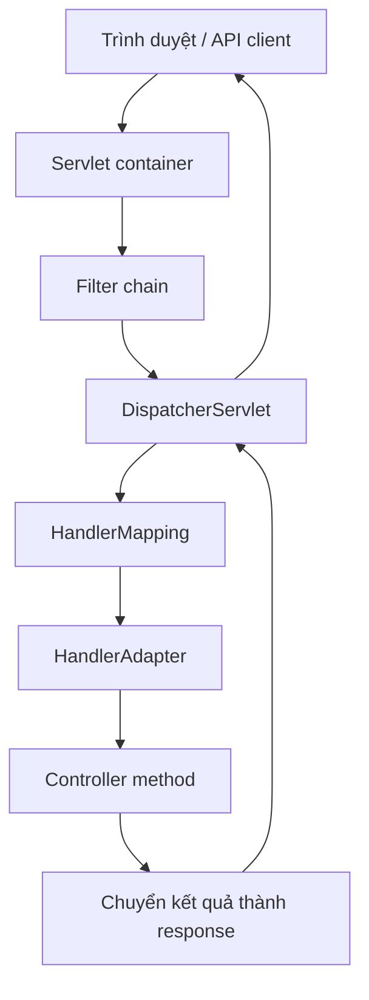
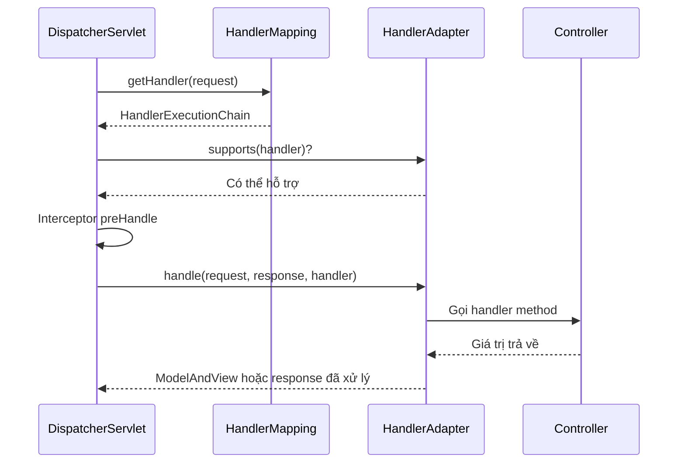
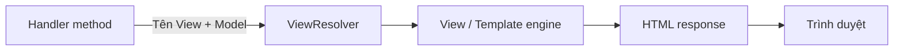
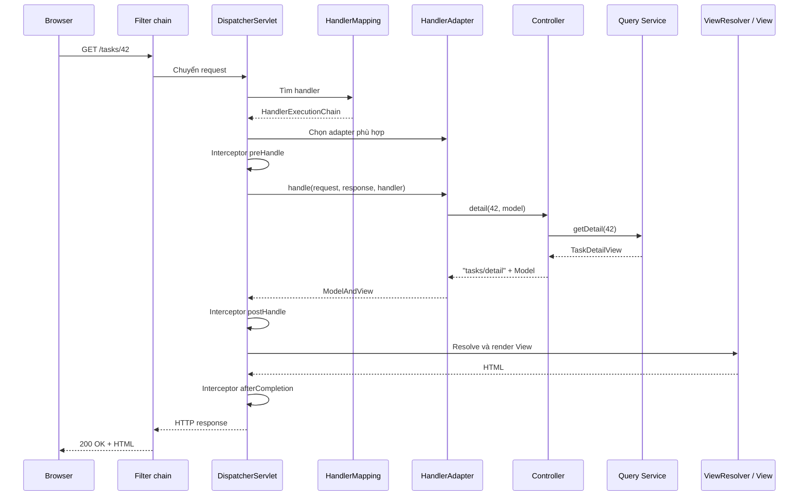

# Bộ điều phối, bộ ánh xạ xử lý và cơ chế gọi hành động

Khi trình duyệt gửi request đến một ứng dụng web MVC, request không tự tìm và gọi một phương thức Controller. Framework cần có một thành phần tiếp nhận request, xác định handler phù hợp, chuẩn bị tham số, gọi handler và chuyển kết quả thành response HTTP. Trong Spring MVC, các vai trò này được phối hợp bởi **DispatcherServlet**, **HandlerMapping**, **HandlerAdapter** cùng những thành phần xử lý dữ liệu và phản hồi.

Nắm được chuỗi điều phối giúp ta hiểu một URL đi đến phương thức nào, vì sao một tham số được lấy từ path hoặc request body, tại sao một giá trị trả về lại trở thành HTML hay JSON, và lỗi được xử lý ở đâu. Đây cũng là nền tảng để thiết kế Controller gọn, định tuyến rõ ràng và kiểm thử đúng ranh giới trong ứng dụng Model–View–Controller (MVC).

Bài học dùng Spring MVC làm ví dụ cụ thể. Các khái niệm **Front Controller**, ánh xạ request, gọi handler và chuyển đổi response cũng xuất hiện trong nhiều framework web khác, dù tên lớp và chi tiết triển khai có thể khác nhau.

## 1. Từ request HTTP đến hành động của Controller

Giả sử người dùng mở trang chi tiết công việc bằng địa chỉ `GET /tasks/42`. Ứng dụng cần tìm handler hiển thị công việc có mã `42`, lấy dữ liệu, rồi trả HTML. Nếu người dùng gửi `POST /tasks/42/complete`, ứng dụng cần tìm handler thực hiện hành động hoàn thành công việc, kiểm tra đầu vào và quyền, gọi nghiệp vụ, rồi trả redirect hoặc response API.

Một ứng dụng web MVC thường phải giải quyết các câu hỏi sau:

- Thành phần nào nhận mọi request HTTP đi vào ứng dụng?
- Tổ hợp method, URL, header và điều kiện nào xác định handler?
- Handler nào có khả năng gọi loại đối tượng được ánh xạ?
- Các tham số như `id`, form object, JSON body hoặc danh tính người dùng được tạo ra như thế nào?
- Giá trị trả về là tên View, redirect hay nội dung response?
- Nếu không tìm thấy handler hoặc handler ném exception thì ai xử lý?

Spring MVC tách những nhiệm vụ này thành các thành phần có hợp đồng riêng. Controller chỉ cần khai báo route và phương thức xử lý; framework thực hiện phần lớn công việc điều phối xung quanh phương thức đó.

## 2. Front Controller và DispatcherServlet

**Front Controller** là mẫu thiết kế trong đó nhiều request đi qua một điểm tiếp nhận chung. Thành phần trung tâm có thể áp dụng các cơ chế dùng chung như điều phối, chuyển đổi dữ liệu, xử lý lỗi và lựa chọn response trước khi chuyển request đến handler chuyên biệt.

Trong Spring MVC, `DispatcherServlet` là Front Controller. Nó là một Servlet được đăng ký trong Servlet container như Tomcat. Khi request phù hợp đi vào ứng dụng, container chuyển request đến `DispatcherServlet`, rồi servlet này phối hợp với các thành phần MVC để xử lý.



Một số trách nhiệm quan trọng của `DispatcherServlet`:

- Nhận request đã đi qua Servlet filter chain.
- Yêu cầu `HandlerMapping` tìm handler phù hợp.
- Chọn `HandlerAdapter` có thể gọi handler đó.
- Phối hợp các `HandlerInterceptor` trong vòng đời xử lý.
- Chuyển exception qua các `HandlerExceptionResolver` phù hợp.
- Hoàn tất phản hồi bằng cách kết xuất View hoặc ghi body HTTP.

Trong ứng dụng Spring Boot thông thường, framework tự cấu hình và đăng ký `DispatcherServlet`. Ta hiếm khi cần tự tạo servlet này. Khi xây dựng Controller, chỉ cần khai báo annotation và các dependency cần thiết; cơ chế điều phối được cấu hình bởi Spring MVC.

## 3. HandlerMapping: tìm handler phù hợp với request

`HandlerMapping` chịu trách nhiệm ánh xạ request đến handler. Với Controller dùng annotation như `@Controller` và `@RequestMapping`, lớp triển khai thường gặp là `RequestMappingHandlerMapping`.

Handler mapping xem xét những điều kiện được khai báo trên phương thức hoặc lớp Controller, ví dụ:

- Path: `/tasks/{id}`.
- HTTP method: `GET`, `POST`, `PUT`, `PATCH`, `DELETE`.
- Query parameter hoặc điều kiện parameter.
- Header của request.
- Media type được gửi lên qua `Content-Type` (`consumes`).
- Media type mà handler có thể trả về (`produces`).

Ví dụ:

```java
@Controller
@RequestMapping("/tasks")
public class TaskPageController {

    @GetMapping("/{id}")
    public String detail(@PathVariable long id, Model model) {
        // Lấy dữ liệu và chuẩn bị ViewModel.
        return "tasks/detail";
    }

    @PostMapping("/{id}/complete")
    public String complete(@PathVariable long id) {
        // Gọi ca sử dụng hoàn thành công việc.
        return "redirect:/tasks/" + id;
    }
}
```

`@RequestMapping("/tasks")` đặt tiền tố ở cấp lớp. `@GetMapping` và `@PostMapping` ràng buộc method và phần path ở cấp phương thức. Khi request là `GET /tasks/42`, mapping chọn `detail`; khi request là `POST /tasks/42/complete` với media type phù hợp, mapping chọn `complete`.

Với kiểu Controller annotation, kết quả ánh xạ thường là một `HandlerMethod`, chứa thông tin về bean Controller và phương thức sẽ được gọi. `HandlerMapping` còn có thể trả về `HandlerExecutionChain`, bao gồm handler cùng danh sách interceptor áp dụng cho request.

### Nếu không tìm thấy hoặc có nhiều handler phù hợp

Ánh xạ request cần rõ ràng. Một số trường hợp thường gặp:

| Tình huống | Kết quả thường thấy |
|---|---|
| Không có handler phù hợp với path | `404 Not Found` |
| Path tồn tại nhưng không hỗ trợ HTTP method được gửi | `405 Method Not Allowed` |
| Handler có điều kiện `consumes` nhưng request gửi media type khác | `415 Unsupported Media Type` |
| Handler chỉ `produces` một kiểu mà client không chấp nhận | `406 Not Acceptable` |
| Nhiều mapping cùng phù hợp và không thể chọn duy nhất | Lỗi ánh xạ mơ hồ, thường là `IllegalStateException` trong cấu hình annotation |

Thông báo và status chính xác có thể chịu ảnh hưởng bởi cấu hình framework và exception resolver. Khi thiết kế route, tránh khai báo các phương thức có cùng điều kiện khiến framework không thể xác định handler duy nhất.

## 4. HandlerAdapter: gọi handler theo cách phù hợp

`HandlerMapping` tìm được handler nhưng không trực tiếp gọi mọi loại handler. Trong Spring MVC, `HandlerAdapter` cung cấp cơ chế gọi handler. `DispatcherServlet` chọn adapter có thể hỗ trợ handler được tìm thấy, rồi yêu cầu adapter thực thi.

Với Controller annotation, adapter thường dùng là `RequestMappingHandlerAdapter`. Adapter này biết cách gọi `HandlerMethod`, giải quyết tham số, áp dụng data binding và validation, rồi xử lý giá trị trả về.

Sự phân tách có ý nghĩa:

- `HandlerMapping` trả lời: **request này thuộc handler nào?**
- `HandlerAdapter` trả lời: **gọi handler đó như thế nào?**
- Handler/Controller method trả lời: **ứng dụng cần thực hiện hành động gì?**

Nhờ có adapter, `DispatcherServlet` không cần biết chi tiết cách gọi từng kiểu handler. Các loại handler khác nhau có thể được hỗ trợ thông qua adapter tương ứng.



Đây là sơ đồ khái quát. Trong triển khai annotation, adapter còn phối hợp nhiều resolver và processor để biến dữ liệu HTTP thành tham số Java, rồi diễn giải giá trị trả về.

## 5. Cơ chế phân giải tham số của handler

Một phương thức Controller có thể nhận nhiều loại tham số:

```java
@PostMapping("/{id}/assign")
public String assign(
        @PathVariable long id,
        @RequestParam long userId,
        @Valid @ModelAttribute("form") AssignTaskForm form,
        BindingResult bindingResult,
        Principal principal) {
    // Xử lý yêu cầu phân công.
    return "redirect:/tasks/" + id;
}
```

Framework không truyền nguyên request vào từng tham số. `RequestMappingHandlerAdapter` sử dụng các `HandlerMethodArgumentResolver` để xác định cách tạo giá trị cho từng tham số.

| Tham số | Nguồn dữ liệu hoặc cách giải quyết |
|---|---|
| `@PathVariable long id` | Đoạn path được đặt tên trong route, ví dụ `/{id}` |
| `@RequestParam long userId` | Query parameter hoặc form parameter có tên `userId` |
| `@ModelAttribute AssignTaskForm` | Data binding từ các request parameter vào form object |
| `@RequestBody CreateTaskRequest` | Đọc request body và chuyển đổi từ JSON/XML bằng `HttpMessageConverter` phù hợp |
| `Principal` | Danh tính đã được cơ chế xác thực cung cấp cho request |
| `BindingResult` | Kết quả binding và validation của đối tượng đứng ngay trước nó |
| `Model` | Vùng chứa thuộc tính được chuyển sang View trong Spring MVC |

Một số annotation và kiểu tham số được xử lý bởi resolver chuyên biệt. Resolver có thể đọc path variable, request parameter, header, cookie, session attribute, principal hoặc các đối tượng đặc biệt của Spring MVC.

### Data binding, conversion và validation

Với `@ModelAttribute`, Spring MVC dùng cơ chế data binding để gán dữ liệu request vào thuộc tính của form object. `ConversionService` và các converter giúp chuyển kiểu, chẳng hạn chuỗi `42` thành `Long`, hoặc chuỗi ngày thành kiểu ngày tương ứng. `WebDataBinder` có thể áp dụng validator để kiểm tra dữ liệu.

Ví dụ:

```java
public class CreateTaskForm {
    @NotBlank
    @Size(max = 200)
    private String title;

    @Size(max = 1000)
    private String description;

    // Getter và setter.
}
```

Controller nhận form và lỗi validation:

```java
@PostMapping
public String create(
        @Valid @ModelAttribute("form") CreateTaskForm form,
        BindingResult bindingResult,
        RedirectAttributes redirectAttributes) {

    if (bindingResult.hasErrors()) {
        return "tasks/form";
    }

    long id = taskService.create(form);
    redirectAttributes.addFlashAttribute("notice", "Đã tạo công việc.");
    return "redirect:/tasks/" + id;
}
```

`BindingResult` phải đứng ngay sau tham số được bind và validate để nhận lỗi tương ứng. Khi có lỗi, handler có thể trả lại template cùng dữ liệu đã nhập. Khi hợp lệ, Controller gọi Service và chọn phản hồi sau thao tác.

Với dữ liệu từ client, chỉ nên bind vào form object hoặc request DTO có các trường được phép nhận. Không bind toàn bộ request vào entity có các thuộc tính nội bộ như `ownerId`, `role` hoặc quyền quản trị. Việc bind và validation không thay thế kiểm tra quyền hoặc quy tắc nghiệp vụ.

## 6. Cơ chế gọi hành động: từ HandlerMethod đến ca sử dụng

Trong Spring MVC, phương thức được ánh xạ là điểm vào của hành động ở lớp giao tiếp web. Phương thức này thường được gọi là **handler method** hoặc action trong cách gọi chung của một số framework.

Một handler method nên tập trung vào các bước:

1. Nhận các tham số đã được framework phân giải.
2. Xác định danh tính người gọi và dữ liệu cần thiết cho ca sử dụng.
3. Gọi Application Service hoặc command/query service.
4. Chuyển kết quả thành dữ liệu trình bày hoặc response DTO.
5. Trả kiểu kết quả phù hợp với client.

Ví dụ trang HTML:

```java
@Controller
@RequestMapping("/tasks")
public class TaskPageController {
    private final TaskQueryService taskQueryService;

    public TaskPageController(TaskQueryService taskQueryService) {
        this.taskQueryService = taskQueryService;
    }

    @GetMapping("/{id}")
    public String detail(@PathVariable long id, Model model) {
        TaskDetailView view = taskQueryService.getDetail(id);
        model.addAttribute("task", view);
        return "tasks/detail";
    }
}
```

Ví dụ API:

```java
@RestController
@RequestMapping("/api/tasks")
public class TaskApiController {
    private final TaskQueryService taskQueryService;

    public TaskApiController(TaskQueryService taskQueryService) {
        this.taskQueryService = taskQueryService;
    }

    @GetMapping("/{id}")
    public ResponseEntity<TaskResponse> detail(@PathVariable long id) {
        TaskResponse response = taskQueryService.getResponse(id);
        return ResponseEntity.ok(response);
    }
}
```

Hai handler có thể dùng chung nghiệp vụ hoặc query service, nhưng trả kết quả theo hai hợp đồng khác nhau. Handler HTML trả tên template và Model; handler API trả `ResponseEntity` với body DTO.

Controller không nên tự thực hiện mọi việc như truy vấn SQL, kiểm tra tất cả quy tắc, thay đổi nhiều entity và tạo HTML. Những công việc đó thuộc Service, Model, Repository hoặc View tương ứng. Việc tách rõ giúp cùng một ca sử dụng có thể được gọi từ web, API hoặc tác vụ nền.

## 7. Cơ chế xử lý giá trị trả về

Sau khi handler method chạy xong, framework cần diễn giải giá trị trả về. Trong `RequestMappingHandlerAdapter`, các `HandlerMethodReturnValueHandler` xử lý những kiểu kết quả khác nhau.

| Giá trị trả về | Ý nghĩa thường gặp |
|---|---|
| `String` trong `@Controller` | Tên logic của View hoặc chuỗi điều hướng như `redirect:` / `forward:` |
| `ModelAndView` | Kết hợp tên View và dữ liệu Model |
| `Model` hoặc `Map` | Thuộc tính được đưa vào Model để kết xuất View, tùy chữ ký handler |
| `@ResponseBody` | Ghi giá trị trả về vào response body thông qua message converter |
| `ResponseEntity<T>` | Chỉ định status, header và body của response |
| `void` | Cách xử lý phụ thuộc chữ ký handler, response đã được ghi hay request có liên quan đến một View mặc định |

Một điểm dễ nhầm: `String` trong Controller thông thường có thể là tên template, còn `String` trong `@RestController` thường là nội dung body response. Ngữ nghĩa phụ thuộc vào annotation và cơ chế xử lý giá trị trả về, không chỉ phụ thuộc kiểu Java.

### ViewResolver và quá trình kết xuất HTML

Khi handler trả tên View như `tasks/detail`, Spring MVC dùng `ViewResolver` để tìm đối tượng `View` phù hợp. View sau đó kết xuất HTML dựa trên Model và ghi nội dung vào response.



Ví dụ với Thymeleaf, tên `tasks/detail` thường được kết hợp với prefix và suffix cấu hình để tìm template tương ứng trong thư mục template. Controller không cần tự đọc file HTML hoặc nối chuỗi markup.

### HttpMessageConverter và response body

Khi handler dùng `@ResponseBody`, `@RestController` hoặc trả `ResponseEntity` có body, Spring MVC thường dùng `HttpMessageConverter` để chuyển đổi đối tượng Java thành nội dung response. Converter được chọn dựa trên kiểu dữ liệu và media type có thể ghi.

Ví dụ, Jackson converter có thể chuyển `TaskResponse` thành JSON:

```java
@GetMapping(value = "/{id}", produces = MediaType.APPLICATION_JSON_VALUE)
public TaskResponse detail(@PathVariable long id) {
    return taskQueryService.getResponse(id);
}
```

Nếu client yêu cầu JSON qua `Accept: application/json`, mapping và content negotiation phải tìm được handler/representation tương thích. Nếu không có kiểu response được hỗ trợ, ứng dụng có thể trả `406 Not Acceptable`. Nếu request body có media type không được hỗ trợ, có thể nhận `415 Unsupported Media Type`.

### Redirect và response HTTP

Với `redirect:/tasks/42`, framework tạo phản hồi redirect và header `Location`. Với `ResponseEntity`, Controller có thể chủ động chọn status và header:

```java
@PostMapping
public ResponseEntity<TaskResponse> create(
        @Valid @RequestBody CreateTaskRequest request) {

    TaskResponse created = taskCommandService.create(request);
    URI location = URI.create("/api/tasks/" + created.id());
    return ResponseEntity.created(location).body(created);
}
```

Kết quả là `201 Created`, header `Location` và JSON body. Việc tạo body được message converter thực hiện; handler không cần tự serialize JSON.

## 8. HandlerInterceptor trong vòng đời xử lý

`HandlerInterceptor` cho phép thực hiện logic trước và sau khi handler chạy. `HandlerMapping` có thể gắn interceptor vào `HandlerExecutionChain` để `DispatcherServlet` gọi theo đúng thứ tự.

Ba callback thường gặp:

- `preHandle`: chạy trước khi handler được gọi; có thể cho request tiếp tục hoặc dừng chuỗi.
- `postHandle`: chạy sau khi handler hoàn tất nhưng trước khi View được render.
- `afterCompletion`: chạy sau khi request được xử lý xong và View đã render, kể cả khi có exception được xử lý theo luồng tương ứng.

Ví dụ interceptor ghi nhận thời gian xử lý:

```java
public class RequestTimingInterceptor implements HandlerInterceptor {
    private static final String START_TIME = "requestStartTime";

    @Override
    public boolean preHandle(
            HttpServletRequest request,
            HttpServletResponse response,
            Object handler) {

        request.setAttribute(START_TIME, System.nanoTime());
        return true;
    }

    @Override
    public void afterCompletion(
            HttpServletRequest request,
            HttpServletResponse response,
            Object handler,
            Exception exception) {

        Long start = (Long) request.getAttribute(START_TIME);
        if (start != null) {
            long elapsedNanos = System.nanoTime() - start;
            // Gửi elapsedNanos đến hệ thống metrics/log phù hợp.
        }
    }
}
```

Đăng ký interceptor với `InterceptorRegistry`:

```java
@Configuration
public class WebMvcConfiguration implements WebMvcConfigurer {
    @Override
    public void addInterceptors(InterceptorRegistry registry) {
        registry.addInterceptor(new RequestTimingInterceptor())
                .addPathPatterns("/tasks/**", "/api/tasks/**");
    }
}
```

Interceptor phù hợp cho logic gắn với handler MVC như đo thời gian, bổ sung thuộc tính trình bày hoặc kiểm tra điều kiện giao tiếp chung. Không nên dùng interceptor để thay thế lớp nghiệp vụ hoặc cơ chế bảo mật toàn diện.

## 9. Filter, Interceptor và AOP khác nhau ở đâu?

Ba cơ chế này đều có thể chạy logic bao quanh một hành động, nhưng chúng nằm ở những ranh giới khác nhau.

| Cơ chế | Vị trí | Thường dùng cho |
|---|---|---|
| Servlet Filter | Servlet container, trước hoặc sau Servlet | Encoding, CORS, logging HTTP, security filter chain, xử lý request/response ở mức servlet |
| Spring MVC Interceptor | Bên trong luồng `DispatcherServlet`, gắn với handler | Logic trước/sau handler, metrics theo route, thuộc tính giao diện |
| Spring AOP | Bao quanh lời gọi bean/method thông qua proxy hoặc cơ chế weaving | Transaction, audit, tracing, kiểm soát phương thức ở tầng service |

Một Filter có thể chạy ngay cả khi request không được ánh xạ đến Controller MVC, ví dụ request tài nguyên tĩnh hoặc endpoint khác trong servlet. Interceptor gắn với handler do Spring MVC tìm được. AOP quan tâm lời gọi phương thức bean, không phải toàn bộ request HTTP.

Với Spring Security, cơ chế bảo vệ web chủ yếu được tích hợp qua filter chain. Có thể kết hợp method security ở tầng service để bảo vệ hành động nhạy cảm. Không nên chỉ kiểm tra quyền bằng cách ẩn nút hoặc dựa vào một interceptor tùy chỉnh.

## 10. Xử lý exception trong chuỗi điều phối

Exception có thể phát sinh khi bind tham số, validate, gọi Controller, thực hiện nghiệp vụ hoặc kết xuất View. Spring MVC dùng các `HandlerExceptionResolver` để tìm cách chuyển exception thành response.

Một số cơ chế thường dùng:

- `@ExceptionHandler` trong Controller để xử lý lỗi cục bộ.
- `@ControllerAdvice` hoặc `@RestControllerAdvice` để chia sẻ xử lý lỗi giữa nhiều Controller.
- Các `HandlerExceptionResolver` mặc định của Spring MVC để xử lý một số exception phổ biến như lỗi phương thức, media type hoặc binding.
- Cơ chế error handling ở tầng Servlet container hoặc Spring Boot khi lỗi không được MVC xử lý.

Ví dụ xử lý lỗi API tập trung:

```java
@RestControllerAdvice
public class ApiExceptionHandler {

    @ExceptionHandler(TaskNotFoundException.class)
    public ResponseEntity<ProblemDetail> notFound(
            TaskNotFoundException exception) {

        ProblemDetail problem = ProblemDetail.forStatusAndDetail(
                HttpStatus.NOT_FOUND,
                "Không tìm thấy công việc được yêu cầu.");
        problem.setTitle("Không tìm thấy tài nguyên");
        return ResponseEntity.status(HttpStatus.NOT_FOUND).body(problem);
    }
}
```

Với ứng dụng HTML, advice có thể trả tên template lỗi và dữ liệu hiển thị. Với API, nên trả cấu trúc lỗi ổn định và status phù hợp. Không trả stack trace, câu SQL, token hoặc chi tiết cấu hình nội bộ cho client.

Không phải mọi lỗi đều đi qua `HandlerExceptionResolver`. Lỗi xảy ra trước khi `DispatcherServlet` nhận request, lỗi trong filter hoặc lỗi sau khi response đã được commit có thể cần xử lý ở tầng tương ứng. Khi chẩn đoán, cần xác định lỗi xảy ra ở giai đoạn nào.

## 11. Request bất đồng bộ và tài nguyên tĩnh

### Xử lý bất đồng bộ

Với một số handler trả `Callable`, `DeferredResult` hoặc `CompletionStage`/`CompletableFuture` theo kiểu được Spring hỗ trợ, Spring MVC có thể khởi động Servlet async processing để request không phải giữ nguyên một thread xử lý trong suốt thời gian chờ. Khi kết quả sẵn sàng, request được dispatch lại để hoàn tất response.

```java
@GetMapping("/reports/{id}")
public CompletableFuture<ResponseEntity<ReportResponse>> report(
        @PathVariable long id) {

    return reportService.generateAsync(id)
            .thenApply(ResponseEntity::ok);
}
```

Đoạn mã minh họa một handler trả kết quả bất đồng bộ; khả năng chạy thực tế phụ thuộc cấu hình async, executor, timeout và cách service triển khai. Bất đồng bộ ở tầng MVC không tự biến một tác vụ blocking thành non-blocking. Cần kiểm soát executor, timeout, lỗi và cancellation phù hợp.

### Tài nguyên tĩnh

Không phải request nào cũng đi đến một Controller method. Spring MVC có thể ánh xạ tài nguyên tĩnh thông qua `ResourceHttpRequestHandler`, chẳng hạn CSS, JavaScript, ảnh hoặc font. `HandlerMapping` vẫn tham gia chọn handler, còn adapter phù hợp gọi handler phục vụ tài nguyên.

Điều này giải thích vì sao sơ đồ tổng quát của MVC có thể có handler không phải `@Controller`. `DispatcherServlet` điều phối các loại handler mà các `HandlerMapping` và `HandlerAdapter` được cấu hình hỗ trợ.

## 12. Theo dấu một request từ đầu đến cuối

Xét request `GET /tasks/42` trong ứng dụng Spring MVC dùng Thymeleaf:

1. Trình duyệt gửi request đến máy chủ.
2. Servlet container tiếp nhận request và chạy Filter chain, có thể gồm encoding, logging và Spring Security.
3. Request đến `DispatcherServlet`.
4. `DispatcherServlet` hỏi các `HandlerMapping` theo thứ tự để tìm handler phù hợp.
5. `RequestMappingHandlerMapping` tìm thấy phương thức `detail` của `TaskPageController` và tạo `HandlerExecutionChain`.
6. `DispatcherServlet` chọn `RequestMappingHandlerAdapter` có thể hỗ trợ handler.
7. Các interceptor trong chain chạy `preHandle`; nếu tất cả cho phép tiếp tục, adapter mới gọi handler.
8. Argument resolver lấy `id` từ path, chuyển thành `long` và cung cấp `Model` cho phương thức.
9. Handler gọi query service, đưa `TaskDetailView` vào Model và trả tên View `tasks/detail`.
10. Return value handler diễn giải chuỗi là tên View; `ViewResolver` tìm template tương ứng.
11. Interceptor chạy `postHandle` trước khi View render; sau đó template engine kết xuất HTML.
12. Interceptor chạy `afterCompletion`; response được hoàn tất và trả qua Servlet container về trình duyệt.



Đây là luồng khái quát cho request đồng bộ kết xuất HTML. API trả JSON sẽ đi qua cơ chế `HttpMessageConverter` thay cho `ViewResolver` và template engine.

## 13. Kiểm thử route, handler và response

Có thể kiểm thử luồng điều phối ở nhiều mức mà không cần tự kiểm thử nội bộ của `DispatcherServlet`.

### Kiểm thử bằng MockMvc

`MockMvc` mô phỏng request và response của Spring MVC, giúp xác nhận route, tham số, status, header, View và body.

```java
@WebMvcTest(TaskPageController.class)
class TaskPageControllerTest {
    @Autowired
    private MockMvc mockMvc;

    @MockBean
    private TaskQueryService taskQueryService;

    @Test
    void mapsTaskDetailRequestToControllerAndView() throws Exception {
        given(taskQueryService.getDetail(42L))
                .willReturn(new TaskDetailView(42L, "Viết tài liệu"));

        mockMvc.perform(get("/tasks/42"))
                .andExpect(status().isOk())
                .andExpect(view().name("tasks/detail"))
                .andExpect(model().attributeExists("task"));
    }
}
```

Ví dụ giả định `TaskDetailView` có constructor tương ứng và test slice đã được cấu hình theo phiên bản Spring Boot đang dùng. Tùy phiên bản, annotation mock có thể là `@MockBean` hoặc API thay thế tương ứng.

### Những trường hợp nên kiểm tra

- Route đúng method và path được ánh xạ đến đúng handler.
- Path variable và request parameter được bind đúng kiểu.
- Request body được chuyển đổi đúng theo `Content-Type`.
- Validation lỗi trả lại form hoặc lỗi API theo hợp đồng.
- `Accept` và `produces` dẫn đến representation phù hợp.
- Handler trả đúng View, redirect, status, header và body.
- Exception nghiệp vụ được ánh xạ thành response phù hợp.
- Interceptor chỉ chạy trên các path đã cấu hình và không làm thay đổi kết quả ngoài ý muốn.

Unit test cho Service vẫn cần xác nhận quy tắc nghiệp vụ; `MockMvc` tập trung vào ranh giới MVC và HTTP. Kiểm thử end-to-end có thể xác nhận template, tài nguyên tĩnh, bảo mật và tương tác trình duyệt phối hợp trong ứng dụng đã chạy.

## 14. Lỗi cấu hình thường gặp và cách chẩn đoán

| Triệu chứng | Nguyên nhân có thể | Nơi cần kiểm tra |
|---|---|---|
| Endpoint trả `404` | Sai path, Controller chưa được component scan, không có mapping | Package scan, `@RequestMapping`, log mapping khi ứng dụng khởi động |
| Endpoint trả `405` | Đúng path nhưng sai HTTP method | `@GetMapping`, `@PostMapping` và method client gửi |
| Không bind được path variable | Tên biến hoặc kiểu dữ liệu không khớp | Placeholder trong route, `@PathVariable`, converter |
| Request body không đọc được | `Content-Type` không phù hợp hoặc không có converter | Header, DTO, Jackson/message converter và cấu hình MVC |
| Trả `406` | Không có representation phù hợp với `Accept` | `produces`, content negotiation và converter có thể ghi |
| Trả `415` | Request gửi media type không được handler chấp nhận | `consumes`, `Content-Type` và converter có thể đọc |
| Controller trả chuỗi nhưng trình duyệt nhận chuỗi thô | Handler dùng `@ResponseBody` hoặc `@RestController` | Annotation trên lớp/phương thức và return value handler |
| Không tìm thấy template | Tên View hoặc cấu hình ViewResolver sai | Giá trị trả về, prefix/suffix, vị trí template |
| Interceptor không chạy | Path pattern không khớp hoặc request không qua handler MVC tương ứng | Cấu hình `InterceptorRegistry`, HandlerMapping và loại request |
| Lỗi xuất hiện trước khi vào Controller | Filter, security chain, binding hoặc routing | Log theo từng giai đoạn, status và exception gốc |

Khi chẩn đoán, nên lần theo request theo thứ tự: request có đến servlet không, mapping có tìm thấy handler không, adapter có gọi được handler không, tham số có được bind không, nghiệp vụ có hoàn tất không và response được xử lý bằng View hay message converter. Cách này giúp xác định lỗi ở đúng ranh giới.

## 15. Nguyên tắc thiết kế luồng điều phối dễ bảo trì

**Khai báo route rõ ràng.** Dùng path và HTTP method phản ánh hành động. Tránh mapping quá rộng hoặc nhiều handler có điều kiện chồng lấn.

**Giữ handler method mỏng.** Handler nhận dữ liệu, gọi ca sử dụng và chuyển kết quả thành response. Để Service và Model bảo vệ nghiệp vụ.

**Dùng DTO ở ranh giới HTTP.** Request DTO và form object xác định trường client được gửi; response DTO xác định trường được công khai. Không để cấu trúc ORM quyết định hợp đồng HTTP.

**Chọn đúng kiểu phản hồi.** HTML dùng View/redirect; API dùng status, header và response body. Không trộn hai hợp đồng trong cùng endpoint nếu không có content negotiation rõ ràng.

**Đặt logic dùng chung ở đúng tầng.** Filter xử lý concern ở tầng Servlet; interceptor xử lý concern gắn với handler MVC; AOP xử lý concern quanh lời gọi bean. Bảo mật cần được triển khai ở filter chain và/hoặc tầng nghiệp vụ theo yêu cầu.

**Chuẩn hóa xử lý lỗi.** Dùng exception có ý nghĩa, advice và error response ổn định. Không biến lỗi thành response thành công giả.

**Kiểm thử theo ranh giới.** Kiểm thử Service cho nghiệp vụ, MockMvc cho route và response, E2E cho hành vi toàn ứng dụng.

## 16. Câu hỏi khi đọc một request trong Spring MVC

Khi lần theo một endpoint, hãy tự trả lời:

1. Request đi qua filter nào trước khi đến `DispatcherServlet`?
2. `HandlerMapping` nào có thể nhận request và điều kiện mapping là gì?
3. Handler được ánh xạ là phương thức Controller nào?
4. `HandlerAdapter` nào hỗ trợ handler đó?
5. Các argument resolver lấy từng tham số từ đâu?
6. Binding và validation diễn ra ở đâu, lỗi được giữ trong đối tượng nào?
7. Handler gọi ca sử dụng nào và trả về kiểu dữ liệu gì?
8. Return value handler chọn View, redirect hay response body?
9. Nếu là View, `ViewResolver` tìm template nào; nếu là body, converter nào ghi dữ liệu?
10. Exception, interceptor và security được xử lý ở giai đoạn nào?

Trong MVC web, `DispatcherServlet` đóng vai trò điều phối trung tâm; `HandlerMapping` tìm handler phù hợp; `HandlerAdapter` gọi handler; các resolver và converter chuẩn bị tham số cũng như chuyển kết quả thành response. Khi hiểu trách nhiệm và thứ tự phối hợp của các thành phần này, ta có thể lần theo đường đi của request, thiết kế Controller có hợp đồng rõ ràng và xử lý lỗi định tuyến hoặc phản hồi một cách có hệ thống.
